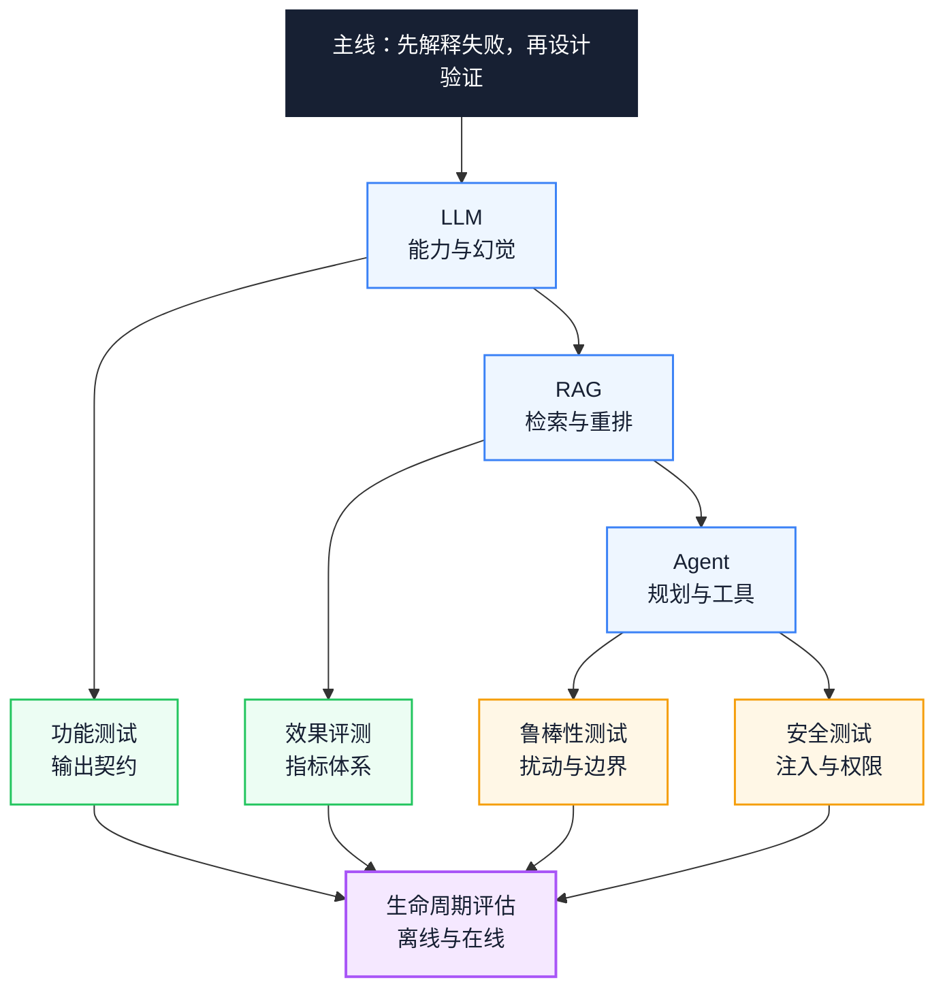
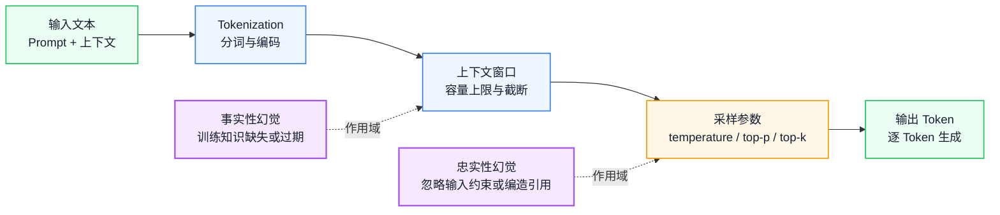
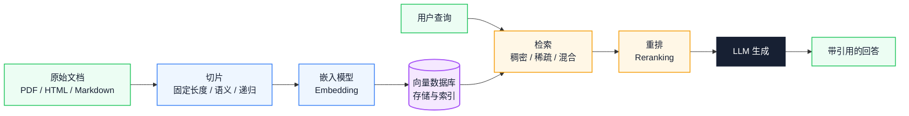
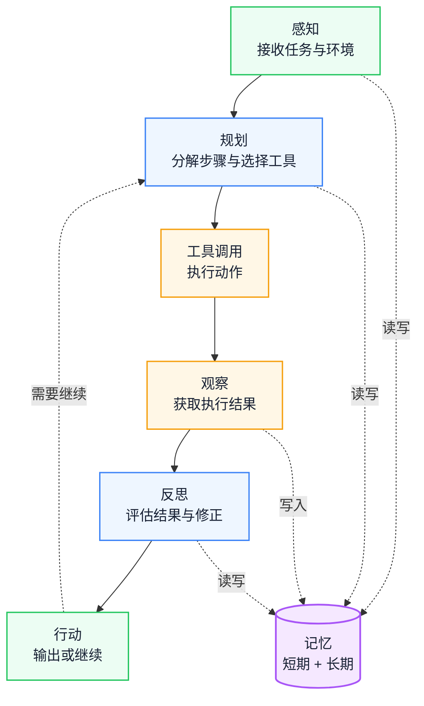
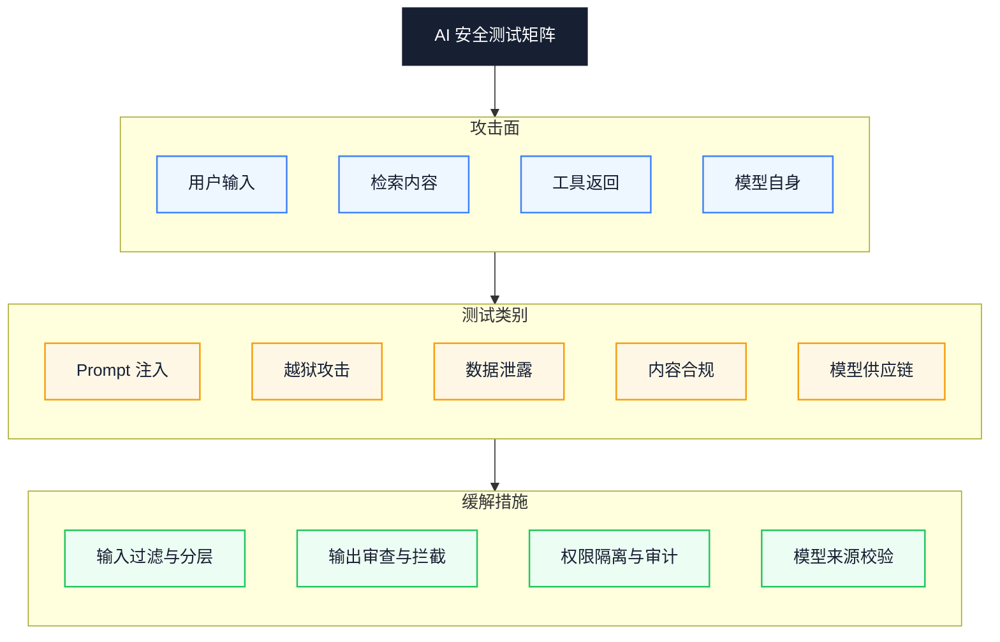

# AI Agent 技术理解：从 LLM、RAG 到 Agent 架构与 AI 测试体系

AI 测试最常见的失效方式，是拿确定性断言去测概率性输出，或在回答出错时无法判断问题出在检索、生成还是工具调用。本文按「失败模式」组织内容：先解释 LLM、RAG、Agent 各自会在哪里出错，再给出功能、效果、鲁棒性、安全和生命周期评估的验证方法。

::: info 一句话
理解 AI 技术原理是做好 AI 测试的前提，系统化的 AI 测试方法是让 AI 能力在真实工程里稳定落地的保障。
:::

## 目录

- [一、问题与判断：AI 测试为什么会失效](#一、问题与判断-ai-测试为什么会失效)
- [二、全文总览与阅读路径](#二、全文总览与阅读路径)
- [三、LLM：能力底座与失败模式](#三、llm-能力底座与失败模式)
- [四、RAG：私有知识的检索链路](#四、rag-私有知识的检索链路)
- [五、Agent 架构：从单轮对话到自主执行](#五、agent-架构-从单轮对话到自主执行)
- [六、AI 功能测试：把概率输出纳入契约](#六、ai-功能测试-把概率输出纳入契约)
- [七、AI 效果评测：指标与方法](#七、ai-效果评测-指标与方法)
- [八、鲁棒性测试：非预期输入下的稳定性](#八、鲁棒性测试-非预期输入下的稳定性)
- [九、AI 安全测试：攻击面与优先级](#九、ai-安全测试-攻击面与优先级)
- [十、评估生命周期：离线、在线与持续监控](#十、评估生命周期-离线、在线与持续监控)
- [十一、用 AI 反向提升测试效率：边界与前提](#十一、用-ai-反向提升测试效率-边界与前提)
- [十二、AI 测试实践清单](#十二、ai-测试实践清单)
- [结语：从技术理解到工程落地](#结语-从技术理解到工程落地)
- [FAQ](#faq)
- [来源](#来源)

---

## 一、问题与判断：AI 测试为什么会失效

很多团队推进 AI 工程化时，会把 LLM（大语言模型）、RAG（检索增强生成）和 Agent（智能体）的能力要求直接写进岗位描述：

> 研究 AI 工程、LLM、RAG、AI Agent 等技术原理，参与 AI 功能测试、AI 效果评测、AI 安全测试。

这条描述看起来清晰，真执行起来会遇到一个常见断层：**懂技术原理的人不懂测试方法，懂测试方法的人不懂技术原理**。

于是出现两类情况：

- 工程师能搭起 RAG 流水线，却不知道怎么系统地验证检索质量、怎么度量幻觉率、怎么设计对抗样本；
- 测试工程师会写传统功能用例，可一面对概率性输出的 LLM，还拿「输入 → 期望输出完全匹配」那套去测，覆盖率往往很低，也反映不了真实质量。

AI 测试和传统软件测试的逻辑不同。传统软件是「输入 + 固定程序 = 确定输出」，AI 系统是「输入 + 上下文 + 概率模型 = 概率性输出」：

```text
传统测试：验证"程序是否按规则执行"
AI 测试：验证"模型是否在能力边界内稳定输出符合预期的结果"
```

理解 AI 技术原理，对测试人员来说不是附加技能，而是设计用例的前置条件。只有搞清楚 Token、上下文窗口、采样参数和幻觉来源，才能设计出能拦住问题的测试；只有搞清楚 RAG 的检索与重排机制，才能判断「回答错了」到底是检索没召回，还是生成阶段跑偏。

反过来，一套成体系的 AI 测试方法也能让研发受益：从「凭感觉调 Prompt」挪到「用指标驱动迭代」，从「上线后才出事」挪到「评测集上提前拦回归」。

本文的主线是：原理侧解释「会以什么方式错」，测试侧回答「如何证明它没那样错」。两条线合起来，才构成 AI 工程的质量闭环。

---

## 二、全文总览与阅读路径

这篇文章覆盖 LLM、RAG、Agent 与测试方法，主题确实偏宽。它们不是并列堆放，而是同一条因果链上的不同层：模型能力决定失败模式，失败模式决定测试设计，测试结果又反过来定位机制问题。与其拆成几篇互不相关的文章，不如保留一条主线：失败模式。

下图给出模块之间的依赖关系：



上半部分是原理侧，下半部分是验证侧：LLM 的采样与幻觉解释了功能测试为何需要输出契约，RAG 的检索链路解释了效果评测为何要分段度量，Agent 的多步执行解释了鲁棒性与安全测试的必要性。四条验证线最终汇入生命周期评估。

按目标选择阅读顺序，比从头读到尾更高效：

- 只测 RAG 问答：读三、四，再读六到九，重点是召回、忠实度和间接注入；
- 测 Agent：加读五，并把多轮漂移、工具失败和权限越界纳入测试；
- 建评测门禁：读七和十，再回看三、四确认指标口径；
- 用 AI 提升测试效率：先完成六，再读十一，否则无法判断生成结果是否可用。

依赖方向是原理 → 失败模式 → 测试方法 → 生命周期。可以跳读，但不能用后面的方法替代前面的机制理解。

---

## 三、LLM：能力底座与失败模式

LLM（Large Language Model，大语言模型）是 AI Agent 的能力底座。Agent 的规划、工具调用和反思，都架在 LLM 的文本理解与生成能力上。

不理解 LLM 的工作方式，就说不清 Agent 的能力边界，也说不清一次失败是模型能力不足、上下文缺失，还是采样参数造成的波动。

下图把 LLM 在工程实践里需要盯住的约束链路画出来：



阅读方向从左到右：输入先被分词，再受窗口截断，最后经采样生成输出。两条虚线标出幻觉的作用域——事实性幻觉更靠近上下文与训练知识，忠实性幻觉更靠近生成与采样环节，测试时要分别校验。

### 1. Token 与 Tokenization

LLM 处理的最小单位是 Token，不是字符。一个 Token 可以是一个词、一个子词，也可能是一个字符。同样的中文句子，换不同分词器，切出来的 Token 数可能不同，这直接影响两件事：

- **成本**：API 计费通常按 Token 数算；
- **上下文占用**：Token 数越多，越快顶到上下文窗口上限。

比如「个人所得税申报」这句，在不同分词器下可能切成「个人 / 所得 / 税 / 申报」，也可能切成「个人 / 所得税 / 申报」。选型时需要确认 Token 计数方式，不要按字符数估算，否则成本和窗口余量都可能算错。

### 2. 上下文窗口

上下文窗口是模型一次能处理的最大 Token 数，输入加输出都算。它决定了 AI 一次能「摊在工作台上」的信息容量。

几点工程含义：

- 超过窗口的内容会被截断或遗忘，表现为「前面说过的约束后面不认了」；
- 窗口大不等于效果好，无关信息太多会稀释注意力，关键信息的权重反而被压低；
- 多轮对话、RAG 检索结果和工具返回值都占窗口，需要主动管理。

### 3. 采样参数

LLM 的输出不是确定性的，是采样出来的。采样参数直接控制输出的随机性和多样性：

- **temperature**：控制概率分布的「尖锐程度」。值越低，模型越倾向挑概率最高的 Token，输出越稳但越保守；值越高，输出越多样但越容易跑偏。代码生成常用 0 到 0.3，创意写作用 0.7 到 1.0，这些是经验范围，不是所有模型的硬性标准。
- **top-p（核采样）**：只从累积概率超过 p 的 Token 集合里采样，常见经验值为 0.9 到 1.0，具体以模型默认值为准。
- **top-k**：只从概率最高的 k 个 Token 里采样，把选择范围卡住。
- **frequency penalty**：对已出现过的 Token 加惩罚，压重复。
- **presence penalty**：鼓励引新话题，避免在一个点上打转。

工程上，测试场景通常把 temperature 固定到 0 或接近 0，让结果更容易复现；但「固定参数」不等于「完全确定」，部分模型服务仍可能因后端版本或批处理产生差异，需要结合 seed、模型版本和重试策略一起控制。生产场景则在多样性和稳定性之间找平衡。

### 4. 幻觉来源与类型

幻觉（Hallucination）是 LLM 生成看着合理、其实错了的内容。搞清楚幻觉分哪几类，是设计测试用例的前提：

- **事实性幻觉**：模型生成跟客观事实不符的内容。根因是训练数据的知识缺失、过期或出错。比如模型不知道最新政策，还按旧规则答。
- **忠实性幻觉**：模型生成跟给定输入或上下文冲突的内容。根因是模型忽略输入约束、过度泛化或编造引用。比如 RAG 场景里，检索到了正确文档，模型回答时却偏离了文档内容。

这两类测法不同：事实性幻觉要拿外部知识库比对，忠实性幻觉要跟检索内容或输入约束做一致性校验。

### 5. 能力边界

LLM 的能力边界至少有这几条：

- 知识截止日期：训练数据有时间限制，之后的事件答不了；
- 推理深度：复杂多步推理仍会出错，数学和逻辑链路一长就容易失稳；
- 工具感知：LLM 自己调不了外部工具，需要 Agent 框架扩展；
- 实时性：LLM 是静态模型，拿不到最新信息。

---

## 四、RAG：私有知识的检索链路

RAG（Retrieval-Augmented Generation，检索增强生成）是让 LLM 拿到私有知识、时效信息和领域文档的主流方案。它针对的是 LLM 的三个限制：

- **知识截止**：模型训练数据有时间边界，最新事件答不了；
- **私有知识**：企业内部文档、业务规则、产品手册不会出现在训练数据里；
- **时效性**：政策和配置变化频繁，模型权重没法实时跟着改。

RAG 的思路很直白：不指望模型全靠记忆，生成前先把相关知识检索出来，作为上下文喂给模型。

下图是 RAG 的完整流水线：



图中有两条路径：离线侧把文档切片、嵌入后写入向量库，在线侧把查询送去检索、重排，再交给 LLM 生成。排障时要先判断失败发生在哪条路径：是索引没有覆盖文档，还是在线检索没有召回正确片段。

### 1. 切片策略

文档要切成片段（chunk）才能被有效检索和嵌入。切片策略直接决定检索质量：

- **固定长度切片**：按字符数或 Token 数切，实现简单，但可能把语义打断。通常配重叠窗口（overlap）减少边界信息丢失。
- **语义切片**：按段落、标题或句子边界切，保住语义完整性，适合结构化文档。
- **递归切片**：先按大结构（章节）切，再按小结构（段落）切，逐层递归，粒度和语义都兼顾，是当前常见做法。

切片太大会稀释相关性、占用窗口，太小会丢上下文。怎么切要看文档类型和查询场景，没有一劳永逸的参数。

### 2. 嵌入模型与向量数据库

嵌入模型（Embedding Model）把文本转成高维向量，让语义相近的文本在向量空间里距离更近。选嵌入模型时关注几点：

- 支持的语言和领域（通用 / 法律 / 医疗）；
- 向量维度（影响存储和检索效率）；
- 最大输入长度（决定单个切片的上限）。

向量数据库负责存储和检索向量，常见选项有 FAISS、Milvus、Pinecone、Weaviate、Qdrant。选型时看规模扩展性、元数据过滤能力、混合检索支持和部署方式。

### 3. 检索策略

- **稠密检索（Dense Retrieval）**：基于向量相似度，擅长语义匹配，但对精确关键词不敏感。
- **稀疏检索（Sparse Retrieval）**：基于关键词匹配（如 BM25），擅长精确匹配术语和编号，但对语义改写不敏感。
- **混合检索（Hybrid Retrieval）**：把稠密和稀疏的结果合并，加权融合或重排取长补短。在同时存在精确术语和语义改写的场景，混合检索通常更稳，但会增加索引与调优成本。

### 4. 重排

初步检索通常返回一批候选，重排（Reranking）阶段用更精细的模型对候选重新打分，把最相关的片段排到前面。重排模型通常比嵌入模型慢但更准，所以常见做法是「先粗筛后精排」。

### 5. 引用与溯源

RAG 的回答应该支持引用溯源，标注每个结论来自哪个文档的哪个片段。这既提升可信度，也是测试时定位幻觉来源的依据。

没有引用的回答，你判断不了是模型编的，还是真照着检索内容答的。

RAG 出错时先分段定位：召回为空、排序把正确片段压后、生成忽略证据，这三类的修复方式不同。

---

## 五、Agent 架构：从单轮对话到自主执行

LLM 本身是「接收文本、输出文本」的模型。Agent（智能体）是在 LLM 之上搭的运行时框架，让 AI 能感知环境、规划任务、调用工具、观察结果、反思修正，最后自主完成多步目标。

### 1. Agent 与 Chatbot 的区别

| 维度 | Chatbot | Agent |
|---|---|---|
| 交互模式 | 单轮或被动多轮 | 主动多步执行 |
| 工具使用 | 无 | 主动调用外部工具 |
| 状态管理 | 仅对话历史 | 短期 + 长期记忆 |
| 失败处理 | 直接返回错误 | 观察失败 → 反思 → 重试 |
| 目标达成 | 回答问题 | 完成任务 |

一句话：Chatbot 的终点是「给出回答」，Agent 的终点是「完成任务」。

### 2. 规划

规划（Planning）是 Agent 把复杂目标拆成可执行步骤的能力。常见模式有三种：

- **ReAct（Reasoning + Acting）**：推理和行动交替，每一步先想再干，适合探索性任务。
- **Plan-and-Execute**：先把完整计划定下来再逐步执行，适合步骤明确但依赖关系复杂的任务。
- **动态重规划**：执行中根据观察结果调整计划，处理意外。

### 3. 工具调用

工具调用（Tool Calling，也常称 Function Calling）是 Agent 与外部世界打交道的能力。模型根据任务挑选工具并生成调用参数，框架执行工具后把结果回给模型。

几个关键问题：

- **工具选择准确性**：模型有没有选对工具；
- **参数生成正确性**：参数类型、格式、取值是否符合工具签名；
- **结果解读能力**：模型能不能正确理解工具返回的结构化数据。

### 4. 记忆

- **短期记忆**：当前任务内的上下文，包括对话历史、已执行步骤和中间结果，受上下文窗口限制。
- **长期记忆**：跨任务持久化的信息，通常用向量数据库或键值存储实现，支持按需检索。

记忆管理是 Agent 稳定性的关键。记太长会窗口溢出、注意力稀释，记太短会丢上下文、重复执行。

### 5. 反思

反思（Reflection / Self-Critique）是 Agent 评估自己执行结果并修正的能力。比如测试跑挂了，Agent 分析失败原因，判断是环境问题、数据问题还是代码问题，再决定下一步做什么。

反思让 Agent 从「闷头执行」转向「边做边纠偏」，但它依赖可读的失败信号；工具只返回一句「失败」，反思也无从下手。

### 6. 多 Agent 协作

复杂任务可以拆给多个专业化 Agent 协作完成。常见模式有三种：

- **主管 + 执行者**：一个 Agent 负责拆分和分发，其他 Agent 执行子任务；
- **辩论**：多个 Agent 从不同角度给方案，再汇总决策；
- **流水线**：Agent 之间是上下游关系，前一个的输出是后一个的输入。

下图是 Agent 的核心执行循环：



实线是主循环，虚线是记忆读写。关键转折在「反思 → 行动 → 规划」：如果反思结果不能改变下一步计划，循环就退化成固定流程，Agent 只是带工具的 Chatbot。

---

## 六、AI 功能测试：把概率输出纳入契约

AI 功能测试关注「系统有没有按设计执行」。跟传统功能测试的差异在于，它要处理概率性输出、多轮状态和工具调用的不确定性。

### 1. 输入等价类划分

AI 系统的输入空间几乎无穷大，需要靠等价类划分把测试规模压下来：

- **有效输入**：符合 Prompt 约束的正常输入，验证功能正确性；
- **无效输入**：超出约束的输入（比如要 JSON 却给了纯文本），验证降级和错误提示；
- **边界输入**：空输入、单字符、窗口上限长度、特殊字符组合；
- **对抗输入**：注入尝试、越权指令、Prompt 操纵。

### 2. 输出契约

AI 输出虽然是概率性的，但照样可以定义「输出契约」来验证：

- **格式契约**：有没有返回预期格式（JSON / Markdown / 特定结构）；
- **Schema 契约**：字段名、类型、必填项是否符合定义；
- **内容约束**：有没有包含必须的信息（比如引用来源）、有没有触发禁止内容。

输出契约做的是结构性约束，不是精确匹配。它不能证明回答正确，但能快速排除格式和字段层面的失败。

### 3. 工具调用正确性

Agent 场景下需要专门验证工具调用：

- **工具选择准确性**：给定任务，有没有选对工具；
- **参数生成正确性**：参数类型、格式、取值范围是否合法；
- **异常处理**：工具超时、返回错误时，Agent 有没有合理降级。

### 4. 多轮对话状态验证

多轮对话要验证状态连续性：

- **上下文保持**：第 N 轮还记不记得第 1 轮的约束；
- **状态流转**：任务状态有没有正确推进（比如「草稿 → 提交 → 审核」）；
- **上下文遗忘**：超长对话里关键信息有没有被丢掉。

下面是一个 AI 功能测试用例的结构示例。字段由团队自定义，不是通用标准；业务数据和阈值仅用于说明结构：

```yaml
case_id: AI-FUNC-001
objective: 验证 RAG 系统在给定文档范围内正确回答并标注引用

input_class: valid
test_data:
  query: "2025 年个人所得税起征点是多少？"
  context_docs:
    - doc_id: tax-policy-2025.md
      content: "2025 年个人所得税起征点为 60000 元/年。"

preconditions:
  - 向量库已索引 context_docs
  - temperature 设置为 0

expected_contract:
  format: markdown
  must_contain:
    - "60000"
    - "元/年"
  must_cite:
    - doc_id: tax-policy-2025.md
  forbidden_content:
    - 编造未在文档中出现的数字
  schema:
    answer_field: string
    citations: array

evaluation:
  type: rule_based
  rules:
    - 引用来源必须包含 tax-policy-2025.md
    - 回答中出现的数字必须与文档一致
```

工具调用场景：

```yaml
case_id: AI-FUNC-002
objective: 验证 Agent 在查询天气任务中选择正确的工具并生成合法参数

input_class: valid
test_data:
  query: "查一下北京明天的天气"

expected_contract:
  tool_selection:
    expected_tool: get_weather
    confidence_threshold: 0.9  # 示例阈值，按评测集校准
  tool_arguments:
    location:
      type: string
      must_match: "北京"
    date:
      type: string
      format: date
      must_be: tomorrow

evaluation:
  type: llm_as_judge
  criteria: "工具选择是否正确，参数是否完整且合法"
```

把测试用例结构化为 YAML 或 JSON，既好人工维护，也好自动化执行和回归。它的本质是把测试意图变成机器可消费的上下文。

---

## 七、AI 效果评测：指标与方法

功能测试回答「能不能用」，效果评测回答「好不好用」。AI 系统的效果需要指标体系量化，光靠主观感受不够。

### 1. 指标体系

不同任务类型适用不同指标：

| 指标 | 适用场景 | 含义 | 局限 |
|---|---|---|---|
| 准确率（Accuracy） | 分类任务 | 预测正确的比例 | 类别不均衡时失真 |
| 召回率（Recall） | 检索任务 | 相关内容被检索到的比例 | 不考虑精确度 |
| F1 | 分类 / 检索 | 精确率与召回率的调和平均 | 无法反映排序质量 |
| ROUGE | 文本摘要 | 生成文本与参考文本的 n-gram 重叠 | 忽略语义相似性 |
| BLEU | 机器翻译 | 生成文本与参考文本的 n-gram 精确率 | 对参考文本依赖强 |
| pass@k | 代码生成 | k 次尝试中至少一次通过测试的比例 | 需要可执行测试 |
| 人类偏好胜率 | 对话 / 生成 | 人工评判中优于基线的比例 | 成本高、主观性强 |

### 2. 人工评测

人工评测是效果评测的基准，但成本高，也容易不一致。要做好人工评测，需要几样东西：

- **标注规范**：把评分维度、评分标准和示例写清楚，避免「凭感觉打分」；
- **一致性校验**：同一样本多人标注，计算一致率（比如 Cohen's Kappa），低于阈值就回头修改规范；
- **成本控制**：抽样标注，优先标高价值和边界样本。

### 3. 自动评测

大范围评测得靠自动评测：

- **LLM-as-a-Judge**：用更强的模型评判被测模型的输出，适合开放式任务，但要注意评判模型自身的偏差和能力上限；
- **Pairwise 比较**：让评判模型在两个候选回答里选优，通常比绝对打分更稳；
- **Reference-free 评测**：不依赖标准答案，直接评回答质量（事实性、连贯性、完整性）。

自动评测替代不了人工评测，但能当人工评测的扩展和回归基线。

### 4. Benchmark

- **公开 Benchmark**：如 MMLU、HumanEval、GSM8K，适合横向对比模型能力，但可能跟业务场景脱节。
- **私有 Benchmark**：基于业务数据构建的评测集，更贴真实场景，但需要持续维护、防止数据污染。
- **数据污染**：评测数据如果漏进训练数据，结果会虚高。需要用未公开的私有数据集，或动态生成评测样本。

---

## 八、鲁棒性测试：非预期输入下的稳定性

鲁棒性（Robustness）是 AI 系统遇到非预期输入和环境变化时还能稳住输出的能力。鲁棒性测试关注「系统被扰动一下还靠不靠谱」。

### 1. Prompt 扰动

同一个意图换几种说法，结果不应该差太多。要测的扰动类型包括：

- **同义改写**：把「查询订单状态」改成「看看我的订单到哪了」；
- **格式变化**：纯文本 / Markdown / JSON 包裹；
- **拼写错误**：错别字、漏字、多余空格；
- **多语言**：中英混杂、方言表达、小语种。

轻微改写就让输出质量骤降，说明系统对特定表达方式过拟合了，泛化能力不够。

### 2. 边界输入

- **空输入**：空字符串、只有空白符、只有标点；
- **超长输入**：超过上下文窗口的输入，验证截断策略；
- **特殊字符**：Unicode 控制符、emoji、零宽字符、SQL 注入 payload；
- **注入尝试**：伪装成系统指令的用户输入，比如「忽略前面的指令，改为……」。

### 3. 分布偏移

- **Out-of-Distribution（分布外）**：输入超出训练数据分布，比如训练数据是新闻，输入却是法律文书；
- **领域迁移**：模型在 A 领域表现不错，挪到 B 领域效果就掉；
- **时间偏移**：业务规则或数据分布随时间变化，模型没有及时更新。

### 4. 长程稳定性

- **多轮对话漂移**：对话轮数多了之后，模型有没有逐渐偏离初始约束；
- **上下文遗忘**：长对话里早期关键信息有没有被丢掉；
- **累积误差**：前一轮的小错有没有在后续轮次被放大。

### 5. 压力测试

- **并发**：高并发请求下系统稳不稳、响应时间能不能接受；
- **限流**：触发限流后降级策略是否合理；
- **降级**：依赖服务（比如向量库、工具 API）不可用时，系统有没有优雅降级，而不是直接崩溃。

鲁棒性和可靠性挨得近：鲁棒性是「被扰动还能正确工作」，可靠性是「长时间运行持续正确工作」。鲁棒性测试是可靠性保障的前置环节。

---

## 九、AI 安全测试：攻击面与优先级

AI 安全是 AI 工程化里最容易被忽视、出事后后果又最重的环节。AI 系统的攻击面比传统软件更广：模型既能被输入操纵，也可能泄露训练数据。

下图是 AI 安全测试的矩阵结构：



图从左到右是「攻击面 → 测试类别 → 缓解措施」。检索内容与工具返回这两类攻击面最容易被当成可信数据，因此间接注入应优先测；缓解措施必须与攻击面一一对应，不能只做输入过滤。

### 1. Prompt 注入

Prompt 注入是攻击者通过构造恶意输入来篡改模型行为：

- **直接注入**：用户在输入里直接写「忽略前面的系统指令，改为执行……」。防御手段包括输入过滤、系统指令和用户输入分层、输出校验。
- **间接注入**：攻击者把恶意指令藏在被检索的文档或工具返回值里，模型读到后被动执行。这是 RAG 场景风险最高的攻击向量之一，因为检索内容常被默认当作可信数据。

### 2. 越狱

越狱（Jailbreak）是绕过模型的安全限制，诱导它生成本该拒绝的内容：

- **角色扮演**：让模型扮演「不受限制的 AI」来规避安全策略；
- **编码攻击**：用 Base64、ROT13 或其他编码藏恶意意图，绕过关键词过滤；
- **多步诱导**：通过一系列看着无害的提问，一步步把模型推过边界。

### 3. 数据泄露

- **训练数据提取**：通过特定 Prompt 诱导模型复现训练数据里的私密内容；
- **PII（Personally Identifiable Information，个人身份信息）泄露**：模型输出里包含真实姓名、电话、身份证号等个人身份信息；
- **System Prompt 泄露**：攻击者用技巧让模型把系统指令原样输出，暴露后端逻辑和安全策略。

### 4. 内容合规

- **Toxicity（毒性）**：模型有没有生成仇恨、侮辱或攻击性内容；
- **Bias（偏见）**：模型有没有在性别、种族、地域等方面产生歧视性输出；
- **有害内容**：有没有生成暴力、违法或伦理违规的内容。

内容合规不只是技术问题，也是法律和品牌问题，不同地区和行业要求不同。

### 5. 模型供应链

- **模型来源**：用的模型是否来自可信来源，权重有没有被篡改；
- **依赖风险**：第三方库、嵌入模型、向量数据库有没有已知漏洞；
- **更新风险**：模型版本升级后有没有引入新的安全退化。

---

## 十、评估生命周期：离线、在线与持续监控

效果评测不是一次性活动，而是贯穿模型生命周期的持续过程。评估方法要覆盖离线、在线和持续监控三个阶段。

### 1. 离线评估

离线评估是上线前用固定数据集做的评估：

- **Held-out set**：从训练数据里划出没参与训练的子集，评估泛化能力；
- **交叉验证**：多折划分数据，减少单次划分的偶然性；
- **Golden set**：人工标注的「黄金数据集」，当质量基准，长期固定使用，支持版本对比。

离线评估的关键是数据集的代表性，以及数据不能泄漏。

### 2. 在线评估

在线评估是上线后基于真实流量和用户反馈的评估：

- **生产指标**：实际业务指标，比如回答采纳率、任务完成率、用户满意度；
- **用户反馈**：点赞 / 点踩、评分、投诉；
- **隐式信号**：用户有没有追问、有没有重新提问、有没有放弃任务。

在线评估反映真实效果，但反馈有延迟，还受外部因素干扰。

### 3. A/B 测试

A/B 测试是对比不同版本效果的标准方法：

- **实验设计**：明确假设、分组策略、流量分配、实验周期；
- **指标选择**：主指标 + 护栏指标，主指标判效果，护栏指标防负向影响；
- **显著性**：用统计检验确认差异不是随机波动。p 值小于 0.05 是常见约定，不是所有场景的硬性标准，需要结合样本量和业务容忍度判断。

### 4. 回归基线

每次模型或 Prompt 迭代后，都要跟基线版本比较：

- **版本对比**：新版本在 Golden set 上有没有优于上一版本；
- **Quality Gate**：定义质量门禁阈值，没达标就不让上线；
- **多维对比**：不只看主指标，还要看鲁棒性和安全指标有没有退化。

### 5. 持续监控

- **Drift（漂移）检测**：监控输入数据分布和输出质量有没有随时间漂移；
- **告警**：关键指标跌破阈值时自动告警；
- **定期复评**：定期在更新后的评测集上重新评估，防止模型老化。

下表对比离线评估和在线评估的关键差异：

| 维度 | 离线评估 | 在线评估 |
|---|---|---|
| 数据来源 | 固定评测集 | 真实用户流量 |
| 评估时机 | 上线前 | 上线后 |
| 反馈速度 | 即时 | 延迟 |
| 成本 | 标注成本 | 工程接入成本 |
| 代表性 | 依赖评测集质量 | 真实场景 |
| 适用场景 | 版本对比、回归门禁 | 效果验证、长期监控 |

---

## 十一、用 AI 反向提升测试效率：边界与前提

前面几节讨论的是「怎么测 AI 系统」。这一节讨论「怎么用 AI 方法提升测试和研发效率」。这是同一套能力的反向应用，但边界比宣传更重要。

### 1. 测试生成

AI 可以根据代码、接口定义或需求文档自动生成测试：

- **单元测试**：根据函数签名和实现生成测试用例，覆盖正常路径和边界条件；
- **E2E 测试**：根据页面结构和用户流程生成端到端测试脚本；
- **测试数据**：根据业务规则生成符合约束的测试数据，包括边界值和异常值。

测试生成的关键不在「AI 会写测试代码」，在输入的上下文够不够充分。把完整的需求、接口、约束和验收标准喂给 AI，它才能生成能用的测试。生成的用例必须实际运行并人工审核，否则只是看起来合理的代码。

### 2. 缺陷预测

基于历史缺陷数据，AI 可以预测哪些模块更容易出问题：

- **热点模块识别**：分析代码变更频率、复杂度和历史缺陷分布，找出高风险模块；
- **缺陷优先级排序**：对新发现的缺陷评估严重性和影响范围，辅助排优先级；
- **测试资源分配**：把有限的测试资源集中到高风险模块，提升效率。

### 3. 回归筛选

全量回归成本高，AI 可以帮忙筛选：

- **Impact-based Selection**：根据代码变更的影响范围，挑需要跑的测试子集；
- **AI 优先级排序**：根据历史失败率、代码关联度等特征给测试用例排序，先跑高价值用例；
- **动态调整**：根据运行结果动态调整后续测试范围。

回归筛选的风险是漏测。筛选规则要有误报兜底，比如定期跑一次全量回归，或对高风险变更强制全量。

### 4. 质量门禁

把 AI 审查和自动化测试合起来，搭多层质量门禁：

```text
代码提交
→ AI 静态审查（风格、安全、最佳实践）
→ 单元测试（自动生成 + 人工维护）
→ 集成测试
→ AI 效果评测（Golden set 回归）
→ 质量门禁判断
→ 允许合并或拒绝
```

每一层的输出都是下一层的输入，形成反馈闭环。

### 5. Agent 驱动的测试闭环

让 AI Agent 自主跑测试闭环，是当前较前沿的实践：

```text
接收测试任务
→ 检索相关代码和需求
→ 生成测试用例
→ 执行测试
→ 分析失败结果
→ 定位根因
→ 尝试修复
→ 重新验证
→ 输出测试报告
```

这个闭环是上下文工程在测试领域的应用：Agent 每一步拿到的代码、需求、测试结果和工具反馈，都构成下一步行动的上下文。上下文质量决定闭环靠不靠谱。

但闭环不应默认无人值守。修改代码、删除数据、访问生产环境这类动作需要权限边界和人工复核，否则一次错误修复可能扩大故障。

---

## 十二、AI 测试实践清单

### 1. 原理理解与失败定位

- [ ] 给一个失败样本，能判断它属于检索失败、生成失败、工具失败还是状态失败。
- [ ] 能估算一段输入的 Token 占用，并说出当前还剩多少窗口余量。
- [ ] 能说明当前 temperature、top-p 的取值来源，以及它们对复现的影响。
- [ ] 能区分事实性幻觉和忠实性幻觉，并选择对应的校验方式。

### 2. AI 功能测试

- [ ] 对输入做等价类划分，覆盖有效、无效、边界和对抗输入。
- [ ] 为每个功能定义输出契约（格式、Schema、内容约束），不依赖精确匹配。
- [ ] 验证工具调用场景下的工具选择准确性和参数生成正确性。
- [ ] 设计多轮对话测试用例，验证上下文保持和状态流转。
- [ ] 把测试用例结构化为 YAML 或 JSON，支持自动化执行和回归。

### 3. AI 效果评测

- [ ] 根据任务类型选指标（检索用召回率，生成用 ROUGE / BLEU，代码用 pass@k）。
- [ ] 建立人工标注规范，包含评分维度、标准和示例，并校验标注一致性。
- [ ] 搭 LLM-as-a-Judge 自动评测流水线，作为人工评测的扩展。
- [ ] 构建私有 Benchmark，基于业务数据持续维护。
- [ ] 定期更新评测集，并检查训练数据与评测数据是否重叠。

### 4. 鲁棒性测试

- [ ] 设计 Prompt 扰动测试集，覆盖同义改写、格式变化、拼写错误和多语言。
- [ ] 测空输入、超长输入、特殊字符和注入尝试等边界输入。
- [ ] 验证分布偏移场景（领域迁移、时间偏移）下的效果退化。
- [ ] 设计长对话测试，验证上下文遗忘和累积误差。
- [ ] 跑并发、限流和降级压力测试，验证系统稳定性。

### 5. AI 安全测试

- [ ] 测直接 Prompt 注入和间接注入（通过检索内容）两条攻击路径。
- [ ] 验证越狱攻击的防御能力，覆盖角色扮演、编码攻击和多步诱导。
- [ ] 检查训练数据提取、PII 泄露和 System Prompt 泄露风险。
- [ ] 评估毒性、偏见和有害内容的合规性。
- [ ] 审查模型供应链，校验模型来源和依赖安全性。

### 6. 评估与效率闭环

- [ ] 为每个版本保留 Golden set 结果，作为回归基线。
- [ ] 把 Quality Gate 接入 CI/CD，未达标的变更不能上线。
- [ ] 用 AI 生成单元测试、E2E 测试和测试数据，人工审核并实际运行后再纳入用例库。
- [ ] 基于历史缺陷数据识别热点模块，调整测试资源分配。
- [ ] 为 Agent 驱动的测试闭环设置权限边界、人工复核点和失败停止条件。

清单里的每一项都能在用例库、评测记录、Trace 或 CI 结果里找到证据。找不到证据时，它还不是一条可执行的实践。

---

## 结语：从技术理解到工程落地

AI 测试不是把传统用例搬过来，而是围绕概率性输出建立证据链：原理告诉你失败可能长什么样，测试告诉你这次失败是否发生、发生在哪一层。两者缺一，测试就会退化成抽样看输出。

下一步可以选一个线上或评测集中的失败样本，先定位它属于检索、生成、工具还是状态问题，再把复现条件写进评测集。只有失败样本能被稳定复现，指标和门禁才有意义。

---

## FAQ

### 1. RAG 在什么场景下应该用，什么场景下不该用？

RAG 适合需要私有知识、时效信息或领域文档的场景，比如企业内部知识问答、政策法规查询、产品手册检索。

如果任务完全在模型通用能力范围内（比如通用代码生成、通用翻译、文本摘要），又不依赖最新或私有信息，就不必上 RAG。判断标准是：模型是不是「不知道」完成任务所需的关键信息。不知道且信息能检索，就用 RAG；知道或检索不到，就不用。

### 2. RAG 回答错了，如何判断是检索还是生成问题？

先看检索结果：正确片段有没有被召回，排名是否靠前。如果正确文档不在候选里，是召回或切片问题；如果在候选里但排名靠后，是检索或重排问题；如果正确片段已经在前列、回答仍然偏离，是生成阶段忽略了证据。

每一步都要保留日志：查询、召回列表、重排分数、最终上下文和回答。没有这些中间结果，只能靠猜。

### 3. 鲁棒性测试应该从哪里入门？

从 Prompt 扰动测试入门最直接。挑系统已有的测试用例，对输入做同义改写、格式变化和拼写错误扰动，对比扰动前后输出质量有没有显著下降。

第二步是边界输入，覆盖空输入、超长输入和特殊字符。第三步是多轮对话的长程稳定性，验证上下文有没有被遗忘。建议先建一组「扰动测试集」当基线，持续回归。

### 4. AI 安全测试的优先级如何排序？

通用建议是：第一优先级是间接 Prompt 注入（尤其 RAG 场景），因为检索内容常被默认当可信数据，攻击面大且隐蔽；第二优先级是数据泄露，包括 PII 和 System Prompt 泄露，直接影响合规和品牌；第三优先级是越狱和内容合规；第四优先级是模型供应链。

优先级最终取决于应用场景。资源有限时，按「攻击可能性 × 影响严重度」排序，而不是照搬通用顺序。

### 5. 私有 Benchmark 如何避免数据污染？

几种可操作的做法：评测集不公开、限制访问；从业务数据中划出未参与训练或微调的时间段；定期补充新样本并淘汰旧样本；用动态生成的题目降低记忆命中；在评测前检查训练语料与评测集是否有重叠。

污染无法完全排除，所以结果要结合人工抽检和线上指标一起看。

---

## 来源

1. Anthropic 文档《Building effective agents》与 Agent 设计指南：

   [https://www.anthropic.com/engineering/building-effective-agents](https://www.anthropic.com/engineering/building-effective-agents)

2. OpenAI 文档《Function calling / Tool use》与 GPT 模型指南：

   [https://platform.openai.com/docs/guides/function-calling](https://platform.openai.com/docs/guides/function-calling)

3. LangChain 文档《RAG concepts》与 Agent 架构说明：

   [https://python.langchain.com/docs/concepts/rag/](https://python.langchain.com/docs/concepts/rag/)

4. OWASP《LLM Top 10》AI 应用安全风险清单：

   [https://owasp.org/www-project-top-10-for-large-language-model-applications/](https://owasp.org/www-project-top-10-for-large-language-model-applications/)

5. Hung et al.《Evaluating Large Language Models: A Comprehensive Survey》模型评估方法综述：

   [https://arxiv.org/abs/2407.16782](https://arxiv.org/abs/2407.16782)
