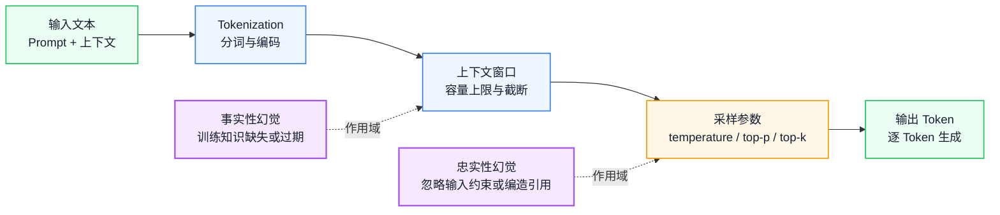
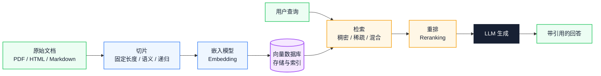
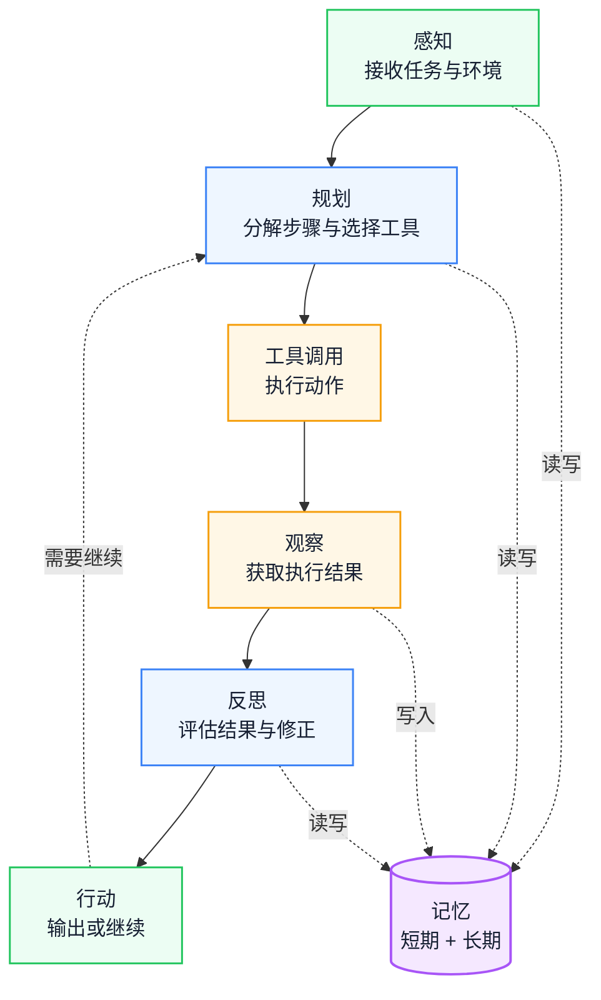
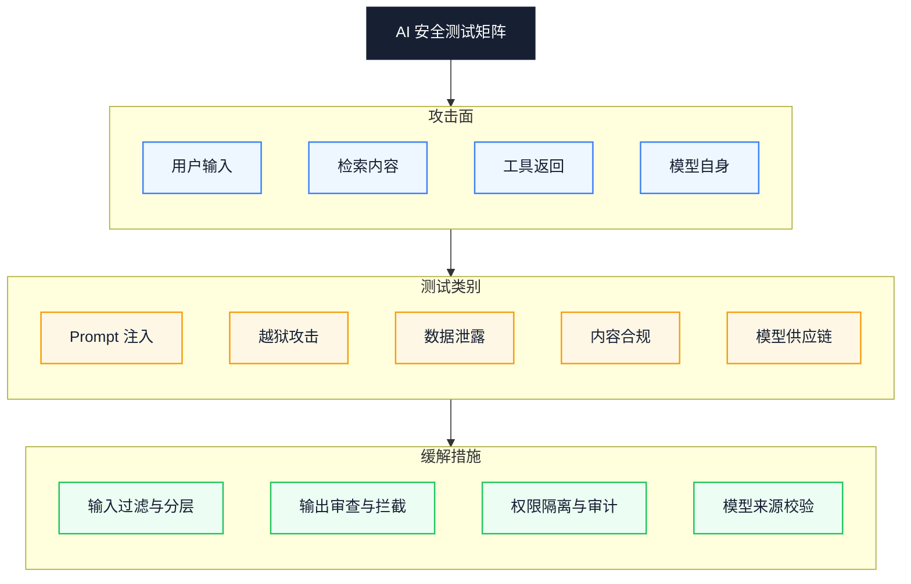

# AI Agent 技术理解：从 LLM、RAG 到 Agent 架构与 AI 测试体系

> 副标题：技术原理与测试方法的双视角
>
> 目标读者：中高级工程师、测试与 QA 负责人、AI 工程化推进者
>
> 阅读时间：约 25 分钟

:::: info 一句话
理解 AI 技术原理是做好 AI 测试的前提，系统化的 AI 测试方法是让 AI 能力在真实工程里稳定落地的保障。
::::

## 目录

- [一、为什么需要系统理解 AI Agent 技术](#一、为什么需要系统理解-ai-agent-技术)
- [二、LLM：AI Agent 的能力底座](#二、llm-ai-agent-的能力底座)
- [三、RAG：让 AI 获得私有知识](#三、rag-让-ai-获得私有知识)
- [四、AI Agent 架构：从单轮对话到自主执行](#四、ai-agent-架构-从单轮对话到自主执行)
- [五、AI 功能测试](#五、ai-功能测试)
- [六、AI 效果评测](#六、ai-效果评测)
- [七、鲁棒性测试](#七、鲁棒性测试)
- [八、AI 安全测试](#八、ai-安全测试)
- [九、AI 模型效果评估方法](#九、ai-模型效果评估方法)
- [十、结合 AI 测试方法提升研发与测试效率](#十、结合-ai-测试方法提升研发与测试效率)
- [十一、AI 测试实践清单](#十一、ai-测试实践清单)
- [结语：从技术理解到工程落地](#结语-从技术理解到工程落地)
- [FAQ](#faq)
- [来源](#来源)

---

## 一、为什么需要系统理解 AI Agent 技术

很多团队推进 AI 工程化时，会直接把能力要求写进岗位描述：

> 研究 AI 工程、LLM、RAG、AI Agent 等技术原理，参与 AI 功能测试、AI 效果评测、AI 安全测试。

这条描述看着清晰，真执行起来就撞上一个老问题：**懂技术原理的人不懂测试方法，懂测试方法的人不懂技术原理**。

于是冒出两类常见情况：

- 工程师能搭起 RAG 流水线，却不知道怎么系统地验证检索质量、怎么度量幻觉率、怎么设计对抗样本；
- 测试工程师会写传统功能用例，可一面对概率性输出的 LLM，还拿"输入 → 期望输出完全匹配"那套去测，覆盖率极低，也反映不了真实质量。

AI 测试跟传统软件测试不是一个路数。传统软件是"输入 + 固定程序 = 确定输出"，AI 系统是"输入 + 上下文 + 概率模型 = 概率性输出"：

```text
传统测试：验证"程序是否按规则执行"
AI 测试：验证"模型是否在能力边界内稳定输出符合预期的结果"
```

所以理解 AI 技术原理，对测试人员来说不是"附加技能"，是做好 AI 测试的前置条件。只有搞清楚 Token、上下文窗口、采样参数、幻觉来源，才能设计出真能拦住问题的测试用例；只有搞清楚 RAG 的检索和重排机制，才能判断"回答错了"到底是检索没召回，还是生成阶段跑偏了。

反过来也一样。一套成体系的 AI 测试方法，能让研发也受益——从"凭感觉调 Prompt"挪到"用指标驱动迭代"，从"上线后才出事"挪到"评测集上提前拦回归"。

本文就顺着"技术原理 → 测试方法 → 效率提升"这条主线，把 LLM、RAG、AI Agent 的核心原理，连同 AI 功能测试、效果评测、鲁棒性测试、安全测试的工程化要点，一次过一遍。

:::: tip 本节核心结论

理解 AI 技术原理是做好 AI 测试的前提，系统化的 AI 测试方法是让 AI 能力在真实工程里稳定落地的保障。这两面得一起抓，缺一面都不行。

::::

:::: warning 常见误区

把 AI 测试等同于"多写几条 Prompt 试一试"。AI 系统的概率性输出决定了它不能用确定性断言去测，得有指标体系、评测集和回归基线。

::::

---

## 二、LLM：AI Agent 的能力底座

LLM（Large Language Model，大语言模型）是 AI Agent 的能力底座。Agent 的规划、工具调用、反思，都架在 LLM 的文本理解和生成能力上。不理解 LLM 怎么工作，就搞不明白 Agent 的能力边界在哪、会怎么挂。

下图把 LLM 在工程实践里需要盯住的约束链路画了出来：



### 1. Token 与 Tokenization

LLM 处理的最小单位是 Token，不是字符。一个 Token 可以是一个词、一个子词，也可能就一个字符。同样的中文句子，换不同分词器，切出来的 Token 数差挺多，这直接影响两件事：

- **成本**：API 计费通常按 Token 数算；
- **上下文占用**：Token 数越多，越快顶到上下文窗口上限。

比如"个人所得税申报"这句，在不同分词器下可能切成"个人 / 所得 / 税 / 申报"，也可能切成"个人 / 所得税 / 申报"。选型时得确认 Token 计数方式，别按字符数估算，不然成本和窗口都可能算飞了。

### 2. 上下文窗口

上下文窗口是模型一次能处理的最大 Token 数，输入加输出都算。它决定了 AI 一次能"摊在工作台上"的信息容量。

几点工程含义：

- 超过窗口的内容会被截断或遗忘，于是"前面说过的约束后面就不认了"；
- 窗口大不等于效果好，无关信息太多会稀释注意力，关键信息权重反被压低；
- 多轮对话、RAG 检索结果、工具调用返回值都占窗口，得主动管。

### 3. 采样参数

LLM 的输出不是确定性的，是采样出来的。采样参数直接控制输出的随机性和多样性：

- **temperature**：控制概率分布的"尖锐程度"。值越低，模型越倾向挑概率最高的 Token，输出越稳但越保守；值越高，输出越花但越容易跑偏。代码生成通常用 0 到 0.3，创意写作用 0.7 到 1.0。
- **top-p（核采样）**：只从累积概率超过 p 的 Token 集合里采样，p 通常设 0.9 到 1.0。
- **top-k**：只从概率最高的 k 个 Token 里采样，把选择范围卡住。
- **frequency penalty**：对已出现过的 Token 加惩罚，压重复。
- **presence penalty**：鼓励引新话题，别在一个点上打转。

工程上，测试场景通常得把 temperature 固定到 0 或接近 0，好让结果能复现；生产场景则在多样性和稳定性之间找平衡。

### 4. 幻觉来源与类型

幻觉（Hallucination）是 LLM 生成看着合理、其实错了的内容。搞清楚幻觉分哪几类，是设计测试用例的前提：

- **事实性幻觉**：模型生成跟客观事实不符的内容。根因是训练数据的知识缺失、过期或出错。比如模型不知道最新政策，还按旧规则答。
- **忠实性幻觉**：模型生成跟给定输入或上下文冲突的内容。根因是模型忽略输入约束、过度泛化或编造引用。比如 RAG 场景里，检索到了正确文档，可模型答的时候偏离了文档内容。

这两类测法不一样：事实性幻觉要拿外部知识库比对，忠实性幻觉要跟检索内容或输入约束做一致性校验。

### 5. 能力边界

LLM 的能力边界至少有这几条：

- 知识截止日期：训练数据有时间限制，之后的事件答不了；
- 推理深度：复杂多步推理仍会出错，数学和逻辑链路一长就容易翻车；
- 工具感知：LLM 自己调不了外部工具，得靠 Agent 框架扩展；
- 实时性：LLM 是静态模型，拿不到最新信息。

:::: tip 本节核心结论

LLM 的工程约束链路是：输入 → 分词 → 上下文窗口 → 采样参数 → 输出。搞懂 Token、上下文窗口、采样参数和幻觉类型，是设计 AI 测试用例、定位失败根因的地基。

::::

:::: warning 常见误区

把幻觉简单归因为"模型不够强"。幻觉有好几种，事实性幻觉和忠实性幻觉的根因和测法都不同，得分开处理。

::::

---

## 三、RAG：让 AI 获得私有知识

RAG（Retrieval-Augmented Generation，检索增强生成）是让 LLM 拿到私有知识、时效信息和领域文档的主流方案。它治的是 LLM 的三个老毛病：

- **知识截止**：模型训练数据有时间边界，最新事件答不了；
- **私有知识**：企业内部文档、业务规则、产品手册不会出现在训练数据里；
- **时效性**：政策和配置变得勤，模型权重没法实时跟着改。

RAG 的思路很直白：别指望模型全靠记忆，生成前先把相关知识检索出来，当作上下文喂给模型。

下图是 RAG 的完整流水线：



### 1. 切片策略

文档得切成片段（chunk）才能被有效检索和嵌入。切片策略直接决定检索质量：

- **固定长度切片**：按字符数或 Token 数切，实现简单，但可能把语义打断。通常配重叠窗口（overlap）减少边界信息丢失。
- **语义切片**：按段落、标题或句子边界切，保住语义完整性，适合结构化文档。
- **递归切片**：先按大结构（章节）切，再按小结构（段落）切，逐层递归。粒度和语义都兼顾，是当前主流。

切片太大会稀释相关性、占窗口，太小会丢上下文。怎么切得看文档类型和查询场景，没有一劳永逸的参数。

### 2. 嵌入模型与向量数据库

嵌入模型（Embedding Model）把文本转成高维向量，让语义相近的文本在向量空间里距离更近。选嵌入模型时盯住几点：

- 支持的语言和领域（通用 / 法律 / 医疗）；
- 向量维度（影响存储和检索效率）；
- 最大输入长度（决定单个切片的上限）。

向量数据库负责存和检索向量，常见选项有 FAISS、Milvus、Pinecone、Weaviate、Qdrant。选型时看：规模扩展性、过滤能力（按元数据筛）、混合检索支持、部署方式。

### 3. 检索策略

- **稠密检索（Dense Retrieval）**：基于向量相似度，擅长语义匹配，但对精确关键词不敏感。
- **稀疏检索（Sparse Retrieval）**：基于关键词匹配（如 BM25），擅长精确匹配术语和编号，但对语义改写不敏感。
- **混合检索（Hybrid Retrieval）**：把稠密和稀疏的结果合起来，加权融合或重排取长补短。生产环境推荐这个。

### 4. 重排

初步检索通常返回一堆候选，重排（Reranking）阶段用更精细的模型对候选重新打分，把最相关的片段排到前面。重排模型比嵌入模型慢但更准，所以一般走"先粗筛后精排"的两阶段。

### 5. 引用与溯源

RAG 的回答应该支持引用溯源，也就是标注每个结论来自哪个文档的哪个片段。这既抬了可信度，也是测试时定位"幻觉来源"的依据。没引用的回答，你判断不了是模型编的，还是真照着检索内容答的。

:::: tip 本节核心结论

RAG 的质量由切片、嵌入、检索、重排四个环节一起决定。任何一个环节拉胯，都会导致"检索不到"或"检索到了但没用上"。测试时分段定位，别只盯最终回答。

::::

:::: info 工程启示

RAG 测试不能只测最终回答，得分别度量检索阶段（召回率、精确率）和生成阶段（忠实度、引用准确率），才能找到质量瓶颈在哪一段。

::::

---

## 四、AI Agent 架构：从单轮对话到自主执行

LLM 本身就是个"接收文本、输出文本"的模型。Agent 是在 LLM 之上搭的运行时框架，让 AI 能感知环境、规划任务、调用工具、观察结果、反思修正，最后自主把多步目标干完。

### 1. Agent vs Chatbot 的区别

| 维度 | Chatbot | Agent |
|---|---|---|
| 交互模式 | 单轮或被动多轮 | 主动多步执行 |
| 工具使用 | 无 | 主动调用外部工具 |
| 状态管理 | 仅对话历史 | 短期 + 长期记忆 |
| 失败处理 | 直接返回错误 | 观察失败 → 反思 → 重试 |
| 目标达成 | 回答问题 | 完成任务 |

一句话：Chatbot 的终点是"给出回答"，Agent 的终点是"完成任务"。

### 2. 规划

规划（Planning）是 Agent 把复杂目标拆成可执行步骤的能力。常见几种模式：

- **ReAct（Reasoning + Acting）**：推理和行动交替来，每一步先想再干，适合探索性任务。
- **Plan-and-Execute**：先把完整计划定下来再逐步执行，适合步骤明确但依赖关系复杂的任务。
- **动态重规划**：执行中根据观察结果调整计划，处理意外。

### 3. 工具调用

工具调用（Function Calling / Tool Use）是 Agent 跟外部世界打交道的能力。模型根据任务挑合适的工具并生成调用参数，框架执行工具后把结果回给模型。

几个关键问题：

- **工具选择准确性**：模型选没选对工具；
- **参数生成正确性**：参数类型、格式、取值符不符合工具签名；
- **结果解读能力**：模型能不能正确理解工具返回的结构化数据。

### 4. 记忆

- **短期记忆**：当前任务内的上下文，包括对话历史、已执行步骤、中间结果。受上下文窗口限制。
- **长期记忆**：跨任务持久化的信息，通常用向量数据库或键值存储实现，支持按需检索。

记忆管理是 Agent 稳定性的命门。记太长会窗口溢出、注意力稀释，记太短会丢上下文、重复执行。

### 5. 反思

反思（Reflection / Self-Critique）是 Agent 评估自己执行结果并修正的能力。比如测试跑挂了，Agent 分析失败原因，判断是环境问题、数据问题还是代码问题，再决定下一步干啥。反思让 Agent 从"闷头执行"挪到"边做边纠偏"。

### 6. 多 Agent 协作

复杂任务可以拆给多个专业化 Agent 协作完成。常见几种模式：

- **主管 + 执行者**：一个 Agent 负责拆分和分发，其他 Agent 执行子任务；
- **辩论**：多个 Agent 从不同角度给方案，再汇总决策；
- **流水线**：Agent 之间上下游关系，前一个的输出是后一个的输入。

下图是 Agent 的核心执行循环：



:::: tip 本节核心结论

Agent 的核心是"感知 → 规划 → 工具调用 → 观察 → 反思 → 行动"这个闭环，记忆贯穿全流程。Agent 测试的关键是验证闭环每一步有没有按预期走，别只测最终输出。

::::

:::: warning 常见误区

以为"接了工具调用 API 就是 Agent"。真正的 Agent 得有规划、反思和动态调整能力，否则只是"带工具的 Chatbot"。

::::

---

## 五、AI 功能测试

AI 功能测试关注"系统有没有按设计执行"。跟传统功能测试不一样的地方在于，它得处理概率性输出、多轮状态和工具调用的不确定性。

### 1. 输入等价类划分

AI 系统的输入空间几乎无穷大，得靠等价类划分把测试规模压下来：

- **有效输入**：符合 Prompt 约束的正常输入，验证功能正确性；
- **无效输入**：超出约束的输入（比如要 JSON 却给了纯文本），验证降级和错误提示；
- **边界输入**：空输入、单字符、窗口上限长度、特殊字符组合；
- **对抗输入**：注入尝试、越权指令、Prompt 操纵。

### 2. 输出契约

AI 输出虽然是概率性的，但照样可以定义"输出契约"来验证：

- **格式契约**：有没有返回预期的格式（JSON / Markdown / 特定结构）；
- **Schema 契约**：字段名、类型、必填项符不符合定义；
- **内容约束**：有没有包含必须的信息（比如引用来源）、有没有触发禁止内容。

输出契约做的是"结构性约束"，不是"精确匹配"。

### 3. 工具调用正确性

Agent 场景下得专门验证工具调用：

- **工具选择准确性**：给定任务，选没选对工具；
- **参数生成正确性**：参数类型、格式、取值范围合不合法；
- **异常处理**：工具超时、返回错误时，Agent 有没有合理降级。

### 4. 多轮对话状态验证

多轮对话得验证状态连续性：

- **上下文保持**：第 N 轮还记不记得第 1 轮的约束；
- **状态流转**：任务状态有没有正确推进（比如"草稿 → 提交 → 审核"）；
- **上下文遗忘**：超长对话里关键信息有没有被丢掉。

下面是一个 AI 功能测试用例的结构化示例：

```yaml
case_id: AI-FUNC-001
objective: 验证 RAG 系统在给定文档范围内正确回答并标注引用

input_class: valid
test_data:
  query: "2025 年个人所得税起征点是多少？"
  context_docs:
    - doc_id: tax-policy-2025.md
      content: "2025 年个人所得税起征点为 60000 元/年。"

preconditions:
  - 向量库已索引 context_docs
  - temperature 设置为 0

expected_contract:
  format: markdown
  must_contain:
    - "60000"
    - "元/年"
  must_cite:
    - doc_id: tax-policy-2025.md
  forbidden_content:
    - 编造未在文档中出现的数字
  schema:
    answer_field: string
    citations: array

evaluation:
  type: rule_based
  rules:
    - 引用来源必须包含 tax-policy-2025.md
    - 回答中出现的数字必须与文档一致
```

工具调用场景：

```yaml
case_id: AI-FUNC-002
objective: 验证 Agent 在查询天气任务中选择正确的工具并生成合法参数

input_class: valid
test_data:
  query: "查一下北京明天的天气"

expected_contract:
  tool_selection:
    expected_tool: get_weather
    confidence_threshold: 0.9
  tool_arguments:
    location:
      type: string
      must_match: "北京"
    date:
      type: string
      format: date
      must_be: tomorrow

evaluation:
  type: llm_as_judge
  criteria: "工具选择是否正确，参数是否完整且合法"
```

:::: tip 本节核心结论

AI 功能测试的核心是"用结构化契约替代精确匹配"。通过输入等价类划分、输出契约验证、工具调用正确性和多轮状态验证，把概率性输出纳入可控的测试框架。

::::

:::: info 工程启示

把 AI 功能测试用例结构化（比如上面的 YAML 格式），既好人工维护，也好自动化执行和回归。测试用例本身就是一种"机器能消费的上下文"。

::::

---

## 六、AI 效果评测

功能测试回答"能不能用"，效果评测回答"好不好用"。AI 系统的效果得用指标体系量化，光靠主观感受不算数。

### 1. 指标体系

不同任务类型适用不同指标：

| 指标 | 适用场景 | 含义 | 局限 |
|---|---|---|---|
| 准确率（Accuracy） | 分类任务 | 预测正确的比例 | 类别不均衡时失真 |
| 召回率（Recall） | 检索任务 | 相关内容被检索到的比例 | 不考虑精确度 |
| F1 | 分类 / 检索 | 精确率与召回率的调和平均 | 无法反映排序质量 |
| ROUGE | 文本摘要 | 生成文本与参考文本的 n-gram 重叠 | 忽略语义相似性 |
| BLEU | 机器翻译 | 生成文本与参考文本的 n-gram 精确率 | 对参考文本依赖强 |
| pass@k | 代码生成 | k 次尝试中至少一次通过测试的比例 | 需要 executable 测试 |
| 人类偏好胜率 | 对话 / 生成 | 人工评判中优于基线的比例 | 成本高、主观性强 |

### 2. 人工评测

人工评测是效果评测的"金标准"，但成本高，还容易不一致。要做好人工评测，得有几样：

- **标注规范**：把评分维度、评分标准和示例写清楚，别"凭感觉打分"；
- **一致性校验**：同一样本多人标，算一致率（比如 Cohen's Kappa），低于阈值就回去改规范；
- **成本控制**：抽样标注，别全量标，优先标高价值和边界样本。

### 3. 自动评测

大范围评测得靠自动评测：

- **LLM-as-a-Judge**：用更强的模型评判被测模型的输出，适合开放式任务。得注意评判模型自身的偏差和能力上限。
- **Pairwise 比较**：让评判模型在两个候选回答里选优，比绝对打分稳。
- **Reference-free 评测**：不依赖标准答案，直接评回答质量（事实性、连贯性、完整性）。

自动评测替代不了人工评测，但能当人工评测的扩展和回归基线。

### 4. Benchmark

- **公开 Benchmark**：如 MMLU、HumanEval、GSM8K，适合横向对比模型能力，但可能跟业务场景脱节。
- **私有 Benchmark**：基于业务数据构建的评测集，更贴真实场景，但得持续维护、防数据污染。
- **数据污染**：评测数据要是漏进训练数据，结果会虚高。得用未公开的私有数据集，或动态生成评测样本。

:::: tip 本节核心结论

AI 效果评测得建分层指标体系：人工评测定基线，自动评测做回归，私有 Benchmark 贴业务。三类方法互补，单一指标盖不住全貌。

::::

:::: warning 常见误区

只用一个指标（比如准确率）衡量 AI 系统效果。不同任务维度要不同指标，单一指标容易盖住短板，最后"指标好看但用户不满"。

::::

---

## 七、鲁棒性测试

鲁棒性（Robustness）是 AI 系统在遇到非预期输入和环境变化时还能稳住输出的能力。鲁棒性测试关注"系统被扰动一下还靠不靠谱"。

### 1. Prompt 扰动

同一个意图换几种说法，结果不应该差太多。要测的扰动类型：

- **同义改写**：把"查询订单状态"改成"看看我的订单到哪了"；
- **格式变化**：纯文本 / Markdown / JSON 包裹；
- **拼写错误**：错别字、漏字、多余空格；
- **多语言**：中英混杂、方言表达、小语种。

轻微改写就让输出质量骤降，说明系统对 Prompt 过拟合了，泛化能力不够。

### 2. 边界输入

- **空输入**：空字符串、只有空白符、只有标点；
- **超长输入**：超过上下文窗口的输入，验证截断策略；
- **特殊字符**：Unicode 控制符、emoji、零宽字符、SQL 注入 payload；
- **注入尝试**：伪装成系统指令的用户输入，比如"忽略前面的指令，改为……"。

### 3. 分布偏移

- **Out-of-Distribution**：输入超出训练数据分布，比如训练数据是新闻，输入却是法律文书；
- **领域迁移**：模型在 A 领域表现不错，挪到 B 领域效果就掉；
- **时间偏移**：业务规则或数据分布随时间变，模型没及时更新。

### 4. 长程稳定性

- **多轮对话漂移**：对话轮数多了之后，模型有没有逐渐偏离初始约束；
- **上下文遗忘**：长对话里早期关键信息有没有被丢掉；
- **累积误差**：前一轮的小错有没有在后续轮次被放大。

### 5. 压力测试

- **并发**：高并发请求下系统稳不稳、响应时间能不能接受；
- **限流**：触发限流后降级策略合不合理；
- **降级**：依赖服务（比如向量库、工具 API）不可用时，系统有没有优雅降级，而不是直接崩。

鲁棒性和可靠性挨得近：鲁棒性是"被扰动还能正确工作"，可靠性是"长时间运行持续正确工作"。鲁棒性测试是可靠性保障的前置环节。

:::: tip 本节核心结论

鲁棒性测试覆盖 Prompt 扰动、边界输入、分布偏移、长程稳定性和压力测试五个维度。目标是验证系统在非预期条件下还能保持可接受的质量，别只看"理想输入"下表现多好。

::::

:::: warning 常见误区

"标准输入"下测试通过就以为系统可靠。真实用户输入千差万别，没做鲁棒性测试的系统上线后往往在边界场景频繁出事。

::::

---

## 八、AI 安全测试

AI 安全是 AI 工程化里最容易被忽视、可一旦出事后果最重的环节。AI 系统的攻击面比传统软件更广——模型既能被输入操纵，也可能泄露训练数据。

下图是 AI 安全测试的矩阵结构：



### 1. Prompt 注入

Prompt 注入是攻击者通过构造恶意输入来篡改模型行为：

- **直接注入**：用户在输入里直接写"忽略前面的系统指令，改为执行……"。防御手段包括输入过滤、系统指令和用户输入分层、输出校验。
- **间接注入**：攻击者把恶意指令藏在被检索的文档或工具返回值里，模型读到后被动执行。这是 RAG 场景最危险的攻击向量，因为检索内容常被默认当作可信数据。

### 2. 越狱

越狱（Jailbreak）是绕过模型的安全限制，诱导它生成本该拒绝的内容：

- **角色扮演**：让模型扮演"不受限制的 AI"来规避安全策略；
- **编码攻击**：用 Base64、ROT13 或其他编码藏恶意意图，绕过关键词过滤；
- **多步诱导**：通过一系列看着无害的提问，一步步把模型推过边界。

### 3. 数据泄露

- **训练数据提取**：通过特定 Prompt 诱导模型复现训练数据里的私密内容；
- **PII 泄露**：模型输出里包含真实姓名、电话、身份证号等个人身份信息；
- **System Prompt 泄露**：攻击者用技巧让模型把系统指令原样输出，暴露后端逻辑和安全策略。

### 4. 内容合规

- **Toxicity（毒性）**：模型有没有生成仇恨、侮辱或攻击性内容；
- **Bias（偏见）**：模型有没有在性别、种族、地域等方面产生歧视性输出；
- **有害内容**：有没有生成暴力、违法或伦理违规的内容。

内容合规不只是技术问题，也是法律和品牌问题，不同地区和行业要求不一样。

### 5. 模型供应链

- **模型来源**：用的模型是不是来自可信来源，权重有没有被篡改；
- **依赖风险**：第三方库、嵌入模型、向量数据库有没有已知漏洞；
- **更新风险**：模型版本升级后有没有引入新的安全退化。

:::: tip 本节核心结论

AI 安全测试覆盖 Prompt 注入、越狱、数据泄露、内容合规和模型供应链五个维度。其中间接 Prompt 注入和数据泄露是 RAG 和 Agent 场景下最该先盯住的风险。

::::

:::: warning 常见误区

以为"模型提供商已经做了安全对齐，应用层不用再测"。对齐是通用层面的防护，应用层的业务场景、检索内容、工具权限各不相同，必须在应用层补上安全测试。

::::

---

## 九、AI 模型效果评估方法

效果评测不是一次性活动，是贯穿模型生命周期的持续过程。评估方法得覆盖离线、在线和持续监控三个阶段。

### 1. 离线评估

离线评估是上线前用固定数据集做的评估：

- **Held-out set**：从训练数据里划出没参与训练的子集，评估泛化能力；
- **交叉验证**：多折划分数据，减少单次划分的偶然性；
- **Golden set**：人工标注的"黄金数据集"，当质量基准，长期固定使用，支持版本对比。

离线评估的关键是数据集的代表性，和不能泄漏。

### 2. 在线评估

在线评估是上线后基于真实流量和用户反馈的评估：

- **生产指标**：实际业务指标，比如回答采纳率、任务完成率、用户满意度；
- **用户反馈**：点赞 / 点踩、评分、投诉；
- **隐式信号**：用户有没有追问、有没有重新提问、有没有放弃任务。

在线评估反映真实效果，但反馈有延迟，还受外部因素干扰。

### 3. A/B 测试

A/B 测试是对比不同版本效果的标准方法：

- **实验设计**：明确假设、分组策略、流量分配、实验周期；
- **指标选择**：主指标 + 护栏指标，主指标判效果，护栏指标防负向影响；
- **显著性**：用统计检验确认差异不是随机波动，通常要求 p 值小于 0.05。

### 4. 回归基线

每次模型或 Prompt 迭代后，都得跟基线版本比一比：

- **版本对比**：新版本在 Golden set 上有没有优于上一版本；
- **Quality Gate**：定义质量门禁阈值，没达标就不让上线；
- **多维对比**：别只看主指标，还得看鲁棒性和安全指标有没有退化。

### 5. 持续监控

- **Drift 检测**：监控输入数据分布和输出质量有没有随时间漂移；
- **告警**：关键指标跌破阈值时自动告警；
- **定期复评**：定期在更新后的评测集上重新评估，防模型老化。

下表对比了离线评估和在线评估的关键差异：

| 维度 | 离线评估 | 在线评估 |
|---|---|---|
| 数据来源 | 固定评测集 | 真实用户流量 |
| 评估时机 | 上线前 | 上线后 |
| 反馈速度 | 即时 | 延迟 |
| 成本 | 标注成本 | 工程接入成本 |
| 代表性 | 依赖评测集质量 | 真实场景 |
| 适用场景 | 版本对比、回归门禁 | 效果验证、长期监控 |

:::: tip 本节核心结论

AI 模型效果评估得有"离线 + 在线 + 持续监控"三层。离线评估守住上线门禁，A/B 测试验证真实效果，持续监控防线上退化。三层缺一不可。

::::

:::: info 工程启示

把 Quality Gate 集成进 CI/CD 流水线，让每次模型或 Prompt 变更都得过 Golden set 评估才能上线，这是把评估方法工程化的关键一步。

::::

---

## 十、结合 AI 测试方法提升研发与测试效率

前面几节讨论的是"怎么测 AI 系统"。这一节讨论"怎么用 AI 方法提升测试和研发效率"。这是 AI 测试体系的另一面价值：测试方法本身也能被 AI 增强。

### 1. 测试生成

AI 可以根据代码、接口定义或需求文档自动生成测试：

- **单元测试**：根据函数签名和实现生成测试用例，覆盖正常路径和边界条件；
- **E2E 测试**：根据页面结构和用户流程生成端到端测试脚本；
- **测试数据**：根据业务规则生成符合约束的测试数据，包括边界值和异常值。

测试生成的关键不在"AI 会写测试代码"，在输入的上下文够不够充分。这跟上下文工程的道理一样——把完整的需求、接口、约束和验收标准喂给 AI，它才能生成能用的测试。

### 2. 缺陷预测

基于历史缺陷数据，AI 可以预测哪些模块更容易出问题：

- **热点模块识别**：分析代码变更频率、复杂度和历史缺陷分布，找出高风险模块；
- **缺陷优先级排序**：对新发现的缺陷评估严重性和影响范围，辅助排优先级；
- **测试资源分配**：把有限的测试资源集中到高风险模块，提升效率。

### 3. 回归筛选

全量回归成本高，AI 可以帮忙智能筛选：

- **Impact-based Selection**：根据代码变更的影响范围，挑需要跑的测试子集；
- **AI 优先级排序**：根据历史失败率、代码关联度等特征给测试用例排序，先跑高价值用例；
- **动态调整**：根据运行结果动态调整后续测试范围。

### 4. 质量门禁

把 AI 审查和自动化测试合起来，搭多层质量门禁：

```text
代码提交
→ AI 静态审查（风格、安全、最佳实践）
→ 单元测试（自动生成 + 人工维护）
→ 集成测试
→ AI 效果评测（Golden set 回归）
→ 质量门禁判断
→ 允许合并或拒绝
```

每一层的输出都是下一层的输入，形成反馈闭环。

### 5. Agent 驱动的测试闭环

最前沿的实践是让 AI Agent 自主跑测试闭环：

```text
接收测试任务
→ 检索相关代码和需求
→ 生成测试用例
→ 执行测试
→ 分析失败结果
→ 定位根因
→ 尝试修复
→ 重新验证
→ 输出测试报告
```

这个闭环就是上下文工程在测试领域的落地：Agent 每一步拿到的代码、需求、测试结果和工具反馈，都构成它下一步行动的上下文。上下文质量决定 Agent 测试闭环靠不靠谱。

:::: tip 本节核心结论

AI 测试方法不光用于"测 AI 系统"，还能反过来"提升测试和研发效率"。从测试生成、缺陷预测、回归筛选到 Agent 驱动的测试闭环，核心逻辑都是把上下文工程的理念用到测试流程里。

::::

:::: info 工程启示

搭 Agent 驱动的测试闭环时，关键不在 Agent 能不能写测试代码，在团队能不能给 Agent 提供结构化的需求、接口、约束和验收标准。这跟上下文工程的要求完全一致。

::::

---

## 十一、AI 测试实践清单

### 1. 技术原理理解

- [ ] 理解 Tokenization 机制，能估算不同输入的 Token 占用和成本
- [ ] 理解上下文窗口的含义，知道系统 Prompt + 对话历史 + 检索结果怎么占窗口
- [ ] 掌握 temperature、top-p、top-k 等采样参数对输出稳定性的影响
- [ ] 能区分事实性幻觉和忠实性幻觉，并设计不同的测试策略
- [ ] 理解 RAG 的切片、嵌入、检索、重排四个环节及其质量影响因素
- [ ] 理解 Agent 的感知 → 规划 → 工具调用 → 观察 → 反思循环

### 2. AI 功能测试

- [ ] 对输入做等价类划分，覆盖有效、无效、边界和对抗输入
- [ ] 为每个功能定义输出契约（格式、Schema、内容约束），别依赖精确匹配
- [ ] 验证工具调用场景下的工具选择准确性和参数生成正确性
- [ ] 设计多轮对话测试用例，验证上下文保持和状态流转
- [ ] 把测试用例结构化为 YAML 或 JSON，支持自动化执行和回归

### 3. AI 效果评测

- [ ] 根据任务类型选合适的指标（检索用召回率，生成用 ROUGE/BLEU，代码用 pass@k）
- [ ] 建立人工标注规范，包含评分维度、标准和示例，并校验标注一致性
- [ ] 搭 LLM-as-a-Judge 自动评测流水线，当人工评测的扩展
- [ ] 构建私有 Benchmark，基于业务数据持续维护
- [ ] 防评测数据污染，定期更新评测集

### 4. 鲁棒性测试

- [ ] 设计 Prompt 扰动测试集，覆盖同义改写、格式变化、拼写错误和多语言
- [ ] 测空输入、超长输入、特殊字符和注入尝试等边界输入
- [ ] 验证分布偏移场景（领域迁移、时间偏移）下的效果退化
- [ ] 设计长对话测试，验证上下文遗忘和累积误差
- [ ] 跑并发、限流和降级压力测试，验证系统稳定性

### 5. AI 安全测试

- [ ] 测直接 Prompt 注入和间接注入（通过检索内容）两条攻击路径
- [ ] 验证越狱攻击的防御能力，覆盖角色扮演、编码攻击和多步诱导
- [ ] 检查训练数据提取、PII 泄露和 System Prompt 泄露风险
- [ ] 评估毒性、偏见和有害内容的合规性
- [ ] 审查模型供应链，校验模型来源和依赖安全性

### 6. 效率提升

- [ ] 用 AI 生成单元测试、E2E 测试和测试数据，人工审核后纳入用例库
- [ ] 基于历史缺陷数据识别热点模块，优化测试资源分配
- [ ] 实现 Impact-based 回归筛选，优先跑高价值用例
- [ ] 把 AI 审查 + 自动化测试集成为质量门禁，嵌进 CI/CD
- [ ] 探索 Agent 驱动的测试闭环，从生成到执行到修复形成自动化链路

---

## 结语：从技术理解到工程落地

本文从"技术原理"和"测试方法"两个视角梳理了 AI Agent 技术体系：

```text
技术原理侧：
LLM 能力底座
→ RAG 私有知识
→ Agent 自主执行

测试方法侧：
AI 功能测试
→ AI 效果评测
→ 鲁棒性测试
→ AI 安全测试
→ 模型评估方法
→ 效率提升实践
```

这两条线不是各走各的，是互相撑着的：理解技术原理才能设计有效测试，系统化测试才能让技术能力稳定落地。

一个常见的认知偏差是：以为"用了最强的模型，质量自然有保障"。可模型决定的是能力上限，测试体系决定的是这个上限能不能在真实工程里被稳定够到。没测试体系的 AI 工程，说白了就是裸奔上线。

另一个认知偏差是：以为"AI 测试就是多跑几轮看看输出对不对"。可 AI 系统的概率性输出决定了它得有指标体系、评测集、回归基线和安全测试，否则隐藏的质量和安全风险根本发现不了。

> **理解 AI 技术原理是做好 AI 测试的前提，系统化的 AI 测试方法是让 AI 能力在真实工程里稳定落地的保障。**

:::: info 一句话
模型决定能力上限，测试体系决定能力下限，工程化决定能力能不能稳定输出。
::::

---

## FAQ

### 1. LLM 和 AI Agent 的区别是什么？

LLM 是个"接收文本、输出文本"的概率模型，自己调不了工具、存不住记忆、不会主动规划多步任务。AI Agent 是在 LLM 之上搭的运行时框架，通过规划、工具调用、记忆和反思机制，让 LLM 从"回答问题"升级到"完成任务"。打个比方，LLM 是引擎，Agent 是整辆车——光有引擎上不了路，还得有方向盘、变速箱和导航。

### 2. RAG 在什么场景下应该用，什么场景下不该用？

RAG 适合需要私有知识、时效信息或领域文档的场景，比如企业内部知识问答、政策法规查询、产品手册检索。如果任务完全在模型通用能力范围内（比如通用代码生成、通用翻译、文本摘要），又不依赖最新或私有信息，那就别上 RAG，引入了反而多一堆复杂度和故障点。判断标准很简单：模型是不是"不知道"完成任务所需的关键信息——不知道且信息能检索，就用 RAG；知道或检索不到，就不用。

### 3. AI 测试和传统软件测试的核心区别是什么？

核心区别在输出的确定性。传统软件是"输入 + 固定程序 = 确定输出"，测试用断言精确匹配就行；AI 系统是"输入 + 上下文 + 概率模型 = 概率性输出"，精确匹配测不了。所以 AI 测试得用"输出契约"（格式、Schema、内容约束）替代精确匹配，用指标体系（准确率、召回率、忠实度）替代通过 / 失败二分，用评测集和回归基线替代单次验证。测试思维从"验证规则执行"挪到"验证能力边界内的稳定输出"。

### 4. 鲁棒性测试应该从哪里入门？

从 Prompt 扰动测试入门最直接。挑系统已有的测试用例，对输入做同义改写、格式变化和拼写错误扰动，对比扰动前后输出质量有没有显著下降。下降明显，说明系统对特定表达方式过拟合了。第二步是边界输入测试，覆盖空输入、超长输入和特殊字符。第三步是多轮对话的长程稳定性测试，验证上下文有没有被遗忘。建议先建一组"扰动测试集"当基线，持续回归。

### 5. AI 安全测试的优先级如何排序？

优先级取决于应用场景，但通用建议是：第一优先级是间接 Prompt 注入（尤其 RAG 场景），因为检索内容常被默认当可信数据，攻击面最大也最隐蔽；第二优先级是数据泄露，包括 PII 泄露和 System Prompt 泄露，直接影响合规和品牌；第三优先级是越狱和内容合规，已有不少通用防御手段；第四优先级是模型供应链，属于基础设施层安全。资源有限时，按"攻击可能性 × 影响严重度"排序投入。

---

## 来源

1. Anthropic 文档《Building effective agents》与 Agent 设计指南：

   [https://docs.anthropic.com/en/docs/build-with-claude/agentic](https://docs.anthropic.com/en/docs/build-with-claude/agentic)

2. OpenAI 文档《Function calling / Tool use》与 GPT 模型指南：

   [https://platform.openai.com/docs/guides/function-calling](https://platform.openai.com/docs/guides/function-calling)

3. LangChain 文档《RAG concepts》与 Agent 架构说明：

   [https://python.langchain.com/docs/concepts/rag/](https://python.langchain.com/docs/concepts/rag/)

4. OWASP《LLM Top 10》AI 应用安全风险清单：

   [https://owasp.org/www-project-top-10-for-large-language-model-applications/](https://owasp.org/www-project-top-10-for-large-language-model-applications/)

5. Hung et al.《Evaluating Large Language Models: A Comprehensive Survey》模型评估方法综述：

   [https://arxiv.org/abs/2407.16782](https://arxiv.org/abs/2407.16782)
