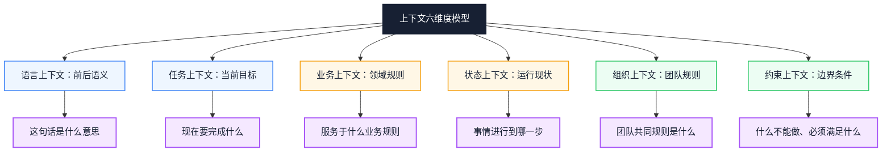
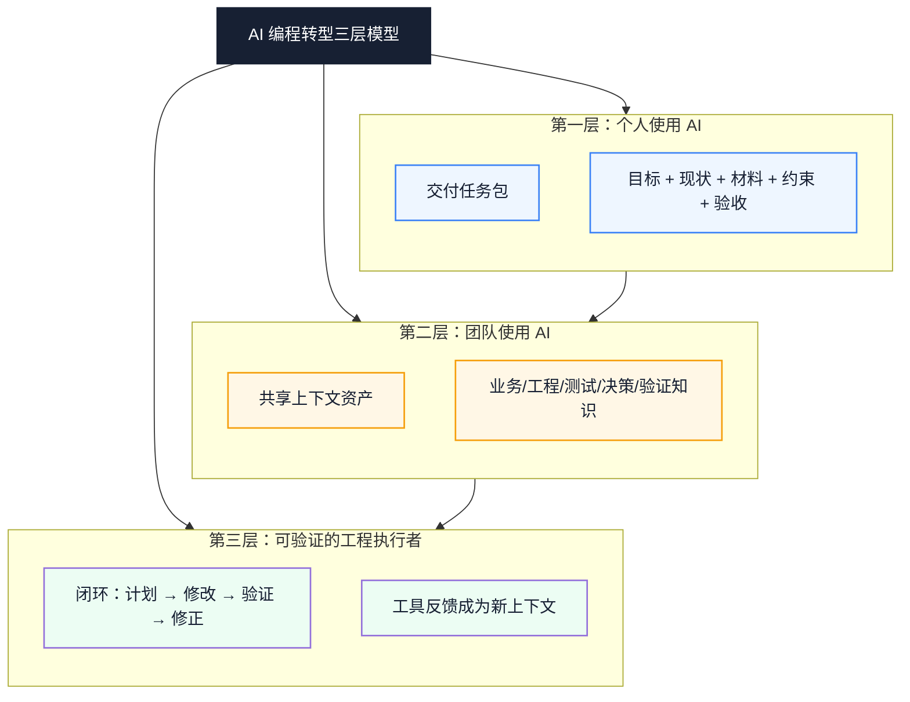

# AI 时代如何理解「上下文」及其在 AI 编程转型中的应用

团队常把 AI 编程转型等同于「换个更强的模型」或「让每个人都学会写 Prompt」，真正卡住交付的却是业务规则、状态和验收标准没有被交到模型手里。本文把上下文拆成可评价的维度，比较个人、团队、平台三层转型的投入与前提，并给出按团队成熟度选择起点的条件化建议。

::: info 一句话
AI 编程质量越来越不只取决于"怎么写 Prompt"，而取决于"给 AI 提供了什么上下文"。
:::

## 目录

- [一、决策背景：AI 编程转型该把力气花在哪](#一、决策背景-ai-编程转型该把力气花在哪)
- [二、上下文的六个维度：任务完整度的评价框架](#二、上下文的六个维度-任务完整度的评价框架)
- [三、AI 时代的变化：输出由信息环境决定](#三、ai-时代的变化-输出由信息环境决定)
- [四、AI 运行时上下文：模型实际能看到什么](#四、ai-运行时上下文-模型实际能看到什么)
- [五、为什么上下文比代码生成更值得投入](#五、为什么上下文比代码生成更值得投入)
- [六、上下文质量的四个评价维度](#六、上下文质量的四个评价维度)
- [七、三层转型路径比较：个人、团队与平台](#七、三层转型路径比较-个人、团队与平台)
- [八、约束与风险：冲突、失效与安全](#八、约束与风险-冲突、失效与安全)
- [九、角色变化与能力迁移](#九、角色变化与能力迁移)
- [十、落地示例：测试用例如何变成可消费上下文](#十、落地示例-测试用例如何变成可消费上下文)
- [十一、条件化建议：不同团队从哪一层开始](#十一、条件化建议-不同团队从哪一层开始)
- [十二、AI 编程实践清单](#十二、ai-编程实践清单)
- [结语：从 Prompt 到上下文工程](#结语-从-prompt-到上下文工程)
- [FAQ](#faq)
- [来源](#来源)

---

## 一、决策背景：AI 编程转型该把力气花在哪

「上下文」听起来像一个技术词，但它其实是人类每天都在用的基本能力。先看一个最简单的例子。假设有人说：

> "帮我处理一下这个问题。"

这句话本身几乎没有有效信息。要理解它，至少得知道：

- "我"是谁；
- "你"是谁；
- "这个问题"指什么；
- 问题发生在哪里；
- 之前已经做过什么；
- 期望得到什么结果；
- 什么时间之前完成；
- 有哪些限制条件。

如果双方刚刚讨论过一个登录失败的问题，那么"这个问题"可能就是登录失败。如果双方正在讨论测试报告，那"这个问题"可能就是报告里的阻塞缺陷。

一句话的真实含义，光看字面不够。它由多个信息层共同决定：

```text
真实含义
= 当前表达
+ 前文信息
+ 当前环境
+ 双方共同认知
+ 隐含规则
```

这里的"前文信息、当前环境、共同认知和隐含规则"，就是上下文。上下文不是附加信息，而是理解真实意图的必要前提。

把这个例子放回 AI 编程，决策问题就出现了：模型能力越来越接近，团队之间的差距更多来自任务定义、信息环境和验证能力。转型投入大致有三类：

- 换更强的模型；
- 优化单条 Prompt；
- 建设上下文资产与验证闭环。

前两类见效快，但很难积累；第三类前期成本高，却能被团队复用。本文的立场是：先把第三类做对，再决定前两类投入多少。

下面的章节按决策顺序展开：先定义上下文的评价维度，再比较三层转型路径，最后给出约束、风险和条件化建议。

---

## 二、上下文的六个维度：任务完整度的评价框架

很多人把上下文简单理解为聊天记录，这不够。评价一个任务包是否完整，至少要看六个维度。

下图把六个维度的整体关系摆出来：



六个维度从核心向外展开，每个维度对应一个必须回答的问题。前两个维度回答「在说什么」和「要做什么」，中间两个回答「在什么环境里做」，最后两个回答「按什么规则做」和「不能做什么」。任何一维缺失，AI 都可能在这个方向上用一般经验补空白。

### 1. 语言上下文

一句话前后说了什么。例如"它还是不行"——要理解"它"，得知道前面讨论的是接口、脚本、服务器，还是测试环境。

### 2. 任务上下文

当前到底在完成什么任务。同样是"检查这段代码"：

- 在 Code Review 中，可能是检查可维护性；
- 在故障排查中，可能是寻找异常原因；
- 在安全审计中，可能是检查漏洞；
- 在测试开发中，可能是补充可测试性和边界条件。

不知道任务就"检查代码"，很容易检查错方向。

### 3. 业务上下文

代码不是孤立存在的，它服务于某种业务规则。例如：

```typescript
if (income > threshold) {
  calculateTax();
}
```

只看代码，AI 能检查语法和一般逻辑，但它不知道：

- `income` 是月收入还是年收入；
- `threshold` 对应哪个课税年度；
- 是否区分个人和企业；
- 币种和精度怎么处理；
- 临界值是"大于"还是"大于等于"；
- 有没有豁免条件。

这些都属于业务上下文。在税务、金融、政务这类规则密集型系统里，业务上下文往往比代码上下文更重要。

### 4. 状态上下文

状态上下文描述"事情目前进行到了哪里"。例如当前用哪个分支、跑在哪个环境、用户登录了没、数据库里有什么测试数据、前一个接口返回了什么、某个任务已经试过多少次。

自动化测试特别依赖状态上下文。假设测试步骤是"点击提交按钮"，光这一个动作不够，还得知道完整的前置状态：

```text
用户已经登录
→ 已进入申报页面
→ 已填写必填字段
→ 已上传附件
→ 当前记录处于草稿状态
→ "提交"按钮可见且启用
```

这些前置状态，决定了"点击提交"有没有意义。

### 5. 组织上下文

组织上下文是团队内部形成的共同规则：代码规范、目录结构、命名约定、分支策略、缺陷等级、测试优先级、Definition of Done（完成定义）、哪些框架允许用、哪些数据不能进 AI、谁负责审批和发布。

一名新员工不知道这些规则，就容易写出"技术上正确、团队里不可用"的代码。AI 也一样。

### 6. 约束上下文

约束上下文告诉执行者什么不能做，以及结果必须满足什么条件。例如必须用 Playwright、不能改生产代码、不能访问真实客户数据、脚本必须兼容 Linux CI Agent、单个测试用例不得超过五分钟、失败后必须保留截图和网络日志、不得用固定等待掩盖稳定性问题。

约束不是附加信息，它是任务定义的一部分。

---

## 三、AI 时代的变化：输出由信息环境决定

传统软件按明确的输入和规则运行：

```text
输入 + 固定程序 = 输出
```

生成式 AI 是另一套：

```text
当前指令
+ 对话历史
+ 提供的文档
+ 代码和工具结果
+ 系统规则
+ 模型已有能力
= 模型对当前任务的理解
= 输出结果
```

所以 AI 的输出并不由最后一句 Prompt 决定，而由它在当前时刻能拿到的整个信息环境决定。

可以把 AI 想象成一位能力很强、学得很快、但刚刚加入项目的工程师：

- 它懂通用编程；
- 它知道常见框架；
- 它能快速阅读代码；
- 但它天然不知道你们公司的业务；
- 不知道内部缩写；
- 不知道历史设计决策；
- 不知道哪些接口已经废弃；
- 不知道你们真正关心的验收标准。

你不给它上下文，它就按一般经验补空白。AI 补空白的过程，恰恰是很多错误和幻觉的来源。

所以转型的第一个判断不是换模型，而是确认 AI 当前能看到的信息环境是否足以完成任务。工程团队的工作重心，也从"优化单条 Prompt"转向"优化 AI 能拿到的信息环境"。

---

## 四、AI 运行时上下文：模型实际能看到什么

进入 AI 领域，"上下文"被赋予了更具体的含义。以下几个概念，是判断 AI 能否拿到正确信息的基础。

### 1. 上下文窗口

上下文窗口可以理解为 AI 一次能"放在工作台上阅读"的信息容量。工作台上可能放着：系统指令、当前对话、代码文件、需求文档、API 定义、日志、测试结果、工具调用结果、AI 自己之前生成的内容。

窗口越大，AI 一次能读的材料越多。但"大"不等于"好"。如果工作台上堆满了过期文档、重复代码、无关日志、相互冲突的需求、一大堆没优先级的信息，AI 反而更难抓住重点。

真正要追求的是：给 AI 完成当前任务所需的最相关、最准确、最有结构的信息。

### 2. 上下文工程

Prompt Engineering（提示词工程）通常关注"这句话应该怎么问"。Context Engineering（上下文工程）更关注"为了让 AI 正确完成任务，应该让它看到哪些信息"。

二者的差异可以这样理解：

```text
// 反例：低上下文指令
帮我生成登录测试。
```

```text
// 正例：经过上下文工程后的任务包
目标：
为香港税务申报系统的个人用户登录功能生成自动化测试。

技术栈：
- Playwright
- TypeScript
- Page Object Model
- 测试运行在 Linux CI 环境

相关材料：
- requirements/login.md
- openapi/auth.yaml
- pages/LoginPage.ts
- fixtures/users.ts
- tests/login/existing-login.spec.ts

业务规则：
- 连续 5 次输入错误密码后锁定账户
- 锁定时间为 30 分钟
- MFA（多因素认证）只对特定角色启用
- 测试环境禁止使用真实纳税人资料

实现约束：
- 不使用 waitForTimeout
- 定位器优先采用 getByRole
- 每个测试独立创建和清理数据
- 失败时保存截图、trace 和接口响应

验收标准：
- 覆盖正常登录、错误密码、账户锁定和 MFA
- 通过 npm run typecheck
- 通过 npm run lint
- 生成代码后执行登录模块的 smoke test
```

上面的业务规则和阈值仅用于示例，不代表真实制度。这个任务包的价值不只是"写得更详细"，而是搭出了一个可执行的信息环境。

### 3. 短期上下文

短期上下文是当前会话或当前任务里的信息，例如正在改哪个文件、刚才跑了什么命令、出了什么报错、已经试过哪些方案、用户刚刚否了哪种做法。它相当于人的工作记忆。

AI 编程中，短期上下文让 AI 能连续完成：

```text
阅读代码
→ 修改代码
→ 运行测试
→ 读取错误
→ 修复错误
→ 再次验证
```

中间上下文一丢，就可能出现：重复已经失败的方案、忘掉前面确认的约束、改回已经修复的代码、只盯最后一个错误而忘了整体目标。

### 4. 长期上下文

长期上下文是跨任务保持有效的信息，例如项目架构说明、团队编码规范、业务术语表、测试策略、历史技术决策、系统边界、安全与合规规范。它相当于团队的组织记忆。

长期上下文不该只活在某位资深员工的脑里。要支持 AI 编程，团队得把它转化成可读取的资产：

```text
/docs
  business-glossary.md
  architecture.md
  testing-strategy.md
  coding-guidelines.md
  security-rules.md
  domain-rules.md

/decisions
  ADR-001-test-framework.md
  ADR-002-api-mocking.md
  ADR-003-test-data-isolation.md
```

ADR（Architecture Decision Record，架构决策记录）用来保留"为什么这样选"的背景，避免 AI 只看到最终代码，却不知道哪些方案已经被否决。

这背后还有一个变化：过去文档主要写给人看，以后文档还得能被 AI 准确检索和使用。

### 5. 检索上下文

大型项目不可能把所有内容一次性塞给 AI，得先找到跟当前任务最相关的信息，再喂给模型。

例如任务是"修复提交报税表时金额精度错误"，系统可以检索：金额计算规则、当前课税年度配置、相关接口定义、Decimal 工具类、对应测试用例、过去类似缺陷、最近的代码变更。

这个过程通常叫检索增强生成（RAG）。核心思想很简单：在需要的时候，把正确的信息送到 AI 面前。

### 6. 工具上下文

AI 光读代码不够，它还得从工具拿到真实反馈：Git 当前差异、编译错误、单元测试结果、Playwright trace、浏览器 console、网络请求、API 响应、数据库查询结果、CI 日志、静态分析结果。

例如 AI 觉得某段测试已经修好了，但真跑一次还是挂：

```text
Expected: "Submitted"
Received: "Pending Review"
```

这个测试结果就成了新的上下文，逼着 AI 修正原来的判断。

所以，靠谱的 AI 编程不该停在"用户提问 → AI 生成代码 → 结束"这一步，而是：

```text
理解任务
→ 获取相关上下文
→ 制定计划
→ 修改代码
→ 调用真实工具验证
→ 把结果加入上下文
→ 根据反馈继续修正
```

上下文工程是从"写好一句话"到"搭一个可执行信息环境"的跨越。上下文窗口决定容量上限，短期、长期、检索、工具上下文一起决定 AI 能不能在正确时刻拿到正确信息。

---

## 五、为什么上下文比代码生成更值得投入

过去评价一名程序员，往往看是不是熟悉语法、是不是了解框架、能不能快速写代码。AI 已经把代码生成成本大幅压下来，但下面这些问题它没有自动解决：

- 应该解决什么问题；
- 需求是否完整；
- 哪些业务规则适用；
- 应该改哪个模块；
- 哪些现有设计不能动；
- 怎么证明改对了；
- 失败时怎么定位原因。

所以 AI 编程转型的核心能力，正从"亲手写出所有代码"往这几个方向挪：

1. 定义问题；
2. 组织上下文；
3. 分解任务；
4. 设置约束；
5. 让 AI 调工具；
6. 验证结果；
7. 管理知识和反馈。

可以用一个公式来表达：

```text
AI编程结果质量
≈ 模型能力
× 上下文质量
× 任务定义质量
× 工具验证能力
```

这里是乘法关系。任务定义或上下文质量接近零，模型再强，最终结果也会很不稳。

模型决定能力上限，上下文工程决定这份能力能不能在真实项目里稳得住。这也是为什么同样一个模型，在不同团队手里的产出差异会很大。

---

## 六、上下文质量的四个评价维度

上下文不是越多越好。实际工程里，上下文质量问题主要分四类，每一类都会直接打掉 AI 输出的稳定性。

### 1. 上下文不足

表现为：只说"帮我修复"、没给错误日志、没说期望结果、不提供相关代码、不提技术限制。结果就是 AI 只能猜。

解决办法是补目标、现状、材料、限制和验收标准。

### 2. 上下文过载

表现为：把整个代码库一次性塞给 AI、提供几万行无关日志、同时让 AI 处理几个互不相关的问题、复制大量历史对话但不点出当前结论。

解决办法是围着当前任务筛信息，不机械堆积。

### 3. 上下文冲突

例如：需求文档说锁定 30 分钟，测试用例写锁定 60 分钟，实际配置是 15 分钟，旧代码注释又写永久锁定。

这时候 AI 不该自己挑一个"看起来合理"的答案。团队得定义信息优先级：

```text
已经批准的最新业务需求
> 当前版本验收标准
> API契约
> 测试用例
> 代码注释
> 历史文档
```

高优先级资料之间还冲突，就得升级成需求澄清，别让 AI 猜。

### 4. 上下文失效

常见情况：文档没跟代码一起更新、API 示例已过期、测试数据不再有效、AI 读了旧版本分支、历史缺陷的解决方案不再适用。

所以上下文除了"相关"，还得带：版本、更新时间、适用范围、来源、权威级别、当前是否仍有效。

上下文质量可以概括为：相关 × 准确 × 一致 × 有效。四类里任何一类失控，AI 输出就会从"可靠"滑到"看起来合理、实际错了"。

---

## 七、三层转型路径比较：个人、团队与平台

上下文的概念和质量问题弄清楚后，接下来的决策是：转型从哪里开始、每一层需要什么前提、投入产出比如何。

AI 编程转型通常分三层，逐层递进：



图中三层都从核心出发，但实线箭头表示依赖：个人层是团队层的前提，团队层是平台层的前提。跳过个人习惯直接买平台，通常只会得到一套没人维护的工具。

三层的前提、投入和风险并不相同：

| 层级 | 前提 | 主要投入 | 可观察收益 | 主要风险 |
| --- | --- | --- | --- | --- |
| 个人层 | 团队已有基本代码规范 | 任务包模板、个人上下文习惯 | 返工次数下降、变更范围变小 | 依赖个人，难以复制 |
| 团队层 | 有文档与评审流程 | 业务/工程/测试/决策/验证资产 | 新人上手更快、AI 回答更一致 | 文档失效、维护成本 |
| 平台层 | 有 CI 与可观测能力 | 工具链、权限、验证闭环 | 变更可自动验证、问题可回放 | 过度自动化、权限风险 |

收益需要结合团队基线度量，不能保证固定比例。没有基线数据时，先记录返工次数、变更范围和验证通过率，再判断投入是否有效。

### 第一层：个人使用 AI

个人先从"问问题"转向"交付任务包"。每次向 AI 发起编程任务，至少提供：

```text
1. 目标：要解决什么问题
2. 现状：现在发生了什么
3. 材料：相关代码、日志、接口和需求
4. 约束：不能怎么做、必须使用什么
5. 输出：希望得到代码、方案还是分析
6. 验收：怎样判断任务完成
```

可以复用下面这个任务包模板：

```text
任务目标：
[描述预期结果]

当前现象：
[描述实际结果、错误信息和复现方式]

项目背景：
[业务模块、技术栈和运行环境]

相关材料：
[文件、接口、日志、测试用例]

必须遵守：
[框架、规范、安全和兼容性要求]

禁止事项：
[不能修改的模块、不能使用的方式]

验收标准：
[编译、测试、性能和业务结果]

执行要求：
先分析原因和影响范围，再修改代码；修改后运行相关检查，
不要只根据代码推断成功。
```

### 第二层：团队使用 AI

团队需要建立共享上下文，避免每个人重复向 AI 解释项目。建议建设五类资产：

**业务知识**：业务术语表、核心业务流程、角色与权限、状态转换规则、边界和异常规则。

**工程知识**：项目架构、模块职责、编码规范、依赖使用原则、常用命令。

**测试知识**：测试分层策略、UI/API/性能测试的适用范围、Page Object 设计规则、标签和优先级规范、测试数据管理、失败证据采集标准。

**决策知识**：为什么选 Playwright、为什么禁止固定等待、为什么接口测试和 UI 测试要分层、哪些模块不能直接 Mock、历史方案为什么被废弃。

**验证知识**：完成任务后必须跑哪些命令、什么情况下要全量回归、哪些失败可以重试、什么条件才能合并、哪些结果必须人工审核。

### 第三层：让 AI 成为可验证的工程执行者

成熟的 AI 编程平台，应该让 AI 具备一个闭环：

```text
获取任务
→ 检索项目上下文
→ 阅读相关代码
→ 输出实施计划
→ 修改最小范围
→ 执行类型检查
→ 执行静态检查
→ 执行相关自动化测试
→ 分析失败证据
→ 修正
→ 输出变更摘要和风险
```

每一步产生的结果，都会成为下一步的新上下文。

这也是 AI Agent（智能体）与普通聊天机器人的一条关键分界线：

> 聊天机器人主要拿已有文字回答；编程 Agent 会通过代码库和工具主动去找新的上下文。

三层转型逐层递进：个人层交付任务包，团队层建设共享上下文资产，平台层构建可验证的工程闭环。跳过底层，顶层往往落不了地。

---

## 八、约束与风险：冲突、失效与安全

转型不是只有收益。下面几类约束决定三层路径能不能落地，也决定投入顺序。

### 1. 安全与合规约束

真实客户数据、密钥、生产日志不应直接进入上下文。需要脱敏、最小权限和数据留存策略；受监管行业还要确认数据出境、审计和访问记录要求。

上下文越完整，泄露风险越高。团队要在"给 AI 足够信息"和"只给必要信息"之间划边界，而不是把所有资料一次性放进任务包。

### 2. 验证能力约束

没有 CI、没有可运行测试的团队，平台层闭环无法成立。AI 修改代码后如果不能自动运行类型检查、静态检查和测试，所谓"可验证"就只是人工目测。

这类团队应先补验证命令，再谈 Agent 自动修改；顺序反了，自动化只会放大未验证的变更。

### 3. 知识与维护成本

上下文资产会腐化。文档与代码不同步时，AI 会以更高置信度使用错误信息，返工反而更隐蔽。

资产需要版本、负责人和失效标记。没有维护责任的文档，通常不值得放进长期上下文。

### 4. 过度依赖与责任边界

AI 生成的变更仍需代码评审和测试。把责任转移给模型，不会消除故障，往往只会让根因更难定位。

团队要明确哪些动作必须人工确认，例如修改生产配置、删除数据、变更权限、发布版本。

### 5. 工具与供应商风险

协议和平台会演进。把工具定义、Trace 格式或提示模板绑定到单一供应商，迁移成本会在规模扩大后显现。

优先使用可导出的格式和开放协议，至少保留一条不依赖单一平台的验证路径。

---

## 九、角色变化与能力迁移

AI 不会让工程人员只剩下"写 Prompt"这一件事。它会把对工程判断力的要求抬高，能力重心也会随之迁移，但速度和幅度因团队而异。

| 传统能力重心 | AI 时代能力重心 |
|---|---|
| 记忆语法 | 准确定义问题 |
| 手工编写大量代码 | 设计任务与上下文 |
| 根据经验查错 | 利用工具建立证据链 |
| 个人掌握项目知识 | 把知识沉淀成团队资产 |
| 审查代码写法 | 审查业务正确性和影响范围 |
| 执行测试步骤 | 设计质量门禁和反馈闭环 |

对 QA 和自动化测试工程师，角色会从"脚本编写者"进一步往这些方向走：

- 测试上下文设计者；
- 业务规则结构化人员；
- AI 生成结果的验证者；
- 自动化质量门禁建设者；
- 测试知识库维护者；
- Agent 工作流设计者。

这不是岗位消失，而是职责重心迁移。具体岗位名称和分工因组织而异，但"定义问题、组织上下文、设计验证闭环"这三项能力会越来越难被替代。

---

## 十、落地示例：测试用例如何变成可消费上下文

在"根据已有业务测试用例生成 UI、接口和压力测试脚本"这个场景里，最大挑战通常不是 AI 会不会写 Playwright，而是测试用例里有没有足够的可执行上下文。

一条传统人工测试用例可能写成：

```text
用户登录系统，填写申报表并提交，检查提交成功。
```

人类测试人员脑子里装了一大堆隐含信息，但 AI 不知道：

- 用哪类用户；
- 登录入口在哪；
- 测试数据怎么创建；
- 申报表对应哪个课税年度；
- 必填字段有哪些；
- "提交成功"的判断依据是什么；
- 提交后是 `Submitted` 还是 `Pending Review`；
- 要不要验证数据库和接口；
- 怎么清理数据；
- 允不允许重复提交。

要让它能被 AI 稳定转化为自动化脚本，测试用例得升级成结构化上下文：

```yaml
case_id: TAX-FILING-001
objective: 验证个人用户可以提交有效申报表

preconditions:
  - 用户已完成身份验证
  - 用户存在当前课税年度的草稿申报表
  - 测试账户未开启 MFA

test_data:
  user_role: individual_taxpayer
  assessment_year: 2025
  currency: HKD
  income: 500000

steps:
  - action: 登录系统
  - action: 打开草稿申报表
  - action: 填写收入信息
  - action: 提交申报表

expected_results:
  - 页面显示提交成功
  - 申报表状态变为 Submitted
  - 提交接口返回成功业务码
  - 系统生成 submission reference

automation_constraints:
  framework: Playwright
  language: TypeScript
  locator_strategy: role-first
  fixed_wait: forbidden
  cleanup_required: true
```

上面的年度、金额和状态字段仅用于说明结构，实际值按业务规则填写。这些字段是团队自定义的测试上下文结构，不是行业标准；关键是前置条件、数据、预期结果和约束能被机器读取。

测试用例从"人类可读"升级成"机器可消费的上下文"，AI 才能稳定生成能运行的测试脚本。AI 会不会写 Playwright 只是表层，脚本能不能在真实环境里稳住，取决于业务规则、状态前置和验证标准有没有给全。

---

## 十一、条件化建议：不同团队从哪一层开始

三层路径不是必须按顺序全部建完。不同团队的条件不同，起点也应该不同。

| 条件 | 优先动作 | 暂时不要做 | 观察信号 |
| --- | --- | --- | --- |
| 5 人以下，无专职平台 | 统一任务包模板，建一份业务术语表 | 先买平台或搭多 Agent | 返工次数、变更范围 |
| 有 CI，多人协作 | 把验证命令和验收标准写进仓库 | 先做全自动 Agent 闭环 | CI 通过率、回归耗时 |
| 有平台团队，Agent 已上线 | 补 Trace、Replay 和权限闭环 | 继续堆 Prompt 模板 | 失败定位时间、Token 成本 |
| 受监管行业 | 脱敏、权限、审计优先 | 先追求生成速度 | 敏感数据事件、审计缺口 |
| 返工率长期偏高 | 补业务规则和验收标准 | 先换更强的模型 | 同类返工占比 |

这些信号是观察项，不是固定 KPI。先记录基线，再判断投入是否有效；没有基线，任何"效率提升"都无法验证。

如果只能做一件事，先做个人任务包。它成本最低，能立刻暴露上下文缺口，也是团队资产和平台闭环的原料。

---

## 十二、AI 编程实践清单

### 1. 个人任务包设计

- [ ] 每次向 AI 发起编程任务时，提供目标、现状、材料、约束、输出、验收六要素。
- [ ] 区分"问问题"和"交付任务包"，后者必须包含验收标准。
- [ ] 任务包中明确禁止事项（不能修改的模块、不能使用的方式）。
- [ ] 要求 AI 先分析原因和影响范围，再修改代码。
- [ ] 修改后要求运行相关检查，不根据代码推断成功。

### 2. 团队上下文资产建设

- [ ] 维护业务术语表（`business-glossary.md`）。
- [ ] 维护项目架构说明（`architecture.md`）。
- [ ] 维护测试策略文档（`testing-strategy.md`）。
- [ ] 维护编码规范（`coding-guidelines.md`）。
- [ ] 使用 ADR 记录历史技术决策（`/decisions` 目录）。
- [ ] 为每份资产标注负责人、更新时间和失效条件。

### 3. 测试用例结构化

- [ ] 测试用例包含 `case_id`、`objective`、`preconditions`、`test_data`、`steps`、`expected_results`。
- [ ] 明确 `automation_constraints`（框架、语言、定位器策略、等待策略、清理策略）。
- [ ] `expected_results` 覆盖页面、接口、数据库三个层面的验证。
- [ ] `preconditions` 描述完整的前置状态，而非隐含假设。

### 4. 上下文质量与安全

- [ ] 提交前检查上下文是否充足（目标、材料、约束是否齐全）。
- [ ] 避免一次性提交整个代码库或几万行无关日志。
- [ ] 定义信息优先级（业务需求 > 验收标准 > API 契约 > 测试用例 > 代码注释 > 历史文档）。
- [ ] 高优先级资料冲突时升级为需求澄清，而非让 AI 猜。
- [ ] 文档标注版本、更新时间、适用范围和当前是否有效。
- [ ] API 示例、测试数据和代码注释随代码同步更新。
- [ ] 确认 AI 读取的分支与当前工作分支一致。
- [ ] 敏感数据脱敏后再进入上下文，并记录数据留存策略。

### 5. 工具反馈闭环

- [ ] AI 修改代码后运行类型检查和静态检查。
- [ ] 失败时保留截图、trace 和接口响应作为证据。
- [ ] 把工具运行结果加入下一轮上下文，形成反馈闭环。
- [ ] 用真实运行结果验证，不根据代码推断成功。
- [ ] 区分"聊天机器人"和"编程 Agent"，后者必须能调用真实工具。

清单里的每一项都能在仓库、任务包、CI 记录或一次运行结果里找到证据。找不到证据时，它只是愿望，不是实践。

---

## 结语：从 Prompt 到上下文工程

把上下文理解成四层，可以帮助你重新看待 AI 编程：先弄清这句话在说什么，再确认要完成什么任务，再补齐业务、状态、组织和约束，最后用工具和验收标准证明结果正确。Prompt 只是入口，上下文才是工作环境。

下一步不必从平台层开始。挑一个最近返工过的任务，把它的业务规则、前置状态和验收标准写成一份任务包，再记录返工次数和验证结果。等这份任务包能被同事复用，再考虑把它沉淀成团队资产。

---

## FAQ

### 1. 上下文工程是不是就是把 Prompt 写长？

不是。写长只增加信息量，上下文工程要解决的是信息是否相关、准确、一致和有效。

一份很长的 Prompt 如果混入过期文档、冲突规则和无关日志，效果可能比一句清晰的短指令更差。判断标准不是长度，而是 AI 能否在正确时刻拿到完成任务所需的信息。

### 2. 上下文窗口变大后，还需要检索和长期上下文吗？

需要。窗口变大只是提高容量上限，不保证信息相关，也不保证模型会注意到关键片段。

大型项目的文档量通常超过单次上下文窗口，检索仍然负责筛选；长期上下文负责跨任务保持规则和决策一致。窗口越大，越需要控制噪声，而不是把所有资料都塞进去。

### 3. 上下文工程的投入如何衡量收益？

先记录基线，再看变化。可观察的指标包括：同类任务的返工次数、变更范围、验证通过率、人工复核时间、失败定位时间。

不要用单一指标判断，也不要把行业传闻的百分比当作预期收益。上下文资产的价值通常体现在重复任务上，一次性任务未必划算。

### 4. 上下文工程和 RAG 是什么关系？

RAG 是上下文工程的一种取数方式，负责在需要时检索并送入外部知识；上下文工程的范围更大，还包括上下文窗口管理、短期与长期上下文、工具反馈和约束条件。

只做 RAG 不等于完成上下文工程。检索结果是否准确、是否占满窗口、是否与业务规则冲突，仍然要靠上下文质量和验证闭环来约束。

---

## 来源

1. Addy Osmani《Modern Web Performance》：

   [https://addyosmani.com/](https://addyosmani.com/)

2. Andrej Karpathy 谈 LLM 上下文与 Agent 设计：

   [https://karpathy.ai/](https://karpathy.ai/)

3. Anthropic 文档《Effective context engineering for AI agents》：

   [https://www.anthropic.com/engineering/effective-context-engineering-for-ai-agents](https://www.anthropic.com/engineering/effective-context-engineering-for-ai-agents)

4. Playwright 官方文档《Best Practices》：

   [https://playwright.dev/docs/best-practices](https://playwright.dev/docs/best-practices)

5. Microsoft《The New Future of Work: AI and Context》：

   [https://www.microsoft.com/en-us/research/](https://www.microsoft.com/en-us/research/)
