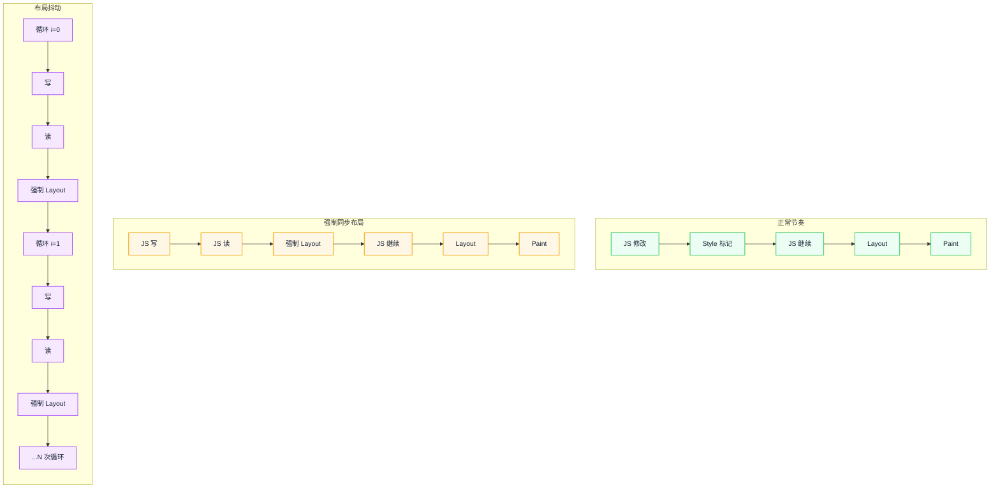
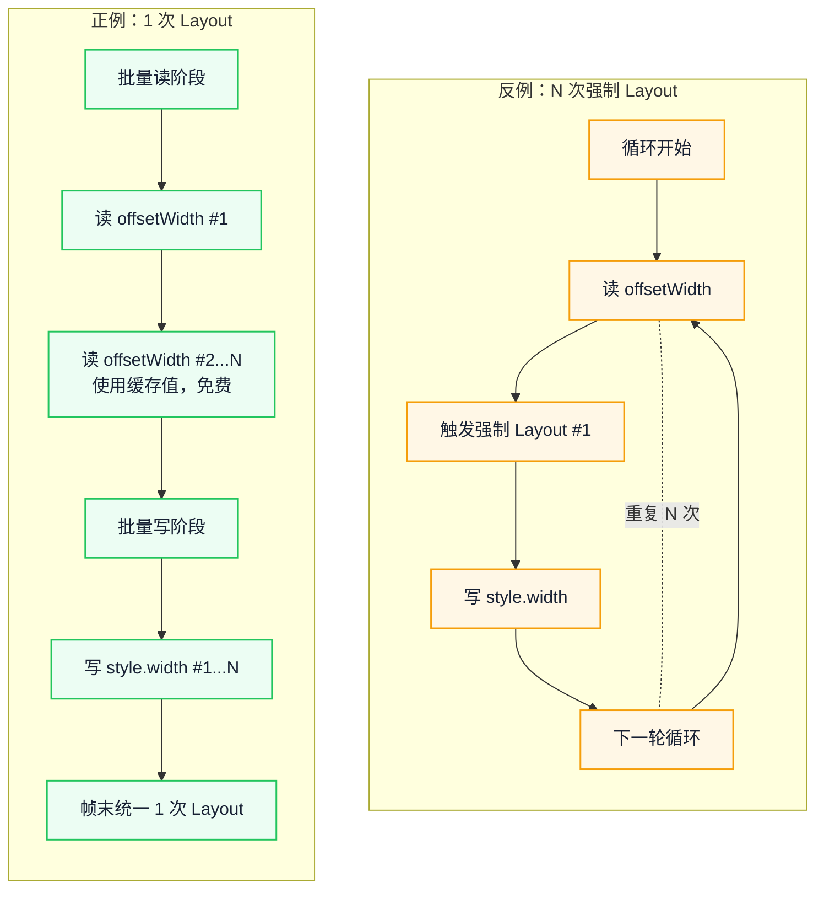

# 布局抖动的真相：Layout Thrashing 如何搞垮你的动画

动画卡顿常被归因于 JS 太慢或元素太多，但有时原因只是几行看似无害的尺寸读取。本文从一个反直觉的事实出发：布局（Layout）计算是惰性的，真正决定代价的是读取发生的时机。沿着强制同步布局、循环读写与帧末批量处理这条链路，你会得到一套能解释卡顿、也能指导改法的判断依据，而不必死记属性清单。

::: info 一句话
写后立即读，才是一次布局被提前结算的开关；循环把这个开关按了 N 次，性能问题才从单次开销变成结构性放大。
:::

## 目录

- [一、什么是强制同步布局（Forced Synchronous Layout）](#一、什么是强制同步布局-forced-synchronous-layout)
- [二、读写交替导致的布局抖动机制](#二、读写交替导致的布局抖动机制)
- [三、反例与正例：读写顺序的代价](#三、反例与正例-读写顺序的代价)
- [四、边界场景与常见陷阱](#四、边界场景与常见陷阱)
- [五、requestAnimationFrame 的正确使用](#五、requestanimationframe-的正确使用)
- [六、Layout 阶段的性能优化策略](#六、layout-阶段的性能优化策略)
- [七、如何识别与诊断布局抖动](#七、如何识别与诊断布局抖动)
- [结语](#结语)
- [FAQ](#faq)
- [来源](#来源)

---

## 一、什么是强制同步布局（Forced Synchronous Layout）

### 1. 正常的渲染节奏

在正常情况下，浏览器的渲染节奏是这样的：

```text
JS 执行 → Style 标记 → Layout → Paint → Composite → 下一帧
```

JS 修改 DOM 或样式时，浏览器只是把"需要重新计算"的标记打上，**不立即执行 Layout**。等 JS 把一帧内所有改动都做完，主线程进入渲染阶段时，浏览器才一次性完成 Style 重算、Layout、Paint、Composite。

这是浏览器的批量优化：把一帧内的多次修改合并成一次 Layout。

### 2. 强制同步布局的触发

JS 在修改样式后**立刻读取布局信息**时，这个批量节奏会被打断：

```javascript
element.style.width = '100px'
console.log(element.offsetWidth)  // 触发强制同步布局
```

`offsetWidth` 返回的是元素**当前**的布局宽度。浏览器要返回正确值，就必须先应用刚才的 `width: 100px` 修改，**立即执行 Layout**。这一次 Layout 没有等到帧末，而是被"提前"到 JS 执行过程中，所以叫"强制同步布局"——强制、同步、立即。

### 3. 强制同步布局 vs Layout Thrashing

两个术语经常混用，但有区别：

- **强制同步布局（FSL）**：一次写后立即读，触发一次提前 Layout
- **布局抖动（Layout Thrashing）**：在循环里反复"写-读-写-读"，触发 N 次提前 Layout，造成性能坍塌



图中上半部分是正常节奏：样式修改先累积，Layout 在帧末统一执行；中间是单次强制同步布局；下半部分是循环把同一动作重复 N 次。阅读时重点看"Layout 被谁触发"，而不是循环次数本身。

::: warning 常见误区

把"读 offsetWidth 一定慢"当成铁律。实际上，**没有前置修改的读**几乎是免费的——浏览器直接返回缓存的布局信息。慢的是"写后读"。
:::

---

## 二、读写交替导致的布局抖动机制

### 1. 为什么"写后读"会触发提前 Layout

浏览器设计上有一个不变量：**任何布局查询都必须返回当前准确的值**。

如果不强制 Layout，你刚把 `width` 改成 100px，紧接着读 `offsetWidth` 拿到的还是旧值——这是不可接受的。所以浏览器只能选择：**JS 查询布局信息时，如果有未消化的样式修改，就立即执行 Layout**。

### 2. 为什么在循环里会变成 O(n²)

考虑这段代码：

```javascript
const items = document.querySelectorAll('.item')
for (let i = 0; i < items.length; i++) {
  items[i].style.width = container.offsetWidth + 'px'  // 写 + 读
}
```

每次循环都执行"写 → 读"：

- 第 1 次循环：写 item[0]，读 container → 触发 1 次 Layout
- 第 2 次循环：写 item[1]，读 container → 触发 1 次 Layout
- ...
- 第 N 次循环：触发 1 次 Layout

总共 N 次 Layout。每次 Layout 的成本可能并不只是"处理一个元素"，因为浏览器要做增量 Layout 的脏标记追踪、依赖计算，在大 DOM 上单次 Layout 也可能很贵。所以总成本是 O(N) × 单次 Layout 成本，最坏情况下接近 O(N²)。

### 3. 浏览器的"Layout 提示"优化

Chromium 有一个轻微的优化：在某些情况下，连续的强制同步布局会被合并。但这只在很简单的场景下生效，不能依赖。在循环里、有多个互相依赖的元素时，优化失效。

这也解释了为什么修复手段总是围绕读写顺序，而不是换一个更快的读取 API。

---

## 三、反例与正例：读写顺序的代价

### 1. 反例：循环里读写交替

```javascript
// 反例：每次循环都触发强制同步布局
function updateWidthsBad(items) {
  for (let i = 0; i < items.length; i++) {
    // 读：触发 Layout（因为前一次循环已经写过）
    const width = items[i].parentNode.offsetWidth
    // 写：标记 Layout 脏
    items[i].style.width = width + 'px'
  }
}

const items = document.querySelectorAll('.item')
updateWidthsBad(items)
```

如果 `items` 有几百个，这段代码就会触发同等数量的强制同步 Layout。单次 Layout 的耗时取决于 DOM 规模和设备，但在低端设备上通常足以让一帧严重超时；累计起来，动画会明显掉帧。

### 2. 正例：先批量读，再批量写

```javascript
// 正例：先读全部，再写全部
function updateWidthsGood(items) {
  // 第一步：批量读，把所有需要的值先拿出来
  const widths = []
  for (let i = 0; i < items.length; i++) {
    widths.push(items[i].parentNode.offsetWidth)
  }

  // 第二步：批量写
  for (let i = 0; i < items.length; i++) {
    items[i].style.width = widths[i] + 'px'
  }
}

const items = document.querySelectorAll('.item')
updateWidthsGood(items)
```

这段代码通常只触发 1 次 Layout：第一次读时结算此前的脏修改，后续读都命中缓存，写阶段累积到帧末统一处理。节省的布局次数与元素数量成正比，元素越多差距越明显。

### 3. 两种时序的结构差异



上半部分是一个闭环：每轮循环都重新触发一次 Layout；下半部分把读和写拆成两段，Layout 只在第一次读时发生。关键转折不在循环次数，而在"读是否落在写之后"。

### 4. 更复杂的场景：多变量读写

实际项目中，往往不是单一变量的读写。比如：

```javascript
// 反例：循环里同时读多个属性
for (const card of cards) {
  const containerWidth = card.parentNode.offsetWidth
  const containerHeight = card.parentNode.offsetHeight
  const ratio = containerWidth / containerHeight
  card.style.aspectRatio = ratio
  card.style.width = containerWidth * 0.5 + 'px'
}
```

修复思路一样：把所有读操作前置到循环外，把所有写操作后置到循环外或循环内统一写。

```javascript
// 正例：批量读 + 批量写
const ratios = cards.map(card => {
  const w = card.parentNode.offsetWidth
  const h = card.parentNode.offsetHeight
  return { ratio: w / h, w: w * 0.5 }
})

cards.forEach((card, i) => {
  card.style.aspectRatio = ratios[i].ratio
  card.style.width = ratios[i].w + 'px'
})
```

无论循环里读几个属性，只要所有读都发生在写之前，布局次数就不会随循环次数增长。

---

## 四、边界场景与常见陷阱

### 1. 响应式组件中频繁 getBoundingClientRect

```javascript
// 反例：滚动事件里读 getBoundingClientRect
window.addEventListener('scroll', () => {
  const rect = element.getBoundingClientRect()  // 读
  if (rect.top < 100) {
    element.classList.add('sticky')  // 写
  }
})
```

修复：

```javascript
// 正例：用 IntersectionObserver 替代
const observer = new IntersectionObserver((entries) => {
  entries.forEach(entry => {
    if (entry.isIntersecting) {
      element.classList.add('sticky')
    }
  })
}, { threshold: [0, 0.1, 0.5, 1] })
observer.observe(element)
```

### 2. 第三方库的 DOM 操作

某些第三方库（旧版本图表库、广告 SDK）内部存在读写交替。这类问题难以直接修复，应对方式：

- 升级到新版本
- 用 `contain: strict` 隔离第三方库操作的容器
- 无法升级时，把它的更新集中到同一帧，减少与其他读写的交错

### 3. 框架内的 ref 测量

```javascript
// React 中的反例
useEffect(() => {
  const height = ref.current.offsetHeight  // 读
  ref.current.style.height = height * 2 + 'px'  // 写
}, [deps])
```

修复思路：

```javascript
// 正例：先读后写，且让 React 批量处理
useLayoutEffect(() => {
  const height = ref.current.offsetHeight  // 读
  // 通过 setState 触发 React 的批量更新
  setTargetHeight(height * 2)
}, [deps])
```

### 4. 动画驱动的布局测量

某些动画需要在每帧测量元素位置（如拖拽吸附、磁吸效果）。这种场景下：

- 用 `useLayoutEffect` 或帧末调度统一测量
- 把测量结果缓存到 ref，避免重复读
- 优先用 `transform` 表达位移；只有确实需要参与布局时才改 `top/left`

这些场景的共同点是读写发生在同一个高频回调里。先检查回调中的读写顺序，再决定用 observer、隔离还是调度替代。

---

## 五、requestAnimationFrame 的正确使用

### 1. rAF 的作用

`requestAnimationFrame` 是浏览器提供的、用来在**下一次渲染前**执行 JS 的 API。它有几个关键特性：

- 回调在渲染前执行
- 回调里修改样式会被合并到当前帧的 Layout 阶段
- 一帧只回调一次（约 16.6ms @ 60fps）
- 标签页不可见时回调暂停，节省资源

### 2. rAF 修复"分散的写"

如果同一帧内有多个不相关的代码块都要修改 DOM，把它们都放到 rAF 里可以确保它们在同一个帧末统一处理：

```javascript
// 反例：多个事件回调里直接改 DOM
button1.addEventListener('click', () => {
  element.style.left = '100px'  // 写
})
button2.addEventListener('click', () => {
  element.style.top = '200px'   // 写
})
// 两次点击发生在同一帧内时，浏览器会做两次 Style 标记，但只做一次 Layout
```

这种情况其实问题不大（浏览器批量优化能处理），但如果你**在每次写后立刻读**，rAF 也救不了。rAF 解决不了循环里的"写-读"问题，因为问题发生在一次 JS 执行内部。

### 3. rAF 修复动画循环

动画场景下，rAF 用来把写操作对齐到下一次渲染。下面两段是示意代码，省略了位移变量 `x` 的更新和停止条件：

```javascript
// 反例：用 setTimeout 做动画
function animateBad() {
  element.style.transform = `translateX(${x}px)`
  setTimeout(animateBad, 16)
}
```

`setTimeout` 不和渲染对齐，可能在帧的中间触发，导致一帧执行多次或错过帧。

```javascript
// 正例：用 rAF 做动画
function animateGood() {
  element.style.transform = `translateX(${x}px)`
  requestAnimationFrame(animateGood)
}
```

### 4. rAF 的错误用法

```javascript
// 反例：在 rAF 里读布局，外面写
function bad() {
  const width = element.offsetWidth  // 读
  requestAnimationFrame(() => {
    element.style.width = width + 'px'  // 写
  })
}
```

这个写法没解决任何问题。正确做法是反过来：**外面读，rAF 里写**——这样读的时候还没有未消化的写，写的时候统一在帧末 Layout。

```javascript
// 正确：先读，rAF 里写
function good() {
  const width = element.offsetWidth  // 读：此时没有脏修改，免费
  requestAnimationFrame(() => {
    element.style.width = width + 'px'  // 写：帧末统一处理
  })
}
```

### 5. 双 rAF 的特殊场景

有时需要"在下一帧的渲染完成后"读取布局信息（比如测量一个动画结束后的最终位置），这时用**双 rAF**：

```javascript
requestAnimationFrame(() => {
  requestAnimationFrame(() => {
    // 此时上一帧已经渲染完成，读布局是准确的
    const rect = element.getBoundingClientRect()
  })
})
```

::: warning 常见误区

把所有 DOM 操作都包进 rAF 来"提升性能"。这不会修复布局抖动，只会让代码更难调试。先确保读写分离正确，再考虑是否需要 rAF 调度。
:::

---

## 六、Layout 阶段的性能优化策略

### 1. 优先用 transform / opacity 做动画

最直接的避免 Layout 的办法是**不触发它**。把动画做成只改 `transform` 和 `opacity`，整条流水线就跳过 Layout 和 Paint，直接进 Composite。

```css
/* 反例：触发 Layout */
.move {
  transition: left 0.3s, top 0.3s;
  left: 100px;
  top: 200px;
}

/* 正例：只触发 Composite */
.move {
  transition: transform 0.3s;
  transform: translate(100px, 200px);
}
```

### 2. 避免 `display: none` 切换

`display: none` 与 `display: block` 之间切换会触发渲染树重建 + 完整 Layout。需要频繁切换的场景，用 `visibility: hidden`（只触发 Paint）或 `opacity: 0`（只触发 Composite）。

### 3. 用 `contain` 属性隔离布局

CSS `contain` 属性告诉浏览器某个元素的子树独立，可以隔离重排范围：

```css
.card-list {
  contain: layout style;
}
```

这样卡片列表内部的 Layout 变化不会扩散到外部。`contain: strict` 等价于 `layout style paint size`，隔离范围最大，但要求元素有固定尺寸。

### 4. 减少 DOM 规模

DOM 节点数量直接决定 Layout 成本。长列表用虚拟滚动（如 `react-window`、`vue-virtual-scroller`），只渲染可见区域的几十个节点，而不是几千个。

### 5. 使用 DocumentFragment 批量插入

```javascript
// 反例：循环里逐个 append，触发多次 Layout
for (const item of items) {
  const li = document.createElement('li')
  li.textContent = item
  list.appendChild(li)
}

// 正例：用 DocumentFragment 批量插入
const fragment = document.createDocumentFragment()
for (const item of items) {
  const li = document.createElement('li')
  li.textContent = item
  fragment.appendChild(li)
}
list.appendChild(fragment)
```

### 6. 现代框架的批量更新机制

React、Vue、Solid 等框架都有批量更新机制：

- **React 18**：事件回调、`setTimeout`、Promise 等场景中的状态更新会自动批处理
- **Vue 3**：基于响应式系统的依赖追踪，同一 tick 内的多次修改合并成一次更新
- 但框架的批量更新解决的是"多次状态修改合并成一次渲染"，**不能解决你主动在 effect 里读写 DOM 造成的布局抖动**

这些手段的共同点是缩小需要重新布局的范围，或者干脆不触发布局；它们都不能替代读写分离。框架的批量更新只合并状态修改，不会改变你主动读写 DOM 的顺序。

---

## 七、如何识别与诊断布局抖动

### 1. Performance 面板

打开 DevTools → Performance → 录制 → 查看主线程轨迹：

- **紫色 Layout 块连续出现**：典型布局抖动信号
- **点击 Layout 块**：在 Bottom-Up 面板看到触发函数
- **红色三角标记**：长任务（>50ms）
- **强制同步布局警告**：Layout 事件上会出现 "Forced reflow" 警告，点击可回溯到触发它的代码

### 2. Rendering 面板

DevTools → More tools → Rendering：

- **Layout Shift Regions**：高亮发生布局抖动的区域（这是 CLS 概念，与 Layout Thrashing 不同，但区域重合时往往能定位问题）
- **Paint flashing**：高亮重绘区域

### 3. Lighthouse 审计

Lighthouse 的诊断项能提示过大的 DOM 规模与主线程长任务，可作为旁证；它通常不会直接指出循环里的读写顺序，仍要回到 Performance 面板确认。

### 4. 关键指标

- **FPS**：动画期间 FPS 突然下降且伴随大量紫色 Layout 块
- **INP**：交互响应慢，但 JS 执行时间不长——可能是 Layout 占用了主线程
- **CLS**：累积布局偏移，反映视觉稳定性

最快的排查顺序仍然是先看 Layout 块是否连续出现，再回到代码检查读写顺序；强制同步布局警告只是入口，不是结论。

---

## 结语

把布局抖动重新理解为一次时机错误，而不是某个 API 的原罪：样式写入只是登记变更，布局读取才决定这些变更何时被结算。判断一段代码是否有风险，看的是读写顺序，而不是属性名单。

下一步，挑一个你负责的动画或列表更新，在 Performance 面板录制一次真实交互，确认是否出现连续的 Layout 块与 "Forced reflow" 警告。若有，先把读操作集中到写之前，再考虑 rAF 或合成层；多数情况下，这一步就能把多次布局压回一次。

---

## FAQ

### 1. O(n²) 是最坏情况，还是每次都会发生？

读写交替导致的 N 次布局是确定的；"平方级"描述的是最坏情况，因为单次 Layout 可能随 DOM 规模和依赖关系变贵。如果增量布局成本很低，总耗时更接近 N 乘以一个较小的常数。判断风险时先看循环次数，再看单次布局的范围。

### 2. `contain: layout` 能消除布局抖动吗？

不能。`contain` 限制的是布局影响的范围，能降低单次 Layout 的成本，但如果循环里仍然写后读，强制同步布局照样会发生。它应该和读写分离一起用，而不是替代读写分离。

### 3. 读写分离后仍然掉帧，下一步查什么？

先确认布局是否真的减少，再按性能面板的顺序检查 Paint、Raster、Composite 和长任务。常见原因包括单次 Layout 范围仍然过大、绘制效果太复杂、第三方库内部读写交替，或者合成层数量过多。不要只盯着"有没有读 offsetWidth"。

### 4. 为什么没有 Forced reflow 警告也可能在抖动？

警告是否出现受浏览器版本、优化路径和录制时机影响。连续 Layout 块、调用栈里重复出现的读写函数，以及代码本身的读写顺序，都是独立证据；没有警告只能说明这次录制没有触发提示，不能反推没有问题。

---

## 来源

以下资料可直接支撑文中的机制与工具说明：

1. web.dev - Avoid large, complex layouts and layout thrashing：[https://web.dev/articles/avoid-large-complex-layouts-and-layout-thrashing](https://web.dev/articles/avoid-large-complex-layouts-and-layout-thrashing)
2. Chrome DevTools - Analyze runtime performance：[https://developer.chrome.com/docs/devtools/performance/](https://developer.chrome.com/docs/devtools/performance/)
3. CSS Triggers：[https://csstriggers.com/](https://csstriggers.com/)
4. MDN - requestAnimationFrame：[https://developer.mozilla.org/zh-CN/docs/Web/API/Window/requestAnimationFrame](https://developer.mozilla.org/zh-CN/docs/Web/API/Window/requestAnimationFrame)
