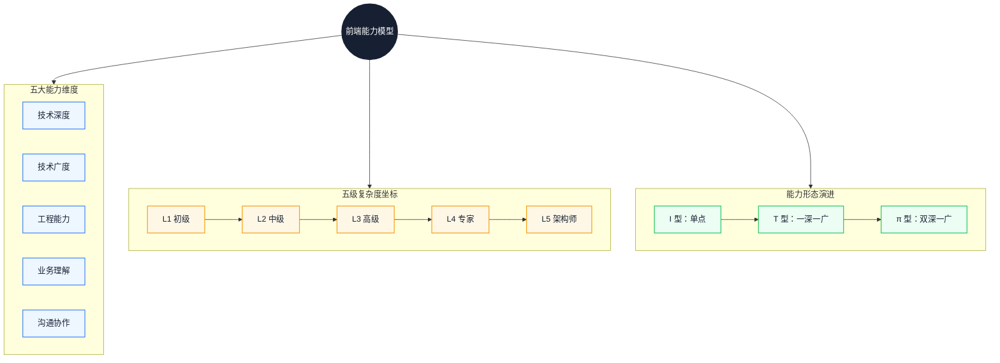
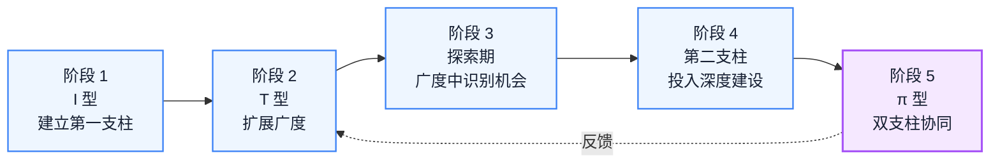

# 前端工程师能力模型：从 T 型到 π 型人才的进阶框架

年度规划写满「学 React、学 Node」，通常说明衡量标准还停在技术清单上。本文把能力拆成可观察的行为维度，给出一套判断复杂度边界的坐标，再比较单支柱与双支柱两种形态分别在什么条件下成立。读完后，你可以用具体事件完成一次自评，并据此决定下一阶段是补短板，还是换一根支柱。

::: info 一句话
前端工程师的能力，衡量的是你在多个维度上能不能稳定输出工程价值。从 T 型往 π 型走，就是把单点深度换成两条能互相借力的支柱。
:::

## 目录

- [写在前面](#写在前面)
- [一、为什么需要重新定义前端能力模型](#一、为什么需要重新定义前端能力模型)
- [二、能力模型的五大维度](#二、能力模型的五大维度)
- [三、五级能力分级标准](#三、五级能力分级标准)
- [四、T 型人才的局限性](#四、t-型人才的局限性)
- [五、π 型人才：两个深度支柱的构建](#五、π-型人才-两个深度支柱的构建)
- [六、能力雷达图：自我评估方法](#六、能力雷达图-自我评估方法)
- [七、常见的能力短板与突破策略](#七、常见的能力短板与突破策略)
- [八、能力模型的工程化应用](#八、能力模型的工程化应用)
- [结语：能力模型是地图，不是标尺](#结语-能力模型是地图-不是标尺)
- [FAQ](#faq)
- [来源](#来源)

## 写在前面

### 1. 技术清单回答不了的问题

很多前端工程师在做年度规划时，会写下这样的目标：

- 学习 React 18 新特性
- 学习 Vue 3 源码
- 学习 Node.js
- 学习 TypeScript

这些目标本身没有问题，问题在于它们只回答了「我会什么」，没有回答「我能在多大复杂度下稳定输出」。结果常见的状态是：技术学了一长串，手头解决的问题复杂度却没变，能力天花板也没怎么动。

同样是「会 React」，两个人的实际差距可能很大。工程师 A 在已有脚手架里完成页面开发，状态一复杂就堆 Redux，遇到性能问题就整套 `memo` 加上。工程师 B 能根据业务复杂度选择状态方案，能判断 LCP 慢是因为模块图过深，也能在 Code Review 中识别出可能导致 Hydration 问题的写法。技术清单看起来一样，能处理的复杂度差了一个量级。

### 2. 本文的判断与主线

本文把能力模型（Capability Model）定义为：用若干可观察维度描述「在什么复杂度下能稳定输出什么价值」的框架。它不负责评价你会哪些 API，负责的是定位你的复杂度边界，以及下一步该往哪里投入。

主线按决策顺序展开：先说明为什么技术清单失效，再给出五个评价维度，然后比较五级坐标以及 T 型、π 型两种形态，最后讨论自评失真、年限错配等约束，并给出条件化的行动建议。下图先建立整体印象：

读图顺序：五个维度是坐标，五级是刻度，三种形态是可选路径。维度决定往哪里投入，级别决定当前的复杂度边界，形态决定要立几根深度支柱。

---

## 一、为什么需要重新定义前端能力模型

前端岗位的边界一直在往外扩。早期「会 jQuery + Ajax」就能上岗，后来要求会一个 MVVM 框架和构建工具，再后来要求懂性能优化、有工程化经验，如今还要求能独立设计系统、处理跨端场景、推动跨团队协作。

边界一扩，用「会多少技术」衡量能力就越来越不准。技术清单只能说明你接触过什么，说明不了你能在多复杂的场景下做出判断。面试里常见的「用过 X 吗」只能验证接触面，验证不了复杂度。

这也是本文把能力拆成维度的原因：只有当每个维度都有可观察的行为标准，能力才谈得上定位和比较。

::: tip 本节核心结论

技术清单记录接触面，能力模型记录复杂度边界。前者可以靠时间堆出来，后者只能靠解决更难的问题换出来。
:::

---

## 二、能力模型的五大维度

五个维度相对独立，一个人在某一维很强、另一维很弱是常态。成长的重点不是五项同步抬升，而是识别短板、强化支柱。

### 1. 技术深度

技术深度指在某个具体领域能穿透到多底层。对前端工程师来说，常见的深度支柱有三类：

- **语言与运行时**：JavaScript / TypeScript 的类型系统、执行模型、V8 的 JIT 与 GC
- **浏览器原理**：渲染管线、事件循环、网络栈、安全模型
- **框架源码与设计思想**：React Fiber、Vue 响应式、Svelte 的编译时优化

衡量深度的标准不是读过多少源码，而是遇到新问题时能不能定位到链路上的根因。读源码是手段，用它解释真实故障才是能力。

### 2. 技术广度

技术广度指对不同技术栈和解决方案的认知范围，解决的是「知道有哪些选项」。典型表现：

- 能说出 SSR、SSG、ISR、Streaming SSR、Islands、Resumability 各自适合什么场景
- 知道 Webpack、Vite、Rollup、esbuild、Turbopack 的差异和取舍
- 了解 CSS 方案的演进：CSS-in-JS、CSS Modules、Tailwind、CSS Variables

广度的关键是知道存在、能判断适用场景，用不用得熟在其次。它的直接收益是技术选型时手里不止一把锤子。

### 3. 工程能力

工程能力指把代码变成可维护、可演进、可多人协作系统的能力。它最容易在面试中被低估，却在实际工作里决定成败。具体表现：

- 能设计合理的目录结构和模块边界
- 能制定 Code Review 标准，并真正执行
- 能搭建 CI/CD、灰度发布、监控告警
- 能在多人协作中控制代码质量，包括类型、测试、Lint 和提交规范
- 能识别并偿还技术债，而不是让它无限累积

工程能力的核心可以概括为一句话：让别人能更容易地在你的代码上继续工作。

### 4. 业务理解

业务理解指能不能跳出「实现需求」的视角，看到需求背后的业务目标。它可以分成几个层次：

- L1：能按 PRD 实现
- L2：能识别 PRD 中的不合理之处，提出技术侧的反建议
- L3：能从业务指标出发，反推技术投入的优先级
- L4：能主动发现业务机会，用技术手段推动业务结果

举例来说，需求方要「做一个支持自定义配置的活动落地页」。业务理解停在 L1 的工程师会直接做配置后台加渲染页；到 L3 的工程师会先问配置频率多高、由运营还是开发配置、活动周期多长。这几个答案直接决定是做一个可视化搭建系统，还是只做一个 JSON Schema 配置。

### 5. 沟通协作

沟通协作指在跨角色、跨团队场景下推动事情前进的能力。典型场景包括：

- 和产品经理对齐需求边界，避免 PRD 写到一半就开始实现
- 和后端约定接口契约，减少后期联调返工
- 和测试沟通边界 case，避免上线后才发现关键路径漏测
- 跨团队推进技术方案，在不同利益方之间找到平衡

它的核心是识别不同角色的关注点，用对方能接受的方式推动决策，而不是把话说得漂亮。

两侧的维度并不是并列的五个标签。技术深度和技术广度决定你能看见什么，工程能力和业务理解决定你能交付什么，沟通协作决定这些东西能被多少人采用。

::: tip 本节核心结论

五个维度可以单独评分，但不能单独成长。某一维的产出，往往需要另一维提供支撑；短板决定上限，支柱决定不可替代性。
:::

---

## 三、五级能力分级标准

把五个维度组合起来，可以得到五级复杂度坐标。每一级的核心特征，是「能在什么复杂度下独立完成什么」。下图是分级骨架，年限只作为阅读坐标：

图中的年限是常见经验区间，不是晋升门槛；分级真正比较的是箭头右侧的「独立处理复杂度」。五级之间没有自动升级，跨不过去通常卡在当前级的某个维度上。

### L1 初级（经验区间 0-2 年）

**核心特征**：能在指导下完成明确任务。

- **技术深度**：能熟练使用 1 个框架（React 或 Vue）完成页面开发，理解基本 API 背后的机制，例如 `useState` 何时触发重渲染
- **技术广度**：掌握 HTML/CSS/JS，听说过构建工具但不会独立配置
- **工程能力**：能遵循已有规范提交代码，能在 Code Review 中接受建议并改进
- **业务理解**：能按 PRD 实现，对需求背后的业务目标不敏感
- **沟通协作**：能在小团队内同步进度，遇到阻塞主动反馈

**行为信号**：给定明确的设计稿和接口，能在约定排期内独立完成一个中等复杂度页面，返工主要来自需求变更，而不是理解偏差。

### L2 中级（经验区间 2-4 年）

**核心特征**：能独立完成模块级功能。

- **技术深度**：理解框架核心机制，如 Fiber、Reconciler、响应式系统，能定位常见性能问题
- **技术广度**：熟悉构建工具配置，了解 SSR 基本原理，知道状态管理方案的演进
- **工程能力**：能写出可维护代码，抽象合理、命名清晰、职责单一，能写出有效的单元测试
- **业务理解**：能识别 PRD 中的边界 case，能从技术角度提出反建议
- **沟通协作**：能和后端、测试独立对接，能主导小规模技术方案讨论

**行为信号**：能独立负责一个完整业务模块，如下单流程或用户中心，从设计到上线不需要他人逐步指导。

### L3 高级（经验区间 4-6 年）

**核心特征**：能独立负责一条完整业务线。

- **技术深度**：能从浏览器底层链路定位性能问题，理解 V8 执行模型、渲染管线、网络栈
- **技术广度**：能对比多种方案并给出选型依据，跨端（Web、React Native、小程序）有实战经验
- **工程能力**：能制定团队规范，包括 Code Review 标准、提交规范、测试策略，能搭建监控告警
- **业务理解**：能从业务指标反推技术投入优先级，能用技术手段提升业务结果
- **沟通协作**：能跨团队推进方案，能在不同利益方之间找到平衡

**行为信号**：能独立负责一个业务线的技术方案，并在一个规划周期内拿出可对比的指标改善，而不是只交付功能。

### L4 专家（经验区间 6-8 年）

**核心特征**：能设计复杂系统，解决跨团队问题。

- **技术深度**：在多个领域有穿透性理解，能在源码层面贡献或修复框架级问题
- **技术广度**：具备跨栈视野，前端、Node 与基础设施之间能做技术迁移
- **工程能力**：能主导平台化建设，如组件库、工具链、低代码平台
- **业务理解**：能识别业务机会，用技术手段推动业务模式创新
- **沟通协作**：能在组织层面推动技术决策，影响其他团队的技术方向

**行为信号**：能主导一个跨团队技术项目，如全公司前端性能治理或统一工程化平台，产出可衡量的组织级结果。

### L5 架构师（经验区间 8 年以上）

**核心特征**：能定义技术方向，对业务结果负责。

- **技术深度**：具备全链路视角，能在任意环节定位根因
- **技术广度**：技术全景清晰，能判断哪些技术值得投入
- **工程能力**：能设计组织级工程体系，包括研发流程、质量体系、技术栈演进路线
- **业务理解**：能用技术驱动业务战略，参与业务决策
- **沟通协作**：能在高管、产品负责人和技术团队之间做翻译

**行为信号**：能定义一个业务线或技术领域 1-3 年的演进方向，并对最终结果负责。

::: warning 常见误区

把工作年限等同于能力级别。年限只能说明你在这个行业待了多久，分级标准看的是「能独立解决的复杂度」。有人 3 年做到 L3，也有人 10 年仍停在 L2。
:::

---

## 四、T 型人才的局限性

T 型人才是过去十年最常被推荐的能力形态：一竖代表深度，一横代表广度。对前端工程师来说，典型画像是 React 或 Vue 熟练，同时了解 HTML/CSS、构建工具、状态管理和基础后端。

相比只有单点深度的 I 型，T 型是明显进步。但在当前的复杂度下，它的局限也很清楚。

### 1. 单一深度支柱容易贬值

如果深度支柱是「React 用法」，那么并发模型、Server Components、Suspense for Data Fetching 这些变化都会让你的深度贬值。

如果深度支柱是「渲染管线 + 调度模型」，框架怎么演进，你理解的都是更底层的稳定结构。同样一份深度，挂在 API 上会过时，挂在机制上更耐用。

### 2. 单一深度难以处理跨领域问题

很多真实问题既不是纯前端问题，也不是纯后端问题，而是系统问题。

以 Hydration 性能问题为例，需要同时理解浏览器渲染管线、服务端执行模型和框架的 SSR 实现。只有一个深度支柱的工程师，在跨领域问题上容易失去判断力，只能把问题推给「不是我这层的原因」。

### 3. 单一深度难以承担架构责任

架构工作的本质是在多个不确定维度上做权衡。如果只有一个深度支柱，判断就会被这个支柱主导，倾向于用熟悉的方案解决所有问题。

### 4. 先判断你是否需要 π 型

π 型不是所有前端工程师的必经之路。如果你的目标是长期做单点技术专家，把一根支柱做到极深，同样能形成不可替代性。需要 π 型的典型条件是：

- 你要对跨端、跨层或跨团队的系统结果负责
- 你遇到的高频问题已经无法由单一领域解释
- 你需要在两个领域之间做取舍，而不是只在一个领域内优化

三个条件都不成立时，强行开辟第二支柱可能只是分散精力。

---

## 五、π 型人才：两个深度支柱的构建

π 型人才的核心是两条深度支柱加一定广度。对前端工程师来说，常见的组合是：

- 支柱 A：前端框架 + 浏览器原理
- 支柱 B：Node.js / 服务端 / 云原生
- 广度：跨端、工程化、性能优化、业务理解

关键不在支柱数量，而在两个支柱之间能不能互相借力。

### 1. 协同性的判断标准

判断两个支柱有没有协同，可以问三个问题：

1. **支柱 A 的深度，能不能帮支柱 B 解决更复杂的问题？** 例如前端框架深度可以帮助设计更合理的 SSR 方案。
2. **支柱 B 的深度，能不能帮支柱 A 突破天花板？** 例如服务端深度可以支撑 BFF、Edge Computing、Streaming SSR。
3. **两个支柱结合，能不能解决单一支柱搞不定的问题？** 例如全栈深度可以主导 Islands Architecture 落地。

三个问题都答「否」，那只是两个独立的 I 型拼在一起，不构成真正的 π 型。

### 2. 第二支柱的选择

第二支柱不建议跟热点，更稳的依据是业务场景：

| 业务场景 | 第二支柱建议 |
| --- | --- |
| 中后台 SaaS | 后端架构 + 数据库设计（BFF、权限模型、数据流转） |
| C 端内容 / 电商 | 性能工程 + CDN / 边缘计算 |
| 跨端业务 | React Native / Flutter / 小程序运行时 |
| 工具 / 平台型业务 | 编译原理 + IDE 工具链 |
| AI 应用 | LLM 应用工程 + 上下文工程 |

这张表给的是候选方向，不是标准答案。更可靠的判断是：你所在业务未来一年最贵的问题，是否正好落在某个第二支柱的能力范围内。

### 3. π 型的构建路径

构建 π 型不是「先把 A 做到顶级，再开始 B」，而是带着反馈的迭代过程：

路径不是单向流水线。到 π 型之后仍会回到 T 型补广度，虚线表示这种反馈；第二支柱是否成立，通常要在真实项目里被验证一次，而不是在规划表里被确认。

---

## 六、能力雷达图：自我评估方法

抽象模型如果不能落到自评，就没有实际用处。下面这套方法的目标不是打出一个漂亮分数，而是找出下一阶段最该投入的方向。

### 1. 五维度评分表

对每个维度按 1-5 分自评：

| 维度 | 1 分 | 3 分 | 5 分 |
| --- | --- | --- | --- |
| 技术深度 | 会用框架 | 理解框架机制 | 能从底层链路定位问题 |
| 技术广度 | 只会一个栈 | 知道多种方案并能选型 | 跨栈视野，能做技术迁移 |
| 工程能力 | 遵循规范 | 写出可维护代码 | 制定规范、主导平台化 |
| 业务理解 | 按 PRD 实现 | 识别边界 case | 从业务指标反推技术投入 |
| 沟通协作 | 团队内同步 | 跨职能对齐 | 跨团队推动决策 |

### 2. 评分的纪律

自评最大的风险是自我感觉良好。三个校准手段：

1. **用具体事件佐证**：每项评分至少能举出 1-2 个具体事件。说自己沟通协作 4 分，就要说得出近半年主导过的一次跨团队决策。
2. **和同事校准**：找 1-2 个长期合作的同事按同样维度评分，对比差异，而不是只对比结论。
3. **和外部对比**：通过技术社区、开源贡献、技术分享，了解同级工程师在做什么。

一项评分如果举不出事件，就按低一档处理。这是让雷达图从感觉变成证据的最低要求。

### 3. 识别「短板」还是「瓶颈」

雷达图的作用是排优先级，但短板和瓶颈不是一回事：

- **短板**：明显低于其他维度，限制整体水平。例如工程能力 2 分，其他都是 4 分。
- **瓶颈**：当前级别向上突破时最关键的能力。例如从 L3 升 L4，业务理解和跨团队推动通常是瓶颈。

两者在不同阶段优先级不同。L1 到 L3 之间，优先补短板，因为复杂度提升需要五个维度都能接住；L3 往上，优先破瓶颈，因为继续补短板带来的边际收益已经很低。

### 4. 一次完整的自评流程

1. 选最近半年最能代表你当前工作的 2-3 个事件，写下你在其中实际做了什么。
2. 按五个维度各打 1-5 分，每项必须对应到上面的事件。
3. 找 1-2 位合作过的同事复评，只讨论差异最大的两项。
4. 判断差异来自「短板」还是「瓶颈」，只选一个作为下一阶段的主投入方向。
5. 为这个方向设定一个可观察的验证信号，例如主导一次跨团队评审、独立完成一次根因定位。

---

## 七、常见的能力短板与突破策略

### 1. 技术深度伪瓶颈

很多 L2 工程师觉得自己深度不够，于是去读 React 源码、Vue 源码，几个月后发现工作能力没有明显变化。

原因不是源码没用，而是缺少应用场景。深度不是读过什么，而是能用底层理解解释并解决什么问题。

**突破策略**：

- 选一个最近遇到的线上问题，性能、内存或稳定性都可以
- 从浏览器链路、框架机制、运行时三个角度定位根因
- 把定位过程写成技术文章或团队分享，让别人能复现你的判断

做完这一轮，深度就有了可验证的载体。

### 2. 工程能力欠缺

L2 到 L3 的最大瓶颈往往是工程能力。典型表现是代码别人接手困难、不知道怎么制定 Code Review 标准、团队代码质量长期低迷却没有改善手段。

**突破策略**：

- 固定参与 Code Review，重点看设计与边界，而不是只挑语法
- 主导一次团队规范制定，如提交规范或测试策略
- 从零搭建一次监控告警，把线上问题转化成可观测指标

工程能力只能靠做工程攒出来，读文章不够。

### 3. 业务理解表面化

很多工程师对业务的理解停在「知道这个功能是干什么的」。再深一层要回答三个问题：它解决用户的什么问题，影响哪些业务指标，投入产出怎么衡量。

**突破策略**：

- 主动和产品经理对齐业务目标，不只盯 PRD 细节
- 定期看业务周报和核心指标看板，理解自己工作的影响
- 选一个业务核心指标，用技术手段做一次可对比的优化

### 4. 沟通协作只在熟人圈

在团队内沟通顺畅、一跨团队就磕磕绊绊，是 L3 到 L4 的典型瓶颈。

跨团队沟通的关键不是把技术讲清楚，而是识别对方的利益点，用对方能接受的方式推动。突破可以从三个动作开始：

- 主导一次跨团队技术项目，如统一登录、性能治理、组件库共建
- 每次跨团队沟通前，先列出对方关心什么、担心什么、你能提供什么
- 复盘每次协作的成败，找到自己反复出现的沟通模式

::: warning 常见误区

把「我不擅长沟通」当作不成长的解释。沟通协作是可学习的技能，关键在识别对方视角和持续练习，跟性格关系没有那么大。
:::

---

## 八、能力模型的工程化应用

能力模型不只用于个人规划，也可以进入团队管理。前提是把它当作校准工具，而不是贴标签的依据。

### 1. 招聘定级

招聘时用统一的分级标准评估候选人，可以减少「感觉不错就给高级」的随意性。具体做法：

- 每级定义清楚「能独立解决的复杂度」，而不是罗列技术栈
- 面试问题对应到具体能力维度，而不是「会不会某个 API」
- 多个面试官独立评级，再校准差异

### 2. 晋升评估

晋升评估的核心问题是「是否已经稳定在下一级复杂度上输出」，而不是「工作几年了」。可以观察三个信号：

- 近半年是否有 2-3 个事件证明其在下一级复杂度上稳定输出
- 在当前级别是否已经明显有余力，说明能力溢出
- 短板是否会限制其在下一级发挥作用

### 3. 团队能力地图

把成员的能力评分汇总，可以得到团队能力地图，用来回答三个问题：哪些维度是团队短板，需要招聘或培养；哪些维度有冗余，可以做交叉备份；哪些成员的能力可以互补。

汇总时要注意，个人评分不能直接用于绩效。它更适合做培养规划，因为评分本身带有主观性，一旦和利益挂钩就会失真。

---

## 结语：能力模型是地图，不是标尺

能力模型的价值，是让你做职业规划时不再只能写「学 React、学 Node、学 Rust」。它回答的是位置和方向：我现在在哪一级复杂度上，下一步该补哪一维，短板和瓶颈分别是什么。

但它不是标尺。别用它给自己或别人贴标签，也别把五级当成必须逐级爬的台阶。能力是动态的，模型是静态的；模型负责定位，成长仍然发生在解决具体问题的过程里。

如果只带走一个动作，那就是：用最近半年的两三个真实事件完成一次自评，选一个方向，为它设定一个能被别人观察到的验证信号。半年后回看这个信号，比争论自己到底是 L3 还是 L4 有用得多。

---

## FAQ

### 1. 我工作 5 年了，但还是觉得自己在 L2，是哪里出问题了？

先不要用年限推断级别。做一次雷达图自评，看是技术深度停在「会用框架」，还是工程能力停在「写代码」而没有进到「制定规范、主导平台化」。如果五个维度都不低，却一直拿不到更复杂的任务，问题可能在环境而不是能力，这时需要和 leader 明确成长诉求，或者换一个能提供复杂度的场景。

### 2. 是不是每个前端工程师最终都要走到 π 型？

不是。π 型解决的是跨领域问题和架构责任，如果你的目标是在一个领域做到极深，单支柱同样有价值。可以用三个条件判断：是否需要为跨层系统结果负责、高频问题是否已超出单一领域、是否需要在两个领域之间做取舍。三个都不成立时，优先加深第一支柱。

### 3. 这套五级标准能直接用于公司定级吗？

不能直接套用。本文的分级是经验模型，用来描述复杂度边界，不对应任何一家公司的职级体系。公司定级还需要考虑业务规模、影响范围和岗位序列，通常要把这里的「行为信号」翻译成公司自己的标准，再用多个评估者校准。

---

## 来源

本文的能力维度与分级来自作者对多家互联网公司工程师职级体系的归纳，属于经验模型，不是任何一家公司的官方标准。π 型人才的概念来自对前端岗位边界扩张的观察，同样属于判断而非行业规范。文中未引用可公开核验的外部数据；涉及年限的数字均为常见经验区间，不作为晋升或招聘的硬性标准。
