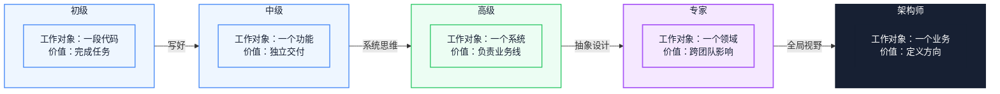
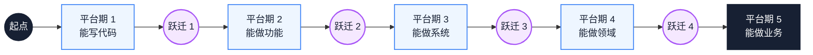
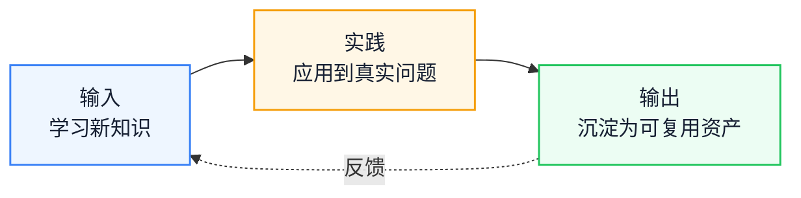

# 技术成长路径：从初级到架构师的能力跃迁

工作年限在涨、能力却停住，通常不是努力不够，而是工作对象没有换。本文按工作对象的变化把成长分成几段，逐段说明每次升级要换掉什么、卡点通常出现在哪里、什么条件下换环境才有意义。读完后，你可以判断自己正处在哪个平台期，并为下一次升级挑一个能验证的动作。

::: info 一句话
技术成长是多次「能力跃迁」，不是平滑爬坡。每次跃迁，工作对象都从一个具体事物升级为一个更抽象的系统。
:::

## 目录

- [写在前面](#写在前面)
- [一、技术成长的非线性特征](#一、技术成长的非线性特征)
- [二、五个阶段的核心特征](#二、五个阶段的核心特征)
- [三、初级 → 中级：从能写到写好的跨越](#三、初级-→-中级-从能写到写好的跨越)
- [四、中级 → 高级：从功能到系统的思维升级](#四、中级-→-高级-从功能到系统的思维升级)
- [五、高级 → 专家：从实现到设计的抽象能力](#五、高级-→-专家-从实现到设计的抽象能力)
- [六、专家 → 架构师：从技术到全局的视野](#六、专家-→-架构师-从技术到全局的视野)
- [七、技术成长的复利效应](#七、技术成长的复利效应)
- [结语：跃迁不是更努力，是工作对象的升级](#结语-跃迁不是更努力-是工作对象的升级)
- [FAQ](#faq)
- [来源](#来源)

## 写在前面

### 1. 一个常见假设

很多前端工程师在做职业规划时，默认了一个前提：只要持续学技术、做项目，能力就会随时间线性提升，最后自然会成为架构师。

这个前提经不起验证。如果每年处理的都是同类问题，十年经验可能只是同一段经验重复了多次。年限能积累熟练度，但不自动带来复杂度。

### 2. 本文的判断与主线

本文把技术成长理解为工作对象的升级：从一段代码，到一个功能，到一个系统，到一个领域，到一个业务。每一次升级，价值产出、判断范围和不确定度都会换一档。

主线按决策顺序展开：先说明成长为什么是非线性的，再给出五个阶段和四次跃迁的比较，然后讨论平台期、环境和复利这些约束，最后给出条件化的行动建议。下图先给出五阶段骨架：


箭头上的词是跃迁条件，不是职位名称。判断自己在哪个阶段，看工作对象，不看 title；同一 title 下有不同工作对象，是很常见的情况。

---

## 一、技术成长的非线性特征

先接受一个反直觉的事实：**技术能力和工作年限之间是阶梯关系，不是线性关系**。

把能力放在纵轴、年限放在横轴，曲线更接近一组平台加几次跳变：


平台期和跃迁交替出现。平台期用于把当前工作对象做熟，跃迁点才是能力曲线跳变的位置；只做平台期的事，曲线会一直变平。

这种非线性有两个直接推论：

1. **平台期不能靠更努力突破**。在当前阶段加倍努力，只能让你更接近天花板，天花板本身不会升高。
2. **跃迁需要主动设计**。跃迁不会自然发生，需要主动改变工作对象和判断范围。

---

## 二、五个阶段的核心特征

进入具体跃迁之前，先把五个阶段放在一起对照。下表是后文展开的参照，年限列只是常见经验区间：

| 阶段 | 工作对象 | 核心能力 | 价值产出 | 典型年限（经验参考） |
| --- | --- | --- | --- | --- |
| 初级 | 一段代码 | 实现明确任务 | 完成开发任务 | 0-2 年 |
| 中级 | 一个功能 | 独立交付模块 | 独立完成功能 | 2-4 年 |
| 高级 | 一个系统 | 设计技术方案 | 负责业务线 | 4-6 年 |
| 专家 | 一个领域 | 跨团队推动 | 平台化建设 | 6-8 年 |
| 架构师 | 一个业务 | 全局权衡 | 定义技术方向 | 8 年以上 |

每个阶段的核心问题不同：

- 初级：怎么把这个功能写出来？
- 中级：怎么把它写好，写得别人能维护？
- 高级：这个系统怎么设计，才能支撑业务未来一到两年的发展？
- 专家：这个领域的共性问题是什么，能不能平台化解决？
- 架构师：这个业务的技术投入应该往哪里倾斜？

下面四次跃迁，回答的是「如何从一个问题升级到下一个问题」。

### 判断：换环境能不能带来跃迁

在考虑换团队或换公司之前，可以先过三个问题：

- 当前团队是否还在产生更高复杂度的问题？
- 你是否已经独立处理过当前阶段的典型问题？
- 目标环境能提供下一个工作对象，还是只提供一个更高的 title？

前两个问题的答案都是「否」时，换环境大概率只是换同事。只有目标环境确实能提供新的工作对象，换环境才构成跃迁条件。

---

## 三、初级 → 中级：从能写到写好的跨越

### 1. 跃迁在改什么

初级工程师的核心能力是把功能写出来：给定明确的设计稿和接口，产出可运行的代码。

中级工程师的核心能力是把功能写好：代码可维护、可测试、可扩展，能独立处理边界 case 和异常。

这次跃迁，是从「实现功能」走到「实现工程化功能」。

### 2. 关键转变

#### 转变 1：从「能跑就行」到「可维护代码」

初级工程师的代码通常能跑，但把实现、请求、提示和异常揉在一起：

```javascript
// 典型初级代码：能跑，但难维护
function handleSubmit() {
  const name = document.getElementById('name').value
  const age = document.getElementById('age').value
  if (name && age) {
    fetch('/api/user', {
      method: 'POST',
      body: JSON.stringify({ name, age })
    }).then(res => {
      if (res.ok) {
        alert('成功')
      } else {
        alert('失败')
      }
    })
  }
}
```

中级工程师会把关注点拆开，并显式处理失败：

```typescript
// 中级代码：抽象、类型化、错误处理
interface UserData {
  name: string
  age: number
}

async function createUser(data: UserData): Promise<Result<User, ApiError>> {
  try {
    const response = await fetch('/api/user', {
      method: 'POST',
      body: JSON.stringify(data)
    })
    if (!response.ok) {
      return { ok: false, error: await parseApiError(response) }
    }
    return { ok: true, value: await response.json() }
  } catch (e) {
    return { ok: false, error: { type: 'network' } }
  }
}

async function handleSubmit(values: FormValues) {
  const result = await createUser(values)
  if (result.ok) {
    notify.success('创建成功')
  } else {
    notify.error(formatApiError(result.error))
  }
}
```

两个片段只保留了与跃迁相关的差异，`Result`、`parseApiError`、`notify` 等定义已省略。差异不在会不会 TypeScript，而在三个层面：

- **类型化思维**：先想清楚数据形状，再写实现
- **错误处理思维**：所有外部调用都可能失败，错误是显式的
- **抽象思维**：API 调用、UI 通知、表单提交是不同关注点，应该分离

#### 转变 2：从「自己能跑」到「别人能接手」

初级工程师常写出只有自己看得懂的代码：变量名缩写、魔法数字、隐式依赖、缺少说明。

中级工程师会考虑「如果我离开，别人接手需要多久」。具体表现：

- 命名清晰，避免 `data1`、`temp`、`handle` 这类无意义名字
- 关键逻辑的注释解释「为什么这么做」，而不是重复「做了什么」
- 公共函数有简单的参数和返回值说明
- 复杂业务逻辑有简短的设计说明

#### 转变 3：从「测过没问题」到「有测试保障」

初级工程师的测试往往是手动点几下，加上一句「应该没问题」。

中级工程师会写单元测试，至少覆盖核心逻辑：

- 工具函数有完整测试
- 关键业务路径有覆盖
- 边界 case 有显式测试

### 3. 关键转折点

这次跃迁的转折点，通常是第一次长期接手别人的代码。

当你花几天时间理解一段没人维护的代码时，会开始反问：如果当初这样写，现在就不用这么累。这个反问出现时，你才开始从「能写」转向「写好」。

### 4. 常见瓶颈

#### 瓶颈 1：陷入框架文档学习

很多初级工程师以为中级等于会更多框架 API，于是不断追 React、Vue、Angular 的新特性。方向偏了：API 学得再多，代码仍然可以难维护。

**突破**：选一个最近写的功能，主动找高级工程师做一次深度 Code Review，重点问「为什么这样写不好」，而不是「还有什么 API 没学」。

#### 瓶颈 2：业务理解停滞

初级工程师容易被实现需求占满注意力，不思考需求背后的业务目标，做了一年仍是「按 PRD 写代码」的水平。

**突破**：每周问自己一次「这个需求解决了用户的什么问题」，把答案记下来，长期积累业务判断。

---

## 四、中级 → 高级：从功能到系统的思维升级

### 1. 跃迁在改什么

中级工程师的工作对象是一个功能，能独立完成从设计到上线。

高级工程师的工作对象是一个系统：多个功能怎么组合、数据怎么流转、怎么支撑业务长期发展。

这次跃迁，是从功能视角走到系统视角。

### 2. 关键转变

#### 转变 1：从「实现需求」到「设计技术方案」

中级工程师拿到需求，第一反应是怎么实现。高级工程师第一反应是「这个需求会怎么影响系统」：

- 会引入哪些新数据？
- 新数据和现有数据是什么关系？
- 未来可能怎么扩展？
- 能否复用已有底层能力？

以「给用户列表增加批量导出」为例。中级思路是加按钮、调接口、生成 Excel、触发下载。高级思路会先回答几个问题：

- 未来会不会扩展成导出 PDF 或导出选中列？如果会，应该抽象统一的导出能力。
- 数据量多大？同步导出还是异步任务？大数据量需要后端任务化，前端轮询。
- 导出权限怎么控制？必须复用现有权限体系，而不是单独再做一套。
- 失败如何反馈？是否需要重试和可观测指标？

差异不在实现能力，而在动手之前是否已经把系统影响想清楚。

#### 转变 2：从「局部最优」到「全局权衡」

中级工程师的优化往往是局部的：这个组件渲染慢，就加 `memo`。

高级工程师会先判断：

- 组件为什么慢，是数据结构问题还是设计问题？
- 加 `memo` 是治标还是治本，会不会引入新的内存问题？
- 不优化时，对用户体验的实际影响有多大？
- 优化的投入产出比是否合理？

#### 转变 3：从「自己写好」到「团队规范」

中级工程师能写出好代码，但只对自己的代码负责。高级工程师会把个人的「好」复制到团队：

- 制定 Code Review Checklist
- 推动提交规范、Lint 规则和测试覆盖率门槛
- 设计团队的技术栈和目录结构标准
- 主导技术分享和文档沉淀

### 3. 关键转折点

这次跃迁的转折点，通常是第一次独立负责一个完整业务模块。

当你需要从零设计技术方案、考虑未来扩展、和多方对齐时，视角会被迫从功能升级到系统。

### 4. 常见瓶颈

#### 瓶颈 1：技术深度不够，定位不到根因

中级工程师能定位「哪个组件慢」，但说不清「为什么慢」，后者需要理解浏览器渲染管线、框架调度机制和 V8 执行模型。

**突破**：选一个真实性能问题，从 DevTools 开始，逐步深入到渲染管线、框架源码和运行时机制，把过程写下来。

#### 瓶颈 2：缺乏跨职能对齐能力

中级工程师习惯自己搞定，高级工程师则需要频繁和产品、后端、测试对齐。这个转变对很多人是痛苦的。

**突破**：主动承担一次跨职能项目，例如复杂需求评审、跨端联调或线上事故复盘。这些场景会强制练习对齐。

#### 瓶颈 3：业务理解停留在「按 PRD 实现」

能识别边界 case，不等于理解业务整体。缺少业务判断时，技术方案容易过度设计或设计不足。

**突破**：花一段时间了解自己负责业务线的核心指标、用户画像和商业模型，再回头看哪些技术投入真正影响了指标。

::: warning 常见误区

把「会用更多工具」等同于高级能力。会用 Webpack、Vite、Turbopack 只是广度，能在具体场景下做正确选型、并为结果负责，才是高级能力。
:::

---

## 五、高级 → 专家：从实现到设计的抽象能力

### 1. 跃迁在改什么

高级工程师的工作对象是一个系统，能设计技术方案、负责业务线。

专家的工作对象是一个领域：多个系统之间的共性、平台化能力、跨团队影响。

这次跃迁，是从解决具体问题走到识别模式并抽象。

### 2. 关键转变

#### 转变 1：从「解决问题」到「消除问题」

高级工程师解决具体问题：这个页面慢，我来优化。

专家会识别问题模式：为什么团队的页面普遍慢，是工程化体系缺失、规范不到位，还是组件库设计有问题？

举个例子。团队里有 5 个业务都在重复实现「分页表格 + 筛选 + 导出」。

- 高级工程师：把 5 个实现重构成统一组件
- 专家：识别这是中后台的共性问题，设计配置化能力，让非核心业务通过配置生成

差异在于：高级工程师解决重复，专家消除重复的原因。

#### 转变 2：从「技术方案」到「领域设计」

高级工程师设计技术方案：怎么实现、用什么技术栈、如何扩展。

专家设计领域模型：这个领域的核心概念是什么、不同业务的差异在哪里、怎么抽象出可复用的模型。常见的抽象方向：

- 设计组件库时，不只堆组件，而是区分基础组件、复合组件和业务组件
- 设计监控系统时，不只堆指标，而是区分性能、稳定性和业务三层指标体系
- 设计工程化平台时，不只堆工具，而是按构建、部署、监控、治理划分领域

#### 转变 3：从「团队内影响」到「跨团队影响」

高级工程师的影响范围是自己负责的业务线。专家需要在跨团队场景下推动事情：

- 主导跨团队技术项目，如统一登录、性能治理、组件库共建
- 在技术委员会层面参与决策
- 影响其他团队的技术方向

跨团队推动的关键，是识别不同团队的诉求、找到共赢点、用对方能接受的方式推进。只靠技术强不够。

### 3. 关键转折点

这次跃迁的转折点，通常是第一次主导跨团队项目。

当你发现用团队内沟通的方式推不动跨团队项目时，才会从「讲清楚技术」转向「识别利益 + 设计共赢」。

### 4. 常见瓶颈

#### 瓶颈 1：技术深度停滞

很多高级工程师在技术深度上提前停住了：能定位常见性能问题，但遇到 GC 行为异常、跨进程通信成本、JIT 去优化这类问题就束手无策。

**突破**：选 1-2 个底层领域做深度穿透，例如完整理解 V8 执行流水线、Chromium 渲染架构或 HTTP/3 协议。这种深度在跨团队场景下会转化为判断权威。

#### 瓶颈 2：缺乏抽象能力

高级工程师习惯解决具体问题，抽象能力需要刻意练习。

**突破**：

- 每次解决一个共性问题后，追问「这类问题能不能从根本上消除？」
- 主导一次平台化项目，如组件库、工具链或低代码平台
- 学习领域驱动设计（DDD），理解怎么从业务中抽象领域模型

#### 瓶颈 3：跨团队推动能力不足

这是高级升专家最常见的瓶颈。表现是技术很强，但跨团队项目总是推不动。

**突破**：

- 主导一次跨团队项目，提前识别哪些团队需要配合、各自关心什么、阻力在哪
- 每次跨团队会议前，准备一份「对方视角」分析：对方为什么要配合，有什么顾虑
- 复盘每次协作，找到自己反复出现的沟通盲点

---

## 六、专家 → 架构师：从技术到全局的视野

### 1. 跃迁在改什么

专家的工作对象是一个领域，能在该领域做平台化建设、跨团队影响。

架构师的工作对象是一个业务：在多个领域之间做权衡、定义技术方向、对业务结果负责。

这次跃迁，是从技术最优走到全局最优。

### 2. 关键转变

#### 转变 1：从「技术驱动」到「业务驱动」

专家的技术决策往往以技术最优为导向：性能更好、扩展性更强、设计更优雅。

架构师的技术决策以业务最优为导向，会先问：

- 这个技术投入对业务指标的影响有多大？
- 方案的人力、时间和维护成本是否合理？
- 是否符合业务未来一到两年的方向？
- 如果业务方向变了，沉没成本有多大？

以「是否自研状态管理库」为例。专家视角看到的是更贴合业务、性能更好、可控性更强；架构师视角会先算两件事：自研需要多少人月开发和持续维护，业务未来一年是否会复杂到必须自研。如果不会，开源方案加适配层可能更合适。

#### 转变 2：从「单领域深度」到「跨领域权衡」

专家在自己擅长的领域有深度，跨领域决策时却容易以本领域为中心。架构师需要在多个领域之间做权衡：

- 性能 vs 开发效率
- 稳定性 vs 迭代速度
- 技术先进性 vs 团队承接能力
- 短期收益 vs 长期投入

权衡的本质，是识别什么对业务最重要，其余部分可以妥协。

#### 转变 3：从「技术领导」到「组织领导」

专家的领导力体现在技术方向：用什么技术栈、系统怎么设计。

架构师的领导力体现在组织层面：

- 团队结构怎么设计，按业务线、技术领域还是平台划分
- 人才结构怎么配置，高级、中级、初级的比例如何
- 技术栈演进路线怎么规划，哪些该投入、哪些该淘汰
- 团队效能怎么衡量，不只看代码量，还要看业务结果、工程质量和人才成长

### 3. 关键转折点

这次跃迁的转折点，通常是第一次对业务结果负全责。

当你不再只是完成技术项目，而是要为 GMV、留存、转化率这类指标负责时，视角会被迫从技术扩展到业务、组织和技术的组合。

### 4. 常见瓶颈

#### 瓶颈 1：技术惯性，跳不出技术视角

很多专家升到架构师后，仍然用技术视角看问题：业务方提需求，第一反应是怎么实现，而不是这个需求是否值得做。

**突破**：

- 参与业务规划会议，理解业务战略和优先级
- 和业务负责人建立定期沟通，不只听技术诉求
- 学习业务分析方法，如用户漏斗、ROI 计算、商业模型

#### 瓶颈 2：缺乏组织设计能力

架构师不只设计技术架构，还要参与团队架构设计。这是很多专家的盲区。

**突破**：

- 学习康威定律，理解系统架构和团队架构如何相互影响
- 观察不同团队结构的优劣：职能团队、业务团队、平台团队
- 参与团队组建、人才招聘和绩效考核设计

#### 瓶颈 3：失去技术敏感度

有些架构师升上去后，忙于业务和组织事务，技术判断力下降，最后只剩下画图。

**突破**：

- 保留固定的技术时间，例如每周留一天不排会议，用于 Code Review、关键问题定位或技术预研
- 定期和一线工程师 1:1，了解真实的技术问题
- 保留一个持续跟进的技术领域，不让自己和代码完全脱节

::: warning 常见误区

以为架构师就是画架构图的人。架构图只是产物，架构师的核心能力是在多个不确定维度上做权衡，并对结果负责。
:::

---

## 七、技术成长的复利效应

前面四节讲的是跃迁，但跃迁不会凭空发生。支撑跃迁的，是平台期的持续积累，而积累依赖复利。

### 1. 复利的三要素：输入、实践、输出

技术成长的复利来自三个环节的闭环：


三个环节首尾相连，缺一环复利就断。只输入不实践会快速遗忘，只实践不输出，经验只能留在个人身上。

#### 输入：学习新知识

输入不是刷技术新闻，而是有目标地学习。大致有三个层次：

- **被动输入**：读技术文章、看视频教程，留存率低
- **系统输入**：读经典书籍、官方文档、源码，留存率中等
- **问题驱动输入**：带着具体问题去学，例如为解决 Hydration 问题去读 React SSR 实现，留存率最高

有效输入的核心是带着问题学，而不是先学完再用。

#### 实践：应用到真实问题

实践是复利的关键。没有实践的输入会快速遗忘。

实践的关键是真实问题：在真实业务场景下用新知识解决问题，写 demo 不算。真实问题的复杂度会暴露学习中的盲点。

#### 输出：沉淀为可复用资产

输出是复利的放大器。没有输出的实践，只能沉淀为个人经验；有输出的实践，才可能变成可复用资产。常见形式：

- 技术文章或团队分享：把解决问题的过程写下来
- 开源贡献或内部组件库：把通用方案沉淀为代码
- 技术规范或 Checklist：把经验沉淀为团队规则
- 培训或 Mentorship：把经验传递给其他人

### 2. 复利的非线性特征

复利的回报不是均匀分布的：

- 第 1 年：每周输出技术笔记，能力提升不明显
- 第 2 年：旧笔记开始成为参考，解决问题的速度加快
- 第 3 年：积累的笔记可以组合成系统化的文章或分享
- 第 5 年：系统化输出让你在团队内形成领域辨识度

这些时间点是经验观察，不是承诺。很多人坚持不到拐点：写了几个月笔记，看不到明显效果，就停了。停下来的位置，往往正好在复利开始起作用之前。

### 3. 复利的工程化方法

把复利落到日常，可以给自己设一个可持续的节奏。下面是一组示例，不是标准：

- **每周固定输入时间**：读源码、官方文档或经典书籍
- **每周若干次真实场景应用**：把学到的东西用在有业务约束的问题上
- **每月固定输出**：技术分享、文章或 Code Review 总结

例如「每周 3 小时输入、每周 3 次真实场景应用、每月 3 次输出」这样的 3-3-3 节奏。数字本身不重要，重点是可持续。每月突击几十个小时，通常不如每周稳定投入；复利依赖持续，不依赖爆发。

---

## 结语：跃迁不是更努力，是工作对象的升级

重新理解技术成长，关键不是把「更努力」当作答案，而是问：我现在解决的是什么复杂度的问题，下一个工作对象是什么。

下一次跃迁通常不会以晋升通知的形式出现。它更可能表现为一个你还没完全接得住的任务：一个需要你设计而不是实现的需求，一个需要你跨团队推动而不是独自完成的项目。判断要不要接，看它是否把你从当前工作对象推向下一层。

如果只带走一个动作，那就是给未来半年选一个「略高于当前能力」的工作对象，并提前说清楚验证信号：交付后，谁能观察到什么变化。做不到这一点，读再多成长方法论，也只是在平台期里换姿势。

---

## FAQ

### 1. 我工作 4 年了，还在做「按 PRD 实现」的工作，怎么突破？

先区分是团队没给机会，还是自己没争取。如果是团队问题，可以和 leader 明确成长诉求，或争取参与更复杂的项目；如果是自己一直待在舒适区，就从当前需求里主动多做一步：考虑扩展性、补测试、做性能分析。关键不是换任务类型，而是让下一件事的复杂度比上一件高一点。

### 2. 在一家公司能完成多次跃迁吗？

可以，但有条件。公司业务需要持续产生更高复杂度的问题，团队要有可争取的空间，你也要主动接下超出当前级别的任务。三个条件都成立时，不必靠换公司获得跃迁；如果都不成立，换环境可能更有效，但只换环境、不换工作对象，仍然不会发生跃迁。

### 3. 架构师一定要做管理吗？技术专家路线和管理路线怎么选？

架构师和技术管理者是两个方向。架构师的核心是在多个不确定维度上做技术权衡，技术管理者的核心是通过团队拿结果。两者有重叠，但不互相替代。

选择时可以看两点：你更愿意花时间在判断方案，还是在判断人和组织；你更能接受哪种失败方式，是技术判断失误，还是团队结果不达标。两条路都能走到很高的层级。

### 4. 复利效应真的有用吗？写了 1 年技术笔记，没感觉能力提升多少。

一年看不到明显效果是正常的，拐点通常在更晚出现。但也要检查输出质量：是不是抄书式笔记，是不是没有和实践结合，是不是零散到无法复用。把零散笔记重新组织成「某个具体问题的完整解决方案」，复利才可能开始积累。

---

## 来源

本文的阶段划分与跃迁描述来自作者对多家互联网公司工程师成长路径的归纳，属于经验模型，不对应任何公司的职级标准。复利的「输入—实践—输出」框架来自个人长期实践观察，不是经过实证研究验证的结论。文中年限均为常见经验区间，不作为晋升门槛；复利拐点的时间描述同样属于经验判断，个体差异可能很大。
