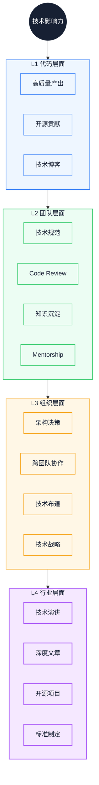
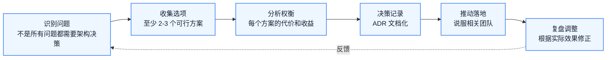

# 技术影响力构建：从代码贡献到技术领导力

技术方案被否决、跨团队项目推不动，原因往往不在方案本身，而在影响力还停在代码层。本文按影响范围分层，说明从个人产出到团队复用、再到组织决策，每一层各自需要什么能力、要付什么代价，并讨论从专家转向管理时容易出现的误判。读完后，你能定位自己的影响范围，并选一条当下可执行的建设路径。

::: info 一句话
技术影响力，就是让你的能力产生的价值超过你亲自写的代码——从「自己做好」到「让系统更好」到「让组织更好」。
:::

## 目录

- [写在前面](#写在前面)
- [一、技术影响力的四层模型](#一、技术影响力的四层模型)
- [二、代码层面：高质量产出与开源贡献](#二、代码层面-高质量产出与开源贡献)
- [三、团队层面：技术规范、Code Review、知识沉淀](#三、团队层面-技术规范、code-review、知识沉淀)
- [四、组织层面：架构决策、跨团队协作、技术布道](#四、组织层面-架构决策、跨团队协作、技术布道)
- [五、行业层面：技术演讲、文章输出、开源项目](#五、行业层面-技术演讲、文章输出、开源项目)
- [六、技术领导力的本质](#六、技术领导力的本质)
- [七、从技术专家到技术管理者的转型陷阱](#七、从技术专家到技术管理者的转型陷阱)
- [结语：影响力是放大器，不是替代品](#结语-影响力是放大器-不是替代品)
- [FAQ](#faq)
- [来源](#来源)

## 写在前面

### 1. 技术强，为什么影响仍然有限

很多高级前端工程师会遇到同一个困惑：技术能力已经不弱，但跨团队项目推不动，技术方案也容易被否决。

困惑的根源，是把技术能力等同于技术影响力。技术能力回答「自己能做什么」，技术影响力（Technical Influence）回答「能让多少人、多少系统因为你的判断而变好」。两者相关，但不是一回事。一个人可以技术很强而影响力很弱，也可以技术中等却能把团队带起来。

### 2. 本文的判断与主线

本文先给出四层影响力模型，再逐层说明每一层的投入方式、衡量信号和常见误区，最后讨论技术领导力（Technical Leadership）以及从专家转向管理的风险。

主线按决策顺序展开：先判断自己当前的影响范围，再比较各层的收益与代价，然后识别转型约束，最后给出条件化建议。下图是整体结构：


四层表示影响范围，不表示必须逐层通关。多数人会在相邻两层之间往返：代码产出建立信任，团队工作扩大影响，再回到代码解决更难的问题。

---

## 一、技术影响力的四层模型

技术影响力可以拆成四个层次，每一层的影响范围、核心能力和衡量信号都不同：

| 层次 | 影响范围 | 核心能力 | 衡量信号 |
| --- | --- | --- | --- |
| L1 代码层面 | 个人 / 小团队 | 高质量产出 | 代码质量、缺陷率、复用度 |
| L2 团队层面 | 整个团队 | 规范制定、知识沉淀 | 团队效率、代码质量、人才成长 |
| L3 组织层面 | 多个团队 | 架构决策、跨团队推动 | 跨团队项目结果、组织级指标 |
| L4 行业层面 | 整个行业 | 思想输出、生态建设 | 行业认知度、开源项目影响 |

四层之间是递进关系，但不是「必须做完 L1 才能做 L2」。高级工程师通常主要在 L1 和 L2 之间切换，专家在 L2 和 L3 之间切换，架构师在 L3 和 L4 之间投入更多。

模型的实际用途是定位：你现在的影响主要发生在哪一层，下一层需要补的不是努力程度，而是另一种工作方式。

---

## 二、代码层面：高质量产出与开源贡献

L1 是影响力的基础。代码质量不行，再会沟通、再会布道，也很难拿到技术信任。

### 1. 高质量代码产出

高质量代码通常有四个特征：

- **可读性**：别人接手时，能在一次 Code Review 的时间内理解主要逻辑
- **可维护性**：需求变更时改动局部化，不会牵一发动全身
- **可测试性**：核心逻辑有测试覆盖，重构时不会破坏功能
- **健壮性**：边界 case 和异常情况都有处理

同样是写一个用户列表组件，差别不在用了多少 API，而在是否显式建模状态、管理异步资源、分离关注点：

```typescript
// 低质量版本：能跑，但状态和请求揉在一起
function UserList() {
  const [users, setUsers] = useState([])
  const [loading, setLoading] = useState(false)

  useEffect(() => {
    setLoading(true)
    fetch('/api/users').then(res => res.json()).then(data => {
      setUsers(data)
      setLoading(false)
    })
  }, [])

  if (loading) return <div>loading...</div>
  return (
    <div>
      {users.map(u => <div key={u.id}>{u.name}</div>)}
    </div>
  )
}
```

```typescript
// 高质量版本：状态显式、请求可取消、错误可处理
interface User {
  id: string
  name: string
}

interface UserListProps {
  onError?: (error: Error) => void
}

type UserListState =
  | { status: 'idle' }
  | { status: 'loading' }
  | { status: 'success'; users: User[] }
  | { status: 'error'; error: Error }

function UserList({ onError }: UserListProps) {
  const [state, setState] = useState<UserListState>({ status: 'idle' })

  useEffect(() => {
    const controller = new AbortController()

    setState({ status: 'loading' })
    fetchUsers(controller.signal)
      .then(users => setState({ status: 'success', users }))
      .catch(error => {
        if (error.name !== 'AbortError') {
          setState({ status: 'error', error })
          onError?.(error)
        }
      })

    return () => controller.abort()
  }, [onError])

  switch (state.status) {
    case 'idle':
    case 'loading':
      return <Skeleton />
    case 'error':
      return <ErrorFallback message={state.error.message} />
    case 'success':
      return (
        <List>
          {state.users.map(user => (
            <UserItem key={user.id} user={user} />
          ))}
        </List>
      )
  }
}
```

示例只保留与质量差异相关的实现，`fetchUsers`、`Skeleton`、`List`、`UserItem` 等定义已省略。三个提升点分别是：

- **状态机思维**：显式建模状态，避免 `loading` 与 `error` 组合出非法状态
- **资源管理**：用 `AbortController` 处理竞态和卸载清理
- **关注点分离**：数据获取、UI 渲染、错误处理各自独立

### 2. 开源贡献

开源贡献是 L1 影响力的放大器。它的价值不只是代码被合并，还在于：

- **可信度建设**：技术能力可以被公开验证
- **协作能力证明**：能在陌生团队和既有规范中推动事情
- **技术视野拓展**：接触不同场景和不同的设计取舍

开源贡献不一定要维护一个广受关注的项目。从低门槛到高门槛，大致有这样一条路径：

1. 修文档、修小 bug：很多项目有 `good first issue` 标签
2. 修功能 bug：理解项目代码后修复具体问题
3. 新增功能：在理解设计原则的基础上扩展能力
4. 维护子模块：负责某个模块的 review 和演进
5. 维护自己的项目：从工具库到框架

很多工程师对开源有门槛焦虑，觉得水平不够没法贡献。开源项目更缺的往往是愿意做琐事的人：修文档、补测试、复现 issue、参与讨论。这些贡献看着小，但它们是建立信任的底子。

::: warning 常见误区

把会写复杂代码等同于高质量代码。复杂往往意味着设计不清晰；高质量代码通常更简洁，因为抽象到位。
:::

---

## 三、团队层面：技术规范、Code Review、知识沉淀

L2 影响力的核心，是让你的能力复制到整个团队。

### 1. 技术规范制定

技术规范做的事，是把个人最佳实践沉淀成团队标准。一份有用的规范应该具备：

- **可执行**：能通过工具自动检查，如 ESLint、TypeScript、CommitLint
- **有理由**：每条规则都说明为什么，而不是「我觉得」
- **可演进**：随着团队和业务变化可以更新

如果规范只是「我们用 ESLint」，价值有限。真正有用的前端规范还会覆盖：

- **目录结构**：模块怎么划分、组件和工具函数放在哪里
- **状态管理**：什么场景用 Context、什么场景用 Zustand、什么场景需要 Redux
- **接口调用**：错误处理、loading 状态、缓存策略的统一做法
- **测试**：哪些代码必须有测试、覆盖率门槛、E2E 范围
- **提交**：Commit Message 格式、PR 大小限制、Review 流程

制定规范的关键不在列了多少条，而在解释为什么，并提供工具支持。一条没有工具支撑的规则，最后基本会被遗忘。

### 2. Code Review 文化建设

Code Review 是 L2 影响力最直接的表现。低质量 Review 只看语法：

```text
- 这里少了一个分号
- 这个变量名拼错了
- 这个 import 没用到
```

高质量 Review 看设计和边界：

```text
- 这个组件承担了太多职责，建议拆分成 3 个
- 这个状态管理方案在 X 场景下会有问题，因为 Y
- 这个错误处理不够健壮，如果接口超时会怎样？
- 这个抽象可能过度了，当前只有 1 个使用场景
```

Review 的态度同样影响效果。三个原则：

- **对事不对人**：评论针对代码，不针对作者
- **解释为什么**：不只说这样不好，而要说在什么场景下会出什么问题
- **给出建议**：指出问题的同时提供改进方向

Review 也需要尺度。影响线上稳定性的必须严格；影响可维护性的建议改进；个人风格偏好可以提，但不强求。

### 3. 知识沉淀

知识沉淀是把团队隐性知识转化成显性、可复用的资产。隐性知识通常长这样：

- 「这个接口要特殊处理，因为后端有 bug」——只有经手过的人知道
- 「这个组件不能改，因为某个老业务依赖」——只有维护过的人知道
- 「这个性能问题不能用 X 方案解决，因为 Y」——只有踩过坑的人知道

显性化的方法：

- **技术文档**：核心模块有设计文档，关键决策有 ADR（Architecture Decision Record，架构决策记录）
- **故障复盘**：线上事故有 postmortem，记录根因、影响和改进措施
- **Onboarding 文档**：新人能通过文档了解系统全貌
- **内部技术博客**：把团队成员的深度分享沉淀下来

### 4. Mentorship

Mentorship 是 L2 影响力的最高形式，通过培养他人放大自己的影响。

它的关键是帮 mentee 成长，而不只是教技术。具体做法：

- **定期 1:1**：固定节奏，聊成长而不是只聊进度
- **挑战性任务**：给比当前能力稍难的任务，并提供安全网
- **复盘反馈**：在关键事件后给具体反馈，不只说「做得好」或「做得不好」
- **职业规划**：帮 mentee 看清下一步方向

---

## 四、组织层面：架构决策、跨团队协作、技术布道

L3 影响力的核心，是让多个团队朝同一个方向走。

### 1. 架构决策

架构决策是在多个不确定维度上做权衡，并说服其他人跟随。一个有效的决策过程如下：


六步里最容易跳过的是「收集选项」和「复盘」。只列一个方案的决策只是说服；不复盘的决策无法校准下一次判断。

#### 识别问题

不是所有问题都需要架构决策。值得走完整流程的问题通常满足三个条件：

- 影响多个团队
- 难以回退，决策后修改成本高
- 没有明显最优解，多个方案各有优劣

举例：是否引入微前端、是否统一状态管理库、是否自研组件库，这些需要架构决策。而「用 React 还是 Vue」通常不需要，除非整个组织需要统一。

#### 收集选项

至少列出 2-3 个可行方案，包括「不做什么」这个选项。只列一个方案的决策，实际上只是说服。

#### 分析权衡

每个方案的代价和收益，至少从四个维度评估：

- **技术**：性能、可维护性、可扩展性
- **组织**：学习成本、招聘成本、团队接受度
- **业务**：开发效率、迭代速度、风险
- **时间**：短期成本 vs 长期收益

#### 决策记录

用 ADR 记录决策。下面是一份示例 ADR，其中的数字只用于说明结构：

```markdown
# ADR-001: 使用 Vite 替换 Webpack 作为构建工具

## 状态
已采纳

## 背景
- 团队当前使用 Webpack 5，大型项目构建时间超过 60s
- 新项目接入频繁，启动时间影响开发体验
- 团队对 Vite 有兴趣，但缺乏生产环境验证

## 决策
新项目默认使用 Vite，老项目保持 Webpack，不主动迁移

## 替代方案
1. 全部迁移到 Vite：风险高，老项目改造成本大
2. 继续 Webpack + 优化：收益有限，无法解决根本问题
3. 探索 Turbopack：成熟度不足，不建议生产使用

## 后果
- 优点：新项目开发体验提升，启动和热更新反馈更快
- 缺点：需要维护两套构建体系，工具链复杂度增加
- 风险：Vite 在大型项目上的稳定性需要持续观察
```

ADR 的价值不在记下决策，而在让后来的工程师理解决策当时的上下文。背景、替代方案和后果三部分，缺一项都会让记录变成结论。

### 2. 跨团队协作

跨团队协作是 L3 影响力最直接的考验。项目推不动，多数时候是利益和沟通问题，而不是技术方案问题。

#### 识别利益相关方

项目启动前，先列出所有相关方：

- 谁是受益者？
- 谁是承担者？
- 谁是决策者？
- 谁是潜在阻力？

#### 设计共赢

好的跨团队项目要让参与方都能受益。只有一方受益时，推动会非常困难。

以推动「全公司前端统一监控平台」为例：

- 你的团队受益于平台能力建设
- 运维团队受益于统一可观测性
- 测试团队受益于线上问题可追踪
- 业务团队需要接入，短期是负担，因此是潜在阻力

对应的处理方式：

- 把接入成本降到最低，例如一行 SDK
- 给业务团队即时价值，例如免费的性能报告
- 争取高层背书，让业务负责人认可长期价值

#### 沟通策略

跨团队沟通不能只用讲技术的方式。对不同角色要用不同语言：

- 对业务负责人：讲效率提升和风险降低
- 对技术负责人：讲架构清晰度和维护成本
- 对一线工程师：讲接入成本和能解决的具体问题

### 3. 技术布道

技术布道是 L3 影响力的放大器，它让好的技术实践被更多人采用。常见形式包括内部技术分享、跨团队技术交流、技术 Newsletter 和培训课程。

布道的关键是讲清楚什么场景该用、什么场景不该用，而不是讲新技术。一个只会说「这个技术很好」的布道者，最后会让团队陷入盲目跟风。

---

## 五、行业层面：技术演讲、文章输出、开源项目

L4 影响力的核心，是让你的思考影响整个行业。

L4 不是必须的。很多优秀的架构师终其职业生涯都停在 L3。如果有意愿建设 L4 影响力，可以参考以下路径。

### 1. 技术演讲

技术演讲是 L4 最直接的形式。一个好的演讲通常具备：

- **有洞察**：讲发现了什么规律，而不是会用什么技术
- **有体系**：系统化思考，而不是零散技巧
- **有案例**：真实工程实践，而不是空泛理论
- **有争议**：敢于表达不同观点，引发讨论

常见问题也要避开：过度自嘲会降低专业度，过度营销会让听众反感，过度细节会失去主线，过度抽象会让听众无法落地。

### 2. 深度文章

深度文章是 L4 影响力的基础。相比演讲，文章的优势是：

- 可索引：能被搜索到，长期价值高
- 可深度：能展开复杂论证，不受演讲时长限制
- 可迭代：能根据反馈持续修订

写作原则：

- **先有洞察，再写文章**：不要为了写而写
- **结构清晰**：让读者能快速定位感兴趣的部分
- **证据充分**：论点有数据或案例支撑
- **承认局限**：说明适用场景和边界

### 3. 开源项目

L4 的开源项目和 L1 的开源贡献不同：L1 是给项目贡献代码，L4 是维护有影响力的项目。

维护一个开源项目，关键能力包括：

- **愿景清晰**：项目解决什么问题、不解决什么问题
- **设计原则**：项目的设计哲学是什么，避免功能无限膨胀
- **社区建设**：吸引贡献者、处理 issue、回应 PR
- **可持续性**：避免 burnout，建立维护者团队

很多优秀的开源项目最终停止维护，问题往往出在维护者 burnout，而不是技术本身。因此可持续性是最被低估的能力。

### 4. 标准制定

最高级别的 L4 影响力是参与行业标准制定，例如 W3C 标准提案、ECMA 提案或行业技术规范。

这是极少数人能到达的层级，作为方向了解即可，不必当作职业规划的必要条件。

---

## 六、技术领导力的本质

技术领导力经常被误解为「技术最强的人当领导」。这个理解漏掉了它的核心：技术领导力是让团队做到最好，而不是自己做得最好。

### 1. 技术领导力 vs 技术能力

技术能力是自己能解决问题，技术领导力是能让团队解决更多问题。两者的差异：

| 维度 | 技术能力 | 技术领导力 |
| --- | --- | --- |
| 价值产出 | 自己写的代码 | 团队整体的产出 |
| 关注点 | 怎么实现 | 谁来实现、怎么协作 |
| 衡量标准 | 代码质量、技术深度 | 团队效能、人才成长 |
| 时间尺度 | 当前任务 | 长期演进 |

### 2. 技术领导力的三个层次

#### 层次 1：技术方向领导

定义团队的技术方向：

- 团队应该用什么技术栈
- 系统应该怎么演进
- 哪些技术债需要优先偿还

#### 层次 2：技术决策领导

在关键决策点拍板：

- 多个方案各有优劣时选择哪个
- 业务压力和技术原则冲突时如何平衡
- 出现分歧时如何统一方向

#### 层次 3：技术人才领导

培养团队的技术能力：

- 识别每个工程师的能力短板
- 设计有挑战性的任务分配
- 提供 mentorship 和反馈
- 帮助成员成长

很多技术专家升到技术领导后，只做前两层，忽略第三层。结果团队对他的个人依赖越来越强，他越忙，团队越弱。

### 3. 技术领导力的核心原则

#### 原则 1：让团队不需要你

好的技术领导，最终目标是让自己变得不必要：团队在你不在场时，依然能做出正确决策。

这意味着不要成为单点决策瓶颈，把决策权下放给最了解情况的人，并培养团队自己的判断力。

#### 原则 2：在关键问题上有判断

放权不等于没有判断。在架构方向、关键技术选型、人才任用这些关键问题上，技术领导必须有清晰判断，否则团队会失去方向。

#### 原则 3：为团队的错误负责

团队犯错时，技术领导要承担责任，而不是把责任推给执行者。这是建立信任的基础。

---

## 七、从技术专家到技术管理者的转型陷阱

很多技术专家在 L3 或 L4 阶段会面临一个选择：继续走技术专家路线，还是转向技术管理。选择管理后，常见的陷阱有六个。

### 陷阱 1：用「技术最强」代替「管理」

新晋技术管理者仍然把技术最强当作核心价值，表现为关键技术问题自己上、Code Review 过度干预实现细节、讨论时很快给出标准答案。

**问题**：团队依赖越来越强，你的时间越来越不够用，团队成长停滞。

**突破**：把「自己解决问题」切换为「指导团队解决问题」。哪怕团队第一遍做得不够好，也要让他们试。

### 陷阱 2：失去技术敏感度

有些管理者忙于会议、汇报和组织事务，技术敏感度快速下降。

**问题**：失去技术判断力后，无法在关键决策上提供价值，最后变成传话筒。

**突破**：

- 保留固定的技术时间，例如每周留一天不排会议
- 持续参与 Code Review，不一定要写代码，但要看代码
- 定期和一线工程师 1:1，了解真实问题
- 保留一个持续跟进的技术领域

### 陷阱 3：用「流程」代替「信任」

新晋管理者容易陷入建立流程的执念：周报、周会、OKR、KPI 一个接一个。

**问题**：流程过多会让团队失去主动性，所有人都在完成流程，而不是拿结果。

**突破**：流程是工具，不是目的。建立流程前先问「它解决什么问题」，说不清楚就不要建。

### 陷阱 4：避免冲突

很多技术管理者不愿意做困难的决定：不愿给低绩效员工负面反馈，不愿否定明显不合理的需求，不愿处理团队内冲突。

**问题**：避免短期冲突，会带来长期更大的问题——团队失去方向感，低绩效成员拖累整体，合理需求被持续挤压。

**突破**：把「避免冲突」切换为「建设性冲突」。直接但尊重地表达意见，比绕圈子更高效，也更容易被团队尊重。

### 陷阱 5：把「向上汇报」当作核心工作

有些管理者把大部分精力放在让上级满意上，写精美的 PPT、做漂亮的汇报。

**问题**：团队会觉得你只会说不会做，丧失对你的信任。

**突破**：向上汇报是必要的，但不是核心。核心是让团队拿结果。团队结果好，汇报自然有素材；结果差，再漂亮的汇报也撑不住。

### 陷阱 6：忘记自己曾是工程师

有些管理者转型后，开始只用管理者视角看问题，对工程师的处境缺乏共情。

**问题**：工程师会觉得你变了，不再代表他们。

**突破**：记住自己当工程师时的感受——被不合理需求压迫、被模糊 PRD 折磨、被线上事故惊醒。这种共情是做好技术管理的基础。

### 判断：继续技术路线还是转管理

在做出选择前，可以先回答三个问题：

- 你是否愿意把大部分时间花在判断人、分配任务和承担团队结果上？
- 你是否能接受自己的技术产出不再是价值的主要来源？
- 你所在的组织是否真的有管理岗位，而不只是一个头衔？

三个问题里有两个以上答「否」，留在技术路线通常更合适。两条路都能达到很高的影响力，没有必要把管理当作技术路线的唯一出口。

::: warning 常见误区

认为做管理就是放弃技术。优秀的技术管理者仍然保持技术敏感度，只是不再亲自写所有代码；完全脱离技术的管理，最后会失去技术团队的信任。
:::

---

## 结语：影响力是放大器，不是替代品

重新理解技术影响力，关键是把它和技术能力分开看。技术能力决定你能不能解决问题，影响力决定这个问题解决之后，有多少人能复用你的判断。前者是底座，后者是放大器；缺少底座，放大器只会放大空话。

四层模型不是一张必须爬完的梯子。L1 要扎实，L2 是多数高级工程师的主场，L3 是专家和架构师的主战场，L4 取决于机会和兴趣。一个 L2 工程师同样可以展现技术领导力：通过 Code Review 帮同事成长，通过规范提升团队效率，通过 mentorship 培养新人。

下一步最值得做的，不是立刻去布道或做跨团队项目，而是先回答一个问题：如果没有你，团队现在的工作会变成什么样？答案里出现的那部分，就是你当前真实的影响力所在；想扩大它，就从那部分开始往外推一层。

---

## FAQ

### 1. 我是一个 L2 工程师，想开始建设影响力，从哪里入手？

从 Code Review 开始最容易。主动承担 Review，把关注点从语法提升到设计和边界。同时选一个小领域做规范化和文档化，例如团队内部的工具函数库。Mentorship 可以从带新人开始，不需要正式关系，平时帮新人解决问题就是雏形。

### 2. 跨团队项目推不动，是技术问题还是沟通问题？

先做诊断，不要直接归因。检查四件事：是否识别了所有利益相关方；是否设计了让参与方都能受益的方案；是否用了对方能接受的语言；是否有足够的决策者支持。四项里缺得越多，越可能是协作问题。技术方案只有在这些条件满足后，才会成为决定因素。

### 3. 开源贡献真的对职业发展有帮助吗？

有帮助，但有前提：贡献是真实的，不是刷 PR 数量；方向和你的成长相关；你能从贡献中提炼出判断，而不只是「我提交了 N 个 PR」。开源最大的价值是协作能力证明和技术视野拓展，履历加分只是附带。面试时能讲清楚在贡献中学到了什么，比列出项目数量更有说服力。

### 4. 技术领导力一定要做管理才能体现吗？

不需要。技术领导力可以在 IC（Individual Contributor，个人贡献者）路线上体现：通过技术方向建议影响团队决策，通过 Code Review 和 mentorship 帮团队成长，通过跨团队项目推动组织改进。是否转管理，取决于你更愿意通过自己影响，还是通过团队影响。

---

## 来源

本文基于行业实践和作者经验总结。四层影响力模型参考了多家科技公司工程师影响力建设的常见路径，技术领导力部分参考了多位技术管理者的转型经验。文中没有引用可公开核验的外部数据，模型属于经验框架，不是行业标准；ADR 示例为说明结构而构造，不代表真实项目记录。
