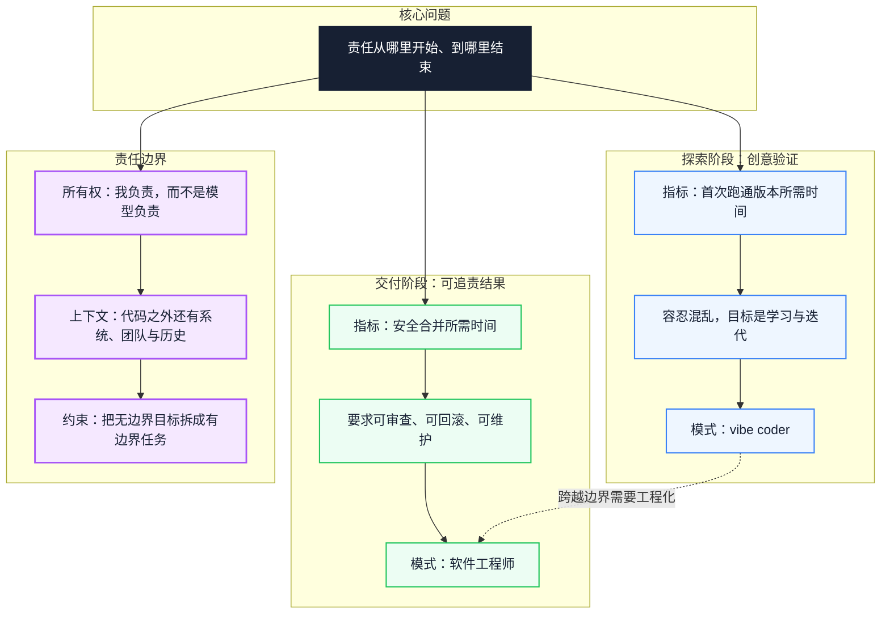

# Vibe Coder 与软件工程师：AI 时代的责任分界线

AI 让写出可运行原型变便宜了，但审查、回滚、维护和担责的成本没有同步下降。围绕 vibe coding 的争论，常把工具能力和工程责任混在一起。本文用「安全合并所需时间」衡量 AI 辅助开发，比较探索与交付两种模式的纪律差异，并给出切换边界。读完后，你能判断一项任务该用哪种模式，以及跨过边界前必须补齐什么。

::: info 一句话
分界线在责任从哪里开始、到哪里结束。主要产出是创意验证时，vibe coder 有用；主要成本是责任归属时，就需要软件工程师。
:::

## 目录

- [一、错误的衡量指标](#一、错误的衡量指标)
- [二、输出不等于进展](#二、输出不等于进展)
- [三、AI 无法替你担责](#三、ai-无法替你担责)
- [四、上下文不只是文件](#四、上下文不只是文件)
- [五、Vibe Coding 的适用边界](#五、vibe-coding-的适用边界)
- [六、学徒问题](#六、学徒问题)
- [七、区别](#七、区别)
- [八、统一模型：探索与交付之间的责任边界](#八、统一模型-探索与交付之间的责任边界)
- [九、实践清单](#九、实践清单)
- [结语：选择模式，而不是选择阵营](#结语-选择模式-而不是选择阵营)
- [FAQ](#faq)
- [来源](#来源)

## 一、错误的衡量指标

围绕 vibe coding 的讨论，衡量指标经常选错。大家展示的是从想法到应用用了多快。这在验证想法时确实有价值，但进入真实团队后，事情并没有结束。

总得有人审查它，有人理解背后的意图，有人判断依赖该不该放在这里，有人确认测试是否真的验证了行为，有人处理 schema 变更，有人协调跨团队改动，有人准备回滚，有人写运行手册，有人回应告警。这些工作没有一件属于玩具项目。

所以衡量 AI 生成的工作，应该换一个指标：**安全合并所需时间**。它包括可审查性、风险、测试质量、所有权、回滚能力，以及作者能不能说清这次变更里的关键决策。AI 把代码生成变便宜、却把安全合并变贵时，团队拿到的收益并没有自己以为的那么多。

vibe coder 量的是首次跑通版本所需时间；软件工程师量的是安全合并所需时间。探索阶段，首次跑通版本很有用；一旦进入共享代码库，安全合并所需时间才是必要指标，它包含审查、测试、发布、回滚、协调和未来的维护成本。

::: warning 常见误区

把「从提示词到可运行原型」的速度当成团队整体效率，会盖住后面审查、修复和运维的隐性开销。
:::

---

## 二、输出不等于进展

AI 辅助写的代码应该更好，不是更多。工具让你能生成更多内容，人就得更多地约束它。否则你并没有省下工作量，只是把活顺延到下游，让维护变成别人的麻烦。AI 辅助代码不能套另一套标准，它得达到和手写代码一样的门槛。

因此它应该是收敛的：只有一个存在理由，不夹带无关清理，不因为模型「顺手」就重新格式化半个文件，也不在没有清晰解释的情况下新增依赖。

变更变大时，如果是模型生成得太多，那就拆。模型很乐意为十行能写完的东西生成一大堆样板代码。作者要是说不出每个有意义的文件为什么变了，就还没准备好接受审查。这就是基本的所有权意识。

第二个区别在工作单位。vibe coder 把生成结果当进展；软件工程师把任何改动都当责任单位。生成结果可以很大、很乱、也可以是临时的，变更管理不能这么随意。

真正的变更得足够聚焦，便于审查；足够可解释，值得信任；边界足够清晰，合并不至于把半个系统一起拖下水。速度要么因此变得有用，要么沦为审查债。

---

## 三、AI 无法替你担责

审查生成代码和审查人写的代码不一样。人写代码时，背后通常有一条决策链。它可能有缺陷，但至少有一个人能解释这条路径：为什么用那个抽象，为什么把规则放在那里，为什么选这个包，为什么测试写成那样。

AI 生成的代码，其中一些所谓的「决策」根本不是决策，只是补全。作者要是没把生成结果转化成自己真正负责的成果，审查者就同时在干两件事：审查，外加追溯作者意图。

所有权是第三个区别。vibe coder 可以说这是模型生成的；软件工程师必须说，这是我负责的。这意味着请求审查之前，作者得先把生成内容转成一个工程决策。代码也许从模型开始，但责任不能停在模型那里。

::: warning 常见误区

觉得「我审查过了」就等于「我负责了」。审查是质量手段，责任归属才是工程身份的分界线。
:::

---

## 四、上下文不只是文件

现在模型已经能读很多代码了，但这不代表它理解系统。一部分上下文在代码里，大量工程上下文在别处：事故里、旧迁移里、客户行为里、运维痛点里、团队惯例里、安全要求里、合规规则里，还有过去那些看起来奇怪的决策里。

你不提供，模型就没有这些上下文。即便提供了，它携带上下文的方式也和工程师不同：它在一个有限的上下文窗口里运行，任务越大，越容易局部优化、全局破坏。

所以「直接让它把整个东西修好」既是个坏习惯，现阶段也确实不太管用。更好的做法是在让它写代码之前，先缩小决策空间。要求更具体时，模型确实能做得更好；但更具体意味着作者得先真正明白自己在干什么。

经验丰富的工程师从 AI 里拿到的价值最大，方式是给模型更少自由，而不是更多。自由适合周末折腾，生产环境需要约束。

这就是第四个区别。vibe coder 给模型一个目标，软件工程师给模型一个有边界的任务。真正的工程性就发生在这个有边界的任务里：用这个接口，不要碰这一层。好的提示词谈不上魔法，它通常只是说明工程师已经理解了边界。

---

## 五、Vibe Coding 的适用边界

Zig 项目对 AI 生成贡献的限制经常被拿来讨论。维护者看到的是大量 AI 生成的拉取请求：里面塞满无关改动、损坏的遗留行为、奇怪的依赖新增，还有解释不清自己提交了什么代码的贡献者。

但这些混乱不是对 AI 的判决，而是 vibe coding 越界后的产物。问题不在于禁用它，而在于把它放到合适的位置。

这就是第五个区别：**探索与交付**。同一份让维护者花掉整个下午的拉取请求，在做原型验证时可能无伤大雅，因为没人会对那段一次性代码负责。

探索可以容忍混乱，目标是学习，或者围绕一个想法快速迭代。交付不能容忍无法解释的混乱，目标是可追责的业务结果。有些场景可以接受 99.9% 的正确率，有些场景就是必须正确。分界线在这里。

这条线也在移动。工具在测试、回滚和审查方面变强之后，安全合并的部分成本会下降，但不会消失。只要还需要有人对结果负责，就需要保留一定程度的纪律。把 vibe coding 用在出错代价低的地方，把工程纪律用在出错代价由客户、团队或业务承担的地方。

---

## 六、学徒问题

初级工程师一定会用 AI，也应该用。用得好时，它可以解释代码、比较方案、生成示例，加速学习。但用不好时，它会替代学习。

初级工程师如果用 AI 来逃避理解系统，就可能交付更多、学得更少。这是一笔糟糕的交易。工程生涯头几年，正是建立心智模型的时候。这个模型得在自己大脑里建起来，不能长期从机器那里借。

判断力不会靠一直站在系统外面、让模型替你修问题而建立。AI 短期内可能让初级工程师看起来更高产，却削弱了把他们培养成强工程师的学习闭环。这也是不少项目限制 AI 贡献的深层原因之一：代码审查不仅是质量关卡，也是识别和培养长期贡献者的过程。AI 提交会绕过这一点，因为贡献者并没有真正理解代码库，也没有吸收反馈。

工程还需要一定程度的学徒制。vibe coding 诱使你单打独斗，但人是在团队里工作和学习的。

软件工程师靠跟别人协作提升技艺。工作不只是写代码，工作还包括判断：什么有风险、什么没风险。这种判断力来自跟系统和人之间的持续接触。

---

## 七、区别

主要产出是创意验证时，vibe coder 有用。他们可以缩短想法到可点击原型之间的距离。很多想法都值得先这样处理，再决定要不要投入真正的工程产能。

主要成本是责任归属时，就需要软件工程师。他们控制什么进入系统、怎么审查、怎么保护、怎么测试、怎么运维，以及今后怎么改。这个区别是运营层面的，也不是固定身份。同一个人应该在探索阶段做 vibe coding，在交付阶段切到工程模式。

关键技能是知道自己当前处于哪种模式，并且别让一种模式的习惯渗到另一种里。vibe coding 能帮你更快学习；软件工程能帮你避免为这份学习付出永久的代价。

---

## 八、统一模型：探索与交付之间的责任边界

前文从衡量指标、工作单位、所有权、上下文边界、阶段适用性和学徒制六个角度展开。它们可以归并成一个统一模型：以责任归属为主轴，区分创意验证的探索阶段和可追责的交付阶段。

图的读法是从核心问题出发，向下分成两条路径：左侧探索、右侧交付，中间的责任边界决定能否跨越。虚线是唯一入口——探索产物进入交付，靠的不是时间，而是责任边界上的条件同时成立。

### 进入交付的四个条件

以下四条全部满足，生成内容才算进入交付阶段：

- 作者能逐文件解释变更理由，而不是只说「模型生成的」
- 关键行为有能验证的测试，而不只是「本地跑通了」
- 变更可以独立回滚，不必连带回退半个系统
- 有人明确承担上线后的维护责任，包括告警和故障处理

缺任何一条，它仍然停留在探索阶段。这条判据比「代码看起来能不能用」更可靠，因为它检查的是责任，而不是外观。

---

## 九、实践清单

以下条目都对应一个可以当场执行或事后检查的动作。

### 衡量方式

- [ ] 记录一次 AI 辅助变更从提交到合并的耗时，并与同类手写变更对比
- [ ] 汇报 AI 提效时，同时给出原型耗时和审查、测试、回滚成本
- [ ] 在团队效率讨论中，明确区分「首次跑通时间」和「安全合并时间」

### 变更边界

- [ ] 提交前逐文件检查 diff，删除与任务无关的格式化和清理
- [ ] 单个 AI 生成变更超出一次 Review 能看完的规模时，拆成多个提交
- [ ] 为每个被修改的文件写一句变更理由，写不出就回退

### 所有权与审查

- [ ] 在 PR 描述里写明关键设计决策和已知风险，而不是只贴生成结果
- [ ] 审查 AI 生成代码时，至少提出一个关于边界条件的问题
- [ ] 合并前确认维护责任人，避免「审查通过就无人负责」

### 上下文控制

- [ ] 在提示词里明确写出「不要改哪些文件或哪些层」
- [ ] 涉及历史决策、合规要求或运维约束时，先把相关背景贴进上下文
- [ ] 拆掉「把整个系统修好」这类无边界任务，改成可验证的小目标

### 阶段与成长

- [ ] 任务开始时标注「探索」或「交付」，探索产物进共享库前重做一次交付审查
- [ ] 要求初级工程师在调用模型前，先口述问题、约束和预期改动
- [ ] 线上问题复盘时，检查是否由 AI 生成变更引入，并更新使用规则

---

## 结语：选择模式，而不是选择阵营

AI 改变的不是编程语言，而是软件开发的经济学：生成代码的成本在降，但审查、理解、维护和担责的成本没有同比例消失。真正的问题因此从「能不能写出来」变成「谁对它负责」。

所以 vibe coder 和软件工程师的区别，不是身份标签，而是工作模式的选择。同一个人完全可以上午做 vibe coding，下午切到工程模式。成熟的标志，是清楚自己处于哪种模式，并遵守该模式的规则。

下一步最值得做的，是挑一个正在进行的任务，用「四个条件」检查一遍。如果它已经进入共享代码库，却还有条件不满足，先补齐再继续；如果它本来就在探索阶段，就保留速度，但把产物隔离在交付流程之外。工具会继续变强，边界会继续移动，责任归属这条线不会消失。

---

## FAQ

### 1. 如果 AI 生成的代码通过了所有测试，是不是就可以安全合并？

测试通过只是合并条件之一。还需要审查者理解设计意图、确认边界条件、评估依赖变更、检查回滚能力，并明确作者愿意为后续问题负责。测试覆盖的是已知行为，工程责任覆盖的是未知风险。

### 2. 团队应该怎样划定 vibe coding 与工程交付的边界？

从出错代价出发：只在个人或隔离环境里允许无约束的 vibe coding；进入共享代码库、用户环境或生产路径之前，必须经过可审查、可测试、可回滚的工程流程。阶段划分应在任务开始时就明确，而不是合并前才补。

### 3. 初级工程师应该如何使用 AI 才不影响成长？

把 AI 当解释和比较方案的工具，不要当绕过理解的捷径。生成代码之前，先自己描述问题、约束和预期改动；生成之后手动走读，并解释每一处关键改动。管理者应保留代码审查里的反馈闭环，不要因为 AI 提交看起来更快就跳过。

### 4. 同一个人既要探索又要交付，如何避免习惯混淆？

给探索任务设独立分支或目录，并标注「原型」属性。转向交付前强制做一次清理：删无关文件、补测试、写变更说明。关键是别让探索阶段的临时产物默认进入交付流程。

---

## 来源

1. Yusuf Aytaş. *Vibe Coder vs Software Engineer*：[https://yusufaytas.com/vibe-coder-vs-software-engineer](https://yusufaytas.com/vibe-coder-vs-software-engineer)
2. Yusuf Aytaş. *The Invisible Difference*：[https://yusufaytas.com/the-invisible-difference](https://yusufaytas.com/the-invisible-difference)
3. Yusuf Aytaş. *Managers Have Been Vibe Coding All Along*：[https://yusufaytas.com/managers-have-been-vibe-coding-all-along](https://yusufaytas.com/managers-have-been-vibe-coding-all-along)
