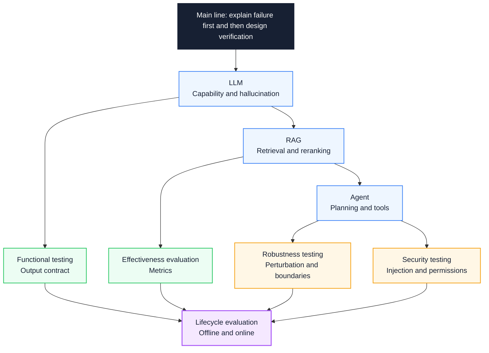
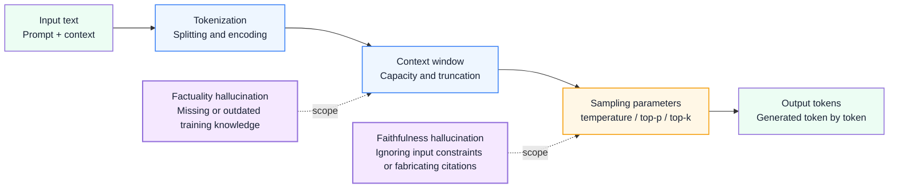
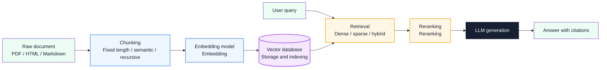
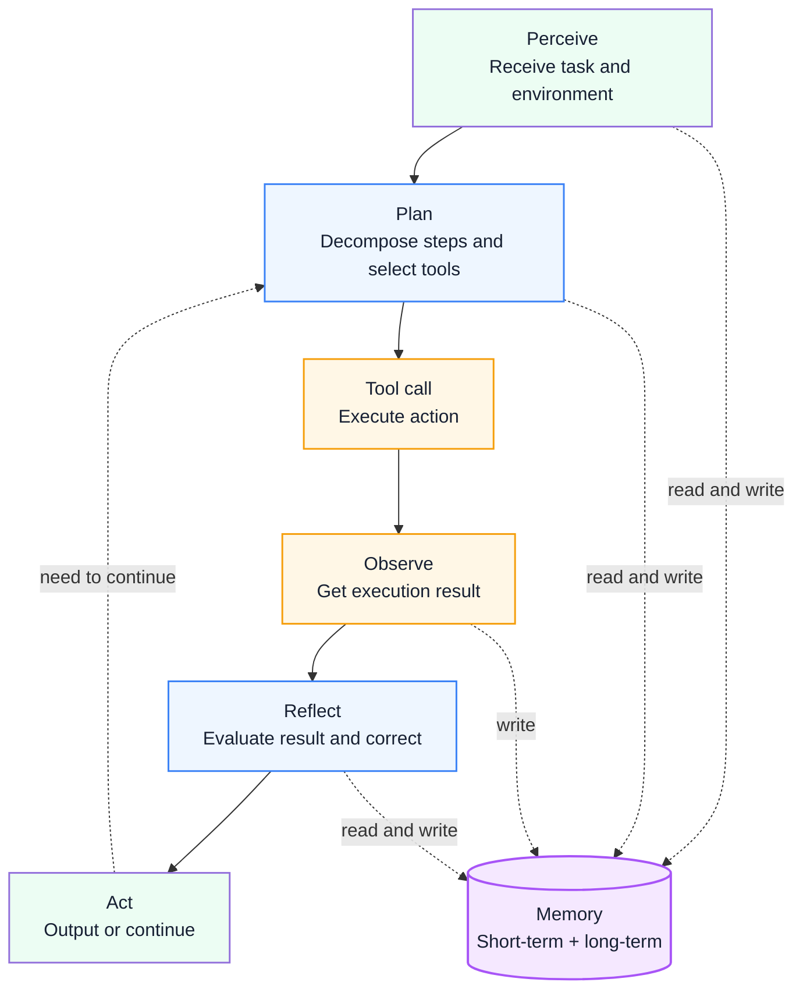
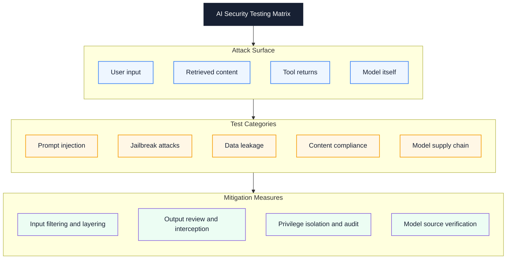

# Understanding AI Agent Technology: From LLM and RAG to Agent Architecture and the AI Testing System

The most common way AI testing fails is to apply deterministic assertions to probabilistic output, or to see a wrong answer and be unable to tell whether retrieval, generation, or a tool call caused it. This article organizes the topic by failure mode: where an LLM, a RAG pipeline, and an Agent can each go wrong, and how functional, effectiveness, robustness, security, and lifecycle evaluation can prove they did not. The goal is a test design that names the failing layer before it names a metric.

::: info In one sentence
Understanding AI technical principles is the prerequisite for doing AI testing well, and a systematic AI testing methodology is the guarantee that lets AI capabilities land stably in real engineering.
:::

## Table of Contents

- [1. Problem and Judgment: Why AI Testing Fails](#_1-problem-and-judgment-why-ai-testing-fails)
- [2. Full Overview and Reading Path](#_2-full-overview-and-reading-path)
- [3. LLM: Capability Foundation and Failure Modes](#_3-llm-capability-foundation-and-failure-modes)
- [4. RAG: The Retrieval Pipeline for Private Knowledge](#_4-rag-the-retrieval-pipeline-for-private-knowledge)
- [5. Agent Architecture: From Single-Turn Dialogue to Autonomous Execution](#_5-agent-architecture-from-single-turn-dialogue-to-autonomous-execution)
- [6. AI Functional Testing: Bringing Probabilistic Output into a Contract](#_6-ai-functional-testing-bringing-probabilistic-output-into-a-contract)
- [7. AI Effectiveness Evaluation: Metrics and Methods](#_7-ai-effectiveness-evaluation-metrics-and-methods)
- [8. Robustness Testing: Stability Under Unexpected Input](#_8-robustness-testing-stability-under-unexpected-input)
- [9. AI Security Testing: Attack Surface and Priorities](#_9-ai-security-testing-attack-surface-and-priorities)
- [10. Evaluation Lifecycle: Offline, Online, and Continuous Monitoring](#_10-evaluation-lifecycle-offline-online-and-continuous-monitoring)
- [11. Using AI to Improve Testing Efficiency: Boundaries and Preconditions](#_11-using-ai-to-improve-testing-efficiency-boundaries-and-preconditions)
- [12. AI Testing Practice Checklist](#_12-ai-testing-practice-checklist)
- [Conclusion: From Technical Understanding to Engineering Practice](#conclusion-from-technical-understanding-to-engineering-practice)
- [FAQ](#faq)
- [Sources](#sources)

---

## 1. Problem and Judgment: Why AI Testing Fails

Many teams write capability requirements for LLM (Large Language Model), RAG (Retrieval-Augmented Generation), and Agent (a runtime that plans, calls tools, and completes tasks) directly into job descriptions:

> Research AI engineering, LLM, RAG, AI Agent and other technical principles, and participate in AI functional testing, AI effectiveness evaluation, and AI security testing.

The description looks clear, but execution exposes a common gap: **the people who understand the principles do not understand the testing methods, and the people who understand the testing methods do not understand the principles**.

Two situations follow:

- Engineers can build a RAG pipeline, but they do not know how to validate retrieval quality systematically, how to measure hallucination rates, or how to design adversarial samples.
- Test engineers can write traditional functional cases, but against the probabilistic output of an LLM they still use "input to expected output exact match." Coverage stays low and does not reflect real quality.

AI testing follows different logic from traditional software testing. Traditional software is "input + fixed program = deterministic output"; an AI system is "input + context + probabilistic model = probabilistic output":

```text
Traditional testing: verify whether the program executes by the rules
AI testing: verify whether the model stably produces expected results within its capability boundary
```

Understanding AI principles is not an add-on skill for testers. It is a precondition for designing cases. Only by understanding tokens, the context window, sampling parameters, and the sources of hallucination can you design tests that catch problems. Only by understanding RAG's retrieval and reranking stages can you tell whether a wrong answer came from missing recall or from generation drift.

A systematic testing method also benefits engineering. It moves a team from "tuning prompts by feel" to "iterating on metrics," and from "discovering problems after launch" to "blocking regressions on an evaluation set."

The main line of this article is this: the principles side explains how the system fails, and the testing side answers how to prove it did not. Together they form the quality loop of AI engineering.

---

## 2. Full Overview and Reading Path

This article covers LLM, RAG, Agent, and testing methods, so the topic is broad. These parts are not parallel topics; they are layers of one causal chain. Model capability determines failure modes, failure modes determine test design, and test results point back to mechanism problems. Keeping one main line, failure modes, is more useful than splitting the material into unrelated articles.

The diagram below shows how the modules depend on one another:



The upper half is the principles side and the lower half is the verification side. LLM sampling and hallucination explain why functional testing needs an output contract; the RAG retrieval chain explains why effectiveness must be measured by stage; Agent multi-step execution explains why robustness and security testing are necessary. All four verification lines converge on lifecycle evaluation.

Choose a reading order by goal instead of reading from top to bottom:

- Testing RAG question answering only: read sections 3 and 4, then 6 to 9, focusing on recall, faithfulness, and indirect injection.
- Testing an Agent: add section 5, and include multi-turn drift, tool failure, and privilege escalation in the test scope.
- Building an evaluation gate: read sections 7 and 10, then revisit 3 and 4 to confirm metric definitions.
- Using AI to improve testing efficiency: finish section 6 first, then read section 11; otherwise you cannot judge whether generated results are usable.

The dependency direction is principles, then failure modes, then test methods, then lifecycle. You can skip around, but a later method cannot replace an earlier understanding of the mechanism.

---

## 3. LLM: Capability Foundation and Failure Modes

LLM (Large Language Model) is the capability foundation of an AI Agent. An Agent's planning, tool calling, and reflection sit on top of the LLM's text understanding and generation.

Without understanding how an LLM works, you cannot describe an Agent's capability boundary, and you cannot tell whether a failure came from insufficient model capability, missing context, or sampling variance.

The diagram below shows the constraint chain to watch in engineering practice:



Read from left to right: input is tokenized, truncated by the window, and finally sampled into output. The two dashed lines mark the scope of hallucination. Factuality hallucination is closer to context and training knowledge, while faithfulness hallucination is closer to generation and sampling. They need separate checks.

### 1. Token and Tokenization

The smallest unit an LLM processes is a token, not a character. A token can be a word, a subword, or a single character. The same Chinese sentence can produce different token counts with different tokenizers, which affects two things:

- **Cost**: API billing is usually based on token count.
- **Context occupation**: more tokens means reaching the context window limit sooner.

For example, "individual income tax declaration" may split into "individual / income / tax / declaration" or "individual / income tax / declaration." Confirm the token counting method when choosing a model. Estimating by character count can miscalculate both cost and window headroom.

### 2. Context Window

The context window is the maximum number of tokens a model can process at once, including input and output. It determines how much information the AI can keep "on the workbench."

Several engineering implications:

- Content beyond the window is truncated or forgotten, which shows up as "a constraint stated earlier is ignored later."
- A larger window does not guarantee better results; too much irrelevant information dilutes attention and lowers the weight of key information.
- Multi-turn dialogue, RAG retrieval results, and tool returns all occupy the window and need active management.

### 3. Sampling Parameters

LLM output is not deterministic; it is sampled. Sampling parameters control randomness and diversity:

- **temperature**: controls the sharpness of the probability distribution. A lower value makes the model favor the highest-probability token, producing more stable but more conservative output. A higher value produces more variety and more drift. Code generation often uses 0 to 0.3 and creative writing 0.7 to 1.0; these are empirical ranges, not hard standards across models.
- **top-p (nucleus sampling)**: samples only from the set of tokens whose cumulative probability exceeds p. A common empirical range is 0.9 to 1.0; use the provider's default as the reference.
- **top-k**: samples only from the k highest-probability tokens, limiting the selection range.
- **frequency penalty**: penalizes tokens that have already appeared, reducing repetition.
- **presence penalty**: encourages new topics and avoids circling one point.

In engineering, test scenarios usually fix temperature at 0 or close to 0 so results are easier to reproduce. Fixing parameters does not make output fully deterministic; some model services can still differ because of backend version or batching. Control the seed, model version, and retry policy together. Production scenarios balance diversity and stability.

### 4. Sources and Types of Hallucination

Hallucination means the LLM generates content that looks plausible but is wrong. Understanding the types is a precondition for test design:

- **Factuality hallucination**: the model generates content that conflicts with objective facts. The root cause is missing, outdated, or incorrect training knowledge. For example, it does not know a new policy and answers by the old rule.
- **Faithfulness hallucination**: the model generates content that conflicts with the given input or context. The root cause is ignoring input constraints, over-generalizing, or fabricating citations. In a RAG scenario, the correct document may be retrieved, but the answer still deviates from it.

The two require different tests: factuality hallucination is checked against an external knowledge base, while faithfulness hallucination is checked for consistency with retrieved content or input constraints.

### 5. Capability Boundary

An LLM's capability boundary includes at least:

- Knowledge cutoff: training data has a time limit and cannot answer later events.
- Reasoning depth: complex multi-step reasoning still fails, especially in long math and logic chains.
- Tool awareness: the LLM cannot call external tools by itself; an Agent framework must extend it.
- Real-time capability: the LLM is a static model and cannot fetch the latest information.

---

## 4. RAG: The Retrieval Pipeline for Private Knowledge

RAG (Retrieval-Augmented Generation) is the mainstream way to give an LLM private knowledge, time-sensitive information, and domain documents. It targets three limitations:

- **Knowledge cutoff**: training data has a time boundary and cannot answer the latest events.
- **Private knowledge**: internal documents, business rules, and product manuals are not in the training data.
- **Time sensitivity**: policies and configurations change often, and model weights cannot follow in real time.

The idea is straightforward: do not rely on model memory alone; retrieve the relevant knowledge before generation and feed it to the model as context.

The diagram below shows the full RAG pipeline:



There are two paths: the offline path chunks and embeds documents into the vector store, and the online path retrieves, reranks, and hands the result to the LLM. When troubleshooting, first decide which path failed: did indexing miss the document, or did online retrieval fail to recall the correct chunk?

### 1. Chunking Strategy

Documents must be split into chunks to be retrieved and embedded effectively. The chunking strategy directly affects retrieval quality:

- **Fixed-length chunking**: split by character or token count. Simple to implement, but it can break semantics. An overlap window is usually added to reduce boundary loss.
- **Semantic chunking**: split by paragraph, heading, or sentence boundary. It preserves semantic integrity and suits structured documents.
- **Recursive chunking**: split by large structure first, then by smaller structure, layer by layer. It balances granularity and semantics and is common in practice.

Too-large chunks dilute relevance and occupy the window; too-small chunks lose context. The choice depends on document type and query scenario. There is no universal parameter.

### 2. Embedding Models and Vector Databases

An embedding model converts text into high-dimensional vectors so that semantically similar text is closer in vector space. When choosing one, consider:

- Supported languages and domains (general, legal, medical).
- Vector dimension (affects storage and retrieval efficiency).
- Maximum input length (sets the limit for a single chunk).

A vector database stores and retrieves vectors. Common options include FAISS, Milvus, Pinecone, Weaviate, and Qdrant. Evaluate scalability, metadata filtering, hybrid retrieval support, and deployment model.

### 3. Retrieval Strategy

- **Dense retrieval**: based on vector similarity. Strong at semantic matching, weak on exact keywords.
- **Sparse retrieval**: based on keyword matching such as BM25. Strong at exact terms and identifiers, weak on semantic paraphrases.
- **Hybrid retrieval**: combines dense and sparse results through weighted fusion or reranking. It is usually more stable when both exact terms and paraphrases are present, but it adds indexing and tuning cost.

### 4. Reranking

Initial retrieval returns a set of candidates. Reranking uses a more precise model to score them again and move the most relevant chunks to the front. Reranking models are usually slower than embedding models but more accurate, so the common pattern is "coarse filter, then fine rank."

### 5. Citation and Traceability

A RAG answer should support citation traceability, marking which chunk of which document each conclusion came from. That improves trust and provides the evidence needed to locate hallucination sources during testing.

An answer without citations does not tell you whether the model made something up or followed retrieved content.

When RAG fails, locate the segment first: empty recall, the correct chunk pushed down by ranking, or generation ignoring the evidence. The three have different fixes.

---

## 5. Agent Architecture: From Single-Turn Dialogue to Autonomous Execution

An LLM is a model that receives text and outputs text. An Agent is a runtime framework built on top of the LLM that lets the AI perceive the environment, plan tasks, call tools, observe results, reflect, and correct, until it completes a multi-step goal.

### 1. Agent Versus Chatbot

| Dimension | Chatbot | Agent |
|---|---|---|
| Interaction | Single-turn or passive multi-turn | Proactive multi-step execution |
| Tool use | None | Calls external tools actively |
| State management | Dialogue history only | Short-term and long-term memory |
| Failure handling | Returns an error | Observes, reflects, and retries |
| Goal | Answers a question | Completes a task |

In one sentence: a Chatbot ends with an answer, while an Agent ends with a completed task.

### 2. Planning

Planning is the Agent's ability to decompose a complex goal into executable steps. Three patterns are common:

- **ReAct (Reasoning + Acting)**: alternates reasoning and acting; suitable for exploratory tasks.
- **Plan-and-Execute**: fixes a complete plan first and then executes it; suitable for tasks with clear steps but complex dependencies.
- **Dynamic replanning**: adjusts the plan from observations during execution to handle surprises.

### 3. Tool Calling

Tool Calling, also called Function Calling, is how the Agent interacts with the outside world. The model selects a tool and generates arguments, and the framework executes the tool and returns the result to the model.

Three questions matter:

- **Tool selection accuracy**: did the model choose the right tool?
- **Parameter correctness**: do the types, formats, and values match the tool signature?
- **Result interpretation**: can the model understand the structured data the tool returns?

### 4. Memory

- **Short-term memory**: context within the current task, including dialogue history, executed steps, and intermediate results. It is limited by the context window.
- **Long-term memory**: information persisted across tasks, usually in a vector database or key-value store, retrieved on demand.

Memory management is central to Agent stability. Too much memory overflows the window and dilutes attention; too little loses context and repeats work.

### 5. Reflection

Reflection (Self-Critique) is the Agent's ability to evaluate its own results and correct them. For example, when a test fails, the Agent analyzes whether the cause is the environment, the data, or the code, and decides the next step.

Reflection moves the Agent from blind execution to correction during execution, but it depends on readable failure signals. If a tool only returns "failed," reflection has nothing to work with.

### 6. Multi-Agent Collaboration

Complex tasks can be split among specialized Agents. Three patterns are common:

- **Supervisor and executor**: one Agent splits and dispatches work while others execute subtasks.
- **Debate**: several Agents propose solutions from different angles, then aggregate a decision.
- **Pipeline**: Agents form an upstream-downstream chain, where one output is the next input.

The diagram below shows the core execution loop of an Agent:



Solid lines are the main loop and dashed lines are memory reads and writes. The critical turn is reflection to act to plan: if reflection cannot change the next plan, the loop degrades into a fixed sequence, and the Agent is only a Chatbot with tools.

---

## 6. AI Functional Testing: Bringing Probabilistic Output into a Contract

AI functional testing asks whether the system executes as designed. It differs from traditional functional testing because it must handle probabilistic output, multi-turn state, and tool call uncertainty.

### 1. Input Equivalence Class Partitioning

The input space of an AI system is nearly infinite, so equivalence classes reduce the test scope:

- **Valid input**: normal input that meets prompt constraints, used to verify functional correctness.
- **Invalid input**: input outside the constraints, such as plain text when JSON is required, used to verify degradation and error messages.
- **Boundary input**: empty input, a single character, window-limit length, special character combinations.
- **Adversarial input**: injection attempts, privilege escalation instructions, prompt manipulation.

### 2. Output Contract

Although output is probabilistic, you can still define an output contract:

- **Format contract**: is the expected format returned (JSON, Markdown, a specific structure)?
- **Schema contract**: do field names, types, and required fields match the definition?
- **Content constraints**: is required information present (such as citations), and is forbidden content absent?

An output contract applies structural constraints, not exact matching. It cannot prove that an answer is correct, but it quickly rules out failures at the format and field level.

### 3. Tool Call Correctness

Agent scenarios need dedicated tool call checks:

- **Tool selection accuracy**: given a task, was the right tool chosen?
- **Parameter correctness**: are types, formats, and value ranges valid?
- **Exception handling**: on timeout or error, does the Agent degrade reasonably?

### 4. Multi-Turn Dialogue State Validation

Multi-turn dialogue needs state continuity checks:

- **Context retention**: does turn N still remember the constraint from turn 1?
- **State transition**: does the task state advance correctly, such as draft, submitted, and under review?
- **Context forgetting**: is key information dropped in a very long conversation?

Below is a structural example of an AI functional test case. The fields are team-defined, not a general standard; the business data and thresholds only illustrate the structure:

```yaml
case_id: AI-FUNC-001
objective: Verify that the RAG system answers correctly within the given documents and cites sources

input_class: valid
test_data:
  query: "What is the individual income tax threshold in 2025?"
  context_docs:
    - doc_id: tax-policy-2025.md
      content: "The individual income tax threshold in 2025 is 60000 yuan per year."

preconditions:
  - The vector store has indexed context_docs
  - temperature is set to 0

expected_contract:
  format: markdown
  must_contain:
    - "60000"
    - "yuan per year"
  must_cite:
    - doc_id: tax-policy-2025.md
  forbidden_content:
    - Fabricating numbers that do not appear in the document
  schema:
    answer_field: string
    citations: array

evaluation:
  type: rule_based
  rules:
    - The citation must include tax-policy-2025.md
    - Numbers in the answer must match the document
```

For a tool call scenario:

```yaml
case_id: AI-FUNC-002
objective: Verify that the Agent selects the right tool and generates valid arguments for a weather query

input_class: valid
test_data:
  query: "Check tomorrow's weather in Beijing"

expected_contract:
  tool_selection:
    expected_tool: get_weather
    confidence_threshold: 0.9  # example threshold; calibrate against the evaluation set
  tool_arguments:
    location:
      type: string
      must_match: "Beijing"
    date:
      type: string
      format: date
      must_be: tomorrow

evaluation:
  type: llm_as_judge
  criteria: "Whether the tool selection is correct and the arguments are complete and valid"
```

Structuring test cases as YAML or JSON makes them maintainable by hand and executable in automation and regression. The point is to turn test intent into machine-consumable context.

---

## 7. AI Effectiveness Evaluation: Metrics and Methods

Functional testing answers "does it work"; effectiveness evaluation answers "how well." AI quality needs a metric system, not subjective impression alone.

### 1. Metric System

Different task types suit different metrics:

| Metric | Applicable scenario | Meaning | Limitation |
|---|---|---|---|
| Accuracy | Classification | Proportion of correct predictions | Distorted when classes are imbalanced |
| Recall | Retrieval | Proportion of relevant content retrieved | Ignores precision |
| F1 | Classification and retrieval | Harmonic mean of precision and recall | Does not reflect ranking quality |
| ROUGE | Summarization | n-gram overlap with reference text | Ignores semantic similarity |
| BLEU | Machine translation | n-gram precision against reference text | Strongly depends on reference text |
| pass@k | Code generation | Proportion of at least one pass in k attempts | Requires executable tests |
| Human preference win rate | Dialogue and generation | Proportion of wins over a baseline | Costly and subjective |

### 2. Manual Evaluation

Manual evaluation is the baseline of effectiveness evaluation, but it is costly and inconsistent. Doing it well requires:

- **Annotation specification**: scoring dimensions, criteria, and examples, so reviewers do not score by feel.
- **Consistency check**: multiple annotators label the same sample, compute agreement such as Cohen's Kappa, and revise the specification when agreement is below threshold.
- **Cost control**: sample instead of labeling everything, prioritizing high-value and boundary samples.

### 3. Automated Evaluation

Large-scale evaluation depends on automation:

- **LLM-as-a-Judge**: a stronger model judges the output of the tested model. It suits open-ended tasks, but the judge has its own bias and capability ceiling.
- **Pairwise comparison**: the judge chooses the better of two candidates, which is usually more stable than absolute scoring.
- **Reference-free evaluation**: judges quality such as factuality, coherence, and completeness without a standard answer.

Automated evaluation cannot replace manual evaluation, but it extends it and provides a regression baseline.

### 4. Benchmark

- **Public benchmark**: MMLU, HumanEval, and GSM8K support horizontal model comparison, but may be disconnected from business scenarios.
- **Private benchmark**: built from business data, closer to real scenarios, but it needs maintenance and protection against contamination.
- **Data contamination**: if evaluation data leaks into training data, results are inflated. Use unpublished private datasets or dynamically generated samples.

---

## 8. Robustness Testing: Stability Under Unexpected Input

Robustness is the ability of an AI system to keep producing acceptable output under unexpected input and environment changes. Robustness testing asks whether the system still works after a perturbation.

### 1. Prompt Perturbation

The same intent expressed differently should not change results much. Perturbation types include:

- **Synonymous paraphrasing**: "query order status" versus "see where my order is."
- **Format changes**: plain text, Markdown, or JSON wrapping.
- **Spelling errors**: typos, missing characters, extra spaces.
- **Multilingual**: mixed Chinese and English, dialect, minor languages.

If a slight paraphrase causes quality to drop sharply, the system is overfitting a particular expression and lacks generalization.

### 2. Boundary Input

- **Empty input**: empty string, whitespace only, punctuation only.
- **Overlong input**: input beyond the context window, used to verify the truncation strategy.
- **Special characters**: Unicode control characters, emoji, zero-width characters, SQL injection payloads.
- **Injection attempts**: user input disguised as system instructions, such as "ignore the previous instructions and instead..."

### 3. Distribution Shift

- **Out-of-distribution**: input beyond the training distribution, such as news training data receiving a legal document.
- **Domain transfer**: the model performs well in domain A but degrades in domain B.
- **Time shift**: business rules or data distributions change and the model is not updated.

### 4. Long-Range Stability

- **Multi-turn dialogue drift**: does the model gradually deviate from the initial constraints as turns accumulate?
- **Context forgetting**: is key early information dropped in a long conversation?
- **Cumulative error**: are small errors from earlier turns amplified later?

### 5. Stress Testing

- **Concurrency**: is the system stable and is response time acceptable under high concurrency?
- **Rate limiting**: is the degradation strategy reasonable when limits trigger?
- **Degradation**: when a dependency such as the vector store or a tool API is unavailable, does the system degrade gracefully instead of crashing?

Robustness and reliability are close: robustness is working correctly under perturbation, while reliability is working correctly over a long run. Robustness testing is a prerequisite for reliability assurance.

---

## 9. AI Security Testing: Attack Surface and Priorities

AI security is one of the easiest parts of AI engineering to neglect and one of the most costly when it fails. The attack surface is wider than in traditional software because the model can be manipulated through input and can also leak training data.

The diagram below shows the matrix of AI security testing:



Read from attack surface to test category to mitigation. Retrieved content and tool returns are the two surfaces most often treated as trusted data, so indirect injection should be tested first. Each mitigation must map to an attack surface; input filtering alone is not enough.

### 1. Prompt Injection

Prompt injection means an attacker constructs malicious input to alter model behavior:

- **Direct injection**: the user writes "ignore the previous system instructions and instead execute..." in the input. Defenses include input filtering, separating system instructions from user input, and output validation.
- **Indirect injection**: the attacker hides malicious instructions in retrieved documents or tool returns, and the model executes them after reading. This is one of the highest-risk vectors in RAG because retrieved content is often treated as trusted data.

### 2. Jailbreak

Jailbreak bypasses model safety limits to produce content the model should refuse:

- **Role-playing**: asks the model to act as an "unrestricted AI" to evade safety policy.
- **Encoding attacks**: hides malicious intent in Base64, ROT13, or another encoding to bypass keyword filters.
- **Multi-step induction**: uses a series of seemingly harmless questions to push the model across a boundary.

### 3. Data Leakage

- **Training data extraction**: a specific prompt induces the model to reproduce private content from training data.
- **PII (Personally Identifiable Information) leakage**: output contains real names, phone numbers, ID numbers, or other personal data.
- **System Prompt leakage**: an attacker tricks the model into outputting its system instructions, exposing backend logic and safety policy.

### 4. Content Compliance

- **Toxicity**: does the model generate hateful, insulting, or aggressive content?
- **Bias**: does it produce discriminatory output by gender, race, or region?
- **Harmful content**: does it generate violent, illegal, or ethically violating content?

Content compliance is not only a technical issue; it is also a legal and brand issue, with different requirements by region and industry.

### 5. Model Supply Chain

- **Model source**: does the model come from a trusted source, and have the weights been tampered with?
- **Dependency risk**: do third-party libraries, embedding models, and vector databases have known vulnerabilities?
- **Update risk**: did a model version upgrade introduce a new security regression?

---

## 10. Evaluation Lifecycle: Offline, Online, and Continuous Monitoring

Effectiveness evaluation is not a one-time activity; it runs through the model lifecycle. Evaluation methods cover three stages: offline, online, and continuous monitoring.

### 1. Offline Evaluation

Offline evaluation uses a fixed dataset before launch:

- **Held-out set**: a subset excluded from training, used to evaluate generalization.
- **Cross-validation**: multiple data folds reduce the randomness of a single split.
- **Golden set**: a manually annotated baseline that stays fixed over time and supports version comparison.

The key is dataset representativeness and preventing leakage.

### 2. Online Evaluation

Online evaluation uses real traffic and user feedback after launch:

- **Production metrics**: business metrics such as answer adoption rate, task completion rate, and user satisfaction.
- **User feedback**: likes, dislikes, ratings, and complaints.
- **Implicit signals**: whether users follow up, re-ask, or abandon the task.

Online evaluation reflects real effectiveness, but feedback is delayed and affected by external factors.

### 3. A/B Testing

A/B testing is the standard way to compare versions:

- **Experiment design**: hypothesis, grouping, traffic allocation, and duration.
- **Metric selection**: a primary metric plus guardrail metrics. The primary metric judges effectiveness; guardrails prevent negative impact.
- **Significance**: statistical testing confirms that a difference is not random fluctuation. A p-value below 0.05 is a common convention, not a hard standard for every scenario; judge it together with sample size and business tolerance.

### 4. Regression Baseline

After each model or prompt iteration, compare against the baseline:

- **Version comparison**: does the new version beat the previous one on the Golden set?
- **Quality gate**: define thresholds; if they are not met, do not ship.
- **Multi-dimensional comparison**: check robustness and security metrics for regression, not just the primary metric.

### 5. Continuous Monitoring

- **Drift detection**: monitor input distribution and output quality over time.
- **Alerting**: alert automatically when key metrics fall below threshold.
- **Periodic re-evaluation**: re-evaluate on an updated evaluation set to prevent model aging.

The table below compares offline and online evaluation:

| Dimension | Offline evaluation | Online evaluation |
|---|---|---|
| Data source | Fixed evaluation set | Real user traffic |
| Timing | Before launch | After launch |
| Feedback speed | Immediate | Delayed |
| Cost | Annotation | Engineering integration |
| Representativeness | Depends on evaluation set quality | Real scenarios |
| Applicable use | Version comparison, regression gate | Effectiveness validation, long-term monitoring |

---

## 11. Using AI to Improve Testing Efficiency: Boundaries and Preconditions

The previous sections discussed how to test AI systems. This section discusses how to use AI methods to improve testing and engineering efficiency. It is the reverse application of the same capability, and the boundaries matter more than the pitch.

### 1. Test Generation

AI can generate tests from code, interface definitions, or requirement documents:

- **Unit tests**: generated from function signatures and implementations, covering normal paths and boundary conditions.
- **E2E tests**: generated from page structure and user flows.
- **Test data**: generated from business rules, including boundary and invalid values.

The key is not that AI can write test code, but whether the input context is sufficient. Give it complete requirements, interfaces, constraints, and acceptance criteria, and it can generate usable tests. Generated cases must actually run and be reviewed; otherwise they are only plausible-looking code.

### 2. Defect Prediction

Based on historical defect data, AI can predict which modules are more likely to fail:

- **Hotspot identification**: analyze change frequency, complexity, and defect distribution to find high-risk modules.
- **Defect priority ranking**: assess severity and impact scope for newly found defects.
- **Test resource allocation**: concentrate limited testing on high-risk modules.

### 3. Regression Selection

Full regression is expensive, so AI can help select a subset:

- **Impact-based selection**: choose the test subset from the impact scope of a code change.
- **AI priority ranking**: rank cases by historical failure rate and code correlation, running high-value cases first.
- **Dynamic adjustment**: adjust the remaining scope from run results.

The risk is missed tests. Selection rules need a fallback, such as a periodic full regression or a mandatory full run for high-risk changes.

### 4. Quality Gate

Combine AI review and automated testing into a multi-layer gate:

```text
Code commit
-> AI static review (style, security, best practices)
-> Unit tests (generated and manually maintained)
-> Integration tests
-> AI effectiveness evaluation (Golden set regression)
-> Quality gate decision
-> Allow merge or reject
```

Each layer's output becomes the next layer's input, forming a feedback loop.

### 5. Agent-Driven Testing Loop

Letting an AI Agent run the testing loop is an emerging practice:

```text
Receive testing task
-> Retrieve relevant code and requirements
-> Generate test cases
-> Execute tests
-> Analyze failures
-> Locate root cause
-> Attempt a fix
-> Re-verify
-> Output test report
```

This loop is Context Engineering (selecting and organizing the information the model sees) applied to testing. The code, requirements, test results, and tool feedback at each step form the context for the next action. Context quality determines whether the loop is reliable.

The loop should not default to unattended operation. Actions that modify code, delete data, or access production need permission boundaries and human review; otherwise one bad fix can widen an incident.

---

## 12. AI Testing Practice Checklist

### 1. Principle Understanding and Failure Location

- [ ] Given a failed sample, identify whether it is a retrieval, generation, tool, or state failure.
- [ ] Estimate the token footprint of an input and state the remaining window headroom.
- [ ] Explain where the current temperature and top-p values come from and how they affect reproducibility.
- [ ] Distinguish factuality hallucination from faithfulness hallucination and choose the matching check.

### 2. AI Functional Testing

- [ ] Partition inputs into valid, invalid, boundary, and adversarial classes.
- [ ] Define an output contract (format, schema, content constraints) for each function instead of exact matching.
- [ ] Verify tool selection accuracy and parameter correctness in tool call scenarios.
- [ ] Design multi-turn cases that verify context retention and state transition.
- [ ] Structure test cases as YAML or JSON so they run in automation and regression.

### 3. AI Effectiveness Evaluation

- [ ] Choose metrics by task type (recall for retrieval, ROUGE or BLEU for generation, pass@k for code).
- [ ] Build an annotation specification with dimensions, criteria, and examples, and check agreement.
- [ ] Build an LLM-as-a-Judge pipeline as an extension of manual evaluation.
- [ ] Build a private benchmark from business data and maintain it.
- [ ] Refresh the evaluation set regularly and check for overlap with training data.

### 4. Robustness Testing

- [ ] Build a prompt perturbation set covering paraphrases, format changes, spelling errors, and multiple languages.
- [ ] Test boundary inputs such as empty input, overlong input, special characters, and injection attempts.
- [ ] Verify degradation under distribution shift (domain transfer and time shift).
- [ ] Design long-conversation tests for context forgetting and cumulative error.
- [ ] Run concurrency, rate-limit, and degradation stress tests.

### 5. AI Security Testing

- [ ] Test direct prompt injection and indirect injection through retrieved content.
- [ ] Verify jailbreak defenses against role-playing, encoding attacks, and multi-step induction.
- [ ] Check training data extraction, PII leakage, and System Prompt leakage risks.
- [ ] Evaluate toxicity, bias, and harmful content compliance.
- [ ] Audit the model supply chain, including model source and dependency security.

### 6. Evaluation and Efficiency Loop

- [ ] Keep Golden set results for every version as a regression baseline.
- [ ] Connect the quality gate to CI/CD so a failing change cannot ship.
- [ ] Use AI to generate unit tests, E2E tests, and test data, then review and run them before adding them to the case library.
- [ ] Identify hotspot modules from historical defect data and adjust test resource allocation.
- [ ] Set permission boundaries, human review points, and stop conditions for an Agent-driven testing loop.

Every item can be evidenced in the case library, evaluation records, a Trace, or CI results. If you cannot find the evidence, it is not yet an executable practice.

---

## Conclusion: From Technical Understanding to Engineering Practice

AI testing does not move traditional cases over. It builds an evidence chain around probabilistic output: the principles tell you what failure can look like, and the tests tell you whether this failure occurred and at which layer. Without either one, testing degrades into sampling outputs.

A practical next step is to take one failed sample from production or an evaluation set, locate whether it belongs to retrieval, generation, tools, or state, and write the reproduction conditions into the evaluation set. Metrics and gates only become meaningful when a failed sample can be reproduced reliably.

---

## FAQ

### 1. When should RAG be used, and when should it not be used?

RAG suits scenarios that need private knowledge, time-sensitive information, or domain documents, such as internal knowledge Q&A, policy lookup, and product manual retrieval.

If a task is fully within the model's general capability, such as general code generation, translation, or summarization, and does not depend on the latest or private information, RAG is unnecessary. The criterion is whether the model does not know the key information required for the task. If it does not know and the information can be retrieved, use RAG. If it knows, or the information cannot be retrieved, do not use it.

### 2. When a RAG answer is wrong, how do I tell whether retrieval or generation failed?

Check retrieval first: was the correct chunk recalled, and did it rank near the top? If the correct document is not in the candidates, the problem is recall or chunking. If it is in the candidates but ranked low, the problem is retrieval or reranking. If the correct chunk is near the top and the answer still deviates, generation ignored the evidence.

Keep logs at every step: query, candidate list, rerank scores, final context, and answer. Without these intermediate results, you can only guess.

### 3. Where should robustness testing start?

Start with prompt perturbation. Take existing test cases, apply paraphrases, format changes, and spelling errors, and compare output quality before and after. A sharp drop means the system is overfitting a particular expression.

The second step is boundary input: empty, overlong, and special characters. The third is long-range stability across multiple turns, checking whether context is forgotten. Build a perturbation set as a baseline and regress against it continuously.

### 4. How should AI security testing be prioritized?

A general order is: indirect prompt injection first, especially in RAG, because retrieved content is treated as trusted and the surface is large and hidden; data leakage second, including PII and System Prompt leakage, because it directly affects compliance and brand; jailbreak and content compliance third; model supply chain fourth.

Priority ultimately depends on the application. With limited resources, rank by attack likelihood times impact severity rather than copying a general order.

### 5. How can a private benchmark avoid data contamination?

Practical options include keeping the evaluation set private and access-controlled, selecting time periods that did not participate in training or fine-tuning, adding new samples and retiring old ones regularly, using dynamically generated questions to reduce memorization, and checking for overlap between training corpora and the evaluation set before evaluation.

Contamination cannot be eliminated completely, so combine automated results with manual spot checks and online metrics.

---

## Sources

1. Anthropic, "Building effective agents" and Agent design guidance:

   [https://www.anthropic.com/engineering/building-effective-agents](https://www.anthropic.com/engineering/building-effective-agents)

2. OpenAI documentation, "Function calling / Tool use" and the GPT model guide:

   [https://platform.openai.com/docs/guides/function-calling](https://platform.openai.com/docs/guides/function-calling)

3. LangChain documentation, "RAG concepts" and Agent architecture:

   [https://python.langchain.com/docs/concepts/rag/](https://python.langchain.com/docs/concepts/rag/)

4. OWASP, "LLM Top 10" AI application security risks:

   [https://owasp.org/www-project-top-10-for-large-language-model-applications/](https://owasp.org/www-project-top-10-for-large-language-model-applications/)

5. Hung et al., "Evaluating Large Language Models: A Comprehensive Survey":

   [https://arxiv.org/abs/2407.16782](https://arxiv.org/abs/2407.16782)
