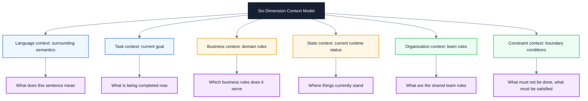
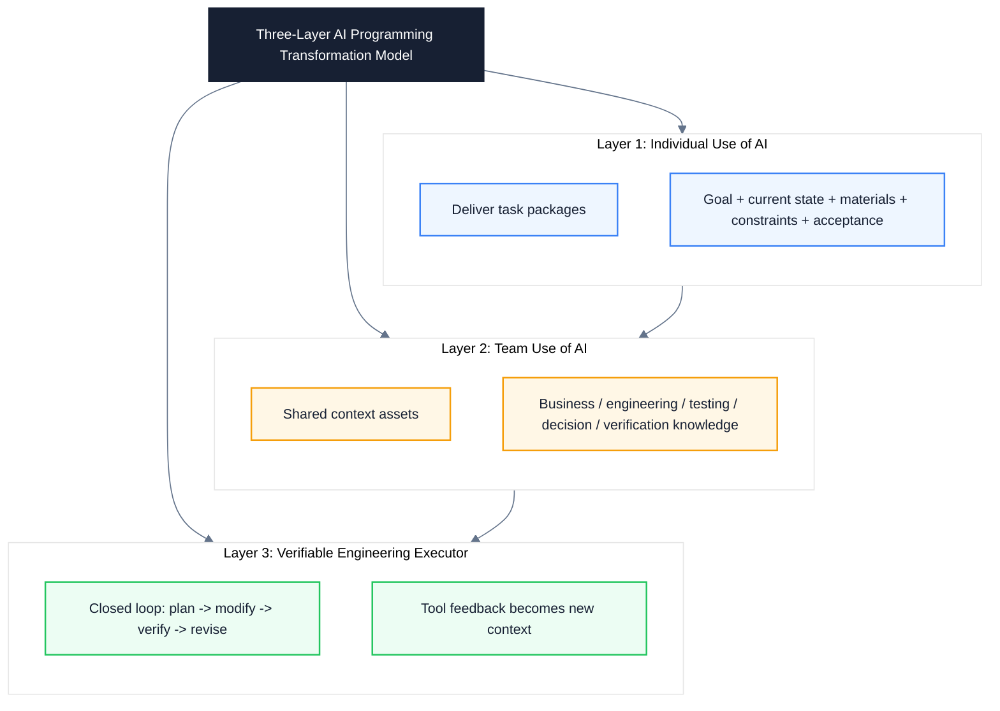
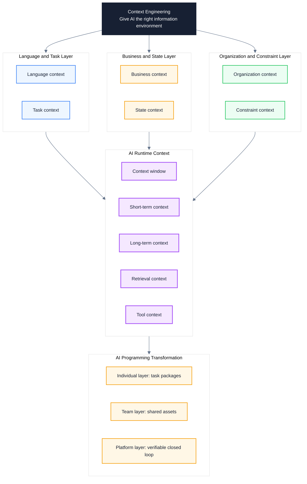

# Understanding Context in the AI Era and Its Role in AI Programming Transformation

> Subtitle: From everyday language context to context engineering for AI programming
>
> Target readers: Mid- to senior-level engineers, test and QA leads, AI programming transformation drivers
>
> Reading time: ~20 minutes

::: info In one sentence
AI programming quality increasingly depends not on "how to write the prompt" but on "what context you provide to the AI."
:::

## Table of Contents

- [1. Understanding Context from Everyday Language](#1-understanding-context-from-everyday-language)
- [2. The Six Dimensions of Context](#2-the-six-dimensions-of-context)
- [3. How Context Changes in the AI Era](#3-how-context-changes-in-the-ai-era)
- [4. Core Context Concepts in AI](#4-core-context-concepts-in-ai)
- [5. Why Context Matters More Than Code Generation](#5-why-context-matters-more-than-code-generation)
- [6. Four Types of Context Quality Problems](#6-four-types-of-context-quality-problems)
- [7. Three Layers of AI Programming Transformation](#7-three-layers-of-ai-programming-transformation)
- [8. Concrete Application in Automated Testing](#8-concrete-application-in-automated-testing)
- [9. Role Evolution and Capability Shift](#9-role-evolution-and-capability-shift)
- [10. Unified Model: Six-Layer Context Framework](#10-unified-model-six-layer-context-framework)
- [11. AI Programming Practice Checklist](#11-ai-programming-practice-checklist)
- [Conclusion: From Prompt to Context Engineering](#conclusion-from-prompt-to-context-engineering)
- [FAQ](#faq)
- [Sources](#sources)

---

## 1. Understanding Context from Everyday Language

"Context" sounds like a technical term, but it is actually a basic capability humans use every day.

Start with the simplest example. Suppose someone says:

> "Help me handle this issue."

This sentence itself carries almost no useful information. To understand it, you need to know at least:

- Who "me" is;
- Who "you" is;
- What "this issue" refers to;
- Where the issue occurred;
- What has already been tried;
- What outcome is expected;
- By when it must be done;
- What constraints apply.

If both sides just discussed a login failure, "this issue" might be the login failure. If both sides are reviewing a test report, "this issue" might be a blocking defect in the report.

The real meaning of a sentence cannot be captured from its literal text alone. It is determined by several layers of information combined:

```text
Real meaning
= current expression
+ previous information
+ current environment
+ shared understanding
+ implicit rules
```

The "previous information, current environment, shared understanding, and implicit rules" here are context.

::: tip Core conclusion of this section

Context is not supplementary information. It is a necessary precondition for understanding real intent. The same sentence can mean completely different things in different contexts. Get the context straight first, and understanding intent has a foundation.

:::

::: warning Common misconception

Equating context with "chat history" or "what was said before." That is only part of context. Complete context also includes environment, shared understanding, implicit rules, and more.

:::

---

## 2. The Six Dimensions of Context

Many people reduce context to chat history. That is not enough. Broadly, context contains at least six dimensions, and each one decides whether AI can correctly understand your real intent.

The diagram below shows how the six dimensions relate:



### 1. Language Context

What was said before and after a sentence. For example, "it still doesn't work" — to understand "it," you need to know whether the previous discussion was about an API, a script, a server, or a test environment.

### 2. Task Context

What task is actually being completed. Take "check this code":

- In code review, it might mean checking maintainability;
- In incident response, it might mean finding the root cause;
- In a security audit, it might mean checking for vulnerabilities;
- In test development, it might mean adding testability and boundary cases.

"Check the code" without knowing the task easily goes in the wrong direction.

### 3. Business Context

Code does not exist in isolation. It serves business rules. For example:

```typescript
if (income > threshold) {
  calculateTax();
}
```

Just by reading the code, AI can check syntax and general logic, but it does not know:

- Whether `income` is monthly or annual;
- Which tax year `threshold` corresponds to;
- Whether individuals and companies are distinguished;
- How currency and precision are handled;
- Whether the boundary is "greater than" or "greater than or equal to";
- Whether exemption conditions exist.

All of these belong to business context. In rule-dense systems such as tax, finance, and government, **business context is often more important than code context**.

### 4. State Context

Describes "where things currently stand." For example: which branch is in use, which environment is running, whether the user has logged in, what test data exists in the database, what the previous API returned, how many times a task has already been retried.

Automated testing depends heavily on state context. Suppose the test step is "click the submit button." That action alone is not enough. You also need to know the complete preconditions:

```text
User has logged in
-> Has entered the declaration page
-> Has filled in required fields
-> Has uploaded attachments
-> The current record is in draft state
-> The "Submit" button is visible and enabled
```

These preconditions determine whether "click submit" is meaningful.

### 5. Organization Context

Shared rules formed within a team: coding standards, directory structure, naming conventions, branching strategy, defect severity levels, test priority, Definition of Done, which frameworks are allowed, which data must not enter AI, who is responsible for approval and release.

A new employee who does not know these rules tends to write code that is "technically correct but unusable in the team." AI is the same.

### 6. Constraint Context

Tells the executor what cannot be done, and what conditions the result must satisfy. For example: must use Playwright, must not modify production code, must not access real customer data, scripts must be compatible with the Linux CI agent, a single test case must not exceed five minutes, on failure must retain screenshots and network logs, must not use fixed waits to paper over stability issues.

Constraints are not supplementary information. They are part of the task definition.

::: tip Core conclusion of this section

Complete context is a combination of six dimensions: language, task, business, state, organization, and constraint. Missing any one of them, and AI can drift off in some direction.

:::

---

## 3. How Context Changes in the AI Era

Traditional software runs on explicit inputs and rules:

```text
Input + Fixed program = Output
```

Generative AI is an entirely different model:

```text
Current instruction
+ conversation history
+ provided documents
+ code and tool results
+ system rules
+ model's existing capability
= model's understanding of the current task
= output
```

So AI output is not determined by the last prompt. It is determined by the entire information environment the model can access at that moment.

You can think of AI as a very capable, fast-learning engineer who just joined the project:

- It knows general programming;
- It knows common frameworks;
- It can read code quickly;
- But it inherently does not know your company's business;
- It does not know internal abbreviations;
- It does not know historical design decisions;
- It does not know which APIs are already deprecated;
- It does not know the acceptance criteria you actually care about.

If you do not give it context, it fills the gaps with general experience. And that gap-filling process is exactly the source of many errors and "hallucinations."

::: tip Core conclusion of this section

AI's problems often sit at the layer of "not knowing what you really want it to do," not at "not knowing how to do it." The information environment it can access at the current moment is what decides its output quality. What the last instruction said is secondary.

:::

::: info Engineering insight

Once you understand this property of AI, the focus of engineering teams has to shift from "optimizing a single prompt" to "optimizing the information environment AI can access." That is the threshold from Prompt Engineering to Context Engineering.

:::

---

## 4. Core Context Concepts in AI

In the AI field, "context" has been given a more specific meaning. The following core concepts are the foundation for mastering AI programming.

### 1. Context Window

The context window can be understood as the amount of information AI can "place on the workbench to read" at one time. The workbench may hold: system instructions, current conversation, code files, requirement documents, API definitions, logs, test results, tool call results, and content the AI itself generated earlier.

A larger window means the AI can read more material at once. But "large" does not mean "good." If the workbench is piled with outdated documents, duplicate code, irrelevant logs, conflicting requirements, and a pile of unprioritized information, the AI has more trouble finding the focus.

What you should actually pursue is:

> Give AI the most relevant, accurate, and structured information needed to complete the current task.

### 2. Context Engineering

Prompt Engineering usually focuses on "how should this sentence be asked." Context Engineering focuses on "to let AI correctly complete the task, what information should it see."

The difference can be understood through these two examples:

```text
// Bad example: low-context instruction
Help me generate login tests.
```

```text
// Good example: task package after context engineering
Goal:
Generate automated tests for the individual user login feature of the Hong Kong tax filing system.

Tech stack:
- Playwright
- TypeScript
- Page Object Model
- Tests run in a Linux CI environment

Relevant materials:
- requirements/login.md
- openapi/auth.yaml
- pages/LoginPage.ts
- fixtures/users.ts
- tests/login/existing-login.spec.ts

Business rules:
- After 5 consecutive wrong passwords, the account is locked
- Lock duration is 30 minutes
- MFA is only enabled for specific roles
- Real taxpayer data must not be used in the test environment

Implementation constraints:
- Do not use waitForTimeout
- Prefer getByRole for locators
- Each test creates and cleans up its own data
- On failure, save screenshot, trace, and API response

Acceptance criteria:
- Cover normal login, wrong password, account lock, and MFA
- Pass npm run typecheck
- Pass npm run lint
- After generating code, run the smoke test for the login module
```

The second example is not just "more detailed writing." It builds an executable information environment.

### 3. Short-term Context

Short-term context is the information in the current session or current task, for example: which file is being edited, what command was just run, what error appeared, which solutions have already been tried, what approach the user just rejected. It is equivalent to human working memory.

In AI programming, short-term context lets the AI continuously complete:

```text
Read code
-> Modify code
-> Run tests
-> Read errors
-> Fix errors
-> Verify again
```

If context is lost mid-way, several problems may appear: repeating already-failed solutions, forgetting constraints confirmed earlier, reverting already-fixed code, and focusing only on the last error while forgetting the overall goal.

### 4. Long-term Context

Long-term context is information that remains valid across tasks, for example: project architecture description, team coding standards, business glossary, test strategy, historical technical decisions, system boundaries, security and compliance rules. It is equivalent to the team's organizational memory.

Long-term context should not live only in the head of a senior employee. To support AI programming, the team needs to turn it into readable assets:

```text
/docs
  business-glossary.md
  architecture.md
  testing-strategy.md
  coding-guidelines.md
  security-rules.md
  domain-rules.md

/decisions
  ADR-001-test-framework.md
  ADR-002-api-mocking.md
  ADR-003-test-data-isolation.md
```

There is also a shift behind this: in the past, documentation was mainly written for humans. Going forward, documentation must also be accurately retrievable and usable by AI.

### 5. Retrieval Context

Large projects cannot feed everything to the AI at once. The system must first find the information most relevant to the current task, then feed it to the model.

For example, if the task is "fix the amount precision error when submitting a tax return," the system can retrieve: amount calculation rules, current tax year configuration, relevant API definitions, the Decimal utility class, corresponding test cases, past similar defects, and recent code changes.

This process is usually called retrieval augmentation (RAG). The core idea is simple:

> When needed, deliver the right information to the AI.

### 6. Tool Context

Reading code alone is not enough for AI. It also needs real feedback from tools: Git current diff, compilation errors, unit test results, Playwright trace, browser console, network requests, API responses, database query results, CI logs, static analysis results.

For example, the AI believes a test has been fixed, but the actual run still fails:

```text
Expected: "Submitted"
Received: "Pending Review"
```

This test result becomes new context, forcing the AI to revise its earlier judgment.

So reliable AI programming should not stop at "user asks a question -> AI generates code -> done." It should be:

```text
Understand task
-> Retrieve relevant context
-> Make a plan
-> Modify code
-> Call real tools to verify
-> Add results to context
-> Continue revising based on feedback
```

::: tip Core conclusion of this section

Context engineering is the leap from "writing a good sentence" to "building an executable information environment." The context window sets the capacity ceiling. Short-term, long-term, retrieval, and tool context together decide whether AI can get the right information at the right moment.

:::

---

## 5. Why Context Matters More Than Code Generation

In the past, evaluating a programmer often focused on: familiarity with syntax, knowledge of frameworks, and speed of writing code. AI has already significantly lowered the cost of code generation, but it has not automatically solved the following problems:

- What problem should be solved;
- Whether requirements are complete;
- Which business rules apply;
- Which module should be modified;
- Which existing designs must not be broken;
- How to prove the change is correct;
- How to locate the cause when something fails.

So the core capability in AI programming transformation is shifting from "writing all the code by hand" toward these directions:

1. Defining the problem;
2. Organizing context;
3. Decomposing tasks;
4. Setting constraints;
5. Letting AI call tools;
6. Verifying results;
7. Managing knowledge and feedback.

This can be expressed as a formula:

```text
AI Programming Result Quality
≈ Model capability
× Context quality
× Task definition quality
× Tool verification capability
```

This is a multiplication relationship. If task definition or context quality approaches zero, the final result will be very unstable even if the model is strong.

::: tip Core conclusion of this section

AI programming quality is a multiplication relationship. If context quality approaches zero, the overall result approaches zero. The model sets the capability ceiling. Context engineering decides whether that capability can hold steady in real projects.

:::

::: warning Common misconception

Believing "as long as the model is strong enough, you do not need to carefully organize context." No matter how strong the model is, without business rules, constraints, and acceptance criteria, it can only guess based on general experience. And guessing is the main source of "hallucinations" and rework.

:::

---

## 6. Four Types of Context Quality Problems

Context is not "the more, the better." In real engineering, context quality problems fall into four categories, and each one directly undermines the stability of AI output.

### 1. Insufficient Context

Symptoms: only saying "help me fix it," no error log attached, expected result not stated, relevant code not provided, technical constraints not mentioned. The result is that the AI can only guess.

Solution:

> Supplement goal, current state, materials, constraints, and acceptance criteria.

### 2. Context Overload

Symptoms: feeding the entire codebase to the AI at once, providing tens of thousands of lines of irrelevant logs, asking the AI to handle several unrelated problems simultaneously, copying a large amount of history without pointing out the current conclusion.

Solution:

> Filter information around the current task. Do not mechanically accumulate.

### 3. Context Conflict

For example: the requirement document says the lock is 30 minutes, the test case says the lock is 60 minutes, the actual configuration is 15 minutes, and an old code comment says "permanent lock."

At this point, the AI should not pick a "reasonable-looking" answer on its own. The team needs to define information priority:

```text
Approved latest business requirements
> Current version acceptance criteria
> API contract
> Test cases
> Code comments
> Historical documents
```

If high-priority sources still conflict, escalate to a requirement clarification. Do not let the AI guess.

### 4. Stale Context

Common situations: documentation not updated with code, API examples already expired, test data no longer valid, AI read an old branch, past defect solutions no longer apply.

So context, besides being "relevant," must also carry: version, update time, applicable scope, source, authority level, and whether it is still valid now.

::: tip Core conclusion of this section

Context quality = relevant × accurate × consistent × valid. If any one of the four categories goes out of control, AI output slides from "reliable" to "looks reasonable but is actually wrong."

:::

---

## 7. Three Layers of AI Programming Transformation

With the concepts and quality problems of context clear, the next step is turning the understanding into an actionable transformation path. AI programming transformation usually has three layers, each building on the previous:



### Layer 1: Individual Use of AI

Individuals first need to shift from "asking questions" to "delivering task packages." Every time you start a programming task with AI, provide at least:

```text
1. Goal: what problem to solve
2. Current state: what is happening now
3. Materials: relevant code, logs, APIs, and requirements
4. Constraints: what not to do, what must be used
5. Output: whether you want code, a plan, or an analysis
6. Acceptance: how to judge task completion
```

You can reuse this task package template:

```text
Task goal:
[Describe expected result]

Current phenomenon:
[Describe actual result, error, and reproduction]

Project background:
[Business module, tech stack, and runtime environment]

Relevant materials:
[Files, APIs, logs, test cases]

Must follow:
[Frameworks, standards, security, and compatibility requirements]

Prohibited:
[Modules that cannot be modified, approaches that cannot be used]

Acceptance criteria:
[Compile, test, performance, and business outcome]

Execution requirements:
First analyze the root cause and impact scope, then modify code. After modification, run relevant checks.
Do not infer success from code alone.
```

### Layer 2: Team Use of AI

The team needs to build shared context, instead of letting everyone repeatedly explain the project to AI. It is recommended to build five categories of assets:

**Business knowledge**: business glossary, core business processes, roles and permissions, state transition rules, boundary and exception rules.

**Engineering knowledge**: project architecture, module responsibilities, coding standards, dependency usage principles, common commands.

**Testing knowledge**: test layering strategy, scope of UI/API/performance tests, Page Object design rules, tag and priority conventions, test data management, failure evidence collection standards.

**Decision knowledge**: why Playwright was chosen, why fixed waits are forbidden, why API and UI tests are layered, which modules cannot be directly mocked, why historical solutions were deprecated.

**Verification knowledge**: which commands must be run after a task, when a full regression is required, which failures can be retried, what conditions must be met before merging, which results must be manually reviewed.

### Layer 3: Let AI Become a Verifiable Engineering Executor

A mature AI programming platform should let AI complete a closed loop:

```text
Receive task
-> Retrieve project context
-> Read relevant code
-> Output implementation plan
-> Modify minimal scope
-> Run type check
-> Run static check
-> Run relevant automated tests
-> Analyze failure evidence
-> Revise
-> Output change summary and risks
```

Each step's result becomes new context for the next step.

This is also one of the key dividing lines between an AI Agent and an ordinary chatbot:

> A chatbot mainly answers from existing text. A programming Agent actively obtains new context through the codebase and tools.

::: tip Core conclusion of this section

The three layers build on each other: the individual layer delivers task packages, the team layer builds shared context assets, and the platform layer builds a verifiable engineering closed loop. The bottom is individual habit, the top is system capability. None of them can be skipped.

:::

---

## 8. Concrete Application in Automated Testing

In the scenario of "generating UI, API, and load test scripts from existing business test cases," the biggest challenge usually gets stuck on whether the test case contains enough executable context, not on whether AI can write Playwright.

A traditional manual test case might be written as:

```text
The user logs in to the system, fills in the declaration form, and submits it. Verify submission succeeds.
```

A human tester has a lot of implicit information in their head, but the AI does not:

- Which type of user is used;
- Where the login entry is;
- How test data is created;
- Which tax year the declaration form corresponds to;
- What the required fields are;
- What "submission succeeds" is judged by;
- Whether the post-submit status is `Submitted` or `Pending Review`;
- Whether the database and API need to be verified;
- How to clean up data;
- Whether duplicate submissions are allowed.

To make it stably convertible by AI into an automated script, the test case needs to be upgraded to structured context:

```yaml
case_id: TAX-FILING-001
objective: Verify that an individual user can submit a valid declaration form

preconditions:
  - User has completed identity verification
  - User has a draft declaration form for the current tax year
  - The test account does not have MFA enabled

test_data:
  user_role: individual_taxpayer
  assessment_year: 2025
  currency: HKD
  income: 500000

steps:
  - action: Log in to the system
  - action: Open the draft declaration form
  - action: Fill in income information
  - action: Submit the declaration form

expected_results:
  - The page shows submission success
  - The declaration form status becomes Submitted
  - The submission API returns a success business code
  - The system generates a submission reference

automation_constraints:
  framework: Playwright
  language: TypeScript
  locator_strategy: role-first
  fixed_wait: forbidden
  cleanup_required: true
```

This is actually building a machine-consumable test context. "Writing it in more detail" is just a side effect.

::: tip Core conclusion of this section

Test cases need to be upgraded from "human-readable" to "machine-consumable context." Structure preconditions, test data, expected results, and automation constraints, and AI can stably produce test scripts that actually run.

:::

::: warning Common misconception

Believing "AI knowing how to write Playwright is enough." Whether the scripts AI writes can hold up in a real environment depends on whether the test case provides the full set of business rules, state preconditions, and verification criteria, not on how familiar the AI is with the framework syntax.

:::

---

## 9. Role Evolution and Capability Shift

AI will not leave engineers with only the job of "writing prompts." On the contrary, it raises the bar for engineering judgment. The more important capabilities are shifting:

| Traditional capability focus | AI-era capability focus |
|---|---|
| Memorizing syntax | Accurately defining the problem |
| Hand-writing large amounts of code | Designing tasks and context |
| Debugging from experience | Building evidence chains with tools |
| Individuals holding project knowledge | Crystallizing knowledge into team assets |
| Reviewing code style | Reviewing business correctness and impact scope |
| Executing test steps | Designing quality gates and feedback loops |

For QA and automation engineers, the role also further shifts from "script writer" toward:

- Test context designer;
- Business rule structurer;
- Verifier of AI-generated results;
- Builder of automated quality gates;
- Maintainer of the test knowledge base;
- Agent workflow designer.

::: tip Core conclusion of this section

AI raises the bar for engineering judgment, it does not lower it. The core capability shifts from "implementing by hand" to "defining problems, organizing context, and designing verification loops." This sets a higher requirement for engineers' systems thinking.

:::

---

## 10. Unified Model: Six-Layer Context Framework

The diagram below summarizes the context concepts scattered throughout this article into a unified model. The core node is context engineering. It connects to the six dimensions of context and ultimately serves the three-layer path of AI programming transformation:



### 1. Six-Dimension Model

The six dimensions — language, task, business, state, organization, and constraint — together form the complete context needed to understand any task. The first two answer "what is being said" and "what is to be done," the middle two answer "in what environment," and the last two answer "by what rules" and "what cannot be done."

### 2. AI Runtime Context

The context window is the capacity ceiling. Short-term context maintains task continuity. Long-term context carries team memory. Retrieval context gets relevant information on demand. Tool context provides real feedback. Together, these five decide what the information environment looks like that the AI can access at a given moment.

### 3. Three-Layer Transformation Path

The individual layer delivers structured task packages. The team layer builds reusable context assets. The platform layer builds an engineering closed loop of "modify -> verify -> feedback." The three layers build on each other and ultimately let AI become a verifiable engineering executor.

::: tip Core conclusion of this section

The six-dimension model + AI runtime context + three-layer transformation path together form the unified context framework for AI programming. The model sets the capability ceiling. Context engineering decides whether that capability can hold steady in real projects.

:::

---

## 11. AI Programming Practice Checklist

### 1. Individual Task Package Design

- [ ] Every time you start a programming task with AI, provide the six elements: goal, current state, materials, constraints, output, and acceptance
- [ ] Distinguish between "asking a question" and "delivering a task package"; the latter must include acceptance criteria
- [ ] Explicitly state prohibited items in the task package (modules that cannot be modified, approaches that cannot be used)
- [ ] Require AI to first analyze the root cause and impact scope, then modify code
- [ ] After modification, require running relevant checks; do not infer success from code alone

### 2. Team Context Asset Building

- [ ] Maintain a business glossary (business-glossary.md)
- [ ] Maintain a project architecture description (architecture.md)
- [ ] Maintain a test strategy document (testing-strategy.md)
- [ ] Maintain coding standards (coding-guidelines.md)
- [ ] Use ADRs to record historical technical decisions (/decisions directory)
- [ ] Maintain security and compliance rules (security-rules.md)

### 3. Test Case Structuring

- [ ] Test cases include case_id, objective, preconditions, test_data, steps, and expected_results
- [ ] Explicitly state automation_constraints (framework, language, locator strategy, wait strategy, cleanup strategy)
- [ ] expected_results covers validation at the page, API, and database levels
- [ ] preconditions describe the complete pre-existing state, not implicit assumptions

### 4. Context Quality Management

- [ ] Before submitting, check whether context is sufficient (are goal, materials, and constraints complete)
- [ ] Avoid submitting the entire codebase or tens of thousands of lines of irrelevant logs at once
- [ ] Define information priority (business requirements > acceptance criteria > API contract > test cases > code comments > historical documents)
- [ ] When high-priority sources conflict, escalate to a requirement clarification instead of letting AI guess
- [ ] Tag documents with version, update time, applicable scope, and whether currently valid

### 5. Tool Feedback Loop

- [ ] After AI modifies code, type check and static analysis must run
- [ ] On failure, retain screenshots, trace, and API responses as evidence
- [ ] Add tool run results to the next round of context to form a feedback loop
- [ ] Do not allow inferring success from code alone; verify with real run results
- [ ] Distinguish between a "chatbot" and a "programming Agent"; the latter must be able to call real tools

### 6. Knowledge Crystallization and Version Management

- [ ] Documentation must be readable by humans and accurately retrievable and usable by AI
- [ ] Long-term context must not depend on individual memory; it must be turned into readable assets
- [ ] API examples, test data, and code comments are updated in sync with code
- [ ] The branch AI reads stays consistent with the current working branch
- [ ] Historical defect solutions are tagged with applicable scope and failure conditions

### 7. Capability Shift and Role Upgrade

- [ ] Shift from "memorizing syntax" to "accurately defining the problem"
- [ ] Shift from "hand-writing large amounts of code" to "designing tasks and context"
- [ ] Shift from "debugging from experience" to "building evidence chains with tools"
- [ ] Shift from "individuals holding project knowledge" to "crystallizing knowledge into team assets"
- [ ] Shift from "reviewing code style" to "reviewing business correctness and impact scope"
- [ ] Shift from "executing test steps" to "designing quality gates and feedback loops"

---

## Conclusion: From Prompt to Context Engineering

You can think of context as four layers:

```text
Layer 1: What does this sentence mean?
         -- Language context

Layer 2: What task is being completed now?
         -- Task context

Layer 3: What business and engineering environment is this task in?
         -- Business, state, and organization context

Layer 4: How do you prove the result is actually correct?
         -- Tool, testing, and acceptance context
```

And the most important cognitive shift in AI programming comes down to one sentence:

> **The prompt is the command, context is the work environment, tool results are the facts, and acceptance criteria are the destination.**

With only a prompt and no context, the AI can only guess. With only context and no clear task, the AI does not know where to start. With a task and context but no tool verification, the AI can only assume it got things right.

Truly reliable AI programming should bring these together:

```text
Clear task
+ high-quality context
+ explicit constraints
+ real tool feedback
+ checkable acceptance criteria
= deployable AI engineering capability
```

For enterprises doing AI programming transformation, the first step is not necessarily picking the strongest model. First check whether the team can answer three questions: Have we structured our business and engineering knowledge? Can AI get the right project context at the right time? Can AI-generated results be automatically verified against compile, test, and business rules?

The model sets the capability ceiling. Context engineering decides whether that capability can hold steady in real projects.

> **AI programming quality increasingly depends not on "how to write the prompt" but on "what context you provide to the AI."**

---

## FAQ

### 1. What is the difference between context engineering and prompt engineering?

Prompt Engineering focuses on "how should this sentence be asked," with the emphasis on optimizing the expression of a single instruction. Context Engineering focuses on "to let AI correctly complete the task, what information should it see," with the emphasis on building an executable information environment, including relevant materials, business rules, constraints, and acceptance criteria. The former is writing a good sentence; the latter is building a task package.

### 2. Is a bigger context window always better?

No. A larger window means the AI can read more material at once, but if the workbench is piled with outdated documents, duplicate code, irrelevant logs, and conflicting requirements, the AI has more trouble finding the focus. What you should pursue is giving the AI the most relevant, accurate, and structured information needed for the current task, not the most information.

### 3. How do you judge whether the context is enough?

A simple checklist: Have you provided the goal, current state, materials, constraints, and acceptance criteria? If the AI's output keeps needing rework, or produces "looks reasonable but is actually wrong" results, it is usually not a model capability problem. It is insufficient context. Supplementing business rules, preconditions, and verification criteria is often more effective than switching to a stronger model.

### 4. Where should a team start with AI programming transformation?

It is recommended to start with three things. First, fix the individual task package template so every task delivered to AI carries the six elements. Second, turn team tacit knowledge (business glossary, architecture description, test strategy, historical decisions) into readable document assets. Third, build a "modify -> verify -> feedback" tool loop so that AI output must pass real run verification.

### 5. How do you handle context conflicts?

Do not let the AI pick a "reasonable-looking" answer on its own. The team needs to define information priority, for example "approved latest business requirements > current version acceptance criteria > API contract > test cases > code comments > historical documents." If high-priority sources still conflict, escalate to a requirement clarification. Only feed it to the AI after human confirmation. Do not let the AI guess among conflicting information.

---

## Sources

1. Addy Osmani, "Modern Web Performance":

   [https://addyosmani.com/](https://addyosmani.com/)

2. Andrej Karpathy on LLM context and Agent design:

   [https://karpathy.ai/](https://karpathy.ai/)

3. Anthropic, "Context Engineering for Agents":

   [https://docs.anthropic.com/](https://docs.anthropic.com/)

4. Playwright official documentation, "Best Practices":

   [https://playwright.dev/docs/best-practices](https://playwright.dev/docs/best-practices)

5. Microsoft, "The New Future of Work: AI and Context":

   [https://www.microsoft.com/en-us/research/](https://www.microsoft.com/en-us/research/)
