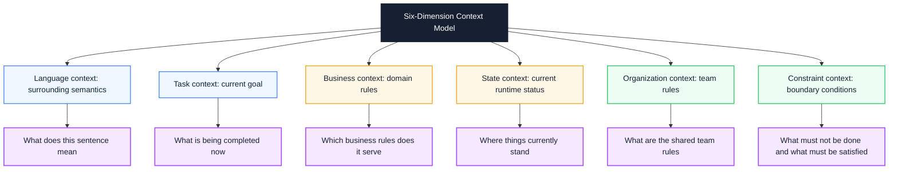
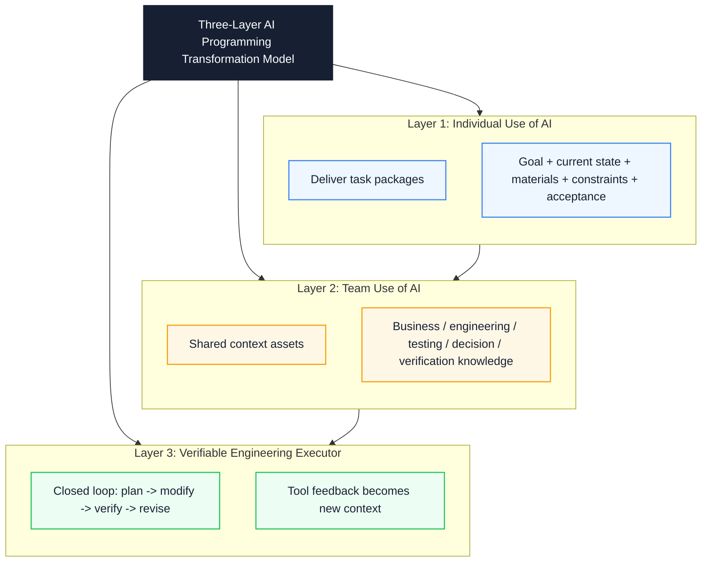

# Understanding Context in the AI Era and Its Role in AI Programming Transformation

Teams often treat AI programming transformation as a model upgrade or a prompt-writing course, while the work that actually blocks delivery sits in business rules, state, and acceptance criteria that never reach the model. This article turns context into dimensions you can evaluate, compares the investment and prerequisites of individual, team, and platform layers, and gives conditional advice on where a team should start. The decision is not whether to adopt AI coding, but which context asset to build first.

::: info In one sentence
AI programming quality increasingly depends not on "how to write the prompt" but on "what context you provide to the AI."
:::

## Table of Contents

- [1. Decision Background: Where AI Programming Transformation Should Focus](#_1-decision-background-where-ai-programming-transformation-should-focus)
- [2. The Six Dimensions of Context: A Framework for Task Completeness](#_2-the-six-dimensions-of-context-a-framework-for-task-completeness)
- [3. What Changes in the AI Era: Output Is Determined by the Information Environment](#_3-what-changes-in-the-ai-era-output-is-determined-by-the-information-environment)
- [4. AI Runtime Context: What the Model Can Actually See](#_4-ai-runtime-context-what-the-model-can-actually-see)
- [5. Why Context Deserves More Investment Than Code Generation](#_5-why-context-deserves-more-investment-than-code-generation)
- [6. Four Evaluation Dimensions of Context Quality](#_6-four-evaluation-dimensions-of-context-quality)
- [7. Comparing Three Transformation Layers: Individual, Team, and Platform](#_7-comparing-three-transformation-layers-individual-team-and-platform)
- [8. Constraints and Risks: Conflict, Staleness, and Security](#_8-constraints-and-risks-conflict-staleness-and-security)
- [9. Role Changes and Capability Migration](#_9-role-changes-and-capability-migration)
- [10. Practical Example: Turning a Test Case into Consumable Context](#_10-practical-example-turning-a-test-case-into-consumable-context)
- [11. Conditional Recommendations: Where Different Teams Should Start](#_11-conditional-recommendations-where-different-teams-should-start)
- [12. AI Programming Practice Checklist](#_12-ai-programming-practice-checklist)
- [Conclusion: From Prompt to Context Engineering](#conclusion-from-prompt-to-context-engineering)
- [FAQ](#faq)
- [Sources](#sources)

---

## 1. Decision Background: Where AI Programming Transformation Should Focus

"Context" sounds like a technical term, but it is a basic capability humans use every day. Start with a simple example. Suppose someone says:

> "Help me handle this issue."

The sentence carries almost no useful information. To understand it, you need to know at least:

- Who "I" is;
- Who "you" are;
- What "this issue" refers to;
- Where the issue occurred;
- What has already been tried;
- What outcome is expected;
- By when it must be done;
- What constraints apply.

If the two sides just discussed a login failure, "this issue" may mean the login failure. If they are reviewing a test report, it may mean a blocking defect in the report.

The real meaning of a sentence is not in its literal text alone. Several layers of information determine it:

```text
Real meaning
= current expression
+ previous information
+ current environment
+ shared understanding
+ implicit rules
```

The previous information, current environment, shared understanding, and implicit rules are context. Context is not supplementary information; it is a precondition for understanding real intent.

Put this example back into AI programming, and the decision problem appears. Model capability is converging, so the difference between teams comes more from task definition, the information environment, and verification capability. Transformation investment falls into three categories:

- A stronger model;
- A better single prompt;
- Context assets and a verification loop.

The first two show results quickly but are hard to accumulate. The third costs more up front but can be reused by the team. The position of this article is to get the third right first, then decide how much to invest in the first two.

The sections follow decision order: define the evaluation dimensions of context, compare three transformation paths, and then give constraints, risks, and conditional advice.

---

## 2. The Six Dimensions of Context: A Framework for Task Completeness

Many people reduce context to chat history. That is not enough. To judge whether a task package is complete, look at six dimensions.

The diagram below shows how the six dimensions relate:



The six dimensions expand from the core, and each maps to one question that must be answered. The first two answer "what is being said" and "what is to be done"; the middle two answer "in what environment"; the last two answer "by what rules" and "what cannot be done." If any dimension is missing, the AI fills the gap with general experience.

### 1. Language Context

What was said before and after a sentence. For example, "it still doesn't work" requires knowing whether "it" refers to an API, a script, a server, or a test environment.

### 2. Task Context

What task is actually being completed. The same instruction to "check this code" can mean:

- Checking maintainability in code review;
- Finding the cause of an incident;
- Looking for vulnerabilities in a security audit;
- Adding testability and boundary cases in test development.

"Check the code" without knowing the task easily checks the wrong thing.

### 3. Business Context

Code does not exist in isolation; it serves business rules. For example:

```typescript
if (income > threshold) {
  calculateTax();
}
```

Reading the code alone lets AI check syntax and general logic, but it does not know:

- Whether `income` is monthly or annual;
- Which tax year `threshold` belongs to;
- Whether individuals and companies are treated differently;
- How currency and precision are handled;
- Whether the boundary is "greater than" or "greater than or equal to";
- Whether exemptions exist.

These are business context. In rule-dense systems such as tax, finance, and government, business context is often more important than code context.

### 4. State Context

State context describes where things currently stand: which branch is checked out, which environment is running, whether the user is logged in, what test data is in the database, what the previous API returned, and how many times a task has been tried.

Automated testing depends heavily on state context. Suppose the step is "click the submit button." That action alone is not enough; the full precondition set matters:

```text
User is logged in
-> Has entered the declaration page
-> Has filled in required fields
-> Has uploaded attachments
-> The current record is in draft state
-> The "Submit" button is visible and enabled
```

These preconditions decide whether "click submit" means anything.

### 5. Organization Context

Organization context is the shared rules a team has built: coding standards, directory structure, naming conventions, branching strategy, defect severity, test priority, Definition of Done, which frameworks are allowed, which data must not enter AI, and who approves and releases.

A new employee who does not know these rules writes code that is technically correct but unusable in the team. AI behaves the same way.

### 6. Constraint Context

Constraint context tells the executor what cannot be done and what the result must satisfy. Examples: must use Playwright, must not modify production code, must not access real customer data, scripts must run on a Linux CI agent, a single test case must finish within five minutes, failure must retain screenshots and network logs, and fixed waits must not hide stability problems.

Constraints are part of the task definition, not extra information.

---

## 3. What Changes in the AI Era: Output Is Determined by the Information Environment

Traditional software runs on explicit inputs and rules:

```text
Input + fixed program = output
```

Generative AI works differently:

```text
Current instruction
+ conversation history
+ provided documents
+ code and tool results
+ system rules
+ existing model capability
= model understanding of the current task
= output
```

AI output is therefore not decided by the last prompt. It is decided by the entire information environment available at that moment.

Think of AI as a capable, fast-learning engineer who has just joined the project:

- It knows general programming;
- It knows common frameworks;
- It can read code quickly;
- But it does not know your company's business;
- It does not know internal abbreviations;
- It does not know historical design decisions;
- It does not know which APIs are deprecated;
- It does not know the acceptance criteria you actually care about.

Without context, it fills gaps with general experience. That gap-filling is exactly where many errors and hallucinations come from.

The first decision in transformation is therefore not which model to switch to, but whether the information environment the AI can see is sufficient for the task. The engineering focus shifts from optimizing a single prompt to optimizing the information environment the AI can access.

---

## 4. AI Runtime Context: What the Model Can Actually See

In AI, "context" takes on a more specific meaning. The concepts below are the foundation for judging whether the AI can obtain the right information.

### 1. Context Window

The context window is the amount of information the AI can keep "on the workbench" at one time. The workbench may hold system instructions, the current conversation, code files, requirement documents, API definitions, logs, test results, tool call results, and content the AI generated earlier.

A larger window lets the AI read more material at once. But large is not the same as good. If the workbench is piled with stale documents, duplicate code, irrelevant logs, conflicting requirements, and unprioritized information, the AI has more trouble finding the focus.

The goal is to give the AI the most relevant, accurate, and structured information needed for the current task.

### 2. Context Engineering

Prompt Engineering focuses on how a sentence should be asked. Context Engineering (the practice of selecting and organizing everything the model sees) focuses on what information the AI should see in order to complete the task correctly.

The difference is visible in two examples:

```text
// Anti-pattern: low-context instruction
Generate login tests for me.
```

```text
// Correct: a task package produced through context engineering
Goal:
Generate automated tests for the individual user login feature of the Hong Kong tax filing system.

Tech stack:
- Playwright
- TypeScript
- Page Object Model
- Tests run in a Linux CI environment

Relevant materials:
- requirements/login.md
- openapi/auth.yaml
- pages/LoginPage.ts
- fixtures/users.ts
- tests/login/existing-login.spec.ts

Business rules:
- After 5 consecutive wrong passwords, the account is locked
- Lock duration is 30 minutes
- MFA (multi-factor authentication) is enabled only for specific roles
- Real taxpayer data must not be used in the test environment

Implementation constraints:
- Do not use waitForTimeout
- Prefer getByRole for locators
- Each test creates and cleans up its own data
- On failure, save the screenshot, trace, and API response

Acceptance criteria:
- Cover normal login, wrong password, account lock, and MFA
- Pass npm run typecheck
- Pass npm run lint
- After generating code, run the smoke test for the login module
```

The business rules and thresholds above are examples, not real policy. The value of the task package is not that it is longer; it builds an executable information environment.

### 3. Short-term Context

Short-term context is information in the current session or task: which file is being edited, what command just ran, what error appeared, which approaches have failed, and what the user just rejected. It is the equivalent of working memory.

In AI programming, short-term context lets the AI carry a chain through:

```text
Read code
-> Modify code
-> Run tests
-> Read errors
-> Fix errors
-> Verify again
```

If context is lost in the middle, the AI may repeat a failed approach, forget a confirmed constraint, revert a fixed change, or focus on the last error while losing the overall goal.

### 4. Long-term Context

Long-term context stays valid across tasks: architecture notes, coding standards, a business glossary, test strategy, historical technical decisions, system boundaries, and security and compliance rules. It is the team's organizational memory.

Long-term context should not live only in the head of a senior employee. To support AI programming, the team must turn it into readable assets:

```text
/docs
  business-glossary.md
  architecture.md
  testing-strategy.md
  coding-guidelines.md
  security-rules.md
  domain-rules.md

/decisions
  ADR-001-test-framework.md
  ADR-002-api-mocking.md
  ADR-003-test-data-isolation.md
```

ADR (Architecture Decision Record) preserves the background of why a choice was made, so the AI sees more than the final code and knows which options were rejected.

Behind this is a change in documentation itself: in the past, documents were written mainly for people. Going forward, they also need to be accurately retrievable and usable by AI.

### 5. Retrieval Context

A large project cannot feed everything to the AI at once. The system must first find the information most relevant to the current task, then give it to the model.

For example, for "fix the amount precision error when submitting a tax return," the system can retrieve the amount calculation rules, the current tax year configuration, relevant API definitions, the Decimal utility class, matching test cases, similar past defects, and recent code changes.

This process is usually called RAG (Retrieval-Augmented Generation). The core idea is simple: deliver the right information at the right time.

### 6. Tool Context

Reading code is not enough; the AI also needs real feedback from tools: the current Git diff, compilation errors, unit test results, Playwright traces, browser console output, network requests, API responses, database query results, CI logs, and static analysis results.

For example, the AI believes a test is fixed, but a real run still fails:

```text
Expected: "Submitted"
Received: "Pending Review"
```

That result becomes new context and forces the AI to revise its judgment.

Reliable AI programming therefore does not stop at "user asks, AI generates code, done." It follows a loop:

```text
Understand the task
-> Retrieve relevant context
-> Make a plan
-> Modify code
-> Call real tools to verify
-> Add results to context
-> Keep correcting from feedback
```

Context engineering is the leap from writing a good sentence to building an executable information environment. The context window sets the capacity ceiling, and short-term, long-term, retrieval, and tool context determine whether the AI gets the right information at the right moment.

---

## 5. Why Context Deserves More Investment Than Code Generation

In the past, a programmer was often judged by familiarity with syntax, knowledge of frameworks, and speed of writing code. AI has greatly reduced the cost of code generation, but it has not solved these problems:

- What problem should be solved;
- Whether the requirements are complete;
- Which business rules apply;
- Which module should change;
- Which existing designs must not be touched;
- How to prove the change is correct;
- How to locate the cause when it fails.

The core capability in AI programming transformation is therefore shifting from writing all the code by hand toward:

1. Defining the problem;
2. Organizing context;
3. Decomposing tasks;
4. Setting constraints;
5. Letting the AI call tools;
6. Verifying results;
7. Managing knowledge and feedback.

A formula expresses the relationship:

```text
AI programming result quality
= model capability
x context quality
x task definition quality
x tool verification capability
```

This is a multiplication relationship. If task definition or context quality approaches zero, the result is unstable no matter how strong the model is.

The model sets the capability ceiling; context engineering decides whether that capability holds steady in a real project. This is why the same model produces very different results in different teams.

---

## 6. Four Evaluation Dimensions of Context Quality

More context is not better. In engineering, quality problems fall into four categories, and each directly undermines the stability of AI output.

### 1. Insufficient Context

Symptoms: only "help me fix it," no error log, no expected result, no relevant code, no technical constraints. The AI can only guess.

The fix is to add the goal, current state, materials, constraints, and acceptance criteria.

### 2. Context Overload

Symptoms: feeding the entire codebase, tens of thousands of lines of irrelevant logs, several unrelated problems at once, or a large history without the current conclusion.

The fix is to filter around the current task instead of piling on information.

### 3. Context Conflict

For example: the requirement document says a 30-minute lock, the test case says 60 minutes, the actual configuration is 15 minutes, and an old code comment says permanent lock.

The AI should not pick the most plausible answer by itself. The team must define an information priority:

```text
Approved latest business requirement
> Current version acceptance criteria
> API contract
> Test cases
> Code comments
> Historical documents
```

If high-priority sources still conflict, escalate to requirement clarification instead of letting the AI guess.

### 4. Stale Context

Common cases: documentation not updated with the code, expired API examples, invalid test data, the AI reading an old branch, and past fixes that no longer apply.

Context must therefore carry version, update time, applicable scope, source, authority level, and whether it is still valid.

Context quality can be summarized as relevant times accurate times consistent times valid. If any one dimension is out of control, AI output slides from reliable to plausible but wrong.

---

## 7. Comparing Three Transformation Layers: Individual, Team, and Platform

Once the dimensions and quality problems are clear, the next decision is where transformation should start, what each layer requires, and what the return looks like.

AI programming transformation usually has three layers that build on one another:



All three layers start from the core, and the solid arrows show dependency: the individual layer is a prerequisite for the team layer, and the team layer is a prerequisite for the platform layer. Buying a platform while skipping individual habits usually produces a tool nobody maintains.

The prerequisites, investment, and risk differ by layer:

| Layer | Prerequisite | Main investment | Observable benefit | Main risk |
| --- | --- | --- | --- | --- |
| Individual | Basic team coding standards | Task package template and personal context habits | Fewer reworks and smaller change scope | Depends on one person and is hard to replicate |
| Team | Documentation and review process | Business, engineering, testing, decision, and verification assets | New hires ramp faster and AI answers are more consistent | Stale documents and maintenance cost |
| Platform | CI and observability | Toolchain, permissions, and a verification loop | Changes are verified automatically and problems can be replayed | Over-automation and permission risk |

Benefits must be measured against the team baseline; no fixed percentage is guaranteed. Without baseline data, record rework count, change scope, and verification pass rate first, then judge whether the investment works.

### Layer 1: Individual Use of AI

An individual moves from asking questions to delivering a task package. Every AI programming task provides at least:

```text
1. Goal: what problem to solve
2. Current state: what is happening now
3. Materials: relevant code, logs, APIs, and requirements
4. Constraints: what not to do and what must be used
5. Output: code, a plan, or an analysis
6. Acceptance: how to judge completion
```

You can reuse this template:

```text
Task goal:
[Describe the expected result]

Current symptom:
[Describe the actual result, error, and reproduction]

Project background:
[Business module, tech stack, and runtime environment]

Relevant materials:
[Files, APIs, logs, test cases]

Must follow:
[Framework, standards, security, and compatibility requirements]

Prohibited:
[Modules that cannot be modified and approaches that cannot be used]

Acceptance criteria:
[Build, test, performance, and business outcome]

Execution requirements:
Analyze the cause and impact scope before editing. Run relevant checks after editing.
Do not infer success from the code alone.
```

### Layer 2: Team Use of AI

The team needs shared context so that everyone does not explain the project to the AI again. Build five categories of assets:

**Business knowledge**: business glossary, core processes, roles and permissions, state transition rules, and boundary and exception rules.

**Engineering knowledge**: project architecture, module responsibilities, coding standards, dependency principles, and common commands.

**Testing knowledge**: test layering strategy, scope of UI, API, and performance tests, Page Object design rules, tag and priority conventions, test data management, and failure evidence standards.

**Decision knowledge**: why Playwright was chosen, why fixed waits are banned, why API and UI tests are layered, which modules cannot be mocked directly, and why past approaches were abandoned.

**Verification knowledge**: which commands must run after a task, when full regression is required, which failures can be retried, what conditions allow a merge, and which results need human review.

### Layer 3: Let AI Become a Verifiable Engineering Executor

A mature AI programming platform gives the AI a closed loop:

```text
Receive task
-> Retrieve project context
-> Read relevant code
-> Output an implementation plan
-> Modify the smallest scope
-> Run type checks
-> Run static checks
-> Run relevant automated tests
-> Analyze failure evidence
-> Correct
-> Output a change summary and risks
```

Every result becomes new context for the next step.

This is also a key dividing line between an AI Agent (a runtime that plans, calls tools, and verifies results) and an ordinary chatbot:

> A chatbot mainly answers from existing text; a programming Agent actively obtains new context through the codebase and tools.

The three layers build on one another: the individual layer delivers task packages, the team layer builds shared context assets, and the platform layer builds a verifiable engineering loop. Skipping the lower layers usually makes the upper layers fail in practice.

---

## 8. Constraints and Risks: Conflict, Staleness, and Security

Transformation has costs as well as benefits. The constraints below decide whether the three layers can land and in what order to invest.

### 1. Security and Compliance Constraints

Real customer data, secrets, and production logs should not enter context directly. They need redaction, least privilege, and a data retention policy. Regulated industries also need to confirm cross-border data rules, audit requirements, and access records.

The more complete the context, the higher the leakage risk. A team must draw a boundary between "enough information for the AI" and "only the necessary information" instead of putting everything into the task package.

### 2. Verification Capability Constraints

A team without CI or runnable tests cannot operate the platform layer. If AI changes cannot automatically run type checks, static checks, and tests, "verifiable" is only visual inspection.

Such teams should add verification commands before talking about autonomous Agent changes. Reversing the order only amplifies unverified changes.

### 3. Knowledge and Maintenance Cost

Context assets decay. When documentation and code are out of sync, the AI uses wrong information with higher confidence, which makes rework harder to see.

Assets need versions, owners, and invalidation markers. Documentation without a maintenance owner is usually not worth putting into long-term context.

### 4. Over-Reliance and Responsibility Boundaries

AI-generated changes still need code review and testing. Transferring responsibility to the model does not remove failures; it usually makes root causes harder to find.

The team must define actions that require human confirmation, such as changing production configuration, deleting data, changing permissions, and releasing versions.

### 5. Tool and Vendor Risk

Protocols and platforms evolve. Binding tool definitions, Trace formats, or prompt templates to one vendor creates migration cost that appears at scale.

Prefer exportable formats and open protocols, and keep at least one verification path that does not depend on a single platform.

---

## 9. Role Changes and Capability Migration

AI does not reduce engineering work to prompt writing. It raises the bar for engineering judgment, and the center of capability shifts. The speed and extent vary by team.

| Traditional capability focus | AI-era capability focus |
|---|---|
| Memorizing syntax | Defining the problem accurately |
| Writing large amounts of code by hand | Designing tasks and context |
| Debugging from experience | Building an evidence chain with tools |
| Holding project knowledge personally | Turning knowledge into team assets |
| Reviewing code style | Reviewing business correctness and impact scope |
| Executing test steps | Designing quality gates and feedback loops |

For QA and automation engineers, the role moves further from script writer toward:

- Test context designer;
- Business rule structurer;
- Verifier of AI-generated results;
- Builder of automated quality gates;
- Maintainer of the test knowledge base;
- Agent workflow designer.

This is not the disappearance of jobs but a shift in responsibility. Titles and divisions vary by organization, but the three capabilities of defining problems, organizing context, and designing verification loops are increasingly hard to replace.

---

## 10. Practical Example: Turning a Test Case into Consumable Context

In "generate UI, API, and load test scripts from existing business test cases," the biggest challenge is usually not whether the AI can write Playwright. It is whether the test case contains enough executable context.

A traditional manual test case might say:

```text
The user logs in, fills in the declaration form, and submits it. Verify that submission succeeds.
```

A human tester carries a lot of implicit information that the AI does not:

- Which type of user;
- Where the login entry is;
- How test data is created;
- Which tax year the form belongs to;
- Which fields are required;
- What "submission succeeds" means;
- Whether the post-submit status is `Submitted` or `Pending Review`;
- Whether the database and API need verification;
- How to clean up data;
- Whether duplicate submission is allowed.

To make the case stably convertible into an automated script, it must be upgraded to structured context:

```yaml
case_id: TAX-FILING-001
objective: Verify that an individual user can submit a valid declaration form

preconditions:
  - The user has completed identity verification
  - The user has a draft declaration form for the current tax year
  - The test account does not have MFA enabled

test_data:
  user_role: individual_taxpayer
  assessment_year: 2025
  currency: HKD
  income: 500000

steps:
  - action: Log in to the system
  - action: Open the draft declaration form
  - action: Fill in income information
  - action: Submit the declaration form

expected_results:
  - The page shows submission success
  - The declaration form status becomes Submitted
  - The submission API returns a success business code
  - The system generates a submission reference

automation_constraints:
  framework: Playwright
  language: TypeScript
  locator_strategy: role-first
  fixed_wait: forbidden
  cleanup_required: true
```

The year, amount, and status fields above only illustrate the structure; fill in real values from business rules. These fields are a team-defined test context structure, not an industry standard. The key is that preconditions, data, expected results, and constraints are machine-readable.

A test case moves from human-readable to machine-consumable, and only then can the AI stably generate scripts that run. Whether the AI can write Playwright is superficial; whether the script holds up in a real environment depends on whether business rules, state preconditions, and acceptance criteria were supplied.

---

## 11. Conditional Recommendations: Where Different Teams Should Start

The three-layer path does not have to be built in full order. Different teams have different starting points.

| Condition | First action | Do not do yet | Signal to watch |
| --- | --- | --- | --- |
| Fewer than 5 people and no platform team | Standardize the task package template and build a business glossary | Buy a platform or build multi-Agent systems | Rework count and change scope |
| CI in place and multiple contributors | Put verification commands and acceptance criteria in the repository | Build a fully automatic Agent loop | CI pass rate and regression time |
| Platform team and Agents in production | Add Trace, Replay, and a permission loop | Keep piling up prompt templates | Failure localization time and token cost |
| Regulated industry | Redaction, permissions, and audit first | Chase generation speed | Sensitive data incidents and audit gaps |
| Persistently high rework rate | Add business rules and acceptance criteria | Switch to a stronger model first | Share of repeated rework |

These signals are observations, not fixed KPIs. Record a baseline first, then judge whether the investment works; without a baseline, no efficiency claim can be verified.

If you can do only one thing, start with the individual task package. It costs the least, exposes context gaps immediately, and becomes the raw material for team assets and the platform loop.

---

## 12. AI Programming Practice Checklist

### 1. Individual Task Package Design

- [ ] For every AI programming task, provide the goal, current state, materials, constraints, output, and acceptance.
- [ ] Distinguish asking a question from delivering a task package; the latter must include acceptance criteria.
- [ ] State prohibited items explicitly: modules that cannot be modified and approaches that cannot be used.
- [ ] Ask the AI to analyze the cause and impact scope before editing.
- [ ] After editing, require relevant checks and do not infer success from the code.

### 2. Team Context Asset Building

- [ ] Maintain a business glossary (`business-glossary.md`).
- [ ] Maintain project architecture notes (`architecture.md`).
- [ ] Maintain a test strategy document (`testing-strategy.md`).
- [ ] Maintain coding standards (`coding-guidelines.md`).
- [ ] Record historical technical decisions with ADRs (the `/decisions` directory).
- [ ] Mark an owner, update time, and invalidation condition on every asset.

### 3. Test Case Structuring

- [ ] Include `case_id`, `objective`, `preconditions`, `test_data`, `steps`, and `expected_results` in test cases.
- [ ] State `automation_constraints` explicitly: framework, language, locator strategy, wait strategy, and cleanup strategy.
- [ ] Cover page, API, and database verification in `expected_results`.
- [ ] Describe the complete preconditions instead of implicit assumptions.

### 4. Context Quality and Security

- [ ] Check context sufficiency before submitting: are the goal, materials, and constraints complete?
- [ ] Avoid submitting the entire codebase or tens of thousands of lines of irrelevant logs at once.
- [ ] Define information priority: business requirement > acceptance criteria > API contract > test case > code comment > historical document.
- [ ] Escalate high-priority conflicts to requirement clarification instead of letting the AI guess.
- [ ] Mark documentation with version, update time, applicable scope, and current validity.
- [ ] Keep API examples, test data, and code comments in sync with the code.
- [ ] Confirm that the branch the AI reads matches the current working branch.
- [ ] Redact sensitive data before it enters context, and record the data retention policy.

### 5. Tool Feedback Loop

- [ ] Run type checks and static checks after the AI modifies code.
- [ ] On failure, retain screenshots, traces, and API responses as evidence.
- [ ] Add tool results to the next round of context to form a feedback loop.
- [ ] Verify with real run results instead of inferring success from code.
- [ ] Distinguish a chatbot from a programming Agent; the latter must call real tools.

Every item can be evidenced in the repository, a task package, CI records, or a run result. If you cannot find the evidence, it is a wish rather than a practice.

---

## Conclusion: From Prompt to Context Engineering

Understanding context through these dimensions changes how you approach AI programming: first clarify what the sentence means, then confirm the task, then supply business, state, organization, and constraint context, and finally prove the result with tools and acceptance criteria. The prompt is only the entry point; context is the work environment.

You do not need to start at the platform layer. Pick a task that recently needed rework, write its business rules, preconditions, and acceptance criteria into a task package, and record the rework count and verification result. Once a colleague can reuse that package, consider turning it into a team asset.

---

## FAQ

### 1. Is context engineering just writing longer prompts?

No. Writing longer only adds information; context engineering addresses whether information is relevant, accurate, consistent, and valid.

A long prompt that mixes stale documents, conflicting rules, and irrelevant logs can perform worse than a short, clear instruction. The criterion is not length but whether the AI gets the information it needs at the right moment.

### 2. If the context window keeps growing, do we still need retrieval and long-term context?

Yes. A larger window raises the capacity ceiling; it does not guarantee relevance or that the model will notice a key passage.

A large project's documentation usually exceeds a single context window, so retrieval still selects, and long-term context still keeps rules and decisions consistent across tasks. The larger the window, the more noise control matters, not less.

### 3. How should the return on context engineering be measured?

Record a baseline first, then observe changes. Useful signals include rework count for similar tasks, change scope, verification pass rate, manual review time, and failure localization time.

Do not judge by a single metric, and do not treat percentages from industry anecdotes as expected returns. Context assets usually pay off on repeated tasks; one-off tasks may not justify the cost.

### 4. What is the relationship between context engineering and RAG?

RAG is one way to fetch context: it retrieves external knowledge when needed and feeds it to the model. Context engineering is broader and also covers context window management, short-term and long-term context, tool feedback, and constraints.

RAG alone does not complete context engineering. Whether retrieved results are accurate, whether they fill the window, and whether they conflict with business rules still depend on context quality and a verification loop.

---

## Sources

1. Addy Osmani, "Modern Web Performance":

   [https://addyosmani.com/](https://addyosmani.com/)

2. Andrej Karpathy on LLM context and Agent design:

   [https://karpathy.ai/](https://karpathy.ai/)

3. Anthropic, "Effective context engineering for AI agents":

   [https://www.anthropic.com/engineering/effective-context-engineering-for-ai-agents](https://www.anthropic.com/engineering/effective-context-engineering-for-ai-agents)

4. Playwright documentation, "Best Practices":

   [https://playwright.dev/docs/best-practices](https://playwright.dev/docs/best-practices)

5. Microsoft, "The New Future of Work: AI and Context":

   [https://www.microsoft.com/en-us/research/](https://www.microsoft.com/en-us/research/)
