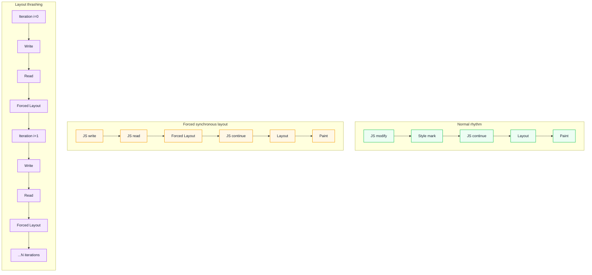
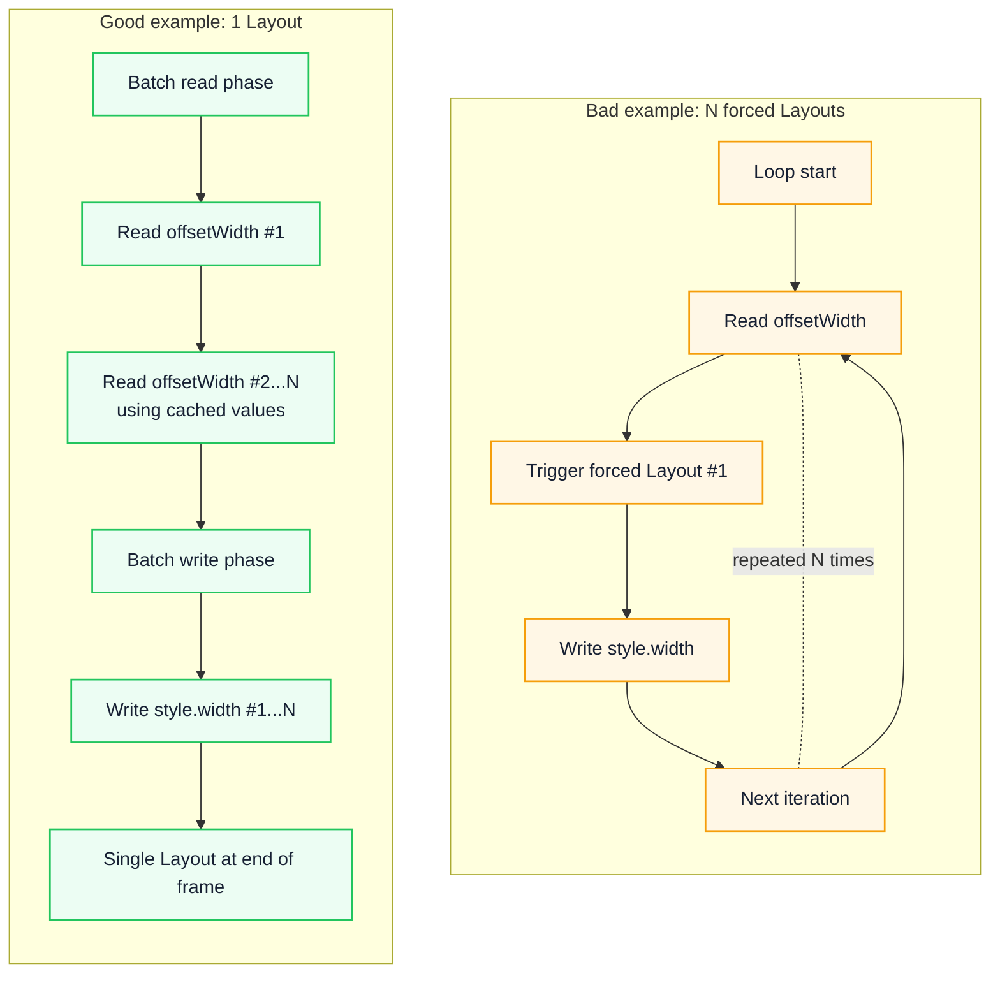

# The Truth About Layout Thrashing: How It Wrecks Your Animations

Animation jank is usually blamed on slow JavaScript or too many elements. Often the trigger is a handful of size reads that look harmless. The useful distinction is not which property you read but when the read happens: style writes only register changes, while a layout read settles them. This article follows that timing through a single write-read pair, a looped version, and the frame-end batching that repairs it. By the end you can classify a suspicious handler by its read-write order, predict how many layouts it forces, and choose between batching, observers, and rAF without memorizing a list of expensive properties.

::: info In one sentence
A write followed immediately by a read is the switch that settles a layout early; a loop just flips that switch N times, turning a single cost into a structural multiplier.
:::

## Table of Contents

- [1. What Is Forced Synchronous Layout (FSL)?](#_1-what-is-forced-synchronous-layout-fsl)
- [2. How Read-Write Alternation Causes Layout Thrashing](#_2-how-read-write-alternation-causes-layout-thrashing)
- [3. Bad vs. Good: The Cost of Read-Write Order](#_3-bad-vs-good-the-cost-of-read-write-order)
- [4. Edge Cases and Common Traps](#_4-edge-cases-and-common-traps)
- [5. Using requestAnimationFrame Correctly](#_5-using-requestanimationframe-correctly)
- [6. Layout-Stage Optimization Strategies](#_6-layout-stage-optimization-strategies)
- [7. How to Identify and Diagnose Layout Thrashing](#_7-how-to-identify-and-diagnose-layout-thrashing)
- [Conclusion](#conclusion)
- [FAQ](#faq)
- [Sources](#sources)

---

## 1. What Is Forced Synchronous Layout (FSL)?

### 1. The normal rendering rhythm

Under normal conditions, the browser renders in this rhythm:

```text
JS execution → Style mark → Layout → Paint → Composite → next frame
```

When JavaScript modifies the DOM or styles, the browser only records that recalculation is needed; it **does not run Layout immediately**. Once JavaScript finishes all changes for a frame and the main thread enters the rendering phase, the browser performs style recalculation, Layout, Paint, and Composite in one pass.

This is the browser's batch optimization: multiple changes within one frame become a single Layout.

### 2. When forced synchronous layout happens

The batch rhythm breaks when JavaScript **reads layout information immediately after modifying styles**:

```javascript
element.style.width = '100px'
console.log(element.offsetWidth)  // triggers forced synchronous layout
```

`offsetWidth` returns the element's **current** layout width. To return a correct value, the browser has to apply the `width: 100px` change and **run Layout immediately**. That Layout does not wait for the end of the frame; it is pulled forward into JavaScript execution. Hence the name: forced, synchronous, immediate.

### 3. Forced synchronous layout vs. layout thrashing

The two terms are often used interchangeably, but they describe different scales:

- **Forced synchronous layout (FSL)**: one write followed by one read, triggering one early Layout.
- **Layout thrashing**: repeated write-read pairs inside a loop, triggering N early Layouts and collapsing performance.



The top band shows the normal rhythm: writes accumulate and Layout runs once at frame end. The middle band pulls that Layout into a single read, and the bottom band repeats the same action N times. Track what triggers each Layout rather than counting iterations.

::: warning Common misconception

Treating "reading `offsetWidth` is always slow" as an iron rule. A **read with no preceding write** is almost free because the browser returns cached layout information. What is slow is reading after writing.
:::

---

## 2. How Read-Write Alternation Causes Layout Thrashing

### 1. Why write-then-read forces an early Layout

The browser maintains an invariant: **every layout query must return the currently accurate value**.

Without forcing Layout, reading `offsetWidth` right after changing `width` to 100px would return the old value, which is unacceptable. So when JavaScript queries layout information while unprocessed style changes exist, the browser executes Layout immediately.

### 2. Why a loop turns it into O(n²)

Consider this code:

```javascript
const items = document.querySelectorAll('.item')
for (let i = 0; i < items.length; i++) {
  items[i].style.width = container.offsetWidth + 'px'  // write + read
}
```

Each iteration performs write → read:

- Iteration 1: write `item[0]`, read `container` → one Layout
- Iteration 2: write `item[1]`, read `container` → one Layout
- ...
- Iteration N: one Layout

That is N Layouts in total. A single Layout is not limited to "processing one element": the browser tracks dirty marks for incremental layout and resolves dependencies, and on a large DOM one Layout can already be expensive. The total is N multiplied by the cost of one Layout, approaching O(n²) in the worst case.

### 3. Chromium's layout hint optimization

Chromium has a small optimization that merges consecutive forced synchronous layouts in some cases. It only applies to simple scenarios and cannot be relied on. Inside a loop, or with multiple interdependent elements, it stops helping.

This also explains why the fix is always about read-write order, not about finding a faster read API.

---

## 3. Bad vs. Good: The Cost of Read-Write Order

### 1. Bad example: read-write alternation in a loop

```javascript
// Bad example: each iteration triggers forced synchronous layout
function updateWidthsBad(items) {
  for (let i = 0; i < items.length; i++) {
    // Read: triggers Layout because the previous iteration already wrote
    const width = items[i].parentNode.offsetWidth
    // Write: marks Layout dirty
    items[i].style.width = width + 'px'
  }
}

const items = document.querySelectorAll('.item')
updateWidthsBad(items)
```

With a few hundred items this code forces roughly the same number of synchronous Layouts. How long one Layout takes depends on DOM size and the device, but on low-end hardware a single pass can already exceed a frame. Accumulated across the loop, the animation visibly drops frames.

### 2. Good example: batch reads, then batch writes

```javascript
// Good example: read all first, then write all
function updateWidthsGood(items) {
  // Step 1: batch read, collect every value first
  const widths = []
  for (let i = 0; i < items.length; i++) {
    widths.push(items[i].parentNode.offsetWidth)
  }

  // Step 2: batch write
  for (let i = 0; i < items.length; i++) {
    items[i].style.width = widths[i] + 'px'
  }
}

const items = document.querySelectorAll('.item')
updateWidthsGood(items)
```

This version typically forces one Layout: the first read settles earlier dirty writes, later reads hit the cache, and writes accumulate until frame end. The number of Layouts saved scales with the element count, so the gap widens as the list grows.

### 3. The structural difference between the two timings



The top half is a closed loop: every iteration triggers another Layout. The bottom half splits reads and writes into two phases, so Layout happens only on the first read. The turning point is not the iteration count but whether a read lands after a write.

### 4. A more complex case: multiple reads and writes

Real projects rarely read a single variable. For example:

```javascript
// Bad example: reading multiple properties inside the loop
for (const card of cards) {
  const containerWidth = card.parentNode.offsetWidth
  const containerHeight = card.parentNode.offsetHeight
  const ratio = containerWidth / containerHeight
  card.style.aspectRatio = ratio
  card.style.width = containerWidth * 0.5 + 'px'
}
```

The fix is the same: move every read before the loop and every write after it, or into a separate write loop.

```javascript
// Good example: batch read + batch write
const ratios = cards.map(card => {
  const w = card.parentNode.offsetWidth
  const h = card.parentNode.offsetHeight
  return { ratio: w / h, w: w * 0.5 }
})

cards.forEach((card, i) => {
  card.style.aspectRatio = ratios[i].ratio
  card.style.width = ratios[i].w + 'px'
})
```

No matter how many properties a loop reads, Layout count stops growing with iteration count as long as every read happens before every write.

---

## 4. Edge Cases and Common Traps

### 1. Frequent getBoundingClientRect in responsive components

```javascript
// Bad example: reading getBoundingClientRect inside a scroll handler
window.addEventListener('scroll', () => {
  const rect = element.getBoundingClientRect()  // read
  if (rect.top < 100) {
    element.classList.add('sticky')  // write
  }
})
```

Fix:

```javascript
// Good example: use IntersectionObserver instead
const observer = new IntersectionObserver((entries) => {
  entries.forEach(entry => {
    if (entry.isIntersecting) {
      element.classList.add('sticky')
    }
  })
}, { threshold: [0, 0.1, 0.5, 1] })
observer.observe(element)
```

### 2. Third-party library DOM operations

Some third-party libraries, such as older chart libraries and ad SDKs, alternate reads and writes internally. These problems are hard to fix directly. Practical responses:

- Upgrade to a newer version.
- Isolate the container the library operates on with `contain: strict`.
- If upgrading is not possible, batch the library's updates into the same frame so they interleave less with your own reads and writes.

### 3. Ref measurements inside frameworks

```javascript
// Anti-pattern in React
useEffect(() => {
  const height = ref.current.offsetHeight  // read
  ref.current.style.height = height * 2 + 'px'  // write
}, [deps])
```

Fix:

```javascript
// Good example: read first, then write, and let React batch the update
useLayoutEffect(() => {
  const height = ref.current.offsetHeight  // read
  // Trigger React's batched update through state
  setTargetHeight(height * 2)
}, [deps])
```

### 4. Measurement inside animation loops

Some animations need to measure element positions every frame, such as drag snapping or magnetic effects. In these cases:

- Measure uniformly with `useLayoutEffect` or frame-end scheduling.
- Cache the result in a ref to avoid repeated reads.
- Prefer `transform` for displacement; change `top`/`left` only when the value must participate in layout.

These scenarios share one trait: reads and writes happen inside the same high-frequency callback. Check the order first, then decide whether to replace the measurement with an observer, isolate the subtree, or reschedule the work.

---

## 5. Using requestAnimationFrame Correctly

### 1. What rAF does

`requestAnimationFrame` runs JavaScript **before the next render**. Its key properties:

- The callback runs before rendering.
- Style changes inside the callback merge into the current frame's Layout phase.
- The browser calls it once per frame, roughly every 16.6ms at 60fps.
- Callbacks pause when the tab is hidden, saving resources.

### 2. rAF fixes scattered writes

When several unrelated code paths modify the DOM in the same frame, putting them in rAF ensures they are handled together at frame end:

```javascript
// Bad example: modifying the DOM directly in multiple event callbacks
button1.addEventListener('click', () => {
  element.style.left = '100px'  // write
})
button2.addEventListener('click', () => {
  element.style.top = '200px'   // write
})
// When both clicks happen in the same frame, the browser marks Style twice but performs Layout once
```

This case is not a real problem because batch optimization already handles it. If you **read immediately after each write**, however, rAF cannot save you. rAF does not fix write-read alternation inside a loop, because that problem occurs within a single JavaScript execution.

### 3. rAF fixes animation loops

For animations, rAF aligns writes with the next render. Both snippets below are illustrative and omit how `x` is updated and how the loop stops:

```javascript
// Bad example: using setTimeout for animation
function animateBad() {
  element.style.transform = `translateX(${x}px)`
  setTimeout(animateBad, 16)
}
```

`setTimeout` is not aligned with rendering. It may fire in the middle of a frame, causing multiple executions per frame or missed frames.

```javascript
// Good example: using rAF for animation
function animateGood() {
  element.style.transform = `translateX(${x}px)`
  requestAnimationFrame(animateGood)
}
```

### 4. Incorrect rAF usage

```javascript
// Wrong: read layout outside rAF, then write inside rAF
function bad() {
  const width = element.offsetWidth  // read
  requestAnimationFrame(() => {
    element.style.width = width + 'px'  // write
  })
}
```

This solves nothing. The correct order is the reverse: **read outside, write inside rAF**. The read then happens with no unprocessed writes, and the write is settled at frame end.

```javascript
// Correct: read first, write inside rAF
function good() {
  const width = element.offsetWidth  // read: no dirty writes at this point, cheap
  requestAnimationFrame(() => {
    element.style.width = width + 'px'  // write: batched at frame end
  })
}
```

### 5. Double rAF for post-render measurement

Sometimes you need layout information **after the next frame has rendered**, for example to measure the final position of a finished animation. Use **double rAF**:

```javascript
requestAnimationFrame(() => {
  requestAnimationFrame(() => {
    // The previous frame has rendered; reading layout here is accurate
    const rect = element.getBoundingClientRect()
  })
})
```

::: warning Common misconception

Wrapping every DOM operation in rAF to "improve performance." This does not fix layout thrashing; it only makes the code harder to debug. Separate reads from writes first, then decide whether rAF scheduling is needed.
:::

---

## 6. Layout-Stage Optimization Strategies

### 1. Prefer transform / opacity for animations

The most direct way to avoid Layout is **not to trigger it**. An animation that only changes `transform` and `opacity` skips Layout and Paint and goes straight to Composite.

```css
/* Bad: triggers Layout */
.move {
  transition: left 0.3s, top 0.3s;
  left: 100px;
  top: 200px;
}

/* Good: only triggers Composite */
.move {
  transition: transform 0.3s;
  transform: translate(100px, 200px);
}
```

### 2. Avoid `display: none` toggling

Switching between `display: none` and `display: block` rebuilds render-tree nodes and triggers a full Layout. When you need to toggle frequently, use `visibility: hidden` (Paint only) or `opacity: 0` (Composite only).

### 3. Isolate layout with `contain`

The CSS `contain` property tells the browser that an element's subtree is independent, which isolates the reflow scope:

```css
.card-list {
  contain: layout style;
}
```

Layout changes inside the card list then stop at its boundary. `contain: strict` is equivalent to `layout style paint size`, the widest isolation, but it requires fixed dimensions.

### 4. Reduce DOM size

DOM node count directly drives Layout cost. For long lists, use virtual scrolling such as `react-window` or `vue-virtual-scroller` so only the few dozen visible nodes are rendered instead of thousands.

### 5. Batch insertions with DocumentFragment

```javascript
// Bad: appending one by one in a loop, triggering multiple Layouts
for (const item of items) {
  const li = document.createElement('li')
  li.textContent = item
  list.appendChild(li)
}

// Good: batch insert with DocumentFragment
const fragment = document.createDocumentFragment()
for (const item of items) {
  const li = document.createElement('li')
  li.textContent = item
  fragment.appendChild(li)
}
list.appendChild(fragment)
```

### 6. Framework batching

React, Vue, and Solid all batch updates:

- **React 18**: state updates in event handlers, `setTimeout`, and Promises are batched automatically.
- **Vue 3**: reactive dependency tracking merges multiple changes in the same tick into one update.
- But framework batching solves "merge multiple state changes into one render"; it **cannot** fix layout thrashing caused by reading and writing the DOM yourself inside an effect.

All of these approaches shrink the scope that needs layout, or avoid layout entirely. None replaces read-write separation: framework batching merges state changes, but it does not change the order in which your code reads and writes the DOM.

---

## 7. How to Identify and Diagnose Layout Thrashing

### 1. Performance panel

Open DevTools → Performance → record → inspect the main-thread trace:

- **Consecutive purple Layout blocks**: a classic layout thrashing signal.
- **Click a Layout block**: the Bottom-Up panel shows the triggering function.
- **Red triangle marker**: a long task over 50ms.
- **Forced reflow warning**: the Layout event carries a warning that can be traced back to the code that triggered it.

### 2. Rendering panel

DevTools → More tools → Rendering:

- **Layout Shift Regions**: highlights regions with layout shifts. This is the CLS concept, not layout thrashing, but overlapping regions often point to the problem.
- **Paint flashing**: highlights repaint areas.

### 3. Lighthouse audit

Lighthouse diagnostics can flag an oversized DOM or long main-thread tasks as supporting evidence. They usually do not identify read-write order inside a loop, so confirm in the Performance panel.

### 4. Key metrics

- **FPS**: a sudden drop during animation, accompanied by many purple Layout blocks.
- **INP**: slow interaction response while JavaScript execution time stays low; Layout may be occupying the main thread.
- **CLS**: cumulative layout shift, which reflects visual stability.

The fastest order is still to check whether Layout blocks repeat, then inspect the read-write order in code. A forced reflow warning is an entry point, not a conclusion.

---

## Conclusion

Treat layout thrashing as a timing error rather than a sin of one API. A style write only registers a change; a layout read decides when that change is settled. Whether a piece of code is risky depends on the read-write order, not on a property list.

Next, pick an animation or list update you own and record one real interaction in the Performance panel. Check for consecutive Layout blocks and a "Forced reflow" warning. If they appear, move the reads before the writes first, then consider rAF or compositing layers; in most cases that step already collapses several layouts into one.

---

## FAQ

### 1. Is O(n²) the worst case, or does it happen every time?

The N layouts caused by write-read alternation are certain; "quadratic" describes the worst case, because a single Layout can become more expensive as DOM size and dependencies grow. If incremental layout is cheap, total time is closer to N times a small constant. Judge risk by the iteration count first, then by the scope of each Layout.

### 2. Can `contain: layout` eliminate layout thrashing?

No. `contain` limits the scope of layout impact and can lower the cost of one Layout, but a write followed by a read still forces synchronous layout. Use it together with read-write separation, not as a replacement.

### 3. Read-write separation is in place but frames still drop. What next?

First confirm that Layout work actually decreased, then walk the Performance panel through Paint, Raster, Composite, and long tasks. Common causes include a single Layout that still covers too much, overly complex paint effects, read-write alternation inside a third-party library, or too many compositing layers. Do not stop at "did we read `offsetWidth`."

### 4. Why can thrashing occur without a Forced reflow warning?

Whether the warning appears depends on the browser version, optimization paths, and when the recording started. Consecutive Layout blocks, a read-write function repeating in the call stack, and the read-write order in the code are independent evidence. A missing warning only means this recording did not surface the hint; it does not prove the code is fine.

---

## Sources

The following sources directly support the mechanisms and tooling described above:

1. web.dev - Avoid large, complex layouts and layout thrashing: [https://web.dev/articles/avoid-large-complex-layouts-and-layout-thrashing](https://web.dev/articles/avoid-large-complex-layouts-and-layout-thrashing)
2. Chrome DevTools - Analyze runtime performance: [https://developer.chrome.com/docs/devtools/performance/](https://developer.chrome.com/docs/devtools/performance/)
3. CSS Triggers: [https://csstriggers.com/](https://csstriggers.com/)
4. MDN - requestAnimationFrame: [https://developer.mozilla.org/en-US/docs/Web/API/Window/requestAnimationFrame](https://developer.mozilla.org/en-US/docs/Web/API/Window/requestAnimationFrame)
