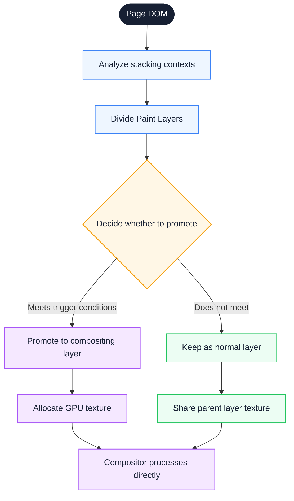
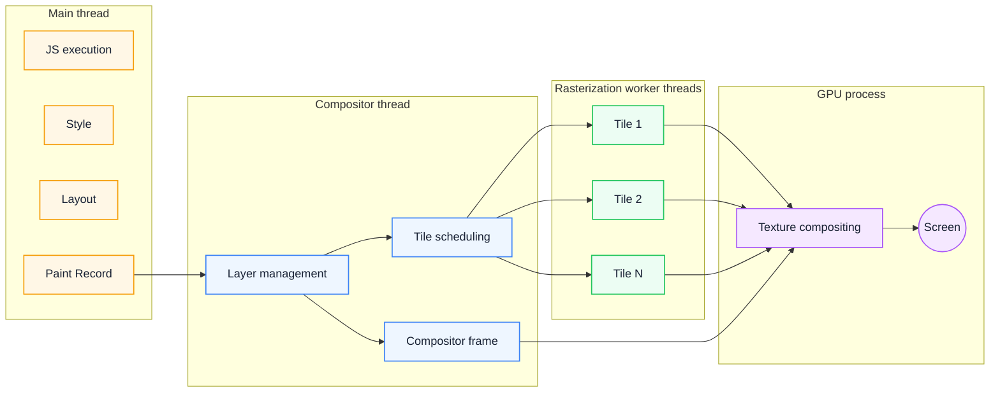

# Painting and Rasterization: From Layer Composition to Screen Display

A page can keep animating while the main thread is blocked, and an image can finish downloading without appearing. Both facts are often blamed on "GPU acceleration" or a slow network, but they belong to the same stretch of the rendering pipeline. After Paint, work is divided across threads and processes, and the layer is the unit that makes that division possible. This article follows paint commands, layers, tiles, and the compositor in order. The payoff is a model that explains when work leaves the main thread, which cost you are actually paying, and how to read that split in DevTools.

::: info In one sentence
Paint to screen is not one straight thread: drawing commands, rasterization, and compositing are distributed across threads and processes, and layers decide which work can bypass the main thread. Smooth animation depends on that division, not just on how much is painted.
:::

## Table of Contents

- [Starting from a Few Symptoms](#starting-from-a-few-symptoms)
- [1. What the Paint Stage Does](#_1-what-the-paint-stage-does)
- [2. Layers and Stacking Contexts](#_2-layers-and-stacking-contexts)
- [3. Rasterization: From Vector to Bitmap](#_3-rasterization-from-vector-to-bitmap)
- [4. Compositing: GPU Compositing Principles](#_4-compositing-gpu-compositing-principles)
- [5. Why transform/opacity Do Not Trigger Layout](#_5-why-transform-opacity-do-not-trigger-layout)
- [6. Understanding Hardware Acceleration Correctly](#_6-understanding-hardware-acceleration-correctly)
- [7. How the Compositor Thread Cooperates with the Main Thread](#_7-how-the-compositor-thread-cooperates-with-the-main-thread)
- [8. Practice: Locating Paint and Raster Bottlenecks](#_8-practice-locating-paint-and-raster-bottlenecks)
- [Conclusion](#conclusion)
- [FAQ](#faq)
- [Sources](#sources)

## Starting from a Few Symptoms

The same rendering pipeline leaves behind phenomena that look unrelated in daily frontend work:

- Why can `transform: translate()` animations stay smooth even when the main thread is choked by JavaScript?
- Why can't `will-change` be abused, yet it really works?
- Why does a large blurred `box-shadow` make FPS collapse?
- Why do `position: fixed` elements sometimes "flicker"?
- Why isn't GPU acceleration free?
- Why does an LCP image still need a few hundred milliseconds to appear after it has downloaded?

All of these point to one question: how does the abstract layer model become pixels on screen?

---

## 1. What the Paint Stage Does

### 1. Paint does not produce pixels directly

A common misconception is that "Paint is drawing the page." Strictly speaking, **the Paint stage does not produce pixels directly**; it produces a **list of drawing commands** (Paint Record, Display List, Paint Ops).

A Paint Record looks like this set of abstract commands:

```text
pushClip(0, 0, 1440, 900)
  drawRect(0, 0, 1440, 900, color=#ffffff)
  drawRect(20, 20, 200, 50, color=#3b82f6)
  drawText("Hello", 30, 50, font=14px sans-serif, color=#ffffff)
  drawImage(hero.webp, 0, 100, 1440, 600)
  drawShadow(20, 700, 300, 100, blur=20px, color=rgba(0,0,0,0.3))
    drawRect(20, 700, 300, 100, color=#ffffff)
popClip()
```

These commands tell the rasterizer what to draw at which coordinates, in what order, and with which parameters. The order follows the painter's algorithm: later draws cover earlier ones.

### 2. Why pixels are not produced directly

Separating command generation from command execution has several benefits:

- **Parallelism**: commands can be distributed to multiple rasterization threads and executed concurrently.
- **Reuse**: if only a layer's transform changes, old commands can be reused and Paint skipped.
- **Layering**: each layer generates commands, rasterizes, and composites independently.
- **Caching**: identical command sequences can be cached as GPU textures and composited directly next time.

### 3. Where Paint cost comes from

Paint cost mainly comes from:

- **Repaint area**: how many pixels are redrawn each time.
- **Paint complexity**: the complexity of shadows, blur, gradients, and filters.
- **Layer count**: each layer must generate its own Paint Record.

One of the most expensive operations is **large-area blurred shadows**. For a shadow like `box-shadow: 0 0 100px rgba(0,0,0,0.5)`, the browser either blurs in software on the CPU (expensive) or samples multiple times on the GPU (also expensive). If the element is repainted repeatedly during an animation, FPS drops sharply.

### 4. Paint output: Paint Layer and Graphics Layer

Besides producing Paint Records, the Paint stage **splits the page into layers according to stacking contexts**:

- **Paint Layer**: the unit that participates in painting, corresponding to a stacking context.
- **Graphics Layer**: a layer the compositor can handle independently; each Graphics Layer has its own GPU texture.

Not every Paint Layer becomes a Graphics Layer. Only layers that meet specific conditions, such as 3D transforms, `will-change`, or animated transform/opacity, are promoted to compositing layers.

Paint therefore outputs two things: drawing commands and a layer list. Rasterization and compositing both use layers as their unit of organization.

---

## 2. Layers and Stacking Contexts

### 1. Stacking Context

Stacking context is a CSS concept: certain elements become a stacking context root. Their children stack internally by z-order, while the element is treated as a whole from the outside.

Common conditions that create a stacking context:

- `position: absolute/relative` with `z-index` other than auto
- `position: fixed/sticky`
- `opacity < 1`
- `transform` other than none
- `filter` other than none
- `will-change` with certain values
- Replaced elements such as `<video>` and `<canvas>`

### 2. From stacking context to layer

During Paint, the browser maps stacking contexts to Paint Layers. But **not every stacking context becomes an independent layer**; that gap is where the browser optimizes.

A simple page may have only one layer, with all content painted together. But a page containing:

- a `position: fixed` navigation bar
- a card with `transform: translateZ(0)`
- a `<video>` element
- an overlay with `opacity: 0.5`

may give each of these its own layer.

### 3. Compositing Layer

A compositing layer is a layer the compositor can handle independently: it has its own GPU texture, so transform and opacity changes do not need the main thread.

Common triggers for promotion to a compositing layer:

| Trigger | Description |
| --- | --- |
| 3D transform | `transform: translateZ(0)`, `translate3d`, `rotateX/Y` |
| `will-change: transform/opacity` | provided a real animation is about to happen |
| Animated `transform/opacity` | at least one animated frame |
| `<video>`, `<canvas>`, WebGL | replaced elements are composited by nature |
| `position: fixed` with software compositing | in some browser implementations |
| `opacity < 1` on an existing compositing layer | combined with transform or another condition |
| CSS `filter` | in some browser implementations |

### 4. Side effects of promotion

More compositing layers is not always better. Each one brings:

- **GPU memory**: each texture costs at least a few hundred KB to several MB.
- **Compositing cost**: the compositor handles more textures, and more is slower.
- **Repaint cost**: when a compositing layer's content changes, the whole layer must be re-rasterized.



The diagram starts from the page DOM, divides Paint Layers, then decides whether to promote. The two branches differ in their output: compositing layers get independent textures, while normal layers keep sharing their parent's texture. Cost diverges at the same point.

::: warning Common misconception

Adding `transform: translateZ(0)` to every element to "enable GPU acceleration." This creates compositing layers for elements that do not need them, causing memory usage to surge and the compositing stage to slow down. Use it temporarily, only for elements that actually animate.
:::

---

## 3. Rasterization: From Vector to Bitmap

### 1. What rasterization does

Rasterization turns **vector drawing commands** (drawRect, drawText, drawImage) into **real pixel bitmaps**.

A Paint Record says "draw a 200×50 blue rectangle at (20, 20)"; the rasterizer calculates which pixels the rectangle covers and what color each should be, accounting for anti-aliasing, subpixel rendering, and text hinting.

### 2. Tile splitting

Compositing layers are usually not rasterized in one pass. They are cut into small **tiles**, typically 256×256 or 512×512 pixels.

Tile splitting provides:

- **Parallelism**: multiple tiles go to multiple rasterization threads at once.
- **On-demand rasterization**: only the visible area plus a margin is rasterized, saving resources.
- **Priority**: tiles inside the viewport are rasterized before tiles outside it.
- **Incremental updates**: when part of a layer changes, only the affected tiles are re-rasterized.

### 3. Rasterization thread pool

Chromium does not rasterize on the main thread. It uses the **compositor thread plus a rasterization worker pool**:

- **Compositor thread**: manages layers, schedules tiles, and generates compositor frames.
- **Rasterization workers**: multiple workers rasterize tiles concurrently.

This is why transform animations stay smooth even when JavaScript occupies the main thread: the compositor thread and workers are independent of it.

### 4. GPU rasterization vs. software rasterization

Modern browsers generally use **GPU rasterization**: drawing commands go to the GPU, shaders execute them, and pixels come out.

Its advantages:

- Massive pixel-level parallelism.
- Text, paths, and images can all be processed by GPU shaders.
- The output is already a GPU texture, with no CPU-to-GPU copy.

Some scenarios still fall back to software rasterization on the CPU:

- certain complex SVG filters
- certain CSS filters, such as a complex `drop-shadow`
- insufficient video memory
- some non-standard CSS properties

### 5. Rasterization and LCP

The completion time of LCP (Largest Contentful Paint) essentially depends on **when the LCP element finishes rasterization**. Even after the image has downloaded, decoded, and been laid out, LCP will not fire if the compositor thread is busy with other work and the element's tiles are not rasterized.

This is also why long main-thread tasks delay LCP: while the main thread is occupied, the Paint stage cannot start, so rasterization cannot begin.

When optimizing LCP, therefore, treat download, decode, layout, and rasterization as separate steps. "The image has arrived" does not mean "the image can be shown."

---

## 4. Compositing: GPU Compositing Principles

### 1. What compositing does

Compositing is the last step of the pipeline: it assembles multiple already-rasterized layers (GPU textures) in the correct order and with the correct transforms into the final frame, then outputs that frame to the screen.

Compositing is a combination of **textures and transform matrices**:

```text
Compositor frame = [
  { texture: layer1, transform: identity, opacity: 1.0 },
  { texture: layer2, transform: translate(100, 50) rotate(15deg), opacity: 0.8 },
  { texture: layer3, transform: scale(1.2), opacity: 1.0 }
]
```

The GPU draws each texture into the screen buffer according to its transform matrix, stacks them in order, and outputs pixels.

### 2. Where compositing runs

Chromium splits compositing into two steps:

- **Compositor thread** (part of the renderer process): decides each layer's position, transform, and visibility, then generates a compositor frame.
- **GPU process**: performs the actual texture compositing and outputs to the screen.

Neither runs on the main thread. This is the root reason transform animations do not block the main thread.

### 3. The cost of compositing

Compositing is relatively cheap, just a few texture samples, but it is not free:

- **Layer count**: each layer must be sampled; more layers are slower.
- **Transform complexity**: 3D transforms cost slightly more than 2D.
- **Blend modes**: opacity and blend modes require extra samples.
- **Clipping and masking**: complex masks increase sample count.
- **Oversized textures**: textures beyond the GPU limit must be split.

### 4. How often compositing happens

Compositing happens on demand. A static page usually does not keep generating new frames; animations and scrolling advance at the display refresh rate, with 60fps corresponding to roughly 16.6ms per frame.

When the user scrolls, the compositor thread can update the scroll position and re-composite **without the main thread**, which is the basis of non-main-thread scrolling. The precondition is that the scrolling container has no `scroll` listener, or that the listener uses `passive: true`.



From left to right, the bands are the main thread, compositor thread, rasterization workers, and GPU process. The turning point comes after `Paint Record`: layer and tile scheduling leave the main thread, so compositing that has already started can continue while JavaScript occupies the main thread.

---

## 5. Why transform/opacity Do Not Trigger Layout

With the pipeline above, this question can be answered directly by asking which stage is triggered.

### 1. The nature of transform

`transform` changes an element's **visual transform**, not its **layout position**.

Specifically:

- `transform: translate(100px, 50px)` changes where the element is **drawn on screen**.
- The element's **layout position**, which affects other elements, does not change.
- The browser still considers the element to be at its original position and only "moves" it during compositing.

So transform does not trigger Layout: the layout information did not change, so nothing needs to be recalculated.

### 2. Which stage transform acts in

Transform acts in the **compositing stage**:

```text
Layout (unchanged) → Paint (unchanged) → Raster (unchanged) → Composite (apply transform)
```

The element's rasterized texture stays the same; a transform matrix draws it at a new position during compositing. This is why transform animations are cheap: only compositing works, while the main thread, Layout, Paint, and Raster are skipped.

### 3. opacity works the same way

`opacity` changes the **transparency used when drawing**, without changing layout or draw content. The compositor adjusts transparency while drawing the layer texture to the screen:

```text
output pixel = source pixel × opacity + pixel below × (1 - opacity)
```

### 4. Full comparison

```mermaid
flowchart TB
    subgraph Width["Change width/height"]
        direction LR
        W1[Style] --> W2[Layout] --> W3[Paint] --> W4[Raster] --> W5[Composite]
    end

    subgraph Color["Change color/background"]
        direction LR
        C1[Style] --> C2[Paint] --> C3[Raster] --> C4[Composite]
    end

    subgraph Transform["Change transform/opacity"]
        direction LR
        T1[Composite]
    end

    classDef metric fill:#F5E8FF,stroke:#A855F7,color:#172033,stroke-width:1.5px;
    classDef block fill:#FFF7E6,stroke:#F59E0B,color:#172033,stroke-width:1.5px;
    classDef work fill:#ECFDF3,stroke:#22C55E,color:#172033,stroke-width:1.5px;

    class W1,W2,W3,W4,W5 metric;
    class C1,C2,C3,C4 block;
    class T1 work;
```



The three chains get shorter from top to bottom: a geometry change walks from Style to Composite, a color change starts at Paint, and a transform/opacity change leaves only Composite. The key is not the property name but which part of the work stays on the main thread.

### 5. Why transform animations need a compositing layer

If the element is not on a compositing layer, every frame of a transform animation must:

1. redo Style on the main thread
2. redo Layout on the main thread, even if layout is unchanged
3. redo Paint on the main thread
4. redo Raster on a worker
5. composite

That is far more expensive than compositing alone. The browser therefore **automatically promotes elements with animated transform/opacity to compositing layers**, keeping the animation on the compositing path.

::: info Key insight

"transform does not trigger Layout" is shorthand. The full statement is: when transform acts on a compositing layer and only transform/opacity change, the pipeline runs only in the compositing stage. If the element is not on a compositing layer in some edge case, or other properties change at the same time, Paint or even Layout may still be triggered.
:::

---

## 6. Understanding Hardware Acceleration Correctly

### 1. "GPU acceleration" means more than one thing

What the industry calls "GPU acceleration" usually means that **a layer is promoted to a compositing layer, and its transform and opacity are handled directly by the GPU**.

The GPU's role in the pipeline goes further:

- **GPU rasterization**: turning drawing commands into pixels on worker threads plus the GPU.
- **GPU compositing**: combining layer textures into the final frame in the GPU process.
- **GPU shaders**: executing CSS filters and complex blending.

Strictly speaking, then, GPU acceleration is not a single switch. It is different acceleration methods at different stages.

### 2. Hacks that force compositing layers

A historically common frontend hack:

```css
.gpu-hack {
  transform: translateZ(0);
  /* or */
  transform: translate3d(0, 0, 0);
  /* or */
  will-change: transform;
}
```

All of these force an element onto a compositing layer and route animation through the compositor. The costs:

- each compositing layer occupies GPU memory
- many compositing layers slow the compositing stage itself
- insufficient video memory can trigger a worse fallback

### 3. Correct use of will-change

`will-change` is a heads-up mechanism: it tells the browser that a property is about to change so it can prepare in advance.

Appropriate usage:

```css
/* The element is about to animate on hover */
.card:hover {
  will-change: transform;
}
.card {
  transition: transform 0.3s;
}
```

Counterexample:

```css
/* Permanently enable will-change for every card */
.card {
  will-change: transform;
}
```

The correct approach is **event-driven**: add `will-change` just before the animation starts and remove it after the animation ends. The React snippet below is illustrative and omits imports and ref initialization:

```jsx
function Card() {
  const ref = useRef()
  const handleMouseEnter = () => {
    ref.current.style.willChange = 'transform'
  }
  const handleTransitionEnd = () => {
    ref.current.style.willChange = 'auto'
  }
  return (
    <div
      ref={ref}
      onMouseEnter={handleMouseEnter}
      onTransitionEnd={handleTransitionEnd}
      className="card"
    />
  )
}
```

### 4. Memory cost

Using uncompressed RGBA as an estimate, each compositing layer's GPU texture is roughly `width × height × 4 bytes`.

- A 1920×1080 layer is about 8MB.
- Twenty such layers use about 160MB of GPU memory.
- When video memory runs out, the browser falls back to software compositing, and performance drops sharply.

Actual usage also depends on texture format, tile alignment, and driver overhead; the numbers above are only for order-of-magnitude reasoning.

::: warning Common misconception

Treating `will-change` as a performance patch and adding it to every element that might animate. This causes compositing-layer explosion and a surge in GPU memory, which slows the page down.
:::

---

## 7. How the Compositor Thread Cooperates with the Main Thread

### 1. Division of labor

| Work | Where it runs | Blocks the main thread? |
| --- | --- | --- |
| JavaScript execution | Main thread | Yes |
| Style calculation | Main thread | Yes |
| Layout | Main thread | Yes |
| Paint Record generation | Main thread | Yes |
| Layer management | Compositor thread | No |
| Tile rasterization scheduling | Compositor thread | No |
| Tile rasterization execution | Worker threads + GPU | No |
| Compositor frame generation | Compositor thread | No |
| Final compositing and output | GPU process | No |

### 2. What happens when the main thread stalls

If a long JavaScript task occupies the main thread:

- **New style changes cannot be processed**: Style, Layout, and Paint queue up.
- **Layers that are already composited keep animating**: the compositor thread works independently, so transform animations continue.
- **New animations cannot start**: promoting a compositing layer requires Style work on the main thread.

This is the reality behind "the main thread is stuck but the transform animation is still moving."

### 3. Non-main-thread scrolling

Browser scrolling can bypass the main thread:

- the compositor thread updates the scroll position directly
- layers are re-composited and a new frame is output
- Style, Layout, and Paint are not triggered

There are exceptions:

- a `scroll` listener that is not `passive` must run on the main thread and can block scrolling
- scrolling that triggers effects needing Layout, such as `position: sticky`, requires the main thread
- scrolling that changes the DOM, such as `scrollTo` plus a state update, requires the main thread

So the first rule of mobile scroll performance is to **add `passive: true` to scroll listeners**.

```javascript
// Bad: can block scrolling
element.addEventListener('scroll', handleScroll)

// Good: does not block scrolling
element.addEventListener('scroll', handleScroll, { passive: true })
```

### 4. Compositing and input events

The compositor thread also handles some input events, such as touch and wheel. It can forward events to the main thread, such as `click`, or consume them directly, such as non-passive scrolling. When the main thread is occupied by a long task, events queue up and INP gets worse.

The compositor thread and workers are independent of the main thread, but starting new animations and updating Style or Layout still need it. Understanding that boundary is how you tell whether an optimization reduces main-thread work or merely moves work to another thread.

---

## 8. Practice: Locating Paint and Raster Bottlenecks

### 1. Performance panel

Record an interaction and inspect:

- **Green Paint blocks**: time in the Paint stage.
- **Green Rasterize / Raster Task blocks**: time spent rasterizing.
- **Green Composite Layers blocks**: time spent compositing.
- **Layer list**: the Layers tab shows all layers and how many are compositing layers.

### 2. Layers tab

DevTools → More tools → Layers:

- view all layers
- view each layer's dimensions and memory usage
- view the Paint Profile, which breaks down paint cost
- detect compositing-layer explosion

### 3. Rendering tab

- **Paint flashing**: highlights repainted regions, showing what is being repainted.
- **Layer borders**: shows compositing-layer boundaries and count.

### 4. Typical problem patterns

- **Large green Paint blocks**: repaint area is too large, possibly from a big shadow or a complex background.
- **Many Rasterize blocks**: too many layers, or one layer is too large.
- **Expensive Composite Layers**: compositing-layer explosion.
- **Paint flashing covers the whole screen**: a full-page repaint may have been triggered, for example by changing the `body` background.

### 5. Optimization directions

| Problem | Direction |
| --- | --- |
| Large-area repaint | Reduce the repaint area; isolate animated elements into compositing layers |
| Large shadow or filter | Replace with a static image, or simplify the effect |
| Too many compositing layers | Remove unnecessary `will-change` and `translateZ(0)` |
| Oversized layer | Split large layers, or isolate with `contain` |
| Slow rasterization | Control layer count and size; avoid rasterizing a whole long list as one layer |

When diagnosing, first separate whether Paint area, Raster count, or Composite cost is growing. The three point to different fixes, and looking at them together easily assigns the problem to the wrong stage.

---

## Conclusion

Think of the second half of rendering as a division of labor rather than a single sequential pipe: the main thread produces commands, rasterization workers turn commands into pixels, and the GPU assembles layers into frames. Layers mark the boundaries of that division, and compositing layers decide which work can leave the main thread.

Next, take a page you suspect of dropping frames and compare Paint, Raster, and Composite shares in the Performance panel, then confirm layer count and texture memory in the Layers panel. If the main thread is busy while Composite is light, reduce main-thread work first; if Composite itself is heavy, check whether you promoted too many layers.

---

## FAQ

### 1. Why can a transform/opacity animation still drop frames?

The animation only stays entirely on the compositing path when the element is already on a compositing layer and these properties do not trigger other effects. Frames can still drop if the layer is very large, if there are too many compositing layers, if texture upload or rasterization cannot keep up, or if another paint-triggering property changes at the same time. Judge by the stages that actually appear in the Performance panel, not by the property name.

### 2. What do white patches or blur during fast scrolling have to do with tile rasterization?

Compositing layers are cut into tiles and rasterized on demand. When scrolling outpaces rasterization, tiles entering the viewport may not be ready, so blank or low-resolution placeholders appear. Browsers pre-rasterize a margin to mitigate this, but large layers, complex painting, or a busy main thread can make prefetch fall behind. The fix is to control layer size and paint complexity, not simply to add compositing layers.

### 3. Do `filter` and `opacity` always create a compositing layer?

No. `opacity < 1` creates a stacking context and `filter` affects painting, but promotion to a compositing layer depends on the browser implementation, the property value, and whether an animation exists. Equating "this property is set" with "GPU acceleration is active" is a common misjudgment. Confirm the actual layers in the Layers panel.

### 4. Why doesn't texture memory in the Layers panel match the width × height × 4 estimate?

That formula only gives the ideal size of uncompressed RGBA. Actual textures are affected by tile alignment, texture format, mipmaps, driver allocation granularity, and layer overlap, so they are usually larger. The estimate is useful only for orders of magnitude; for memory issues, rely on the Layers panel and the browser process's actual usage.

---

## Sources

The following sources directly support the mechanisms and tooling described above:

1. web.dev - Stick to compositor-only properties and manage layer count: [https://web.dev/articles/stick-to-compositor-only-properties-and-manage-layer-count](https://web.dev/articles/stick-to-compositor-only-properties-and-manage-layer-count)
2. Chromium Graphics documentation: [https://source.chromium.org/chromium/chromium/src/+/main:docs/graphics/](https://source.chromium.org/chromium/chromium/src/+/main:docs/graphics/)
3. web.dev - Animate with will-change: [https://web.dev/articles/animations-guide#will-change](https://web.dev/articles/animations-guide#will-change)
4. Chrome DevTools - Layers panel documentation: [https://developer.chrome.com/docs/devtools/layers/](https://developer.chrome.com/docs/devtools/layers/)
5. MDN - CSS will-change: [https://developer.mozilla.org/en-US/docs/Web/CSS/will-change](https://developer.mozilla.org/en-US/docs/Web/CSS/will-change)
