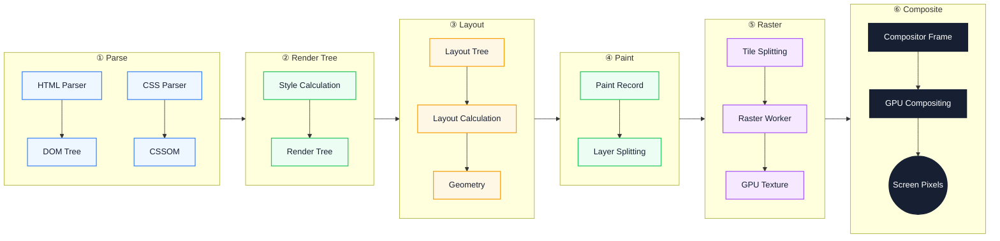
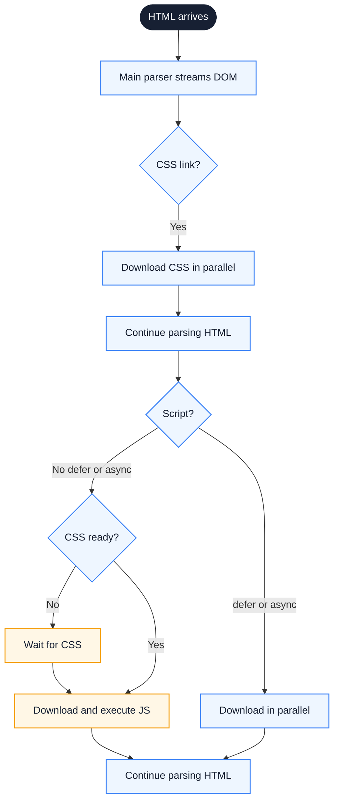
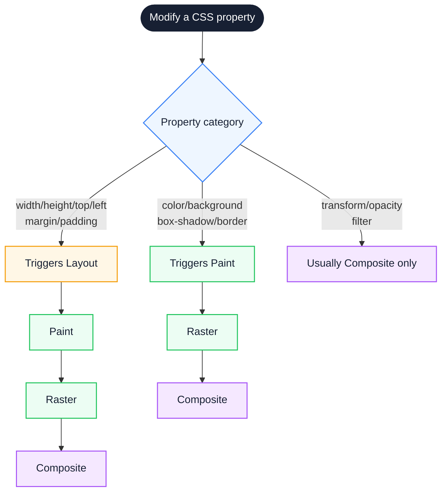

# Rendering Pipeline: From HTML to Pixels

Most engineers can recite Layout, Paint, and Composite, yet still hesitate when asked which of them a particular DOM change will trigger. The stage names are not the difficulty; the trigger conditions and thread ownership are. This article rebuilds the pipeline as a chain with inputs, outputs, and skip conditions, then uses that same chain to explain CSS blocking, the difference between the render tree and the DOM tree, and the real cost of composited animation. After reading, you should be able to look at a change and predict its path before opening DevTools.

::: info In one sentence
The pipeline is a dependency graph, not a checklist. A stage starts only after the previous stage has produced its input, and a change that skips a stage removes that dependency; performance problems usually come from a skip that did not happen or from a scope that grew.
:::

## Table of Contents

- [Six Questions First](#six-questions-first)
- [1. Rendering Pipeline Overview](#_1-rendering-pipeline-overview)
- [2. HTML Streaming Parsing and DOM Construction](#_2-html-streaming-parsing-and-dom-construction)
- [3. CSSOM Construction and CSS Blocking](#_3-cssom-construction-and-css-blocking)
- [4. Render Tree Synthesis](#_4-render-tree-synthesis)
- [5. Layout (Reflow) Calculation](#_5-layout-reflow-calculation)
- [6. Paint and Layering](#_6-paint-and-layering)
- [7. Composite and GPU Acceleration](#_7-composite-and-gpu-acceleration)
- [8. Performance Bottlenecks at Each Stage](#_8-performance-bottlenecks-at-each-stage)
- [9. Which CSS Properties Trigger Which Paths](#_9-which-css-properties-trigger-which-paths)
- [10. Practice: Locating Bottlenecks with the Performance Panel](#_10-practice-locating-bottlenecks-with-the-performance-panel)
- [Conclusion](#conclusion)
- [FAQ](#faq)
- [Sources](#sources)

## Six Questions First

The same DOM or CSS change walks a different length of the pipeline depending on the property. The questions below are often memorized as separate facts:

- Is HTML parsed as a stream or all at once? What exactly does the preload scanner do?
- Is CSSOM a tree or a table? Why does CSS block first render but not HTML parsing?
- What is the difference between `display: none` and `visibility: hidden` in the render tree?
- Is Layout really that expensive? Why can changing one `width` reflow an entire page?
- What sits between Paint and Composite? Why doesn't `transform` trigger Layout?
- How does GPU compositing assemble multiple layers onto the screen?

All of them follow from the same dependency graph.

---

## 1. Rendering Pipeline Overview

The modern rendering pipeline, using Chromium as the reference, can be simplified into six stages:



Read the diagram from left to right: parse, render tree, layout, paint, raster, composite. Focus first on each box's input and output, then on the arrows that cross stages. Parse output feeds the render tree, layout results determine what Paint describes, and Raster and Composite can already leave the main thread.

Each stage's input and output are roughly:

| Stage | Main input | Main output | Thread |
| --- | --- | --- | --- |
| HTML parsing | HTML byte stream | DOM tree | Main thread |
| CSS parsing | CSS byte stream | CSSOM | Main thread |
| Style calculation | DOM + CSSOM | Final style of each DOM node | Main thread |
| Layout | Render/Style tree + geometry constraints | Position and size of each node | Main thread |
| Paint | Layout tree + styles | Paint Record + layer list | Main thread |
| Raster | Layer + tile | Pixel bitmap (GPU texture) | Compositor thread + raster workers |
| Composite | Textures of multiple layers | Compositor frame | GPU process |

::: info Key insight

Notice the division of labor among the **main thread, compositor thread, raster workers, and GPU process**. **Layout and Paint occupy the main thread**, so they delay JavaScript and interaction; **Raster and Composite can finish off the main thread**, which is why `transform/opacity` animations stay smooth even when JavaScript fills the main thread. Every optimization strategy later in this article rests on that split.
:::

---

## 2. HTML Streaming Parsing and DOM Construction

### 1. Incremental parsing

The HTML parser does not wait for the whole document to download. It parses the byte stream as it arrives. Chromium hands bytes from the network layer to the parser, which consumes them while building DOM nodes.

This means:

- The earlier HTML starts streaming back, the earlier DOM construction begins.
- The server can return HTML in chunks (streaming SSR), letting the browser parse and discover subresources sooner.
- Large HTML blocks still create long "Parse HTML" tasks.

### 2. Preload Scanner

When the main parser reaches `<script src="...">` without `defer` or `async`, it blocks, but parsing does not stop entirely. A **preload scanner** keeps scanning raw HTML ahead while the main parser waits, discovering images, CSS, JavaScript, and other resources in parallel.

```html
<!-- The preload scanner can find these -->
<link rel="stylesheet" href="/a.css">
<script src="/b.js"></script>


<!-- The preload scanner cannot find this: it only exists after JS runs -->
<div id="root"></div>
<script>
  // This image is discovered only after the script executes
  document.getElementById('root').innerHTML = ''
</script>
```

### 3. Blocking points

HTML parsing has two main blocking points:

- **Synchronous scripts**: block HTML parsing until the script is downloaded and executed.
- **CSS blocks JavaScript execution**: if a script reads element styles, CSS must be ready first. So CSS does not block HTML parsing, but it may block JavaScript execution.



Top to bottom is the main parsing path; the right-hand branches are waits caused by CSS or scripts. The key turn is `WaitCSS`: when CSS is not ready, a synchronous script cannot run, and HTML parsing stops at that point.

Put first-screen critical resources early in the HTML, and move non-critical JavaScript off the parsing path with `defer` or `async`.

::: warning Common misconception

Treating SSR as a performance silver bullet. SSR makes HTML return earlier, but if the output is too large or every piece of data is embedded in the HTML, the Parse HTML stage becomes longer. Streaming SSR with critical content placed first is usually safer.
:::

---

## 3. CSSOM Construction and CSS Blocking

### 1. What CSSOM is

The CSS parser turns CSS text into the **CSSOM (CSS Object Model)**. Its structure is tree-like, similar to the DOM: selectors are organized by nesting, and each rule carries a set of declarations.

CSSOM is tree-shaped because CSS has inheritance and cascading:

- **Inheritance**: properties such as `font-size` and `color` flow from parent nodes.
- **Cascading**: when several rules apply to one node, priority, specificity, and origin decide the final value.

### 2. CSS blocks first render

CSS does not block HTML parsing, because the parser can keep building the DOM. It **blocks first render** instead. The browser avoids the flash of unstyled content (FOUC) that would come from painting an unstyled page and then repainting it with styles.

In other words, CSS is a render-blocking resource, not a parser-blocking resource.

### 3. CSS blocks JavaScript execution

If a script queries element styles, for example through `getComputedStyle`, CSS must load first. So CSS also indirectly blocks later JavaScript execution.

### 4. Media queries and non-blocking CSS

`<link rel="stylesheet" media="print">` does not block first render because the browser knows it does not apply to the current media. You can use this to mark non-critical CSS for a different media and switch it after load:

```html
<!-- Non-critical CSS: does not block first render -->
<link rel="stylesheet" href="/non-critical.css"
      media="print" onload="this.media='all'">
```

### 5. The Style calculation stage

Once DOM and CSSOM are ready, the browser enters **Style calculation**:

1. For each DOM node, find all matching rules in the CSSOM.
2. Sort by priority, specificity, and origin.
3. Compute the final style (Computed Style).

Its cost depends on:

- DOM node count
- number of CSS rules
- selector complexity, where descendant and universal selectors are more expensive

Among the three, selector complexity is the easiest to overlook: it rarely shows up inside one component, but it amplifies as the node count grows.

---

## 4. Render Tree Synthesis

### 1. Render Tree is not the DOM tree

The **Render Tree** is the merged product of the DOM and style information, but it **contains only nodes that need to be painted**:

- `display: none` elements are **not in the render tree** and take no part in layout or paint.
- `visibility: hidden` elements **remain in the render tree**: they occupy space but are not visible.
- Invisible elements such as `<head>` and `<script>` are not in the render tree.
- Pseudo-elements such as `::before` and `::after` generate corresponding nodes in the render tree.

### 2. Layout Tree and Render Tree

In Chromium's modern architecture, the render tree concept is split further:

- **Layout Tree**: nodes that participate in layout, each backed by a LayoutObject.
- **Paint Layer**: the layer unit that participates in painting.
- **Graphics Layer**: a compositing layer the compositor can handle independently.

The Layout Tree is built roughly like this:

```text
For each node in the DOM tree:
  If it generates a box (display is not none)
    Create a LayoutObject for it
  Else skip
```

### 3. Key implications

The difference between the render tree and the DOM explains several behaviors:

- Why toggling `display: none` costs more than toggling `visibility: hidden`: the former rebuilds render-tree nodes and triggers a full Layout; the latter triggers Paint only.
- Why many `display: none` nodes slow initial rendering: they are not painted, but DOM parsing and Style calculation still process them.
- Why virtual lists help long lists: they reduce Layout Tree nodes at the source.

Controlling DOM scale and removing unnecessary render-tree nodes is more fundamental than optimizing Layout after the fact.

---

## 5. Layout (Reflow) Calculation

### 1. What Layout does

Layout calculates each node's **geometry** from the render tree and viewport constraints: position (x, y), size (width, height), z-order, and relationship to the parent.

It is a recursive process. Starting at the root, layout descends through box-model constraints. A parent's size may depend on its children, as with `height: auto`, and a child's size may depend on the parent, as with `width: 50%`, so Layout often needs several passes to converge.

### 2. The cost of Layout

Layout is one of the most expensive stages because:

- **Global reach**: a size change in one node can affect the whole page.
- **Multiple passes**: flex and adaptive layouts may need repeated calculation to converge.
- **Synchronous execution**: it runs on the main thread and cannot be accelerated by Workers.

### 3. Incremental layout

The browser does not reflow the whole page for every changed node. Chromium performs **incremental layout**: it marks dirty nodes and recalculates only the affected parts.

The boundary of that increment does not always match intuition:

- Changing a `width` may affect siblings and the parent.
- Changing `font-size` may reflow text across the page.
- Moving a floated element may affect all following content.

### 4. Forced synchronous layout

When JavaScript reads a layout property while unprocessed style changes exist, the browser is **forced to run Layout immediately** to return a correct value. This is the root of [Layout Thrashing](/en/browser/layout-thrashing).

Common reads that trigger Layout:

```javascript
element.offsetWidth / offsetHeight / offsetTop / offsetLeft
element.clientWidth / clientHeight / clientTop / clientLeft
element.scrollHeight / scrollWidth / scrollLeft / scrollTop
window.getComputedStyle(element)
element.getBoundingClientRect()
window.scrollX / scrollY / innerWidth / innerHeight
```

Optimizing Layout is therefore about reducing how often it triggers and how far it reaches, not about memorizing a list of expensive properties.

::: warning Common misconception

"I made the animation use `transform`, so it never triggers Layout and I can use it anywhere." Transform does not trigger Layout, but abusing `will-change: transform` creates many compositing layers, which increases memory and compositing cost.
:::

---

## 6. Paint and Layering

### 1. What Paint does

Paint does not produce pixels directly. It produces a **Paint Record / Display List**: what color, rectangle, text, or image to draw at which coordinates, and in what order.

A Paint Record is a series of drawing instructions, similar to:

```text
drawRect(0, 0, 100, 100, #ff0000)
drawText("hello", 10, 50, font=...)
drawImage(hero.webp, 0, 200, 800, 600)
```

Order matters because later draws cover earlier ones, following the painter's algorithm.

### 2. Layer splitting

Paint does not draw the whole page as one image. It **splits the page into layers according to stacking context**, and each layer generates its own Paint Record.

Common reasons a new layer appears:

- 3D transforms: `transform: translateZ(0)`, `translate3d`
- `position: fixed`, `sticky` in some browsers
- `opacity < 1`
- `will-change: transform / opacity`
- `<video>`, `<canvas>`, WebGL elements
- positioned elements with a `z-index` other than auto

Each layer is then cut into small **tiles** for raster workers to process concurrently.

### 3. The cost of Paint

Paint cost comes mainly from:

- repaint area
- paint complexity: shadows, blur, gradients, filters
- layer count, since each layer generates its own Paint Record

A large blurred shadow such as `box-shadow: 0 0 50px rgba(0,0,0,0.5)` is expensive because the browser either blurs in software on the CPU or samples repeatedly on the GPU.

Controlling repaint area and paint complexity is usually more direct than adding layers.

---

## 7. Composite and GPU Acceleration

### 1. What Composite does

The Composite stage assembles multiple rasterized layers in the correct order and with the correct transforms, then outputs the result to the screen.

Compositing is performed mainly by the **compositor thread and GPU process**, not the main thread. As long as an animation changes only `transform` and `opacity`, the compositor and GPU can keep advancing it even when JavaScript occupies the main thread.

### 2. Compositing Layer

When a layer is promoted to a **compositing layer**, it gets its own GPU texture and can be transformed and composited directly by the GPU without the main thread.

Common promotion triggers:

- 3D transforms
- `<video>`, `<canvas>`, WebGL
- `will-change: transform / opacity`, provided a real animation exists
- `position: fixed` with software compositing
- animated `transform / opacity`

### 3. Correct understanding of GPU acceleration

"GPU acceleration" is often treated as one switch, but it refers to different optimizations. The most common meaning is that **a layer has been promoted to a compositing layer, and its transform and opacity changes are handled directly by the GPU without triggering Layout or Paint**.

Not every form of GPU acceleration helps:

- each compositing layer consumes GPU memory
- many compositing layers slow the compositing stage itself
- abusing `will-change` can blow up memory

Raster and Composite can leave the main thread, but starting a new layer or a new animation still needs it. That boundary determines how far an optimization can go.

::: warning Common misconception

Adding `will-change: transform` or `transform: translateZ(0)` to every element to "enable GPU acceleration." This creates many compositing layers, slows the compositing stage, and consumes memory. `will-change` should be added just before an animation starts and removed after it ends.
:::

---

## 8. Performance Bottlenecks at Each Stage

Common bottlenecks and observable signals by stage:

| Stage | Common bottleneck | Optimization direction | Performance panel marker |
| --- | --- | --- | --- |
| HTML parsing | Synchronous scripts, oversized HTML | Use defer/async, streaming SSR | Blue Parse HTML |
| CSS parsing | Large CSS files, many rules | Inline critical CSS, load non-critical CSS asynchronously | Blue Parse Stylesheet |
| Style calculation | Many DOM nodes, complex selectors | Reduce DOM, simplify selectors | Purple Recalculate Style |
| Layout | Frequent triggers, forced synchronous layout | Avoid read/write alternation, animate with transform | Purple Layout |
| Paint | Large-area repaint, complex effects | Control repaint area, avoid large blurred shadows | Green Paint |
| Raster | Large layers, many tiles | Control layer size, avoid rasterizing whole long lists | Green Rasterize |
| Composite | Too many compositing layers | Use will-change carefully | Green Composite Layers |

### A typical "full pipeline redo" anti-pattern

```javascript
// Anti-pattern: one operation triggers the full pipeline
function updateList(items) {
  const list = document.querySelector('.list')
  list.innerHTML = ''  // triggers DOM rebuild
  items.forEach(item => {
    const li = document.createElement('li')
    li.style.width = list.clientWidth + 'px'  // triggers forced synchronous layout
    li.style.boxShadow = '0 0 30px rgba(0,0,0,0.3)'  // complex paint
    li.textContent = item.name
    list.appendChild(li)
  })
}
```

Each call triggers DOM rebuild → Style recalculation → forced Layout → Paint → Raster → Composite, and repeats it inside the loop. Ways to fix it:

1. Build the DOM in bulk with `DocumentFragment`.
2. Read `clientWidth` first, then write in batch.
3. Make the shadow a static background or use `filter` on a compositing layer.

Answer which stages the operation triggers first, then choose a technique. Color blocks are clues, not conclusions.

---

## 9. Which CSS Properties Trigger Which Paths

This is the most practical part of the pipeline: **different CSS properties trigger pipelines of different lengths**.



The property category branches into three paths, and the chain gets shorter as it moves downstream. Note that `transform/opacity/filter` does not mean "no stage runs"; these properties usually land only on Composite, and the exact behavior still depends on whether the element is already on a compositing layer.

### 1. Properties that trigger Layout

Any property that changes element geometry triggers Layout:

- `width`, `height`
- `margin`, `padding`
- `top`, `left`, `right`, `bottom`
- `font-size`, `font-family`, `line-height`
- `float`, `clear`
- `text-align`, which affects text flow
- `display`

### 2. Properties that only trigger Paint

Properties that leave geometry unchanged but alter visual appearance:

- `color`, `background-color`
- `border-color`
- `box-shadow`, `text-shadow`
- `background-image`
- `border-radius`

### 3. Properties that usually only trigger Composite

- `transform`
- `opacity`
- `filter`, in some cases

These act on the compositing layer: the browser does not recalculate layout or regenerate drawing commands, it only changes the transform matrix or opacity during compositing.

So prefer `transform` and `opacity` for animation, provided the element is on a compositing layer and no other paint-triggering property changes at the same time.

csstriggers.com lists the rendering stages each CSS property triggers in mainstream browsers and is a useful quick reference. Actual behavior is still affected by compositing-layer promotion and incremental layout.

---

## 10. Practice: Locating Bottlenecks with the Performance Panel

### 1. Recording steps

1. Open DevTools → Performance.
2. Enable CPU 4× slowdown to simulate a low-end device.
3. Enable network throttling if needed.
4. Click record → interact with the page → stop.

### 2. Color mapping

| Color | Stage | Meaning |
| --- | --- | --- |
| Blue | Parse HTML / Parse Stylesheet | Parsing |
| Purple | Recalculate Style / Layout | Style and layout |
| Green | Paint / Raster / Composite | Painting and compositing |
| Yellow | Evaluate Script / Function Call | JavaScript execution |
| Red | Long task | Main thread occupied for over 50ms |

### 3. Typical problem patterns

- **Parse HTML followed by a long Evaluate Script**: a synchronous script is blocking parsing.
- **Consecutive purple Layout blocks**: layout thrashing, possibly forced synchronous layout.
- **Many green Paint blocks**: repaint area is too large or effects are too complex.
- **Yellow long task with a red triangle**: JavaScript is occupying the main thread and hurting interaction (INP).
- **Expensive Composite Layers**: too many compositing layers.

### 4. Rendering tab

DevTools → More tools → Rendering provides:

- **Paint flashing**: highlights repaint regions.
- **Layout Shift Regions**: highlights layout shift regions.
- **Layer borders**: shows compositing-layer boundaries.
- **FPS meter**: real-time frame rate.

Start with the longest event, then check whether your code triggered it directly or a resource delay caused it indirectly. The Rendering tab is for verification, not a substitute for judgment.

---

## Conclusion

Treat the pipeline as a dependency graph rather than six steps on an assembly line: parsing decides when input becomes available, Style decides which rules each node matches, Layout turns the tree into geometry, Paint and Raster turn geometry into pixels, and Composite delivers pixels to the screen. Each kind of change merely lights up different nodes on that graph.

Next, record one real interaction in the Performance panel. Find which fragment the longest event belongs to, then check whether your own code triggered it or a blocked resource did. Mapping an optimization to a specific node is more reusable than memorizing which property to avoid.

---

## FAQ

### 1. Why can `defer` and `async` still slow first paint?

Both keep scripts from blocking HTML parsing, but the script still has to execute on the main thread after download. `defer` executes in order after parsing finishes, while `async` may execute at any moment and interrupt other work. A heavy script occupies the main thread either way and delays first render or later interaction. They change scheduling, not execution cost.

### 2. What is the difference between Style calculation and Layout?

Style calculation answers "which CSS values does each node finally apply" and outputs computed styles. Layout answers "what geometry do those values imply" and outputs box positions and sizes. Changing a color usually requires only Style recalculation and Paint; changing a width may affect both.

### 3. Why does changing `transform` sometimes still trigger Paint or Layout?

Transform usually affects only the transform matrix in the compositing stage. But if the element is not on a compositing layer, if other geometric properties change at the same time, or if the transform makes content redraw, such as revealing a different face after a 3D transform, Paint or even Layout may still be triggered. Seeing `transform` in the code does not prove the change stays on Composite.

### 4. Can incremental layout guarantee that only a local area reflows?

No. Incremental layout tries to narrow the scope, but a node's change may affect its parent, siblings, or following text flow, depending on the box model, floats, fonts, and dependencies. It reduces cost; it is not a promise that changing one node recalculates only that node.

### 5. Does CSS selector complexity have a large performance impact?

In most cases the impact is limited, because modern browsers match styles quickly. With tens of thousands of DOM nodes and many CSS rules, however, complex selectors, especially long descendant chains and universal selectors, can make Recalculate Style noticeably slower. Prefer class names and avoid structures like `div ul li a`.

---

## Sources

The following sources directly support the mechanisms and tooling described above:

1. Chromium Graphics architecture documentation: [https://source.chromium.org/chromium/chromium/src/+/main:docs/graphics/](https://source.chromium.org/chromium/chromium/src/+/main:docs/graphics/)
2. web.dev rendering performance series: [https://web.dev/articles/rendering-performance](https://web.dev/articles/rendering-performance)
3. CSS Triggers: [https://csstriggers.com/](https://csstriggers.com/)
4. Chrome DevTools Performance panel documentation: [https://developer.chrome.com/docs/devtools/performance/](https://developer.chrome.com/docs/devtools/performance/)
