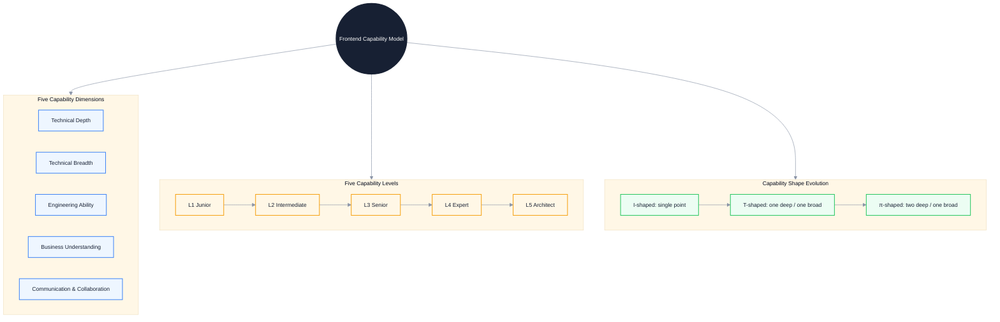
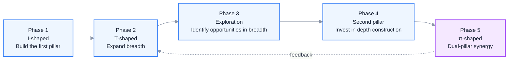

# Frontend Engineer Capability Model: A Growth Framework from T-Shaped to π-Shaped Talent

> Subtitle: Capability dimension division, five-level grading standards, T-shaped limitations and π-shaped construction, and radar-chart self-assessment methods.
>
> Target readers: Junior and intermediate frontend engineers seeking advancement, senior frontend engineers planning growth paths, and engineering managers defining talent standards.
>
> Reading time: ~25 minutes.

::: info In one sentence
A frontend engineer's capability measures whether you can stably deliver engineering value across multiple dimensions. Moving from T-shaped to π-shaped means replacing single-point depth with two pillars that reinforce each other.
:::

## Table of Contents

- [Introduction](#introduction)
- [1. Why Redefine the Frontend Capability Model](#1-why-redefine-the-frontend-capability-model)
- [2. Five Dimensions of the Capability Model](#2-five-dimensions-of-the-capability-model)
- [3. Five-Level Capability Grading Standards](#3-five-level-capability-grading-standards)
- [4. Limitations of T-Shaped Talent](#4-limitations-of-t-shaped-talent)
- [5. π-Shaped Talent: Building Two Deep Pillars](#5-π-shaped-talent-building-two-deep-pillars)
- [6. Capability Radar Chart: Self-Assessment Method](#6-capability-radar-chart-self-assessment-method)
- [7. Common Capability Shortcomings and Breakthrough Strategies](#7-common-capability-shortcomings-and-breakthrough-strategies)
- [8. Engineering Applications of the Capability Model](#8-engineering-applications-of-the-capability-model)
- [Conclusion: The Capability Model Is a Map, Not a Ruler](#conclusion-the-capability-model-is-a-map-not-a-ruler)
- [FAQ](#faq)
- [Sources](#sources)

## Introduction

Many frontend engineers, when doing annual planning, write goals like these:

- Learn React 18 new features
- Learn Vue 3 source code
- Learn Node.js
- Learn TypeScript

These goals themselves are fine. The problem is that they only answer "what I know," not "at what complexity I can stably deliver." So a common situation: someone learns a long list of technologies, but the complexity of the problems they solve stays the same, and their capability ceiling barely moves.

::: info In one sentence
A capability model is a framework. What it measures is "at what complexity you can stably deliver what value." As for "what technologies you know," that is outside its concern.
:::

This article wants to give frontend engineers a genuinely usable capability model. It breaks capability down into several measurable dimensions and uses a grading standard to help you locate where you stand now and what to fix next. The diagram below ties together dimensions, grading, and shape evolution:

---

## 1. Why Redefine the Frontend Capability Model

Over the past decade, the boundaries of the frontend role have kept expanding outward:

- Around 2014, "knowing jQuery + Ajax" was enough.
- Around 2017, the expectation became "knowing an MVVM framework + build tools."
- Around 2020, the expectation added "understanding performance optimization, having engineering experience."
- After 2023, the expectation became "able to independently design systems, work cross-platform, and collaborate across teams."

The moment the boundary expands, it brings a direct problem: measuring capability by "how many technologies you know" is becoming less and less accurate.

Here is a real example. Both engineers "know React":

- Engineer A: Can complete page development within an existing scaffold; starts piling on Redux when state gets complex; throws `memo` at everything when performance issues arise.
- Engineer B: Can choose state solutions based on business complexity (Context / Zustand / custom-built); can locate that slow LCP is caused by an overly deep module graph; can identify code patterns in Code Review that may cause Hydration issues.

The two look the same on a "technology checklist," but differ by an order of magnitude in "the complexity they can solve."

::: tip Core conclusion of this section

What a capability model measures is "at what complexity you can stably deliver what value." A technology checklist is just a checklist; it cannot support the word "capability."
:::

---

## 2. Five Dimensions of the Capability Model

Frontend engineer capability can be broken down into five relatively independent dimensions, each with its own measurement standard.

### 1. Technical Depth

Technical depth refers to how deeply you can penetrate into a specific technology domain. For frontend engineers, the most common deep pillars are:

- **JavaScript / TypeScript as languages**: type systems, runtime, V8 execution model, GC, Event Loop.
- **Browser internals**: rendering pipeline, event loop, network stack, security model.
- **Framework source code and design philosophy**: React Fiber, Vue reactivity, Svelte compile-time optimization.

The measure of depth is not "how much source code you have read," but "when you encounter a new problem, can you locate the root cause along the chain."

::: warning Common misconception

Treating "having read the React source code" as equivalent to "having technical depth." Reading source code is only a means. Depth shows up in whether you can use source-level understanding to solve real engineering problems.
:::

### 2. Technical Breadth

Technical breadth refers to your breadth of awareness across different technology stacks and different solutions. It answers the question "what options exist."

Typical manifestations of breadth:

- Knowing the applicable scenarios of SSR / SSG / ISR / Streaming SSR / Islands / Resumability.
- Knowing the differences and trade-offs among Webpack / Vite / Rollup / esbuild / Turbopack.
- Understanding the evolution of CSS solutions: CSS-in-JS / CSS Modules / Tailwind / CSS Modules + CSS Variables.

The key to breadth is "knowing it exists and being able to judge the applicable scenario"; whether you can use it fluently is secondary. With it, when you do technology selection you have more than one hammer in your hand.

### 3. Engineering Ability

Engineering ability refers to the ability to turn code into a maintainable, evolvable, multi-person collaborative system. This is the dimension most easily underestimated in interviews but most decisive for success at work.

Specific manifestations of engineering ability:

- Able to design reasonable directory structures and module boundaries.
- Able to define Code Review standards and actually enforce them.
- Able to set up CI/CD, canary release, monitoring, and alerting.
- Able to control code quality in multi-person collaboration (types, tests, Lint, commit conventions).
- Able to identify and pay down technical debt rather than letting it accumulate indefinitely.

The core of engineering ability in one sentence: make it easier for others to continue working on your code.

### 4. Business Understanding

Business understanding refers to whether you can step outside the "implement requirements" perspective and see the business goals behind the requirements.

Levels of business understanding:

- L1: Can implement according to the PRD.
- L2: Can identify unreasonable parts in the PRD and raise technical counter-suggestions.
- L3: Can derive the priority of technical investment from business metrics.
- L4: Can proactively discover business opportunities and drive business outcomes through technical means.

Here is a concrete example. The product side says, "Build a campaign landing page that supports custom configuration."

- Engineer at business understanding L1: directly builds a configuration backend + rendering page per the requirement.
- Engineer at business understanding L3: first asks, "How often is it configured? By operations or by developers? How long is the campaign cycle?" — the answers to these questions directly determine whether to build a visual builder system or just a JSON Schema configuration.

### 5. Communication & Collaboration

Communication and collaboration refer to the ability to drive things forward in cross-role and cross-team scenarios.

Typical scenarios:

- Aligning requirement boundaries with product managers, to avoid "starting implementation before the PRD is half written."
- Agreeing on interface contracts with backend, to avoid late integration rework.
- Communicating boundary cases with QA, to avoid discovering untested critical paths only after launch.
- Driving technical solutions across teams, finding balance among stakeholders with different interests.

The core of communication and collaboration is being able to identify the concerns of different roles and drive decisions in a way the other party can accept. Whether you "can talk" is secondary.

::: tip Core conclusion of this section

The five dimensions are relatively independent: a person can be strong in one dimension and weak in another. Growth is not "raising all five dimensions in sync," but "identifying shortcomings + strengthening pillars."
:::

---

## 3. Five-Level Capability Grading Standards

Combining the five dimensions, we can build a five-level capability grading. Each level's core characteristic is summarized in one sentence: at what complexity can a person at this level independently complete what.

```mermaid
%%{init: {'theme': 'base', 'themeVariables': { 'fontFamily': 'Inter, PingFang SC, Microsoft YaHei, sans-serif', 'primaryColor': '#FFF7E6', 'primaryTextColor': '#172033', 'primaryBorderColor': '#F59E0B', 'lineColor': '#8A94A6', 'fontSize': '13px'}}}%%
flowchart LR
    subgraph L1["L1 Junior (0-2 years)"]
        L1A["Can complete explicit<br/>tasks under guidance"]
        L1B["Technical depth: single framework usage"]
        L1C["Engineering ability: follows conventions"]
    end

    subgraph L2["L2 Intermediate (2-4 years)"]
        L2A["Can independently complete<br/>module-level features"]
        L2B["Technical depth: understands framework mechanisms"]
        L2C["Engineering ability: writes maintainable code"]
    end

    subgraph L3["L3 Senior (4-6 years)"]
        L3A["Can independently own<br/>a complete business line"]
        L3B["Technical depth: browser / runtime"]
        L3C["Engineering ability: defines conventions"]
    end

    subgraph L4["L4 Expert (6-8 years)"]
        L4A["Can design complex systems<br/>and solve cross-team problems"]
        L4B["Technical depth: penetrates multiple domains"]
        L4C["Engineering ability: platform construction"]
    end

    subgraph L5["L5 Architect (8+ years)"]
        L5A["Can define technical direction<br/>and be responsible for business outcomes"]
        L5B["Technical depth: full-chain perspective"]
        L5C["Engineering ability: organization-level engineering system"]
    end

    L1 --> L2 --> L3 --> L4 --> L5

    classDef l1 fill:#ECFDF3,stroke:#22C55E,color:#172033,stroke-width:1.5px;
    classDef l2 fill:#EEF6FF,stroke:#3B82F6,color:#172033,stroke-width:1.5px;
    classDef l3 fill:#FFF7E6,stroke:#F59E0B,color:#172033,stroke-width:1.5px;
    classDef l4 fill:#F5E8FF,stroke:#A855F7,color:#172033,stroke-width:1.5px;
    classDef l5 fill:#FEE2E2,stroke:#EF4444,color:#172033,stroke-width:1.5px;

    class L1,L1A,L1B,L1C l1;
    class L2,L2A,L2B,L2C l2;
    class L3,L3A,L3B,L3C l3;
    class L4,L4A,L4B,L4C l4;
    class L5,L5A,L5B,L5C l5;
```

### L1 Junior (0-2 years)

**Core characteristic**: Can complete explicit tasks under guidance.

- **Technical depth**: Proficient in using one framework (React or Vue) to complete page development; understands the mechanism behind basic APIs (e.g., when `useState` triggers re-render).
- **Technical breadth**: Knows the HTML/CSS/JS triad; has heard of build tools but cannot configure them independently.
- **Engineering ability**: Can submit code following existing conventions; can accept feedback in Code Review and improve.
- **Business understanding**: Can implement according to the PRD; not sensitive to the business goals behind requirements.
- **Communication & collaboration**: Can sync progress within a small team; can proactively raise blockers.

**Measurement signal**: Given a clear design draft and interfaces, can independently complete a medium-complexity page within 3 days, with no more than 5 major bugs.

### L2 Intermediate (2-4 years)

**Core characteristic**: Can independently complete module-level features.

- **Technical depth**: Understands core framework mechanisms (e.g., Fiber, Reconciler, reactivity system); can locate common performance issues.
- **Technical breadth**: Familiar with build tool configuration; understands basic SSR principles; knows the evolution of state management solutions.
- **Engineering ability**: Can write maintainable code (reasonable abstraction, clear naming, single responsibility); can write effective unit tests.
- **Business understanding**: Can identify boundary cases in the PRD; can raise technical counter-suggestions from a technical angle.
- **Communication & collaboration**: Can independently interface with backend and QA; can lead small-scale technical solution discussions.

**Measurement signal**: Can independently own a complete business module (e.g., checkout flow, user center) from design to launch without needing guidance from others.

### L3 Senior (4-6 years)

**Core characteristic**: Can independently own a complete business line.

- **Technical depth**: Can locate performance issues from browser low-level chains; understands V8 execution model, rendering pipeline, network stack.
- **Technical breadth**: Can compare multiple solutions and give selection rationale; has hands-on cross-platform experience (Web / RN / mini-programs).
- **Engineering ability**: Can define team conventions (Code Review standards, commit conventions, testing strategy); can set up monitoring and alerting.
- **Business understanding**: Can derive technical investment priorities from business metrics; can use technical means to improve business outcomes.
- **Communication & collaboration**: Can drive solutions across teams; can find balance among stakeholders with different interests.

**Measurement signal**: Can independently own the technical solution of a business line and significantly improve its core metrics (performance, stability, R&D efficiency) within 3-6 months.

### L4 Expert (6-8 years)

**Core characteristic**: Can design complex systems and solve cross-team problems.

- **Technical depth**: Has penetrating understanding across multiple domains; can contribute to or fix framework-level issues at the source-code level.
- **Technical breadth**: Cross-stack vision (frontend + Node + infrastructure); can drive technology migration across different stacks.
- **Engineering ability**: Can lead platform construction (component libraries, toolchains, low-code platforms).
- **Business understanding**: Can identify business opportunities; can drive business model innovation through technical means.
- **Communication & collaboration**: Can drive technical decisions at the organizational level; can influence the technical direction of other teams.

**Measurement signal**: Can lead a cross-team technical project (e.g., company-wide frontend performance optimization, unified engineering platform) and produce measurable organization-level results.

### L5 Architect (8+ years)

**Core characteristic**: Can define technical direction and be responsible for business outcomes.

- **Technical depth**: Full-chain perspective; can locate root causes at any link.
- **Technical breadth**: Clear technology landscape; can judge "which technologies are worth investing in."
- **Engineering ability**: Organization-level engineering system design (R&D process, quality system, technology stack evolution roadmap).
- **Business understanding**: Can drive business strategy with technology; can participate in business decisions.
- **Communication & collaboration**: Can translate among C-level executives, product owners, and technical teams.

**Measurement signal**: Can define the 1-3 year evolution direction of a business line or technical domain and be responsible for the final outcome.

::: warning Common misconception

Treating "years of work" as equivalent to "capability level." Years are only a reference. The real grading standard is "the complexity of problems you can independently solve." People who reach L3 in 3 years exist; people who are still at L2 after 10 years are also common.
:::

::: tip Core conclusion of this section

The use of the five-level grading is to locate "the boundary of complexity you can currently handle independently." The breakthrough point to the next level is often stuck at the bottleneck of the current level.
:::

---

## 4. Limitations of T-Shaped Talent

"T-shaped talent" has been the most praised capability model over the past decade: the vertical bar represents depth, the horizontal bar represents breadth.

For frontend engineers, the typical T-shaped profile:

- Vertical: proficient in React / Vue frameworks.
- Horizontal: HTML/CSS/build tools/state management/basic backend.

Compared with "I-shaped" (only single-point depth), the T-shaped model is a big step forward. But under today's complexity, its limitations are becoming more and more obvious:

### 1. A Single Deep Pillar Is Prone to Obsolescence

If your deep pillar is "React usage," then changes like React 18's concurrent model, Server Components, Suspense for Data Fetching will devalue your depth.

If your deep pillar is "rendering pipeline + React scheduling model," then no matter how React evolves, your depth still holds — because what you understand is a more fundamental, stable structure.

### 2. A Single Deep Pillar Struggles with Cross-Domain Problems

Many real problems are not "frontend problems" or "backend problems," but "system problems."

For example, Hydration performance issues require understanding simultaneously:

- Browser rendering pipeline (frontend depth).
- Server execution model (Node/Edge depth).
- Framework SSR implementation (framework depth).

An engineer with only one deep pillar will lose judgment on cross-domain problems.

### 3. A Single Deep Pillar Struggles to Bear Architectural Responsibility

An architect's work is to make trade-offs across multiple uncertain dimensions. If you have only one deep pillar, your judgment will be dominated by that pillar, tending to "solve all problems with familiar solutions."

::: tip Core conclusion of this section

The T-shaped model was sufficient in 2015. Today a single deep pillar can no longer support the requirements of senior roles. The next step is to move toward π-shaped.
:::

---

## 5. π-Shaped Talent: Building Two Deep Pillars

The core of π-shaped talent is two deep pillars plus a certain breadth.

For frontend engineers, common π-shaped combinations:

- Pillar A: Frontend frameworks + browser internals (frontend depth).
- Pillar B: Node.js / server-side / cloud-native (backend depth).
- Breadth: cross-platform, engineering, performance optimization, business understanding.

The key to π-shaped is that the two pillars can produce synergy, not randomly picking two.

### 1. Criteria for Judging Synergy

To judge whether two pillars have synergy, you can ask three questions:

1. **Can the depth of pillar A help pillar B solve more complex problems?**
   - Example: frontend framework depth → helps design a better SSR solution.
2. **Can the depth of pillar B help pillar A break through its ceiling?**
   - Example: server-side depth → helps implement BFF, Edge Computing, Streaming SSR.
3. **Can the combination of the two pillars solve problems that a single pillar cannot?**
   - Example: full-stack depth → leading the implementation of Islands Architecture.

If all three answers are "no," that is two independent I-shapes pieced together, not a true π-shape.

### 2. Choosing the Second Pillar

Do not follow trends when choosing the second pillar; base it on your business scenario.

| Business Scenario | Recommended Second Pillar |
| --- | --- |
| Mid- to back-office SaaS | Backend architecture + database design (BFF, permission model, data flow) |
| Consumer content / e-commerce | Performance engineering + CDN / edge computing |
| Cross-platform business | RN / Flutter / mini-program runtime |
| Tool / platform business | Compiler theory + IDE toolchain |
| AI applications | LLM application engineering + prompt engineering |

### 3. The Building Path of π-Shaped

Building π-shaped is not "make A top-level first, then start B." It is a more complex iterative process:

::: tip Core conclusion of this section

π-shaped is "two deep pillars with synergy," not two T-shapes pieced together. How to choose the second pillar depends on the business scenario, not on hot trends.
:::

---

## 6. Capability Radar Chart: Self-Assessment Method

An abstract capability model has no practical value if it cannot be applied to self-assessment. Below is a usable radar-chart assessment method.

### 1. Five-Dimension Scoring Table

For each dimension, self-rate on a 1-5 scale:

| Dimension | 1 point | 3 points | 5 points |
| --- | --- | --- | --- |
| Technical depth | Can use frameworks | Understands framework mechanisms | Can locate problems from low-level chains |
| Technical breadth | Only knows one stack | Knows multiple solutions and can select | Cross-stack vision, can drive technology migration |
| Engineering ability | Follows conventions | Writes maintainable code | Defines conventions, leads platformization |
| Business understanding | Implements per PRD | Identifies boundary cases | Derives technical investment priorities from business metrics |
| Communication & collaboration | Syncs within team | Cross-functional alignment | Drives decisions across teams |

### 2. Scoring Discipline

The biggest risk of self-assessment is "feeling good about yourself." Three alignment methods:

1. **Substantiate with concrete events**: Every score must be backed by 1-2 concrete events as evidence. "I score 4 in communication and collaboration" — then name one cross-team decision you led in the last 3 months.
2. **Calibrate with colleagues**: Find 1-2 long-term collaborators and ask them to rate you on the same dimensions, then compare the differences.
3. **Compare externally**: Through technical communities, open-source contributions, tech sharing, compare yourself with engineers at the same level.

### 3. Identifying "Shortcomings" vs. "Bottlenecks"

The purpose of the radar chart is to identify improvement priorities. But pay attention to distinguishing two situations:

- **Shortcoming**: Significantly lower than other dimensions, limiting the overall level. For example, engineering ability at 2 points while others are all at 4.
- **Bottleneck**: The capability most critical when breaking through from the current level to the next. For example, when moving from L3 to L4, business understanding and communication & collaboration are usually the bottlenecks.

Fixing shortcomings solves the "bucket effect"; breaking bottlenecks solves "growth stagnation." The two have different priorities at different stages:

- L1→L2, L2→L3: prioritize fixing shortcomings.
- L3→L4, L4→L5: prioritize breaking bottlenecks.

::: tip Core conclusion of this section

The capability radar chart is a self-assessment tool, but it has to be backed by concrete events, calibrated with colleagues, and compared externally. Otherwise it is easy to feel good about yourself.
:::

---

## 7. Common Capability Shortcomings and Breakthrough Strategies

### 1. "Pseudo Bottleneck in Technical Depth"

Many L2 engineers feel their "depth is insufficient," so they read the React source code, the Vue source code, but after a few months find that their work ability has not improved.

**Reason**: Depth is not "reading source code," it is "using underlying understanding to solve problems." Reading source code without an application scenario, the knowledge does not precipitate into capability.

**Breakthrough strategy**:

- Pick one recent online issue (performance, memory, stability).
- Locate the root cause from three angles: browser chain, framework mechanism, runtime.
- Write the whole process into a technical article or a team sharing.

After finishing this round, depth is no longer "what source code I have read," but "what problems I can solve."

### 2. "Insufficient Engineering Ability"

The biggest bottleneck from L2 to L3 is often engineering ability. Manifestations:

- The code you write is hard for others to take over.
- You don't know how to define Code Review standards.
- Team code quality has been low for a long time but you don't know how to improve it.

**Breakthrough strategy**:

- Proactively take on Code Review work; review at least 5 PRs per week.
- Lead one team convention definition (e.g., commit conventions, testing conventions).
- Build monitoring and alerting from scratch once; convert the team's online issues into observable metrics.

Engineering ability can only be accumulated by "doing engineering"; reading more articles is never enough.

### 3. "Superficial Business Understanding"

Many technical engineers' understanding of the business stays at "knowing what this feature does." True business understanding needs to go one level deeper:

- What user problem does this feature solve?
- Which business metrics does this feature affect?
- How is the ROI of this feature measured?

**Breakthrough strategy**:

- Proactively align with product managers on business goals; do not just stare at PRD details.
- Read business weekly reports and core metric dashboards; understand the impact of your own work.
- Pick one core metric of a business line and proactively optimize it with technical means.

### 4. "Communication & Collaboration Only Within the Familiar Circle"

Many engineers communicate smoothly within the team but stumble as soon as they cross teams. This is a typical bottleneck from L3 to L4.

**Reason**: The core of cross-team communication is not "explaining technology clearly," but "identifying the other party's interests + driving forward in a way the other party can accept."

**Breakthrough strategy**:

- Lead one cross-team technical project (e.g., unified login, performance optimization, component library co-construction).
- Before each cross-team communication, first list "what the other party cares about, what the other party worries about, what I can offer."
- Review the success/failure of each cross-team collaboration to find your own communication pattern.

::: warning Common misconception

Using "I'm not good at communication" as an excuse for not growing. Communication and collaboration are learnable skills; the key is "identifying the other party's perspective + practicing feedback," and it has little to do with innate personality.
:::

::: tip Core conclusion of this section

Every capability shortcoming has a corresponding breakthrough strategy. The shared principle is "use concrete events to verify capability improvement"; reading books and learning technologies alone do not count.
:::

---

## 8. Engineering Applications of the Capability Model

The capability model is not only a personal planning tool; it can also be applied to team management.

### 1. Hiring and Leveling

Use a unified grading standard to evaluate candidates during hiring, to avoid "giving a senior title just because they feel good." Specific practices:

- Define clear "complexity they can independently solve" for each level.
- Map interview questions to specific capability dimensions, not "whether they know a certain API."
- Have multiple interviewers rate independently and calibrate the differences.

### 2. Promotion Evaluation

The key question in promotion evaluation is "whether they are stably outputting at the next level of complexity"; it has little to do with "how many years they have worked."

Signals to judge:

- Has the candidate had 2-3 events in the last 6 months proving stable output at the next level of complexity?
- Is the candidate already "too comfortable" at the current level, indicating capability overflow?
- Will the candidate's shortcomings limit their effectiveness at the next level?

### 3. Team Capability Map

Aggregating the capability radar charts of team members gives a team capability map:

- Which dimensions are team shortcomings (need to hire or cultivate).
- Which dimensions have redundancy (can do cross-backup).
- Which members' capabilities can complement each other.

::: info Engineering insight

Applying the capability model to team management is turning "capability" from a subjective judgment into a measurable, comparable, plannable object.
:::

---

## Conclusion: The Capability Model Is a Map, Not a Ruler

The greatest value of a capability model is that when you do career planning, you no longer have to only write "learn React, learn Node, learn Rust."

It can help you answer a few more practical questions:

- Where am I now?
- What should I improve next?
- Which dimension is my shortcoming?
- What is my bottleneck?

But it is not a ruler — do not use it to label yourself or others. Capability is dynamic; the model is static. The model helps you locate and plan, but real growth always happens in the process of solving concrete problems.

::: info In one sentence
The capability model is a map, not a destination. The value of a map is to help you decide which way to go next, not to make you stand still arguing whether you are L3 or L4.
:::

---

## FAQ

### 1. I have worked for 5 years but still feel like I am at L2. What went wrong?

Years and capability level do not correspond directly. First do a radar-chart self-assessment to identify the real shortcoming. Common situations: technical depth stays at "can use frameworks" without precipitating into low-level chain understanding; or engineering ability stays at "writing code" without advancing to "defining conventions, leading platformization." After identifying the shortcoming, use concrete events to verify breakthroughs; do not keep piling up technology checklists.

### 2. Are T-shaped and π-shaped really fundamentally different, or is it just conceptual hype?

T-shaped was effective around 2015, because frontend complexity was still within the range a single pillar could cover. But today frontend involves SSR, Edge, cross-platform, AI, and other domains; a single deep pillar can no longer hold up cross-domain problems. π-shaped is a response to "single-pillar failure after complexity rises," not conceptual hype. The judgment standard is simple: in the last six months, was the hardest problem you encountered one that a single deep pillar could no longer solve?

### 3. What should the second pillar of π-shaped be? Is there a standard answer?

There is no standard answer; it depends on the business scenario and personal interest. But there is one judgment principle: the second pillar should have synergy with the first pillar. For example, if the first pillar is frontend framework depth, choosing Node / server-side can synergize to solve SSR, BFF, and other problems; choosing AI engineering can synergize to solve LLM application frontend problems. If the second pillar cannot synergize with the first, that is just two independent I-shapes pieced together.

### 4. My capability radar-chart self-assessment is always not objective. What should I do?

Three alignment methods: (1) every score must be backed by 1-2 concrete events as evidence; (2) find long-term collaborators to rate you on the same dimensions and compare the differences; (3) through technical communities, open-source contributions, tech sharing, compare yourself with engineers at the same level. If you cannot name a concrete event for a score, that score is invalid.

### 5. How should team managers use the capability model for promotion evaluation?

The core question of promotion evaluation is "whether they are stably outputting at the next level of complexity." Specific practices: look at whether the candidate has had 2-3 events in the last 6 months proving stable output at the next level of complexity; whether the candidate is already "too comfortable" at the current level, indicating capability overflow; whether the candidate's shortcomings will limit their effectiveness at the next level. Do not do "promote just because the years of service are up."

---

## Sources

This article is based on industry practice and the author's experience. The five dimensions and five-level grading of the capability model reference engineer capability standards from multiple internet companies. The concept of π-shaped talent comes from observation of the expansion of frontend role boundaries.
