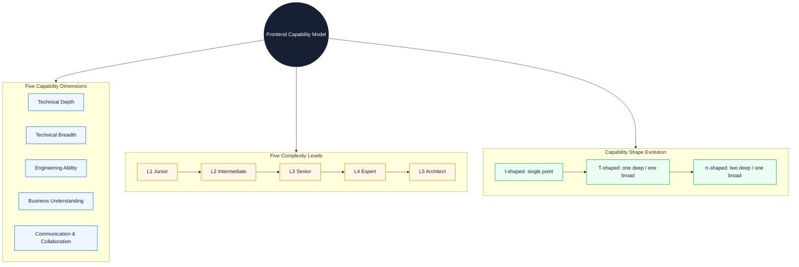
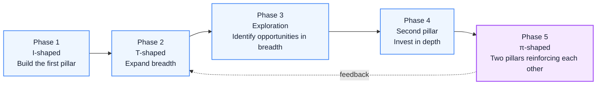

# Frontend Engineer Capability Model: A Growth Framework from T-Shaped to π-Shaped Talent

Annual plans often list frameworks and tools, then leave the harder question untouched: at what level of complexity can you still deliver without supervision? A longer technology list does not move that ceiling.

This article treats capability as a set of observable behaviors, uses five dimensions and five levels to locate where you currently stand, and compares single-pillar and two-pillar shapes under explicit conditions. The goal is not a better-looking label but a defensible next investment: fix a limiting dimension, or open a second pillar. You will finish with a self-assessment procedure and a decision list for whether π-shaped growth is warranted at all.

::: info In one sentence
A frontend engineer's capability measures whether you can stably deliver engineering value across multiple dimensions. Moving from T-shaped to π-shaped means replacing single-point depth with two pillars that reinforce each other.
:::

## Table of Contents

- [Before We Start](#before-we-start)
- [1. Why Redefine the Frontend Capability Model](#_1-why-redefine-the-frontend-capability-model)
- [2. Five Dimensions of the Capability Model](#_2-five-dimensions-of-the-capability-model)
- [3. Five-Level Capability Grading Standards](#_3-five-level-capability-grading-standards)
- [4. Limitations of T-Shaped Talent](#_4-limitations-of-t-shaped-talent)
- [5. π-Shaped Talent: Building Two Deep Pillars](#_5-π-shaped-talent-building-two-deep-pillars)
- [6. Capability Radar Chart: Self-Assessment Method](#_6-capability-radar-chart-self-assessment-method)
- [7. Common Capability Shortcomings and Breakthrough Strategies](#_7-common-capability-shortcomings-and-breakthrough-strategies)
- [8. Engineering Applications of the Capability Model](#_8-engineering-applications-of-the-capability-model)
- [Conclusion: The Capability Model Is a Map, Not a Ruler](#conclusion-the-capability-model-is-a-map-not-a-ruler)
- [FAQ](#faq)
- [Sources](#sources)

## Before We Start

### 1. Questions a Technology Checklist Cannot Answer

Many frontend engineers, when doing annual planning, write goals like these:

- Learn React 18 new features
- Learn Vue 3 source code
- Learn Node.js
- Learn TypeScript

These goals themselves are fine. The problem is that they only answer "what I know," not "at what complexity I can stably deliver." So a common situation: someone learns a long list of technologies, but the complexity of the problems they solve stays the same, and their capability ceiling barely moves.

Two engineers can both "know React" and still differ by an order of magnitude. Engineer A completes page development inside an existing scaffold, piles on Redux when state gets complex, and adds `memo` everywhere when performance suffers. Engineer B chooses a state solution from the business complexity, traces slow LCP to an overly deep module graph, and spots code in review that may cause hydration problems.

### 2. This Article's Judgment and Main Line

This article defines a capability model (Capability Model) as a framework that uses observable dimensions to describe "at what complexity you can stably deliver what value." It does not grade which APIs you know. It locates your complexity boundary and the next place to invest.

The main line follows a decision order: why a technology checklist fails, which five dimensions to evaluate, how the five levels and the T-shaped and π-shaped forms compare, which constraints distort self-assessment, and what actions follow under which conditions. The diagram below gives the overall shape:

Read the diagram as three coordinates: dimensions say where to invest, levels say the current complexity boundary, and shapes say how many deep pillars to stand on.

---

## 1. Why Redefine the Frontend Capability Model

The frontend role's boundary keeps expanding. "jQuery + Ajax" was once enough to get hired; then came an MVVM framework and build tooling; then performance work and engineering experience; now independent system design, cross-platform scenarios, and cross-team collaboration.

As the boundary expands, measuring capability by "how many technologies you know" becomes less accurate. A technology list shows what you have touched, not what you can judge in a complex situation. The common interview question "have you used X" verifies exposure, not complexity.

That is why this article splits capability into dimensions. Only when each dimension has observable behavioral standards can capability be located and compared.

::: tip Section takeaway
A technology checklist records exposure; a capability model records the complexity boundary. The first can be accumulated with time; the second only comes from solving harder problems.
:::

---

## 2. Five Dimensions of the Capability Model

The five dimensions are relatively independent. Being strong in one and weak in another is normal. Growth is not about raising all five in sync; it is about identifying the short board and strengthening a pillar.

### 1. Technical Depth

Technical depth is how far you can penetrate a specific domain. For frontend engineers, common depth pillars fall into three groups:

- **Language and runtime**: the JavaScript / TypeScript type system, execution model, V8 JIT and GC
- **Browser internals**: rendering pipeline, event loop, network stack, security model
- **Framework source and design**: React Fiber, Vue reactivity, Svelte compile-time optimization

The measure of depth is not how much source code you have read, but whether you can trace a new problem to its root cause on the chain. Reading source is a means; using it to explain a real failure is the capability.

### 2. Technical Breadth

Technical breadth is your awareness of different stacks and solutions. It answers "what options exist." Typical manifestations:

- Can explain when SSR, SSG, ISR, Streaming SSR, Islands, and Resumability each fit
- Knows the differences and trade-offs among Webpack, Vite, Rollup, esbuild, and Turbopack
- Understands the evolution of CSS approaches: CSS-in-JS, CSS Modules, Tailwind, CSS Variables

The key to breadth is knowing that an option exists and being able to judge where it fits. Fluency is secondary. Its direct payoff is having more than one hammer during technology selection.

### 3. Engineering Ability

Engineering ability turns code into a maintainable, evolvable system that several people can work on. It is the dimension most often underestimated in interviews and most decisive in practice:

- Can design reasonable directory structures and module boundaries
- Can define Code Review standards and actually enforce them
- Can set up CI/CD, canary release, monitoring, and alerting
- Can control code quality across a team, including types, tests, lint, and commit conventions
- Can identify and pay down technical debt instead of letting it accumulate

The core can be stated in one sentence: make it easier for others to continue working on your code.

### 4. Business Understanding

Business understanding is the ability to step outside "implement the requirement" and see the business goal behind it. It has levels:

- L1: can implement according to the PRD
- L2: can identify unreasonable parts in the PRD and raise technical counter-suggestions
- L3: can derive technical investment priorities from business metrics
- L4: can discover business opportunities and use technical means to drive business outcomes

For example, the request is "build a campaign landing page that supports custom configuration." An engineer at L1 builds a configuration backend plus a rendering page. An engineer at L3 first asks how often it is configured, whether operations or developers configure it, and how long the campaign runs. Those answers determine whether to build a visual builder or a JSON Schema configuration.

### 5. Communication & Collaboration

Communication and collaboration is the ability to move work forward across roles and teams:

- Aligning requirement boundaries with product managers before implementation starts
- Agreeing on interface contracts with backend to avoid late integration rework
- Discussing boundary cases with QA before launch exposes a missed critical path
- Driving a technical proposal across teams with different interests

Its core is identifying what each role cares about and pushing decisions in a form the other side can accept, not speaking more elegantly.

The five dimensions are not parallel labels. Depth and breadth determine what you can see; engineering and business understanding determine what you can deliver; communication determines how many people can adopt it.

::: tip Section takeaway
The five dimensions can be scored separately, but they cannot grow separately. Output in one dimension usually needs support from another: a short board sets the ceiling, a pillar sets irreplaceability.
:::

---

## 3. Five-Level Capability Grading Standards

Combining the five dimensions produces five complexity levels. Each level's core question is "at what complexity can this person independently complete what." Years appear only as a reading coordinate:

The years are common experience ranges, not promotion thresholds. What the grading compares is the "independence at increasing complexity" shown to the right of each arrow. Nobody upgrades automatically; people usually get stuck on one dimension of their current level.

### L1 Junior (typical 0-2 years)

**Core characteristic**: can complete explicit tasks under guidance.

- **Technical depth**: proficient with one framework (React or Vue) for page development; understands the mechanism behind basic APIs, such as when `useState` triggers a re-render
- **Technical breadth**: knows HTML, CSS, and JavaScript; has heard of build tools but cannot configure them alone
- **Engineering ability**: can submit code following existing conventions; can accept review feedback and improve
- **Business understanding**: can implement per the PRD; not sensitive to the business goal behind it
- **Communication & collaboration**: can sync progress in a small team and raise blockers early

**Behavioral signal**: given a clear design and API contract, can independently deliver a medium-complexity page within the agreed schedule. Rework comes mainly from requirement changes, not misreading.

### L2 Intermediate (typical 2-4 years)

**Core characteristic**: can independently complete module-level features.

- **Technical depth**: understands core framework mechanisms such as Fiber, the reconciler, or a reactivity system; can locate common performance problems
- **Technical breadth**: familiar with build tool configuration; understands basic SSR principles; knows how state management approaches evolved
- **Engineering ability**: writes maintainable code with reasonable abstraction, clear naming, and single responsibility; can write effective unit tests
- **Business understanding**: can identify boundary cases in the PRD and raise technical counter-suggestions
- **Communication & collaboration**: can interface with backend and QA independently; can lead a small technical discussion

**Behavioral signal**: can own a complete business module, such as checkout or the user center, from design to launch without step-by-step guidance.

### L3 Senior (typical 4-6 years)

**Core characteristic**: can independently own a complete business line.

- **Technical depth**: can trace performance problems down the browser chain; understands the V8 execution model, rendering pipeline, and network stack
- **Technical breadth**: can compare several solutions and give selection rationale; has hands-on cross-platform experience (Web, React Native, mini-programs)
- **Engineering ability**: can define team standards for Code Review, commits, and testing; can set up monitoring and alerting
- **Business understanding**: can derive technical priorities from business metrics and improve business outcomes through technical work
- **Communication & collaboration**: can drive a proposal across teams and balance different interests

**Behavioral signal**: can own a business line's technical solution and produce comparable metric improvements within one planning cycle, not just deliver features.

### L4 Expert (typical 6-8 years)

**Core characteristic**: can design complex systems and solve cross-team problems.

- **Technical depth**: penetrating understanding across several domains; can contribute to or fix framework-level issues at the source level
- **Technical breadth**: cross-stack vision across frontend, Node, and infrastructure; can migrate technology between stacks
- **Engineering ability**: can lead platform construction such as a component library, toolchain, or low-code platform
- **Business understanding**: can identify business opportunities and use technical means to change how the business operates
- **Communication & collaboration**: can drive technical decisions at the organization level and influence other teams

**Behavioral signal**: can lead a cross-team technical project, such as company-wide frontend performance governance or a unified engineering platform, and produce measurable organization-level results.

### L5 Architect (typically 8+ years)

**Core characteristic**: can define technical direction and own business outcomes.

- **Technical depth**: full-chain perspective; can locate a root cause at any link
- **Technical breadth**: a clear technology landscape; can judge which technologies deserve investment
- **Engineering ability**: can design an organization-level engineering system covering R&D process, quality, and stack evolution
- **Business understanding**: can use technology to drive business strategy and participate in business decisions
- **Communication & collaboration**: can translate among executives, product owners, and engineering teams

**Behavioral signal**: can define a one-to-three-year evolution direction for a business line or technical domain and own the result.

::: warning Common misconception

Treating years of work as capability level. Years only say how long you have been in the industry; the grading looks at "the complexity you can independently solve." Some people reach L3 in three years; others stay at L2 after ten.
:::

---

## 4. Limitations of T-Shaped Talent

The T-shaped model has been the most recommended capability shape of the past decade: the vertical bar is depth, the horizontal bar is breadth. For frontend engineers, the typical profile is proficiency in React or Vue plus familiarity with HTML/CSS, build tools, state management, and basic backend work.

Compared with the I-shaped model, which has only single-point depth, T-shaped is a clear step forward. Under current complexity, however, its limits are equally clear.

### 1. A Single Deep Pillar Depreciates

If the deep pillar is "React usage," then concurrent rendering, Server Components, and Suspense for Data Fetching all devalue that depth.

If the deep pillar is "rendering pipeline + scheduling model," framework changes still leave you with a more stable underlying structure. The same depth attached to an API expires; attached to a mechanism, it lasts longer.

### 2. A Single Deep Pillar Struggles with Cross-Domain Problems

Many real problems are neither purely frontend nor purely backend; they are system problems. Hydration performance, for example, requires understanding the browser rendering pipeline, the server execution model, and the framework's SSR implementation at the same time.

An engineer with one deep pillar tends to lose judgment on such problems and push them away as "not my layer."

### 3. A Single Deep Pillar Cannot Carry Architectural Responsibility

Architecture is trade-offs across several uncertain dimensions. With one deep pillar, judgment is dominated by that pillar, and every problem starts to look like a nail for the same hammer.

### 4. First Decide Whether You Need π-Shaped

π-shaped is not a mandatory path for every frontend engineer. If your goal is to remain a deep specialist in one area, one very deep pillar also creates irreplaceability. The typical conditions for needing π-shaped are:

- You are accountable for system outcomes that cross platforms, layers, or teams
- Your frequent problems can no longer be explained within one domain
- You need to trade off between two domains, not just optimize inside one

When none of these holds, forcing a second pillar may only split your attention.

---

## 5. π-Shaped Talent: Building Two Deep Pillars

π-shaped talent combines two deep pillars with a certain breadth. For frontend engineers, common combinations are:

- Pillar A: frontend frameworks + browser internals
- Pillar B: Node.js / server-side / cloud-native
- Breadth: cross-platform, engineering, performance, business understanding

The key is not the number of pillars but whether the two can reinforce each other.

### 1. Criteria for Judging Synergy

To judge whether two pillars have synergy, ask three questions:

1. **Can the depth of pillar A help pillar B solve harder problems?** Frontend framework depth, for example, helps design a better SSR solution.
2. **Can the depth of pillar B break pillar A's ceiling?** Server-side depth, for example, supports BFF, edge computing, and Streaming SSR.
3. **Can the combination solve problems neither pillar can handle alone?** Full-stack depth, for example, can lead an Islands Architecture rollout.

If all three answers are no, you have two independent I-shapes placed side by side, not a π-shape.

### 2. Choosing the Second Pillar

Do not choose the second pillar by trend. A more stable basis is the business scenario:

| Business scenario | Suggested second pillar |
| --- | --- |
| Mid- and back-office SaaS | Backend architecture + database design (BFF, permission model, data flow) |
| Consumer content / e-commerce | Performance engineering + CDN / edge computing |
| Cross-platform business | React Native / Flutter / mini-program runtime |
| Tool / platform business | Compiler theory + IDE toolchain |
| AI applications | LLM application engineering + context engineering |

The table gives candidate directions, not a standard answer. A more reliable test is whether the most expensive problem in your business over the next year falls inside one of these pillars.

### 3. The Building Path of π-Shaped

Building π-shaped is not "make A top-tier first, then start B." It is an iterative process with feedback:

The path is not a one-way pipeline. Even after reaching π-shaped, you return to T-shaped to widen breadth; the dashed edge represents that feedback. Whether the second pillar works is usually verified in a real project, not confirmed in a planning document.

---

## 6. Capability Radar Chart: Self-Assessment Method

An abstract model is useless if it cannot support self-assessment. The method below is not meant to produce a flattering score; it is meant to identify where the next investment should go.

### 1. Five-Dimension Scoring Table

Rate each dimension from 1 to 5:

| Dimension | 1 point | 3 points | 5 points |
| --- | --- | --- | --- |
| Technical depth | Can use a framework | Understands framework mechanisms | Can trace problems down the chain |
| Technical breadth | Knows one stack | Knows several solutions and can select | Cross-stack vision and technology migration |
| Engineering ability | Follows conventions | Writes maintainable code | Defines standards and leads platformization |
| Business understanding | Implements per PRD | Identifies boundary cases | Derives technical priorities from metrics |
| Communication & collaboration | Syncs within the team | Aligns across functions | Drives decisions across teams |

### 2. Scoring Discipline

The biggest risk in self-assessment is feeling good about yourself. Three calibration methods:

1. **Support each score with events**: every score needs one or two concrete events. A four in communication requires a cross-team decision you led in the last six months.
2. **Calibrate with colleagues**: ask one or two long-term collaborators to rate you on the same dimensions, then compare the gaps rather than the conclusions.
3. **Compare externally**: use technical communities, open-source work, and talks to see what engineers at the same level are doing.

If you cannot name an event for a score, treat it as one level lower. That is the minimum requirement for turning the chart from a feeling into evidence.

### 3. Identifying a "Short Board" Versus a "Bottleneck"

The radar chart sets priorities, but a short board and a bottleneck are different:

- **Short board**: clearly below the other dimensions and limiting the overall level. Engineering ability at 2 while everything else is 4 is a short board.
- **Bottleneck**: the capability most critical for breaking into the next level. Moving from L3 to L4, business understanding and cross-team drive are usually the bottleneck.

Their priority changes with stage. From L1 to L3, fix short boards first, because every dimension must hold up as complexity rises. From L3 upward, break the bottleneck first, because further work on the short board has low marginal return.

### 4. A Complete Self-Assessment Procedure

1. Pick two or three events from the last six months that best represent your current work, and write down what you actually did.
2. Score the five dimensions from 1 to 5, with every score tied to those events.
3. Ask one or two collaborators to re-score you, and discuss only the two largest gaps.
4. Decide whether the gap comes from a short board or a bottleneck, and choose one as the main investment for the next stage.
5. Define an observable verification signal for that direction, such as leading a cross-team review or completing a root-cause investigation independently.

---

## 7. Common Capability Shortcomings and Breakthrough Strategies

### 1. The Pseudo-Bottleneck in Technical Depth

Many L2 engineers feel their depth is insufficient, so they read the React or Vue source for months and find no visible change in their work.

The reason is not that source code is useless, but that there is no application scenario. Depth is not what you have read; it is what you can explain and solve with low-level understanding.

**Breakthrough strategy**:

- Pick a recent production issue involving performance, memory, or stability
- Trace the root cause from three angles: the browser chain, framework mechanisms, and the runtime
- Write the investigation into an article or a team talk so others can reproduce your judgment

After one such round, depth has a verifiable carrier.

### 2. Insufficient Engineering Ability

The largest bottleneck from L2 to L3 is often engineering ability. Typical signs: others struggle to take over your code, you cannot define Code Review standards, and team code quality stays low with no lever to improve it.

**Breakthrough strategy**:

- Join Code Review regularly and focus on design and boundaries, not only syntax
- Lead one round of team standards, such as commit conventions or a testing strategy
- Build monitoring and alerting once, turning production issues into observable signals

Engineering ability is accumulated by doing engineering; reading articles is not enough.

### 3. Superficial Business Understanding

Many engineers stop at "knowing what this feature does." One level deeper means answering three questions: what user problem it solves, which business metrics it affects, and how the investment is measured.

**Breakthrough strategy**:

- Align with product managers on the business goal, not only PRD details
- Read business weekly reports and core dashboards to understand the impact of your work
- Pick one core business metric and run one comparable technical optimization against it

### 4. Communication Only Inside the Familiar Circle

Communicating smoothly inside the team and stumbling across teams is a typical L3-to-L4 bottleneck.

The key to cross-team communication is not explaining technology more clearly; it is identifying the other side's interests and pushing in a form they can accept. Three starting actions:

- Lead one cross-team technical project, such as unified login, performance governance, or a shared component library
- Before each cross-team conversation, list what the other side cares about, what they worry about, and what you can offer
- Review each collaboration to find the communication pattern you repeat

::: warning Common misconception

Using "I am not good at communication" as an explanation for not growing. Communication is a learnable skill; the key is seeing the other side's perspective and practicing, and it has little to do with personality.
:::

---

## 8. Engineering Applications of the Capability Model

The capability model is not only for personal planning. It can enter team management, provided it is used as a calibration tool rather than a labeling device.

### 1. Hiring and Leveling

A unified grading standard reduces the arbitrariness of "this candidate feels senior." Specific practices:

- Define the "complexity the person can independently solve" for each level instead of listing a tech stack
- Map interview questions to capability dimensions rather than "do you know this API"
- Have several interviewers rate independently, then calibrate the differences

### 2. Promotion Evaluation

The core question in promotion is whether the person already delivers stably at the next level of complexity, not how many years they have worked. Three signals:

- Two or three events in the last six months showing stable output at the next level
- Visible slack at the current level, suggesting capability overflow
- Whether a short board would limit them at the next level

### 3. Team Capability Map

Aggregating members' scores produces a team capability map that answers three questions: which dimensions are team short boards that need hiring or cultivation, which dimensions have redundancy for cross-backup, and which members complement each other.

Individual scores should not be used directly for performance review. They fit development planning better, because the scores are subjective and distort once tied to compensation.

---

## Conclusion: The Capability Model Is a Map, Not a Ruler

The value of a capability model is that career planning no longer has to read "learn React, learn Node, learn Rust." It answers position and direction: which complexity level I am on, which dimension to strengthen next, and what my short board and bottleneck are.

It is not a ruler. Do not use it to label yourself or others, and do not treat the five levels as steps you must climb in order. Capability is dynamic and the model is static; the model locates, while growth still happens in the process of solving concrete problems.

If you take away one action, make it this: use two or three real events from the last six months to complete one self-assessment, choose one direction, and define a verification signal someone else can observe. Looking back at that signal in six months is more useful than arguing whether you are L3 or L4.

---

## FAQ

### 1. I have worked for five years but still feel like I am at L2. What went wrong?

Do not infer the level from years. Run the radar self-assessment and see whether technical depth is stuck at "can use frameworks" or engineering ability is stuck at "writing code" without reaching "defining standards and leading platformization." If none of the dimensions is low but you never receive harder tasks, the problem may be the environment rather than your capability. In that case, state your growth request to your lead, or move to a context that offers more complexity.

### 2. Does every frontend engineer eventually have to become π-shaped?

No. π-shaped solves cross-domain problems and architectural responsibility. If your goal is to go very deep in one area, a single pillar remains valuable.

Use three conditions: whether you must own cross-layer system outcomes, whether your frequent problems exceed one domain, and whether you must trade off between two domains. If none holds, deepen the first pillar first.

### 3. Can this five-level standard be used directly for company leveling?

Not directly. The grading here is an experience model that describes complexity boundaries; it does not correspond to any company's job ladder. Company leveling also depends on business scale, scope of impact, and the role track. Teams usually translate the behavioral signals here into their own standard and calibrate with several assessors.

---

## Sources

The capability dimensions and grading in this article come from the author's synthesis of engineer leveling systems at several internet companies. They are an experience model, not an official standard of any company. The π-shaped concept comes from observing the expansion of the frontend role and is likewise a judgment, not an industry specification. No publicly verifiable external data is cited; the year ranges are common experience ranges, not hard requirements for promotion or hiring.
