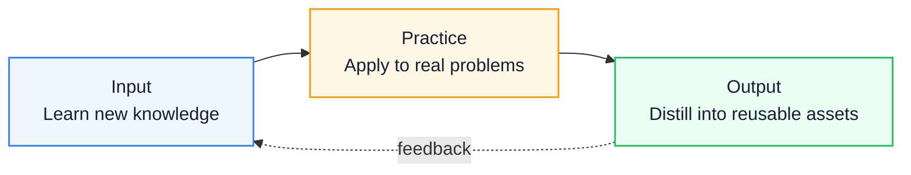

# Technical Growth Path: Capability Leaps from Junior to Architect

Years accumulate; capability sometimes does not. The usual explanation is insufficient effort, but a more common cause is that the object of work never changed.

This article divides growth by that object—code, feature, system, domain, business—and examines what each leap replaces, where people stall, and when changing teams actually helps. It is written for engineers who can already ship features and want to know why the next level feels out of reach. By the end, you can place yourself on the curve, test whether a move would produce a real leap, and pick one action that raises the complexity of your next task.

::: info In one sentence
Technical growth is a series of "capability leaps," not a smooth climb. Each leap upgrades the object of your work from a concrete thing to a more abstract system.
:::

## Table of Contents

- [Before We Start](#before-we-start)
- [1. The Non-linear Nature of Technical Growth](#_1-the-non-linear-nature-of-technical-growth)
- [2. Core Characteristics of the Five Stages](#_2-core-characteristics-of-the-five-stages)
- [3. Junior → Intermediate: From "Can Write" to "Writes Well"](#_3-junior-→-intermediate-from-can-write-to-writes-well)
- [4. Intermediate → Senior: From Feature to System Thinking](#_4-intermediate-→-senior-from-feature-to-system-thinking)
- [5. Senior → Expert: From Implementation to Design Abstraction](#_5-senior-→-expert-from-implementation-to-design-abstraction)
- [6. Expert → Architect: From Technology to Global Vision](#_6-expert-→-architect-from-technology-to-global-vision)
- [7. The Compounding Effect of Technical Growth](#_7-the-compounding-effect-of-technical-growth)
- [Conclusion: A Leap Is Not About Working Harder, but Upgrading the Object of Work](#conclusion-a-leap-is-not-about-working-harder-but-upgrading-the-object-of-work)
- [FAQ](#faq)
- [Sources](#sources)

## Before We Start

### 1. A Common Assumption

Many frontend engineers carry an implicit assumption when planning their careers: as long as they keep learning technology and shipping projects, capability will rise linearly over time, and they will eventually become architects.

That assumption does not survive inspection. If every year brings the same kind of problem, ten years of experience may be the same year repeated ten times. Years accumulate familiarity; they do not automatically add complexity.

### 2. This Article's Judgment and Main Line

This article treats technical growth as an upgrade of the object of work: from a piece of code, to a feature, to a system, to a domain, to a business. Each upgrade changes the value produced, the scope of judgment, and the amount of uncertainty by one notch.

The main line follows a decision order: why growth is non-linear, how the five stages and four leaps compare, which constraints appear as plateaus and environment effects, and what actions follow under which conditions. The diagram below gives the five-stage skeleton:

```mermaid
flowchart LR
    subgraph Stage1["Junior"]
        S1["Work object: a piece of code<br/>Value: complete tasks"]
    end

    subgraph Stage2["Intermediate"]
        S2["Work object: a feature<br/>Value: independent delivery"]
    end

    subgraph Stage3["Senior"]
        S3["Work object: a system<br/>Value: own a business line"]
    end

    subgraph Stage4["Expert"]
        S4["Work object: a domain<br/>Value: cross-team influence"]
    end

    subgraph Stage5["Architect"]
        S5["Work object: a business<br/>Value: define direction"]
    end

    Stage1 -->|Write well| Stage2
    Stage2 -->|System thinking| Stage3
    Stage3 -->|Abstract design| Stage4
    Stage4 -->|Global vision| Stage5

    classDef wait fill:#EEF6FF,stroke:#3B82F6,color:#172033,stroke-width:1.5px;
    classDef work fill:#ECFDF3,stroke:#22C55E,color:#172033,stroke-width:1.5px;
    classDef metric fill:#F5E8FF,stroke:#A855F7,color:#172033,stroke-width:2px;
    classDef core fill:#172033,color:#fff,stroke:#172033,stroke-width:2px;

    class Stage1,S1,Stage2,S2 wait;
    class Stage3,S3 work;
    class Stage4,S4 metric;
    class Stage5,S5 core;
```



The words on the arrows are leap conditions, not job titles. To place yourself, look at the object of work, not the title; the same title often covers different objects.

---

## 1. The Non-linear Nature of Technical Growth

Accept a counterintuitive fact first: **technical capability and years of experience have a stepwise relationship, not a linear one**.

Plot capability on the vertical axis and years on the horizontal axis, and the curve looks closer to a set of plateaus with occasional jumps:


Plateaus and leaps alternate. A plateau is where you get comfortable with the current object; the leap is where the capability curve jumps. Doing only plateau work flattens the curve.

This non-linearity has two direct implications:

1. **A plateau cannot be broken by working harder.** Working harder at the current stage only brings you closer to the ceiling; the ceiling itself does not rise.
2. **A leap must be actively designed.** Leaps do not happen on their own. You have to change the object of work and the scope of judgment.

---

## 2. Core Characteristics of the Five Stages

Before the specific leaps, put the five stages side by side. The table is a reference for what follows; the years are common experience ranges.

| Stage | Object of Work | Core Capability | Value Output | Typical Experience Range |
| --- | --- | --- | --- | --- |
| Junior | A piece of code | Implement clear tasks | Complete development tasks | 0-2 years |
| Intermediate | A feature | Deliver a module independently | Complete a feature independently | 2-4 years |
| Senior | A system | Design technical solutions | Own a business line | 4-6 years |
| Expert | A domain | Drive across teams | Platformization | 6-8 years |
| Architect | A business | Global trade-offs | Define technical direction | 8+ years |

The core question differs at each stage:

- Junior: how do I write this feature?
- Intermediate: how do I write it well enough for others to maintain?
- Senior: how should this system be designed to support the business over the next one or two years?
- Expert: what are the common problems in this domain, and can they be solved through platformization?
- Architect: where should this business's technical investment go?

The four leaps below answer how to move from one question to the next.

### Can a Change of Environment Produce a Leap?

Before changing teams or companies, pass three questions:

- Is the current team still producing problems of higher complexity?
- Have you already handled the typical problems of your current stage independently?
- Can the target environment offer the next object of work, or only a higher title?

If the first two answers are no, changing environment probably only changes colleagues. A move becomes a leap condition only when the target actually offers a new object of work.

---

## 3. Junior → Intermediate: From "Can Write" to "Writes Well"

### 1. What the Leap Changes

A junior engineer's core capability is writing a feature: given a clear design and API contract, produce runnable code.

An intermediate engineer's core capability is writing it well: maintainable, testable, extensible, with edge cases and exceptions handled independently.

This leap moves from "implementing a feature" to "implementing an engineered feature."

### 2. Key Transformations

#### Transformation 1: From "As Long As It Runs" to "Maintainable Code"

Junior code usually runs, but mixes implementation, requests, notifications, and error handling together:

```javascript
// Typical junior code: runs but is hard to maintain
function handleSubmit() {
  const name = document.getElementById('name').value
  const age = document.getElementById('age').value
  if (name && age) {
    fetch('/api/user', {
      method: 'POST',
      body: JSON.stringify({ name, age })
    }).then(res => {
      if (res.ok) {
        alert('Success')
      } else {
        alert('Failed')
      }
    })
  }
}
```

Intermediate code separates concerns and handles failure explicitly:

```typescript
// Intermediate code: abstracted, typed, with error handling
interface UserData {
  name: string
  age: number
}

async function createUser(data: UserData): Promise<Result<User, ApiError>> {
  try {
    const response = await fetch('/api/user', {
      method: 'POST',
      body: JSON.stringify(data)
    })
    if (!response.ok) {
      return { ok: false, error: await parseApiError(response) }
    }
    return { ok: true, value: await response.json() }
  } catch (e) {
    return { ok: false, error: { type: 'network' } }
  }
}

async function handleSubmit(values: FormValues) {
  const result = await createUser(values)
  if (result.ok) {
    notify.success('Created successfully')
  } else {
    notify.error(formatApiError(result.error))
  }
}
```

Both snippets keep only the differences relevant to the leap; definitions such as `Result`, `parseApiError`, and `notify` are omitted. The difference is not knowing TypeScript, but a shift on three levels:

- **Typed thinking**: clarify the shape of the data before writing the implementation
- **Error-handling thinking**: every external call can fail, so failure is explicit
- **Abstract thinking**: API calls, UI notifications, and form submission are separate concerns

#### Transformation 2: From "Works for Me" to "Others Can Take Over"

Junior engineers often write code only they can understand: abbreviated names, magic numbers, implicit dependencies, and no explanation.

Intermediate engineers ask, "If I leave, how long would someone else need to take over?" Specific behaviors:

- Clear naming; avoid `data1`, `temp`, or `handle`
- Comments explain why the code is written this way, not what it does
- Public functions have a short description of parameters and return values
- Complex business logic has a brief design note

#### Transformation 3: From "Tested It, Should Be Fine" to "Protected by Tests"

A junior's testing is often a few manual clicks plus "should be fine."

An intermediate engineer writes unit tests that at least cover core logic:

- Utility functions have complete tests
- Key business paths have coverage
- Edge cases have explicit tests

### 3. Key Turning Point

The turning point is usually the first time you take over someone else's code for a long period.

When you spend days understanding code nobody maintains, you start asking why it was written that way. That question is when you begin moving from "can write" to "writes well."

### 4. Common Bottlenecks

#### Bottleneck 1: Stuck in Framework Documentation

Many juniors assume intermediate means knowing more framework APIs, so they chase new features in React, Vue, and Angular. The direction is wrong: more APIs do not make code easier to maintain.

**Breakthrough**: pick a feature you recently wrote and ask a senior engineer for a deep Code Review. Ask "why is this not good," not "which API should I learn next."

#### Bottleneck 2: Stagnant Business Understanding

Juniors are easily consumed by implementation and do not ask what business goal the requirement serves. After a year, they still write code according to the PRD.

**Breakthrough**: once a week, ask yourself what user problem this requirement solves, and write the answer down. Over time, that becomes business judgment.

---

## 4. Intermediate → Senior: From Feature to System Thinking

### 1. What the Leap Changes

An intermediate engineer's object of work is a feature, delivered independently from design to launch.

A senior engineer's object of work is a system: how features combine, how data flows, and how the system supports the business over time.

This leap moves from a feature perspective to a system perspective.

### 2. Key Transformations

#### Transformation 1: From "Implementing Requirements" to "Designing Technical Solutions"

An intermediate engineer's first reaction to a requirement is how to implement it. A senior engineer's first reaction is how it will affect the system:

- What new data does it introduce?
- How does that data relate to existing data?
- How might it extend in the future?
- Can it reuse existing underlying capabilities?

Take "add batch export to the user list" as an example. The intermediate approach is to add a button, call an API, generate an Excel file, and trigger a download. The senior approach answers several questions first:

- Will this later expand to PDF export or selected columns? If so, abstract a unified export capability.
- How large is the data? Synchronous export or an asynchronous task? Large volumes need backend taskization and frontend polling.
- How is export permission controlled? Reuse the existing permission system rather than building a second one.
- How are failures reported? Are retries and observable metrics needed?

The difference is not implementation ability, but whether the system impact has been thought through before writing code.

#### Transformation 2: From "Local Optimum" to "Global Trade-off"

An intermediate optimization is often local: the component renders slowly, so add `memo`.

A senior engineer first asks:

- Why is it slow: a data structure problem or a design problem?
- Does `memo` treat the symptom or the cause? Will it introduce a memory problem?
- Without optimization, what is the real impact on user experience?
- Is the investment proportional to the payoff?

#### Transformation 3: From "Writing Well Myself" to "Team Standards"

An intermediate engineer can write good code but is responsible only for their own code. A senior engineer copies personal quality into the team:

- Define a Code Review checklist
- Drive commit conventions, lint rules, and test coverage thresholds
- Design the team's stack and directory standards
- Lead technical talks and documentation

### 3. Key Turning Point

The turning point is usually the first time you independently own a complete business module.

Designing a technical solution from scratch, planning for extension, and aligning with multiple parties forces the shift from feature to system.

### 4. Common Bottlenecks

#### Bottleneck 1: Insufficient Technical Depth to Locate Root Causes

An intermediate engineer can locate which component is slow, but not why. The latter requires understanding the browser rendering pipeline, framework scheduling, and the V8 execution model.

**Breakthrough**: pick a real performance problem, start from DevTools, and dig into the rendering pipeline, framework source, and runtime. Write the process down.

#### Bottleneck 2: Lack of Cross-Functional Alignment

Intermediate engineers are used to handling things themselves; senior engineers align frequently with product, backend, and QA. That shift is painful for many people.

**Breakthrough**: take on a cross-functional project such as a complex requirements review, cross-platform integration, or incident retrospective. These scenarios force alignment practice.

#### Bottleneck 3: Business Understanding Stuck at "Implementing the PRD"

Identifying edge cases is not the same as understanding the business. Without business judgment, a technical solution is easily over-engineered or under-designed.

**Breakthrough**: spend time understanding the core metrics, user personas, and business model of your business line, then revisit which technical investments actually moved those metrics.

::: warning Common misconception

Equating "knowing more tools" with senior capability. Knowing Webpack, Vite, and Turbopack is breadth; making the right choice for a specific scenario and owning the result is senior capability.
:::

---

## 5. Senior → Expert: From Implementation to Design Abstraction

### 1. What the Leap Changes

A senior engineer's object of work is a system: designing technical solutions and owning a business line.

An expert's object of work is a domain: commonalities across systems, platform capabilities, and cross-team influence.

This leap moves from solving specific problems to recognizing patterns and abstracting them.

### 2. Key Transformations

#### Transformation 1: From "Solving Problems" to "Eliminating Problems"

A senior engineer solves a specific problem: this page is slow, so optimize it.

An expert identifies the pattern: why are pages across the team generally slow? Is the engineering system missing, are standards inadequate, or is the component library design wrong?

Suppose five business lines each implement "paginated table + filters + export."

- Senior engineer: refactor the five implementations into one shared component
- Expert: recognize this as a common back-office problem and design configuration capability so non-core businesses can generate it

The difference: a senior engineer removes duplication; an expert removes the cause of duplication.

#### Transformation 2: From "Technical Solution" to "Domain Design"

A senior engineer designs a technical solution: how to implement, which stack, how to extend.

An expert designs a domain model: what the core concepts are, where businesses differ, and what reusable model captures the difference. Common abstraction directions:

- A component library distinguishes base, composite, and business components instead of piling up components
- A monitoring system separates performance, stability, and business metric layers instead of piling up metrics
- An engineering platform divides build, deploy, monitor, and governance instead of piling up tools

#### Transformation 3: From "Within-Team Influence" to "Cross-Team Influence"

A senior engineer's influence stays inside the business line. An expert must drive work across teams:

- Lead cross-team technical projects such as unified login, performance governance, or shared component libraries
- Participate in decisions at the technical committee level
- Influence other teams' technical direction

The key to cross-team drive is identifying each team's needs, finding a win-win, and pushing in a form they can accept. Technical strength alone is not enough.

### 3. Key Turning Point

The turning point is usually the first time you lead a cross-team project.

When within-team communication no longer moves a cross-team project, you move from "explaining the technology" to "identifying interests and designing a win-win."

### 4. Common Bottlenecks

#### Bottleneck 1: Stagnant Technical Depth

Many senior engineers stop early in technical depth: they can locate common performance problems but are helpless with abnormal GC behavior, cross-process communication cost, or JIT deoptimization.

**Breakthrough**: choose one or two low-level domains for deep penetration, such as the full V8 execution pipeline, Chromium rendering architecture, or HTTP/3. That depth becomes judgment authority in cross-team settings.

#### Bottleneck 2: Lack of Abstraction Ability

Senior engineers are used to solving concrete problems; abstraction needs deliberate practice.

**Breakthrough**:

- After solving a common problem, ask whether the whole class of problems can be eliminated
- Lead one platform project such as a component library, toolchain, or low-code platform
- Learn Domain-Driven Design to understand how to abstract a domain model from business

#### Bottleneck 3: Insufficient Cross-Team Drive

This is the most common bottleneck from senior to expert: strong technical work that cannot move across teams.

**Breakthrough**:

- Lead a cross-team project and identify early which teams must cooperate, what each cares about, and where resistance lies
- Before each cross-team meeting, prepare an "other side's view": why should they cooperate, and what concerns do they have
- Review each collaboration to find your recurring communication blind spots

---

## 6. Expert → Architect: From Technology to Global Vision

### 1. What the Leap Changes

An expert's object of work is a domain: platform construction and cross-team influence within it.

An architect's object of work is a business: trade-offs across domains, technical direction, and accountability for business outcomes.

This leap moves from technical optimum to global optimum.

### 2. Key Transformations

#### Transformation 1: From "Technology-Driven" to "Business-Driven"

An expert's technical decisions often aim at technical optimum: better performance, more extensibility, cleaner design.

An architect's decisions aim at business optimum and start with:

- How much does this technical investment affect business metrics?
- Are the people, time, and maintenance costs reasonable?
- Does it fit the business direction for the next one or two years?
- If the direction changes, how large is the sunk cost?

Take "should we build our own state management library" as an example. The expert view sees a better fit, better performance, and more control. The architect view first estimates two things: how many person-months development and ongoing maintenance require, and whether the business will become complex enough within a year to justify it. If not, an open-source solution plus an adapter may fit better.

#### Transformation 2: From "Single-Domain Depth" to "Cross-Domain Trade-offs"

An expert has depth in one domain and tends to center cross-domain decisions on it. An architect trades off across domains:

- Performance versus development efficiency
- Stability versus iteration speed
- Technical advancement versus team adoption
- Short-term gain versus long-term investment

A trade-off means identifying what matters most to the business and letting the rest compromise.

#### Transformation 3: From "Technical Leadership" to "Organizational Leadership"

An expert's leadership shows in technical direction: which stack, how systems are designed.

An architect's leadership shows at the organizational level:

- How team structure is designed: by business line, technical domain, or platform
- How talent is composed across senior, intermediate, and junior levels
- How the stack evolution roadmap is planned: what to invest in and what to retire
- How team effectiveness is measured, beyond lines of code, through business results, engineering quality, and talent growth

### 3. Key Turning Point

The turning point is usually the first time you are fully accountable for a business outcome.

When you are responsible not only for completing a technical project but for metrics such as GMV, retention, or conversion, your perspective expands from technology to the combination of business, organization, and technology.

### 4. Common Bottlenecks

#### Bottleneck 1: Technical Inertia

Many experts still view problems from a technical angle after becoming architects: when the business proposes a requirement, the first reaction is how to implement it, not whether it is worth doing.

**Breakthrough**:

- Join business planning meetings to understand strategy and priorities
- Establish regular communication with business leaders, not only technical requests
- Learn business analysis methods such as user funnels, ROI, and business models

#### Bottleneck 2: Lack of Organizational Design Ability

An architect designs not only technical architecture but team architecture. This is a blind spot for many experts.

**Breakthrough**:

- Learn Conway's Law and how system and team architecture influence each other
- Observe the strengths and weaknesses of functional, business, and platform teams
- Participate in team building, hiring, and performance review design

#### Bottleneck 3: Losing Technical Sensitivity

Some architects become busy with business and organizational work, their technical judgment declines, and they end up only drawing diagrams.

**Breakthrough**:

- Keep a fixed block of technical time, for example one day per week with no meetings, for Code Review, root-cause work, or technical research
- Hold regular 1:1s with frontline engineers to hear real technical problems
- Keep one technical domain under continuous study so you do not disconnect from code

::: warning Common misconception

Thinking an architect is someone who draws architecture diagrams. A diagram is only an artifact; the core ability is making trade-offs across uncertain dimensions and owning the result.
:::

---

## 7. The Compounding Effect of Technical Growth

The previous sections covered leaps, but leaps do not happen from nothing. What supports them is accumulation during plateaus, and accumulation depends on compounding.

### 1. The Three Elements of Compounding: Input, Practice, Output

Compounding in technical growth comes from a closed loop of three links:



The three links connect end to end; break one and compounding stops. Input without practice fades quickly, and practice without output stays with one person.

#### Input: Learning New Knowledge

Input is not scrolling tech news; it is learning with a target. Roughly three levels:

- **Passive input**: articles and video tutorials, low retention
- **Systematic input**: classic books, official documentation, source code, medium retention
- **Problem-driven input**: learning with a concrete problem, such as reading the React SSR implementation to fix a hydration issue, highest retention

The core of effective input is learning with a problem, not learning first and applying later.

#### Practice: Applying to Real Problems

Practice is the key link. Input without practice fades quickly.

Practice must involve a real problem: applying new knowledge under business constraints, not writing a demo. The complexity of a real problem exposes the blind spots in what you learned.

#### Output: Distilling into Reusable Assets

Output amplifies compounding. Practice without output stays personal experience; practice with output can become a reusable asset. Common forms:

- Technical articles or team talks: write down the process of solving a problem
- Open-source work or an internal component library: turn a general solution into code
- Technical standards or checklists: turn experience into team rules
- Training or mentorship: pass experience to others

### 2. The Non-linear Nature of Compounding

The return on compounding is not evenly distributed:

- Year 1: writing a technical note every week, with little visible improvement
- Year 2: old notes become references, and problem solving speeds up
- Year 3: accumulated notes combine into systematic articles or talks
- Year 5: systematic output creates domain recognition inside the team

These time points are observations, not promises. Many people stop before the inflection point: after a few months of notes with no visible effect, they quit. They often stop just before compounding starts to work.

### 3. An Engineering Method for Compounding

To put compounding into daily work, set a sustainable rhythm. The following is an example, not a standard:

- **A fixed weekly input block**: source code, official documentation, or a classic book
- **Several real-scenario applications per week**: use what you learn on problems with business constraints
- **A fixed monthly output**: a technical talk, an article, or a Code Review summary

One example rhythm is three hours of input per week, three real-scenario applications per week, and three outputs per month. The numbers are not the point; sustainability is. A few dozen hours crammed into a month usually beats nothing, but steady weekly investment usually beats bursts, because compounding depends on continuity rather than intensity.

---

## Conclusion: A Leap Is Not About Working Harder, but Upgrading the Object of Work

The useful question is not how hard you are working, but what complexity you currently solve and what object of work comes next.

The next leap rarely arrives as a promotion notice. It usually appears as a task you cannot fully handle yet: a requirement that asks you to design rather than implement, a project that asks you to drive across teams rather than finish alone. Decide whether to take it by asking whether it moves you from the current object of work to the next layer.

If you take one action, choose an object of work slightly above your current capability for the next six months, and define the verification signal in advance: after delivery, who can observe what change. Without that, more growth methodology only changes your posture inside the same plateau.

---

## FAQ

### 1. I have worked for four years and still do "implement the PRD" work. How do I break through?

First separate "the team gives no opportunity" from "I have not asked for one." If it is the team, state your growth request to your lead or ask to join a more complex project. If you have stayed in a comfort zone, take one extra step on the current requirement: consider extensibility, add tests, run a performance analysis. The point is not a new task type, but making the next task slightly more complex than the last.

### 2. Can multiple leaps happen inside one company?

Yes, under conditions. The business must keep producing higher-complexity problems, the team must have room you can compete for, and you must actively take on work above your current level. When all three hold, you do not need to change companies. When none holds, a move may help, but changing environment without changing the object of work still produces no leap.

### 3. Does an architect have to do management? How do I choose between the expert and management paths?

Architect and engineering manager are different directions. An architect makes technical trade-offs across uncertain dimensions; a manager gets results through a team. They overlap but do not replace each other.

Two questions help: would you rather spend time judging solutions or judging people and organization, and which failure can you tolerate more, a wrong technical judgment or a team result that misses? Both paths can reach a high level.

### 4. Does compounding really work? I wrote notes for a year and feel little improvement.

Seeing little in one year is normal; the inflection usually comes later. Also check output quality: is it copied from books, disconnected from practice, or too scattered to reuse? Reorganize scattered notes into "a complete solution to a specific problem" and compounding has a chance to start.

---

## Sources

The stage division and leap descriptions come from the author's synthesis of engineer growth paths at several internet companies. They are an experience model and do not correspond to any company's job ladder. The "input-practice-output" framework comes from long-term personal observation, not from empirical research. All year ranges are common experience ranges, not promotion thresholds; the timing of compounding inflection points is likewise an experience judgment with large individual variation.
