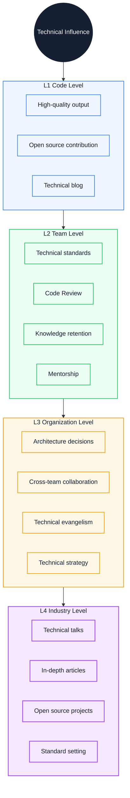
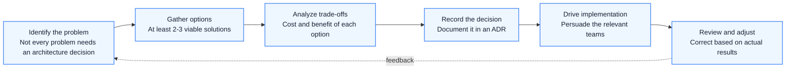

# Building Technical Influence: From Code Contribution to Technical Leadership

Proposals get rejected and cross-team projects stall for reasons that rarely sit in the design itself. The gap is usually influence: the ability to make more people and systems better because of your judgment. Influence is not the same as technical strength, and it is not a personality trait. It has layers, costs, and conditions.

This article maps four layers from code to industry, shows what each layer demands and what it costs, then examines technical leadership and the transition to management. You will finish able to locate your current scope and choose one realistic next move.

::: info In one sentence
Technical influence means making the value produced by your capabilities exceed the code you personally write — from "doing well yourself" to "making the system better" to "making the organization better."
:::

## Table of Contents

- [Before We Start](#before-we-start)
- [1. The Four-Layer Model of Technical Influence](#_1-the-four-layer-model-of-technical-influence)
- [2. Code Level: High-Quality Output and Open Source Contribution](#_2-code-level-high-quality-output-and-open-source-contribution)
- [3. Team Level: Technical Standards, Code Review, and Knowledge Retention](#_3-team-level-technical-standards-code-review-and-knowledge-retention)
- [4. Organization Level: Architecture Decisions, Cross-Team Collaboration, and Technical Evangelism](#_4-organization-level-architecture-decisions-cross-team-collaboration-and-technical-evangelism)
- [5. Industry Level: Technical Talks, Articles, and Open Source Projects](#_5-industry-level-technical-talks-articles-and-open-source-projects)
- [6. The Nature of Technical Leadership](#_6-the-nature-of-technical-leadership)
- [7. Transition Traps from Technical Expert to Technical Manager](#_7-transition-traps-from-technical-expert-to-technical-manager)
- [Conclusion: Influence Is an Amplifier, Not a Substitute](#conclusion-influence-is-an-amplifier-not-a-substitute)
- [FAQ](#faq)
- [Sources](#sources)

## Before We Start

### 1. Why Strong Technical Skills Can Still Produce Limited Influence

Many senior frontend engineers run into the same confusion: their technical ability is no longer weak, yet cross-team projects will not move and technical proposals are easily rejected.

The root is equating technical capability with technical influence. Technical capability answers "what I can do myself." Technical influence (Technical Influence) answers "how many people and systems become better because of my judgment." The two are related but distinct. A person can be technically strong with weak influence, or technically moderate and still able to raise a team.

### 2. This Article's Judgment and Main Line

The article first presents a four-layer influence model, then explains each layer's investment, measurement signal, and common mistake, and finally discusses technical leadership (Technical Leadership) and the risk of moving from expert to manager.

The main line follows a decision order: locate your current scope of influence, compare the payoff and cost of each layer, identify transition constraints, and derive conditional advice. The diagram below shows the overall structure:



The four layers describe scope, not a sequence you must complete in order. Most people move back and forth between adjacent layers: code output builds trust, team work widens scope, then they return to code to solve harder problems.

---

## 1. The Four-Layer Model of Technical Influence

Technical influence splits into four layers, each with a different scope, core capability, and measurement signal:

| Layer | Scope of Influence | Core Capability | Measurement Signal |
| --- | --- | --- | --- |
| L1 Code Level | Individual / small team | High-quality output | Code quality, defect rate, reuse |
| L2 Team Level | Entire team | Standards and knowledge retention | Team efficiency, code quality, talent growth |
| L3 Organization Level | Multiple teams | Architecture decisions and cross-team drive | Cross-team project results, organization-level metrics |
| L4 Industry Level | The industry | Thought output and ecosystem building | Industry recognition, open-source impact |

The layers are progressive, but you do not have to finish L1 before touching L2. Senior engineers mostly move between L1 and L2, experts between L2 and L3, and architects invest more in L3 and L4.

The model's practical use is locating: which layer your influence mainly sits on now, and which different way of working the next layer requires rather than more effort.

---

## 2. Code Level: High-Quality Output and Open Source Contribution

L1 is the foundation. If code quality is poor, no amount of communication or evangelism earns technical trust.

### 1. High-Quality Code Output

High-quality code usually has four traits:

- **Readability**: someone taking over can understand the main logic within one Code Review session
- **Maintainability**: a requirement change stays localized instead of touching the whole system
- **Testability**: core logic has coverage, so refactoring does not break behavior
- **Robustness**: edge cases and exceptions are handled

Two versions of a user list component differ not in how many APIs they use, but in whether state is modeled explicitly, async resources are managed, and concerns are separated:

```typescript
// Low-quality version: runs, but state and requests are tangled
function UserList() {
  const [users, setUsers] = useState([])
  const [loading, setLoading] = useState(false)

  useEffect(() => {
    setLoading(true)
    fetch('/api/users').then(res => res.json()).then(data => {
      setUsers(data)
      setLoading(false)
    })
  }, [])

  if (loading) return <div>loading...</div>
  return (
    <div>
      {users.map(u => <div key={u.id}>{u.name}</div>)}
    </div>
  )
}
```

```typescript
// High-quality version: explicit state, cancellable requests, handled errors
interface User {
  id: string
  name: string
}

interface UserListProps {
  onError?: (error: Error) => void
}

type UserListState =
  | { status: 'idle' }
  | { status: 'loading' }
  | { status: 'success'; users: User[] }
  | { status: 'error'; error: Error }

function UserList({ onError }: UserListProps) {
  const [state, setState] = useState<UserListState>({ status: 'idle' })

  useEffect(() => {
    const controller = new AbortController()

    setState({ status: 'loading' })
    fetchUsers(controller.signal)
      .then(users => setState({ status: 'success', users }))
      .catch(error => {
        if (error.name !== 'AbortError') {
          setState({ status: 'error', error })
          onError?.(error)
        }
      })

    return () => controller.abort()
  }, [onError])

  switch (state.status) {
    case 'idle':
    case 'loading':
      return <Skeleton />
    case 'error':
      return <ErrorFallback message={state.error.message} />
    case 'success':
      return (
        <List>
          {state.users.map(user => (
            <UserItem key={user.id} user={user} />
          ))}
        </List>
      )
  }
}
```

Both snippets keep only the implementation differences relevant to quality; definitions such as `fetchUsers`, `Skeleton`, `List`, and `UserItem` are omitted. The three improvements are:

- **State-machine thinking**: model states explicitly so `loading` and `error` cannot combine into an illegal state
- **Resource management**: use `AbortController` for races and unmount cleanup
- **Separation of concerns**: data fetching, UI rendering, and error handling stay independent

### 2. Open Source Contribution

Open source contribution amplifies L1 influence. Its value is not only merged code:

- **Credibility**: technical ability can be publicly verified
- **Collaboration proof**: you can move work in an unfamiliar team with existing conventions
- **Technical horizon**: exposure to different scenarios and design trade-offs

You do not have to maintain a widely followed project. From low to high barrier, a rough path is:

1. Fix documentation and small bugs: many projects label these `good first issue`
2. Fix functional bugs: understand the project, then fix a specific problem
3. Add features: extend capability based on the project's design principles
4. Maintain a submodule: own review and evolution for one module
5. Maintain your own project: from a utility library to a framework

Many engineers worry they are not good enough to contribute. Open source projects often lack people willing to do small work: fix docs, add tests, reproduce issues, join discussions. These contributions look small, but they build the foundation of trust.

::: warning Common misconception

Equating "can write complex code" with "high-quality code." Complexity often means unclear design; high-quality code is usually simpler because the abstraction is right.
:::

---

## 3. Team Level: Technical Standards, Code Review, and Knowledge Retention

The core of L2 influence is making your capability replicate across the team.

### 1. Technical Standards

Technical standards turn personal best practice into a team baseline. A useful standard should be:

- **Executable**: checkable by tools such as ESLint, TypeScript, or CommitLint
- **Justified**: every rule explains why, rather than "I think so"
- **Evolvable**: updated as the team and business change

A standard that only says "we use ESLint" has limited value. A useful frontend standard also covers:

- **Directory structure**: how modules are divided and where components and utilities live
- **State management**: when to use Context, Zustand, or Redux
- **API calls**: unified error handling, loading states, and caching
- **Testing**: what must be tested, coverage thresholds, and E2E scope
- **Commits**: message format, PR size limits, and review flow

The key is not how many rules you list, but explaining why and providing tool support. A rule without tooling is eventually forgotten.

### 2. Code Review Culture

Code Review is the most direct expression of L2 influence. A low-quality review only checks syntax:

```text
- A semicolon is missing here
- This variable name is misspelled
- This import is unused
```

A high-quality review looks at design and boundaries:

```text
- This component has too many responsibilities; consider splitting it into 3
- This state approach will fail in scenario X because of Y
- This error handling is not robust; what happens if the API times out?
- This abstraction is premature; there is only one usage scenario
```

Three principles shape the effect:

- **Target the code, not the person**: comments address the code, not the author
- **Explain why**: say which scenario breaks, not just that something is bad
- **Offer a direction**: point out the problem and the improvement

Review also needs proportion. Anything affecting production stability must be strict; maintainability issues are suggestions; personal style can be mentioned but not enforced.

### 3. Knowledge Retention

Knowledge retention turns tacit team knowledge into explicit, reusable assets. Tacit knowledge sounds like this:

- "This API needs special handling because the backend has a bug" — only the person who handled it knows
- "This component cannot change because a legacy business depends on it" — only the maintainer knows
- "This performance problem cannot be solved with X because of Y" — only the person who was burned knows

Ways to make it explicit:

- **Technical documentation**: core modules have design docs; key decisions have ADRs (Architecture Decision Records)
- **Incident postmortems**: production incidents record root cause, impact, and follow-up actions
- **Onboarding docs**: a newcomer can understand the system from documentation
- **Internal tech blog**: deep sharing from team members is preserved

### 4. Mentorship

Mentorship is the highest form of L2 influence, amplifying impact by developing others.

The key is helping the mentee grow, not only teaching technology:

- **Regular 1:1s**: a fixed cadence, discussing growth rather than only progress
- **Challenging tasks**: work slightly above current ability, with a safety net
- **Reflective feedback**: specific feedback after key events, not only "good job" or "bad job"
- **Career planning**: help the mentee see the next direction

---

## 4. Organization Level: Architecture Decisions, Cross-Team Collaboration, and Technical Evangelism

The core of L3 influence is getting multiple teams to move in the same direction.

### 1. Architecture Decisions

An architecture decision makes trade-offs across uncertain dimensions and persuades others to follow. An effective process looks like this:



The two steps most often skipped are "gather options" and "review." A decision with one option is persuasion; a decision without review cannot calibrate the next judgment.

#### Identify the Problem

Not every problem needs an architecture decision. Problems that justify the full process usually meet three conditions:

- They affect multiple teams
- They are hard to roll back, so changing the decision later is expensive
- There is no obvious optimum; several options have different trade-offs

Examples include whether to introduce micro-frontends, unify the state management library, or build an in-house component library. "React or Vue" usually does not qualify unless the whole organization needs one standard.

#### Gather Options

List at least two or three viable options, including "do nothing." A decision that lists one option is persuasion in disguise.

#### Analyze Trade-offs

Evaluate cost and benefit on at least four dimensions:

- **Technical**: performance, maintainability, extensibility
- **Organization**: learning cost, hiring cost, team acceptance
- **Business**: development efficiency, iteration speed, risk
- **Time**: short-term cost versus long-term payoff

#### Record the Decision

Use an ADR to record the decision. The example below illustrates structure only; its figures are not measurements:

```markdown
# ADR-001: Replace Webpack with Vite as the Build Tool

## Status
Adopted

## Context
- The team currently uses Webpack 5; build time for large projects exceeds 60s
- New projects are added frequently, and startup time affects developer experience
- The team is interested in Vite but lacks production validation

## Decision
New projects default to Vite; legacy projects stay on Webpack and are not actively migrated

## Alternatives
1. Migrate everything to Vite: high risk, large refactoring cost for legacy projects
2. Keep Webpack and optimize: limited benefit, does not solve the root problem
3. Explore Turbopack: not mature enough for production

## Consequences
- Pros: better development experience for new projects; faster startup and HMR feedback
- Cons: two build systems to maintain, increasing toolchain complexity
- Risks: Vite's stability on large projects needs ongoing observation
```

The value of an ADR is not recording the decision, but letting later engineers understand the context at the time. Context, alternatives, and consequences are all required; missing one turns the record into a bare conclusion.

### 2. Cross-Team Collaboration

Cross-team collaboration is the most direct test of L3 influence. When a project will not move, the cause is usually interests and communication rather than the technical design.

#### Identify Stakeholders

Before launch, list every stakeholder:

- Who benefits?
- Who bears the cost?
- Who decides?
- Who may resist?

#### Design a Win-Win

A good cross-team project lets every participant gain. When only one side gains, progress is difficult.

Take a "company-wide frontend monitoring platform" as an example:

- Your team gains platform capability
- Operations gains unified observability
- QA gains traceability for production issues
- Business teams must integrate, which is a short-term burden and therefore the likely resistance

Corresponding moves:

- Minimize integration cost, for example a one-line SDK
- Give business teams immediate value, for example free performance reports
- Seek executive backing so business leaders recognize the long-term value

#### Communication Strategy

Cross-team communication cannot rely only on technical language. Different roles need different framing:

- For business leaders: efficiency gains and risk reduction
- For technical leaders: clearer architecture and lower maintenance cost
- For frontline engineers: integration cost and the concrete problems it solves

### 3. Technical Evangelism

Technical evangelism amplifies L3 influence by getting good practices adopted more widely. Common forms include internal talks, cross-team exchanges, a technical newsletter, and training.

The key is explaining where a practice fits and where it does not, not promoting a new technology. An evangelist who only says "this technology is great" leads the team into blind following.

---

## 5. Industry Level: Technical Talks, Articles, and Open Source Projects

The core of L4 influence is making your thinking affect the industry.

L4 is not mandatory. Many excellent architects spend their entire careers at L3. If you want to build L4 influence, the following paths are worth considering.

### 1. Technical Talks

Technical talks are the most direct form of L4 influence. A good talk usually has:

- **Insight**: what pattern you found, not which technology you used
- **System**: systematic thinking, not scattered tips
- **Cases**: real engineering practice, not empty theory
- **Disagreement**: a willingness to express a different view and start discussion

Common problems to avoid: excessive self-deprecation lowers professionalism, excessive marketing annoys the audience, excessive detail loses the main line, and excessive abstraction prevents application.

### 2. In-Depth Articles

In-depth articles are the foundation of L4 influence. Compared with talks, articles have advantages:

- Indexable: searchable, with long-term value
- Deep: can carry a complex argument without a time limit
- Iterable: can be revised as feedback arrives

Writing principles:

- **Have an insight before writing**: do not write for the sake of writing
- **Clear structure**: let readers locate the part they need
- **Sufficient evidence**: arguments have data or cases
- **Acknowledge limits**: state where the conclusion applies and where it does not

### 3. Open Source Projects

L4 open-source work differs from L1 contribution. L1 contributes code to a project; L4 maintains a project with influence.

Maintaining an open-source project requires:

- **A clear vision**: what the project solves and does not solve
- **Design principles**: the project's design philosophy, preventing unbounded feature growth
- **Community building**: attracting contributors, handling issues, responding to PRs
- **Sustainability**: avoiding burnout and building a maintainer team

Many good open-source projects stop because maintainers burn out, not because the technology failed. Sustainability is therefore the most underestimated capability at this layer.

### 4. Standard Setting

The highest level of L4 influence is participating in industry standards, such as W3C proposals, ECMA proposals, or industry specifications.

Very few people reach this level. Treat it as a direction to know, not a required career step.

---

## 6. The Nature of Technical Leadership

Technical leadership is often misunderstood as "the strongest technical person becomes the leader." That misses the core: technical leadership is making the team perform at its best, not performing best yourself.

### 1. Technical Leadership Versus Technical Capability

Technical capability is solving problems yourself; technical leadership is enabling the team to solve more problems. The differences:

| Dimension | Technical Capability | Technical Leadership |
| --- | --- | --- |
| Value output | Code you write | The team's overall output |
| Focus | How to implement | Who implements and how to collaborate |
| Measurement | Code quality, technical depth | Team effectiveness, talent growth |
| Time horizon | The current task | Long-term evolution |

### 2. Three Levels of Technical Leadership

#### Level 1: Technical Direction Leadership

Define the team's technical direction:

- Which technology stack the team should use
- How the system should evolve
- Which technical debt should be repaid first

#### Level 2: Technical Decision Leadership

Make the call at critical points:

- Which option to choose when several have trade-offs
- How to balance business pressure against technical principles
- How to unify direction when views diverge

#### Level 3: Technical Talent Leadership

Develop the team's technical capability:

- Identify each engineer's short board
- Design challenging task assignments
- Provide mentorship and feedback
- Help members grow

Many technical experts who become leaders do only the first two levels and skip the third. The team's dependence on them grows, they get busier, and the team gets weaker.

### 3. Core Principles of Technical Leadership

#### Principle 1: Make the Team Not Need You

A good technical leader ultimately makes themselves unnecessary: the team can still make the right decision when they are absent.

That means not becoming a single-point decision bottleneck, delegating to the person closest to the situation, and cultivating the team's own judgment.

#### Principle 2: Have Judgment on Key Issues

Delegation is not the absence of judgment. On architecture direction, key technology choices, and talent placement, a technical leader must have a clear view, or the team loses direction.

#### Principle 3: Own the Team's Mistakes

When the team fails, the technical leader takes responsibility rather than pushing it to the executor. That is the foundation of trust.

---

## 7. Transition Traps from Technical Expert to Technical Manager

Many technical experts at L3 or L4 face a choice: continue on the expert track or move into management. Choosing management brings six common traps.

### Trap 1: Using "Strongest Technically" as a Substitute for Management

A new technical manager still treats being the strongest as the core value: handling key problems personally, over-intervening in review details, and giving the standard answer early in discussions.

**Problem**: the team depends on you more, your time runs short, and team growth stalls.

**Breakthrough**: switch from "solving problems myself" to "guiding the team to solve them." Even when the first attempt is imperfect, let them try.

### Trap 2: Losing Technical Sensitivity

Some managers become busy with meetings, reporting, and organizational work, and their technical judgment declines quickly.

**Problem**: without technical judgment, they cannot add value on key decisions and become a megaphone.

**Breakthrough**:

- Keep a fixed block of technical time, for example one day per week with no meetings
- Keep participating in Code Review; you do not have to write code, but you should read it
- Hold regular 1:1s with frontline engineers to hear real problems
- Keep one technical domain under continuous study

### Trap 3: Using "Process" as a Substitute for Trust

New managers often fall into building process: weekly reports, weekly meetings, OKRs, and KPIs one after another.

**Problem**: too much process removes initiative; everyone completes process instead of delivering results.

**Breakthrough**: process is a tool, not a goal. Before adding one, ask what problem it solves. If the answer is unclear, do not build it.

### Trap 4: Avoiding Conflict

Many technical managers avoid difficult decisions: giving negative feedback, rejecting an unreasonable requirement, or handling conflict inside the team.

**Problem**: avoiding short-term conflict creates larger long-term problems. The team loses direction, low performers drag the group, and reasonable needs keep getting squeezed.

**Breakthrough**: switch from "avoiding conflict" to "constructive conflict." Direct but respectful disagreement is more efficient than talking around the issue and earns more respect.

### Trap 5: Treating "Upward Reporting" as the Core Job

Some managers spend most of their energy pleasing superiors: polished slides and beautiful reports.

**Problem**: the team concludes that you only talk and do not deliver, and trust erodes.

**Breakthrough**: upward reporting is necessary but not central. The center is getting results from the team. Good results provide material; poor results cannot be rescued by a polished report.

### Trap 6: Forgetting You Were an Engineer

Some managers adopt only a manager's perspective and lose empathy for engineers.

**Problem**: engineers feel you have changed and no longer represent them.

**Breakthrough**: remember how it felt to be an engineer: pressured by unreasonable requirements, frustrated by a vague PRD, and woken up by a production incident. That empathy is the foundation of good technical management.

### Decide: Stay on the Technical Track or Move into Management

Before deciding, answer three questions:

- Are you willing to spend most of your time judging people, assigning work, and owning team results?
- Can you accept that your own technical output is no longer the main source of value?
- Does your organization really have management roles, or only a title?

If two or more answers are no, staying on the technical track is usually the better fit. Both paths can reach high influence; management is not the only exit from a technical career.

::: warning Common misconception

Thinking management means abandoning technology. Good technical managers keep technical sensitivity and simply stop writing all the code themselves. Management completely disconnected from technology eventually loses the trust of the technical team.
:::

---

## Conclusion: Influence Is an Amplifier, Not a Substitute

The useful way to understand technical influence is to separate it from technical capability. Technical capability decides whether you can solve a problem; influence decides how many people can reuse your judgment after it is solved. The first is the base, the second is the amplifier; without the base, the amplifier only amplifies empty talk.

The four-layer model is not a ladder that must be climbed to the top. L1 must be solid, L2 is the main ground for most senior engineers, L3 is the main ground for experts and architects, and L4 depends on opportunity and interest. An L2 engineer can also demonstrate technical leadership: helping colleagues grow through Code Review, improving team efficiency through standards, and developing newcomers through mentorship.

The next step is not to start evangelizing or launch a cross-team project immediately. Answer one question first: what would the team's current work look like without you? Whatever appears in that answer is your real influence today. To expand it, start from that part and push one layer outward.

---

## FAQ

### 1. I am an L2 engineer and want to build influence. Where do I start?

Code Review is the easiest start. Take reviews proactively and move the focus from syntax to design and boundaries. At the same time, pick one small area to standardize and document, such as the team's utility library. Mentorship can begin with onboarding newcomers; no formal relationship is required, and helping them solve problems is already the prototype.

### 2. A cross-team project will not move. Is it a technical problem or a communication problem?

Diagnose before attributing. Check four things: whether every stakeholder is identified, whether the design benefits each participant, whether you use language the other side accepts, and whether enough decision-makers support it. The more of these are missing, the more likely the issue is collaboration. Only after these conditions hold does the technical design become the deciding factor.

### 3. Does open source contribution really help career development?

It helps, with conditions: the contribution is real rather than padding a PR count, it relates to your growth direction, and you can extract judgment from it rather than only saying "I submitted N PRs." The main value is proof of collaboration and a wider technical horizon; resume credit is incidental. Being able to explain what you learned from a contribution is more convincing in an interview than listing project counts.

### 4. Does technical leadership require management?

No. Technical leadership can be demonstrated on the IC (Individual Contributor) track: influencing team decisions through technical direction, helping the team grow through Code Review and mentorship, and driving organizational improvement through cross-team projects. Whether to move into management depends on whether you prefer influencing through your own work or through a team.

---

## Sources

This article is based on industry practice and the author's experience. The four-layer influence model references common paths of engineer influence building at several technology companies; the technical leadership section references the transition experience of several technical managers. No publicly verifiable external data is cited. The model is an experience framework, not an industry standard. The ADR example is constructed to illustrate structure and does not represent a real project record.
