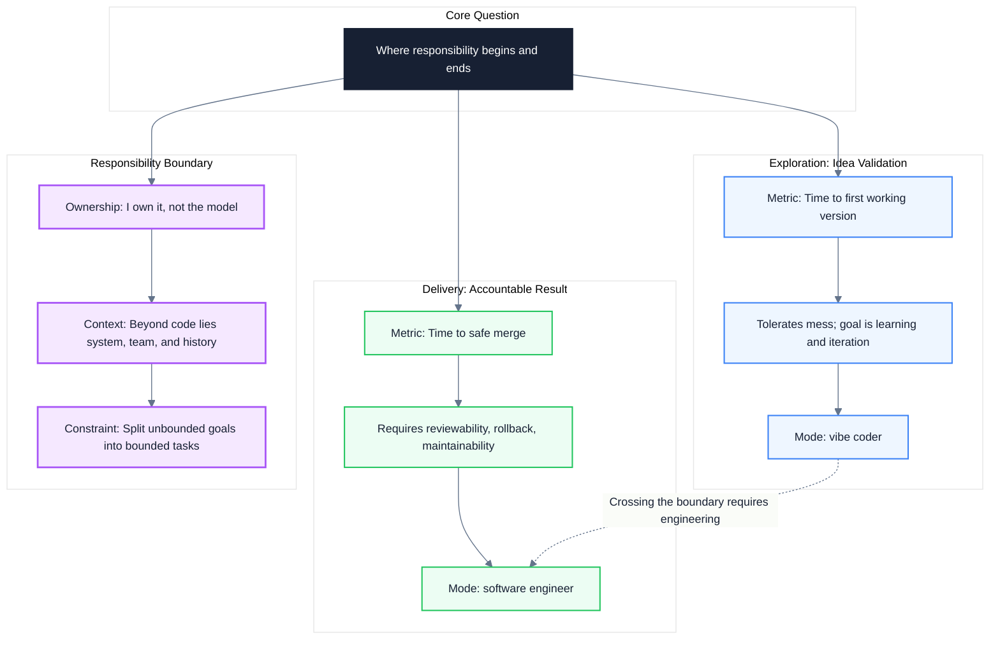

# Vibe Coder vs Software Engineer: The Boundary of Responsibility in the AI Era

> Subtitle: Starting from the phenomenon of vibe coding, re-examining responsibility, review cost, and delivery discipline in AI-assisted development
>
> Target readers: mid-to-senior software engineers, tech leads, and engineering managers introducing AI-assisted development workflows
>
> Reading time: about 15 minutes

::: info In one sentence
The boundary is where responsibility begins and where it ends. When the main output is idea validation, vibe coders are useful; when the main cost is accountability, you need a software engineer.
:::

## Table of Contents

- [1. The Wrong Metric](#1-the-wrong-metric)
- [2. Output Is Not Progress](#2-output-is-not-progress)
- [3. AI Cannot Take Responsibility for You](#3-ai-cannot-take-responsibility-for-you)
- [4. Context Is More Than Files](#4-context-is-more-than-files)
- [5. Vibe Coding Fits Some Stages of the Delivery Process, but Not Everywhere](#5-vibe-coding-fits-some-stages-of-the-delivery-process-but-not-everywhere)
- [6. The Apprenticeship Problem](#6-the-apprenticeship-problem)
- [7. The Difference](#7-the-difference)
- [8. Unified Model: The Boundary of Responsibility Between Exploration and Delivery](#8-unified-model-the-boundary-of-responsibility-between-exploration-and-delivery)
- [9. Practice Checklist](#9-practice-checklist)
- [Conclusion: Choose the Mode, Not the Camp](#conclusion-choose-the-mode-not-the-camp)
- [FAQ](#faq)
- [Sources](#sources)

## 1. The Wrong Metric

Much of the discussion around vibe coding measures the wrong thing. What people show off is "how fast I went from idea to running app." That has value, especially when you only want to validate an idea. But inside a real development team, someone always has to review it. Someone has to understand the intent behind it. Someone has to judge whether that dependency belongs there. Someone has to check whether the tests actually verify behavior. Someone has to handle schema changes. Someone has to coordinate this change across teams. Someone has to roll it back. Someone has to write the runbook. Someone has to respond to alerts.

None of these jobs belongs to a toy project.

So the metric for evaluating AI-generated work has to change: **time to safe merge**. It covers reviewability, risk, test quality, ownership, rollback capability, and whether the author can explain the key decisions in this change. If AI makes code generation cheaper but makes safe merge more expensive, the team gains far less than it thinks.

The vibe coder measures time to first working version; the software engineer measures time to safe merge. In the exploration stage, time to first working version is useful; once you enter a shared codebase, time to safe merge is the required metric. It covers review cost, testing cost, release cost, rollback cost, coordination cost, and future maintenance cost.

::: tip Core conclusion of this section
A demo is not the right finish line. It proves something can be shown, not that the team can accept it. The real cost inside a shared codebase is time to safe merge.
:::

::: warning Common misconception
Treating "prompt to running prototype" speed as overall team efficiency hides the hidden downstream cost of review, fixes, and operations.
:::

---

## 2. Output Is Not Progress

AI-assisted code should be better, not more. The tool lets you generate more content, so people have to constrain it more. Otherwise you are not saving work; you are just pushing it downstream and making maintenance someone else's problem. AI-assisted code cannot be held to a different standard. It has to meet the same bar as hand-written code.

So it should be convergent. It should have one reason to exist. It should not carry unrelated cleanups. It should not reformat half a file just because the model "felt like it." It should not add a package without a clear explanation.

If a change is large because the model generated too much, split it. The model is happy to produce a pile of boilerplate for something ten lines could handle. If the author cannot say why every meaningful file changed, it is not ready. That is basic ownership.

The second distinction is the unit of work. The vibe coder treats generated output as progress; the software engineer treats any change as a unit of accountability. Generated output can be large, messy, and temporary. Real change management cannot be that casual. It has to be focused enough to review, explainable enough to trust, and bounded enough that merging it does not drag half the system down with it. Speed either becomes useful because of this, or it turns into review debt.

::: tip Core conclusion of this section
The output unit for AI-assisted code should be a "mergeable change," not "what the model generated." Progress is measured by the explainability and maintainability of the change.
:::

::: info Engineering insight
Before committing, do a proactive shrinking pass on generated output: remove unrelated changes, split large diffs, add tests and explanations. This is the minimum bar for turning generated content into engineering output.
:::

---

## 3. AI Cannot Take Responsibility for You

Reviewing generated code is not the same as reviewing human-written code. When a person writes code, there is usually a chain of decisions behind it. It may be flawed, but at least one person can explain the path. You can ask them why they used that abstraction, why they put the rule there, why they chose that package, why the test was written that way.

With AI-generated code, some of the so-called "decisions" are not decisions at all; they are completions. If the author has not turned the generated result into something they truly own, the reviewer is doing two things at once: reviewing, plus reconstructing the author's intent.

Ownership is the third distinction. The vibe coder can say the model generated it; the software engineer has to say, this is on me. That means before requesting review, the author has to convert generated content into an engineering decision. The code may start with the model, but responsibility cannot stop at the model.

::: tip Core conclusion of this section
Review rights cannot replace ownership. The model can provide a starting point, but only the engineer is responsible for design decisions, risks, and ongoing maintenance.
:::

::: warning Common misconception
Thinking "I reviewed it" equals "I own it." Review is a quality mechanism; accountability is the dividing line of engineering identity.
:::

---

## 4. Context Is More Than Files

Models can read a lot of code now. That does not mean they understand the system. Part of the context lives in the code, but a lot of engineering context lives elsewhere: in incidents, in old migrations, in customer behavior, in operational pain points, in team conventions, in security requirements, in compliance rules, and in those strange decisions made in the past.

If you do not give it to the model, it does not have it. Even if you do, it does not carry that context the way an engineer does. It runs inside its own context window. The larger the task, the more likely the model is to optimize locally and cause damage globally.

So "just let it fix the whole thing" is both a bad habit and, at this stage, genuinely not very effective. A better approach is to narrow the decision space before letting it write code. Models do better when the request is more specific. But more specific about what? It requires the author to actually understand what they are doing.

Experienced engineers get the most value from AI by giving the model less freedom, not more. Freedom is for weekend tinkering; production needs constraints.

This is the fourth distinction. The vibe coder gives the model a goal; the software engineer gives the model a bounded task. Real engineering happens inside that bounded task: use this interface, do not touch this layer, and so on. A good prompt is not magic here. It usually just shows that the engineer already understands the boundaries.

::: tip Core conclusion of this section
Engineering context is distributed across systems, teams, and history beyond the code. Breaking large goals into bounded tasks is the key constraint that makes AI output usable.
:::

::: info Engineering insight
Explicitly stating "what not to do" in a prompt often cuts downstream review cost more than stating "what to do."
:::

---

## 5. Vibe Coding Fits Some Stages of the Delivery Process, but Not Everywhere

Andrew Kelley, the creator of Zig, said in an interview that the project bans AI contributions and broadly calls them garbage. What the maintainers see is a flood of AI-generated pull requests stuffed with unrelated changes, broken legacy behavior, strange dependency additions, and contributors who cannot even explain the code they submitted.

But the chaos they describe is not a verdict on AI; it is what happens when vibe coding crosses the line. So the question is not whether to ban it, but where to place it.

This is the fifth distinction: **exploration versus delivery**. The same pull request that costs a maintainer an entire afternoon is harmless when you are building a prototype to validate an idea. No one is accountable for that throwaway code. Exploration tolerates mess, because the goal is learning, or rapid iteration around an idea. Delivery cannot tolerate unexplained mess, because the goal is a real business outcome. You cannot say we have a 99.9% correctness rate. Sometimes, it just has to be correct. That is where the real boundary lies.

This line also moves. As tools get stronger in testing, rollback, and review, some of the cost of safe merge will fall. But falling is not disappearing. As long as someone still has to be responsible for the result, a certain level of discipline has to remain. Use vibe coding where the cost of failure is low; use engineering discipline where the cost of failure is borne by customers, the team, or the business.

::: tip Core conclusion of this section
Exploration tolerates mess because the goal is learning; delivery cannot tolerate unexplained mess because the goal is an accountable business outcome.
:::

::: warning Common misconception
Equating "it runs" with "it can ship." Between demo-grade code and production-grade code lie the costs of review, testing, rollback, operations, and long-term maintenance.
:::

---

## 6. The Apprenticeship Problem

Junior engineers will use AI, and they should. Used well, it can explain code, compare approaches, generate examples, and accelerate learning. But there is a downside.

If junior engineers use AI to avoid understanding the system, they may deliver more while learning less. That is a bad trade. The first few years of an engineering career are exactly when people build their mental models. That model has to be built inside their own head; it cannot be borrowed from a machine.

You do not build judgment by staying outside the system and letting the model fix problems for you. This is also one of the hardest parts for managers to handle. AI may make junior engineers look more productive in the short term, but it weakens the learning loop that turns them into strong engineers. Kelley's deeper reason for banning AI in Zig is related to this. He called code review "contributor poker": the way the project finds people worth growing into core team members. AI submissions break this, because contributors are not really learning the codebase or absorbing feedback.

One last point. Engineering requires a certain degree of apprenticeship. Vibe coding tempts you to work alone; but people work and learn inside a team. Software engineers improve their craft by collaborating with others. Work is not just writing code; work is judgment: judging what is risky and what is not. That judgment comes from contact with the system and with people.

::: tip Core conclusion of this section
AI can accelerate learning, or it can replace learning. A junior engineer's growth depends on contact with the system, the codebase, and team feedback, not on continuous reliance on model output.
:::

::: info Engineering insight
Give junior engineers an "explain first, generate second" exercise: before invoking the model, describe the problem, constraints, and expected changes in their own words.
:::

---

## 7. The Difference

When the main output is idea validation, vibe coders are useful. They can shorten the distance from idea to clickable prototype. Many ideas deserve this treatment first, before deciding whether to invest real engineering capacity.

When the main cost is accountability, you need a software engineer. They control what enters the system, how it is reviewed, how it is protected, how it is tested, how it is operated, and how it will be changed going forward. This distinction is operational, and it is not a fixed identity. The same person should vibe-code during the exploration stage and switch to engineering mode during the delivery stage.

The key skill is knowing which mode you are currently in, and not letting the habits of one mode leak into the other. Vibe coding can help you learn faster; software engineering can help you avoid paying for that learning forever.

::: tip Core conclusion of this section
Vibe coder and software engineer are two modes, not two kinds of people. Recognizing the current mode and honoring its discipline is the core marker of engineering maturity in the AI era.
:::

---

## 8. Unified Model: The Boundary of Responsibility Between Exploration and Delivery

The previous sections examined six angles: metric, unit of work, ownership, context boundary, stage fit, and apprenticeship. They can be unified into one model: a spectrum along "accountability," separating the idea-validation exploration stage from the accountable-delivery engineering stage.

### Exploration Phase

In the exploration phase, the main output is idea validation. Vibe coding can quickly turn an idea into a clickable, discussable prototype. The metric here is time to first working version, and a certain degree of mess is allowed, because the goal is learning and iteration.

### Delivery Phase

In the delivery phase, the main cost is accountability. Software engineers have to ensure changes are reviewable, testable, rollback-capable, and operable. The metric here is time to safe merge, and discipline matters more than speed.

### Boundary of Responsibility

The transition between the two phases does not happen on its own. It depends on three things: the author taking ownership of the output, understanding engineering context beyond the code, and breaking large goals into bounded tasks. When these conditions are met, generated content can move from the exploration phase into the delivery phase.

::: tip Core conclusion of this section
The main axis of the unified model is the moving boundary of responsibility, not the opposition between human and tool. Recognizing the current phase and fulfilling its discipline is an expression of engineering judgment.
:::

---

## 9. Practice Checklist

### Metrics

- [ ] Include "time to safe merge" in the team's efficiency evaluation of AI-assisted development
- [ ] When showing prototype speed, also estimate the downstream review, testing, and rollback costs
- [ ] Refuse to treat "time to first working version" as the only efficiency metric in a shared codebase

### Change Management

- [ ] Before every commit, check whether generated content contains unrelated changes or auto-formatting noise
- [ ] Split oversized AI-generated changes into multiple independently reviewable commits
- [ ] Ensure every modified file can be explained with one sentence describing the reason for the change

### Ownership and Review

- [ ] Before requesting review, turn model output into your own engineering decision and write it into the description
- [ ] When reviewing AI-generated code, focus on design intent and boundary conditions, not just syntax
- [ ] Make clear that "review approved" does not equal "responsibility transferred"; the author remains accountable for follow-up issues

### Context Control

- [ ] State both "what to do" and "what not to do" in prompts to narrow the model's decision space
- [ ] For tasks involving historical decisions, compliance requirements, or operational constraints, proactively add context from outside the code
- [ ] Do not let the model directly handle open-ended tasks like "fix the whole system"

### Stage Separation

- [ ] At the start of a task, clearly label whether it belongs to the exploration phase or the delivery phase
- [ ] Before exploration-phase output enters a shared codebase, it must go through the review discipline of the delivery phase again
- [ ] Reserve vibe coding space for low-cost-of-failure scenarios; enforce engineering discipline for high-cost scenarios

### Team Growth

- [ ] Give junior engineers an "explain first, generate second" practice routine
- [ ] Preserve the feedback loop in code review so AI submissions do not bypass the learning process
- [ ] Regularly review how AI-generated code performs in long-term maintenance and adjust usage strategy

---

## Conclusion: Choose the Mode, Not the Camp

AI is not another programming language, nor another framework. What it changes is the economics of software development: the cost of generating code is falling, but the costs of reviewing, understanding, maintaining, and being accountable for it are not disappearing in the same proportion. So the real question shifts from "can it be written?" to "who is responsible for it?"

The difference between a vibe coder and a software engineer is therefore not an identity label, but a choice of working mode. The exploration stage needs speed, tolerates mess, and aims at learning; the delivery stage needs discipline, explainability, and accountable outcomes. The same person can vibe-code in the morning and switch to engineering mode in the afternoon. The mark of maturity is knowing which mode you are in and following the rules of that mode.

Tools will keep getting stronger, and the boundary will keep moving, but the line of accountability will not disappear.

> **The boundary is where responsibility begins and where it ends. When the main output is idea validation, vibe coders are useful; when the main cost is accountability, you need a software engineer.**

---

## FAQ

### 1. Is vibe coding an unprofessional way of developing?

No. It is a mode suited for idea validation and rapid learning. The problem arises when it is used in scenarios that require accountable delivery, without adding engineering discipline. Professionalism lies in knowing when to use which mode.

### 2. If AI-generated code passes all tests, can it be safely merged?

Passing tests is only one condition for merging. You also need reviewers to understand the design intent, confirm boundary conditions, evaluate dependency changes, check rollback capability, and make sure the author is willing to be responsible for follow-up issues. Tests cover known behavior; engineering responsibility covers unknown risks.

### 3. How should junior engineers use AI without harming their growth?

Treat AI as a tool for explanation and comparing approaches, not as a shortcut around understanding. Before generating code, describe the problem, constraints, and expected changes in your own words; after generating, manually walk through and explain each line. Managers should preserve the feedback loop in code review.

### 4. How should a team draw the boundary between vibe coding and engineering delivery?

Start from "cost of failure": allow unconstrained vibe coding only in personal or isolated environments. Before entering a shared codebase, a user environment, or a production path, it must go through a reviewable, testable, rollback-capable engineering process. Stage separation should be made explicit at the start of a task.

### 5. If the same person both explores and delivers, how can they avoid mixing up the habits?

Use explicit switching signals: set up separate branches or directories for exploration tasks and label them as "prototypes"; before switching to delivery, force a cleanup pass that includes removing unrelated files, adding tests, and writing explanations. The key is not to let temporary exploration artifacts default into the delivery process.

---

## Sources

1. Yusuf Aytaş. *Vibe Coder vs Software Engineer*: [https://yusufaytas.com/vibe-coder-vs-software-engineer](https://yusufaytas.com/vibe-coder-vs-software-engineer)
2. Yusuf Aytaş. *The Invisible Difference*: [https://yusufaytas.com/the-invisible-difference](https://yusufaytas.com/the-invisible-difference)
3. Yusuf Aytaş. *Managers Have Been Vibe Coding All Along*: [https://yusufaytas.com/managers-have-been-vibe-coding-all-along](https://yusufaytas.com/managers-have-been-vibe-coding-all-along)
