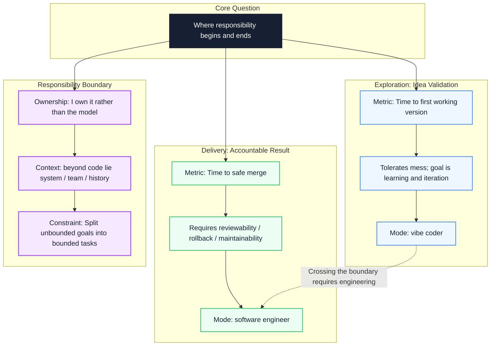

# Vibe Coder vs Software Engineer: The Boundary of Responsibility in the AI Era

AI has made a runnable prototype cheap. It has not made review, rollback, maintenance, or accountability cheap. Much of the vibe coding debate conflates the two, measuring how fast an idea becomes an app while ignoring what it costs a team to accept the result.

This article uses time to safe merge as the yardstick, compares exploration and delivery as two modes with different discipline, and marks where one must become the other. You will finish able to classify a task, choose the right mode, and check the four conditions that allow generated work into delivery.

::: info In one sentence
The boundary is where responsibility begins and where it ends. When the main output is idea validation, vibe coders are useful; when the main cost is accountability, you need a software engineer.
:::

## Table of Contents

- [1. The Wrong Metric](#_1-the-wrong-metric)
- [2. Output Is Not Progress](#_2-output-is-not-progress)
- [3. AI Cannot Take Responsibility for You](#_3-ai-cannot-take-responsibility-for-you)
- [4. Context Is More Than Files](#_4-context-is-more-than-files)
- [5. The Applicable Boundary of Vibe Coding](#_5-the-applicable-boundary-of-vibe-coding)
- [6. The Apprenticeship Problem](#_6-the-apprenticeship-problem)
- [7. The Difference](#_7-the-difference)
- [8. Unified Model: The Boundary of Responsibility Between Exploration and Delivery](#_8-unified-model-the-boundary-of-responsibility-between-exploration-and-delivery)
- [9. Practice Checklist](#_9-practice-checklist)
- [Conclusion: Choose the Mode, Not the Camp](#conclusion-choose-the-mode-not-the-camp)
- [FAQ](#faq)
- [Sources](#sources)

## 1. The Wrong Metric

Much of the discussion around vibe coding measures the wrong thing. People show how fast they went from idea to running app. That has value when the goal is to validate an idea, but inside a real team the work does not end there.

Someone has to review it, understand the intent behind it, judge whether that dependency belongs here, and check whether the tests verify behavior. Others have to handle a schema change, coordinate the change across teams, prepare a rollback, write the runbook, and respond to alerts.

None of those jobs belongs to a toy project.

So the metric for AI-generated work has to change: **time to safe merge**. It covers reviewability, risk, test quality, ownership, rollback capability, and whether the author can explain the key decisions in the change. When AI makes code generation cheaper but makes safe merge more expensive, the team gains less than it thinks.

The vibe coder measures time to first working version; the software engineer measures time to safe merge. In exploration, the first metric is useful. Once code enters a shared repository, safe merge becomes the required metric, because it includes review, testing, release, rollback, coordination, and future maintenance.

::: warning Common misconception

Treating "prompt to running prototype" speed as overall team efficiency hides the downstream cost of review, fixes, and operations.
:::

---

## 2. Output Is Not Progress

AI-assisted code should be better, not more. The tool lets you generate more, so the human has to constrain more. Otherwise you are not saving work; you are pushing it downstream and making maintenance someone else's problem. AI-assisted code cannot be held to a different standard; it must meet the same bar as hand-written code.

It should therefore be convergent. It has one reason to exist, carries no unrelated cleanup, does not reformat half a file because the model felt like it, and does not add a dependency without a clear explanation.

When a change is large because the model generated too much, split it. The model will happily produce a pile of boilerplate for something ten lines could handle. If the author cannot say why every meaningful file changed, the change is not ready for review. That is basic ownership.

The second distinction is the unit of work. A vibe coder treats generated output as progress; a software engineer treats every change as a unit of accountability. Generated output can be large, messy, and temporary.

Change management cannot be that casual. A real change has to be focused enough to review, explainable enough to trust, and bounded enough that merging it does not drag half the system down. Speed then becomes useful; otherwise it turns into review debt.

---

## 3. AI Cannot Take Responsibility for You

Reviewing generated code is not the same as reviewing code a person wrote. Human code usually has a decision chain behind it. It may be flawed, but at least one person can explain the path: why that abstraction, why the rule sits there, why this package, why the test is written that way.

With AI-generated code, some so-called decisions are not decisions at all; they are completions. If the author has not turned the output into something they own, the reviewer does two jobs at once: reviewing, and reconstructing the author's intent.

Ownership is the third distinction. A vibe coder can say the model generated it; a software engineer has to say, this is mine to answer for. Before requesting review, the author has to convert generated content into an engineering decision. The code may start with a model, but responsibility cannot stop there.

::: warning Common misconception

Thinking "I reviewed it" equals "I own it." Review is a quality mechanism; accountability is the dividing line of engineering identity.
:::

---

## 4. Context Is More Than Files

Models can read a lot of code now. That does not mean they understand the system. Part of the context lives in the code, but much of the engineering context lives elsewhere: in incidents, old migrations, customer behavior, operational pain points, team conventions, security requirements, compliance rules, and strange decisions made in the past.

If you do not provide it, the model does not have it. Even when you do, it carries context differently from an engineer: it runs inside a limited context window, and the larger the task, the more likely it is to optimize locally and break something globally.

So "just let it fix the whole thing" is both a bad habit and, at this stage, not very effective. A better approach is to narrow the decision space before letting it write code. Models do better with a specific request, but being specific requires the author to understand what they are doing.

Experienced engineers get the most value from AI by giving it less freedom, not more. Freedom suits weekend tinkering; production needs constraints.

That is the fourth distinction. A vibe coder gives the model a goal; a software engineer gives it a bounded task. Real engineering happens inside that boundary: use this interface, do not touch this layer. A good prompt is not magic; it usually shows that the engineer already understands the boundary.

---

## 5. The Applicable Boundary of Vibe Coding

The Zig project's restrictions on AI-generated contributions are often discussed. Maintainers describe a flood of AI-generated pull requests: unrelated changes, broken legacy behavior, strange dependency additions, and contributors who cannot explain what they submitted.

That chaos is not a verdict on AI; it is what happens when vibe coding crosses the line. The question is not whether to ban it, but where to place it.

This is the fifth distinction: **exploration versus delivery**. The same pull request that costs a maintainer an afternoon may be harmless during prototype validation, because nobody is accountable for that throwaway code.

Exploration tolerates mess. The goal is learning, or rapid iteration around an idea.

Delivery cannot tolerate unexplained mess, because the goal is an accountable business result. Some scenarios can accept a 99.9% correctness rate; others simply have to be correct. That is where the line sits.

The line also moves. As tools improve at testing, rollback, and review, some of the cost of safe merge falls, but it does not disappear. As long as someone remains accountable for the result, some discipline has to remain. Use vibe coding where the cost of failure is low; use engineering discipline where the cost of failure is borne by customers, the team, or the business.

---

## 6. The Apprenticeship Problem

Junior engineers will use AI, and they should. Used well, it explains code, compares approaches, generates examples, and accelerates learning. Used badly, it replaces learning.

If a junior uses AI to avoid understanding the system, they may deliver more while learning less. That is a bad trade. The first years of an engineering career are when mental models are built. The model has to be built in the person's own head; it cannot be borrowed from a machine indefinitely.

Judgment does not grow by standing outside the system and letting the model fix problems. AI may make a junior look more productive in the short term while weakening the learning loop that turns them into a strong engineer. This is one reason some projects restrict AI contributions: code review is not only a quality gate but also how a project identifies and develops long-term contributors. An AI submission can bypass that, because the contributor has not understood the codebase or absorbed the feedback.

Engineering also still needs apprenticeship. Vibe coding tempts you to work alone, but people work and learn inside teams.

Software engineers improve their craft by collaborating. The job is not only writing code; it is judgment about what is risky and what is not. That judgment comes from sustained contact with the system and with people.

---

## 7. The Difference

When the main output is idea validation, vibe coders are useful. They shorten the distance from idea to clickable prototype. Many ideas deserve that treatment before anyone invests real engineering capacity.

When the main cost is accountability, you need a software engineer. They control what enters the system, how it is reviewed, protected, tested, operated, and changed later. The distinction is operational, not a fixed identity. The same person should vibe-code during exploration and switch to engineering mode during delivery.

The key skill is knowing which mode you are in and not letting the habits of one leak into the other. Vibe coding can help you learn faster; software engineering can help you avoid paying for that learning forever.

---

## 8. Unified Model: The Boundary of Responsibility Between Exploration and Delivery

The previous sections covered six angles: metric, unit of work, ownership, context boundary, stage fit, and apprenticeship. They can be unified into one model: a spectrum along accountability, separating the idea-validation exploration stage from the accountable-delivery stage.

Read the diagram from the core question downward: exploration on one side, delivery on the other, with the responsibility boundary deciding whether a crossing is allowed. The dashed edge is the only entrance; exploration output enters delivery not by spending more time, but by satisfying the conditions on that boundary at the same time.

### Four Conditions for Entering Delivery

Generated work enters the delivery stage only when all four conditions hold:

- The author can explain every changed file, rather than saying "the model generated it"
- Critical behavior has tests that verify it, not only "it ran locally"
- The change can be rolled back independently, without reverting half the system
- Someone explicitly owns post-release maintenance, including alerts and incident handling

If any condition is missing, the work is still in exploration. This test is more reliable than "does the code look usable," because it checks responsibility rather than appearance.

---

## 9. Practice Checklist

Each item below maps to an action you can perform now or check afterward.

### Measurement

- [ ] Record the time one AI-assisted change takes from submission to merge, and compare it with a similar hand-written change
- [ ] When reporting AI productivity, include prototype time plus review, testing, and rollback cost
- [ ] In team efficiency discussions, separate "time to first working version" from "time to safe merge"

### Change Boundaries

- [ ] Check the diff file by file before committing and remove unrelated formatting or cleanup
- [ ] Split an AI-generated change that cannot be reviewed in one pass into several commits
- [ ] Write one sentence explaining each modified file; if you cannot, revert it

### Ownership and Review

- [ ] State the key design decisions and known risks in the PR description instead of only pasting the output
- [ ] When reviewing AI-generated code, ask at least one question about a boundary condition
- [ ] Confirm the maintenance owner before merging, so "review approved" does not mean "nobody is responsible"

### Context Control

- [ ] Explicitly list which files or layers must not change in the prompt
- [ ] When historical decisions, compliance, or operational constraints are involved, add that background to the context first
- [ ] Break unbounded tasks like "fix the whole system" into verifiable smaller goals

### Stage and Growth

- [ ] Label a task as "exploration" or "delivery" at the start; run a delivery review before exploration output enters a shared repository
- [ ] Ask junior engineers to describe the problem, constraints, and expected change before calling the model
- [ ] In incident retrospectives, check whether an AI-generated change introduced the issue and update the usage rules

---

## Conclusion: Choose the Mode, Not the Camp

AI changes not the programming language but the economics of software development: generating code gets cheaper, while reviewing, understanding, maintaining, and owning it does not fall by the same amount. The real question shifts from "can it be written" to "who is responsible for it."

The difference between a vibe coder and a software engineer is therefore a choice of working mode, not an identity label. The same person can vibe-code in the morning and switch to engineering mode in the afternoon. Maturity is knowing which mode you are in and following its rules.

The next useful step is to take one current task and run it through the four conditions. If it is already in a shared repository and a condition fails, fix that before continuing. If it is still exploration, keep the speed but isolate the output from the delivery flow. Tools will keep improving and the boundary will keep moving; the line of accountability will not disappear.

---

## FAQ

### 1. If AI-generated code passes all tests, can it be merged safely?

Passing tests is only one merge condition. Reviewers also need to understand the design intent, confirm boundary conditions, evaluate dependency changes, check rollback capability, and establish that the author will own follow-up problems. Tests cover known behavior; engineering responsibility covers unknown risk.

### 2. How should a team draw the boundary between vibe coding and engineering delivery?

Start from the cost of failure. Allow unconstrained vibe coding only in personal or isolated environments. Before code enters a shared repository, a user environment, or a production path, it must go through a reviewable, testable, rollback-capable engineering process. Make the stage explicit at the start of the task, not just before merging.

### 3. How should junior engineers use AI without harming their growth?

Treat AI as a tool for explanation and comparing approaches, not a shortcut around understanding. Before generating code, describe the problem, constraints, and expected change yourself; afterward, walk through the output and explain each key change. Managers should preserve the feedback loop in code review and not skip it because an AI submission looks faster.

### 4. If the same person both explores and delivers, how can they avoid mixing habits?

Give exploration tasks a separate branch or directory and label them as prototypes. Before switching to delivery, force a cleanup pass: remove unrelated files, add tests, and write the change explanation. The key is to prevent temporary exploration output from entering the delivery flow by default.

---

## Sources

1. Yusuf Aytaş. *Vibe Coder vs Software Engineer*: [https://yusufaytas.com/vibe-coder-vs-software-engineer](https://yusufaytas.com/vibe-coder-vs-software-engineer)
2. Yusuf Aytaş. *The Invisible Difference*: [https://yusufaytas.com/the-invisible-difference](https://yusufaytas.com/the-invisible-difference)
3. Yusuf Aytaş. *Managers Have Been Vibe Coding All Along*: [https://yusufaytas.com/managers-have-been-vibe-coding-all-along](https://yusufaytas.com/managers-have-been-vibe-coding-all-along)
