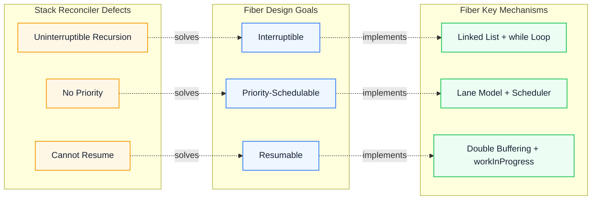
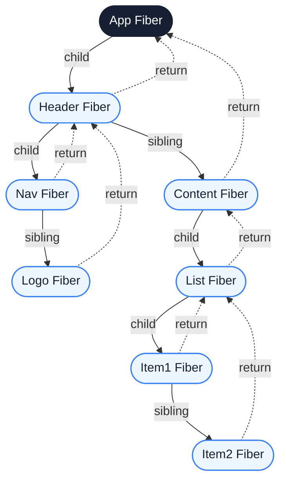
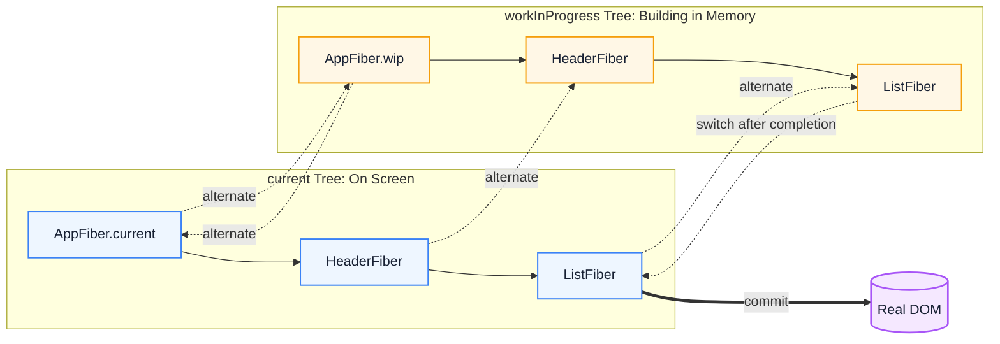
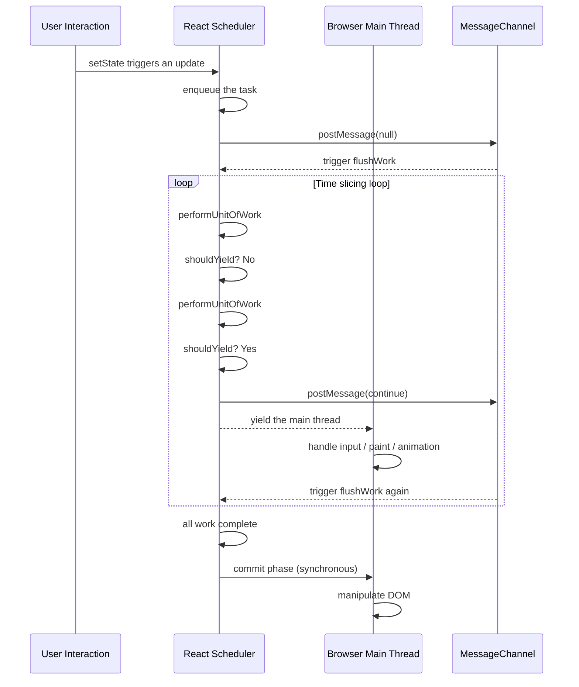
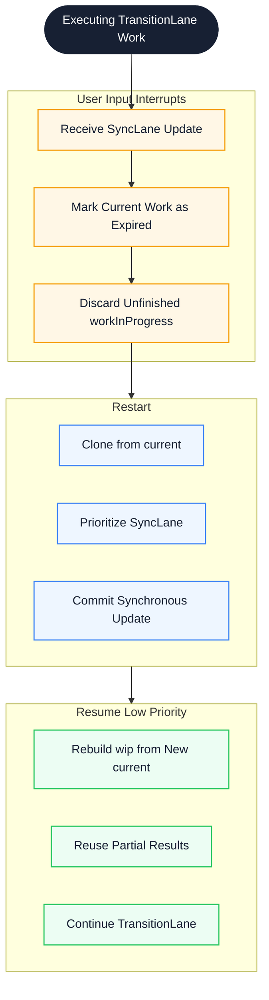
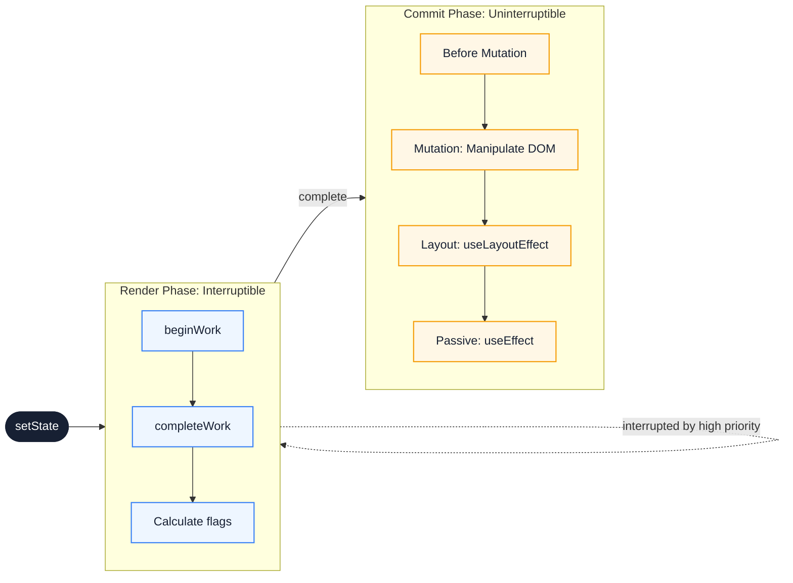
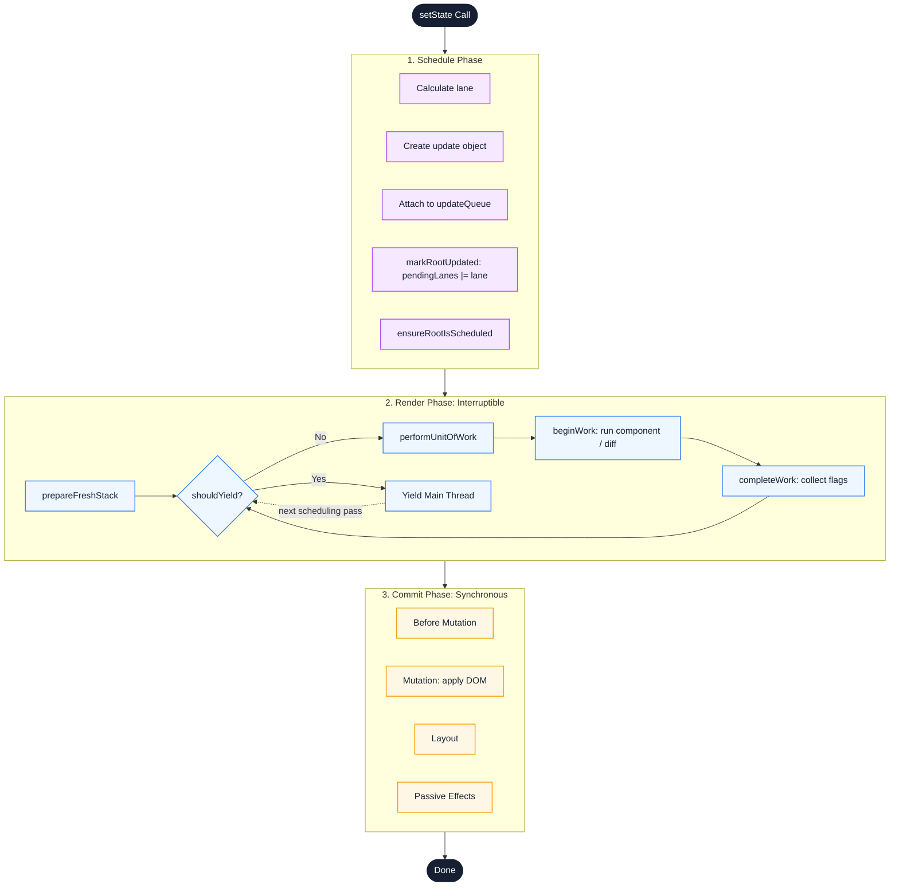

# React Fiber Architecture: From Stack Reconciliation to Interruptible Chain Rendering

A single `setState` can leave an input box unresponsive even when the update itself is cheap. The cause is not the amount of work but where it runs: once React starts reconciling a large tree, it cannot stop, so input handling waits behind rendering. This article follows that constraint from React 15's recursive reconciler through the linked-list Fiber node, the two-tree buffer, the time-slicing scheduler, and the Lane bitmap. It ends at the observable boundary: which work can be interrupted, which cannot, and what that means for code you write today.

::: info In one sentence
The essence of React Fiber is rewriting a recursively uninterruptible component tree into an interruptible, resumable, priority-schedulable linked list.
:::

## Table of Contents

- [Introduction](#introduction)
- [1. The Fundamental Problem of React 15 Stack Reconciler](#_1-the-fundamental-problem-of-react-15-stack-reconciler)
- [2. Fiber Design Motivations: Interruptible, Resumable, Priority-Schedulable](#_2-fiber-design-motivations-interruptible-resumable-priority-schedulable)
- [3. Fiber Node Data Structure: From Tree to Linked List](#_3-fiber-node-data-structure-from-tree-to-linked-list)
- [4. Double Buffering: current Tree and workInProgress Tree](#_4-double-buffering-current-tree-and-workinprogress-tree)
- [5. Time Slicing and MessageChannel: Letting the Main Thread Breathe](#_5-time-slicing-and-messagechannel-letting-the-main-thread-breathe)
- [6. Lane Model: Expressing Priority with Bit Operations](#_6-lane-model-expressing-priority-with-bit-operations)
- [7. The Essence of Concurrent Mode: Cooperative Scheduling, Not True Concurrency](#_7-the-essence-of-concurrent-mode-cooperative-scheduling-not-true-concurrency)
- [8. From setState to commit: The Flow of a Complete Update](#_8-from-setstate-to-commit-the-flow-of-a-complete-update)
- [9. Engineering Value and Cost of Fiber](#_9-engineering-value-and-cost-of-fiber)
- [Conclusion: Treat Fiber as a Scheduling Contract, Not a Performance Switch](#conclusion-treat-fiber-as-a-scheduling-contract-not-a-performance-switch)
- [FAQ](#faq)
- [Sources](#sources)

## Introduction

Many frontend engineers understand Fiber as "the new architecture introduced in React 16" and know that it "uses time slicing," but cannot clearly answer:

- Why is a recursive call stack uninterruptible? Why not just change it to a `while` loop?
- Why does a Fiber node split into a three-pointer linked list instead of continuing to use a tree?
- Is double buffering only about reusing memory?
- What exactly is `shouldYield` yielding?
- What does the Lane model solve compared with `expirationTime`?
- JavaScript is single-threaded, so where does the "concurrency" in Concurrent Mode come from?

Before answering those questions, fix the word **Reconciliation**. Reconciliation is the process in which React compares the old and new element trees and decides which nodes to create, update, or delete. It computes changes only and does not touch the DOM. Writing those changes into the DOM happens later in the commit phase. Fiber changes how the reconciliation phase executes.

The code below follows React 18's source structure with detail removed, keeping only the fields and branches that support the main line. It explains the mechanism and is not directly runnable.

## 1. The Fundamental Problem of React 15 Stack Reconciler

React 15's reconciler is called **Stack Reconciler**. Its workflow is direct: start at the root, recurse through the component tree, compare the two trees, record the differences, and commit them together.

```javascript
// Structure of Stack Reconciler, with diff details omitted
function reconcileChildren(parentFiber, children) {
  for (const child of children) {
    reconcileChild(parentFiber, child)
  }
}

function reconcileChild(parentFiber, child) {
  if (Array.isArray(child)) {
    reconcileChildren(parentFiber, child)
  } else {
    // create / update / delete a fiber, then continue recursing
    reconcileChildren(parentFiber, child.props.children)
  }
}
```

The implementation is simple, but it has a hard constraint: **once it starts, it must run to completion**.

### 1. Recursive Call Stacks Cannot Be Interrupted

The JavaScript call stack is managed by the engine, and developers cannot pause a running function. Once reconciliation enters `reconcileChildren`, it recurses down the component tree to the end.

For a large tree with thousands of nodes, the process can last tens to hundreds of milliseconds. During that window the main thread is fully occupied: clicks get no response, input fields stutter, and animations drop frames.

::: warning Key issue
It is not that React is slow, but that while React is working it cannot yield the main thread.
:::

### 2. Single Priority, No Cutting in Line

Stack Reconciler treats every update equally. A high-priority update triggered by user input must wait behind a low-priority update that has already started.

The result is counterintuitive: the click response is slow not because the click itself is complex, but because an unimportant update is already running in front of it.

### 3. Call Stack Depth Equals Component Tree Depth

Recursion makes the call stack grow with the component tree. The deeper the tree, the deeper the stack, and the harder error stacks become to read. This is not the main bottleneck, but it shows that the model leaves no room for stepwise execution.

All three problems point to one conclusion: Stack Reconciler lacks a model for pausing, resuming, and reordering work, not a performance trick.

## 2. Fiber Design Motivations: Interruptible, Resumable, Priority-Schedulable

Fiber's design goals can be summarized as three items, each corresponding to one defect of Stack Reconciler.



Read the dashed edges as cause: each defect motivates a goal, and each goal is implemented by a mechanism on the right. Interruptibility comes from the linked list and iteration, resumability from node-local context, and priority scheduling from the Lane model plus the scheduler.

### 1. Interruptible: Turning Recursion into Iteration

The direct way to make recursion interruptible is to turn it into a `while` loop and check inside the loop whether the main thread should be yielded.

Recursion keeps its context on the call stack. After switching to a loop, the call stack is gone, so where does the context come from?

The answer is to store the context in an object. That object is the Fiber node.

### 2. Resumable: Linked List Structure + Nodes Remember Context

A recursive function learns "who to process next" from the call stack. After switching to iteration, each node must remember three things:

- Who its parent is, so it knows where to return after processing itself;
- Who its first child is, so it knows where to descend;
- Who its next sibling is, so it knows where to go after finishing a subtree.

These are the three core Fiber pointers: `return`, `child`, and `sibling`.

### 3. Priority-Schedulable: Important Things First

Interruptibility and resumability are only the foundation. The real goal is priority scheduling. Fiber maintains a priority system (early versions used `expirationTime`; React began introducing the Lane model progressively from React 17) so that the scheduler can compare two updates, delay low-priority work, and let a high-priority update cut in.

Together, the three goals determine the implementation: replace the tree with a linked list, store context in objects, and let the scheduler decide when to yield. This is a cooperative scheduling system, not a one-off performance optimization.

## 3. Fiber Node Data Structure: From Tree to Linked List

Below is a simplified but structurally accurate Fiber node, with fields unrelated to the main line removed.

```javascript
function FiberNode(tag, pendingProps, key) {
  // Identity and type
  this.tag = tag              // FunctionComponent / ClassComponent / HostComponent / ...
  this.key = key
  this.type = null            // corresponding function / class / string such as 'div'
  this.pendingProps = pendingProps
  this.memoizedProps = null   // props used in the last render
  this.memoizedState = null   // hooks linked list / class instance state
  this.stateNode = null       // corresponding DOM node / class instance

  // Three pointers: turning a tree into a linked list
  this.return = null          // parent Fiber
  this.child = null           // first child Fiber
  this.sibling = null         // next sibling Fiber
  this.index = 0              // position among siblings

  // Double buffering
  this.alternate = null       // corresponding Fiber in the other tree

  // Effects
  this.flags = NoFlags        // Placement / Update / Deletion / ...
  this.subtreeFlags = NoFlags // accumulated flags of the subtree
  this.deletions = null       // child nodes pending deletion

  // Scheduling related
  this.lanes = NoLanes        // pending priority on this Fiber
  this.childLanes = NoLanes   // pending priority of the subtree
}
```

The word *effect* here does not mean React's `useEffect`. It means the DOM change marks recorded during reconciliation, such as insertion, update, or deletion. They live in `flags` and `subtreeFlags` and are executed only in the commit phase.

### 1. Three-Pointer Linked List: Each Node Only Remembers Three Neighbors

The critical design is `return / child / sibling`. Together they turn a tree into a structure that can be traversed one step at a time.



Solid edges are the downward path: descend through `child`, then move across through `sibling`. Dashed edges are the backtracking path through `return`. With these three edges, traversal no longer needs a call stack to know where to go next.

The work loop can then be written as follows.

```javascript
function workLoopSync(rootFiber) {
  let nextUnitOfWork = rootFiber
  while (nextUnitOfWork !== null) {
    nextUnitOfWork = performUnitOfWork(nextUnitOfWork)
  }
}

function performUnitOfWork(unitOfWork) {
  // 1. Process the current node: run the component function, compare props, etc.
  const next = beginWork(unitOfWork)
  if (next !== null) {
    return next // there is a child; process it next
  }

  // 2. No child: look for a sibling; if none, backtrack to the parent
  let node = unitOfWork
  while (node !== null) {
    completeWork(node)
    if (node.sibling !== null) {
      return node.sibling
    }
    node = node.return
  }
  return null // the whole tree has been traversed
}
```

The return value of `performUnitOfWork` is the next unit of work. This is the core of turning recursion into iteration: **the next unit of work is determined by pointers, not by the call stack**.

### 2. Scheduling Unit = Rendering Unit

A Fiber node is both a data carrier and a scheduling unit. The scheduler can decide how many nodes to process now, at which node to yield, and from which node to resume.

::: info Engineering insight
Every Fiber node carries its own context, which is why React can interrupt and resume at any node. It is also why hooks must be called in order: the hooks linked list lives on the Fiber's `memoizedState`, and a wrong order cannot be recovered.
:::

The value of the linked list is not memory savings but traversability and interruptibility. The three pointers flatten the tree into a workflow that advances one step at a time, and each Fiber is an independent unit of work.

## 4. Double Buffering: current Tree and workInProgress Tree

Fiber has a field that often confuses readers: `alternate`. It points to the corresponding Fiber in the other tree.

This is **double buffering**. React maintains two Fiber trees at the same time:

- The **current tree** is the tree currently displayed on screen; each node's `stateNode` points to the real DOM.
- The **workInProgress tree** is the next tree being built in memory.



The left side is the tree on screen; the right side is the tree being built in memory. Dashed edges are the mutual `alternate` links, and the thick arrow is the one-time commit into the DOM. Both trees exist at once, and the switch happens only after commit finishes.

### 1. Why Double Buffering?

The direct benefit is reusing Fiber objects. When an update is interrupted and restarted, React has two choices:

- Rebuild a completely new tree, which wastes memory;
- Reuse Fiber objects from the current tree and update only changed fields.

`alternate` lets React clone the workInProgress tree from the current tree. If a node was already built during an earlier attempt, it is reused directly.

```javascript
function createWorkInProgress(current, pendingProps) {
  let workInProgress = current.alternate
  if (workInProgress === null) {
    // First clone: create a new Fiber
    workInProgress = createFiber(current.tag, pendingProps, current.key)
    workInProgress.type = current.type
    workInProgress.stateNode = current.stateNode
    workInProgress.alternate = current
    current.alternate = workInProgress
  } else {
    // Reuse: update fields only
    workInProgress.pendingProps = pendingProps
    workInProgress.flags = NoFlags
    workInProgress.deletions = null
  }
  workInProgress.lanes = current.lanes
  workInProgress.childLanes = current.childLanes
  workInProgress.memoizedProps = current.memoizedProps
  workInProgress.memoizedState = current.memoizedState
  return workInProgress
}
```

### 2. Double Buffering Makes Interruption and Restart Bounded

Suppose a low-priority update is halfway through when a high-priority task interrupts it. React will:

1. Discard the unfinished workInProgress tree;
2. Process the high-priority update first and build a new workInProgress tree;
3. After the high-priority update commits, point `root.current` at the new tree;
4. Restart the low-priority update by cloning from the new current tree.

Cloning is on demand: unvisited nodes never get a workInProgress counterpart. The cost of interruption and restart is therefore limited to the part that was already worked on.

Thinking of current as the `main` branch and workInProgress as a `feature` branch helps as an entry point: React builds on the feature branch, points `main` at it when the build completes, and cuts a new feature branch from the new main next time. The analogy only opens the door; the actual mechanism is still the `alternate` pointer and on-demand cloning.

Double buffering is not only about memory reuse. It makes the cost of interrupt and restart controllable, and `alternate` is the physical implementation of that mechanism.

## 5. Time Slicing and MessageChannel: Letting the Main Thread Breathe

Interruptibility and resumability are only preparations at the data-structure level. What decides "when to yield the main thread" is the **Scheduler**.

### 1. Time Slicing: A 5 ms Work Budget

React's Scheduler caps a single continuous run at an internal constant named `frameInterval`, which defaults to 5 ms. It is not a browser specification and not an application-facing configuration; on different devices, the same amount of work may yield earlier or later.

```javascript
function workLoopConcurrent(rootFiber) {
  let nextUnitOfWork = rootFiber
  while (nextUnitOfWork !== null && !shouldYieldToHost()) {
    nextUnitOfWork = performUnitOfWork(nextUnitOfWork)
  }
  if (nextUnitOfWork !== null) {
    // Work remains: yield the main thread and wait for the next scheduling pass
    scheduleCallback(continueWork, nextUnitOfWork)
  }
}

// Simplified: the real implementation also checks for input events
function shouldYieldToHost() {
  return getCurrentTime() - startTime >= frameInterval
}
```

`shouldYieldToHost` asks "has my time slice run out," not "does the main thread have other work." React yields voluntarily, giving the browser a chance to handle input, paint, and animation.

### 2. Why MessageChannel?

React needs a mechanism that calls it back as soon as possible. The alternatives each have a cost:

- `setTimeout(cb, 0)` has a minimum delay and is clamped by the browser;
- `requestAnimationFrame` fires once before each frame's render, so its timing is tied to the frame rate;
- `requestIdleCallback` fires only when the browser judges itself idle, so React cannot control when to yield;
- `MessageChannel` triggers a macro task through `postMessage`, with low latency and control over when React continues.

```javascript
const channel = new MessageChannel()
const port = channel.port2

channel.port1.onmessage = () => {
  flushWork()
}

function scheduleCallback() {
  port.postMessage(null)
}
```

React chose `MessageChannel` for two reasons: low latency, and keeping scheduling control in its own hands.

::: warning Common misconception
Many people assume React uses `requestIdleCallback`. The React team evaluated it and abandoned it: it fires only when the browser judges itself idle, cannot guarantee that high-priority updates run first, and cannot guarantee yielding before input events. React implements its own scheduling with `MessageChannel` plus time slicing.
:::

### 3. Time Slicing Flow



The two `postMessage` calls are the key: one starts the work loop, and one returns control to the browser after the time slice runs out. Commit always runs synchronously outside the loop.

The essence of time slicing is that React voluntarily yields the main thread. `MessageChannel` provides a low-latency wake-up, and `shouldYield` checks whether the work budget is exhausted.

## 6. Lane Model: Expressing Priority with Bit Operations

Before React 17, React used `expirationTime`: each update had an expiration time and a smaller value meant more urgency. The model is simple but has two problems:

- Batches are hard to express: when updates of different priorities are mixed together, computing the priority range of the batch is expensive;
- Overlap is hard to handle: when a high-priority update cuts in, how does low-priority work distinguish itself and reuse results?

React began introducing the **Lane model** progressively from React 17, and React 18's concurrent rendering builds on it. It uses each bit of a 32-bit integer to represent one priority.

```javascript
// Simplified Lane definitions; the real implementation has more bits
export const NoLanes = 0b0000000000000000000000000000000
export const SyncLane = 0b0000000000000000000000000000001
export const InputContinuousLane = 0b0000000000000000000000000000010
export const DefaultLane = 0b0000000000000000000000000000100
export const TransitionLane = 0b0000000000000000000000100000000
export const IdleLane = 0b0010000000000000000000000000000
export const OffscreenLane = 0b1000000000000000000000000000000
```

### 1. Why Bit Operations?

Bit operations provide three direct benefits.

First, batch checks use `&`:

```javascript
// Check whether blocking-priority work remains
function includesBlockingLane(lanes) {
  const blockingLanes = SyncLane | InputContinuousLane | DefaultLane
  return (lanes & blockingLanes) !== NoLanes
}
```

Second, multiple priorities can coexist:

```javascript
// One Fiber can carry both sync and transition updates
const lanes = SyncLane | TransitionLane
```

Third, priorities can be separated with `&` and `~`:

```javascript
// Remove the transition bits to get the non-transition part
const nonTransitionLanes = lanes & ~TransitionLanes
```

### 2. Lane and Automatic Batching

React 18's Automatic Batching is tightly coupled with Lane. Merging multiple `setState` calls into one update means merging their lanes with `|`.

```javascript
function markRootUpdated(root, updateLane) {
  root.pendingLanes |= updateLane
}
```

The scheduler reads `pendingLanes`, picks the highest-priority lane, and decides the priority of the next task.

### 3. Priority Cut-in

When user input triggers `SyncLane` while `TransitionLane` work is in progress, React interrupts, rebuilds, and then resumes.



Read top to bottom: user input interrupts the current work, React rebuilds from current, and only then resumes the low-priority task. Resuming does not continue the old tree; it clones from the new current tree.

The Lane model expresses priority as a set of bits that can be merged and separated. That lets React handle multiple priorities at once, batch updates, cut in, and resume. A single `expirationTime` value cannot express that coexistence and separation, which is why the bit representation became the arithmetic foundation of concurrent rendering.

## 7. The Essence of Concurrent Mode: Cooperative Scheduling, Not True Concurrency

Many articles say React 18 introduced "Concurrent Mode," which suggests React became multi-threaded. JavaScript is still single-threaded; "concurrent" here does not mean "parallel."

### 1. Cooperative vs. Preemptive

An operating system can schedule processes in two ways:

- **Preemptive**: the kernel forcibly suspends a process so another can run;
- **Cooperative**: a process voluntarily yields the CPU.

JavaScript is single-threaded. Once a function starts, it runs to completion and cannot be preempted by the kernel. React can only yield voluntarily, which is cooperative scheduling.

### 2. Concurrency = Interruptible + Cut-in-Capable

React's "concurrency" actually means three things:

- Rendering work is split into small tasks;
- High-priority tasks can interrupt low-priority tasks;
- Low-priority tasks continue when the main thread is free.

What users perceive as concurrency is that input, animation, and rendering no longer block one another.

### 3. useTransition and useDeferredValue

These two APIs let developers mark an update as low priority.

```jsx
function App() {
  const [isPending, startTransition] = useTransition()
  const [query, setQuery] = useState('')
  const [results, setResults] = useState([])

  function handleChange(e) {
    setQuery(e.target.value) // high priority: the input updates immediately
    startTransition(() => {
      setResults(filter(hugeList, e.target.value)) // low priority: can be delayed
    })
  }

  return (
    <>
      <input value={query} onChange={handleChange} />
      {isPending ? 'loading...' : <List items={results} />}
    </>
  )
}
```

The `setState` inside `startTransition` is tagged with `TransitionLane`. The input responds immediately, and slow list rendering does not block typing.

::: warning Key insight
`useTransition` is a priority declaration API, not a performance optimization API. It only tells React that an update can happen later. If the list already renders within one frame, it brings no perceivable speed-up.

It also differs from `setTimeout(fn, 0)`: the latter only defers the call to the next macro task, and the `setState` inside the callback still runs at its original priority. `useTransition` changes scheduling priority, so the update can be interrupted and cut in.
:::

### 4. Concurrent Rendering Does Not Affect the Commit Phase

The render phase can be interrupted, but the **commit phase cannot**. Commit contains real DOM operations, lifecycles, and `useEffect` scheduling; once it starts, it must finish synchronously.



Only the upper half can be interrupted; the lower half must run synchronously from Mutation onward. The dashed edge shows render being re-entered after a high-priority task interrupts it.

Commit cannot be interrupted not because it is technically impossible, but because stopping halfway would leave deleted or updated nodes in an inconsistent state. Commit also usually takes only milliseconds, so the benefit of interrupting is small. Recomputing inside `useLayoutEffect` blocks paint directly, so non-essential work belongs in `useEffect` or event handlers.

The "concurrency" in concurrent rendering is cooperative scheduling, not multi-threading; only the render phase is interruptible. `useTransition` and `useDeferredValue` are the entry points for declaring priority.

## 8. From setState to commit: The Flow of a Complete Update

Putting the concepts together, a complete `setState` flow looks like this.



Read from 1 to 3: scheduling only registers work, render can yield repeatedly, and commit completes in one synchronous pass. The terminal "Done" means the current pointer has switched, not that `useEffect` has already run.

### 1. Schedule Phase

`setState` does not render immediately. It performs five steps:

1. Compute the lane from the update source (event, transition, Suspense, and so on);
2. Create an `update` object `{ lane, action, next }`;
3. Attach the update to the corresponding Hook or updateQueue;
4. Merge the lane into `root.pendingLanes` with `|=`;
5. Call `ensureRootIsScheduled`: if no task is running, call `scheduleCallback`.

### 2. Render Phase

The scheduler calls the work loop at the right time:

1. Start at the root and call `prepareFreshStack` to reset the work unit;
2. Loop over `performUnitOfWork`;
3. Check `shouldYield` on each iteration and return to the scheduler when the budget is exhausted;
4. When the loop finishes, the flags for the whole workInProgress tree are ready.

### 3. Commit Phase

After render completes, commit runs synchronously:

1. **Before Mutation**: `getSnapshotBeforeUpdate`, and similar work;
2. **Mutation**: manipulate the DOM according to flags (insert, delete, update);
3. **Layout**: `useLayoutEffect`, `componentDidMount`, `componentDidUpdate`;
4. **Passive Effects**: `useEffect` is scheduled asynchronously.

### 4. Switch current

After commit, `root.current` points to the new tree. On the next update, that tree becomes the new current.

The complete chain is "schedule, render (interruptible), commit (synchronous), switch current." Knowing what each phase does and whether it can be interrupted is the map for reading React's source code.

## 9. Engineering Value and Cost of Fiber

### 1. Engineering Value

- **Interruptible rendering**: long tasks are split, and the main thread is no longer monopolized;
- **Priority scheduling**: user input takes precedence over data updates;
- **Suspense**: rendering can wait, which fits asynchronous data flows more naturally;
- **Streaming SSR**: the server can stream HTML;
- **Server Components**: together with Suspense and streaming, this extends React's rendering boundary.

### 2. Cost

- **Mental complexity**: from "render once" to "may render multiple times, with some attempts discarded";
- **No side effects in the render phase**: render may be interrupted and redone, so side effects would run repeatedly;
- **Memory footprint**: double buffering plus a linked list uses more heap memory than a recursive call stack;
- **Hooks rules**: hooks must be called in order because the hooks linked list lives on the Fiber.

::: warning Easy-to-miss pitfalls
Reading a ref and mutating it during render, calling side effects without cleanup, and depending on mutable global state all surface under concurrent rendering. The render function may be called multiple times and must stay pure; cache expensive calculations with `useMemo` and put real side effects in `useEffect`.
:::

### 3. Fiber and the Tension of "React Is a Declarative Framework"

React has always described itself as a declarative UI framework. With concurrent rendering, developers must also care about the non-declarative fact that rendering may be interrupted and redone. This tension is real and has not been fully resolved.

Fiber is a key step in React's move toward a scheduling system. It brings priority, interruptibility, Suspense, and Server Components, while requiring developers to keep render pure and accept more conceptual complexity.

## Conclusion: Treat Fiber as a Scheduling Contract, Not a Performance Switch

What Fiber changes is not the duration of one render but the relationship between React and the main thread: work can be split, discarded, and reordered, so an urgent update no longer waits behind a long task. The linked list, double buffering, and Lane are not three isolated source-code details; they are different sides of the same scheduling contract.

The next useful step is not memorizing fields but observing two things in a real project: whether the render triggered by an interaction is dragged down by long calculations, and which side effects sit in a render phase that may run again. React DevTools Profiler shows commit duration, and pairing it with the pending state of `useTransition` usually exposes the problem faster than reading the source.

If a project still renders everything synchronously in one pass, Fiber alone brings no benefit. Scheduling only turns into a better experience when interruptible updates are actually marked as transitions or deferred values.

## FAQ

### 1. Fiber shipped in React 16, so why did concurrent rendering only become a default capability in React 18?

Fiber provides the interruptible data structure and the scheduling foundation. The concurrent features in React 16 and 17 were still opt-in through experimental entry points such as `unstable_createRoot`. React 18 shipped `createRoot` and exposed APIs such as `useTransition` and `useDeferredValue`, so applications commonly had a way to declare priority. Check the official documentation for the exact behavior of each version.

### 2. How should `useTransition` and `useDeferredValue` be chosen?

Use `useTransition` when you initiate the state update yourself and want it not to block input; it marks the updates inside `startTransition` as low priority. Use `useDeferredValue` when the value comes from props, an external store, or a place where you cannot wrap the update in a callback; it keeps the old value on screen and catches up after urgent updates finish. Both declare priority; neither reduces the amount of computation.

### 3. Is StrictMode's double execution the same as the repeated render caused by concurrent interruption?

No. StrictMode's double call is a deliberate development-time check that exposes impure render functions and effects without cleanup. Concurrent interruption can cause render to be redone in production as well. The triggers and purposes differ, but both require the same discipline: render must not produce external side effects, and side effects belong after commit in places such as `useEffect`.

### 4. Does Fiber always make React faster?

No. Fiber adds heap memory and scheduling overhead, and for small synchronous updates that finish in one pass it may not be faster than the old recursive approach. Its benefit is avoiding long tasks that block input and letting high-priority updates cut in. Whether to enable concurrent features depends on interaction density and per-render cost, not on the framework version number.

## Sources

1. React Official Docs - The Plan for React 18: <https://react.dev/blog/2021/06/08/the-plan-for-react-18>
2. React Official Docs - useTransition: <https://react.dev/reference/react/useTransition>
3. Andrew Clark - React Fiber Architecture: <https://github.com/acdlite/react-fiber-architecture>
4. Sebastian Markbåge - React Basic: <https://github.com/reactjs/react-basic>
5. React source code (packages/react-reconciler / packages/scheduler): <https://github.com/facebook/react>

This article is also based on the author's reading and synthesis of the React source code.
