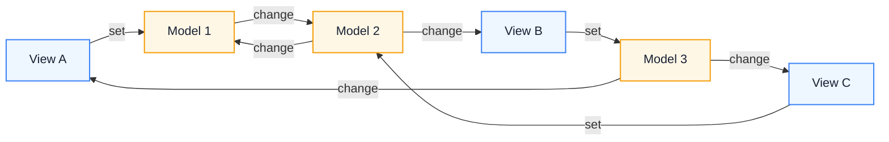
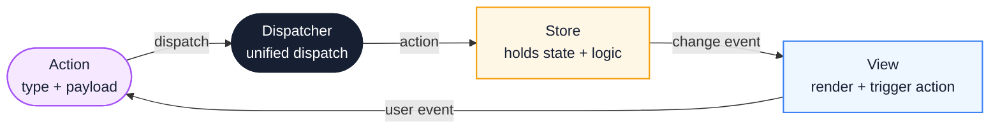
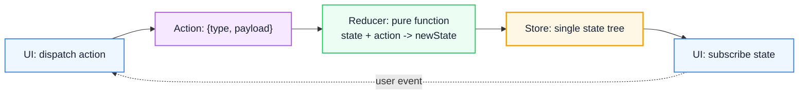
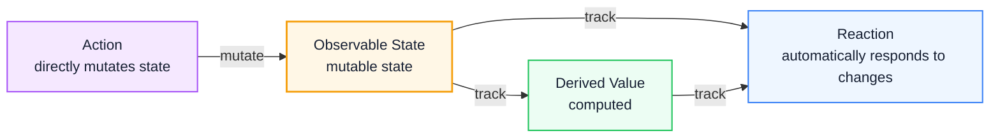
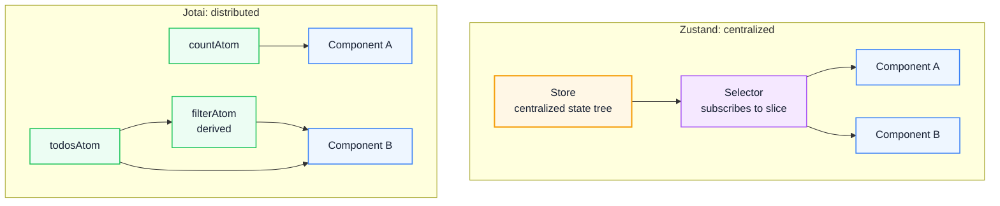
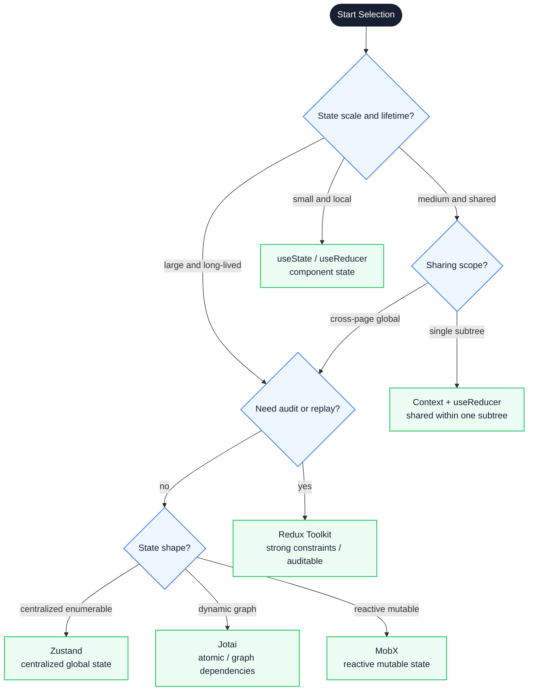

# Modern State Management Evolution: The Design Philosophy from Flux to Zustand

Most teams do not choose a state-management library once. They start with local state, lift it, add a global store, then replace that store when the boilerplate or the update behavior becomes painful. Each replacement feels like a library decision, yet the recurring failures usually come from constraints that were never written down: how large the state is, how often it changes, who must audit it, and how much convention the team can maintain. This article compares Flux, Redux, MobX, Zustand, and Jotai along those constraints, then gives a conditional path for choosing a solution and for deciding whether a migration is justified.

::: info In one sentence
Every step in frontend state-management evolution resolves the tension between "traceability of state changes" and "developer experience" — from Flux's strongly constrained unidirectional flow to Zustand's minimal API, each is a rebalancing of these two dimensions.
:::

## Table of Contents

- [Introduction](#introduction)
- [1. Decision Context: Why MVC's Mesh State Got Out of Control](#_1-decision-context-why-mvc-s-mesh-state-got-out-of-control)
- [2. Evaluation Dimensions: What You Are Actually Trading Off](#_2-evaluation-dimensions-what-you-are-actually-trading-off)
- [3. Solution Comparison: Flux Trades Constraint for Unidirectional Data Flow](#_3-solution-comparison-flux-trades-constraint-for-unidirectional-data-flow)
- [4. Solution Comparison: Redux Pushes Constraints to the Extreme](#_4-solution-comparison-redux-pushes-constraints-to-the-extreme)
- [5. Solution Comparison: MobX Trades Reactivity for Developer Speed](#_5-solution-comparison-mobx-trades-reactivity-for-developer-speed)
- [6. Solution Comparison: Zustand and Jotai Reduce Constraints](#_6-solution-comparison-zustand-and-jotai-reduce-constraints)
- [7. Constraints and Risks: Anti-patterns and Boundary Conditions](#_7-constraints-and-risks-anti-patterns-and-boundary-conditions)
- [8. Conditional Recommendations: Choosing by Project Conditions](#_8-conditional-recommendations-choosing-by-project-conditions)
- [Decision Checklist](#decision-checklist)
- [Conclusion: See the Constraints First, Then Choose the Tool](#conclusion-see-the-constraints-first-then-choose-the-tool)
- [FAQ](#faq)
- [Sources](#sources)

## Introduction

Many engineers follow the same path with state management:

- Start with `useState`, which is simple enough;
- Lift state into parent components as it grows, and begin prop drilling;
- Install Redux when that becomes annoying;
- Switch to MobX, Zustand, or Jotai when Redux feels heavy;
- After a while, find that every option has something that does not fit.

Repeated tool switching usually means the constraints were never confirmed first: how large the state is, how often it updates, whether it needs auditing, and how many conventions the team can maintain.

This article answers those questions in decision order:

- Why did MVC's state flow get out of control before Flux?
- What does each of Redux's three principles constrain?
- Are MobX and Redux opposites, or solutions to different problems?
- What exactly do Zustand and Jotai remove?
- Under what conditions is migrating away from a working solution justified?
- Should server data live in a global store?

Code in this article shows structure and omits error handling and complete types. Snippets marked as runnable include their version and dependencies.

## 1. Decision Context: Why MVC's Mesh State Got Out of Control

Before frontend frameworks matured (roughly 2010 to 2014), Backbone.js, Ember.js, Knockout, and similar frameworks commonly used MVC or MVP. The Model held data, the View listened to Model changes and rendered, and the Controller handled user interaction.

### 1. The Temptation and Trap of Two-Way Binding

Early MVC frameworks commonly supported two-way binding: input changes in the View wrote back to the Model, and Model changes refreshed the View. It felt convenient in small scenarios and got out of control quickly as the application grew.

```javascript
// Backbone-style pseudocode showing only the two-way binding structure; not directly runnable
const Model = Backbone.Model.extend({
  defaults: { count: 0, total: 100 },
})

const View = Backbone.View.extend({
  events: {
    'input #count': 'onInput', // View -> Model
  },
  initialize() {
    this.model.on('change', this.render, this) // Model -> View
  },
  onInput(e) {
    this.model.set('count', e.target.value)
  },
  render() {},
})
```

### 2. State Flow Becomes Untraceable

When Models multiply, Views depend on one another, and Models listen to one another, a single user action can trigger a chain of changes.



The diagram has neither a start nor an end: Views write to Models, and Models influence other Models and Views through change events. As soon as one edge forms a cycle, a single input can trigger circular or cascading updates, and debugging rarely reveals the original action.

This mesh dependency creates three problems:

- **Unpredictable data flow**: one input can trigger circular or cascading updates;
- **Difficult debugging**: the source of a state change is hard to trace;
- **Difficult testing**: tests depend on large amounts of implicit state.

### 3. Facebook's "MVC Does Not Scale" Claim

In 2014, a Facebook engineer showed a diagram in a Flux talk: at large scale, MVC turned into an entangled "V-C-M-V-M-C" loop. That diagram helped drive the creation of Flux.

::: warning Common misconception
MVC itself is not broken. It works well in small applications. The problem is that once a frontend application grows, it lacks a unified constraint on the path of state changes. Flux does not replace MVC; it forces the change path through a unidirectional data flow.
:::

The core problem of the MVC era was two-way binding plus Models listening to each other, which turned data flow into a mesh. Flux set out to compress that mesh back into a unidirectional chain.

## 2. Evaluation Dimensions: What You Are Actually Trading Off

Before comparing libraries, fix the axes. Without them, it is easy to treat "less code" as the only criterion and ignore collaboration and traceability.

| Dimension | Question it answers | Why it changes the choice |
| --- | --- | --- |
| State scale and lifetime | Does the state live inside one component, a subtree, or globally for a long time? | Globalizing widens the subscription surface and blurs cleanup ownership |
| State shape | Is it a centralized enumerable object, or many dynamically generated units that depend on each other? | Decides whether selectors stay usable and whether the dependency graph stays controllable |
| Update granularity | Under frequent updates, can only the affected components re-render? | Component-level subscriptions amplify cost in high-frequency updates |
| Traceability | Does every change need auditing, replay, or strict constraints? | Strong-constraint solutions need more code but give clearer debugging and collaboration boundaries |
| Team collaboration cost | How long does a newcomer need to become productive? Do teams need shared conventions? | High-freedom solutions with weak conventions get harder to maintain as they grow |
| Server-state boundary | Who owns the data, and who owns its freshness? | Server caches have dedicated tools; mixing them into a general store adds burden |

### 1. State Scale and Lifetime

Form input, toggles, and temporary animation state inside a component follow the component lifecycle and are cheapest to keep local. Only state shared across pages and expected to live for a long time belongs in a global layer.

The criterion is not "how many variables exist" but "who reads them, for how long, and who is responsible for cleanup."

### 2. State Shape

Centralized state is like one object with a few slices, suitable for enumerable structures such as user information, theme, and configuration. Atomic state suits large numbers of dynamically generated units that depend on one another, such as complex form fields or cards that can be added and removed.

Choose the wrong shape and you will spend the rest of the project compensating with more selectors or dependency declarations.

### 3. Update Granularity

Frequent updates such as dragging, search suggestions, and real-time collaboration amplify the subscription surface. Component-level subscriptions mean one change can rerun the whole component; field-level subscriptions trigger only the related effects or selectors.

This dimension decides whether you need a finer-grained reactive system, not how short the API is.

### 4. Traceability

When every state change must be audited, replayed, or investigated across teams, explicit Actions and immutable updates pay for themselves. When changes only serve one team's fast iteration, strong constraints may be pure overhead.

### 5. Team Collaboration Cost

Redux Toolkit removes much of early Redux's boilerplate but still requires the team to understand actions, reducers, and middleware. Zustand's API is shorter, but the team must decide when to split stores and how to write selectors.

Choosing a library is also choosing a set of conventions the team will maintain.

### 6. Server-State Boundary

Data fetched from an API has an owner, a freshness requirement, and a consistency requirement; it behaves more like a cache than like client state. Putting it in a general store usually means rebuilding loading, error, cache invalidation, and concurrent request handling yourself.

Identify server state first, and the remaining client state is often much smaller.

## 3. Solution Comparison: Flux Trades Constraint for Unidirectional Data Flow

Flux is an architecture Facebook introduced in 2014. It is not a library but a design pattern: all state changes must pass through the Dispatcher and flow in one direction.

### 1. The Four Roles of Flux



The four roles form a closed loop: the View produces Actions, the Dispatcher distributes them, the Store updates state and emits a change event, and the View renders from that event. Unidirectional means state changes may only travel this way; Stores cannot call one another directly.

- **Action**: a plain object `{ type, payload }` describing what happened;
- **Dispatcher**: distributes Actions to all Stores;
- **Store**: holds state, registers with the Dispatcher, and updates itself by Action type;
- **View**: subscribes to Store changes, renders, and responds to user interaction by triggering Actions.

### 2. Simplified Implementation

```javascript
// Only the dispatch and subscription spine is kept; external references such as render are omitted
class Dispatcher {
  constructor() {
    this.callbacks = []
  }
  register(callback) {
    this.callbacks.push(callback)
    return () => {
      this.callbacks = this.callbacks.filter((cb) => cb !== callback)
    }
  }
  dispatch(action) {
    this.callbacks.forEach((cb) => cb(action))
  }
}

const dispatcher = new Dispatcher()

class TodoStore {
  constructor() {
    this.todos = []
    this.listeners = new Set()
    dispatcher.register((action) => this.handleAction(action))
  }
  handleAction(action) {
    switch (action.type) {
      case 'ADD_TODO':
        this.todos.push(action.payload)
        this.emit()
        break
      case 'REMOVE_TODO':
        this.todos = this.todos.filter((t) => t.id !== action.payload.id)
        this.emit()
        break
    }
  }
  emit() {
    this.listeners.forEach((l) => l())
  }
  subscribe(listener) {
    this.listeners.add(listener)
    return () => this.listeners.delete(listener)
  }
}

const store = new TodoStore()
store.subscribe(() => render(store.todos))
addButton.onclick = () => {
  dispatcher.dispatch({ type: 'ADD_TODO', payload: { id: Date.now(), text: 'new' } })
}
```

### 3. What Flux Solved

| MVC Problem | Flux Solution |
|---|---|
| Mesh data flow | All data flows through the Dispatcher in one direction |
| Models listening to each other | Stores cannot call each other directly; they communicate only through the Dispatcher |
| Untraceable state changes | Every change must be triggered by an Action, and Actions are immutable events |
| Difficult debugging | Actions are discrete events that can be recorded and replayed |

### 4. Limitations of Flux

- **Multi-Store coordination is cumbersome**: one Action may update several Stores, and Stores may need to wait for one another (`waitFor`);
- **No standard implementation**: Facebook provided the pattern, and each implementation exposed a different API;
- **Boilerplate**: every Store needs a switch-case.

These limitations led directly to Redux, a standardized, single-Store, functional variant of Flux.

Flux's contribution is turning state changes into enumerable events. The cost is that every event needs handwritten dispatch and branching.

## 4. Solution Comparison: Redux Pushes Constraints to the Extreme

Dan Abramov and Andrew Clark created Redux in 2015. It standardized Flux's ideas and fixed three principles:

1. **Single source of truth**: the whole application state lives in one state tree;
2. **State is read-only**: the only way to change state is to dispatch an action;
3. **Changes are made with pure functions**: reducers must be pure and free of side effects.

### 1. Redux's Core Model



Actions are the only input, the Reducer is pure computation, and the Store is the only source of state. The dashed edge shows user interaction producing a new Action rather than mutating the Store directly; that boundary is where Redux's traceability comes from.

### 2. Complete Simplified Implementation

```javascript
function createStore(reducer, initialState) {
  let state = initialState
  const listeners = []

  return {
    getState: () => state,
    dispatch: (action) => {
      state = reducer(state, action) // pure function computes the new state
      listeners.forEach((l) => l())
      return action
    },
    subscribe: (listener) => {
      listeners.push(listener)
      return () => {
        const i = listeners.indexOf(listener)
        if (i >= 0) listeners.splice(i, 1)
      }
    },
  }
}

// Reducer: pure function with immutable updates
function todosReducer(state = [], action) {
  switch (action.type) {
    case 'ADD_TODO':
      return [...state, action.payload]
    case 'TOGGLE_TODO':
      return state.map((t) =>
        t.id === action.payload.id ? { ...t, done: !t.done } : t
      )
    case 'REMOVE_TODO':
      return state.filter((t) => t.id !== action.payload.id)
    default:
      return state
  }
}

const store = createStore(todosReducer, [])
store.subscribe(() => console.log(store.getState()))
store.dispatch({ type: 'ADD_TODO', payload: { id: 1, text: 'learn redux', done: false } })
```

This code runs in Node.js 18+ or in a browser console; the output is an array containing one todo.

### 3. Why Immutability Is Enforced

**Immutable** means creating a new object on update instead of modifying the original in place. Redux requires reducers to return new objects for three reasons.

**First, traceability**: every state change produces a new reference, so `===` quickly detects whether something changed without a deep comparison.

```javascript
// Foundation of React-Redux optimization
function shallowEqual(a, b) {
  if (a === b) return true // reference equality returns immediately, O(1)
  // continue comparing the first level of fields
}
```

**Second, time travel**: historical states remain in memory and can be replayed. This is the foundation of Redux DevTools.

**Third, pure functions are testable**: a reducer always produces the same output for the same input, so tests need no mocks.

### 4. Middleware Mechanism

Redux handles side effects such as async requests, logging, and error handling through middleware. Middleware wraps `store.dispatch`.

```javascript
function applyMiddleware(store, middlewares) {
  let dispatch = store.dispatch
  middlewares.forEach((mw) => {
    dispatch = mw(store)(dispatch)
  })
  return { ...store, dispatch }
}

// Logging middleware
const logger = (store) => (next) => (action) => {
  console.log('dispatch', action)
  const result = next(action)
  console.log('next state', store.getState())
  return result
}

// Thunk middleware: handles function-shaped actions
const thunk = (store) => (next) => (action) => {
  if (typeof action === 'function') {
    return action(store.dispatch, store.getState)
  }
  return next(action)
}

const store = createStore(reducer, initialState)
const enhancedStore = applyMiddleware(store, [logger, thunk])

const fetchTodos = () => async (dispatch) => {
  dispatch({ type: 'FETCH_TODOS_REQUEST' })
  try {
    const todos = await api.fetchTodos()
    dispatch({ type: 'FETCH_TODOS_SUCCESS', payload: todos })
  } catch (e) {
    dispatch({ type: 'FETCH_TODOS_FAILURE', payload: e.message })
  }
}
enhancedStore.dispatch(fetchTodos())
```

### 5. The Cost of Redux

Redux's constraint power is both its strength and its cost:

- **Boilerplate**: a simple feature needs action types, action creators, a reducer, and a connected component;
- **Tedious immutable updates**: spreading nested objects is hard to read and easy to get wrong;
- **Steep learning curve**: pure functions, immutability, middleware, and connect or Hooks all have to be learned;
- **Over-engineering**: Redux adds unnecessary constraints to small projects.

```javascript
// The pain of nested updates
function reducer(state, action) {
  switch (action.type) {
    case 'UPDATE_TODO_TEXT':
      return {
        ...state,
        todos: state.todos.map((t) =>
          t.id === action.payload.id
            ? { ...t, text: action.payload.text }
            : t
        ),
      }
  }
}
```

Immer lets reducers write immutable updates with mutable syntax.

```javascript
import { produce } from 'immer'

const reducer = produce((draft, action) => {
  switch (action.type) {
    case 'UPDATE_TODO_TEXT': {
      const todo = draft.todos.find((t) => t.id === action.payload.id)
      if (todo) todo.text = action.payload.text // looks mutable, but produces new state
      break
    }
  }
})
```

Redux fits scenarios where state changes are auditable events. The cost is maintaining an action and reducer convention for every extension. Whether that pays off depends on whether traceability actually matters to the team.

## 5. Solution Comparison: MobX Trades Reactivity for Developer Speed

MobX takes the opposite path. Its reactive system tracks dependencies automatically and brings state management back to "modify the data."

### 1. MobX's Core Model



The entry is an Action and the exit is a Reaction. Observable state records dependencies when it is read and notifies when it is modified; both Derived values and Reactions attach to state through `track`. There is no handwritten subscription list; reading behavior determines the dependency.

### 2. Simplified Implementation

The code below shows the minimum structure of "Proxy plus automatic dependency collection." It is not MobX's source code.

```javascript
// Simplified observable: close in spirit to Vue 3's reactive
function observable(target) {
  const deps = new Map() // key -> Set<reaction>
  let currentReaction = null

  const proxy = new Proxy(target, {
    get(t, key) {
      if (currentReaction) {
        if (!deps.has(key)) deps.set(key, new Set())
        deps.get(key).add(currentReaction)
      }
      return t[key]
    },
    set(t, key, value) {
      t[key] = value
      deps.get(key)?.forEach((r) => r())
      return true
    },
  })

  function autorun(fn) {
    const reaction = () => {
      currentReaction = reaction
      try {
        fn()
      } finally {
        currentReaction = null
      }
    }
    reaction()
  }

  return { proxy, autorun }
}

const state = observable({ count: 0, todos: [] })

state.autorun(() => {
  console.log('count is', state.proxy.count)
})

state.proxy.count = 1 // console output: count is 1
state.proxy.todos.push({}) // does not trigger the autorun above because todos was not read
```

### 3. The MobX 6 Style

Real projects usually use `makeAutoObservable` so class fields, getters, and actions automatically become observable, computed, and actions.

```javascript
import { makeAutoObservable, autorun } from 'mobx'

class TodoStore {
  todos = []

  constructor() {
    makeAutoObservable(this)
  }

  get unfinishedCount() {
    return this.todos.filter((t) => !t.done).length
  }

  addTodo(text) {
    this.todos.push({ text, done: false })
  }
}

const store = new TodoStore()
autorun(() => console.log('unfinished:', store.unfinishedCount))
store.addTodo('learn mobx') // console output: unfinished: 1
```

These examples target MobX 6. Earlier versions used decorators or explicit `observable` wrapping and look different.

### 4. Key Designs of MobX

**First, state is mutable**: write `state.count++` directly, with no reducer, dispatch, or immutable update.

**Second, dependency tracking is automatic**: a reaction subscribes to whichever observables it reads at runtime, with no manual dependency list.

**Third, updates are fine-grained**: each observable property has its own subscription set, so updating one property triggers only the related reactions.

**Fourth, computed values are cached**: derived state is cached and returns the old value while dependencies are unchanged.

### 5. Redux vs MobX

| Dimension | Redux | MobX |
|------|-------|------|
| Data flow | Unidirectional, explicit Actions | Bidirectional, direct mutation |
| State mutability | Immutable | Mutable |
| Dependency tracking | Manual connect or selector | Automatic |
| Update granularity | Component-level (subscribes to a state slice) | Field-level |
| Boilerplate | Much | Little |
| Traceability | Strong (every change is an Action) | Weak (state can be changed anywhere) |
| Debugging | Time travel and Action replay | Hard to replay (state is mutated directly) |
| Suitable scale | Large teams needing constraints | Small to medium teams pursuing development speed |

Redux and MobX are not good versus bad; they trade constraints for freedom. Redux's strong constraints make large-team collaboration safer, and MobX's freedom makes small projects faster to develop. When there is no need to audit every state change, MobX usually offers the better development experience.

## 6. Solution Comparison: Zustand and Jotai Reduce Constraints

Between 2017 and 2019, dissatisfaction with Redux's verbosity produced a wave of minimal state libraries. Zustand and Jotai are the most representative, alongside Recoil, Valtio, and others.

### 1. Zustand: Keep the Store, Remove the Boilerplate

Zustand keeps Redux's idea of an explicit store but removes the boilerplate. The example targets Zustand 4 or 5 with React 18+.

```jsx
import { create } from 'zustand'

const useStore = create((set, get) => ({
  count: 0,
  todos: [],
  increment: () => set((state) => ({ count: state.count + 1 })),
  addTodo: (text) =>
    set((state) => ({ todos: [...state.todos, { text, done: false }] })),
  getUnfinished: () => get().todos.filter((t) => !t.done).length,
}))

function Counter() {
  const count = useStore((state) => state.count)
  const increment = useStore((state) => state.increment)
  return <button onClick={increment}>{count}</button>
}
```

Key designs:

- **The store is a hook**: call it directly in a component, with no Provider;
- **State and actions live together**: no separate reducer or action creator;
- **Mutable or immutable both work**: `set` accepts a new object and can also use Immer syntax;
- **Selector optimization**: components subscribe only to the slice they need.

A simplified implementation looks like this:

```javascript
import { useSyncExternalStore } from 'react'

function createStore(createState) {
  let state
  const listeners = new Set()

  const setState = (partial) => {
    const nextState = typeof partial === 'function' ? partial(state) : partial
    if (!Object.is(nextState, state)) {
      const previousState = state
      state = Object.assign({}, state, nextState)
      listeners.forEach((l) => l(previousState, state))
    }
  }
  const getState = () => state
  const subscribe = (listener) => {
    listeners.add(listener)
    return () => listeners.delete(listener)
  }

  const api = { setState, getState, subscribe }
  state = createState(setState, getState, api)

  const useStore = (selector = (s) => s) => {
    return useSyncExternalStore(subscribe, () => selector(getState()))
  }
  Object.assign(useStore, api)
  return useStore
}
```

This simplified version does not handle caching when a selector returns a new object. Zustand uses `useSyncExternalStoreWithSelector` and compares snapshots with `Object.is`, avoiding repeated renders when nothing changed.

### 2. Jotai: Atomic State

Inspired by Recoil, Jotai takes a different route: state is not concentrated in one tree but scattered into independent atoms. The example targets Jotai 2.x.

```jsx
import { atom, useAtom } from 'jotai'

// Atom: the smallest unit of state
const countAtom = atom(0)
const todosAtom = atom([])

// Derived atom: depends on other atoms
const unfinishedCountAtom = atom((get) =>
  get(todosAtom).filter((t) => !t.done).length
)

// Writable derived atom
const addTodoAtom = atom(null, (get, set, text) => {
  set(todosAtom, [...get(todosAtom), { text, done: false }])
})

function Counter() {
  const [count, setCount] = useAtom(countAtom)
  return <button onClick={() => setCount(count + 1)}>{count}</button>
}
```

Key designs:

- **Scattered state**: each atom is independent and needs no centralized store;
- **Graph-like dependencies**: atoms can depend on other atoms and form a dependency graph automatically;
- **Fine-grained subscriptions**: components subscribe only to the atoms they use;
- **Derivable**: an atom can be read-only derived state or a writable transformation.

### 3. Zustand vs Jotai



On the left, Zustand has one state source and components read slices through a selector. On the right, Jotai has multiple atoms, and derived atoms connect their dependencies into a graph. The more edges the graph has, the more you should consider splitting dependencies instead of piling them into one store.

| Dimension | Zustand | Jotai |
|------|---------|-------|
| State shape | Centralized store | Scattered atoms |
| Mental model | Global object plus selector | Atoms plus dependency graph |
| Suitable scenarios | Business state and enumerable state collections | Complex dependencies and dynamically generated state |
| State sharing | Global by default | Global by default, with optional scoping |
| API style | Imperative set and get | Declarative atom |

### 4. What They Removed

The shared design direction of Zustand and Jotai:

1. **No boilerplate**: no reducer, action creator, or switch-case;
2. **No Provider**: import and use directly without polluting the component tree;
3. **No enforced immutability**: but it is encouraged, and Immer works easily;
4. **Hook-based**: naturally fits React function components;
5. **Small surface**: exact bundle size varies by version and packaging, but all are in the low-kilobyte range.

They also give up some Redux capabilities: no enforced Action types, no native time travel (Zustand needs middleware), and no standardized side-effect solution (choose saga, observable, or async yourself).

Zustand and Jotai represent a return to simplicity. Zustand keeps a centralized store and removes boilerplate; Jotai scatters state into minimal units and manages them through a dependency graph. Both trade reduced constraints for developer experience, and both hand the convention burden back to the team.

## 7. Constraints and Risks: Anti-patterns and Boundary Conditions

Choosing is not a one-time event. Three anti-patterns and several trends can change the earlier judgment.

### 1. Anti-pattern: Putting All State in the Global Store

```jsx
// Counter-example: input used by only one form is placed in a global store
const useFormStore = create((set) => ({
  value: '',
  setValue: (value) => set({ value }),
}))

// Correct: component-local state is enough
const [value, setValue] = useState('')
```

Rule: only state that is shared across multiple components and lives for a long time belongs in a global store. Temporary form input, animation state, and local UI toggles belong in component state.

### 2. Anti-pattern: Managing Server State with a General Store

```jsx
// Counter-example: maintaining the server list cache, loading, and error state yourself
const [todos, setTodos] = useState([])
useEffect(() => {
  fetchTodos().then(setTodos)
}, [])
```

Server state has dedicated libraries: TanStack Query, SWR, and RTK Query. They handle caching, revalidation, loading state, and concurrent requests.

```jsx
// Correct: let a query library manage cache and request state
const { data: todos, isLoading, error } = useQuery({
  queryKey: ['todos'],
  queryFn: fetchTodos,
})
```

### 3. Anti-pattern: Choosing Without Considering the Team

A team with many newcomers choosing Redux is paying for constraints, but the learning cost is high. A strongly collaborative team choosing MobX is paying for freedom, but state changes become hard to trace. The decision must account for team structure, not only technical metrics.

### 4. Server State Is Being Split Out

React Query, SWR, and RTK Query separate server-data caching from state management. Developers no longer need to store API data in Redux; query libraries manage it. In many business applications, most so-called state is a local cache of server data.

### 5. Framework Built-ins Are Growing

- React Server Components render server state directly into the component tree;
- React's `use` Hook reads asynchronous data under Suspense semantics;
- VueUse composables such as `useStorage` and `useAsyncState` cover common cases;
- Meta-frameworks such as SvelteKit and SolidStart include data loading and state synchronization.

The more the framework covers, the less a general state library needs to carry.

### 6. The URL Carries Part of the Shared State

Search criteria, filters, pagination, and selected tabs increasingly move into the URL. URL state is naturally shareable, supports back and forward navigation, and can be server-rendered, which further reduces the client state that needs management.

### 7. Boundary: State Libraries Do Not Disappear

The remaining client state is smaller: user preferences, UI state, local drafts, and collaborative state. Zustand or Jotai is usually enough, but Redux Toolkit and similar strong-constraint solutions still have a place when auditing, cross-team collaboration, or complex async orchestration is required.

If server state, URL state, and framework built-ins keep absorbing common needs, state libraries will return to the role of local tools rather than the core of project architecture. That judgment assumes an application centered on server data; local-first and offline collaboration applications will follow a different path.

## 8. Conditional Recommendations: Choosing by Project Conditions

The dimensions above collapse into one decision path: check scale and lifetime first, then sharing scope, and finally audit needs and state shape.



The tree narrows the question in order: remove state that does not need to be global, then check sharing scope, and only then compare library shapes. It is not a scoring table; if the team already has mature conventions, use it to check whether a key constraint was missed.

The conditional recommendations are as follows.

| Condition | Preferred solution | Benefit | Cost and unsuitable cases |
| --- | --- | --- | --- |
| State is local to a component or subtree | `useState` / `useReducer` / Context | No dependencies and clear boundaries | Cross-page sharing turns into multiple layers of prop drilling |
| Global state is centralized, the team is small, and iteration is fast | Zustand | Short API and controllable subscription granularity | Auditing and conventions are left to the team |
| Many dynamic units with graph-like dependencies | Jotai | Atom-level subscriptions and natural derivation | Too many atoms make the dependency graph hard to reason about |
| Cross-team collaboration with audit and replay needs | Redux Toolkit + RTK Query | Explicit changes and mature tooling | More boilerplate and higher learning cost |
| The team knows reactive style and state changes frequently | MobX | Automatic tracking and field-level updates | Change sources are scattered and replay is difficult |
| Most data comes from APIs | TanStack Query / SWR / RTK Query | Caching, revalidation, and concurrent requests are built in | A client-state library is still needed for UI state |

Migration depends on benefit exceeding cost. If an existing Redux Toolkit setup is stable and the main pain is server data, introduce RTK Query before replacing the whole library. Only when the current constraints keep blocking delivery does a migration deserve scheduling.

## Decision Checklist

- [ ] List all global state and mark who reads and writes each item; move items used by only one component back to local state.
- [ ] Separate server data from client state; give server data to a query library and confirm the invalidation strategy.
- [ ] Decide whether change auditing or replay is required; if so, prefer an explicit-Action solution instead of adding logs later.
- [ ] Use one real page to measure the most frequently updated state and confirm that subscription granularity does not rerender the whole page.
- [ ] Check the team's existing conventions, debugging tools, and migration cost; a shorter new API does not mean a lower total cost.
- [ ] Write down the conditions that would trigger a re-evaluation, such as changes in state scale, team size, or the share of server data.

## Conclusion: See the Constraints First, Then Choose the Tool

Reading state-management history as a chain of tool replacements easily leads to "the newer library is better." Reading it as a redistribution of constraints leads somewhere else. Flux trades unidirectional flow for traceability, Redux institutionalizes constraints, MobX trades reactivity for development speed, and Zustand and Jotai hand constraints back to users and team conventions.

Before the next selection, write down three conditions: whether the state is mostly server-side or client-side, whether every change must be audited, and whether the team can maintain a convention over time. The answers usually eliminate half the options, and only then does comparing API size and bundle cost mean anything.

If a working solution is already in place, the only reasonable reason to migrate is that its constraints have begun to block delivery, not that a new library looks shorter in an example.

## FAQ

### 1. Is it worth migrating an existing Redux Toolkit project to Zustand?

Start with what the migration is meant to fix. If the pain is boilerplate, RTK's slice API already removed most of it; if the pain is server caching, introduce RTK Query first. A full migration may pay off only when the team has shrunk, state has simplified substantially, and existing constraints genuinely block delivery. Migration cost includes rewriting tests, the debugging toolchain, and retraining the team.

### 2. Why do Zustand selectors cause extra renders?

`useStore(selector)` reruns the selector on every snapshot change. If the selector returns a new object or array, such as `(s) => ({ a: s.a, b: s.b })`, the reference differs every time and React treats the snapshot as changed. Split it into multiple selectors that return primitives, or use `useShallow` for a shallow comparison. Zustand's `useSyncExternalStoreWithSelector` does compare, but only when the selector result is stable.

### 3. Do small teams need traceability?

It depends on debugging cost. In a small team with a short cycle, direct mutation is often faster. Once "who changed this value" becomes hard to answer, or a production issue requires replaying an action sequence, explicit change records gain value. Traceability is not exclusive to large teams; problem complexity decides.

### 4. Our team already uses MobX. Should we switch because of ecosystem trends?

Do not switch only because of a trend. MobX still has advantages in reactive style, field-level updates, and development speed. Evaluate concrete pain: is state replay difficult, is integration with Suspense or Server Components blocked, or is it hard to hire people who know the approach? Only when those costs stay above migration cost is a change justified.

## Sources

1. Redux official documentation: <https://redux.js.org/>
2. MobX official documentation: <https://mobx.js.org/>
3. Zustand GitHub: <https://github.com/pmndrs/zustand>
4. Jotai GitHub: <https://github.com/pmndrs/jotai>
5. Dan Abramov - You Might Not Need Redux: <https://medium.com/@dan_abramov/you-might-not-need-redux-be46360cf367>

This article is also based on the author's reading of multiple state-management library source codes and project experience.
