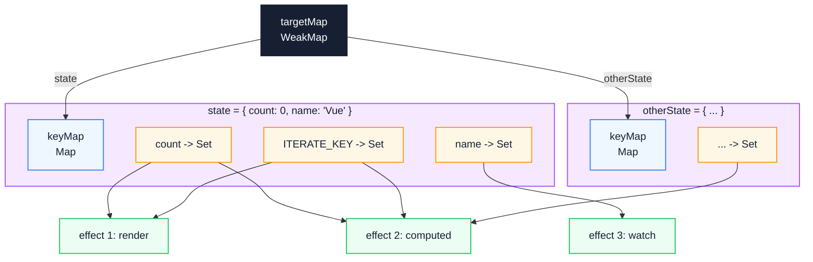
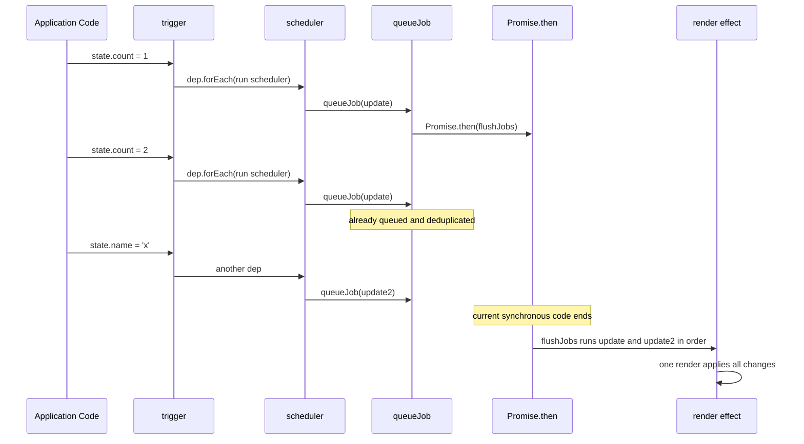

# Vue 3 Reactivity System: The Complete Implementation of Proxy and Dependency Collection

Changing data and watching the view update looks like the whole story until two components read the same object and only one of them should rerender. Vue 3 decides that at runtime by recording which effect read which key, which explains both its precision and its surprising failure modes. This article starts from the limits of `Object.defineProperty`, then follows Proxy interception, dependency tracking, and the scheduler that turns synchronous writes into batched updates. It ends with boundary cases you can verify with a small experiment.

::: info In one sentence
The essence of Vue 3's reactivity system is to use Proxy to intercept reads and writes, and to use a three-layer WeakMap structure to record "who depends on what," so that when data changes, every effect is notified precisely.
:::

## Table of Contents

- [Introduction](#introduction)
- [1. The Fundamental Limitations of Vue 2 Object.defineProperty](#_1-the-fundamental-limitations-of-vue-2-object-defineproperty)
- [2. Proxy and Reflect: The Physical Foundation of Reactivity](#_2-proxy-and-reflect-the-physical-foundation-of-reactivity)
- [3. Implementation Principles of reactive, ref, and computed](#_3-implementation-principles-of-reactive-ref-and-computed)
- [4. Dependency Collection (track) and Triggering Updates (trigger)](#_4-dependency-collection-track-and-triggering-updates-trigger)
- [5. effect and Scheduler: The Execution Entry of Side Effects](#_5-effect-and-scheduler-the-execution-entry-of-side-effects)
- [6. Comparison with React's Reactive Model](#_6-comparison-with-react-s-reactive-model)
- [7. Several Easy-to-Miss Details](#_7-several-easy-to-miss-details)
- [Conclusion: Reactivity Is a Dependency Contract, Not Automatic Magic](#conclusion-reactivity-is-a-dependency-contract-not-automatic-magic)
- [FAQ](#faq)
- [Sources](#sources)

## Introduction

Many engineers understand reactivity as "when data changes, the view updates automatically" but cannot clearly answer these questions:

- Why can Vue 2 not detect the addition or deletion of object properties?
- Why does initialization cost drop after Vue 3 switches to Proxy?
- What is the real difference between `reactive` and `ref`, and why not unify them?
- What exactly is the "dependency" in dependency collection, and where is it stored?
- How are `effect`, `watch`, and `computed` related?
- Why does destructuring `reactive` lose reactivity while `ref` does not?
- What is the essential difference between Vue's reactivity and React's state updates?

First, fix one term: **effect**. An effect here is not a DOM operation. It is a function that reads reactive data and needs to run again when that data changes. Component rendering, `watch`, and `computed` all reuse this abstraction.

The code below follows the structure of `@vue/reactivity` with detail removed, keeping only the dependencies that support the main line. It explains the mechanism and is not directly runnable.

## 1. The Fundamental Limitations of Vue 2 Object.defineProperty

Vue 2's reactivity is based on `Object.defineProperty`.

```javascript
function defineReactive(obj, key, val) {
  let dep = new Dep() // one Dep per key, holding the Watchers that depend on it
  Object.defineProperty(obj, key, {
    enumerable: true,
    configurable: true,
    get() {
      dep.depend() // collect the current Watcher
      return val
    },
    set(newVal) {
      if (newVal === val) return
      val = newVal
      observe(newVal) // the new value must also become reactive
      dep.notify() // notify all Watchers
    },
  })
}

function observe(obj) {
  if (typeof obj !== 'object' || obj === null) return
  Object.keys(obj).forEach((key) => {
    defineReactive(obj, key, obj[key])
  })
}
```

The implementation works but has four fundamental limitations.

### 1. Cannot Detect Property Addition or Deletion

`defineProperty` intercepts only properties that already exist. When a developer writes `obj.newKey = 1` on a reactive object, Vue 2 cannot detect it and requires `Vue.set(obj, 'newKey', 1)`. Deleting a property has the same problem and requires `Vue.delete`.

### 2. Array Observation Requires a Hack

`defineProperty` cannot observe array index assignment (`arr[0] = x`) or `length` changes. Vue 2 overrides seven mutating methods and manually triggers notifications inside them.

```javascript
const methodsToPatch = ['push', 'pop', 'shift', 'unshift', 'splice', 'sort', 'reverse']
methodsToPatch.forEach((method) => {
  const original = arrayProto[method]
  arrayMethods[method] = function (...args) {
    const result = original.apply(this, args)
    const ob = this.__ob__
    // elements added by push / unshift / splice must also become reactive
    let inserted
    switch (method) {
      case 'push':
      case 'unshift':
        inserted = args
        break
      case 'splice':
        inserted = args.slice(2)
        break
    }
    if (inserted) ob.observeArray(inserted)
    ob.dep.notify()
    return result
  }
})
```

### 3. Recursive Traversal at Initialization Makes Deep Observation Expensive

`observe` recursively walks the whole object at initialization and installs a getter and setter for every key. Larger objects cost more to initialize, and many deep properties may never be read.

### 4. Cannot Observe Map / Set / WeakMap

`defineProperty` is designed for plain objects and cannot handle collection types such as `Map` and `Set`. Vue 2 can only treat them as non-reactive data.

These limitations are not a failure of Vue 2's implementation. They are the boundary of the `Object.defineProperty` API: it can intercept only reads and writes of existing properties and cannot cover arrays or collections. The solution is a more general interception mechanism.

## 2. Proxy and Reflect: The Physical Foundation of Reactivity

Vue 3 uses `Proxy`. Proxy can intercept thirteen operations, including `get / set / has / deleteProperty / ownKeys`, covering every scenario Vue 2 could not observe.

### 1. What Proxy Solves

```javascript
const handler = {
  get(target, key, receiver) {
    track(target, key) // collect dependency
    const result = Reflect.get(target, key, receiver)
    if (typeof result === 'object' && result !== null) {
      return reactive(result) // lazy reactivity
    }
    return result
  },
  set(target, key, value, receiver) {
    const result = Reflect.set(target, key, value, receiver)
    trigger(target, key) // trigger update
    return result
  },
  deleteProperty(target, key) {
    const result = Reflect.deleteProperty(target, key)
    trigger(target, key)
    return result
  },
  has(target, key) {
    track(target, key) // 'in' operations also collect
    return Reflect.has(target, key)
  },
  ownKeys(target) {
    track(target, ITERATE_KEY) // Object.keys also collects
    return Reflect.ownKeys(target)
  },
}

function reactive(target) {
  return new Proxy(target, handler)
}
```

Compared with Vue 2's limitations:

| Limitation | Vue 2 | Vue 3 |
|------|-------|-------|
| Property addition | `Vue.set` | `obj.newKey = 1` is observed automatically |
| Property deletion | `Vue.delete` | `delete obj.key` is observed automatically |
| Array index | Not observable | `arr[0] = x` is observed automatically |
| `length` changes | Not observable | Observed automatically |
| Map / Set | Unsupported | Native support |
| Initialization cost | Recursive traversal | Lazy (proxied only when used) |

### 2. Why Reflect Is Used

The third parameter of `Reflect.get` and `Reflect.set`, `receiver`, solves a subtle problem: when an object has an inheritance relationship, the correct `this` should point to the proxy rather than the original object.

```javascript
const obj = { _value: 0, get value() { return this._value } }
const proxy = new Proxy(obj, {
  get(target, key, receiver) {
    // Without receiver, this points to the original obj, and obj._value bypasses the proxy.
    // With receiver, this points to the proxy, so proxy._value can trigger reactivity.
    return Reflect.get(target, key, receiver)
  },
})
```

::: warning Common misconception
Writing `return target[key]` directly in a Proxy loses reactivity for objects with getters because `this` points to the original object. Use `Reflect.get(target, key, receiver)` instead.
:::

### 3. Lazy Reactivity: The Real Source of the Performance Advantage

Vue 3's `reactive` does not recursively walk the object at initialization. It returns a proxy for a child object only when `get` runs.

```javascript
get(target, key, receiver) {
  const result = Reflect.get(target, key, receiver)
  if (typeof result === 'object' && result !== null) {
    return reactive(result) // proxied only when used
  }
  return result
}
```

`reactive` also caches proxies:

```javascript
const reactiveMap = new WeakMap()
function reactive(target) {
  if (reactiveMap.has(target)) {
    return reactiveMap.get(target) // the same object is proxied only once
  }
  const proxy = new Proxy(target, handler)
  reactiveMap.set(target, proxy)
  return proxy
}
```

Initialization cost for one object is therefore O(1) instead of Vue 2's O(n). Deep properties enter the reactive system only when they are read.

Proxy solves the inability to observe addition, deletion, arrays, and collections, and lazy proxying plus WeakMap caching lowers initialization cost. The benefit comes mainly from laziness, not from a single Proxy interception being faster than `defineProperty`.

## 3. Implementation Principles of reactive, ref, and computed

Vue 3 exposes three main reactivity APIs: `reactive`, `ref`, and `computed`. They serve different scenarios and are different wrappers around the same dependency collection mechanism.

### 1. reactive: Proxy for Objects

`reactive` is used for objects, including arrays, Map, and Set. Its implementation is the Proxy plus handler shown above.

```javascript
const reactiveMap = new WeakMap()

function reactive(target) {
  if (!isObject(target)) return target
  if (isReadonly(target)) return target
  if (reactiveMap.has(target)) {
    return reactiveMap.get(target)
  }
  const proxy = new Proxy(target, mutableHandlers)
  reactiveMap.set(target, proxy)
  return proxy
}
```

`reactive` only makes sense for object types. Primitive values (string, number, boolean) cannot be proxied directly by Proxy, which is why `ref` exists.

### 2. ref: A Wrapper for Primitive Values

JavaScript primitive values cannot be intercepted by Proxy. Vue 3 wraps them in an object.

```javascript
class RefImpl {
  constructor(value) {
    this._rawValue = value
    this._value = isObject(value) ? reactive(value) : value
    this.dep = new Dep() // its own dependency set
  }

  get value() {
    trackRefValue(this) // collect when read
    return this._value
  }

  set value(newVal) {
    if (newVal !== this._rawValue) {
      this._rawValue = newVal
      this._value = isObject(newVal) ? reactive(newVal) : newVal
      triggerRefValue(this) // trigger when written
    }
  }
}

function ref(value) {
  return new RefImpl(value)
}
```

The essence of `ref` is holding a primitive value in an object's `.value` property so that object accessors can track changes. The `.value` syntax is not a design preference; it is the necessary choice under JavaScript's language constraints.

`ref` can also hold objects. In that case `_value` is the result of `reactive(value)`, so `ref({ count: 0 })` supports both wholesale replacement (`state.value = { count: 1 }`) and internal mutation (`state.value.count++`).

### 3. computed: Cached Derived State

`computed` adds a cache on top of effect.

```javascript
class ComputedRefImpl {
  constructor(getter, setter) {
    this._value = undefined
    this._dirty = true // whether recomputation is needed
    this.dep = new Dep()

    this.effect = new ReactiveEffect(getter, () => {
      // scheduler: on dependency change, do not recompute; only mark dirty
      if (!this._dirty) {
        this._dirty = true
        triggerRefValue(this) // notify computed subscribers
      }
    })
  }

  get value() {
    trackRefValue(this)
    if (this._dirty) {
      this._dirty = false
      // run the effect: dependencies are collected again
      this._value = this.effect.run()
    }
    return this._value
  }

  set value(newVal) {
    if (this.setter) this.setter(newVal)
  }
}

function computed(getter, setter) {
  return new ComputedRefImpl(getter, setter)
}
```

`computed` has four key designs:

1. **Lazy**: it computes nothing at construction and only computes when read;
2. **Cached**: it returns the old value while `_dirty = false`;
3. **Invalidated**: the scheduler marks `_dirty` when dependencies change but does not recompute immediately;
4. **Chained subscription**: a computed value can itself be depended on by other effects, forming a dependency chain.

`reactive` proxies objects, `ref` wraps primitives, and `computed` caches derived state. All three are different wrappers around the same track/trigger mechanism.

## 4. Dependency Collection (track) and Triggering Updates (trigger)

Dependency collection answers one question: when a key changes, who needs to be notified?

### 1. Three-Layer WeakMap Structure

Vue 3 stores dependencies in three layers.

```javascript
// Global dependency map
const targetMap = new WeakMap()
// targetMap: target -> keyMap
// keyMap:    key    -> depSet
// depSet:    set of effects

function track(target, key) {
  if (!activeEffect) return

  let keyMap = targetMap.get(target)
  if (!keyMap) {
    keyMap = new Map()
    targetMap.set(target, keyMap)
  }

  let depSet = keyMap.get(key)
  if (!depSet) {
    depSet = new Set()
    keyMap.set(key, depSet)
  }

  depSet.add(activeEffect)
  activeEffect.deps.push(depSet) // reverse reference for cleaning old dependencies
}

function trigger(target, key) {
  const keyMap = targetMap.get(target)
  if (!keyMap) return

  const depSet = keyMap.get(key)
  if (!depSet) return

  // copy before iterating so the set can be modified during execution
  const effectsToRun = new Set(depSet)
  effectsToRun.forEach((effect) => {
    // avoid an effect triggering itself
    if (effect !== activeEffect) {
      effect.run()
    }
  })
}
```

The structure looks like this:



Read from `targetMap` downward: the first layer buckets by object, the second by key, and the third holds the effect set. One effect can appear in several sets, which is why the `deps` reverse reference is needed to clean old dependencies.

### 2. Why the Outer Layer Uses WeakMap

The outer layer uses `WeakMap` instead of `Map` so that when a reactive object is destroyed and has no other references, its entry can be collected automatically. A `Map` would hold a strong reference to the target and keep it alive forever.

The second layer uses `Map` (keys are strings or symbols), and the third uses `Set` (the effect set). Their lifetimes follow the target and do not leak on their own.

### 3. activeEffect: The Effect Currently Running

The key question in dependency collection is: who gets added during track? Vue 3 keeps a global `activeEffect` pointing at the effect currently running.

```javascript
let activeEffect = null

class ReactiveEffect {
  constructor(fn, scheduler) {
    this.fn = fn
    this.scheduler = scheduler
    this.deps = [] // reverse references for cleanup
  }

  run() {
    const prevEffect = activeEffect
    activeEffect = this
    try {
      return this.fn() // reads inside fn make track add this effect to the sets
    } finally {
      activeEffect = prevEffect
    }
  }
}
```

So dependency collection really means: an effect registers itself in the subscriber sets of every reactive value it reads while running.

### 4. Nested Effects

Effects can nest, for example when component rendering triggers a computed value. Vue 3 manages the stack by saving and restoring `activeEffect`.

```javascript
function run() {
  const prevEffect = activeEffect
  activeEffect = this
  try {
    return this.fn()
  } finally {
    activeEffect = prevEffect // restore the outer effect
  }
}
```

After the inner effect finishes, the outer effect becomes `activeEffect` again. Data read by the inner effect is not collected by the outer effect, which is the correct behavior.

Dependency collection is stored as `WeakMap(target) -> Map(key) -> Set(effect)`. `track` adds the running effect to the set, and `trigger` takes the set and runs each effect. This is the skeleton of Vue's reactivity system.

## 5. effect and Scheduler: The Execution Entry of Side Effects

`effect` is the lowest-level concept in the reactivity system. `watch`, `computed`, and component render functions are all effects.

### 1. Basic Structure of effect

```javascript
function effect(fn, options = {}) {
  const _effect = new ReactiveEffect(fn, options.scheduler)
  if (!options.lazy) {
    _effect.run() // run once immediately to establish dependencies
  }
  return _effect
}
```

After `effect(fn)` is called:

1. `fn` runs once immediately, and any reactive data it reads adds `_effect` to the corresponding sets;
2. Any later dependency change calls `_effect.run()`;
3. During the rerun, reads refresh the dependency relationships, and old dependencies may be cleaned up.

### 2. Scheduler: Controlling When Side Effects Run

Without a scheduler, `trigger` calls `effect.run()` directly. Many scenarios do not want immediate execution:

- Component rendering should batch into the next microtask to avoid several synchronous rerenders;
- `computed` should delay recomputation until the next read;
- `watch` should run its callback asynchronously.

The scheduler is that control point.

```javascript
const _effect = new ReactiveEffect(fn, () => {
  // on dependency change, do not call fn directly; let the scheduler decide when to run it
})
```

Vue's component render effect uses the scheduler to implement asynchronous batched updates.

```javascript
function setupRenderEffect(instance, container) {
  const update = () => {
    const subTree = instance.render.call(instance.proxy)
    patch(instance.subTree, subTree, container)
    instance.subTree = subTree
  }

  const effect = new ReactiveEffect(update, () => {
    // scheduler: push the update into the queue and flush on the next tick
    queueJob(update)
  })

  effect.run() // first render
}
```

### 3. nextTick and Batched Updates

Vue updates asynchronously: multiple assignments in the same tick are merged into one rerender. The core is `queueJob`.

```javascript
const queue = []
let isFlushing = false
const resolvedPromise = Promise.resolve()

function queueJob(job) {
  if (!queue.includes(job)) {
    queue.push(job)
    if (!isFlushing) {
      isFlushing = true
      resolvedPromise.then(flushJobs)
    }
  }
}

function flushJobs() {
  try {
    for (let i = 0; i < queue.length; i++) {
      queue[i]()
    }
  } finally {
    queue.length = 0
    isFlushing = false
  }
}

export function nextTick(cb) {
  return resolvedPromise.then(cb || (() => {}))
}
```

The execution flow is:



The key is `queueJob` deduplication plus the `Promise.then` deferral: the same update function enters the queue once per tick, and DOM work waits for the microtask. `nextTick` shares that microtask timing.

::: info Engineering insight
Vue's batched updates are based on the microtask queue, and `nextTick` also uses `Promise.then`. React 18's Automatic Batching is based on Lane and the scheduler, covering a broader scope that includes `setState` inside asynchronous callbacks. Both are called batching, but they trigger at different layers.
:::

### 4. The Relationship Among effect, computed, and watch

All three are variants of effect.

| API | Internal implementation | Scheduler behavior |
|-----|---------|---------------|
| `effect(fn)` | Creates a ReactiveEffect directly | Runs synchronously by default |
| `computed(fn)` | Creates an effect with a dirty flag | Marks dirty only, does not recompute immediately |
| `watch(source, cb)` | Creates an effect with a callback | Runs the callback asynchronously by default |
| Render effect | Creates the component render effect | `queueJob` for asynchronous batching |

`effect` is the underlying abstraction of Vue reactivity. `computed`, `watch`, and component rendering are its variants. The scheduler controls when a side effect runs, which lets Vue turn synchronous triggers into asynchronous batched updates.

## 6. Comparison with React's Reactive Model

Vue's reactivity system and React's state update mechanism are two different models. Understanding the difference helps decide which update semantics a project should rely on.

### 1. Push vs Pull

```mermaid
flowchart TB
    subgraph Vue["Vue: Push Model"]
        V1["state.count = 1"]
        V2["setter interception"]
        V3["trigger finds the dep for this key"]
        V4["run subscribed effects"]
        V5["update only affected components"]

        V1 --> V2 --> V3 --> V4 --> V5
    end

    subgraph React["React: Pull Model"]
        R1["setState(1)"]
        R2["mark component dirty"]
        R3["scheduler arranges a task"]
        R4["re-render the whole component"]
        R5["Virtual DOM diff"]
        R6["commit real DOM updates"]

        R1 --> R2 --> R3 --> R4 --> R5 --> R6
    end

    classDef work fill:#ECFDF3,stroke:#22C55E,color:#172033,stroke-width:1.5px;
    classDef wait fill:#EEF6FF,stroke:#3B82F6,color:#172033,stroke-width:1.5px;

    class V1,V2,V3,V4,V5 work;
    class R1,R2,R3,R4,R5,R6 wait;
```



The upper half is push: the setter finds the dependency and runs the effects directly. The lower half is pull: `setState` only marks the component, and the scheduler reruns the component function. The difference is not speed but who decides the update scope.

**Vue (push)**: when data changes, the setter finds subscribers and notifies them. Updates are precise, and only effects that depend on that data run.

**React (pull)**: `setState` only marks a component as needing an update, and rendering happens when the scheduler decides to run it. React does not know which data changed, so it reruns the component function and uses Virtual DOM diff to find the real changes.

### 2. Immutable vs Mutable

```javascript
// React: immutable, returns a new object on every update
const [user, setUser] = useState({ name: 'A', age: 18 })
setUser({ ...user, age: 19 })

// Vue: mutable, direct modification
const user = reactive({ name: 'A', age: 18 })
user.age = 19
```

React's immutable model makes a changed object reference the signal for changed data, because React cannot intercept writes. Vue intercepts writes through Proxy and can therefore allow direct mutation.

### 3. Component-Level vs Field-Level

- React: a state change rerenders the whole component, and diff decides which DOM nodes to update;
- Vue: a state change triggers a specific effect, which may be a render effect, a `watch`, or a `computed`.

This is why Vue does less work in scenarios with many fine-grained updates: it does not rerun the component, only the affected effect.

### 4. Dependency Tracking: Manual vs Automatic

```javascript
// React: declare dependencies manually
useEffect(() => {
  console.log(count, name)
}, [count, name])

// Vue: track automatically
watchEffect(() => {
  console.log(count.value, name.value)
})
```

Vue's automatic tracking comes from `track`: data read while an effect runs automatically becomes a dependency. React's `useEffect` has no reactivity system behind it and must declare the dependency array by hand, which is a major source of Hooks mental overhead.

::: warning Trade-offs
Vue's automatic tracking is not absolutely better. Its costs are:

- Reactive data must be accessed explicitly (`.value` or `reactive`) to be tracked;
- Destructuring a `reactive` object loses reactivity;
- Reads after `await` are not tracked because `activeEffect` has already left the stack.

React's manual dependency array is verbose, but its semantics are clearer and easier to analyze statically.
:::

Vue is a "precise dependency tracking plus push" model, and React is a "mark the component dirty plus pull render" model. Neither is universally better; they differ in who declares dependencies and who decides update granularity.

## 7. Several Easy-to-Miss Details

### 1. Destructuring reactive Loses Reactivity

```javascript
const state = reactive({ count: 0 })
const { count } = state // after destructuring, count is a plain number
// later changes to state.count do not update count
```

The reason is that destructuring runs `Reflect.get`, which returns the primitive value that Proxy no longer intercepts.

Use `toRefs` to turn each property into a ref:

```javascript
const state = reactive({ count: 0 })
const { count } = toRefs(state)
count.value // reactive
```

### 2. ref Is Automatically Unwrapped in Templates, Not in JavaScript

```html
<template>
  <div>{{ count }}</div> <!-- auto-unwrapped; no .value needed -->
</template>

<script setup>
const count = ref(0)
console.log(count) // RefImpl object
count.value = 1    // in JavaScript, .value is required
</script>
```

This is the template compiler automatically unwrapping top-level refs, not a behavior of `ref` itself.

### 3. Replacing the Whole reactive Object Does Not Trigger Updates

```javascript
let state = reactive({ count: 0 })
state = reactive({ count: 1 }) // wrong: the view still subscribes to the old object
```

The correct approach is to replace a ref's value or assign properties one by one.

```javascript
const state = ref({ count: 0 })
state.value = { count: 1 } // correct: replacing value triggers the update

// or
const state2 = reactive({ count: 0 })
Object.assign(state2, { count: 1 }) // correct: assign properties one by one
```

### 4. Dependency Collection Fails in Asynchronous Code

```javascript
watchEffect(async () => {
  const data = await fetchData() // after await, activeEffect has been cleared
  console.log(state.count) // wrong: this read is not collected as a dependency
})
```

The reason is that after `await`, the effect has exited and `activeEffect` is restored to its previous value (usually `null`). Reading `state.count` at that point does not call `track`.

Read reactive values before `await`:

```javascript
watchEffect(async () => {
  const count = state.count // correct: read before await
  const data = await fetchData()
  console.log(count)
})
```

### 5. The Side-Effect Trap in computed

```javascript
const double = computed(() => {
  console.log('computing') // wrong: do not perform side effects in computed
  return state.count * 2
})
```

A computed value should be a pure function. On dependency change it only marks itself dirty and computes on the next read. Putting side effects inside makes their timing unpredictable and the benefit hard to reason about.

Common Vue reactivity pitfalls all come from the boundary of Proxy interception: destructuring loses reactivity, ref unwrapping differs by context, object replacement fails, async reads are missed, and computed side effects run at the wrong time. They are not isolated tricks but the same dependency rules showing up in different places.

## Conclusion: Reactivity Is a Dependency Contract, Not Automatic Magic

Thinking of Vue 3 reactivity as a subscription table is more useful than memorizing APIs. Proxy leaves a record on each read and write, `track` writes the current effect into the set for that key, and `trigger` pushes to the set. `ref`, `computed`, and `watch` are different entry points on the same table; they differ in wrapping and scheduling.

A small verification is worth running next: wrap code in `effect` that reads two properties, change each property, and observe which change fires and which does not because the property was never read. That experiment explains destructuring failures, missed async reads, and computed's lazy cache at the same time.

The real risk is not forgetting an API but mistaking "read once" for "depends forever." Dependencies are rebuilt every time an effect reruns, and conditionals, early `return`, and `await` can all change them.

## FAQ

### 1. Is Vue 3 reactivity faster than React?

They cannot be compared in one dimension. Vue has an advantage in fine-grained updates because it triggers only the relevant effects and does not diff the whole component. React's Virtual DOM and scheduling model also has room in large component trees with many coexisting state values. The difference depends on update patterns, component granularity, and state distribution; no conclusion holds outside a scenario.

### 2. Why are dependencies read inside conditional branches lost?

An effect rebuilds its dependency set on every run and records only the reads that actually executed. If a branch is skipped this time, its properties are not read, and the old dependencies are removed during cleanup. When the condition changes again, the effect may not be triggered by that property, which looks like a lost dependency. Make the condition itself reactive data that is tracked, or split the logic into separate effects.

### 3. Can Vue's reactivity system be used outside Vue?

Yes. `@vue/reactivity` is an independent package and works in non-Vue projects. You can use `reactive` plus `effect` to build a state manager, or use `computed` for derived-state caching in Node.js. Vue 3 split reactivity into its own package specifically so it could be reused outside the framework.

### 4. Can effects be stopped manually, and what happens to dependencies after a component unmounts?

Yes. `ReactiveEffect` provides `stop()`, which clears the dependencies it registered and removes the effect. When a component unmounts, Vue stops its render effect. When effects are created in groups, `effectScope()` can stop them together instead of cleaning them up one by one. A stopped effect no longer responds to dependency changes, but any closures it created still follow normal JavaScript garbage-collection rules.

## Sources

1. Vue 3 Official Docs - Reactivity Fundamentals: <https://vuejs.org/guide/essentials/reactivity-fundamentals.html>
2. Vue 3 Official Docs - Reactivity in Depth: <https://vuejs.org/guide/extras/reactivity-in-depth.html>
3. Vue 3 Reactivity design discussions: <https://github.com/vuejs/rfcs/discussions/categories/reactivity>
4. Vue source code (packages/reactivity): <https://github.com/vuejs/core/tree/main/packages/reactivity>
5. MDN - Proxy: <https://developer.mozilla.org/en-US/docs/Web/JavaScript/Reference/Global_Objects/Proxy>

This article is also based on the author's reading and synthesis of the Vue source code.
