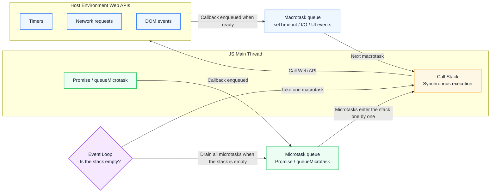
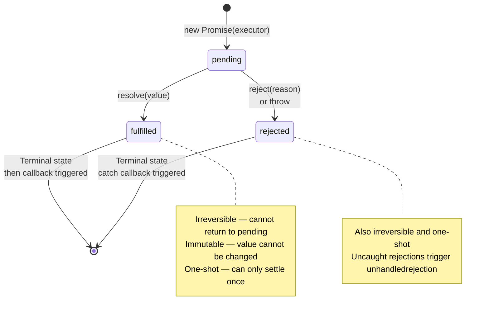
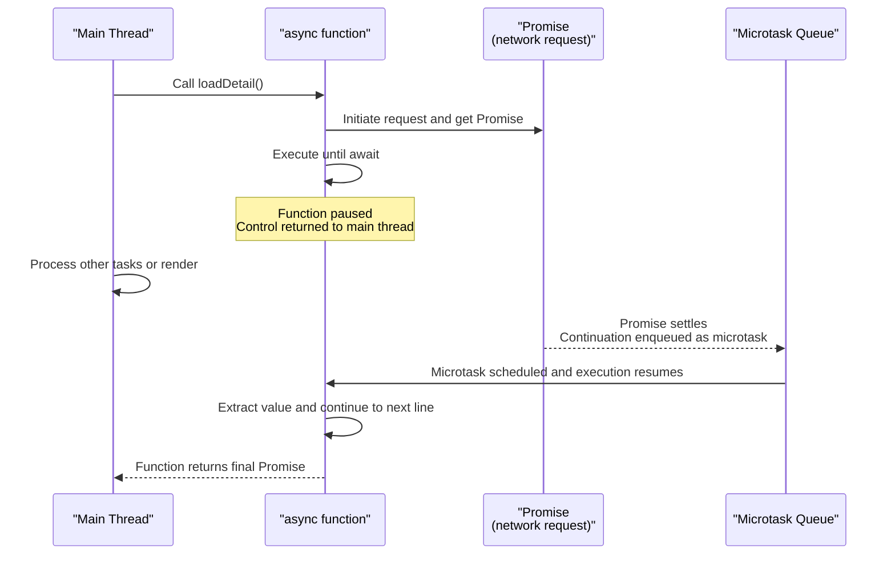

# Async Programming Evolution: From Callback Hell to async/await

Async bugs rarely come from syntax you have not memorized. They come from not knowing who holds execution at each moment: why a timer runs after a promise, what an `await` actually pauses, and why `forEach` ignores a callback that returns a promise. All of these follow from one scheduling chain.

This article builds that chain from the event loop up, then follows the transfer of control through callbacks, Promises, and `async/await`, and ends with error handling and concurrency limits. After reading it, you should be able to derive an execution order from the rules instead of recalling a conclusion.

::: info In one sentence
Every evolution of JavaScript asynchronous programming is essentially solving the same problem — "how to reliably express 'something that will happen later' without blocking the main thread."
:::

## Table of Contents

- [Why Async Order Defies Intuition](#why-async-order-defies-intuition)
- [1. Single Threading and the Event Loop: The Physical Foundation of Asynchrony](#_1-single-threading-and-the-event-loop-the-physical-foundation-of-asynchrony)
- [2. Macrotasks and Microtasks: The Overlooked Execution Order](#_2-macrotasks-and-microtasks-the-overlooked-execution-order)
- [3. The Callback Era: Inversion of Control and Trust Issues](#_3-the-callback-era-inversion-of-control-and-trust-issues)
- [4. Promise: Thinking in State Machines](#_4-promise-thinking-in-state-machines)
- [5. async/await: Syntactic Sugar or Revolution?](#_5-async-await-syntactic-sugar-or-revolution)
- [6. Async Error Handling: Catching, Propagation, and Last Resort](#_6-async-error-handling-catching-propagation-and-last-resort)
- [7. Common Async Pitfalls and Concurrency Control](#_7-common-async-pitfalls-and-concurrency-control)
- [Conclusion: Asynchrony Is Scheduling](#conclusion-asynchrony-is-scheduling)
- [FAQ](#faq)
- [Sources](#sources)

## Why Async Order Defies Intuition

Async bugs are usually a modelling problem rather than a syntax problem. Nearly every frontend engineer has met these questions:

- Why doesn't `setTimeout(fn, 0)` execute immediately? Where exactly does it queue?
- Which runs first, `Promise.then` or `setTimeout`? Why?
- Why doesn't `await` inside `forEach` work?
- What exactly does `await` "block" inside an `async` function? Does it block the main thread?
- What is the essential difference between `Promise.all` and `Promise.allSettled` for error handling?

These questions involve queues, suspension, the iteration protocol, and composition semantics, yet they all fit into the same picture. The sections below follow their dependency order: the event loop comes first, task queues second, and only then can callbacks, Promise, and async/await be explained by what each one fixes.

---

## 1. Single Threading and the Event Loop: The Physical Foundation of Asynchrony

JavaScript is **single-threaded** — it has only one call stack and can execute only one piece of code at a time. This is a historical choice: in the browser, JS manipulates the DOM, and multithreaded concurrent DOM manipulation would cause severe synchronization issues; a single thread is the simplest and safest model.

But single-threading means that if a task takes a long time (for example, waiting for a network response), the entire page freezes. So JavaScript designed the **event loop**: tasks that need to wait do not occupy the call stack — you hang up "what to do later" and come back to execute when the conditions are met.

### 1. Core Components of the Event Loop

The event loop relies on several key parts:

1. **Call Stack**: where synchronous code executes, last-in-first-out.
2. **Host environment (browser or Node)**: provides Web APIs such as timers, network requests, and DOM events. These APIs are often multithreaded at the lower level, but callbacks ultimately return to the JS single thread for execution.
3. **Task Queue**: stores callbacks awaiting execution.
4. **Event Loop**: constantly checks whether the call stack is empty and whether the queue holds tasks, pushing ready tasks onto the call stack.



Start at the left: the call stack executes only synchronous code. Timers, network requests, and DOM events go to the host environment, whose callbacks enter the macrotask queue when ready, while Promise and `queueMicrotask` enqueue into the microtask queue. The loop takes a task only when the stack is empty, and it drains the microtask queue before taking the next macrotask.

### 2. One Tick of the Loop

Each tick of the event loop roughly does the following:

1. Take **one** task from the macrotask queue and execute it.
2. After the current macrotask finishes, **drain all** microtasks produced during its execution.
3. If necessary, perform UI rendering (the browser decides whether to render based on refresh rate, roughly every 16.67 ms on a 60 Hz screen).
4. Return to step 1 and take the next macrotask.

```javascript
console.log('1. Sync start')

setTimeout(() => {
  console.log('4. Macrotask setTimeout')
}, 0)

Promise.resolve().then(() => {
  console.log('3. Microtask Promise')
})

console.log('2. Sync end')

// Output order: 1 → 2 → 3 → 4
```

`setTimeout`'s callback enters the macrotask queue, `Promise.then`'s callback enters the microtask queue. Synchronous code (1, 2) runs first, then microtasks are drained (3), and finally the next macrotask runs (4).

::: warning Zero milliseconds does not mean immediate execution
The `0` in `setTimeout(fn, 0)` is only the earliest possible delay. The callback still waits for the current synchronous code and all pending microtasks before it can enter the stack. The HTML Standard also raises the minimum delay to 4 ms once timers are nested more than five levels deep.
:::

---

## 2. Macrotasks and Microtasks: The Overlooked Execution Order

There is more than one task queue; the most important are the **macrotask queue** and the **microtask queue**. Their scheduling timing differs, and this is the root of many "weird order" problems.

### 1. What Is a Macrotask and What Is a Microtask?

- **Macrotask**: `setTimeout` / `setInterval`, I/O callbacks, UI events (click, scroll), `postMessage`, `MessageChannel`, Node's `setImmediate` / `fs` callbacks, etc.
- **Microtask**: `Promise.then` / `catch` / `finally`, `queueMicrotask`, `MutationObserver`, Node's `process.nextTick` (which has even higher priority than ordinary microtasks).

### 2. Key Rule: Microtasks Are Drained After Every Macrotask

The most easily overlooked rule is: **after each macrotask completes, the engine drains all current microtasks before moving to the next macrotask**. This means microtasks can cut in line ahead of the next macrotask.

```javascript
setTimeout(() => {
  console.log('Macrotask A')
  Promise.resolve().then(() => console.log('  Microtask A1'))
}, 0)

setTimeout(() => {
  console.log('Macrotask B')
  Promise.resolve().then(() => console.log('  Microtask B1'))
}, 0)

// Output:
// Macrotask A
//   Microtask A1
// Macrotask B
//   Microtask B1
```

After each macrotask, the microtasks it produced are cleared before the next macrotask is fetched. Microtasks never accumulate across macrotasks.

### 3. Where Rendering Happens

Browser rendering occurs between macrotasks, after microtasks have been drained. If you change the DOM in a macrotask and then continue changing it with a microtask, the browser can see the merged result before rendering. If you schedule follow-up changes with `setTimeout`, however, the browser may render once between the two changes, causing flicker.

```javascript
// Illustration: assume element already exists
function batchUpdate() {
  element.style.left = '10px'
  queueMicrotask(() => {
    element.style.left = '20px' // Takes effect before rendering; the user only sees 20px
  })
}
```

::: info Engineering takeaway
Use `queueMicrotask` for logic that must run asynchronously but before rendering. Use `setTimeout(fn, 0)` or `requestAnimationFrame` when the main thread should yield to rendering or other tasks. The choice depends on the goal, not on which API seems more advanced.
:::

---

## 3. The Callback Era: Inversion of Control and Trust Issues

Before Promise, asynchrony relied almost entirely on callbacks: you passed "what to do later" as a function to an asynchronous operation, and it called you back when done.

### 1. Inversion of Control

The essence of callbacks is **inversion of control**: you no longer control when the callback runs, how many times it runs, or with what arguments; you hand that control over to a third party (a library, an API, a piece of code you do not fully trust).

```javascript
// Your code
asyncOperation(data, function callback(result) {
  updateUI(result) // When this function is called is not up to you
})
```

### 2. The Trust Problem with Callbacks

Kyle Simpson in *You Don't Know JS* listed the trust problems callbacks face — you assume the callback will execute as agreed, but the third party might:

- Call **too early**: callback before the async operation truly completes.
- Call **too late**: or never call at all.
- Call **too few or too many times**: for example, callback triggered 0 or 3 times.
- **Swallow errors**: not notify you when something goes wrong.
- **Wrong arguments**: return unexpected data.

These problems are not rare in real engineering: a buggy third-party library may call the success callback twice, causing your UI update to run twice; an unhandled timeout may leave your loading spinner forever.

### 3. Callback Hell: Nesting and Lost Control Flow

When multiple asynchronous steps depend on each other, callbacks can only nest deeper and deeper:

```javascript
getUser(userId, function (err, user) {
  if (err) return handleError(err)
  getOrders(user.id, function (err, orders) {
    if (err) return handleError(err)
    getOrderDetail(orders[0].id, function (err, detail) {
      if (err) return handleError(err)
      renderDetail(detail)
    })
  })
})
```

This "pyramid of doom" is not just ugly; more fatally, **control flow is shattered**. Error handling has to be repeated on every level and cannot be unified; adding or reordering a step in the middle requires reshuffling the entire nested structure; sharing variables across steps can only be done through closures passed layer by layer.

The real problem with callbacks is not the indentation. Control leaves your code, the third party may not honor the contract, and the control flow is split across nested functions. Promise exists to address those three problems, not to make the layout neater.

::: warning Naming functions does not return control
Replacing anonymous functions with named functions improves readability and stack traces only. How many times the callback runs, when it runs, and what it receives is still decided by the third party.
:::

---

## 4. Promise: Thinking in State Machines

Treating a Promise as a **finite state machine** explains its behavior better than treating it as "syntactic sugar for callbacks."

### 1. Three States and Irreversible Transitions

A Promise has three states:

- **pending**: initial state, not yet settled.
- **fulfilled**: operation succeeded, associated with a value.
- **rejected**: operation failed, associated with a reason.

The transition rules are very strict:

1. Only pending → fulfilled, or pending → rejected. **Once settled, the state never changes again**.
2. Settlement can happen **only once**. A second resolve or reject is silently ignored.



Only two edges leave `pending`, and no edge returns to it. That is what "irreversible settlement" means. `then` and `catch` subscribe to a terminal state; they do not change it.

### 2. How the State Machine Solves Trust Problems

Returning to the trust checklist of the callback era, the state machine rules resolve each one:

- **Called too many times**: an irreversible state with one-time settlement means only the first resolve takes effect.
- **Called too few or never called**: you can race the operation against a timeout Promise as a fallback.
- **Called too early**: Promise `then` callbacks are **always asynchronous** (microtasks); even if the executor resolves synchronously, the callback will not execute in the current tick, which removes the race of synchronous callbacks.
- **Swallowing errors**: rejections propagate down the chain until caught by `catch`; completely uncaught rejections trigger the browser's `unhandledrejection` event.

### 3. `then` Returns a New Promise: The Essence of Chaining

`then` does not modify the original Promise; it **returns a new Promise**. This is the foundation of chaining and frees Promise from callback nesting:

```javascript
getUser(userId)
  .then((user) => getOrders(user.id))     // Returns a new Promise
  .then((orders) => getOrderDetail(orders[0].id))
  .then((detail) => renderDetail(detail))
  .catch((err) => handleError(err))        // Any step's rejection jumps here

// Equivalent to a flattened pipeline, not a pyramid
```

- If the `then` callback returns a Promise, the next `then` waits for it to settle.
- If it returns an ordinary value, the next `then` receives that value immediately.
- If it throws, the chain enters the rejected state and jumps to the nearest `catch`.

```javascript
Promise.resolve(1)
  .then((n) => n + 1)                       // Returns 2 (ordinary value)
  .then((n) => Promise.resolve(n * 10))     // Returns a Promise, settles as 20
  .then((n) => { throw new Error('boom') }) // Enters rejected
  .then((n) => console.log('not executed')) // Skipped
  .catch((err) => console.log(err.message)) // 'boom'
```

Promise's rules — irreversible settlement, always-asynchronous callbacks, and a new Promise per `then` — are its core addition over callbacks. Control is enforced by the language mechanism instead of depending on a third party's good behavior.

---

## 5. async/await: Syntactic Sugar or Revolution?

`async/await` entered the standard with ES8 in 2017. On the surface it is syntactic sugar for Promise, but its impact on readability and error handling is substantial.

### 1. What It Adds on Top of Promise

- **`async` functions always return a Promise**: if you return an ordinary value, it is wrapped as `Promise.resolve(value)`; if you return a Promise, it is used directly; if you throw, the returned Promise becomes rejected.
- **`await` pauses execution of the current async function**: it waits for the Promise on the right to settle, then extracts the value and continues. **It does not block the main thread**; while paused, the main thread can process other tasks, and the remainder of the function is registered as a microtask to resume after settlement.

```javascript
async function loadDetail(userId) {
  const user = await getUser(userId)        // Pause, wait for Promise to settle
  const orders = await getOrders(user.id)
  const detail = await getOrderDetail(orders[0].id)
  return renderDetail(detail)
}
```

This code reads like synchronous code, but execution is asynchronous — at every `await`, control is returned to the event loop.

### 2. The Execution Timing of `await`



The suspended party is **this async function**, not the main thread. While the Promise is pending, the main thread can respond to input, run other callbacks, and render; only when the Promise settles is the continuation placed in the microtask queue.

### 3. What It Really Changes

Promise solved trust and nesting, but chained `.then` still has pain points: variable scope is split (each step only sees the previous step's value, and cross-step variables need closures), control flow such as conditions and loops is hard to express, and error handling is scattered.

`async/await` lets you use `if` / `for` / `try` / `catch` directly in asynchronous code:

```javascript
async function loadAll() {
  const list = await getList()
  const result = []
  for (const id of list) {
    // await directly inside the loop, serial loading
    result.push(await getItem(id))
  }
  return result
}
```

This logic would be awkward with pure Promise — you would need manual recursion or `reduce` to chain the steps. `async/await` restores asynchronous flow control to the familiar syntax of sequence, branch, and loop.

`async/await` does not change the underlying Promise and microtask semantics. It changes how developers organize asynchronous flow. **`await` pauses only the current async function and does not block the main thread**; if the page freezes during a wait, the cause is a long synchronous task elsewhere.

---

## 6. Async Error Handling: Catching, Propagation, and Last Resort

Asynchronous error handling is an accident-prone area. The core principle: **errors must be caught explicitly and never swallowed silently**.

### 1. Use try/catch with async/await

```javascript
async function load() {
  try {
    const data = await fetch('/api/data').then((r) => r.json())
    return data
  } catch (err) {
    console.error('Load failed', err)
    notifyUser('Load failed, please retry')
    return null
  }
}
```

`await` turns a Promise rejection into a thrown exception, so `try/catch` can catch errors along the entire await chain.

### 2. Don't Forget catch, and Don't Swallow Silently

```javascript
// Anti-pattern: swallows the error; you never know what happened
someAsync().catch(() => {})

// Anti-pattern: forgets catch; unhandledrejections accumulate silently
someAsync()
```

If you really need to ignore an error, at least log it or convert it to a semantically clear default value:

```javascript
someAsync().catch((err) => {
  logger.warn('Non-critical operation failed', err)
  return null
})
```

### 3. Error Semantics of the Four Combination APIs

Understanding the differences among `all` / `allSettled` / `any` / `race` is key to concurrent error handling:

| API | Success condition | Failure behavior | Use case |
| --- | --- | --- | --- |
| `Promise.all` | All succeed | Reject as soon as any fails (fail-fast) | Every result is required |
| `Promise.allSettled` | Always resolves | Returns a status descriptor for each | Every outcome matters |
| `Promise.any` | Any one succeeds | Reject only if all fail | Take the first successful result |
| `Promise.race` | First to settle | First to settle (success or failure) | Timeout checks; does not cancel the remaining promises |

```javascript
// allSettled: even partial failures do not lose information
const results = await Promise.allSettled([
  fetch('/api/a'),
  fetch('/api/b'),
  fetch('/api/c'),
])
const ok = results.filter((r) => r.status === 'fulfilled').map((r) => r.value)
const failed = results.filter((r) => r.status === 'rejected')
```

::: info Engineering takeaway
Register a global `unhandledrejection` listener at the application entry point to report uncaught Promise errors to the monitoring platform. It cannot replace local `catch`, but it exposes code that forgot one.
:::

```javascript
window.addEventListener('unhandledrejection', (event) => {
  tracker.report({
    type: 'unhandled_promise_rejection',
    reason: event.reason,
  })
})
```

---

## 7. Common Async Pitfalls and Concurrency Control

### 1. `forEach` Does Not Wait for `await`

`Array.prototype.forEach` does not wait for `await` inside its callback, because it does not care about the Promise returned by the callback:

```javascript
// Anti-pattern: three requests fire almost simultaneously and the function does not wait
async function wrong() {
  [1, 2, 3].forEach(async (id) => {
    await getItem(id) // forEach does not wait for this await
  })
  console.log('done') // Prints almost immediately while requests are still in flight
}
```

The correct approach is `for...of` (serial) or `Promise.all` (parallel):

```javascript
// Serial: one completes before the next
async function sequential() {
  for (const id of [1, 2, 3]) {
    await getItem(id)
  }
  console.log('done') // Prints only after all are completed
}

// Parallel: fire all at once and wait for all
async function parallel() {
  await Promise.all([1, 2, 3].map((id) => getItem(id)))
  console.log('done')
}
```

### 2. Serial vs. Parallel: Don't Turn Parallel Work into Serial with `await`

```javascript
// Anti-pattern: three independent requests are dragged into serial; total time = a + b + c
async function slow() {
  const a = await fetchA()
  const b = await fetchB()
  const c = await fetchC()
  return { a, b, c }
}

// Good: fire simultaneously; total time ≈ max(a, b, c)
async function fast() {
  const [a, b, c] = await Promise.all([fetchA(), fetchB(), fetchC()])
  return { a, b, c }
}
```

Serial `await` is only required when requests **depend** on each other; independent requests should use `Promise.all`. Note that `Promise.all` only aggregates results and does not cancel requests that are already in flight. Real cancellation requires `AbortController` and the `signal` option of `fetch`.

### 3. Concurrency Limiting: Control with a Promise Pool

When the number of tasks is large (for example, batch requests for 1000 URLs), `Promise.all` fires all 1000 requests at once, potentially overwhelming the server or hitting browser concurrency limits. A concurrency limiter is needed:

```javascript
async function mapWithConcurrency(items, limit, worker) {
  const results = new Array(items.length)
  let cursor = 0
  const runners = new Array(Math.min(limit, items.length))
    .fill(0)
    .map(async () => {
      while (cursor < items.length) {
        const index = cursor++
        results[index] = await worker(items[index], index)
      }
    })
  await Promise.all(runners)
  return results
}

// At most 5 concurrent
const data = await mapWithConcurrency(urls, 5, (url) =>
  fetch(url).then((r) => r.json())
)
```

### 4. Forgetting `await`: The Danger of Fire-and-Forget

```javascript
async function save() {
  // Forgot await; the error will not enter try/catch and the function returns immediately
  syncToRemote()
  return 'saved'
}
```

The Promise returned by `syncToRemote` is not awaited, so its rejection will not enter `save`'s try/catch; it becomes an unhandledrejection. If you really want fire-and-forget, at least attach `.catch`:

```javascript
syncToRemote().catch((err) => tracker.report(err))
```

Concurrency control reduces to three questions: are the tasks independent, is the result needed, and how many may be in flight at once? The first two decide between `for...of` and `Promise.all`; the third decides whether a limiter is needed.

---

## Conclusion: Asynchrony Is Scheduling

The predictability of asynchronous code comes from the scheduling model, not from memorized APIs. The event loop decides what may run, microtasks decide what finishes within a turn, and Promise and async/await hand control back to the caller in composable forms.

Next, pick one async chain in your project and draw it: where the task originates, which queue it enters, which `await` yields control, and which layer catches the error. If you can draw that chain, the model already works as a debugging tool rather than an explanation for output puzzles.

---

## FAQ

### 1. Is the code before the first `await` in an `async` function synchronous?

Yes. Calling an `async` function executes its body synchronously up to the first `await`; only there does it pause and return control to the caller. So synchronous long work before the first `await` still blocks the main thread.

### 2. Does `await` on an ordinary value yield execution?

Yes. `await 42` goes through `Promise.resolve(42)` and the function pauses at the `await`, with the remainder placed in the microtask queue. Even when the right-hand side is not a Promise, the code after `await` does not continue in the current synchronous fragment.

### 3. `queueMicrotask` and `Promise.resolve().then` both schedule microtasks. Which should I use?

Both enter the same microtask queue, and their order depends on enqueue order. `queueMicrotask` creates no Promise and fits pure scheduling; `Promise.resolve().then` brings chained error propagation. Their error behavior also differs: an exception in a `queueMicrotask` callback becomes an uncaught exception, while an exception in a `then` callback rejects the returned Promise.

### 4. What is the difference between `return await p` and `return p` inside an `async` function?

`return p` lets the returned Promise adopt `p`'s state directly; `return await p` first waits for `p` and adds one more microtask turn. The latter is necessary inside `try/catch`, because it ensures `p`'s rejection is caught by the current `catch` instead of passing straight through to the caller.

---

## Sources

1. MDN documentation on event loops, Promise, and async/await: [MDN Using promises](https://developer.mozilla.org/en-US/docs/Web/JavaScript/Guide/Using_promises), [MDN async function](https://developer.mozilla.org/en-US/docs/Web/JavaScript/Reference/Statements/async_function)
2. Kyle Simpson, *You Don't Know JS*, discussions on asynchrony, performance, and callback trust issues.
3. HTML Standard definition of event loops and task queues: [HTML Standard Event loops](https://html.spec.whatwg.org/multipage/webappapis.html#event-loops)
4. ECMAScript specification semantics for Promise and async/await: [ECMA-262 Promises](https://tc39.es/ecma262/#sec-promise-objects)
5. Node.js documentation on the event loop and `process.nextTick`: [Node.js process.nextTick](https://nodejs.org/api/process.html#processnexttickcallback-args)
6. This article is based on public technical documents (MDN, ECMAScript/HTML specifications, Node.js documentation, *You Don't Know JS*) and the author's engineering practice.
