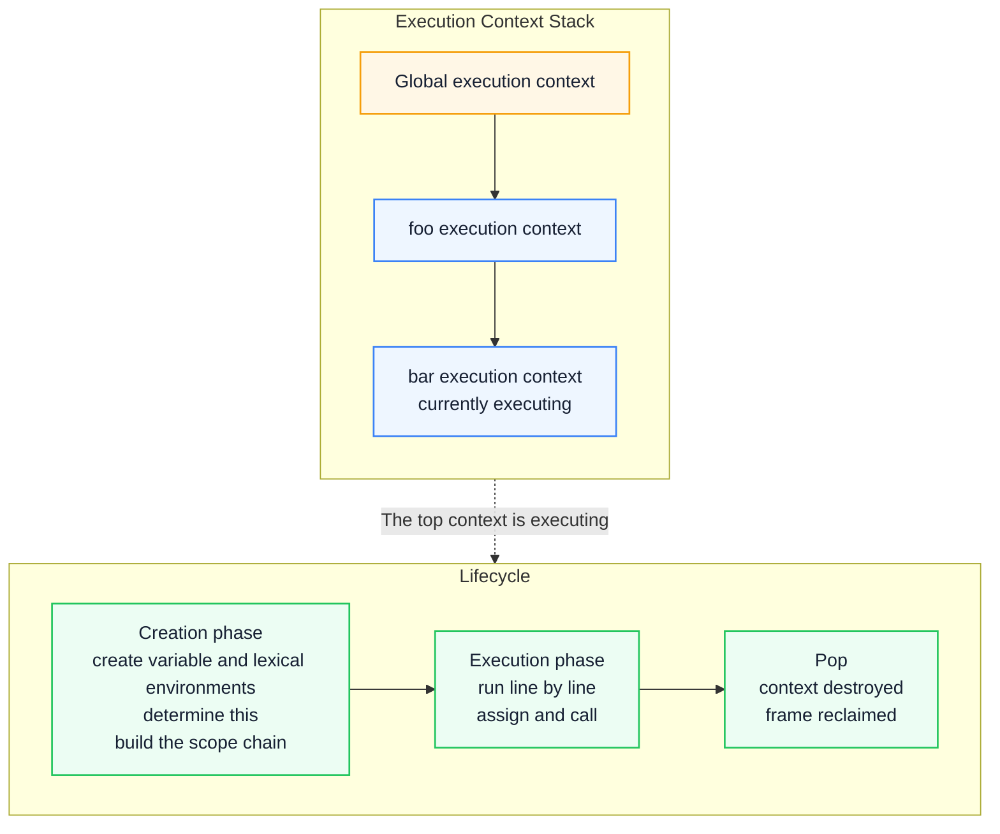
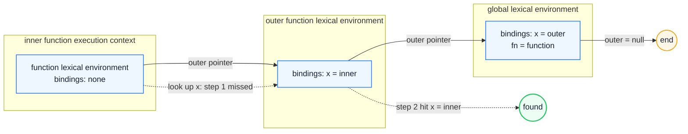
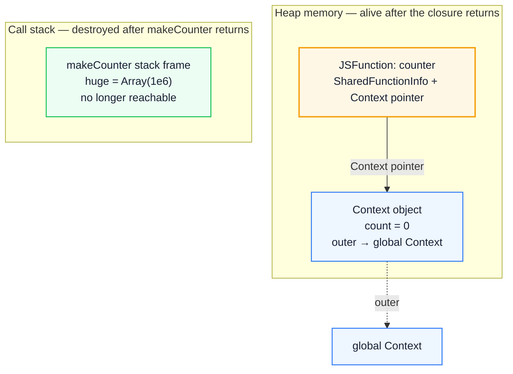

# Execution Context & Scope Chain: Understanding Closures from the V8 Perspective

Most engineers can recite the interview answer for a closure: an inner function remembers variables from its outer scope. That description is correct but too thin to answer the questions that matter in production.

Why does a local variable survive the return of its function? Why does `let` throw before its declaration while `var` yields `undefined`? Which variables does a closure actually keep alive, and when does that retention become a leak?

This article connects the specification model of execution contexts and environment records to V8's Context objects, then separates normal closure retention from real leaks. The goal is a memory model you can use for diagnosis.

::: info In one sentence
A closure is not a syntactic trick of "a function inside a function"; it is a real reference chain left by execution contexts and the scope chain in V8 heap memory — understanding it is what makes the real cause of memory leaks visible.
:::

## Table of Contents

- [Why the Standard Definition of a Closure Falls Short](#why-the-standard-definition-of-a-closure-falls-short)
- [1. Execution Context: The "Scene" Where JavaScript Code Runs](#_1-execution-context-the-scene-where-javascript-code-runs)
- [2. Variable Environment and Lexical Environment: How the Two Divide Work](#_2-variable-environment-and-lexical-environment-how-the-two-divide-work)
- [3. Scope Chain Construction: The Chain Strung Together by outer Pointers](#_3-scope-chain-construction-the-chain-strung-together-by-outer-pointers)
- [4. Closures from the V8 Perspective: Context Objects and Scope Analysis](#_4-closures-from-the-v8-perspective-context-objects-and-scope-analysis)
- [5. The Real Relationship Between Closures and Memory Leaks](#_5-the-real-relationship-between-closures-and-memory-leaks)
- [6. Closure Usage Boundaries and Engineering Patterns](#_6-closure-usage-boundaries-and-engineering-patterns)
- [Conclusion: A Closure Is the Scope Chain Continued on the Heap](#conclusion-a-closure-is-the-scope-chain-continued-on-the-heap)
- [FAQ](#faq)
- [Sources](#sources)

## Why the Standard Definition of a Closure Falls Short

"A function returns another function, and the inner function can access outer variables" is not wrong, but it cannot explain the following:

- What is the real difference between `var` and `let` inside an execution context? Why does `let` have a temporal dead zone (TDZ)?
- Why can local variables still be accessed after their function has returned?
- Which variables does a closure capture? All of them, or only the ones it uses? How does that affect memory?
- Under what premise does "closures cause memory leaks" hold, and when is the claim exaggerated?

Answering these questions means connecting the specification model to V8's implementation: what an execution context creates, how environment records form a chain, and what a closure actually leaves on the heap. The sections below follow that dependency order.

---

## 1. Execution Context: The "Scene" Where JavaScript Code Runs

An **Execution Context** is the scene the JavaScript engine prepares for executing a piece of code. It contains everything that code needs to run: variable bindings, the `this` value, the scope chain, and an outer environment reference.

There are three kinds of execution contexts in JavaScript:

1. **Global Execution Context**: Created when the program starts; only one exists for the lifetime of the program. In the browser it is associated with the global object `window` / `globalThis`.
2. **Function Execution Context**: Created on every function call. When the function returns, its context is popped and bindings not referenced by a closure become unreachable.
3. **Eval Execution Context**: Code executed inside `eval`. Almost unused in modern engineering, but it does exist.

### 1. The Execution Context Stack

JavaScript is single-threaded; at any moment only one execution context can be running. The engine manages them with an **Execution Context Stack (ECS)**:



Read the left side for stack growth: each function call pushes a context and each return pops one. Read the right side for the three phases of a single context; only the context on top of the stack is executing.

```javascript
function foo() {
  bar()
}
function bar() {
  console.log('bar')
}
foo()
```

When `foo()` is called, the stack changes as follows: global context pushed → `foo` context pushed → `bar` context pushed → `bar` finishes and pops → `foo` finishes and pops → back to the global context.

### 2. What Happens During the Creation Phase

During the creation phase, the execution context completes three things that determine what the code can see:

1. **Create the Lexical Environment**
2. **Create the Variable Environment**
3. **Determine the `this` binding**

Many people think hoisting physically moves declarations to the top. A more accurate description: **during the creation phase the engine registers the variable names in the environment record, but `var` starts with the value `undefined`, while `let` / `const` stay uninitialized — that uninitialized state is the TDZ**.

```javascript
console.log(a) // undefined — var is registered with value undefined
console.log(b) // ReferenceError — let is registered but in the TDZ
var a = 1
let b = 2
```

---

## 2. Variable Environment and Lexical Environment: How the Two Divide Work

In the ES5 specification, an execution context already had both `LexicalEnvironment` and `VariableEnvironment` components; in function code they usually point to the same environment. Only after ES6 introduced `let` / `const` / `class` and block scoping did the division of labor become visible:

- **Variable Environment (`VariableEnvironment`)**: holds `var` and `function` declarations. It stays unchanged for the whole function execution.
- **Lexical Environment (`LexicalEnvironment`)**: holds `let` / `const` / `class` declarations and is also the **starting point for identifier lookup at runtime**. It changes when execution enters a new block scope.

### 1. Structure of a Lexical Environment

A lexical environment consists of two parts:

1. **Environment Record**: stores the mapping from variable name to value.
2. **Reference to the outer environment (outer / [[OuterEnv]])**: points to the enclosing lexical environment; this pointer is what strings the scope chain together.

Environment records come in several types, and their differences explain many edge behaviors:

| Environment Record Type | Purpose | Typical Scenario |
| --- | --- | --- |
| Declarative | Bindings for `var` / `let` / `const` / `function` / `class` | Function body, block scope |
| Function | Declarative plus `this` / `new.target` / `super` bindings | Function call |
| Object | Bindings attached to an object | `with` statement, global object record |
| Module | Top-level module declarations with live import/export bindings | ES Module |

### 2. Why `var` and `let` Are Stored Separately

The key differences are **scope granularity** and **initialization timing**:

- `var` is function-scoped and initialized to `undefined` at creation.
- `let` / `const` are block-scoped; the binding is created when the block is entered, but **remains uninitialized until the declaration statement runs** (TDZ).

Separating the two environments lets the engine create a new lexical environment for `let` / `const` when entering a `{ }` block without touching function-scoped `var` bindings:

```javascript
function demo() {
  // VariableEnvironment: { x: undefined }
  // LexicalEnvironment (function level): { x: undefined } — var also appears here for lookup
  var x = 1

  if (true) {
    // Enter the block: a new block-level lexical environment is created with outer pointing to the function level
    // Block-level lexical environment: { y: <uninitialized> }
    console.log(x) // 1 — follow outer to find the outer x
    let y = 2
    console.log(y) // 2
  }
  // Leave the block: the block-level lexical environment is discarded and y is no longer accessible
  console.log(y) // ReferenceError: y is not defined
}
demo()
```

::: info Engineering takeaway
The TDZ is a real runtime constraint, not syntax sugar. When `let` declares order-sensitive variables inside loops or conditional blocks, the TDZ exposes use-before-declaration early; the same position with `var` would silently produce `undefined`.
:::

---

## 3. Scope Chain Construction: The Chain Strung Together by outer Pointers

The **Scope Chain** is not maintained separately; it is formed by each environment's `outer` (`[[OuterEnv]]`) pointer. To look up a variable, the engine starts at the current lexical environment and follows `outer` outward until it finds a binding or reaches `null` beyond the global environment.

### 1. Lexical Scope: Determined When You Write the Code

JavaScript uses **lexical scope**: a function's scope chain is fixed by the environment where it was **defined**, not where it is called. This is the prerequisite for understanding closures:

```javascript
const x = 'outer'

function outer() {
  const x = 'inner'
  function inner() {
    console.log(x) // 'inner' — determined by the definition site
  }
  return inner
}

const fn = outer()
fn() // still 'inner', even though only 'outer' surrounds the call site
```

`inner` is defined inside `outer`, so its `[[Environment]]` points to `outer`'s lexical environment. Wherever it is later called, looking up `x` follows that pointer back to `outer`.

### 2. The Memory Shape of the Scope Chain

The diagram below shows the scope chain during nested function execution. The `outer` pointers point from the inside out and are fixed when the function is **created**:



Follow the solid lines for the direction of `outer` pointers, and the dashed lines for one lookup of `x`: it misses in `inner`, hits in `outer`, then stops. No search continues past the binding that matched.

::: warning Exceptions from dynamic scope
`eval` and `with` can make identifier lookup depart from the static structure, which is why modern code should avoid them. Apart from those, which variables a function can access is fixed at definition time, independent of the call site.
:::

---

## 4. Closures from the V8 Perspective: Context Objects and Scope Analysis

The specification model explains how lookup works but not why variables keep living on the heap. That answer lives in V8's implementation.

### 1. A Context Pointer Hides Inside the Function Object

Inside V8, a JavaScript function object (`JSFunction`) contains at least three parts:

1. **SharedFunctionInfo (SFI)**: the static information of the function — source, AST, bytecode, parameter count. One piece of function code corresponds to one SFI.
2. **Context pointer**: points to the **Context object of the execution context in which the function was created**. This is where a closure's memory comes from.
3. **Feedback Vector**: type-feedback data used by Inline Caches (ICs), which cache property lookup results at an access site.

When the function is called, V8 uses this Context pointer as the parent context of the new stack frame and thereby restores the full scope chain.

### 2. The Division of Labor Between Stack and Heap: Why Local Variables Survive

Local variables of an ordinary function live in the **call stack**. When the function returns, the frame is popped and those bindings become unreachable, but the memory they occupied is reclaimed by the GC later — not at the instant of return.

Closures break that premise: if an inner function references a local variable of the outer function, the variable must remain accessible after the outer function returns. V8 decides during compilation, through **scope analysis**, which variables need context allocation:

- Variables referenced by an inner function are allocated in a **Context object on the heap**.
- Variables not referenced by any closure stay in the stack frame and wait for collection after the function returns.

TurboFan's **Escape Analysis** is a different mechanism: it mainly removes heap allocations for temporary objects and does not decide Context allocation.

A closure therefore does not move the entire activation record of the outer function to the heap; it keeps only the variables that are actually referenced. That is the upper bound of a closure's memory cost.

```javascript
function makeCounter() {
  let count = 0             // referenced by inner → allocated in the heap Context
  let huge = new Array(1e6) // not referenced by a closure → stays on the stack and waits for collection
  return function inner() {
    count++
    return count
  }
}
const counter = makeCounter()
```

Although `huge` is defined inside `makeCounter`, no closure references it, so it never enters the `Context` object; after `makeCounter` returns it is simply unreachable. Only `count` stays in the heap `Context`.

### 3. The Closure Memory Model



The `counter` function on the heap points to the same `Context` object, so `count` survives the return. The `huge` array in the stack frame is unreachable after the return and waits for GC. Solid lines are references; the dashed line continues to the enclosing scope.

::: info Engineering takeaway
When closure code uses unexpected memory, first inspect which large variables it references. Even if you never use a variable explicitly, one function on the closure chain referencing it is enough to keep it on the heap.
:::

---

## 5. The Real Relationship Between Closures and Memory Leaks

"Closures cause memory leaks" is one of the most repeated and most exaggerated claims. Start with the fact: **a closure is not a memory leak**. Keeping the variables it is supposed to keep is a feature, not a bug.

A real leak happens when **an object that should have been reclaimed stays reachable through a long-lived closure chain, so the GC cannot collect it**.

### 1. Three Real Closure Leak Patterns

**Pattern A: An event listener that is never removed**

```javascript
function setup(element, heavyData) {
  element.addEventListener('click', function onClick() {
    // The onClick closure references heavyData
    console.log(heavyData.length)
  })
  // Forgot to removeEventListener when the component is destroyed
}
```

If `element` leaves the DOM but the listener is not removed, the `onClick` closure holds both `heavyData` and `element`, so neither can be collected.

**Pattern B: A long-lived timer holding a reference**

```javascript
function start() {
  const bigCache = buildBigCache()
  setInterval(() => {
    refresh(bigCache) // The timer callback closure holds bigCache forever
  }, 1000)
}
```

The `setInterval` callback stays alive, so `bigCache` stays alive. Keep the timer id and call `clearInterval` when it is no longer needed.

**Pattern C: A growing cache of closures**

```javascript
const cache = {}
function get(key) {
  if (!cache[key]) {
    cache[key] = function () {
      // closure + unbounded cache → memory grows with every key
      return computeExpensive(key)
    }
  }
  return cache[key]
}
```

The closure is fine; the problem is an unbounded cache with no eviction. That is a cache design problem, though it is often blamed on closures.

### 2. How to Tell Whether It Is a Real Leak

Use the **Memory** panel in Chrome DevTools:

1. Take a heap snapshot.
2. Perform the suspected operation several times.
3. Take another snapshot and choose Comparison mode.
4. Sort by **Retained Size** and look for objects that keep growing, especially `(closure)` and `(array)` entries.

::: warning A closure is not a leak
"Using closures always leaks memory" does not hold. Short-lived closures used normally cost very little; what needs management is their **lifetime** and reference range. When investigating, look for `(closure)` objects whose Retained Size keeps growing, which usually points to an uncleaned listener or timer.
:::

---

## 6. Closure Usage Boundaries and Engineering Patterns

### 1. Closures in Loops: var vs let

The classic closure trap:

```javascript
for (var i = 0; i < 3; i++) {
  setTimeout(() => console.log(i), 0)
}
// Output: 3, 3, 3
```

`var` is function-scoped, so the three iterations share one `i`. By the time the timer callbacks run, the loop has finished and `i` is `3`.

```javascript
for (let i = 0; i < 3; i++) {
  setTimeout(() => console.log(i), 0)
}
// Output: 0, 1, 2
```

`let` is block-scoped, and the specification creates **a new `i` binding on every iteration**. Each callback closure therefore captures its own `i`.

Before `let`, an IIFE (Immediately Invoked Function Expression) was the workaround:

```javascript
for (var i = 0; i < 3; i++) {
  ;((j) => {
    setTimeout(() => console.log(j), 0)
  })(i)
}
// Output: 0, 1, 2
```

The IIFE copies the current value of `i` into the parameter `j`, cutting the reference to the shared `i`. Modern code can use `let` directly; the IIFE is a historical solution.

### 2. Accidentally Capturing a Large Object

```javascript
function handler() {
  const huge = new Array(1e6).fill(0) // only needed during setup
  return function onClick() {
    console.log('clicked')
    // huge is not used here, but older engines might still retain it
  }
}
```

Modern V8's scope analysis recognizes that `onClick` does not reference `huge` and keeps it out of the `Context`. Do not rely on engine optimization, though: a safer style keeps large objects in the smallest possible scope or explicitly drops the reference after use:

```javascript
function handler() {
  let huge = new Array(1e6).fill(0)
  doSomething(huge)
  huge = null // cut the reference so the GC can collect it earlier
  return function onClick() {
    console.log('clicked')
  }
}
```

### 3. Stable Callback References for Easy Unbinding

A new closure creates a new function object, so `removeEventListener` cannot match it:

```javascript
// Anti-pattern: a new closure every time, so unbinding never works
function bind() {
  element.addEventListener('click', () => doWork())
  // element.removeEventListener('click', () => doWork()) // ineffective
}
```

Keep the closure instead:

```javascript
function bind() {
  const onClick = () => doWork()
  element.addEventListener('click', onClick)
  return () => element.removeEventListener('click', onClick) // return a cleanup function
}
```

This "return a cleanup function" pattern is also the standard approach in React `useEffect`.

### 4. Closures and State Encapsulation

Closures naturally support private state encapsulation, which is the basis of the module pattern:

```javascript
function createBankAccount(initial = 0) {
  let balance = initial // private; not directly reachable from outside
  return {
    deposit(amount) {
      balance += amount
      return balance
    },
    withdraw(amount) {
      if (amount > balance) throw new Error('Insufficient balance')
      balance -= amount
      return balance
    },
    getBalance() {
      return balance
    },
  }
}

const account = createBankAccount(100)
account.deposit(50)
console.log(account.getBalance()) // 150
// account.balance // undefined — state is protected by the closure
```

The closure object itself is small. What occupies memory is the captured variables and how long they stay alive. The engineering goal is therefore not to write fewer closures, but to narrow what they capture and shorten the life of the reference chain.

---

## Conclusion: A Closure Is the Scope Chain Continued on the Heap

Understanding closures also separates two things that are easy to conflate: variable visibility and variable lifetime. Visibility is decided by the lexical structure; lifetime is decided by reachability.

Next, take one long-lived callback in your project — an event listener, a timer, or a cache — list the outer variables it actually references, and ask whether that reference chain should live that long. That question is more useful during an investigation than remembering that "closures leak."

---

## FAQ

### 1. Does a closure capture a variable's value or the variable itself?

It captures the **binding**, not a copy of the value at creation time. When several closures share one outer variable, a change made through one is visible through the others. Only the loop form with `let` creates a fresh binding per iteration, which is why each closure then gets an independent variable.

### 2. Do arrow functions and ordinary functions behave differently as closures?

The lexical environment is captured the same way: both remember the environment where they were defined. The difference is `this`, `arguments`, `super`, and `new.target` — an arrow function does not create its own bindings for these and reads the outer values through the scope chain. The memory model applies to both, but they cannot be mixed when `this` matters.

### 3. Are V8's `Context` and the specification's lexical environment the same thing?

No. The specification describes the scope chain with Environment Records and `[[OuterEnv]]`; `Context` is V8's implementation carrier, which holds variable slots and a pointer to the outer Context. They correspond for variable lookup but are not one-to-one, and V8 distinguishes function contexts from block contexts.

### 4. Why does a closure created before a `let` declaration throw a TDZ error when called?

A closure captures the binding, not the value. The binding exists as soon as the block is entered, but stays uninitialized until the `let` declaration runs. If the closure is called before initialization, reading that binding throws `ReferenceError`; after the declaration runs, it reads the initialized value.

---

## Sources

1. ECMAScript specification definitions of execution contexts, lexical environments, and environment records: [ECMA-262 Lexical Environments](https://tc39.es/ecma262/#sec-lexical-environments)
2. V8 engine design and closure implementation documentation and blog posts: [V8 Dev blog](https://v8.dev/blog)
3. MDN explanation of closures and scope: [MDN Closures](https://developer.mozilla.org/en-US/docs/Web/JavaScript/Closures)
4. This article is based on public technical documentation (ECMAScript specification, V8 official blog, MDN) and the author's engineering practice.
