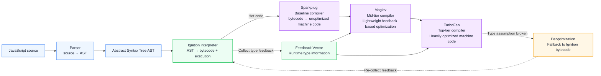
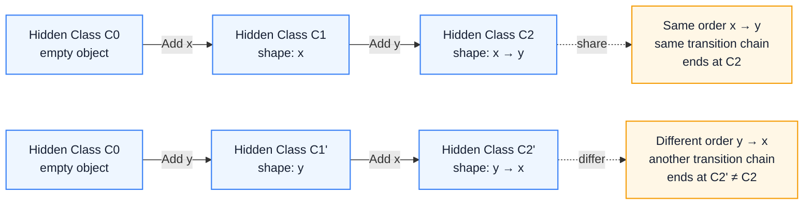
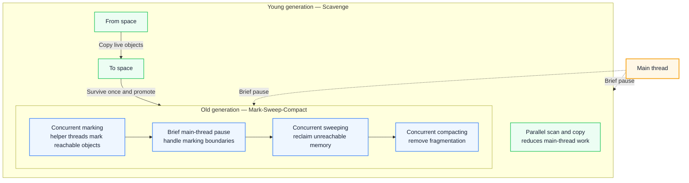

# V8 Engine Deep Dive: JIT Compilation and Garbage Collection

Performance advice about V8 usually arrives as a list of prohibitions: do not use `delete`, do not use `arguments`, always add properties in the same order. Each statement can be true, but only under conditions the list never states.

V8 provides fast paths, not guarantees: once object shape, type stability, or object lifetime departs from what the engine observed, it preserves correctness and gives up speed.

This article follows the causal chain from the compilation pipeline through Hidden Classes and Inline Caches to generational GC, then shows how to observe the result in Chrome DevTools. The aim is to turn a remembered rule into a testable mechanism.

::: info In one sentence
V8 does not optimize everything automatically. It offers fast paths while their preconditions hold; once shape, type, or lifetime breaks them, V8 guarantees semantics but no longer guarantees speed.
:::

## Table of Contents

- [Why Heard Optimization Mantras Are Unreliable](#why-heard-optimization-mantras-are-unreliable)
- [1. V8 Architecture: The Pipeline from Source to Machine Code](#_1-v8-architecture-the-pipeline-from-source-to-machine-code)
- [2. JIT Compilation: The Hybrid Interpreter-Compiler Model](#_2-jit-compilation-the-hybrid-interpreter-compiler-model)
- [3. Hidden Class: The Internal Representation of Object Shape](#_3-hidden-class-the-internal-representation-of-object-shape)
- [4. Inline Cache: Putting Property Access on the Fast Path](#_4-inline-cache-putting-property-access-on-the-fast-path)
- [5. Garbage Collection: Generational GC and Orinoco](#_5-garbage-collection-generational-gc-and-orinoco)
- [6. Common Performance Anti-patterns](#_6-common-performance-anti-patterns)
- [7. Analyzing V8 Behavior with DevTools](#_7-analyzing-v8-behavior-with-devtools)
- [Conclusion: Code for V8 Cooperates with Its Fast Paths](#conclusion-code-for-v8-cooperates-with-its-fast-paths)
- [FAQ](#faq)
- [Sources](#sources)

## Why Heard Optimization Mantras Are Unreliable

`delete`, `arguments`, and property order appear repeatedly in performance discussions, but many recommendations keep only the conclusion and drop the premise. Without V8's fast-path mechanisms, a mantra cannot tell you when it holds. Start with concrete questions:

- How many stages does V8 go through from source to machine code? Why so many?
- Why can two objects that look identical differ in speed? What is a "hidden class"?
- Why does the same function become faster after a few calls, then possibly slower after another call (deoptimization)?
- When exactly does GC pause the main thread? What do generational collection and Orinoco solve?
- How can I use DevTools to see what V8 is doing with my code?

Answering these requires three layers: how code is compiled, how objects are represented, and how memory is reclaimed. Only with that chain can you judge whether an optimization tip applies to your code.

---

## 1. V8 Architecture: The Pipeline from Source to Machine Code

V8 is Google's JavaScript and WebAssembly engine, used by Chrome, Node.js, Deno, and others. Its core pipeline can be summarized as: **source → AST → bytecode → execution → (hot code) → optimized machine code**.

### 1. Core Stages



Follow the solid arrows for promotion: code starts in the interpreter and reaches Sparkplug, Maglev, and TurboFan only after it becomes hot. The dashed path is failure handling: when a type assumption breaks, execution returns to bytecode instead of continuing to optimize.

1. **Parsing**: The Parser turns source text into an **Abstract Syntax Tree (AST)**. V8 uses lazy parsing — it parses only the outer shell of a function at first and fully parses the body when the function is actually called, which speeds up startup.
2. **Bytecode generation and interpretation (Ignition)**: Ignition compiles the AST into bytecode and interprets it. Bytecode is a platform-independent intermediate representation with fast startup and a small memory footprint. Ignition also collects **type feedback** — observed object shapes, argument types, and so on — and stores it in the feedback vector.
3. **Baseline compilation (Sparkplug)**: For hot bytecode, Sparkplug quickly generates unoptimized machine code and removes interpretation overhead, compiling much faster than TurboFan. Introduced in 2021, this tier fills the gap between interpretation and heavy optimization.
4. **Mid-tier compilation (Maglev)**: Produces lightly optimized machine code based on type feedback. Its compilation speed and optimization level sit between Sparkplug and TurboFan; it has matured progressively since 2023.
5. **Top-tier optimization (TurboFan)**: Performs heavy optimization based on rich type feedback — inlining, escape analysis, hidden-class specialization — and generates highly optimized machine code. It takes the longest to compile, so it is enabled only for genuinely hot code.
6. **Deoptimization**: If a type assumption made during TurboFan compilation breaks at runtime (for example, an object with a different shape is passed in), V8 discards the optimized machine code, **falls back to Ignition bytecode**, re-collects feedback, and may optimize again.

### 2. Why So Many Layers?

This is a classic engineering trade-off:

- **Full AOT compilation** (compiling all code before startup) starts too slowly and uses too much memory; browser scenarios are extremely sensitive to startup latency.
- **Pure interpretation** starts fast, but repeatedly interpreting hot code is too slow at runtime.
- **Tiered JIT** lets code run quickly through interpretation first and adds optimization as it gets hot, balancing startup speed and runtime performance.

::: warning Not a one-time compilation
V8 does not compile an entire program to machine code at startup. It interprets first and moves only code judged hot into the compilers; cold code may stay at the bytecode stage for its whole life.
:::

---

## 2. JIT Compilation: The Hybrid Interpreter-Compiler Model

**JIT (Just-In-Time)** means compiling code to machine code at runtime, as opposed to AOT (ahead-of-time) compilation and pure interpretation. V8's JIT is a hybrid of an interpreter and multiple compiler tiers.

### 1. Division of Labor Between Interpreter and Compilers

- **Ignition (interpreter)**: Executes bytecode. Startup is fast and memory use is low, but every instruction pays the cost of fetch → decode → dispatch → execute.
- **Compilers (Sparkplug/Maglev/TurboFan)**: Translate bytecode into native machine code that runs directly, removing interpretation overhead, at the cost of compilation time and memory.

V8 uses **hotness detection** to decide when to upgrade; this strategy of switching compilation tiers progressively is called **tiering**. Ignition maintains a call count and a back-edge count for each bytecode segment, and crossing a threshold triggers the next tier.

### 2. Type Feedback: How JIT Decides What to Specialize

JavaScript is dynamically typed, and the same code may handle many types. The key strategy of JIT optimization is **optimistic specialization**: generate fast machine code for the types observed at runtime.

```javascript
function add(a, b) {
  return a + b
}
// If a and b have historically been integers, TurboFan specializes to integer addition.
add(1, 2)
add(3, 4)
// ...after many integer calls, the function is optimized for integer addition.

// Passing strings breaks the integer assumption → deoptimization, fallback to bytecode.
add('x', 'y')
```

Ignition writes these observations into the **Feedback Vector**, which records which types this addition has seen and which hidden classes this property access has seen. The compilers read that feedback to decide how to specialize.

### 3. Deoptimization: Correctness First

Optimistic specialization is built on assumptions. Once an assumption breaks, V8 must **deoptimize** — discard the machine code and continue in bytecode. Deoptimization keeps semantics correct, but the cost is a clear drop in performance; V8 then re-collects feedback and tries to optimize again.

```mermaid
flowchart LR
    A["Integer calls<br/>feedback: int + int"] --> B["TurboFan optimization<br/>integer addition machine code"]
    B --> C["Continued integer calls<br/>fast execution"]
    C --> D{"String passed in?"}
    D -- "Yes" --> E["Deoptimization<br/>assumption broken"]
    E --> F["Fallback to Ignition bytecode<br/>performance drops"]
    F --> G["Re-collect feedback<br/>int + int and str + str"]
    G --> H["Optimize again<br/>polymorphic version or re-specialization"]
    D -- "No" --> C

    classDef wait fill:#EEF6FF,stroke:#3B82F6,color:#172033,stroke-width:1.5px;
    classDef work fill:#ECFDF3,stroke:#22C55E,color:#172033,stroke-width:1.5px;
    classDef block fill:#FFF7E6,stroke:#F59E0B,color:#172033,stroke-width:2px;
    classDef metric fill:#F5E8FF,stroke:#A855F7,color:#172033,stroke-width:1.5px;
    class A,G wait;
    class B,C,H work;
    class E,F block;
    class D metric;
```



The upper path is normal execution with integer specialization. A type change takes the lower branch: deoptimize, return to bytecode, and collect feedback again. Deoptimization is not a crash; it is a correctness-first fallback.

::: info Engineering takeaway
Avoid mixing types in hot functions. A function that handles both numbers and strings, or both object A and object B, turns its feedback vector polymorphic or megamorphic, which triggers deoptimization or blocks specialization.
:::

---

## 3. Hidden Class: The Internal Representation of Object Shape

The pain of dynamic languages is that object layout is known only at runtime, so property access has to rely on hash lookup, which is slow. V8 solves this with **Hidden Classes** (called Maps internally).

### 1. What Is a Hidden Class?

A Hidden Class describes the shape of an object: which properties it has and at which memory offsets they sit. **Objects with the same shape share one Hidden Class.** With a Hidden Class, V8 locates a property through "class + offset" instead of hashing on every access.

```javascript
function Point(x, y) {
  this.x = x
  this.y = y
}

const p1 = new Point(1, 2)
const p2 = new Point(3, 4)
// p1 and p2 add the same properties in the same order → they share one Hidden Class.
```

### 2. Hidden-Class Transitions

Every time a property is **added**, V8 does not modify the Hidden Class in place. It creates a new Hidden Class along a transition chain:



Both paths end with the same set of properties, but their transition histories differ, so the Hidden Classes differ. Sharing a Hidden Class requires adding the same properties in the same order, not merely having the same property names.

::: warning Object count is not the main issue
One thousand objects with an identical shape can share a Hidden Class and hit the Inline Cache. One thousand objects with different shapes push the access site toward polymorphic. Check shape consistency before checking how many objects you created.
:::

```javascript
function A() {}
const a1 = new A()
a1.x = 1
a1.y = 2 // Transition chain: {} → {x} → {x,y}

const a2 = new A()
a2.y = 1
a2.x = 2 // Transition chain: {} → {y} → {y,x}

// a1 and a2 have the same properties in a different order → different Hidden Classes
```

### 3. When Does an Object Fall into Slow Mode?

The following operations break Hidden Class sharing or force V8 to degrade:

- **`delete` removes a property**: breaks shape consistency, and V8 may downgrade the object to dictionary mode (slow properties with hash lookup).
- **Too many properties**: beyond a threshold, V8 switches to dictionary storage to save memory, which makes access slower.
- **Inconsistent addition order**: as in the example above, produces different Hidden Classes.
- **Heavy mixing of indexed and named properties**: affects the fast-elements path.

---

## 4. Inline Cache: Putting Property Access on the Fast Path

Hidden Classes solve object layout, but each access still has to find the class and then the offset. An **Inline Cache (IC)** stores that lookup result so repeated access approaches a direct read.

### 1. How an IC Works

V8 keeps an IC slot at each property-access bytecode location, recording the Hidden Class of the object and the property offset from the last access. On the next access:

1. Read the Hidden Class of the current object.
2. Compare it with the Hidden Class cached in the IC.
3. Hit → read the value with the cached offset.
4. Miss → take the slow lookup path and update the cache.

### 2. IC States

An IC has several states; the further down the list, the worse the performance:

| State | Meaning | Performance |
| --- | --- | --- |
| Uninitialized | Not accessed yet | — |
| Monomorphic | Has seen one Hidden Class | Fastest (fast-path hit) |
| Polymorphic | Has seen a small number of Hidden Classes (commonly 2–4) | Fast (a few branch checks) |
| Megamorphic | Beyond the polymorphic limit (commonly more than 4) | Slowest (falls back to generic lookup) |

```javascript
function readX(obj) {
  return obj.x
}

const A = { x: 1 } // Hidden Class CA
const B = { x: 1, y: 2 } // Hidden Class CB (different shape)
const C = { x: 1, z: 3 } // Hidden Class CC

readX(A) // IC: monomorphic (CA)
readX(B) // IC: polymorphic (CA, CB)
readX(C) // IC: polymorphic (CA, CB, CC)
// ...passing objects with 5+ different shapes → megamorphic, the cache loses its value
```

Once a hot function becomes megamorphic, property access slows down noticeably and may block TurboFan specialization.

### 3. Practices That Work with Hidden Classes

The core of keeping an IC monomorphic is ensuring that objects entering a hot function **share one Hidden Class**:

```javascript
// Good: all point objects have the same shape, so the IC stays monomorphic
function makePoint(x, y) {
  return { x, y } // literal initialization in a fixed order
}
const points = Array.from({ length: 1000 }, (_, i) => makePoint(i, i))
points.forEach((p) => p.x) // fast

// Bad: inconsistent shapes degrade the IC
const mixed = [{ x: 1 }, { x: 1, y: 2 }, { x: 1, z: 3 }]
mixed.forEach((p) => p.x) // polymorphic, slow
```

::: info Engineering takeaway
When a hot function receives data from several sources (API A returns `{x,y}`, API B returns `{x,y,z}`), normalizing to one shape at the entry point can avoid IC degradation. Normalization itself copies data, so it is worth doing only on a hot path where the variety of shapes is controlled.
:::

---

## 5. Garbage Collection: Generational GC and Orinoco

V8's **Garbage Collection (GC)** follows the generational hypothesis: **most objects die young, and a few live long**. The heap is therefore split into a **young generation** and an **old generation**, each collected with a different algorithm.

### 1. Young Generation: Scavenge and Cheney Semi-Space Copy

The young generation holds short-lived objects; it is small and collected often. V8 uses the **Cheney semi-space copy algorithm**:

1. The young generation is split into two equal semi-spaces: **From space** (currently allocating) and **To space** (idle).
2. During GC, live objects in From space are scanned and **copied** into To space, compacted as they are copied.
3. After copying, From and To swap roles.
4. **Objects that survive one Scavenge are usually promoted to the old generation**.

The copy algorithm is fast and leaves no fragmentation; its downside is that only half the space is usable, which is acceptable because the young generation is small (a few MB to tens of MB).

### 2. Old Generation: Mark-Sweep and Mark-Compact

The old generation holds long-lived objects and is large. Copying is not cost-effective at that size (high copy cost and half the space wasted), so it uses **Mark-Sweep** plus **Mark-Compact**:

1. **Mark**: starting from roots (globals, stack, registers), traverse the object graph and mark every reachable object.
2. **Sweep**: reclaim the memory of unreachable objects.
3. **Compact** (when necessary): move live objects together to remove fragmentation.

### 3. Orinoco: Concurrent and Parallel GC for Shorter Pauses

Early GC was stop-the-world: the main thread paused completely during collection, and with a large old generation a single pause could reach tens of milliseconds. **Orinoco** is V8's incremental GC project; it reduces pauses to the millisecond range through concurrency and parallelism:



The upper half is the young-generation copy; the lower half is concurrent marking, sweeping, and compacting in the old generation. The main thread participates only at brief synchronization points, marked by the two dashed edges.

- **Parallel Scavenge**: several helper threads copy the young generation in parallel, reducing main-thread work.
- **Concurrent Marking**: most marking runs on background threads, with the main thread pausing only at key points.
- **Concurrent Sweeping and Compacting**: sweeping and compacting also run concurrently where possible.
- **Incremental Marking**: one long mark is split into small steps interleaved with main-thread execution, avoiding a single long pause.

GC pauses are shorter, but their frequency still follows the allocation rate. Creating fewer temporary objects on a hot path is more direct than tuning GC parameters afterward; a large number of long-lived objects entering the old generation raises marking cost.

---

## 6. Common Performance Anti-patterns

Putting the previous sections together explains why these patterns are anti-patterns: they break shape consistency, type stability, or object lifetime.

### 1. `delete` Removes a Property

`delete` breaks the Hidden Class, may push the object into dictionary mode, and invalidates related ICs.

```javascript
// Bad: deleting a property changes the shape
const p = { x: 1, y: 2 }
delete p.y

// Good: use a placeholder when "invalidation" is the intent and keep the shape stable
const q = { x: 1, y: null }
```

### 2. Initializing Properties in Different Orders

Inconsistent property order in a constructor or literal creates different Hidden Classes and makes the IC polymorphic.

```javascript
// Bad
function bad(a) {
  if (a) return { x: 1, y: 2 }
  return { y: 2, x: 1 } // different order, different Hidden Class
}

// Good: always use one order, preferably through the same constructor
function Point(x, y) {
  this.x = x
  this.y = y
}
```

### 3. Mixing Types in a Hot Function

```javascript
// Bad: one hot function handles several shapes
function process(item) {
  return item.value * 2
}
process({ value: 1 }) // shape A
process({ value: 1, tag: 'x' }) // shape B → polymorphic IC

// Good: normalize before processing
const normalized = { value: raw.value }
process(normalized) // always shape A
```

### 4. Creating Short-Lived Objects on a Hot Path

```javascript
// Bad: a new object every animation frame increases GC pressure
function animate() {
  const state = { x: 0, y: 0, vx: 1, vy: 1 } // new object per frame
  // ...
  requestAnimationFrame(animate)
}

// Good: reuse the object
const state = { x: 0, y: 0, vx: 1, vy: 1 }
function animate() {
  state.x += state.vx
  state.y += state.vy
  // ...
  requestAnimationFrame(animate)
}
```

### 5. Oversized and Sparse Arrays

Sparse arrays with many holes, or oversized arrays, leave the fast-elements path and degrade to dictionary elements. Avoid using objects as sparse maps; use `Map` when that is the actual need.

---

## 7. Analyzing V8 Behavior with DevTools

Theory has to become observable. Chrome DevTools offers several direct entry points for watching V8.

### 1. Performance Panel: JS Execution and GC

After recording an interaction, inspect the flame chart:

- **Yellow Evaluate Script / Function Call blocks**: JavaScript execution time. Large continuous yellow blocks are usually long tasks that block interaction.
- **Purple Recalculate Style / Layout blocks**: style and layout cost related to the rendering pipeline.
- **GC event blocks**: GC pauses. Color and position vary with the DevTools version and theme. Frequent appearances or long single blocks indicate too many short-lived objects.

### 2. Memory Panel: Heap and Allocations

- **Heap snapshot**: sort by Retained Size to find the object types consuming the most memory (`(array)`, `(string)`, `(system)`, closures). Comparing two snapshots locates growing objects.
- **Allocation timeline**: watch allocations in real time; blue bars are allocations and gray bars are reclaimed objects. Many blue bars with no corresponding gray ones mean short-lived objects or a leak.
- **Allocation sampling**: sample allocations by function to find which function creates the objects.

### 3. Observing Optimization and Deoptimization

Using `node --trace-opt --trace-deopt` shows which functions are optimized, when they deoptimize, and why. These are V8 flags exposed by Node.js, and the output format changes between Node versions:

```bash
# Node.js: trace optimization and deoptimization
node --trace-opt --trace-deopt app.js
```

The output marks entries such as `[optimizing: ...]` and `[deoptimizing: ...]`, and the reason field points to the specific shape or type mismatch. This is a command illustration; the function names and reasons depend on the code and the V8 version.

::: info Engineering takeaway
Reproduce first, measure second, optimize last. Record a real interaction with Performance, find the largest JavaScript, style, or GC block, change that target, and verify the gain with the same metric. Do not optimize code by intuition when no bottleneck has been measured.
:::

---

## Conclusion: Code for V8 Cooperates with Its Fast Paths

V8 performance is not decided by a syntax rule. It is decided by whether the code maintains predictable shape, type, and lifetime. Once that causal chain is clear, advice such as "do not use `delete`" should be restated as "which precondition does it break, and under what conditions does the cost appear."

Next, record one real interaction with Performance, find the largest JavaScript, style, or GC block, then confirm the cause with `--trace-deopt` or Memory allocation sampling. An optimization is worth adopting only when a measurement points to a specific mechanism.

---

## FAQ

### 1. Can developers choose Maglev or TurboFan manually?

Not directly. V8 tiers code automatically based on call counts, back-edge counts, and feedback quality. What developers can influence is whether the feedback stays stable: keep shapes and types consistent in hot functions and avoid unnecessary polymorphism and deoptimization. Chasing a particular tier is usually less effective than reducing type noise.

### 2. After `delete`, does setting `obj.x = null` restore the original fast path?

Not necessarily. `delete` may already have moved the object into dictionary mode or rewritten its transition chain; a later assignment operates on the current form and does not restore the previous Hidden Class. When "invalidation" is the intent, use a placeholder value at creation time instead of deleting and re-adding.

### 3. Does sharing a Hidden Class mean two objects are equal?

No. A Hidden Class describes the property set, order, and memory layout, not the values. `{ x: 1 }` and `{ x: 2 }` can share one Hidden Class while holding different values. Equality still depends on values and semantics.

### 4. Can GC be triggered manually?

For debugging, yes. Node.js exposes `global.gc()` under `--expose-gc`, and the Memory panel in Chrome DevTools can force a collection to check whether objects are still referenced. These are diagnostic tools, not production optimizations; in production, lowering the allocation rate and controlling object lifetime are more effective.

---

## Sources

1. V8 official blog posts on Ignition, TurboFan, Sparkplug, Maglev, and Orinoco: [V8 Dev blog](https://v8.dev/blog)
2. V8 official documentation on hidden classes, inline caching, and garbage collection: [v8.dev](https://v8.dev/docs)
3. MDN documentation on JavaScript performance and memory management: [MDN Memory Management](https://developer.mozilla.org/en-US/docs/Web/JavaScript/Memory_Management)
4. Chrome DevTools official documentation on the Performance and Memory panels: [Chrome DevTools](https://developer.chrome.com/docs/devtools/)
5. This article is based on public technical documentation (V8 official blog and docs, MDN, Chrome DevTools docs) and the author's engineering practice.
