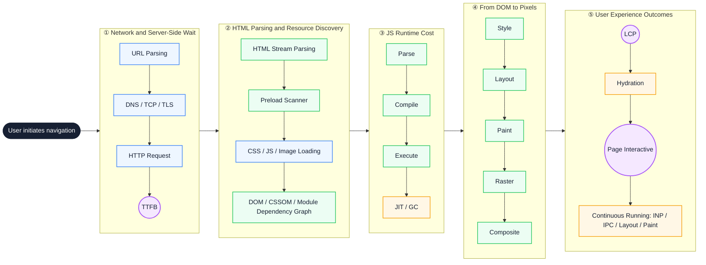
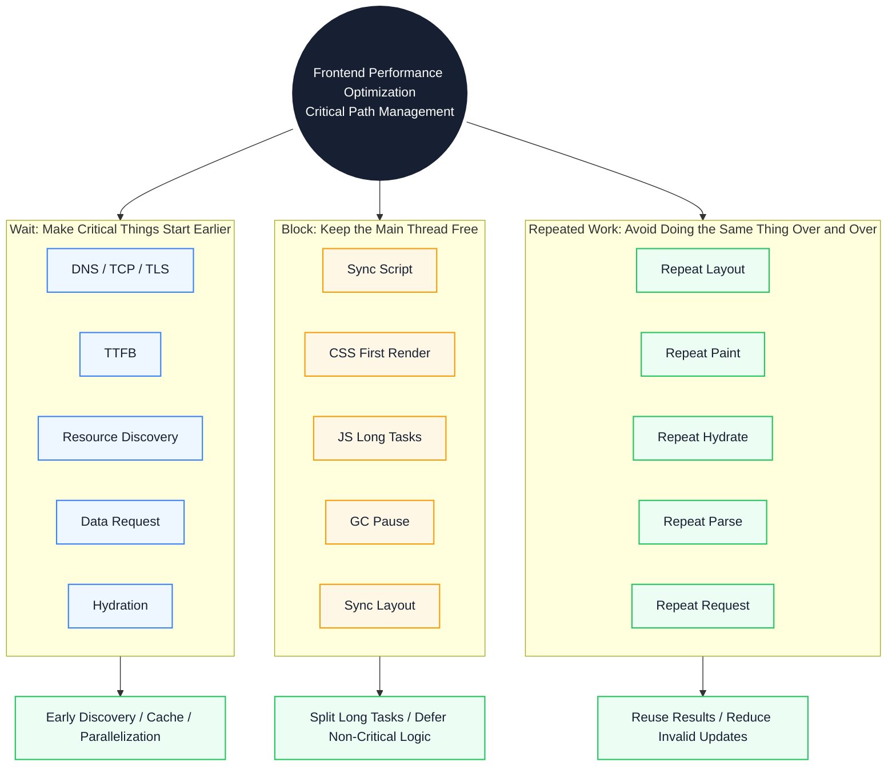

# The Critical Path of Modern Frontend Performance

A page that feels fast on a local machine can still stall in production: the hero image appears late, a button takes a moment to respond, and scrolling drops frames now and then. Shrinking the bundle does not explain these symptoms, because the delay may sit in the network, the parser, the JavaScript runtime, or the rendering pipeline. This article follows a single navigation in time order and separates waiting, blocking, and repeated work at each stage. It then shows how to record a baseline, which change is worth trying, how to verify the result, and when to roll back.

::: info In one sentence
The essence of modern frontend performance optimization is managing waiting, blocking, and repeated work on the critical path.
:::

## Table of Contents

- [Introduction](#introduction)
- [1. From "Framework Perspective" to "Browser Pipeline Perspective"](#_1-from-framework-perspective-to-browser-pipeline-perspective)
- [2. The First Wait: A Lot Happens Before TTFB](#_2-the-first-wait-a-lot-happens-before-ttfb)
- [3. Resource Discovery: Many LCP Issues Are Not Slow Downloads, but Late Discovery](#_3-resource-discovery-many-lcp-issues-are-not-slow-downloads-but-late-discovery)
- [4. HTTP/2 and HTTP/3 Have Changed Resource Organization, but Haven't Eliminated the Critical Path](#_4-http-2-and-http-3-have-changed-resource-organization-but-haven-t-eliminated-the-critical-path)
- [5. The HTML, CSS, and JS Parsing Phase Is a Performance Battlefield](#_5-the-html-css-and-js-parsing-phase-is-a-performance-battlefield)
- [6. LCP Is an Outcome Metric, Not a Single-Resource Metric](#_6-lcp-is-an-outcome-metric-not-a-single-resource-metric)
- [7. From DOM to Pixels: The Real Cost of Layout, Paint, Raster, and Composite](#_7-from-dom-to-pixels-the-real-cost-of-layout-paint-raster-and-composite)
- [8. Rasterization Is Not an Abstraction; It Is Key to LCP and Animation Performance](#_8-rasterization-is-not-an-abstraction-it-is-key-to-lcp-and-animation-performance)
- [9. JS Cost Is More Than Execution: Parsing, Compilation, JIT, and GC](#_9-js-cost-is-more-than-execution-parsing-compilation-jit-and-gc)
- [10. GC Optimization Is Not About "Not Creating Objects"; It Is About Controlling Lifecycles](#_10-gc-optimization-is-not-about-not-creating-objects-it-is-about-controlling-lifecycles)
- [11. Module Runtime: The Browser Is Taking Over Some of the Bundler's Former Responsibilities](#_11-module-runtime-the-browser-is-taking-over-some-of-the-bundler-s-former-responsibilities)
- [12. Hydration: The Cost of SSR Is Often Underestimated](#_12-hydration-the-cost-of-ssr-is-often-underestimated)
- [13. INP: From "Page Appears" to "Interaction Reliability"](#_13-inp-from-page-appears-to-interaction-reliability)
- [14. IPC and Multiprocessing: Collaboration Inside the Browser Also Has a Cost](#_14-ipc-and-multiprocessing-collaboration-inside-the-browser-also-has-a-cost)
- [15. Site Isolation and Sandbox: Security Architecture Also Affects the Performance Model](#_15-site-isolation-and-sandbox-security-architecture-also-affects-the-performance-model)
- [16. bfcache and Service Worker: Reducing Repeated Loading and Repeated Work](#_16-bfcache-and-service-worker-reducing-repeated-loading-and-repeated-work)
- [17. Unified Model: Wait, Block, and Repeated Work](#_17-unified-model-wait-block-and-repeated-work)
- [18. Baseline and Validating Changes](#_18-baseline-and-validating-changes)
- [19. Cost and Rollback: Optimization Is Not Free](#_19-cost-and-rollback-optimization-is-not-free)
- [20. Advanced Frontend Practice Checklist](#_20-advanced-frontend-practice-checklist)
- [Conclusion: Advanced Frontend Optimizes the System, Not a Single Line of Code](#conclusion-advanced-frontend-optimizes-the-system-not-a-single-line-of-code)
- [FAQ](#faq)
- [Sources](#sources)

## Introduction

The main reference for this article is Addy Osmani's long post on X, *How modern browsers work*, and its Chinese compilation. Addy Osmani works on Web performance and Chrome developer experience, has contributed to DevTools, Lighthouse, and Core Web Vitals, and is the author of *Learning JavaScript Design Patterns* and *Image Optimization*. His personal site is [addyosmani.com](https://addyosmani.com/).

One term runs through the whole article: the **Critical Rendering Path** is the sequence of steps that must complete between the arrival of HTML and CSS and the first screen pixels. It is narrower than the full loading process, but it decides how long the user waits before seeing the page.

Panel observations in this article refer to Chromium DevTools; block names and colors vary by version and theme.

A single navigation can be split into five stages in time order. Each stage can introduce waiting, blocking, or repeated work:

- **Waiting**: TTFB waits on the network and server; LCP waits for the main content to actually appear; Hydration waits for the page to go from "viewable" to "usable."
- **Blocking**: synchronous scripts block HTML parsing; CSS blocks first render; long tasks block interaction; GC pauses block the main thread.
- **Repeated work**: repeated layout, repeated paint, repeated rasterization, repeated hydration of static regions, repeated resource requests.



Read from left to right: the first four stages determine when the page can appear, and the fifth determines whether it stays reliable after it appears. Purple nodes are metrics you can collect directly; amber nodes are the stages most likely to occupy the main thread or interrupt the critical path. In the fourth stage, Style, Layout, Paint, Raster, and Composite stand for style calculation, layout, paint, rasterization, and compositing.

---

## 1. From "Framework Perspective" to "Browser Pipeline Perspective"

When many frontend engineers approach performance optimization, they start from the framework and the build output:

- Are React components re-rendering too much?
- Is the Vue reactivity system triggering too many updates?
- Is the bundle too large?
- Are images not compressed?
- Are API responses too slow?

These questions are worth checking, but they only answer "where a problem might be"; they do not answer "which stage this slowdown is in." The next questions are:

- Does the slowness happen in the network, the server, or the browser?
- Is TTFB slow, or is resource discovery late?
- Is CSS blocking first render, or is synchronous JS blocking HTML parsing?
- Is the LCP image downloading slowly, or is decoding, layout, or rasterization slow?
- Is the client module graph too deep, causing critical JS to execute late?
- Is Hydration too heavy, making the page "visible but unclickable"?
- Is JIT deoptimization, GC pauses, or IPC and compositing-layer cost being amplified?

A modern browser is not a simple HTML/CSS/JS execution box; it is a software system. It handles network communication, resource scheduling, HTML/CSS/JS parsing, JavaScript execution, layout, paint, GPU compositing, multi-process isolation, and security sandboxes.

Expanded into an order you can check item by item:

1. User initiates navigation
2. URL parsing / DNS / TCP / TLS / HTTP request
3. TTFB
4. HTML streaming parse / preload scan
5. DOM / CSSOM / module dependency graph
6. JS parse / compile / execute
7. Style calculation / layout / paint records
8. Layering / tile rasterization / GPU composite
9. LCP
10. Hydration
11. Page truly interactive
12. Ongoing JIT / GC / IPC / Layout / Paint / Composite costs

The first step in diagnosis is not choosing an optimization technique, but attaching a stage label to this particular slowdown. A wrong label usually leads to a technique that misses the real bottleneck.

---

## 2. The First Wait: A Lot Happens Before TTFB

**TTFB (Time to First Byte)** is the time between the browser initiating a request and receiving the first byte returned by the server.

Reading TTFB as "backend response time" is incomplete. Before the first byte arrives, the browser has usually gone through URL parsing, security checks, DNS lookup, TCP connection establishment, the TLS handshake in HTTPS scenarios, sending the HTTP request, server processing, and the start of the response headers.

Addy Osmani notes in his original post that the modern Chromium network stack usually runs in a dedicated network service or network process. The renderer process cannot access the network directly; it obtains resources through the browser process or network process. This is both an architectural division and part of security isolation.

TTFB can therefore be slow for three groups of reasons:

- **Network and connection**: slow DNS, slow TCP/TLS handshake, a user far from the server, a CDN cache miss.
- **Server processing**: cold start, slow SSR execution, slow database queries, serial backend APIs, a heavy BFF aggregation layer.
- **Caching and protocol**: HTML that cannot be cached, an edge node without a cached copy, a response that must go back to the origin.

Optimization directions follow the same three groups:

- Shorten distance: use a CDN or edge rendering.
- Reduce server work: cache HTML or data APIs, remove serial requests, optimize SSR cold start, use streaming SSR, defer non-critical data.
- Prepare earlier: use Early Hints for critical resources, or `preconnect` to establish connections sooner.

**Early Hints (HTTP 103)** allows the server to tell the browser in advance which resources can be preconnected or preloaded before the main response is fully generated. It requires server or CDN support and is not suitable as the only measure.

TTFB is a composite metric. In the Network panel or through `PerformanceResourceTiming`, it can be split into Redirect, DNS, TCP, Request, and Response phases to tell whether the delay is in the connection or the server.

The conclusion of this chapter is not "optimize TTFB" but "find which segment of TTFB is the most expensive."

---

## 3. Resource Discovery: Many LCP Issues Are Not Slow Downloads, but Late Discovery

In first-screen performance, an often underestimated problem is: **when does the browser discover the critical resource?**

Many pages have slow LCP not because the image itself downloads slowly, but because the browser learns of the image's existence very late.

The **preload scanner** is the key mechanism here. Chromium's preload scanner scans raw HTML tokens ahead of the main HTML parser. Even if the main parser is blocked by CSS or synchronous JavaScript, the preload scanner can continue discovering images, scripts, stylesheets, and other resources, and initiate parallel requests early.

This means the following pattern is browser-friendly:

```html

```

Because the LCP image appears directly in the HTML, the browser can discover it early.

But if the LCP image is inserted later by JS:

```javascript
const img = document.createElement('img')
img.src = '/hero.webp'
document.body.appendChild(img)
```

The browser must wait for the JS to download, parse, compile, and execute before it knows the image exists. This pushes the LCP image behind JS execution, creating a typical resource-discovery delay.

> **First-screen critical resources should not be hidden behind JavaScript execution.**

Common techniques for starting earlier:

- `rel="preload"`: load critical resources early
- `rel="modulepreload"`: load critical ESM modules early
- `fetchpriority="high"`: hint to the browser to raise resource priority
- `rel="preconnect"`: establish connections early
- Early Hints: get resource hints to the browser earlier

Addy Osmani also notes that browsers assign priorities to resources: HTML and CSS usually have higher priority, images may have lower priority, and developers can influence scheduling through `rel=preload` and Fetch Priority.

Preload only solves discovery and priority; it does not solve dependency chains. If the resource URL must be computed by JS, there is nothing to preload yet.

::: tip Verification
In the Network panel, check the `Initiator` of the LCP image. If the HTML parser initiated it, discovery is normal. If a JavaScript file initiated it and the timestamp is late, resource discovery was delayed.
:::

---

## 4. HTTP/2 and HTTP/3 Have Changed Resource Organization, but Haven't Eliminated the Critical Path

In the HTTP/1.1 era, common performance advice was:

- Reduce request count
- Merge JS
- Merge CSS
- Use sprite images
- Shard domains

That advice assumed a limited number of concurrent connections to the same domain, where too many requests easily caused queuing.

Modern browsers widely support HTTP/2 and HTTP/3. HTTP/2 multiplexes multiple resource requests over a single TCP/TLS connection, while HTTP/3 is based on QUIC, reducing connection-establishment latency and TCP-level head-of-line blocking.

This changes a few things:

- "The fewer requests the better" is no longer absolute
- Many small files are not necessarily a disaster
- Dependency chains on the critical path remain important
- Deep module graphs can still create waterfalls
- Resource priorities still affect first paint

If your LCP dependency chain looks like this:

```text
HTML
→ main.js
→ router.js
→ page.js
  → component.js
  → fetch data
  → render hero image
```

Even if HTTP/3 is fast, users still have to wait for a series of serial dependencies to complete.

Protocol improvements address transfer efficiency. They usually do not remove dependencies that must be satisfied in order.

---

## 5. The HTML, CSS, and JS Parsing Phase Is a Performance Battlefield

After receiving HTML, the browser parses it in a streaming manner and builds the DOM. Addy Osmani points out that HTML parsing is incremental: the browser can start building the DOM before the full HTML has been downloaded.

There are two important blocking points here.

### 1. Synchronous scripts block HTML parsing

By default, when the HTML parser encounters a normal `<script>`, it pauses parsing, waits for the script to download and execute, and then continues. The reason is that scripts may modify the DOM or even use `document.write()` to change the subsequent document structure.

```html
<script src="/large-app.js"></script>
```

A more reasonable approach is to use `defer` or `type="module"`, or `async` in suitable scenarios.

`defer` lets scripts download in parallel but delays execution until HTML parsing is complete, preserving order; `async` downloads in parallel and executes as soon as possible after download; ES modules have defer-like behavior by default. The execution timing of `async` is unpredictable, so it is unsuitable for code with ordering dependencies.

### 2. CSS blocks first render

CSS does not necessarily block HTML parsing, but it usually blocks first render. The browser wants to avoid showing an unstyled version first, then repainting a different version after CSS arrives.

Synchronous scripts are stricter: they block both parsing and subsequent DOM construction. The preload scanner can still discover resources, but the script itself must wait for the download to finish before it executes.

::: tip Observation signal
In the Performance panel, a long blue "Parse HTML" block followed immediately by a yellow "Evaluate Script" block, with parsing continuing afterwards, usually means a synchronous script is blocking parsing. Block names and colors vary between Chrome versions; rely on the call stack and timing.
:::

---

## 6. LCP Is an Outcome Metric, Not a Single-Resource Metric

**LCP (Largest Contentful Paint)** measures when the largest and most important visible content in the viewport finishes rendering. It may be a large image, a video first frame, a large block of text, or the main above-the-fold content.

LCP stops recording after the user's first interaction, so it measures the loading phase, not the whole session. An element that grows during loading can also become a new LCP candidate.

A more effective way to break down LCP:

1. **When does HTML arrive?**
2. **When is the LCP element discovered?**
3. **When does the LCP resource finish downloading?**
4. **When does the browser have time to lay it out, paint it, rasterize it, and composite it?**

```mermaid
flowchart LR
    subgraph Phase1[Discovery Phase]
        A[HTML Arrival]
        B[LCP Element Discovered]
        A --> B
    end

    subgraph Phase2[Loading Phase]
        C[LCP Resource Starts Downloading]
        D[Resource Download Complete]
        B --> C --> D
    end

    subgraph Phase3[Rendering Phase]
        E[Decode]
        F[Layout]
        G[Paint]
        H[Raster]
        I[Composite]
        D --> E --> F --> G --> H --> I
    end

    J((LCP Complete))
    I --> J

    B -. "Discovered late" .-> C
    D -. "Download slow" .-> E
    I -. "Main thread or render pipeline busy" .-> J

    classDef metric fill:#F5E8FF,stroke:#A855F7,color:#172033,stroke-width:2px;
    classDef wait fill:#EEF6FF,stroke:#3B82F6,color:#172033,stroke-width:1.5px;
    classDef work fill:#ECFDF3,stroke:#22C55E,color:#172033,stroke-width:1.5px;

    class A,B,C,D wait;
    class E,F,G,H,I work;
    class J metric;
```



The dotted lines mark the three most common sources of delay. They are parallel candidate causes, not a fixed order; first measure which segment is longest, then choose the technique.

::: tip Verification
Find the LCP marker on the Timings track in the Performance panel and compare it with the resource loading and main-thread activity to its left. If the LCP marker is much later than image download completion, the bottleneck is usually rendering or the main thread, not the network.
:::

---

## 7. From DOM to Pixels: The Real Cost of Layout, Paint, Raster, and Composite

A style or DOM change usually goes through the following steps:

1. DOM construction
2. CSSOM construction
3. Style calculation
4. Layout tree construction
5. Layout calculation (Layout)
6. Paint record generation (Paint record / Display list)
7. Layer construction (Layering)
8. Tile splitting
9. Rasterization (turning paint commands into pixels)
10. GPU compositing (Composite, combining layers onto the screen in order)

Addy Osmani notes: the layout tree omits elements that do not produce layout boxes, such as `display:none`, but keeps elements that still occupy space, such as `visibility:hidden`.

This gives frontend optimization an important insight:

> What is truly expensive is not "changing a style," but whether that style change forces the entire subsequent rendering pipeline to redo work.

For example (typical layout thrashing):

```javascript
// Anti-pattern: interleaved reads and writes force synchronous layout
for (const item of list) {
  item.style.width = container.offsetWidth + 'px'
}
```

Rewrite to "read first, then write":

```javascript
// Best practice: batch reads, then batch writes
const width = container.offsetWidth
for (const item of list) {
  item.style.width = width + 'px'
}
```

Different CSS properties may enter different rendering paths (simplified):

- Changing `width` / `height` / `top` / `left`: may trigger layout
- Changing `color` / `background` / `box-shadow`: may trigger paint
- Changing `transform` / `opacity`: in most cases can stay in compositing when the element already has its own composite layer

The last point has a precondition: if the element has no independent composite layer, changing `transform` can still trigger paint. The property only decides the minimum stage required; the actual path depends on layer state.

::: tip Observation signal
In the Performance panel, consecutive purple Layout blocks and green Paint blocks usually mean the rendering pipeline is being triggered repeatedly. Colors vary by theme and version; look at block names and the call stack first.
:::

---

## 8. Rasterization Is Not an Abstraction; It Is Key to LCP and Animation Performance

**Rasterization** is the process of turning paint instructions into real pixels.

In Chrome, the compositor thread splits layers into smaller tiles, dispatches those tiles to multiple raster worker threads for concurrent processing, and the rasterized tiles enter GPU memory as textures. The GPU process finally composites them onto the screen.

This means:

- The rasterization completion time of the LCP element directly affects the LCP metric
- If re-rasterization is triggered during animations, it consumes GPU bandwidth and compositor thread time
- Large layers (such as long lists or complex backgrounds) increase tile management and rasterization pressure

The entire layer is not rasterized at once. The browser usually prioritizes tiles near the viewport and fills in new regions during scrolling. The problem with a very large layer is therefore more about memory, tile management, and continuous rasterization during scrolling than about painting the whole layer at startup.

To judge whether rasterization is the bottleneck, first check whether the LCP element still waits a long time after download completes, then check whether Raster work keeps appearing during animations.

---

## 9. JS Cost Is More Than Execution: Parsing, Compilation, JIT, and GC

Many teams measure JS cost only by bundle size, but JS cost in the browser includes at least:

1. Download
2. Parsing
3. Compilation
4. Bytecode generation
5. Execution
6. JIT optimization / deoptimization
7. Memory allocation
8. GC collection

In the V8 execution pipeline, source code is parsed into an AST, compiled into bytecode by Ignition, and executed; hot code may enter different tiers of JIT compilers such as Sparkplug, Maglev, and TurboFan. Which compilers are enabled varies by Chrome version and platform.

Keeping object shapes stable helps keep the optimization path stable:

```javascript
// Best practice: stable object shape lets V8 take the fast path
function update(user) {
  return user.score + 1
}

update({ score: 1 })
update({ score: 2 })
update({ score: 3 })
```

Anti-pattern (object shape / type keeps changing):

```javascript
// Anti-pattern: changing object shape may trigger deoptimization
update({ score: 1 })
update({ score: 1, name: 'Ken' })
update({ score: '1' })
```

This example only illustrates the precondition for optimization; it does not represent a fixed timing difference. The actual impact depends on whether the function becomes hot, how often it is called, and the V8 version.

::: tip Observation signal
In the Performance panel, look for `Deoptimize` events, or start the browser with `--trace-deopt` to record deoptimization reasons. The size of yellow Evaluate Script blocks and purple Function Call blocks helps estimate execution cost.
:::

---

## 10. GC Optimization Is Not About "Not Creating Objects"; It Is About Controlling Lifecycles

GC (garbage collection) exists so business code does not need to manually free memory, but storms of short-lived objects on high-frequency interaction paths still need to be watched.

```javascript
// Anti-pattern: creating new objects on every move increases GC pressure
function handleMove(points) {
  return points.map((point) => ({
    x: point.x * 2,
    y: point.y * 2,
    time: Date.now(),
  }))
}
```

Optimization directions:

- Reuse objects on high-frequency paths and avoid creating new objects each time
- Use object pools to manage short-lived objects
- Stabilize references to frequently called callback functions to avoid creating new closures each time

Each of these has a cost. An object pool adds state-management complexity and keeps objects in memory longer; if the call frequency is low, the gain may not justify the complexity. Decide based on the share of GC events in the Performance panel.

The specific GC algorithm and pause time vary with the V8 version, heap size, and object survival rate. There is no universal "pause threshold."

---

## 11. Module Runtime: The Browser Is Taking Over Some of the Bundler's Former Responsibilities

Browsers natively support ES Modules. When encountering a module entry, the browser recursively builds the module dependency graph; only after the entire module graph is fetched and parsed does the browser execute modules in dependency order.

Key differences between static `import` and dynamic `import()`:

- Static `import`: the dependency graph must be built before execution
- Dynamic `import()`: triggered at runtime, more suitable for route-level / component-level / feature-level splitting

The depth of the module graph determines the length of the critical path. Splitting the entry does not necessarily reduce total bytes, but it can reduce the part of the graph the first screen must wait for.

---

## 12. Hydration: The Cost of SSR Is Often Underestimated

SSR lets users see HTML earlier, but the client still needs to download JS, restore state, and bind events to make the static HTML interactive. This process is **Hydration**.

A typical Hydration problem is "it looks ready, but clicks don't work" (zombie page). Its cost includes component code download, execution, state restoration, and event binding; the larger the static HTML, the more content must be processed again.

Modern solutions include:

- Selective Hydration / Progressive Hydration
- Islands Architecture
- Resumability
- Streaming SSR
- Server Components
- Partial Prerendering

The common goal: reduce JS execution, main-thread blocking, and repeated work on the critical path.

Whether SSR is faster depends on the gap between HTML arrival and Hydration completion. If Hydration is long, the time to interactivity can be later than with CSR.

---

## 13. INP: From "Page Appears" to "Interaction Reliability"

**INP (Interaction to Next Paint)** measures the delay between a user interaction and the next visual update. It focuses on interaction reliability after the page has appeared.

Poor INP usually comes from:

- JS long tasks
- A large number of initialization tasks after Hydration
- GC pauses
- Style recalculation
- Forced synchronous layout
- Third-party scripts competing for the main thread

INP is a field metric and requires real user data. A fixed interaction script can approximate it in the lab, but a single local recording cannot infer the overall distribution.

To optimize, first find the long tasks that overlap the interaction, then decide whether to split tasks, defer initialization, or move computation off the main thread.

---

## 14. IPC and Multiprocessing: Collaboration Inside the Browser Also Has a Cost

Chromium uses a multi-process architecture: browser process, renderer process, GPU process, network process, etc. These processes collaborate through IPC.

The following scenarios require more attention to IPC cost:

- Electron applications
- iframe micro-frontends
- Multi-window collaboration
- Large amounts of `postMessage`

The structured clone cost of `postMessage` depends on payload size. Large data can use transferables to move ownership instead of copying. High-frequency cross-process communication should be batched and asynchronous; avoid synchronous IPC blocking the main thread.

---

## 15. Site Isolation and Sandbox: Security Architecture Also Affects the Performance Model

Site Isolation makes different sites run in different renderer processes. Cross-site iframes may become OOPIFs (out-of-process iframes), improving security but also bringing more process overhead and communication cost.

This does not mean every cross-site iframe immediately becomes a separate process. Whether and when it happens depends on the isolation policy and memory pressure. Evaluate the cost by actual process count and IPC frequency, not by iframe count alone.

---

## 16. bfcache and Service Worker: Reducing Repeated Loading and Repeated Work

### 1. bfcache: browser-level instant recovery

If a page can enter bfcache, back/forward navigation does not need to re-download, re-parse, re-execute, or re-hydrate; it can recover almost instantly.

A page may lose bfcache eligibility because of an `unload` listener, `Cache-Control: no-store`, or an open connection. Before optimizing, confirm in the DevTools Application panel that the page actually enters bfcache.

### 2. Service Worker: controlling network wait and caching strategy

Suitable for:

- Static resource precaching
- Weak-network fallback and offline availability
- Stale-while-revalidate and other caching strategies

It also brings complexity: cache updates, version management, stale caches, and old caches that are hard to clear during debugging.

bfcache and Service Worker both reduce repeated work, but one is hosted by the browser and the other is built by the developer, with different costs and maintenance responsibilities.

---

## 17. Unified Model: Wait, Block, and Repeated Work

The earlier chapters each handle one stage. Putting them together reveals three groups of recurring problems:



The upper half groups symptoms into three observation surfaces; the lower half gives the strategy direction for each surface. It is not a strict taxonomy: the same problem can belong to waiting and blocking at once, because Hydration both completes inside a wait queue and occupies the main thread. Use it as an order for diagnosis, not as a set of exclusive labels.

Most performance problems fall into these three groups. Deciding which group a problem belongs to, then returning to the relevant chapter for a technique, is more reliable than picking an item from a generic optimization list.

---

## 18. Baseline and Validating Changes

The easiest way for a practice-oriented optimization to fail is being unable to prove that it actually made the page faster. Four steps avoid that outcome.

### 1. Fix the measurement conditions

Record the page URL, build version, browser version, device or CPU throttling multiplier, network profile, cache state, and viewport size. Data collected under different conditions cannot be compared directly.

### 2. Use field data to judge the symptom and lab data to locate the stage

Field data (RUM, CrUX) answers "are users actually slow"; lab data answers "which segment is slow." With field data but no lab breakdown, it is easy to choose the wrong technique; with lab data only, you may optimize locally without improving production.

### 3. Record a reproducible baseline

Record the same interaction or load sequence several times, and record the median and the variation range rather than a single result. The baseline should include at least TTFB, LCP, total long-task duration, and the time of key stages.

### 4. Compare changes with the same script

Use the same interaction script, the same throttling settings, and the same sample count before and after the change. Compare distributions, not the best run.

```javascript
// Run in the console of the target page for local diagnosis; it cannot replace real user monitoring
new PerformanceObserver((list) => {
  for (const entry of list.getEntries()) {
    console.log('LCP candidate', Math.round(entry.startTime), entry.size)
  }
}).observe({ type: 'largest-contentful-paint', buffered: true })

new PerformanceObserver((list) => {
  for (const entry of list.getEntries()) {
    console.log('Long task', Math.round(entry.startTime), Math.round(entry.duration))
  }
}).observe({ type: 'longtask', buffered: true })
```

This code is only for local observation. LCP stops reporting after the user's first interaction; the Long Task API is currently available mainly in Chromium and may not be supported by other engines. Real conclusions should still come from field data.

| Metric | Question it answers | Collection method |
| --- | --- | --- |
| TTFB | How long the network and server waited | Network panel, `PerformanceResourceTiming` |
| LCP | When the main content finished rendering | Field data, Performance panel marker |
| INP | Whether interactions are reliable | Mainly field data; approximated by a lab interaction script |
| Long task | What occupies the main thread | Performance panel, Long Task API |

---

## 19. Cost and Rollback: Optimization Is Not Free

Every optimization moves cost somewhere else. Writing down the rollback condition before the change is more effective than fixing things afterwards.

| Technique | Main benefit | Cost | Rollback signal |
| --- | --- | --- | --- |
| `preload` / Early Hints | Critical resources start earlier | Too many preloads compete for bandwidth; Early Hints depends on the server or CDN | Other resources queue longer and LCP does not improve |
| Code splitting / dynamic `import()` | Less code must execute on the first screen | Adds request levels and waterfall risk | The first-screen critical path deepens and the request count before interaction rises |
| SSR / streaming SSR | HTML appears earlier | Server rendering cost and Hydration cost | Time to interactivity is later than CSR, or the server error rate rises |
| bfcache / Service Worker | Less repeated loading | Cache invalidation, version management, and debugging complexity | Users see stale versions, or cache cleanup depends on manual work |
| Object pools / object reuse | Lower GC pressure on high-frequency paths | Retained memory and state-management complexity | Memory rises while total GC time does not fall |
| Composite layer promotion | Limits repaint area and stabilizes animation | GPU memory and layer-management cost | Layer count grows by an order of magnitude, and low-end devices drop more frames |

A rollback condition should be tied to an observable signal, such as "field p75 shows no improvement," "the frame-drop rate on low-end devices rises," or "memory use is clearly above the baseline." Specific thresholds depend on the device and the project's tolerance. "Let's watch it for a while" is not a rollback condition.

---

## 20. Advanced Frontend Practice Checklist

### 1. First-screen resources

- [ ] Confirm the LCP element exists in the initial HTML source instead of being inserted by JS
- [ ] Confirm in the Network panel that the LCP image's Initiator is the HTML parser
- [ ] Set `fetchpriority="high"` on only one LCP candidate
- [ ] Inline or front-load critical CSS, and load non-critical CSS asynchronously
- [ ] Cover first-screen entry dependencies with `modulepreload`, and confirm in the Network panel that they start early

### 2. JS loading and the main thread

- [ ] Use `defer` or `type="module"` for first-screen scripts, and confirm in the Performance panel that parsing is not interrupted by Evaluate Script
- [ ] Use dynamic `import()` for non-critical routes and features, and record the depth of the first-screen request chain
- [ ] Count first-screen long tasks with the Long Task API or the Performance panel
- [ ] Move computations longer than 50ms into a Worker or split them across multiple tasks

### 3. Modules and caching

- [ ] Draw the dependency chain from the first-screen entry to the LCP resource and mark the serial levels
- [ ] Check whether the first screen imports utility libraries used only by later pages
- [ ] Configure long-term caching with hashed file names for static assets, and confirm HTML is not cached long-term
- [ ] After a build change, compare module graph depth and first-screen request count

### 4. Rendering pipeline

- [ ] Use the Performance panel to confirm there are no interleaved read-write Layout blocks
- [ ] Animate only `transform` / `opacity`, and confirm in the Layers panel that the element is its own layer
- [ ] Enable `will-change` only before an animation and remove it afterwards
- [ ] Compare Layout and Paint total time and composite layer count before and after the change

### 5. Hydration and interaction

- [ ] Mark Hydration start and end in the Performance panel, and confirm first-screen critical interactions are not queued after a long task
- [ ] Keep static regions out of Hydration and restore interactive regions by priority
- [ ] Record first-screen initialization script duration and compare it with the baseline
- [ ] Approximate INP with a fixed interaction script, then use field data to judge improvement

### 6. Runtime and multi-process

- [ ] Keep object shapes and parameter types stable in hot functions, and recheck with `--trace-deopt`
- [ ] Count short-lived allocations on high-frequency paths, and decide on an object pool only after checking the GC share
- [ ] Batch high-frequency `postMessage` calls, and use transferables for large payloads
- [ ] In Electron or micro-frontend scenarios, record IPC frequency and payload size

---

## Conclusion: Advanced Frontend Optimizes the System, Not a Single Line of Code

Once the browser is treated as a pipeline from request to pixel, a performance problem stops being "some code is slow" and becomes "this pipeline waited somewhere, something occupied it, or one piece of work happened more than once." The value of that view is that it turns a vague stutter into specific stages and collectible signals.

The next step is not to apply a checklist immediately. Pick one real page, fix the measurement conditions, record a baseline, and locate the longest stage. Re-measure under the same conditions after the change; if nothing improves, or the cost exceeds the gain, roll back using the conditions written down beforehand.

---

## FAQ

### 1. Why does a local optimization look effective while production shows no change?

A local environment usually lacks real network jitter, low-end devices, and competition from third-party scripts. First confirm that field data points to the same bottleneck, then reproduce with the same device and network conditions. If lab metrics improve while field metrics do not, the optimization may not target the bottleneck users actually hit.

### 2. When the LCP element is a text block, can it still be split into discovery, download, and rendering?

Yes, but "download" becomes font loading and text layout. Text LCP is often affected by font blocking, style calculation, and main-thread long tasks. First check when HTML arrives, then whether a font blocks first paint, and finally whether the text region finishes late because of layout changes.

### 3. After HTTP/2 multiplexing, is merging resources still meaningful?

Conditionally. Merging reduces request overhead and dependency levels, but it lowers cache granularity, so a change to one file invalidates the whole bundle. Focus on critical-path depth and cache hits rather than minimizing request count alone.

### 4. Why does INP still not improve after splitting long tasks?

INP covers the whole process from input to the next paint, not just the event callback. Splitting long tasks reduces main-thread occupancy, but if rendering, style calculation, or third-party scripts still queue in the same frame, the next paint is still delayed. Use the Performance panel to inspect all work between the input event and the next frame, not just the duration of a single task.

### 5. How can I judge whether an optimization works without real user data?

You can build a reproducible lab baseline, but be clear that it only proves the mechanism works; it does not prove a production gain. Record multiple runs under the same conditions and their variation range, and prefer changes that directly shorten the critical path or reduce main-thread occupancy.

---

## Sources

1. Addy Osmani's profile:
   
    [https://addyosmani.com/](https://addyosmani.com/)

2. Addy Osmani's post on X:
   
    [https://x.com/addyosmani/article/2068394292796871019](https://x.com/addyosmani/article/2068394292796871019)

3. Chinese compilation of *How modern browsers work*:
   
    [https://lumina.shawnxie.top/article/networking-and-resource-loading-e6bdf120](https://lumina.shawnxie.top/article/networking-and-resource-loading-e6bdf120)
