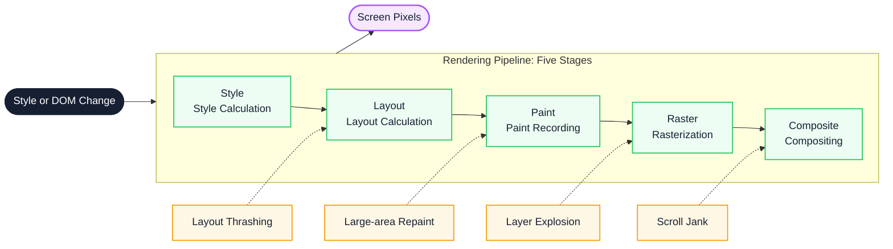
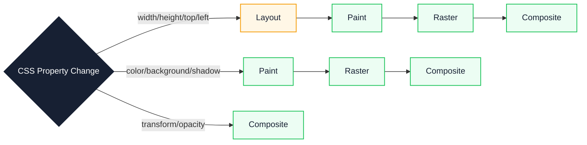

# Rendering Performance Pitfalls: Common Traps and Solutions from Layout, Paint to Composite

Dropped animation frames, sluggish scrolling, and lists that get slower the longer they stay open rarely come from a single slow line of code. More often, a style change restarts the rendering pipeline from an early stage, or the same stage is triggered repeatedly within one frame. This article walks from Style to Composite and examines the common traps at each stage. For each trap it shows how to confirm the stage with the Performance and Layers panels, what change is worth trying, and which signal tells you to roll back.

::: info In one sentence
The essence of rendering performance issues is triggering unnecessary rendering pipeline work, or overloading a specific stage of the pipeline.
:::

## Table of Contents

- [Before We Begin](#before-we-begin)
- [1. Rendering Pipeline Review: Five Stages from Style to Composite](#_1-rendering-pipeline-review-five-stages-from-style-to-composite)
- [2. Layout Pitfalls: Layout Thrashing and Forced Synchronous Layout](#_2-layout-pitfalls-layout-thrashing-and-forced-synchronous-layout)
- [3. Paint Pitfalls: Large-area Repaints and Paint Region Propagation](#_3-paint-pitfalls-large-area-repaints-and-paint-region-propagation)
- [4. Composite Pitfalls: Layer Explosion and will-change Abuse](#_4-composite-pitfalls-layer-explosion-and-will-change-abuse)
- [5. Animation Performance: Boundary Conditions Beyond transform and opacity](#_5-animation-performance-boundary-conditions-beyond-transform-and-opacity)
- [6. DOM Scale: How Node Count Brings Down the Entire Pipeline](#_6-dom-scale-how-node-count-brings-down-the-entire-pipeline)
- [7. CSS Selector Complexity: The Underestimated Cost of Style](#_7-css-selector-complexity-the-underestimated-cost-of-style)
- [8. Fonts and First Screen: FOIT, FOUT, and Layout Shift](#_8-fonts-and-first-screen-foit-fout-and-layout-shift)
- [9. Images and Media: Decoding, Rasterization, and LCP](#_9-images-and-media-decoding-rasterization-and-lcp)
- [10. Scroll Performance: Passive Listener and Composite Layers](#_10-scroll-performance-passive-listener-and-composite-layers)
- [11. Baseline and Validating Changes](#_11-baseline-and-validating-changes)
- [12. Cost and Rollback: Composite Layers Are Not Free](#_12-cost-and-rollback-composite-layers-are-not-free)
- [13. Rendering Performance Practice Checklist](#_13-rendering-performance-practice-checklist)
- [Conclusion: Optimize the Pipeline, Not a Single Point](#conclusion-optimize-the-pipeline-not-a-single-point)
- [FAQ](#faq)
- [Sources](#sources)

## Before We Begin

When many teams work on rendering performance optimization, their first reaction is to "add `will-change`", "use `transform` for animations", or "enable GPU acceleration". These heuristics are useful, but they are conclusions, not causes.

Without understanding the full path of the rendering pipeline, it is easy to run into situations like these:

- Adding `will-change: transform` to every animated element, causing memory to spike and layers to explode
- Using `transform` for animations, but the parent triggers reflow, so the animation still stutters
- Optimizing single-frame paint time, but continuous repaints during scrolling still cause frame drops overall
- Implementing list virtualization perfectly, but complex CSS selectors overload the Style stage and drag down the entire pipeline

This article is organized by "which stage a change lands in": it reviews the five-stage pipeline first, then examines the traps, verification signals, and boundary conditions at each stage. Every technique includes its cost so that the expense is not moved from one stage to another.

The code and panel observations in this article are based on Chromium browsers; panel names and colors vary by version.

---

## 1. Rendering Pipeline Review: Five Stages from Style to Composite

The browser turns the DOM and CSSOM into screen pixels, usually going through the following five stages:

1. **Style**: match selector rules to DOM elements and compute the final style values for each node.
2. **Layout**: compute the box model based on styles and determine each element's position and size.
3. **Paint**: generate paint records (paint record / display list), recording "what to draw first, what to draw later".
4. **Raster**: turn paint instructions into real pixels, usually processed in tiles concurrently.
5. **Composite**: combine multiple layers onto the screen in order, usually done by the GPU.



Solid arrows are the normal pipeline; dotted arrows are where common traps inject work. Confirming which stage a change lands in, then reading the matching trap, is more stable than memorizing a list of tricks.

Different CSS property changes trigger recomputation of different stages:

- Changing `width` / `height` / `margin` / `padding` / `top` / `left`: triggers **Layout** (and all subsequent stages)
- Changing `color` / `background` / `box-shadow` / `border-color`: triggers **Paint** (and subsequent stages)
- Changing `transform` / `opacity`: in most cases triggers only **Composite** when the element is already its own composite layer



The difference between the three branches is where they start: the further left, the more later stages must be redone. The `Composite` branch assumes the element is already its own layer; otherwise the work can fall back to paint.

::: tip Stage cost is not the stage name
"Layout is the most expensive" is only a rough conclusion. If a change repaints the background of an element covering most of the viewport, Paint can cost more than a small Layout. Judge cost by invalidation area and node count, not by the stage name alone.
:::

::: warning Implementation does not decide performance
"CSS animations are always faster than JS animations" does not hold. If the animated property triggers Layout or Paint, CSS animations stutter too. What matters is which stage the property stays in, and whether the animation runs on the compositor thread.
:::

---

## 2. Layout Pitfalls: Layout Thrashing and Forced Synchronous Layout

**Layout Thrashing** is one of the most classic traps in rendering performance. Its root cause is repeatedly triggering a "write → read → write → read" loop within the same frame, forcing the browser to execute synchronous layout calculations multiple times.

### 1. Causes of forced synchronous layout

The browser batches multiple layout changes within a frame and calculates them together in the next frame. But if you **read layout properties immediately after writing to the DOM**, the browser is forced to calculate layout right away to return the correct value. This is **Forced Synchronous Layout**.

Common APIs that trigger forced synchronous layout:

- `offsetWidth` / `offsetHeight` / `offsetTop` / `offsetLeft`
- `clientWidth` / `clientHeight`
- `scrollWidth` / `scrollHeight` / `scrollTop` / `scrollLeft`
- `getBoundingClientRect()`
- `getComputedStyle()`
- `window.scrollY` / `window.scrollX`

### 2. Anti-pattern: interleaved read-write loop

```javascript
// Anti-pattern: forces synchronous layout on every loop iteration
const boxes = document.querySelectorAll('.box')
for (const box of boxes) {
  box.style.width = box.offsetWidth + 10 + 'px'
}
```

Each iteration first reads `offsetWidth` (triggering synchronous layout), then writes `style.width` (invalidating layout). On the next iteration, reading `offsetWidth` again forces the browser to recalculate layout. N elements trigger N synchronous layouts.

### 3. Good pattern: read in batch first, then write in batch

```javascript
// Good pattern: batch reads first, then batch writes, triggering only one layout
const boxes = document.querySelectorAll('.box')
const widths = Array.from(boxes).map((box) => box.offsetWidth)
boxes.forEach((box, i) => {
  box.style.width = widths[i] + 10 + 'px'
})
```

After separating reads and writes, the entire loop triggers only one layout calculation.

### 4. Isolate reads and writes with rAF

In complex scenarios, you can use `requestAnimationFrame` to place reads and writes in different frames, similar to the FastDOM approach:

```javascript
// Good pattern: isolate reads and writes with rAF
function measureAndMutate() {
  const boxes = document.querySelectorAll('.box')
  const widths = Array.from(boxes).map((box) => box.offsetWidth)

  requestAnimationFrame(() => {
    boxes.forEach((box, i) => {
      box.style.width = widths[i] + 10 + 'px'
    })
  })
}
```

This does not eliminate forced layout; it only limits it to once per frame. If the write still happens before the read, the read will force a synchronous layout again.

::: tip Observation signal
In the Performance panel, forced synchronous layout usually appears as consecutive Layout blocks with a warning such as "Forced reflow". Block colors and warning text vary by Chrome version; judge by block name, call stack, and timing.
:::

---

## 3. Paint Pitfalls: Large-area Repaints and Paint Region Propagation

Even after avoiding Layout issues, there are still many traps in the Paint stage. Paint cost depends on two factors: **paint region size** and **paint complexity**.

### 1. The paint region is larger than you think

The browser does not repaint only the area of "the element that changed". It computes an **invalidation rect** that merges all affected regions. If multiple elements are adjacent, their repaint regions may merge into one large rectangle.

```html
<!-- Anti-pattern: adjacent elements' repaint regions merge -->
<div class="card" style="background: #fff">Card A</div>
<div class="card" style="background: #fff">Card B</div>
<div class="card highlighted" style="background: #ffe">Card C highlighted</div>
<div class="card" style="background: #fff">Card D</div>
```

Changing the background color of `.highlighted` may trigger a merged repaint region across all four cards.

### 2. box-shadow and border-radius are Paint cost sources

```css
/* Anti-pattern: large radius + large spread box-shadow is expensive to paint */
.modal {
  box-shadow: 0 50px 100px rgba(0, 0, 0, 0.5);
  border-radius: 24px;
}
```

The paint cost of `box-shadow` is related to the shadow area, and `border-radius` requires anti-aliasing at the edges. When combined, Paint time increases.

### 3. Continuous repaints during scrolling

Fixed-position elements (`position: fixed` / `position: sticky`) can cause noticeable frame drops if they trigger repaints during scrolling:

```css
/* Anti-pattern: a large fixed header changing background repaints an area close to the viewport */
.header {
  position: fixed;
  inset: 0 0 auto 0;
  height: 120px;
  transition: background 0.3s;
}
.header.scrolled {
  background: rgba(255, 255, 255, 0.9);
}
```

The repaint area depends on the area the element covers. It is not a fixed result of "the whole page" or "only the element itself".

### 4. Solution: limit repaints to composite layers

```css
/* Good pattern: promote to a composite layer so repaint happens only on that layer */
.header {
  position: fixed;
  inset: 0 0 auto 0;
  height: 120px;
  will-change: transform;
  transform: translateZ(0);
}
```

After promotion, the element's repaint does not spread to other layers, and the main thread has less work during scrolling. The cost is extra GPU memory, which section 4 expands on.

The repaint area is worth controlling before paint complexity: shrink the invalidated region first, then reduce per-paint cost.

---

## 4. Composite Pitfalls: Layer Explosion and will-change Abuse

`will-change` and `transform: translateZ(0)` are common "GPU acceleration" techniques, but abuse can lead to **Layer Explosion**.

### 1. The cost of composite layers

Each composite layer occupies GPU memory, and compositing between layers also consumes GPU resources. Too many composite layers cause:

- GPU memory usage to rise (especially noticeable on mobile)
- The Composite stage to slow down (layer sorting, layer merging)
- Overhead from layer splitting and re-compositing

### 2. Anti-pattern: adding will-change to every animated element

```css
/* Anti-pattern: indiscriminate will-change causes layer explosion */
.card {
  will-change: transform;
}
.list-item {
  will-change: transform;
}
.button {
  will-change: transform;
}
```

If there are hundreds of `.card` and `.list-item` elements on the page, each becoming an independent composite layer, GPU memory rises quickly.

### 3. Good pattern: enable on demand, remove when done

```css
/* Good pattern: promote to a composite layer only during the animation */
.card-animated {
  will-change: transform;
}
```

```javascript
// Good pattern: remove will-change after animation ends
function animateCard(card) {
  card.style.willChange = 'transform'
  const animation = card.animate(
    [{ transform: 'translateX(0)' }, { transform: 'translateX(100px)' }],
    { duration: 300 }
  )
  animation.onfinish = () => {
    card.style.willChange = 'auto'
  }
}
```

### 4. Implicit composite layers

Some elements get promoted to composite layers even without `will-change`, for example:

- `position: fixed` / `position: sticky` with `z-index`
- `opacity` less than 1
- `transform` not `none`
- `<video>`, `<canvas>`, `<iframe>`
- CSS filter `filter` not `none`

These implicit composite layers are not a problem by themselves, but if there are too many, they also slow down the Composite stage.

::: tip Judging the threshold
There is no universal "normal value" for composite layer count. It depends on viewport area, device memory, and page structure. A more reliable criterion is comparison over time: does the same page show an order-of-magnitude increase in layer count after the change, and does a low-end device get worse?
:::

---

## 5. Animation Performance: Boundary Conditions Beyond transform and opacity

"Only use `transform` and `opacity` for animations" is the right direction, but there are still boundary conditions that can make animations stutter.

### 1. Parent reflow interrupts child animations

```html
<!-- Anti-pattern: parent changes width, so the geometry of the child animation must be recalculated -->
<div class="parent" style="width: 50%">
  <div class="child" style="transform: translateX(100px)"></div>
</div>
```

A parent `width` change triggers Layout, invalidating the layout of the entire subtree. The geometry of the child layer must be recalculated, and the animation may jitter or drop frames.

### 2. After an animated element is promoted to a composite layer, rasterization pressure is too high

```css
/* Anti-pattern: promoting an entire long list to a composite layer adds rasterization pressure */
.long-list {
  will-change: transform;
  height: 10000px;
}
```

The browser rasterizes by tile and usually processes only tiles near the viewport; it does not paint the whole 10000px at startup. But a very large layer still increases tile management, memory use, and continuous rasterization pressure during scrolling.

### 3. Scrolling triggered during animation

```javascript
// Anti-pattern: scrolling immediately after the animation starts interrupts the running animation
element.animate(
  [{ transform: 'translateX(0)' }, { transform: 'translateX(100px)' }],
  { duration: 300 }
)
element.scrollIntoView({ behavior: 'smooth' })
```

`scrollIntoView` must compute the target position, which may trigger layout or scrolling and interrupt the running animation.

### 4. Good pattern: animated elements keep independent composite layers and avoid parent reflow

```css
/* Good pattern: animated element is independent and the parent does not trigger layout */
.card {
  position: absolute;
  will-change: transform;
}
.card.is-moving {
  animation: slide 0.3s ease;
}
@keyframes slide {
  from { transform: translateX(0); }
  to { transform: translateX(100px); }
}
```

The advantage of compositing animation holds only when the property really stays in the composite stage. Any change that invalidates the layer pushes the cost back to Layout or Paint.

---

## 6. DOM Scale: How Node Count Brings Down the Entire Pipeline

DOM node count is the "hidden tax" of rendering performance. It does not directly trigger a specific stage, but makes every stage slower.

### 1. Style stage: selector matching cost grows with node count

The browser must match CSS rules against DOM nodes. As a rough worst-case estimate, 10000 nodes × 1000 rules produces tens of millions of matching attempts. Real engines use rule indexing and invalidation sets, so the actual work is far smaller than that product, but the order of magnitude explains why large-scale DOM slows down Style.

### 2. Layout stage: layout tree construction cost grows with node count

`display: none` elements do not enter the layout tree, but `visibility: hidden` elements do. Layout computation needs to traverse the entire layout tree.

### 3. Paint stage: paint record count grows with node count

Each visible node produces at least one paint record, and complex structures produce more.

### 4. Anti-pattern: full rendering of long lists

```html
<!-- Anti-pattern: large data fully rendered into the DOM (data generation omitted in this example) -->
<ul id="list"></ul>
```

As node count rises, Style, Layout, and Paint all slow down, especially during scrolling.

### 5. Good pattern: virtual list + content chunking

```javascript
// Good pattern: render only viewport + buffer
function renderVisibleItems(container, items, scrollTop, viewportHeight) {
  const itemHeight = 40
  const startIndex = Math.max(0, Math.floor(scrollTop / itemHeight) - 5)
  const endIndex = Math.min(
    items.length,
    Math.ceil((scrollTop + viewportHeight) / itemHeight) + 5
  )

  container.replaceChildren(
    ...items.slice(startIndex, endIndex).map((item) => {
      const li = document.createElement('li')
      li.style.height = `${itemHeight}px`
      li.textContent = item
      return li
    })
  )
}
```

This example assumes every item has the same height. Variable height, scroll position restoration, and search all need extra handling.

::: tip Observation signal
In the Performance panel, if Recalculate Style and Layout time rises clearly with node count, it indicates a DOM scale problem. There is no universal node-count threshold; comparing the time curve before and after a change on the same page is more meaningful.
:::

---

## 7. CSS Selector Complexity: The Underestimated Cost of Style

Many teams only focus on "how many DOM nodes there are" and "whether animations use transform", while ignoring the complexity of CSS selectors themselves.

### 1. Selector matching proceeds from right to left

When matching selectors, the browser starts from the rightmost key selector and verifies leftward. This means the more specific the rightmost selector, the more elements it can filter out early.

```css
/* Anti-pattern: rightmost key selector is a universal selector, so the matching surface is large */
.navbar * {
  outline: none;
}

/* Anti-pattern: descendant selector is too deep, matching path is long */
.list .item .row .col .cell {
  color: red;
}
```

### 2. Universal selectors and attribute selectors widen the matching surface

```css
/* Anti-pattern: universal selector matches all elements */
* {
  box-sizing: border-box;
}

/* Anti-pattern: complex attribute selector combination */
[data-type='card'][data-status='active']:not(.disabled) {
  background: #fff;
}
```

The universal selector is not necessarily expensive by itself, but when there are many rules and a large DOM, it expands the range that every style calculation must check.

### 3. BEM naming is better than deep descendant selectors

```css
/* Good pattern: BEM naming with flat selectors */
.card {}
.card__title {}
.card--highlighted {}
```

The value of BEM is not "nice naming", but that a class selector depends only on the element's own class, not on DOM depth, so the matching path of a single rule is shorter. It does not make overall complexity constant, but it reduces the wasted verification caused by deep descendant selectors.

::: tip Measure before refactoring
Selectors are usually not the first-screen bottleneck. First use the Performance panel to confirm the share of Recalculate Style, then check whether rule count and DOM scale explain it. Refactoring class names at scale without measurement usually produces no visible gain.
:::

---

## 8. Fonts and First Screen: FOIT, FOUT, and Layout Shift

Font loading is an easily overlooked part of rendering performance. It not only affects LCP, but can also trigger CLS (Cumulative Layout Shift).

### 1. FOIT and FOUT

- **FOIT (Flash of Invisible Text)**: text is invisible before the font finishes loading. Under `font-display: auto`, Chromium has a blocking period and then falls back to a fallback font; the length of the blocking period varies by browser version and font loading state.
- **FOUT (Flash of Unstyled Text)**: the fallback font is displayed first, then replaced after the font loads.

```css
/* Good pattern: control font loading strategy with font-display */
@font-face {
  font-family: 'CustomFont';
  src: url('/fonts/custom.woff2') format('woff2');
  font-display: swap;
}
```

`font-display: swap` means display with the fallback font first, then replace after the font loads (FOUT).

### 2. Font loading triggers layout shift

If the metrics of the fallback font and the custom font differ, replacement triggers reflow and causes CLS.

```css
/* Good pattern: adjust fallback font metrics with size-adjust to reduce shift
   The 95% / 90% values are examples and should be tuned to the actual fallback font metrics */
@font-face {
  font-family: 'FallbackFont';
  src: local('Arial');
  size-adjust: 95%;
  ascent-override: 90%;
}
```

### 3. Font preloading

```html
<!-- Good pattern: preload critical fonts to reduce waiting -->
<link
  rel="preload"
  href="/fonts/custom.woff2"
  as="font"
  type="font/woff2"
  crossorigin
/>
```

Preloading fonts competes with the LCP resource for bandwidth. Only preload the weights that are actually used on the first screen and that really block text display.

---

## 9. Images and Media: Decoding, Rasterization, and LCP

Images are the main source of LCP and a major battlefield for rendering performance.

### 1. Image decoding may occupy the main thread

```html
<!-- Anti-pattern: a large image without decoding optimization may occupy the main thread -->

```

Image decoding may occupy the main thread; the exact behavior depends on the browser, image format, and decoder. You can use `decoding="async"` to hint that the browser should decode asynchronously:

```html
<!-- Good pattern: asynchronous decoding reduces main-thread blocking -->

```

`decoding="async"` is a hint, not a guarantee; whether decoding is asynchronous is decided by the browser.

### 2. Rasterization cost is related to the displayed image size

Rasterization uploads the decoded bitmap as a texture to the GPU. Texture cost depends on the actual displayed size and device pixel ratio, not just the file resolution. Use `srcset` to provide appropriate sizes on demand:

```html
<!-- Good pattern: responsive images, load appropriate size by device pixel ratio -->

```

### 3. Video first frame and rasterization

```html
<!-- Good pattern: preload video metadata and use a poster to hold the first frame -->
<video preload="metadata" poster="/poster.webp">
  <source src="/video.mp4" type="video/mp4" />
</video>
```

The `poster` image is displayed before the video first frame renders, avoiding a long black screen when the LCP element is a video.

`fetchpriority="high"` should be given to only one LCP candidate. Multiple resources declaring high priority dilute each other.

---

## 10. Scroll Performance: Passive Listener and Composite Layers

Scrolling is usually driven by the compositor thread; the main thread does not have to participate in every frame. Dropped frames usually come from two cases: the main thread is occupied by long tasks and cannot commit a new compositor frame in time, or the scroll callback reads layout or changes layout-triggering properties and pulls the main thread back into the rendering pipeline.

### 1. Anti-pattern: heavy work inside the scroll callback

```javascript
// Anti-pattern: complex calculations and layout reads inside the scroll callback
document.addEventListener('scroll', () => {
  const rect = header.getBoundingClientRect()
  updateParallax(rect.top)
  updateIndicator()
})
```

`getBoundingClientRect()` reads layout. If there was a write earlier in the same frame, this triggers forced synchronous layout.

### 2. What passive listeners actually solve

Listeners such as `touchmove` and `wheel` are not passive by default. The browser must wait for the callback to finish and confirm that it did not call `preventDefault()` before deciding whether to start scrolling. `passive: true` removes that wait.

The `scroll` event fires after scrolling has begun and does not prevent it from starting. Adding `passive: true` does no harm, but the real problem to solve is the callback occupying the main thread.

```javascript
// Good pattern: merge scroll callbacks with rAF and change only transform
const parallaxLayer = document.querySelector('.parallax-layer')
let ticking = false
document.addEventListener(
  'scroll',
  () => {
    if (ticking) return
    ticking = true
    requestAnimationFrame(() => {
      parallaxLayer.style.transform = `translate3d(0, ${window.scrollY * 0.5}px, 0)`
      ticking = false
    })
  },
  { passive: true }
)
```

### 3. Parallax scrolling should use composite layers

```css
/* Good pattern: promote the parallax element to a composite layer so scrolling only triggers compositing */
.parallax-layer {
  position: fixed;
  will-change: transform;
  transform: translate3d(0, 0, 0);
}
```

::: warning Do not treat passive as a universal fix
Scroll jank does not mean "there are too many event listeners". If the listener reads layout, changes width, or runs a long task, `passive: true` will not make that work disappear. First confirm whether the callback enters the rendering pipeline, then decide whether to promote a composite layer.
:::

---

## 11. Baseline and Validating Changes

Rendering optimization conclusions are easily misled by a single recording. Four steps turn "it got faster" into evidence that can be reviewed.

### 1. Fix the recording conditions

Record the device, browser version, viewport size, device pixel ratio, CPU throttling multiplier, cache state, and page build version. Data collected under different conditions cannot be compared directly.

### 2. Fix the interaction script

Write a repeatable sequence for the scenario you want to validate, such as "scroll for 3 seconds", "open and close the dialog", or "switch tabs". Use the same script for every recording so that differences in operation do not contaminate the result.

### 3. Use panel signals to locate the stage

- Paint flashing in the Rendering panel confirms the repaint area
- Layer borders confirms the number and boundaries of composite layers
- Layout, Paint, and Raster blocks in the Performance panel confirm which stage takes the longest

### 4. Record a distribution, not the best result

Record the same condition several times and note the median and variation range. If the difference before and after the change is smaller than the variation range, it cannot be treated as effective.

| Symptom | Panel signal | Validation criterion |
| --- | --- | --- |
| Dropped frames while scrolling | Long tasks overlap Layout blocks | Long-task count during scrolling falls and frame drops decrease |
| Delay after a click | Long task after the interaction | Time from interaction to the next frame shortens |
| Large repaint area | Paint flashing covers a large region | Repaint area shrinks to the target element |
| Too many composite layers | Layer borders shows an order-of-magnitude increase | Layer count returns near the baseline and memory does not rise |

Production still needs field data. The lab can only prove that a mechanism holds; it cannot by itself prove that the user experience improved.

---

## 12. Cost and Rollback: Composite Layers Are Not Free

Rendering optimization often trades one cost for another. Writing down the rollback condition before the change is more reliable than judging afterwards.

| Technique | Main benefit | Cost | Rollback signal |
| --- | --- | --- | --- |
| `will-change` / composite layer promotion | Limits repaint area and stabilizes animation | GPU memory and layer-management cost | Layer count grows by an order of magnitude, and low-end devices drop more frames |
| Virtual list | Reduces DOM scale | Variable height, search, and scroll restoration need extra handling | Functional regression or blank areas during scrolling |
| `passive` + rAF | Less scroll waiting and fewer repeated callbacks | Callback merging may add one frame of delay | Parallax and indicators lag visibly |
| Font `preload` | Critical fonts are available earlier | Competes with the LCP resource for bandwidth | LCP does not improve and other resources queue longer |
| Fixed header as its own layer | Repaints do not spread during scrolling | Extra composite layer and memory | Layer count rises but frame drops do not improve |

A rollback condition should be tied to an observable signal, such as "field p75 shows no improvement", "the frame-drop rate on low-end devices rises", or "composite layer count grows by an order of magnitude". "Let's watch it for a while" is not a rollback condition.

---

## 13. Rendering Performance Practice Checklist

### 1. Diagnosis and baseline

- [ ] Record device, browser version, viewport, DPR, and CPU throttling multiplier for each problem
- [ ] Record the same interaction script several times and use the median rather than a single result
- [ ] Confirm in the Performance panel whether Style, Layout, Paint, or Raster takes the longest
- [ ] Use Paint flashing and Layer borders to confirm repaint area and composite layer count

### 2. Layout

- [ ] Search the code for layout-reading APIs and confirm they are not read immediately after a write
- [ ] Split read-write loops into "batch read → batch write"
- [ ] Use rAF to isolate cross-frame reads and writes, and confirm they do not interleave again in the same frame
- [ ] Avoid `offsetTop` / `scrollTop` / `getBoundingClientRect()` inside scroll callbacks

### 3. Paint and Composite

- [ ] Shrink the repaint area of frequently changing elements instead of only reducing per-paint complexity
- [ ] Trade off large-radius `box-shadow`, `border-radius`, and filters, and confirm whether they are on the scroll path
- [ ] Enable `will-change` only before an animation and remove it afterwards
- [ ] Compare composite layer count before and after the change and confirm there is no order-of-magnitude increase
- [ ] Check whether implicit composite layers from `opacity`, `filter`, `<video>`, and similar sources are excessive

### 4. Animation

- [ ] Prefer `transform` / `opacity` for animated properties and confirm in the Layers panel that the element is its own layer
- [ ] Ensure the parent does not trigger Layout during the animation
- [ ] Do not promote animated elements in a long list into one very large layer
- [ ] Avoid `scrollIntoView`, width changes, and other interrupting operations during the animation

### 5. DOM and CSS

- [ ] Virtualize long lists and handle variable height, scroll restoration, and search
- [ ] Record the relationship between DOM node count and Style/Layout time to confirm whether it grows with scale
- [ ] Avoid deep descendant selectors and universal rules; prefer class selectors
- [ ] Use the Performance panel to confirm the share of Recalculate Style before refactoring selectors

### 6. Fonts, images, and scrolling

- [ ] Use `font-display: swap` to avoid text being invisible for a long time
- [ ] Only `preload` the critical fonts actually used on the first screen
- [ ] Use `size-adjust` to calibrate fallback font metrics and reduce font replacement shift
- [ ] Provide images by displayed size with `srcset`, and set `decoding="async"` on images
- [ ] Merge scroll callbacks with rAF, and declare `passive: true` on `touchmove` / `wheel` listeners

---

## Conclusion: Optimize the Pipeline, Not a Single Point

The difficulty of rendering performance is not remembering techniques, but judging where a change restarts the pipeline, how large the redo is, and whether it repeats within the same frame. Replacing "add `will-change`" with "which stage does this change trigger" exposes most traps before they reach users.

Pick one real page, record a baseline, and use Paint flashing and the Performance panel to locate the most expensive stage. Re-measure with the same script after the change; if the repaint area, long tasks, or frame drops on low-end devices do not improve, roll back using the conditions written down beforehand.

---

## FAQ

### 1. Why does the local Performance panel look good while online users still report jank?

A local environment usually lacks low-end devices, real network jitter, and competition from third-party scripts. Lab data can only prove that a mechanism holds under current conditions; it cannot represent the user distribution. First confirm whether INP and CLS in field data are also abnormal, then reproduce with the same device and throttling conditions.

### 2. transform animations still drop frames on low-end devices. What should I check first?

First check whether the layer is actually independent, then check layer area and rasterization pressure. Low-end devices have more limited GPU memory and fill rate, so oversized layers, too many composite layers, and continuous repaints all cause compositing animations to drop frames. Use Layer borders and the Performance panel to confirm whether the cost lands in Raster or on the main thread.

### 3. Can a virtual list solve every long-list problem?

No. Variable height requires measurement or estimation, fast scrolling may produce blank areas, and browser find, anchor navigation, and scroll restoration also need extra handling. A virtual list reduces DOM scale; it does not automatically solve image loading, complex cell rendering, or accessibility.

### 4. Why does scrolling get worse after promoting a composite layer?

Composite layers are not free. More layers increase GPU memory and layer-management cost; when a layer is very large, scrolling keeps triggering new tile rasterization. Low-end devices have more limited GPU memory and fill rate, so promotion may turn main-thread cost into GPU cost and make the experience worse. Use Layer borders and the Performance panel to confirm whether the cost moved to Raster or compositing.

### 5. Is CSS selector optimization worth the effort?

It depends on scale. When both DOM node count and CSS rule count are large, the Style stage can become a visible cost; on an ordinary page, selectors are usually not the first-screen bottleneck. First use the Performance panel to confirm the share of Recalculate Style, then decide whether refactoring names and rules is worthwhile.

---

## Sources

1. Web.dev rendering performance guide:
   
   [https://web.dev/articles/rendering-performance](https://web.dev/articles/rendering-performance)

2. Chrome DevTools rendering performance analysis:
   
   [https://developer.chrome.com/docs/devtools/performance/reference](https://developer.chrome.com/docs/devtools/performance/reference)

3. Inside look at modern web browser (Chrome official blog):
   
   [https://developer.chrome.com/blog/inside-browser-part3](https://developer.chrome.com/blog/inside-browser-part3)
