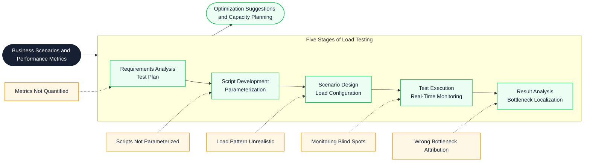
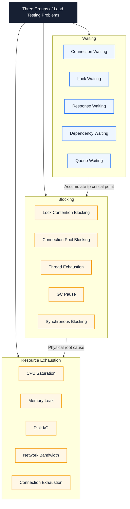
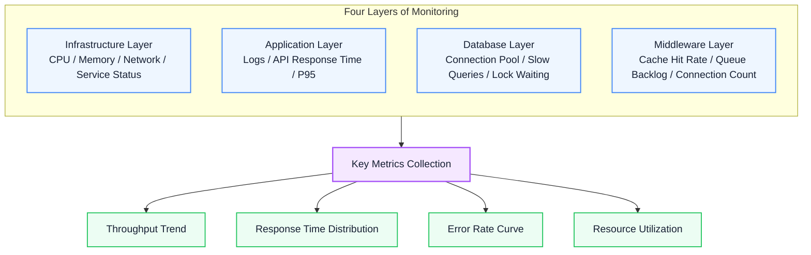
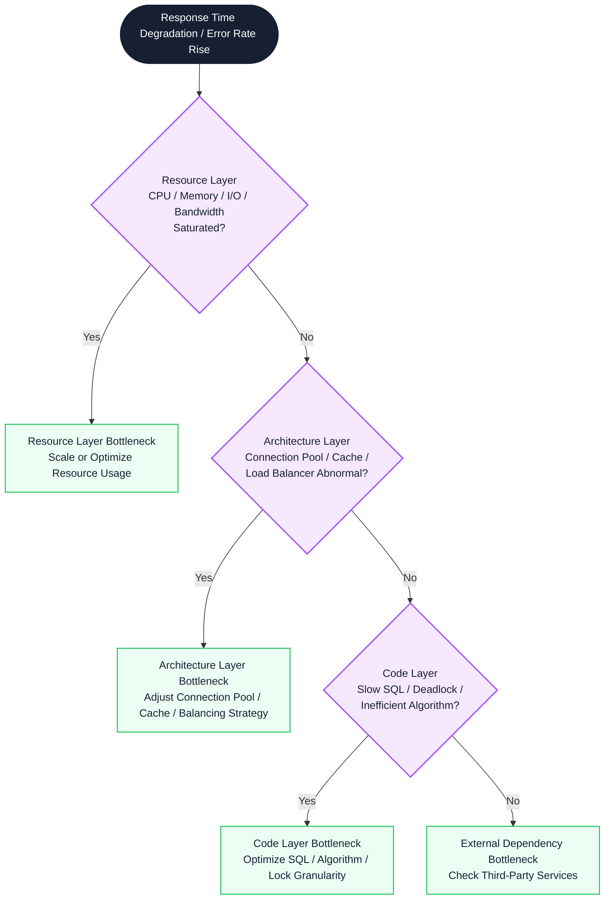

# Load Testing Engineering Practice: A Full-Stack Methodology from Test Plan to Bottleneck Localization

A load test that only produces "pass" or "fail" cannot answer capacity, inflection-point, or failure-boundary questions. This article treats load testing as a controlled experiment with a hypothesis, a control, and a reproducible result: fix the objective and baseline first, apply pressure with parameterized scripts and a matching load pattern, then locate the resource that saturates first on a shared monitoring timeline. After that, re-test a single variable to confirm the attribution and prepare a rollback path for every configuration change. The sequence is what turns numbers into an engineering decision rather than a screenshot.

::: info In one sentence
The essence of load testing is exposing a system's real boundaries under controlled pressure — boundaries of waiting, blocking, and resource exhaustion.
:::

## Table of Contents

- [Introduction](#introduction)
- [1. Why Do Load Testing: From Technical Verification to Business Assurance](#_1-why-do-load-testing-from-technical-verification-to-business-assurance)
- [2. Three Groups of Load Testing Problems: Waiting, Blocking, and Resource Exhaustion](#_2-three-groups-of-load-testing-problems-waiting-blocking-and-resource-exhaustion)
- [3. Requirements Analysis and Test Plan](#_3-requirements-analysis-and-test-plan)
- [4. Script Development and Parameterization](#_4-script-development-and-parameterization)
- [5. Scenario Design and Load Patterns](#_5-scenario-design-and-load-patterns)
- [6. Test Execution and Real-Time Monitoring](#_6-test-execution-and-real-time-monitoring)
- [7. Result Analysis and Bottleneck Localization](#_7-result-analysis-and-bottleneck-localization)
- [8. Key Metrics: TPS, Response Time, and Percentiles](#_8-key-metrics-tps-response-time-and-percentiles)
- [9. Third-Party Dependency Pressure Validation: Degradation and Circuit Breaker](#_9-third-party-dependency-pressure-validation-degradation-and-circuit-breaker)
- [10. Load Testing Practice Checklist](#_10-load-testing-practice-checklist)
- [Conclusion: Load Testing Verifies the Real Boundaries of the System](#conclusion-load-testing-verifies-the-real-boundaries-of-the-system)
- [FAQ](#faq)
- [Sources](#sources)

## Introduction

Many teams think of load testing as "run a tool against the system and see whether it holds." That produces a rough answer, but not the answers that matter:

- At what concurrency does response time begin to degrade? Where is the inflection point?
- When the error rate starts to rise from near zero, which resource saturates first — CPU, memory, the database connection pool, or bandwidth?
- When a third-party dependency (for example, an external queue service) fails, can the system absorb several times the normal peak? Does it slow down, or does it go down?
- Does adding instances (horizontal scaling) really raise throughput linearly, or has a shared resource already become the ceiling?

A load test that ends with "pass" or "fail" has almost no engineering value. The useful output decomposes behavior under pressure: where requests wait, where they are blocked, and which resource runs out first.

Those symptoms fall into three groups:

- **Waiting**: requests waiting for connections, transactions waiting for locks, users waiting for responses, callers waiting on downstream services.
- **Blocking**: lock contention blocking transactions, a full connection pool blocking requests, thread exhaustion blocking admission, GC pauses blocking everything.
- **Resource exhaustion**: CPU saturation, memory leaks, disk I/O saturation, bandwidth depletion, database connection exhaustion.

The three groups recur at every stage from planning to attribution. The diagram below shows the five-stage chain from requirements analysis to bottleneck localization, where each stage has a concrete deliverable.



Read the solid path first: the five stages run in dependency order, and each stage's output is the next stage's input. The dashed lines mark the most common failure at each stage — unquantified metrics, unparameterized scripts, unrealistic load, monitoring blind spots, and attribution that skips a layer. If any stage fails, the conclusion of the stage after it is not trustworthy.

---

## 1. Why Do Load Testing: From Technical Verification to Business Assurance

Many people equate load testing with "run a stress script once before release." That is a narrow reading. Load testing also carries responsibility for business assurance and cost optimization.

Its core value can be summarized as follows:

1. **Discover performance bottlenecks**: under high concurrency or heavy load, the system may show response latency, resource exhaustion (CPU, memory, a full database connection pool), and request queue backlog. The results give the basis for optimizing code, SQL queries, network bandwidth, or server configuration.
2. **Verify system scalability**: horizontal scaling tests whether adding instances (for example, more Pods) shares the load; vertical scaling tests whether more hardware actually improves performance.
3. **Protect user experience**: keep operations such as page loads and form submissions within the expected time, so that crashes or lag do not drive users away.
4. **Prevent business loss**: avoid outages that damage reputation, and plan server resources from measured data to balance performance and cost (capacity planning).
5. **Verify third-party dependencies**: test external services (for example, an external queue service) under load, and check that degradation or circuit breaking works when they fail. Even if the queue service fails, the system should absorb several times the normal peak — slower, but not down.
6. **Optimize cost**: choose the lowest-cost resource configuration (instance count, database specifications) that meets the performance requirement, instead of over-provisioning for unrealistic load.

Separating the two goals — verifying an SLA and finding a boundary — changes script parameters, load pattern, and acceptance criteria. Neither goal is met by running a script once and recording pass or fail.

---

## 2. Three Groups of Load Testing Problems: Waiting, Blocking, and Resource Exhaustion

To move load testing from script running to an engineering method, observed phenomena need a framework. Grouping them as waiting, blocking, and resource exhaustion maps scattered metrics to bottleneck layers quickly.

### 1. Waiting: Waiting Generated Under Pressure

After pressure rises, requests queue and wait at multiple stages:

- **Connection waiting**: the database connection pool is full, and new requests queue for an available connection.
- **Lock waiting**: a transaction holds a row or table lock, and other transactions wait for release.
- **Response waiting**: downstream services respond slowly, and upstream requests wait for the return.
- **Dependency waiting**: third-party services (for example, an external queue service) queue for processing, and the main flow waits for their response.
- **Queue waiting**: request queues back up, and new requests wait to be consumed.

Waiting has a recognizable signature: throughput is still growing, but response time starts to climb. Waiting is the precursor of a bottleneck.

### 2. Blocking: Blocking Generated Under Pressure

When waiting accumulates to a critical point, the system enters a blocked state:

- **Lock contention blocking**: many transactions compete for the same row lock, and database throughput drops sharply.
- **Connection pool blocking**: the pool is exhausted, and new requests are rejected outright or hang for a long time.
- **Thread exhaustion blocking**: web container worker threads are full, so new requests cannot be admitted.
- **GC pause blocking**: memory pressure triggers frequent Full GC, and application threads are paused.
- **Synchronous blocking**: one slow SQL statement occupies a connection and drags down the whole call chain.

Blocking has a different signature: throughput stops growing or even falls, and the error rate starts to rise. Blocking is where the bottleneck breaks through.

### 3. Resource Exhaustion: Hard Boundaries Under Pressure

Resource exhaustion is the physical root cause of blocking:

- **CPU saturation**: CPU usage stays near 100%, and request processing speed cannot improve.
- **Memory leak**: memory keeps growing until OOM, and the process is restarted.
- **Disk I/O bottleneck**: disk throughput is saturated, and all reads and writes slow down.
- **Network bandwidth depletion**: bandwidth is saturated, and transmission latency rises sharply.
- **Database connection exhaustion**: the connection pool is configured too small and becomes the first boundary reached.



The downward arrows show an order of deterioration, not three independent failure types. Waiting appears first while throughput still grows; accumulated waiting turns into blocking; resource exhaustion is the physical cause behind blocking. When localizing, follow the symptom one layer down instead of stopping at the first metric you see.

The three groups also call for different actions. Waiting is addressed by enlarging connection pools, making calls asynchronous, and shaping peaks with queues. Blocking calls for finer lock granularity, rate limiting and degradation, and splitting long transactions. Resource exhaustion leaves only vertical scaling, horizontal scaling, or resource isolation. Choose the wrong layer and you get many changes with no movement in the metrics.

---

## 3. Requirements Analysis and Test Plan

Requirements analysis is the step most easily skipped in load testing, yet it most determines the value of the test. Without a clear objective, every later step loses its evaluation criterion.

### 1. Clarify Test Objectives

Test objectives must be quantified; "see whether the system holds" is not an objective. Typical quantified metrics include:

- **Response time**: P95 for core APIs (the 95th percentile — 95% of requests complete within this value) does not exceed 2 seconds.
- **Throughput**: TPS (Transactions Per Second) reaches the agreed target.
- **Error rate**: the share of failed requests stays below an acceptable threshold.
- **Concurrent users**: how many concurrent users can keep operating.

The 2-second value above is an example. Real thresholds, including the error rate, should come from a business SLA or a historical baseline and be cited in the report.

Beyond metrics, identify the key business scenarios. A system's core flow may include order submission, data query, report export, file upload, and batch processing; these are the transactions the test must cover. Also analyze the architecture — servers, databases, network configuration — and state which dependencies are inside the test scope.

### 2. Formulate the Test Plan

The test plan turns objectives into executable configuration:

- **Load model design**: simulate real user behavior, including the mix of login, browsing, query, and form submission.
- **Environment setup**: isolate the test environment and align it with production (hardware specifications, network bandwidth). Environment differences are a common source of distorted conclusions.
- **Data preparation**: generate and initialize test data, including parameterized accounts, table relationships that match the business schema, dynamic request parameters (for example, a different business number per user), and static files needed by upload tests (for example, XML files).

```text
// Bad example: vague objective
Objective: verify the system can handle big-promotion traffic
Conclusion: pass / fail

// Good example: quantified objective (values are examples, not universal standards)
Objective: under 200 concurrency, core API P95 ≤ 2s, TPS ≥ 500, error rate < 1%
Inflection point: find the concurrency at which TPS stops growing
Scaling validation: after horizontal scaling, does TPS grow with the instance count?
```

### 3. Establish a Baseline

Without a baseline, results can only be compared with expectations. A baseline has at least three parts: the previous version's TPS and P95 on the same environment and script; current production resource levels at normal traffic; and the capacity ceiling of a single instance.

Use the same script, data size, and monitoring definitions as the formal test; otherwise differences cannot be attributed. If the test environment cannot match production, downgrade the conclusion to a version comparison within the same environment and do not extrapolate it into an absolute production capacity.

---

## 4. Script Development and Parameterization

Scripts are the vehicle that turns a test plan into an executable load test. A script without parameterization makes a batch of virtual users share one account and submit the same record; such a test can neither expose concurrency issues nor reflect real traffic.

### 1. Record User Operations

Use JMeter to record HTTP or API requests and produce a base script. Focus the recording on high-frequency behavior — login, form submission, data query — and filter static resource requests (CSS, JavaScript, images) to avoid redundancy.

### 2. Enhance the Script

A recorded script is only a skeleton. Four enhancements make it usable for a real load test:

- **Parameterization**: replace static data with dynamic variables (username, password) so users can run concurrently. A common approach is to read a CSV file and assign a different account to each virtual user.
- **Correlation**: extract values returned by the server and pass them to later requests. The most common case is a session ID or token: the token returned by login must be extracted and sent as a header on subsequent calls.
- **Checkpoints and assertions**: verify the response body, not only HTTP 200. Check JSON fields (for example, `code === 0`, or that `data.userId` exists); otherwise an error page returned with status 200 passes unnoticed.
- **Think time and rendezvous points**: simulate the interval between real user actions (think time), and place rendezvous points before key transactions so several users hit the system at the same moment.

```text
// Bad example: one account used by every virtual user
All virtual users share one account <ACCOUNT>/<PASSWORD>
Every user submits the same business number
No token is extracted; every request logs in again

// Good example: parameterization + correlation + assertion
Read as many account pairs from CSV as there are virtual users
Each user submits their own business number (parameterization)
Extract the token after login and reuse it (correlation)
Assert that the JSON code field is 0 (checkpoint)
```

### 3. Debugging and Validation

After parameterization, replay the script with a single user to confirm functional correctness and catch logic or data problems. Once that passes, raise concurrency gradually and verify that parameterized data is distributed correctly, correlation takes effect, and assertions trigger.

The acceptance criterion is not "the script runs." It is: single-user replay passes, parameterized data is not duplicated across users, and assertions actually fail on an error response.

---

## 5. Scenario Design and Load Patterns

Scenario design decides how pressure is applied. The same script under different load patterns exposes completely different problems.

### 1. Configure Load Patterns

Two basic load patterns serve different purposes:

- **Constant load**: a fixed number of concurrent users (for example, 40 virtual users applying steady pressure). Use it to verify stability under sustained load and to expose gradual problems such as memory or connection leaks.
- **Ramp-up**: increase users step by step (for example, add 10 users every 20 seconds). Use it to find the performance inflection point — the concurrency at which TPS stops growing and response time starts to degrade.

Real tests usually combine the two: ramp up to find the inflection point, then hold constant load to verify stability. Peak load (a sudden burst) and surge load (periodic fluctuation) can be added to simulate promotions and flash sales.

### 2. Resource Monitoring Configuration

Once the load pattern is fixed, configure resource monitoring at the same time; otherwise bottleneck attribution after the test is impossible. Monitoring covers four layers:

- **Infrastructure layer (OCP / Grafana Infra)**: CPU, memory, network traffic, service status.
- **Application layer**: application logs and API metrics (response time, P95).
- **Database layer**: connection pool status, slow queries, lock waiting.
- **Middleware layer**: cache hit rate, message queue backlog, connection count.



The value of four-layer monitoring is cross-checking on one timeline: when application P95 rises, look down at the connection pool and lock waits and up at CPU and bandwidth. Only then can you tell whether the problem is waiting, blocking, or resource exhaustion.

Monitoring is not post-test material. Without resource data on the same timeline, a report can describe symptoms but cannot attribute them.

::: info Engineering insight

OCP (OpenShift Container Platform) and Grafana are a common monitoring pair in cloud-native environments. OCP provides container-level resource monitoring, while Grafana handles metric visualization and alerting. Together they make data available as soon as the test ends.

:::

---

## 6. Test Execution and Real-Time Monitoring

Execution is not "press start and wait." It requires watching the system, recognizing anomalies early, and avoiding time spent on an invalid run.

### 1. Warm-up Phase

Run at low load for a while before the formal test to remove cold-start effects. A common duration is 3 to 5 minutes; the exact time depends on when JIT compilation, cache filling, and the connection pool stabilize. Response time is higher during cold start, and including it pulls up the overall average.

### 2. Formal Execution

Execute the configured scenario and watch:

- **TPS and response time trends**: whether they stay in the expected range, and whether they drop or oscillate.
- **Error rate**: once it crosses the agreed threshold, record the time immediately so it can be aligned with monitoring data later.
- **Exception handling**: set a retry limit or a break-out path. When login or an API call fails, leave the current loop instead of letting one failure trigger a chain that pollutes the sample.

### 3. Real-Time Monitoring

Watch key metrics on a dashboard (Grafana Dashboard):

- CPU, memory, network traffic, service status
- Database connection pool status
- API metrics (response time, P95)

Real-time monitoring supports checking while testing: when response time suddenly degrades, inspect CPU, connection pool, and lock waits at the same moment and narrow the bottleneck layer immediately. If monitoring is reviewed only after the run, time points no longer align and attribution becomes much harder.

What must be preserved from execution is the timeline: every load change, error spike, GC pause, or pool saturation has to line up with the monitoring data. That timeline is the raw evidence for attribution.

---

## 7. Result Analysis and Bottleneck Localization

Result analysis is where load testing turns into value. The same data, analyzed differently, can support opposite conclusions.

### 1. Generate Reports

A report should summarize:

- **Average response time**: the overall level, easily pulled up by a long tail, so never used alone.
- **P95 response time**: the experience of the vast majority of users, more useful than the average.
- **Throughput (TPS)**: processing capacity; follow the trend rather than the instantaneous value.
- **Error type distribution**: counts by error code or error type, which point to the problem direction.

Chart analysis should focus on two correlations:

- **Concurrent users against response time**: find the inflection point where response time starts to degrade.
- **Resource utilization trends**: at the inflection point, which resource reaches its limit first.

### 2. Bottleneck Diagnosis

Diagnose in layers; avoid leapfrog attribution such as "CPU is high, so optimize the code":



Start at the top and rule out each layer; every "No" branch means that layer is not the primary cause. Resource metrics come first because they are the easiest to quantify, which reduces the temptation to change code before capacity has been excluded.

Typical bottlenecks at each layer:

- **Code layer** (usually investigated by backend engineers): slow SQL queries, deadlocks, inefficient algorithms. Locate them with APM tools; open-source options such as Prometheus and Grafana cover metrics and visualization.
- **Architecture layer**: an undersized database connection pool, cache invalidation, an unsuitable load-balancing strategy.
- **Resource layer**: CPU overload, memory leaks, disk I/O saturation, network bandwidth saturation.

::: tip Boundary of the layering order

The order is not a ranking of importance. Resource metrics are easy to quantify and are usually excluded first, but architecture parameters such as connection pool and thread pool sizes can masquerade as resource shortages. Distinguish them by changing one parameter and re-testing, not by guessing from metrics.

:::

### 3. Validation Criteria and Re-testing

An attribution must survive a re-test. A common method is a single-variable control: change only the suspected resource (for example, double the connection pool size) and rerun with the same script and load pattern. If the inflection point moves later and P95 falls, the attribution holds; if the metrics do not move, the bottleneck is elsewhere.

Re-testing also has to exclude data and cache effects. Both runs should use the same data size and the same cache warm-up, and record the run duration, so that a faster second run is not mistaken for a successful optimization.

---

## 8. Key Metrics: TPS, Response Time, and Percentiles

The metric system is the language of load testing. The same result described with different metrics can support completely different conclusions.

### 1. TPS (Transactions Per Second)

TPS is the number of transactions the system processes per second, and it reflects processing capacity. Here "transaction" is defined by the test script: it may be one API call or a group of requests with business meaning, and the report must state the definition. When reading TPS:

- **The trend matters more than the instantaneous value**: under ramp-up, TPS first grows linearly, then flattens, and finally declines. That inflection point is the system's maximum processing capacity.
- **Flat TPS does not mean no bottleneck**: the connection pool may be full or lock contention may exist; resource monitoring is needed to decide.

### 2. Response Time and Percentiles

A percentile describes where a request sits in a distribution: P95 means 95% of requests complete within that value. Response time has to be read as a distribution, not as an average:

- **Average**: the overall level, easily pulled up by a long tail.
- **Median (P50)**: the baseline experience for half of users.
- **95th percentile (P95)**: the upper limit for 95% of users, commonly used in core SLAs.
- **99th percentile (P99)**: long-tail experience, which reflects stability.

Core interfaces often carry a threshold such as "P95 does not exceed 2 seconds" in the SLA. The actual number depends on how much latency the business tolerates; it is not a universal standard.

### 3. Error Rate

Classify errors by type:

- **HTTP 5xx**: server errors, usually resource exhaustion or a code exception.
- **HTTP 4xx**: client errors, possibly bad parameterized data or an authentication failure.
- **Business errors**: HTTP 200 with a non-zero business code, which only an assertion can catch.
- **Timeouts**: requests that do not return within the expected time, usually the result of accumulated response waiting.

```text
// Bad example: concluding from the average alone
Average response time is normal and TPS meets the target; conclusion: performance is good

// Good example: concluding from distribution, trend, and correlation
P50 is normal, but P95 exceeds the target and P99 keeps climbing
TPS rises with concurrency, then stops growing and falls back
The error rate moves from near zero to unacceptable in the same concurrency range
Connection pool monitoring shows the pool saturates first at the inflection point
Conclusion: the inflection point is the concurrency range where TPS stops growing; the bottleneck is the database connection pool
```

Metrics serve the acceptance criterion: SLA uses P95 / P99, capacity planning uses the TPS inflection point, and troubleshooting uses error types and resource levels. Mixing them makes "the average is normal" look like "the system is healthy."

---

## 9. Third-Party Dependency Pressure Validation: Degradation and Circuit Breaker

Modern systems rarely run alone; almost all depend on third-party services. Validating those dependencies under pressure is easy to skip, yet it most affects production stability.

### 1. Dependency Stability Testing

Test how an external service (for example, an external queue service) behaves under load:

- How much traffic can the third party absorb?
- When the third party slows down, does its latency drag down the main system's call chain?
- When the third party rate-limits or trips a circuit breaker, does the main system detect it and degrade correctly?

### 2. Fault Injection and Degradation Validation

Simulate third-party failures and verify that degradation or circuit breaking actually works:

- **Circuit breaker**: when consecutive failures reach the threshold, does the breaker trip and return a degraded response?
- **Timeout control**: is the call given a timeout that matches the downstream SLA? After a timeout, is the connection released instead of being held?
- **Degradation strategy**: when the third party is unavailable, does the system switch to a fallback (return cached data, skip non-core steps)?

The core validation goal: even if the external queue service fails, the system should absorb several times the normal peak — slower, but not down.

```text
// Bad example: no timeout and no degradation
Call the external queue service without a timeout
The service slows down → main-system connections are exhausted → the whole site becomes unavailable

// Good example: timeout + circuit breaker + degradation (thresholds follow the downstream SLA)
Set a timeout that matches the SLA (example: 2s)
Trip the circuit breaker when consecutive failures reach the threshold, then route to degradation
Degradation returns a local queue or a friendly message
The system still serves core flows while the external queue service is down
```

### 3. The Cost and Rollback of Load Testing

Load testing has costs. Write-heavy scenarios produce dirty data, so use dedicated accounts, marked records, or a separate test database. Pressuring a shared environment takes resources from other teams; agree on a time window and notify them in advance. Fault injection may also trigger rate limits or billing on a real dependency, so run it against a stub or in staging first.

The plan also needs a rollback path. Temporary capacity is reclaimed after the test; changes to connection pools, timeouts, and circuit-breaker thresholds go through a switch or configuration center and are promoted to a new baseline only after the metrics are confirmed. A load test without a rollback path turns a verification into a production change.

---

## 10. Load Testing Practice Checklist

### 1. Objectives and Baseline

- [ ] Write an acceptance objective — P95 for core APIs, target TPS, acceptable error rate — with its source (SLA or historical baseline)
- [ ] Record the previous version's or single instance's TPS, P95, and resource levels with the same script and data size
- [ ] List the key transactions covered by this run and the traffic share of each
- [ ] Record differences between test and production environments (instance size, data volume, network path) in the report

### 2. Scripts and Data

- [ ] Assign every virtual user a distinct account and business number from CSV or a database
- [ ] Extract the token after login and reuse it on later requests
- [ ] Assert the business code and key fields in the JSON response, not only HTTP 200
- [ ] Set think time and rendezvous points, and record the configured values
- [ ] After single-user replay passes, run a small concurrency test to verify data distribution and assertion behavior

### 3. Scenario and Monitoring

- [ ] Record concurrency, TPS, P95, and error rate at every ramp-up step
- [ ] Hold constant load long enough to cover one full cache or GC cycle and watch for gradual degradation
- [ ] Monitor CPU, memory, network, connection pool, slow queries, lock waiting, and queue backlog
- [ ] Synchronize clocks between load generators and monitoring before the run

### 4. Execution and Records

- [ ] Warm up until JIT, cache, and connection pool are stable before starting the measurement
- [ ] Record every load change, error spike, and resource alert with a timestamp
- [ ] Give failed requests a retry limit or a break-out path so chain failures do not pollute the sample
- [ ] Keep raw result files (JTL / CSV) and monitoring snapshots

### 5. Analysis and Re-testing

- [ ] Report P50, P95, P99, the TPS trend, and the error type distribution together
- [ ] Mark the inflection point in the range where TPS stops growing and P95 rises
- [ ] Run a single-variable re-test: change one parameter and confirm the inflection point or P95 moves
- [ ] Re-test with the same data size and cache warm-up as the first run
- [ ] State the conclusion as "in this environment, under this load, this resource saturates first"

### 6. Stability and Capacity

- [ ] Inject downstream latency or failure and confirm circuit breaking, timeouts, and degradation behave as expected
- [ ] Record core API P95 and error rate during degradation and confirm they stay acceptable
- [ ] Re-test TPS after horizontal scaling and judge whether growth is linear or a shared resource is the ceiling
- [ ] Provide a rollback plan: when temporary capacity is reclaimed and how configuration changes are reverted

---

## Conclusion: Load Testing Verifies the Real Boundaries of the System

The value of load testing is not the "pass" on the first page of the report. It is what the run leaves behind: reusable scripts and data, a timeline that can be aligned across systems, and a bottleneck conclusion that survives a re-test. Write down the objective, baseline, and environment differences each time, so the next capacity decision has something comparable.

The next step is not to raise concurrency. Pick one core API, add a baseline, a ramp-up run, and one single-variable re-test with the existing script. Once you can explain why TPS stops growing at that concurrency, the method is in place.

---

## FAQ

### 1. What is the difference between load testing and stress testing?

Load testing verifies whether the system meets its SLA under expected load; stress testing keeps raising load until the system fails, to observe the limit and the recovery behavior. The former asks "can it hold," the latter asks "when does it fail and what happens then." They are often combined: verify the SLA first, then locate the limit.

### 2. Can conclusions still be used when the test environment differs from production?

It depends on the type of conclusion. Version comparisons within the same environment, the inflection point, and the bottleneck layer usually still hold; converting test-environment TPS directly into production capacity does not. Limit the conclusion to "same environment, same data size," list instance size, data volume, and network-path differences separately, and make clear which conclusions cannot be extrapolated.

### 3. TPS meets the target but P95 exceeds it — is that a pass?

No. TPS, P95, and error rate describe capacity, user experience, and correctness; missing any of them is not a pass. Read them within the same time window: TPS on target while P95 rises usually means the system has entered the waiting-accumulation stage but has not yet turned that into errors.

### 4. How should the steps and duration of a ramp-up be chosen?

Use as many steps as needed to observe TPS and P95 at each level, usually at least three. Each step should cover one full cache and GC cycle; when metrics are noisy, lengthen the step instead of adding more steps. Start below the normal peak and end beyond the expected inflection point, or the boundary cannot be measured.

---

## Sources

1. Apache JMeter Official User Manual:

   [https://jmeter.apache.org/usermanual/index.html](https://jmeter.apache.org/usermanual/index.html)

2. Grafana Official Monitoring Documentation:

   [https://grafana.com/docs/](https://grafana.com/docs/)

3. OpenShift Container Platform Monitoring Documentation:

   [https://docs.openshift.com/container-platform/latest/observability/monitoring/monitoring-overview.html](https://docs.openshift.com/container-platform/latest/observability/monitoring/monitoring-overview.html)

4. Google SRE Book — Handling Overload and Capacity Planning:

   [https://sre.google/sre-book/handling-overload/](https://sre.google/sre-book/handling-overload/)
