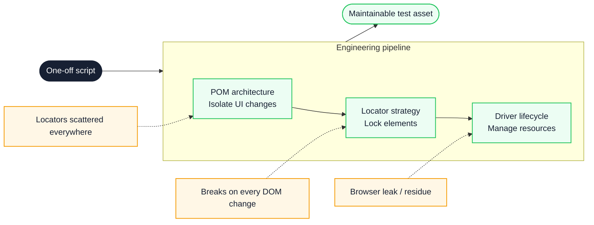
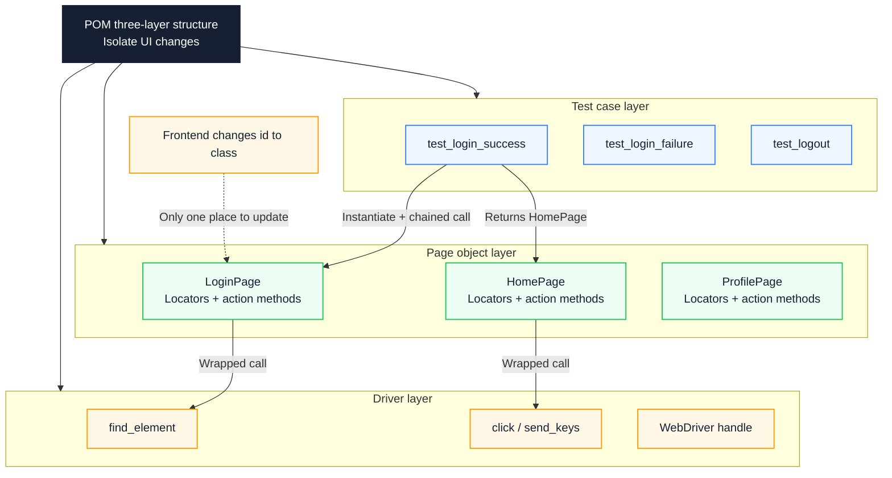
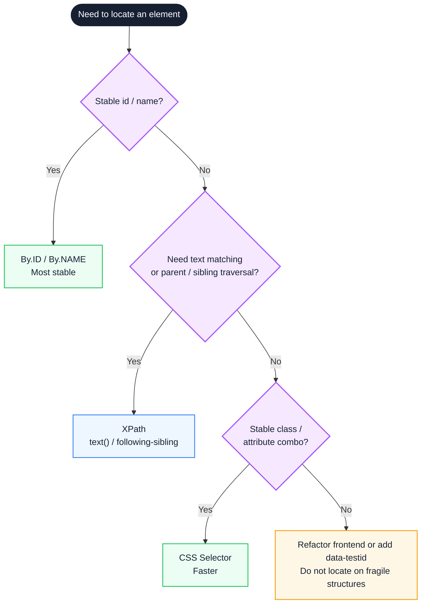
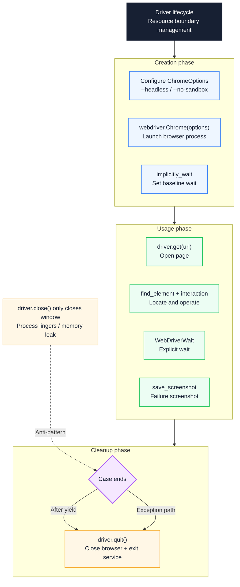

# Python Test Automation Core Concepts: From POM Architecture to Element Locators and Driver Engineering

A frontend change to a single `id` can fail dozens of cases at once, and a CI run that leaves browser processes behind slowly drains the machine. Both symptoms point to the same problem: the test code has no stable boundaries. This article works through three of them — page structure, element lookup, and browser process lifetime — and shows how a small set of class conventions, locator rules, and fixture patterns contains each kind of change. It closes with the measurements that tell you whether the refactor helped: maintenance edits, failure rate, suite time, and leftover processes.

::: info In one sentence
The engineering essence of Python test automation is isolating UI changes through POM architecture, locking elements with precise locator strategies, and managing resources through Driver lifecycle — transforming one-off scripts into maintainable test assets.
:::

## Table of Contents

- [Introduction](#introduction)
- [1. Why Python Test Automation Needs Engineering: From One-Off Scripts to Test Assets](#_1-why-python-test-automation-needs-engineering-from-one-off-scripts-to-test-assets)
- [2. POM Architecture: Isolating UI Changes with Python Classes](#_2-pom-architecture-isolating-ui-changes-with-python-classes)
- [3. Engineering Essentials of POM: Chained Calls, Componentization, and pytest Fixtures](#_3-engineering-essentials-of-pom-chained-calls-componentization-and-pytest-fixtures)
- [4. Locator Strategies: Choosing Between XPath and CSS Selector](#_4-locator-strategies-choosing-between-xpath-and-css-selector)
- [5. Locator Design: Stability and Maintainability](#_5-locator-design-stability-and-maintainability)
- [6. Driver Engineering: Lifecycle, Waits, and Resource Management](#_6-driver-engineering-lifecycle-waits-and-resource-management)
- [7. Collaboration Between Driver and POM](#_7-collaboration-between-driver-and-pom)
- [8. Validation and Rollback Boundaries](#_8-validation-and-rollback-boundaries)
- [9. Python Test Automation Practice Checklist](#_9-python-test-automation-practice-checklist)
- [Conclusion: Three Cornerstones From Scripts to Assets](#conclusion-three-cornerstones-from-scripts-to-assets)
- [FAQ](#faq)
- [Sources](#sources)

## Introduction

Many teams still understand Python test automation as "write a Selenium script that runs through once and call it done." That yields a rough regression conclusion, but not the answers that matter:

- After the frontend changes `id="username"` to `name="username"`, dozens of cases fail at once — where should the fix go?
- When the same button can be found by both CSS Selector and XPath, which should you use? Why do some locators break the moment the DOM changes?
- After the run, browser processes are still alive in the background and the CI machine's memory keeps growing — where is the leak?
- Once the suite grows to hundreds of cases and every run takes more than ten minutes, is the test itself slow, or is Driver reuse broken?

An automation note that only says "POM is a class that wraps a page," "XPath is slower than CSS," or "always call `driver.quit()`" has almost no engineering value. Maintainable automation has to separate three things: how UI changes are isolated, how elements are locked down reliably, and how browser resources are managed across their lifetime.

POM (Page Object Model) constrains code structure. A locator is the query condition that describes how to find an element, and it constrains lookup. A Driver is the client object for the WebDriver protocol, and it constrains process lifetime.

These three form one main line: **POM is the architectural foundation, locators are the precision tool, and Driver is the resource boundary**. The diagram below shows how they turn scripts into assets.



The solid path is the order of the refactor; the dashed lines are the typical failure at each stage. The three are not parallel tools but three boundaries of the same test code: page objects limit where a UI change can land, locators limit how a lookup is expressed, and the fixture limits the process lifetime.

---

## 1. Why Python Test Automation Needs Engineering: From One-Off Scripts to Test Assets

Many people equate Python test automation with "write a few `find_element` calls in Selenium until the login flow runs." That is a narrow view. When the suite grows from a dozen cases to several hundred, when UI iterations move from monthly to daily, and when CI has to run hundreds of browser instances in parallel, unengineered scripts quickly turn into a maintenance burden.

The engineering value of Python test automation can be summarized as follows:

1. **Isolate UI changes**: when the frontend changes an `id` to a `name`, or an `input` to a `div` with `contenteditable`, an engineered test changes one locator and leaves every case untouched.
2. **Lock elements reliably**: with dynamic lists, async loading, and shadow DOM, locator design decides stability. Engineered tests locate by stable semantics rather than fragile structure.
3. **Control the resource lifecycle**: browser process creation, reuse, and teardown are managed by a fixture, which avoids CI memory leaks and cross-test pollution in parallel runs.
4. **Reuse and compose**: common headers, footers, and modals become `Component` classes composed into page objects, following Python's "composition over inheritance."
5. **Read like natural language**: cases interact only with page objects, so code reads like `LoginPage(driver).enter_username("test_user").click_login()`, which lowers the reading barrier.
6. **Integrate with pytest**: the driver is injected through a fixture, page objects are passed through return values, and type hints let the IDE complete chained calls.

Whether a project needs this work depends less on the number of cases than on whether three things have started to constrain each other: locators scattered through cases, the same element queried in several ways, and driver creation scattered through cases. When any two appear, piling on more scripts costs more than refactoring.

### 3. Record a Baseline Before Refactoring

Whether engineering works has to be judged against data recorded before the refactor. Record at least four numbers: total cases and overall pass rate, the share of flaky cases in recent runs, full-suite duration, and the number of browser processes left after one CI run.

The numbers do not need millisecond precision, but they must be collected in the same CI environment with the same browser version; otherwise differences after the refactor cannot be attributed.

---

## 2. POM Architecture: Isolating UI Changes with Python Classes

The first concept to establish is POM. Its core is to wrap each page or independent region in a Python class, so that cases interact only with page objects and never touch the driver or locator details.

### 1. Scripts Without POM: Locators Scattered Everywhere

In early Python Selenium automation, test scripts often drive the underlying driver directly. The example below uses Selenium 4.x (`By` locating API) and pytest; browser driver installation is omitted.

```python
# Anti-pattern: locators scattered across cases; one UI change touches dozens of cases
from selenium.webdriver.common.by import By


def test_login_success(driver):
    driver.find_element(By.ID, "username").send_keys("test_user")
    driver.find_element(By.ID, "password").send_keys("<PASSWORD>")
    driver.find_element(By.ID, "loginBtn").click()
    assert driver.find_element(By.ID, "welcome").text == "Welcome back"
```

Locators end up spread across every case, so a UI change means editing many of them. When the frontend changes `id="loginBtn"` to `class="btn-submit"`, every case that references `loginBtn` fails at the same time.

### 2. The Essence of POM: Three Mappings

The **Page Object Model** wraps each page (or independent region) in a **Python class** and establishes three mappings:

- Elements on the page → class attributes (locator tuples)
- Operations the page offers → class methods
- The navigation after an operation → the method returns the next page object (chained call)

Cases interact only with page objects and never touch the driver or locator details, so the impact of a UI change stays inside one class.

```python
# Best practice: with POM, locators are centralized; a UI change touches one place
from selenium.webdriver.common.by import By
from selenium.webdriver.remote.webdriver import WebDriver


class LoginPage:
    """Login page object"""

    # Locators centralized as class attributes
    _username = (By.ID, "username")
    _password = (By.ID, "password")
    _login_btn = (By.ID, "loginBtn")
    _error_msg = (By.CLASS_NAME, "error")

    def __init__(self, driver: WebDriver):
        self.driver = driver

    def enter_username(self, username: str) -> "LoginPage":
        self.driver.find_element(*self._username).send_keys(username)
        return self  # return self to support chained calls

    def enter_password(self, password: str) -> "LoginPage":
        self.driver.find_element(*self._password).send_keys(password)
        return self

    def click_login(self) -> "HomePage":
        self.driver.find_element(*self._login_btn).click()
        return HomePage(self.driver)  # navigate to the home page

    def click_login_expecting_failure(self) -> "LoginPage":
        self.driver.find_element(*self._login_btn).click()
        return self  # still on the login page

    def get_error_message(self) -> str:
        return self.driver.find_element(*self._error_msg).text


class HomePage:
    """Home page object"""

    def __init__(self, driver: WebDriver):
        self.driver = driver
        self._welcome = (By.ID, "welcome")

    def get_welcome_message(self) -> str:
        return self.driver.find_element(*self._welcome).text
```

### 3. The Test Case Layer: From Imperative to Declarative

With POM in place, the case layer interacts only with page objects, and code moves from "imperatively driving the browser" to "declaratively describing the business flow":

```python
# Best practice: cases describe the business flow; they never touch driver or locators
def test_login_success(driver):
    login_page = LoginPage(driver)
    home_page = (
        login_page.enter_username("test_user")
        .enter_password("<PASSWORD>")
        .click_login()
    )
    assert home_page.get_welcome_message() == "Welcome back"
```

When the frontend changes `id="loginBtn"` to `class="btn-submit"`, only `_login_btn` inside `LoginPage` changes and every case stays the same. That is the core value of POM.

The diagram below shows the three POM layers and the direction of data flow.



Read from top to bottom: the case layer depends only on page objects, and page objects depend on the driver's locating and interaction APIs. The dashed line is the source of change — a frontend edit should affect only the page object layer; if it reaches the case layer, the encapsulation has a leak.

The boundary also shows up in reverse: an `assert` inside a page object means it carries both page modeling and test verification, which reduces reuse.

---

## 3. Engineering Essentials of POM: Chained Calls, Componentization, and pytest Fixtures

Writing POM as a Python class is only the start. To deliver value in a real project, three problems have to be solved: how chained calls keep cases readable, how reusable components avoid duplication, and how the driver lifecycle is decoupled through pytest fixtures.

### 1. Chained Calls and Method Return Values

A POM method's return value determines case readability. A good rule: **action methods return self to support chaining; navigation methods return the next page object**. Case code then reads like natural language:

```python
# Best practice: chained calls make cases read close to natural language
home_page = (
    LoginPage(driver)
    .enter_username("test_user")
    .enter_password("<PASSWORD>")
    .click_login()
)
```

Type hints such as `-> "LoginPage"` and `-> "HomePage"` let the IDE complete the next method in a chain, and they let static analysis catch a broken navigation chain.

```python
# Anti-pattern: methods return None; the chain breaks and cases become imperative stacking
login_page = LoginPage(driver)
login_page.enter_username("test_user")
login_page.enter_password("<PASSWORD>")
home_page = login_page.click_login()
```

### 2. Componentization: Composition Over Inheritance

Complex pages contain common regions: top navigation, footer links, a user menu, tables, modals. Extract them into `Component` classes and compose them into page objects, following Python's "composition over inheritance." The snippet omits imports and the `LoginPage` definition.

```python
# Best practice: reuse components through composition, following "composition over inheritance"
class HeaderComponent:
    """Common header component"""

    def __init__(self, driver: WebDriver):
        self.driver = driver
        self._user_menu = (By.ID, "userMenu")
        self._logout_btn = (By.ID, "logout")

    def open_user_menu(self) -> "HeaderComponent":
        self.driver.find_element(*self._user_menu).click()
        return self

    def click_logout(self) -> "LoginPage":
        self.driver.find_element(*self._logout_btn).click()
        return LoginPage(self.driver)


class HomePage:
    """Home page object that composes the Header component"""

    def __init__(self, driver: WebDriver):
        self.driver = driver
        self.header = HeaderComponent(driver)  # composition, not inheritance
        self._welcome = (By.ID, "welcome")

    def get_welcome_message(self) -> str:
        return self.driver.find_element(*self._welcome).text
```

### 3. Page Objects Do Not Contain Assertions

Page objects provide services; they do not assert. Expose state through `@property` and keep assertions in the case layer:

```python
# Anti-pattern: the page object contains an assertion, reducing reuse
class LoginPage:
    def login_and_assert_success(self, username, password):
        self.driver.find_element(*self._login_btn).click()
        assert "Welcome" in self.driver.title  # assertion coupled inside the page object


# Best practice: the page object only provides services; assertions stay in the case
class LoginPage:
    @property
    def error_message(self) -> str:
        return self.driver.find_element(*self._error_msg).text

    def click_login_expecting_failure(self) -> "LoginPage":
        self.driver.find_element(*self._login_btn).click()
        return self


def test_login_failure(driver):
    page = LoginPage(driver).enter_username("bad").enter_password("bad").click_login_expecting_failure()
    assert "Invalid username or password" in page.error_message
```

### 4. Decoupling Through pytest Fixtures

The driver lifecycle is managed by a pytest fixture, and page objects receive the driver through their constructor. Cases, page objects, and the driver are then fully decoupled:

```python
# Best practice: the driver is injected by a fixture; page objects are created in the case
def test_login_success(driver):
    home_page = LoginPage(driver).enter_username("test_user").enter_password("<PASSWORD>").click_login()
    assert home_page.get_welcome_message() == "Welcome back"
```

Page objects can also become higher-level fixtures, which removes boilerplate from cases:

```python
# Best practice: wrap page objects as fixtures so cases stay focused
import pytest


@pytest.fixture
def login_page(driver):
    return LoginPage(driver)


def test_login_success(login_page):
    home_page = login_page.enter_username("test_user").enter_password("<PASSWORD>").click_login()
    assert home_page.get_welcome_message() == "Welcome back"
```

The acceptance criterion for this layer is concrete: no `find_element` in cases, no `assert` in page objects, and `quit()` in the fixture. If any of the three is missing, the responsibility boundary has not really been drawn.

---

## 4. Locator Strategies: Choosing Between XPath and CSS Selector

POM solves how UI changes are isolated, but locator design decides whether an element can be locked down reliably. Python Selenium offers several strategies (ID, CLASS_NAME, NAME, TAG_NAME, XPath, CSS Selector), and XPath and CSS Selector are the most powerful and the easiest to misuse.

### 1. XPath: Bidirectional Traversal and Text Matching

XPath is a language for finding nodes in XML or HTML through path expressions. Its strengths are bidirectional traversal (parent, child, sibling), text matching, and a rich function set:

```python
from selenium.webdriver.common.by import By

# Locate by text (CSS Selector cannot do this)
driver.find_element(By.XPATH, "//button[text()='Login']")

# Locate by a partial attribute value
driver.find_element(By.XPATH, "//input[contains(@class, 'user')]")

# Sibling traversal (CSS Selector cannot do this)
driver.find_element(By.XPATH, "//label[text()='Password']/following-sibling::input")

# Bidirectional parent traversal
driver.find_element(By.XPATH, "//span[@class='icon']/parent::button")
```

The cost of XPath is performance: a complex path has to traverse the DOM tree, which is slower than the browser's native CSS engine, and the gap grows with expression complexity.

### 2. CSS Selector: Speed and Simplicity

A CSS Selector is the pattern a stylesheet uses to select HTML elements, and it works for locating elements too. Its strengths are speed, concise syntax, and consistency with frontend work; the lack of native text matching is its main limitation:

```python
driver.find_element(By.CSS_SELECTOR, "#username")
driver.find_element(By.CSS_SELECTOR, "input[name='password']")
driver.find_element(By.CSS_SELECTOR, "button.submit:first-child")
driver.find_element(By.CSS_SELECTOR, "form.login > button[type='submit']")
```

### 3. Comparison and Selection Strategy

| Feature | XPath | CSS Selector |
| --- | --- | --- |
| Traversal | Bidirectional (parent, child, sibling) | Downward only |
| Text matching | Supported | Not supported |
| Performance | Slower on complex paths | Faster, browser-native |
| Functions and operators | Rich | Fewer, relies on attributes and pseudo-classes |
| Frontend consensus | Test-specific | Consistent with frontend work |

**Selection strategy**: prefer CSS Selector (ID, class, attribute), and switch to XPath when text matching or complex DOM relationships are required.

The diagram below shows the decision path for locator strategy.



The decision order is: look for a unique identifier first, then decide whether text or structural traversal is needed, and only then consider an attribute combination. At the rightmost branch, the correct action is to improve testability in the frontend, not to write a more complex expression into the test.

The ceiling of a locator strategy is set by frontend testability. Without a stable anchor, switching between XPath and CSS will not make a case stable; adding `data-testid` is more effective than optimizing the expression.

---

## 5. Locator Design: Stability and Maintainability

After the strategy is chosen, locator design decides stability. The same element can often be found in several ways, and the choice determines how long a case survives frontend changes.

### 1. Priority: id > name > data-testid > class > structure

Locator priority should follow decreasing stability:

- **id**: unique on the page and the most stable; the frontend rarely changes it casually.
- **name**: common on form elements, second only to id.
- **data-testid**: a test-only attribute; the frontend knows it serves testing and will not change it casually.
- **class**: distinguish semantic classes (for example, `.login-form`) from styling classes (for example, `.btn-primary`, `.mt-4`). The former are relatively stable; the latter change with style refactors.
- **Complex structure**: for example, `div > ul > li:nth-child(3) > a`, which depends on absolute position and hierarchy and is the most fragile.

```python
# Anti-pattern: depends on absolute position and styling classes
_login_btn = (By.CSS_SELECTOR, "div:nth-child(2) > form > button.btn-primary.mt-4")

# Best practice: use a stable id or data-testid
_login_btn = (By.ID, "loginBtn")
_password = (By.CSS_SELECTOR, "input[data-testid='password-input']")
```

### 2. Push the Frontend to Add data-testid

When there is no stable id or name, do not build locator tricks on fragile classes or structure. Ask the frontend to add a `data-testid` attribute. It is a test-only attribute, and the frontend knows not to touch it during style refactors:

```html
<!-- Frontend code -->
<button data-testid="submit-login">Login</button>
```

```python
# Test code
_login_btn = (By.CSS_SELECTOR, "[data-testid='submit-login']")
```

### 3. Centralize Locator Management

Locators belong in class attributes, not inside methods, so a frontend `id` change requires one edit:

```python
# Anti-pattern: locators scattered inside methods
class LoginPage:
    def enter_username(self, username):
        self.driver.find_element(By.ID, "username").send_keys(username)

    def get_error(self):
        return self.driver.find_element(By.CLASS_NAME, "error").text


# Best practice: locators centralized as class attributes
class LoginPage:
    _username = (By.ID, "username")
    _error_msg = (By.CLASS_NAME, "error")

    def enter_username(self, username):
        self.driver.find_element(*self._username).send_keys(username)

    def get_error(self):
        return self.driver.find_element(*self._error_msg).text
```

### 4. Avoid Absolute XPath

Absolute XPath (for example, `/html/body/div[2]/form/button[1]`) is an anti-pattern. It depends on the full path from the root, so a change at any level breaks it. Use relative XPath (starting with `//`) with a stable anchor:

```python
# Anti-pattern: absolute XPath; any DOM layer change breaks it
_submit = (By.XPATH, "/html/body/div[2]/form/div[3]/button[1]")

# Best practice: relative XPath with a stable text anchor
_submit = (By.XPATH, "//button[text()='Submit']")
```

A simple review test: replace the DOM hierarchy or the styling class names — can the locator still find the same element? If not, it depends on structure it should not depend on.

---

## 6. Driver Engineering: Lifecycle, Waits, and Resource Management

POM solves architecture and locators solve precision; the remaining problem is resources — how browser processes are created, reused, and torn down. Poor Driver engineering makes CI machines slower over time, lets parallel tests pollute each other, and inflates execution time without control.

### 1. What Is a Driver

WebDriver is the W3C protocol for remote browser control. In Python Selenium, `driver` is the **client object** created by `webdriver.Chrome()` (or another browser); it sends commands to the browser over that protocol, and can be thought of as a remote control:

```python
from selenium import webdriver
from selenium.webdriver.common.by import By

driver = webdriver.Chrome()   # launch Chrome
driver.get("https://example.com")
driver.find_element(By.ID, "kw").send_keys("Python")
driver.quit()
```

The driver's core functions cover five areas:

- Browser window control: `driver.maximize_window()`, `driver.back()`, `driver.forward()`
- Element locating and interaction: `driver.find_element(By.ID, "id")`
- Script execution: `driver.execute_script("return document.title")`
- Waiting: `driver.implicitly_wait(10)` (explicit waits are preferred)
- Screenshots: `driver.save_screenshot("screen.png")`

### 2. Lifecycle Management: Centralized by a pytest Fixture

In Python tests, the driver lifecycle must be managed by a pytest fixture so resources are released. Code before `yield` creates the driver; code after `yield` cleans it up. Even when a case raises, `quit()` still runs:

```python
# Anti-pattern: create and destroy the driver inside a case; a failure leaks the process
def test_login():
    driver = webdriver.Chrome()
    driver.get("https://example.com")
    assert "Example" in driver.title
    driver.quit()  # if assert raises, this line never runs


# Best practice: the fixture owns the driver; code after yield always runs
# conftest.py
import pytest
from selenium import webdriver


@pytest.fixture(scope="function")  # one driver per test function for isolation
def driver():
    options = webdriver.ChromeOptions()
    options.add_argument("--headless")  # headless mode, common in CI
    options.add_argument("--no-sandbox")
    options.add_argument("--disable-dev-shm-usage")
    drv = webdriver.Chrome(options=options)
    yield drv
    drv.quit()  # fully close after the test, even if the case raised
```

### 3. Scope Selection: function / class / session

The fixture's `scope` parameter sets how long a driver is reused:

- **`function`** (recommended default): one driver per test function, fully isolated. No state pollution between cases, but the highest startup cost.
- **`class`**: all cases in a class share one driver, suitable for related cases that share login state. Cases must not pollute each other's state.
- **`session`**: one driver shared globally — use with caution. If one case leaves the browser in a bad state, every later case fails.

```python
# Anti-pattern: state pollution between cases under session scope
@pytest.fixture(scope="session")
def driver():
    drv = webdriver.Chrome()
    yield drv
    drv.quit()

# Case A logs in and does not log out → Case B starts logged in →
# Case B assumes a logged-out state and its assertion fails


# Best practice: function scope isolates every case
@pytest.fixture(scope="function")
def driver():
    drv = webdriver.Chrome()
    yield drv
    drv.quit()
```

### 4. Wait Strategy: Explicit Waits Over Implicit Waits

Wait strategy is central to stability. An implicit wait applies globally but has a coarse condition (the element merely appears); an explicit wait can target a condition (visible, clickable, containing specific text):

```python
# Anti-pattern: a global implicit wait plus a sleep
import time

driver.implicitly_wait(10)
time.sleep(3)  # uncontrollable; slows CI down


# Best practice: explicit wait with a specific condition
from selenium.webdriver.support.ui import WebDriverWait
from selenium.webdriver.support import expected_conditions as EC


def wait_for_login_button(driver, timeout=10):
    WebDriverWait(driver, timeout).until(
        EC.element_to_be_clickable((By.ID, "loginBtn"))
    )
```

Explicit waits should be encapsulated in page objects so cases never deal with wait logic:

```python
class LoginPage:
    def __init__(self, driver: WebDriver):
        self.driver = driver
        self._login_btn = (By.ID, "loginBtn")
        self._wait = WebDriverWait(driver, 10)

    def click_login(self) -> "HomePage":
        button = self._wait.until(EC.element_to_be_clickable(self._login_btn))
        button.click()
        return HomePage(self.driver)
```

### 5. quit vs. close

This comes up in interviews and in real code:

- **`driver.quit()`**: closes the whole browser and stops the driver service, releasing all resources.
- **`driver.close()`**: closes only the current window; the browser process and driver service keep running.

```python
# Anti-pattern: close instead of quit; browser processes linger
@pytest.fixture
def driver():
    drv = webdriver.Chrome()
    yield drv
    drv.close()  # the browser process remains; long CI runs keep consuming memory


# Best practice: quit for thorough cleanup
@pytest.fixture
def driver():
    drv = webdriver.Chrome()
    yield drv
    drv.quit()  # close the browser and stop the driver service
```

The diagram below shows the Driver lifecycle from creation to teardown.



Top to bottom is the driver's life: create, use, clean up. The key is the cleanup branch — whether the case ends normally or raises, both paths converge on `quit()`. `close()` only closes the window, while the process and driver service keep running.

::: warning Boundary of resource leaks

On CI, using `close()` instead of `quit()` closes a window, not the browser process or the driver service. After a job runs hundreds of cases, leftover processes keep holding memory and ports until the node becomes unusable.

:::

---

## 7. Collaboration Between Driver and POM

POM and Driver are not isolated concepts; they collaborate through constructor injection. That collaboration is what prevents the two common anti-patterns: creating `webdriver.Chrome()` inside a page object, or operating the driver directly inside a case.

### 1. Injection Pattern: Driver Passed Through the Constructor

Page objects receive the driver through their constructor and never create it. The fixture owns the lifecycle; the page object only uses the driver:

```python
# Anti-pattern: the page object creates its own driver; lifecycle is unmanaged
class LoginPage:
    def __init__(self):
        self.driver = webdriver.Chrome()  # who quits it?

    def login(self, username, password):
        # ...
        pass


# Best practice: the driver is injected; the fixture owns the lifecycle
class LoginPage:
    def __init__(self, driver: WebDriver):
        self.driver = driver  # use only, never create

    def login(self, username, password) -> "HomePage":
        # ...
        return HomePage(self.driver)  # pass the driver on navigation
```

### 2. Navigation Chain: Driver Passed Between Page Objects

When a POM navigation method returns the next page object, it passes the same driver instance along. One test session therefore uses one driver, forming a chain from `LoginPage` to `HomePage` to `ProfilePage`:

```python
# Best practice: the driver travels along the page object chain
def test_user_flow(driver):
    home_page = LoginPage(driver).enter_username("test_user").enter_password("<PASSWORD>").click_login()
    profile_page = home_page.open_profile()
    profile_page.update_nickname("new_name")
    assert profile_page.get_nickname() == "new_name"
```

The flow uses one driver instance, and the fixture quits it when the case ends.

### 3. Parallel Testing: One Driver per Process

With `pytest-xdist`, each worker process has its own driver instance, so no extra thread-safety handling is needed:

```python
# Best practice: pytest-xdist in parallel; each process has an independent driver
# Command: pytest -n 4  (4 worker processes)
@pytest.fixture(scope="function")
def driver():
    drv = webdriver.Chrome()
    yield drv
    drv.quit()
```

The caveat: when several cases operate on the same data (for example, all change one user's state), parallel execution creates data races. The fix is data isolation — one test account per case.

### 4. RemoteWebDriver: Distributed Execution

To connect to Selenium Grid or a cloud testing platform (for example, BrowserStack or Sauce Labs), replace `webdriver.Chrome()` with `webdriver.Remote()`:

```python
# Best practice: connect to Selenium Grid for distributed execution
@pytest.fixture
def driver():
    options = webdriver.ChromeOptions()
    drv = webdriver.Remote(
        command_executor="http://<GRID_HOST>:4444",
        options=options,
    )
    yield drv
    drv.quit()
```

The driver is still managed by a fixture, and case and page object code do not change. That is the extensibility of the POM plus fixture architecture.

There is only one check for this collaboration: neither cases nor page objects create a driver. As soon as `webdriver.Chrome()` or `webdriver.Remote()` appears outside a fixture, lifecycle control is already lost.

---

## 8. Validation and Rollback Boundaries

### 1. Validate Against the Baseline

Whether the refactor was worth it cannot be judged by "the code looks tidier." Compare four signals with the baseline recorded before the change: the number of files edited when a locator changes, full-suite duration, the share of flaky cases, and the number of leftover processes after one CI run.

If changing an `id` still touches several cases, locators are still in the case layer. If execution time did not drop, check whether the driver restarts for every case. If the flaky share rose, inspect wait conditions and data isolation first.

### 2. Cost: One More Layer of Indirection

POM adds a layer of indirection. With many page objects, even a simple case takes several hops; when page objects are tightly coupled to a business flow, changing one entry point means editing several classes. When the suite is small and the page structure is still changing rapidly, centralize locators first and extract page objects once the structure settles.

### 3. Rollback: Keep the Boundary, Shrink the Scope

Rollback is not a rewrite. Keep the fixture and locator conventions and merge page objects back into a few classes; if parallel execution causes data races, return to serial execution or shard by account instead of adding more processes.

---

## 9. Python Test Automation Practice Checklist

### 1. Architecture and Baseline

- [ ] Record total cases, pass rate, flaky-case share, suite duration, and leftover CI processes before the refactor
- [ ] Map each page or independent region to one Page Object, with a class name that matches its responsibility
- [ ] Keep locators as class attributes; no literal locator expression inside methods
- [ ] Action methods return self; navigation methods return the next page object
- [ ] No `assert` inside page objects; assertions live only in the case layer
- [ ] Extract common regions into Components and compose them in

### 2. Locators

- [ ] Prefer id / name / data-testid, then semantic class, and structure selectors last
- [ ] Default to CSS Selector; use XPath for text matching or parent-sibling traversal
- [ ] Start XPath with `//`; never use `/html/body/...` absolute paths
- [ ] Do not locate by nth-child, hierarchy index, or styling class names
- [ ] Check every locator with "remove the styling classes and it still finds the same element"
- [ ] When no stable anchor exists, ask the frontend for data-testid instead of writing a more complex expression

### 3. Driver Lifecycle

- [ ] Create the driver only in a fixture; cases and page objects only receive it
- [ ] Use yield in the fixture and call `driver.quit()` in the cleanup section
- [ ] Default to function scope; use class or session only when state pollution is ruled out
- [ ] Include `--headless` / `--no-sandbox` / `--disable-dev-shm-usage` in CI launch options
- [ ] After a CI run, the browser process count matches the count at the start
- [ ] Keep the scene for failed cases with `save_screenshot`

### 4. Wait Strategy

- [ ] Use only explicit waits (WebDriverWait plus expected_conditions)
- [ ] Match the wait condition to the business state (clickable, visible, text present)
- [ ] Encapsulate explicit waits in page objects; no `WebDriverWait` in the case layer
- [ ] No `time.sleep`; when a fixed wait is truly needed, document why
- [ ] Do not mix implicit and explicit waits

### 5. Cases and Data

- [ ] Cases call only page object methods; no direct `find_element`
- [ ] Every case uses its own account or business data
- [ ] A case can run alone and does not depend on state left by the previous case
- [ ] Assertions cover the business result, not only that navigation succeeded
- [ ] On failure, output the current URL, key element text, and a screenshot

### 6. Parallel and Distributed Execution

- [ ] With pytest-xdist, each process creates its own driver
- [ ] Shard parallel cases by account or data so they do not write the same records
- [ ] When connecting to Selenium Grid or a cloud platform, replace only driver creation
- [ ] Keep browser and driver versions consistent between local and CI
- [ ] Compare suite duration and flaky-case share before and after parallelism; confirm the gain is not bought with retries

---

## Conclusion: Three Cornerstones From Scripts to Assets

POM, locators, and Driver solve the same class of problem: keeping change inside a predictable place. Page objects limit where a UI change lands, locators limit how a DOM change breaks a lookup, and the fixture limits how process lifetime affects the run.

Start with the case that fails most often: move its locators into a page object, add an explicit wait, confirm the fixture quits, then record the failure rate and execution time before and after. The three cornerstones do not have to be built at once, but every layer added should come with data showing which maintenance cost it reduced.

---

## FAQ

### 1. Does POM have to be implemented with Python classes? Can functions do the job?

Function encapsulation can fix "locators scattered everywhere," but it cannot express a navigation chain. One core value of POM is that a method returns the next page object, forming a `LoginPage → HomePage → ProfilePage` chain, which needs a class to carry state (the driver) and behavior (operations plus navigation). Component reuse, such as composing `HeaderComponent` into several pages, also depends on class composition.

### 2. Is XPath really slower than CSS Selector?

In most modern browsers, CSS Selectors are handled by the native CSS engine and XPath by a separate engine, so CSS is usually faster. The gap depends on expression complexity: a simple `//button[@id='login']` is close to CSS, while multi-layer axis traversal or text matching can be several times slower. A single functional-test lookup is usually in the millisecond range, so the difference is rarely the bottleneck; only bulk locating of many elements makes it worth measuring carefully.

### 3. Should a page object cache WebElement references?

Do not cache `find_element` results long-term. After the DOM re-renders, an old WebElement raises `StaleElementReferenceException`. Caching the locator tuple and looking up again on each operation is more stable. Caching only makes sense when the element is known not to be recreated during the case's lifetime.

### 4. After the suite grows to hundreds of cases, execution is slow. What should be checked first?

Check driver creation count first: when every case starts a browser, startup usually dominates, and strongly related cases can move to class scope. Then check waits: many `time.sleep` calls or long timeouts directly lengthen the suite. Only then consider pytest-xdist, and establish data isolation before going parallel. Finally, check flow reuse: repeated login and navigation steps can become fixtures.

---

## Sources

1. Selenium official documentation - Page Object Models pattern:

   [https://www.selenium.dev/documentation/test_practices/encouraged/page_object_models/](https://www.selenium.dev/documentation/test_practices/encouraged/page_object_models/)

2. Selenium official documentation - Waits:

   [https://www.selenium.dev/documentation/webdriver/waits/](https://www.selenium.dev/documentation/webdriver/waits/)

3. pytest official documentation - Fixtures:

   [https://docs.pytest.org/en/stable/explanation/fixtures.html](https://docs.pytest.org/en/stable/explanation/fixtures.html)

4. Martin Fowler - original PageObject pattern article:

   [https://martinfowler.com/bliki/PageObject.html](https://martinfowler.com/bliki/PageObject.html)

5. MDN Web Docs - CSS Selectors:

   [https://developer.mozilla.org/en-US/docs/Web/CSS/CSS_selectors](https://developer.mozilla.org/en-US/docs/Web/CSS/CSS_selectors)

6. MDN Web Docs - XPath documentation:

   [https://developer.mozilla.org/en-US/docs/Web/XPath](https://developer.mozilla.org/en-US/docs/Web/XPath)

7. pytest-xdist distributed execution plugin:

   [https://pytest-xdist.readthedocs.io/en/stable/](https://pytest-xdist.readthedocs.io/en/stable/)
