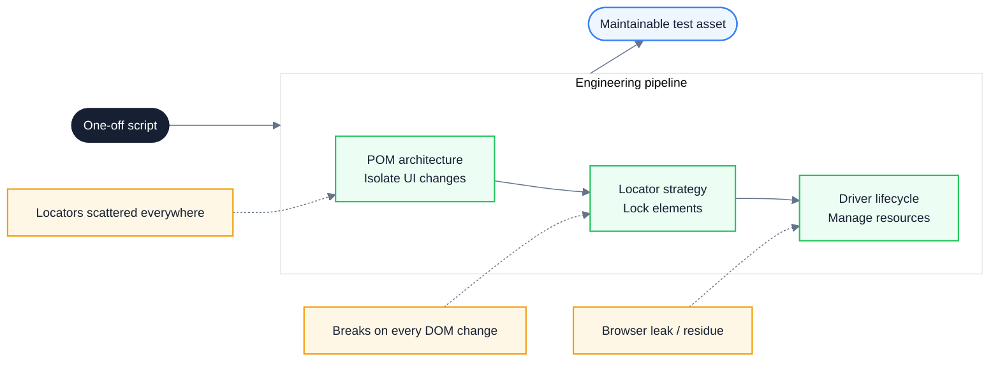
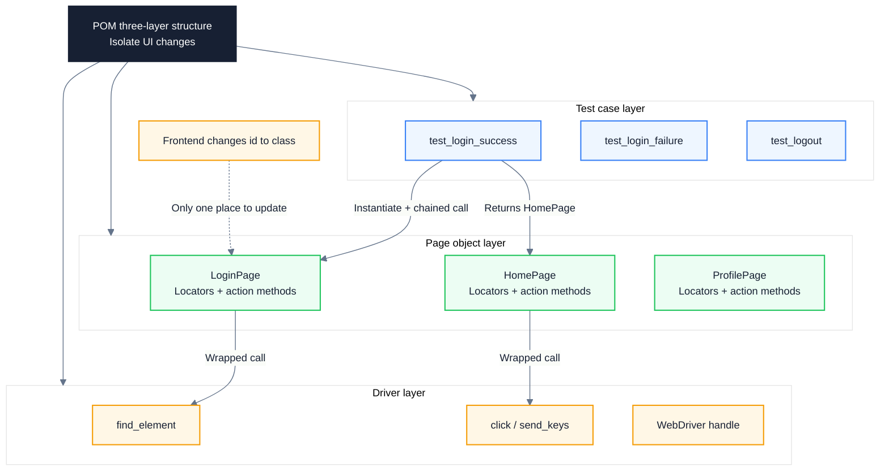
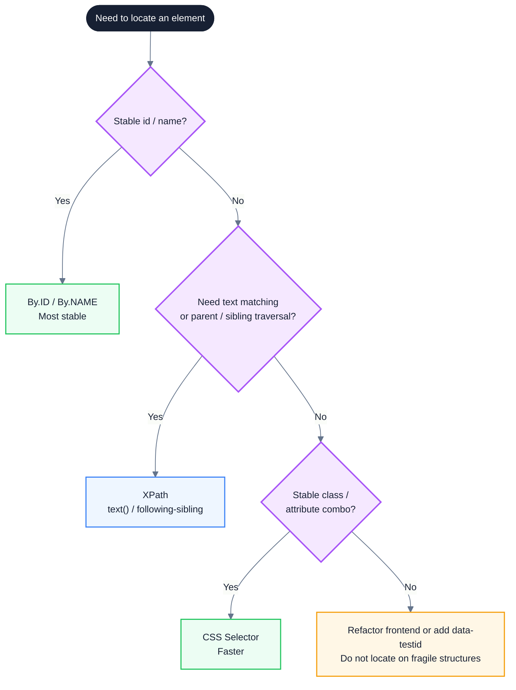
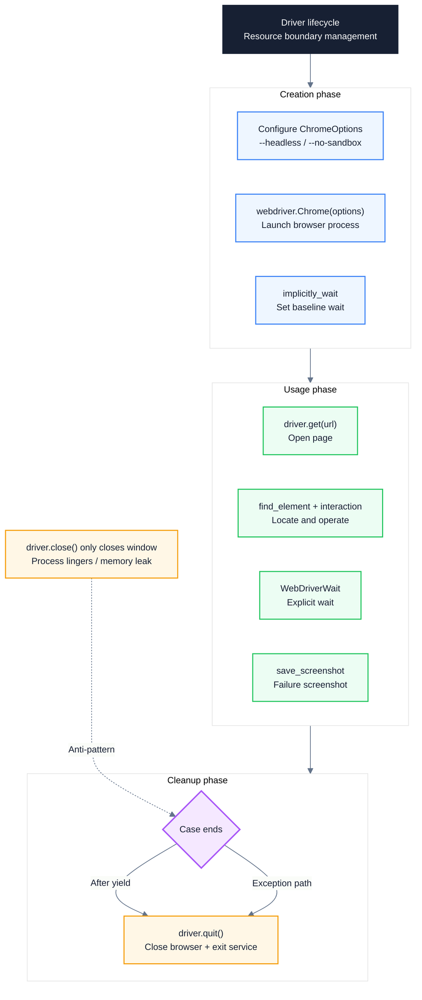
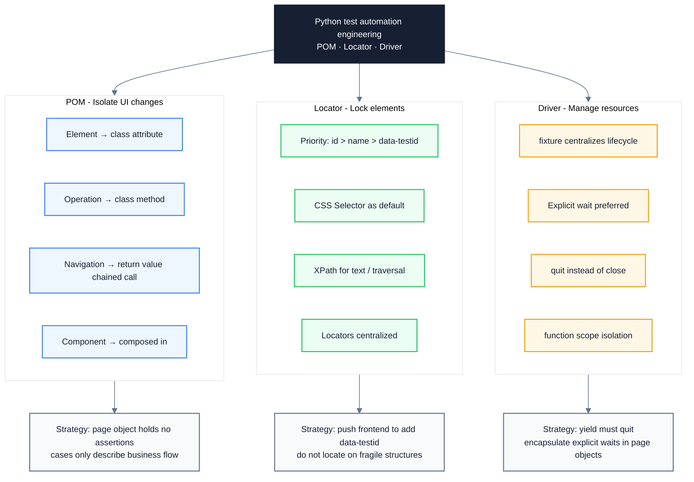

# Python Test Automation Core Concepts: From POM Architecture to Element Locators and Driver Engineering

> Subtitle: From the Page Object Model (POM) architecture, XPath and CSS Selector locator strategies to Driver lifecycle management, a systematic review of the engineering essentials of Python test automation.
>
> Target readers: Test engineers, test automation developers, Python backend engineers, quality owners.
>
> Reading time: ~22 minutes.

::: info In one sentence
The engineering essence of Python test automation is isolating UI changes through POM architecture, locking elements with precise locator strategies, and managing resources through Driver lifecycle — transforming one-off scripts into maintainable test assets.
:::

## Table of Contents

- [Introduction](#introduction)
- [1. Why Python Test Automation Needs Engineering: From One-Off Scripts to Test Assets](#1-why-python-test-automation-needs-engineering-from-one-off-scripts-to-test-assets)
- [2. POM Architecture: Isolating UI Changes with Python Classes](#2-pom-architecture-isolating-ui-changes-with-python-classes)
- [3. Engineering Essentials of POM: Chained Calls, Componentization, and pytest Fixtures](#3-engineering-essentials-of-pom-chained-calls-componentization-and-pytest-fixtures)
- [4. Locator Strategies: Choosing Between XPath and CSS Selector](#4-locator-strategies-choosing-between-xpath-and-css-selector)
- [5. Locator Design: Stability and Maintainability](#5-locator-design-stability-and-maintainability)
- [6. Driver Engineering: Lifecycle, Waits, and Resource Management](#6-driver-engineering-lifecycle-waits-and-resource-management)
- [7. Collaboration Between Driver and POM](#7-collaboration-between-driver-and-pom)
- [8. Unified Model: POM · Locator · Driver](#8-unified-model-pom-locator-driver)
- [9. Python Test Automation Practice Checklist](#9-python-test-automation-practice-checklist)
- [Conclusion: Three Cornerstones From Scripts to Assets](#conclusion-three-cornerstones-from-scripts-to-assets)
- [FAQ](#faq)
- [Sources](#sources)

## Introduction

Many teams still understand Python test automation as "write a Selenium script that runs through and call it a day." This approach yields a rough regression conclusion, but it cannot answer the truly critical questions:

- After the frontend changes `id="username"` to `name="username"`, dozens of test cases fail simultaneously — where should the fix go?
- When the same button can be located by both CSS Selector and XPath, which one should you use? Why do some locators break the moment the DOM changes?
- After tests finish, browser processes are still lingering in the background; the CI machine's memory keeps growing — where is the problem?
- After the automation suite grows to hundreds of cases, every run takes more than ten minutes — is the test itself slow, or is Driver reuse broken?

If an automation testing note only offers conclusions like "POM is a class that wraps a page," "XPath is slower than CSS," or "always call driver.quit()," it has almost no engineering value. Truly maintainable Python test automation must clarify three things: how UI changes are isolated, how elements are stably locked, and how browser resources are managed by their lifecycle.

::: info In one sentence
The engineering essence of Python test automation is isolating UI changes through POM architecture, locking elements with precise locator strategies, and managing resources through Driver lifecycle — transforming one-off scripts into maintainable test assets.
:::

These three things form a single main thread: **POM is the architectural foundation, locators are the precision tool, and Driver is the resource boundary**. The diagram below shows how the three collaborate to turn scripts into assets:



This article unfolds in the order "architecture → locators → resources," with common pitfalls and executable engineering practices noted at each stage.

---

## 1. Why Python Test Automation Needs Engineering: From One-Off Scripts to Test Assets

Many people equate Python test automation with "writing a few `find_element` calls in Selenium to run through the login flow." This is a narrow understanding. When the suite grows from a dozen cases to several hundred, when UI iterations move from monthly to daily, and when CI needs to spin up hundreds of browser instances in parallel, unengineered scripts quickly degenerate into a maintenance nightmare.

The engineering value of Python test automation can be summarized as follows:

1. **Isolate UI changes**: When the frontend changes an `id` to a `name`, or replaces an `input` with a `div + contenteditable`, an engineered test only needs to modify a single locator — all test cases remain unchanged.
2. **Stably lock elements**: In scenarios like dynamic lists, async loading, and shadow DOM, locator design directly determines case stability. Engineered tests locate elements by stable semantics rather than fragile structure.
3. **Controllable resource lifecycle**: Browser process creation, reuse, and teardown are managed centrally by fixtures, avoiding CI memory leaks and cross-test pollution in parallel runs.
4. **Reuse and composition**: Common headers, footers, and modals can be extracted into `Component` classes and composed into page objects, following Python's "composition over inheritance" philosophy.
5. **Readability approaching natural language**: Test cases interact only with page objects, so the code reads like `LoginPage(driver).enter_username("admin").click_login()` — product managers and manual testers can understand it.
6. **Clean integration with the pytest ecosystem**: The driver is injected via fixtures, page objects pass each other through return values, and type hints let the IDE auto-complete chained calls.

::: tip Core conclusion of this section

Python test automation engineering is not just "writing scripts" — it engineers three things: architecture, locators, and resources. It turns one-off scripts into maintainable test assets, reducing the maintenance cost of UI-heavy test cases from linear growth to nearly constant under frequent UI iteration.

:::

::: warning Common misconception

Equating test automation with "record-replay + a pile of find_element scripts." This approach is barely maintainable when there are fewer than 20 cases. Once the page is refactored or the suite scales up, the maintenance cost grows far faster than linear, eventually causing the entire automation system to be abandoned.

:::

---

## 2. POM Architecture: Isolating UI Changes with Python Classes

To upgrade test automation from "scattered scripts" to an "engineering method," the first concept to establish is the Page Object Model (POM). The core idea of POM is to encapsulate each web page or independent region into a Python class, so that test cases interact only with page objects and never touch the underlying driver or element locator details.

### 1. Scripts Without POM: Locators Scattered Everywhere

In the early days of Python Selenium automation, test scripts often operated the underlying driver directly:

```python
# Anti-pattern: locators scattered across cases; any UI change requires touching dozens of cases
def test_login_success(driver):
    driver.find_element(By.ID, "username").send_keys("admin")
    driver.find_element(By.ID, "password").send_keys("123456")
    driver.find_element(By.ID, "loginBtn").click()
    assert driver.find_element(By.ID, "welcome").text == "Welcome back"
```

This approach causes element locators to be scattered everywhere. Any UI change requires modifying a large number of cases, making maintenance extremely costly. When the frontend changes `id="loginBtn"` to `class="btn-submit"`, every case that references `loginBtn` will fail at the same time.

### 2. The Essence of POM: Three Mappings

The **Page Object Model** encapsulates each web page (or independent region) into a **Python class** and establishes three mappings:

- Elements on the page → class attributes (locator tuples)
- Operations the page provides → class methods
- Navigation after an operation → the method returns the next page object (chained call)

Test cases interact only with page objects and never touch the underlying driver or element locator details. This way, the impact of UI changes is confined within a single class.

```python
# Best practice: with POM encapsulation, locators are centralized; UI changes only touch one place
from selenium.webdriver.common.by import By
from selenium.webdriver.remote.webdriver import WebDriver


class LoginPage:
    """Login page object"""

    def __init__(self, driver: WebDriver):
        self.driver = driver
        # Locators centralized
        self._username = (By.ID, "username")
        self._password = (By.ID, "password")
        self._login_btn = (By.ID, "loginBtn")
        self._error_msg = (By.CLASS_NAME, "error")

    def enter_username(self, username: str) -> "LoginPage":
        self.driver.find_element(*self._username).send_keys(username)
        return self  # return self to support chained calls

    def enter_password(self, password: str) -> "LoginPage":
        self.driver.find_element(*self._password).send_keys(password)
        return self

    def click_login(self) -> "HomePage":
        self.driver.find_element(*self._login_btn).click()
        return HomePage(self.driver)  # navigate to home page

    def click_login_expecting_failure(self) -> "LoginPage":
        self.driver.find_element(*self._login_btn).click()
        return self  # still on login page

    def get_error_message(self) -> str:
        return self.driver.find_element(*self._error_msg).text


class HomePage:
    """Home page object"""

    def __init__(self, driver: WebDriver):
        self.driver = driver
        self._welcome = (By.ID, "welcome")

    def get_welcome_message(self) -> str:
        return self.driver.find_element(*self._welcome).text
```

### 3. The Test Case Layer: From Imperative to Declarative

After POM encapsulation, the test case layer interacts only with page objects. Code shifts from "imperatively operating the driver" to "declaratively describing the business flow":

```python
# Best practice: cases only describe the business flow; they never touch driver or locators
def test_login_success(driver):
    login_page = LoginPage(driver)
    home_page = (
        login_page.enter_username("admin")
        .enter_password("123456")
        .click_login()
    )
    assert home_page.get_welcome_message() == "Welcome back"
```

When the frontend changes `id="loginBtn"` to `class="btn-submit"`, you only need to modify `self._login_btn` in `LoginPage` once — all cases remain unchanged. This is the core value of POM isolating UI changes.

The diagram below shows the three-layer structure of POM and the direction of data flow:



::: tip Core conclusion of this section

POM encapsulates page elements into Python classes and establishes the three mappings of "element → attribute, operation → method, navigation → return value," confining the impact of UI changes within a single class. This is the architectural foundation for moving Python UI automation from "one-off scripts" to "sustainably maintained engineering."

:::

::: warning Common misconception

Treating page objects as "locator container utility classes" and stuffing them with `assert` statements. The correct approach is for page objects to provide only services (operations + state queries), with assertions staying in the test case layer. Once a page object contains assertions, it simultaneously bears two responsibilities — "page modeling" and "test verification" — and its reusability drops sharply.

:::

---

## 3. Engineering Essentials of POM: Chained Calls, Componentization, and pytest Fixtures

Writing POM as a Python class is only the starting point. To deliver real value in an engineered project, three problems must be solved: how chained calls make cases readable, how reusable components avoid duplication, and how the driver lifecycle is decoupled from pytest fixtures.

### 1. Chained Calls and Method Return Values

The return value of a POM method determines case readability. A good practice is: **action methods return self to support chained calls, and navigation methods return the next page object**. This makes case code read like natural language:

```python
# Best practice: chained calls make cases read close to natural language
HomePage = (
    LoginPage(driver)
    .enter_username("admin")
    .enter_password("123456")
    .click_login()
)
```

Type hints like `-> "LoginPage"` and `-> "HomePage"` let the IDE intelligently auto-complete the available methods on a chained call — a core advantage of the Python ecosystem over other dynamic languages.

```python
# Anti-pattern: methods return None; chained calls break; cases degenerate into imperative stacking
login_page = LoginPage(driver)
login_page.enter_username("admin")
login_page.enter_password("123456")
home_page = login_page.click_login()
```

### 2. Componentization: Composition Over Inheritance

Complex pages often contain common regions (top navigation, footer links, user menu, tables, modals). Extract these regions into `Component` classes and compose them into page objects, following Python's "composition over inheritance" philosophy:

```python
# Best practice: reuse components via composition; follow "composition over inheritance"
class HeaderComponent:
    """Common header component"""

    def __init__(self, driver: WebDriver):
        self.driver = driver
        self._user_menu = (By.ID, "userMenu")
        self._logout_btn = (By.ID, "logout")

    def open_user_menu(self) -> "HeaderComponent":
        self.driver.find_element(*self._user_menu).click()
        return self

    def click_logout(self) -> "LoginPage":
        self.driver.find_element(*self._logout_btn).click()
        return LoginPage(self.driver)


class HomePage:
    """Home page object that composes the Header component"""

    def __init__(self, driver: WebDriver):
        self.driver = driver
        self.header = HeaderComponent(driver)  # composition over inheritance
        self._welcome = (By.ID, "welcome")

    def get_welcome_message(self) -> str:
        return self.driver.find_element(*self._welcome).text
```

### 3. Page Objects Should Not Contain Assertions

Page objects provide services, not assertions. State queries are exposed via `@property`, and assertions stay in the test case layer:

```python
# Anti-pattern: page object contains assertions; reusability drops
class LoginPage:
    def login_and_assert_success(self, username, password):
        self.driver.find_element(*self._login_btn).click()
        assert "Welcome" in self.driver.title  # assertion coupled inside the page object


# Best practice: page object only provides services; assertions stay in the case
class LoginPage:
    @property
    def error_message(self) -> str:
        return self.driver.find_element(*self._error_msg).text

    def click_login_expecting_failure(self) -> "LoginPage":
        self.driver.find_element(*self._login_btn).click()
        return self


def test_login_failure(driver):
    page = LoginPage(driver).enter_username("bad").enter_password("bad").click_login_expecting_failure()
    assert "Invalid username or password" in page.error_message
```

### 4. Decoupling via pytest Fixtures

The driver's lifecycle is managed by pytest fixtures, and page objects receive the driver through their constructor. This way, the three layers — cases, page objects, and driver — are fully decoupled:

```python
# Best practice: driver injected by fixture; page object instantiated inside the case
def test_login_success(driver):
    home_page = LoginPage(driver).enter_username("admin").enter_password("123456").click_login()
    assert home_page.get_welcome_message() == "Welcome back"
```

Page objects can also be wrapped directly as higher-level fixtures to further reduce boilerplate in cases:

```python
# Best practice: wrap page objects as fixtures too; cases stay focused
import pytest


@pytest.fixture
def login_page(driver):
    return LoginPage(driver)


def test_login_success(login_page):
    home_page = login_page.enter_username("admin").enter_password("123456").click_login()
    assert home_page.get_welcome_message() == "Welcome back"
```

::: tip Core conclusion of this section

The engineering essentials of POM are "chained calls + componentization + fixture decoupling": action methods return self to support chaining, reusable regions are extracted into Components and composed in, and the driver is injected by a pytest fixture to decouple lifecycle from cases. Page objects only provide services and contain no assertions — this is the boundary that guarantees reusability.

:::

::: info Engineering insight

Python's type hints are a hidden advantage of POM engineering. Forward references like `-> "HomePage"` let the IDE intelligently auto-complete the next-level method on a chained call. This is especially valuable for page object chains in complex business flows (login → place order → pay → receipt), effectively encoding the business flow into the type system.

:::

---

## 4. Locator Strategies: Choosing Between XPath and CSS Selector

POM solves "how UI changes are isolated," but the design of the locators themselves determines "whether elements can be stably locked." Python Selenium provides multiple locating strategies (ID, CLASS_NAME, NAME, TAG_NAME, XPath, CSS Selector), of which XPath and CSS Selector are the most powerful and the most easily misused.

### 1. XPath: Bidirectional Traversal and Text Matching

XPath is a language that finds nodes in XML/HTML through path expressions. Its core strengths are support for bidirectional traversal (parent-child-sibling), text matching, and rich functions:

```python
from selenium.webdriver.common.by import By

# Locate by text (CSS Selector cannot do this)
driver.find_element(By.XPATH, "//button[text()='Login']")

# By partial attribute
driver.find_element(By.XPATH, "//input[contains(@class, 'user')]")

# Sibling traversal (CSS Selector cannot do this)
driver.find_element(By.XPATH, "//label[text()='Password']/following-sibling::input")

# Bidirectional parent-child traversal
driver.find_element(By.XPATH, "//span[@class='icon']/parent::button")
```

The cost of XPath is performance: complex path expressions need to traverse the DOM tree, which is slower than the browser's native CSS engine.

### 2. CSS Selector: Speed and Simplicity

A CSS Selector is a pattern used in stylesheets to select HTML elements, and it is used to locate elements. Its core strengths are speed, concise syntax, and consistency with frontend development; the lack of native text matching is its biggest limitation:

```python
driver.find_element(By.CSS_SELECTOR, "#username")
driver.find_element(By.CSS_SELECTOR, "input[name='password']")
driver.find_element(By.CSS_SELECTOR, "button.submit:first-child")
driver.find_element(By.CSS_SELECTOR, "form.login > button[type='submit']")
```

### 3. Comparison and Selection Strategy

| Feature          | XPath                          | CSS Selector                      |
| ---------------- | ------------------------------ | --------------------------------- |
| Traversal        | Bidirectional (parent / child / sibling) | Unidirectional (downward only)   |
| Text locating   | Supported                      | Not supported                     |
| Performance      | Slower (complex paths)         | Faster, browser-native optimization |
| Functions/operators | Rich                        | Fewer (relies on attributes and pseudo-classes) |
| Frontend consensus | Test-only                   | Consistent with frontend dev      |

**Selection strategy**: Prefer CSS Selector (ID, Class, attribute); switch to XPath for text matching or complex DOM relationships.

The diagram below shows the decision path for locator strategy:



::: tip Core conclusion of this section

XPath and CSS Selector are not an "either-or" opposition but a complementary division of labor: CSS Selector is faster and shares a consensus with frontend, so it is the default; XPath is enabled when text matching or parent-sibling traversal is needed. The true starting point of a locator strategy is having a stable id/name; without one, the priority is to push the frontend to add `data-testid` rather than playing locator tricks on fragile structures.

:::

::: warning Common misconception

Blindly pursuing "writing complex XPath paths" as a sign of technical ability. Complex XPath (such as `//div[3]/ul/li[2]/a`) relies on absolute positions and breaks on any DOM change — it is the biggest source of fragility in test automation. If a problem can be solved with id/name, do not use complex XPath paths.

:::

---

## 5. Locator Design: Stability and Maintainability

After the locator strategy is chosen, what really determines case stability is the design of the locator itself. The same element can usually be located in multiple ways; which one you choose determines "how long the case can run without being interrupted by frontend changes."

### 1. Priority: id > name > class > complex structure

Locator priority should follow the "decreasing stability" principle:

- **id**: Unique across the page, most stable; the frontend rarely changes ids casually.
- **name**: Common on form elements, second only to id in stability.
- **data-testid**: A test-only attribute; the frontend clearly knows it serves testing and will not change it casually.
- **class**: Distinguish semantic classes (such as `.login-form`) from styling classes (such as `.btn-primary`, `.mt-4`). The former are relatively stable; the latter change frequently with style refactors.
- **Complex structure**: Such as `div > ul > li:nth-child(3) > a`, which depends on absolute positions and hierarchy, the most fragile.

```python
# Anti-pattern: relies on absolute position and styling classes; breaks on any frontend change
_login_btn = (By.CSS_SELECTOR, "div:nth-child(2) > form > button.btn-primary.mt-4")

# Best practice: use stable id or data-testid
_login_btn = (By.ID, "loginBtn")
_password = (By.CSS_SELECTOR, "input[data-testid='password-input']")
```

### 2. Push the Frontend to Add data-testid

When there is neither a stable id nor a stable name, do not play locator tricks on fragile classes or structures — instead, push the frontend to add the `data-testid` attribute. `data-testid` is a test-only attribute; the frontend clearly knows it serves testing and will not touch it during style refactors:

```html
<!-- Frontend code -->
<button data-testid="submit-login">Login</button>
```

```python
# Test code
_login_btn = (By.CSS_SELECTOR, "[data-testid='submit-login']")
```

### 3. Centralize Locator Management

Locators should be centralized as class attributes, not scattered inside methods. This way, when the frontend changes an id, only one place needs to be updated:

```python
# Anti-pattern: locators scattered inside methods
class LoginPage:
    def enter_username(self, username):
        self.driver.find_element(By.ID, "username").send_keys(username)

    def get_error(self):
        return self.driver.find_element(By.CLASS_NAME, "error").text


# Best practice: locators centralized as class attributes
class LoginPage:
    _username = (By.ID, "username")
    _error_msg = (By.CLASS_NAME, "error")

    def enter_username(self, username):
        self.driver.find_element(*self._username).send_keys(username)

    def get_error(self):
        return self.driver.find_element(*self._error_msg).text
```

### 4. Avoid Absolute XPath

Absolute XPath (such as `/html/body/div[2]/form/button[1]`) is the anti-pattern of locator design. It relies on the complete path starting from the root node; any DOM change at any layer will break it. Use relative XPath (starting with `//`) combined with a stable anchor:

```python
# Anti-pattern: absolute XPath; breaks on any DOM layer change
_submit = (By.XPATH, "/html/body/div[2]/form/div[3]/button[1]")

# Best practice: relative XPath + stable text anchor
_submit = (By.XPATH, "//button[text()='Submit']")
```

::: tip Core conclusion of this section

The core of locator design is "stability over cleverness": priority follows the decreasing principle of id > name > data-testid > semantic class > complex structure; locators are centralized as class attributes; when there is no stable anchor, push the frontend to add data-testid rather than playing locator tricks on fragile structures; absolute XPath is an anti-pattern and must be replaced by relative XPath combined with stable anchors.

:::

::: warning Common misconception

Equating "can write complex XPath" with "strong locator ability." Complex XPath usually means fragility. Truly strong locator ability is reflected in: using the simplest id/name when possible instead of complex structures; pushing the frontend to add data-testid rather than wrestling with styling classes; centralizing locators so the impact of frontend changes is minimized.

:::

---

## 6. Driver Engineering: Lifecycle, Waits, and Resource Management

POM solves the architecture problem, locators solve the precision problem; the remaining core problem is the resource problem — how the creation, reuse, and teardown of browser processes are managed by their lifecycle. Poor Driver engineering leads to slower and slower CI machines, mutual pollution between parallel tests, and uncontrollable inflation of case execution time.

### 1. What Is a Driver

In Python Selenium, `driver` is the **browser control handle** created by `webdriver.Chrome()` (or another browser), essentially a "remote control." You use it to send commands to the real browser:

```python
from selenium import webdriver

driver = webdriver.Chrome()   # launch Chrome browser
driver.get("https://example.com")
driver.find_element(By.ID, "kw").send_keys("Python")
driver.quit()
```

The core functions of a driver cover five areas:

- Control the browser window: `driver.maximize_window()`, `driver.back()`, `driver.forward()`
- Element locating and interaction: `driver.find_element(By.ID, "id")`
- Script execution: `driver.execute_script("return document.title")`
- Waiting: `driver.implicitly_wait(10)` (explicit waits are more recommended)
- Screenshots: `driver.save_screenshot("screen.png")`

### 2. Lifecycle Management: Centralized by pytest Fixture

In Python testing, the driver's lifecycle must be centrally managed by a pytest fixture to ensure resource release. In a fixture, the code before `yield` is creation logic, and the code after is cleanup logic; even if a case raises an exception, `quit()` is guaranteed to execute:

```python
# Anti-pattern: manually creating and destroying the driver in cases; easy to leak on exceptions
def test_login():
    driver = webdriver.Chrome()
    driver.get("https://example.com")
    assert "Example" in driver.title
    driver.quit()  # if assert raises, this line is not executed


# Best practice: driver centrally managed by fixture; the code after yield always executes
# conftest.py
import pytest
from selenium import webdriver


@pytest.fixture(scope="function")  # one driver per test function for isolation
def driver():
    options = webdriver.ChromeOptions()
    options.add_argument("--headless")  # headless mode, common in CI
    options.add_argument("--no-sandbox")
    options.add_argument("--disable-dev-shm-usage")
    drv = webdriver.Chrome(options=options)
    drv.implicitly_wait(10)
    yield drv
    drv.quit()  # fully close after the test; runs even if the case raises
```

### 3. Scope Selection: function / class / session

The fixture's `scope` parameter determines the reuse granularity of the driver:

- **`function`** (recommended default): one driver per test function, fully isolated. No state pollution between cases, but the highest startup overhead.
- **`class`**: all cases in a class share one driver, suitable for a group of related cases sharing login state. Be careful that cases do not pollute each other's state.
- **`session`**: one driver shared globally — use with caution. If one case puts the browser into an abnormal state, all subsequent cases will fail.

```python
# Anti-pattern: state pollution between cases under session scope
@pytest.fixture(scope="session")
def driver():
    drv = webdriver.Chrome()
    yield drv
    drv.quit()

# Case A logs in but does not log out → Case B starts in a logged-in state →
# Case B assumes not logged in and the assertion fails


# Best practice: function scope isolates every case
@pytest.fixture(scope="function")
def driver():
    drv = webdriver.Chrome()
    yield drv
    drv.quit()
```

### 4. Wait Strategy: Explicit Waits Over Implicit Waits

The driver's wait strategy is key to case stability. Implicit waits are global but coarse-grained (they only wait for the element to appear); explicit waits can customize conditions (wait for visible, clickable, or containing specific text):

```python
# Anti-pattern: global implicit wait + sleep hard wait
driver.implicitly_wait(10)
import time
time.sleep(3)  # uncontrollable, slows down CI


# Best practice: explicit wait with custom conditions
from selenium.webdriver.support.ui import WebDriverWait
from selenium.webdriver.support import expected_conditions as EC


def wait_for_login_button(driver, timeout=10):
    WebDriverWait(driver, timeout).until(
        EC.element_to_be_clickable((By.ID, "loginBtn"))
    )
```

Explicit waits should be encapsulated inside page objects so the test case is completely unaware of wait logic:

```python
class LoginPage:
    def __init__(self, driver: WebDriver):
        self.driver = driver
        self._login_btn = (By.ID, "loginBtn")
        self._wait = WebDriverWait(driver, 10)

    def click_login(self) -> "HomePage":
        button = self._wait.until(EC.element_to_be_clickable(self._login_btn))
        button.click()
        return HomePage(self.driver)
```

### 5. quit vs. close

This is a frequent interview question and a frequent engineering mistake:

- **`driver.quit()`**: Closes the entire browser and exits the driver service, releasing all resources.
- **`driver.close()`**: Only closes the current window; the browser process and driver service keep running.

```python
# Anti-pattern: using close instead of quit; browser processes linger
@pytest.fixture
def driver():
    drv = webdriver.Chrome()
    yield drv
    drv.close()  # browser process still in background; CI memory explodes overnight


# Best practice: use quit for thorough cleanup
@pytest.fixture
def driver():
    drv = webdriver.Chrome()
    yield drv
    drv.quit()  # close browser + exit driver service, fully released
```

The diagram below shows the complete Driver lifecycle from creation to teardown:



::: tip Core conclusion of this section

The core of Driver engineering is "lifecycle centralized by fixture, explicit waits over implicit waits, quit instead of close for cleanup." The fixture's yield mechanism guarantees quit runs even if a case raises; explicit waits encapsulated inside page objects make cases unaware; quit closes the entire browser and driver service, and is the bottom line for CI resources not to leak.

:::

::: warning Common misconception

Using `driver.close()` instead of `driver.quit()` on CI to save a few seconds. close only closes the current window; the browser process and chromedriver service keep running in the background. After a CI job runs hundreds of cases, the machine accumulates dozens of zombie browser processes, memory keeps growing, and eventually the CI node becomes unavailable. quit must be used for thorough cleanup.

:::

---

## 7. Collaboration Between Driver and POM

POM and Driver are not two isolated concepts; they collaborate through constructor injection. Understanding this collaboration is the only way to avoid the two typical anti-patterns of "calling `webdriver.Chrome()` directly inside a page object" and "operating the driver directly inside a case."

### 1. Injection Pattern: Driver Passed via Constructor

Page objects receive the driver through their constructor and do not create it themselves. This way, the driver's lifecycle is centrally managed by a fixture, and the page object is only responsible for using it:

```python
# Anti-pattern: page object creates its own driver; lifecycle out of control
class LoginPage:
    def __init__(self):
        self.driver = webdriver.Chrome()  # who quits it? Unmanageable

    def login(self, username, password):
        # ...
        pass


# Best practice: driver injected via constructor; lifecycle managed by fixture
class LoginPage:
    def __init__(self, driver: WebDriver):
        self.driver = driver  # use only, do not create

    def login(self, username, password) -> "HomePage":
        # ...
        return HomePage(self.driver)  # pass the driver to the next page object on navigation
```

### 2. Navigation Chain: Driver Passed Between Page Objects

When a POM navigation method returns the next page object, it passes the same driver instance along. This way, only one driver instance is used within a test session, forming a navigation chain from `LoginPage` to `HomePage` to `ProfilePage`:

```python
# Best practice: driver passed along the page object navigation chain
def test_user_flow(driver):
    home_page = LoginPage(driver).enter_username("admin").enter_password("123456").click_login()
    profile_page = home_page.open_profile()
    profile_page.update_nickname("new_name")
    assert profile_page.get_nickname() == "new_name"
```

The whole flow uses only one driver instance, which is uniformly quit by the fixture when the case ends.

### 3. Parallel Testing: Independent Driver per Process

When using `pytest-xdist` for parallel execution, each worker process has its own driver instance, with no need for extra thread-safety handling:

```python
# Best practice: pytest-xdist in parallel; each process has an independent driver
# Command: pytest -n 4  (4 worker processes in parallel)
@pytest.fixture(scope="function")
def driver():
    drv = webdriver.Chrome()
    yield drv
    drv.quit()
```

But note: if multiple cases operate on the same data (such as all modifying the same user's state), parallel execution creates data races. The solution is data isolation — each case uses an independent test account.

### 4. RemoteWebDriver: Distributed Execution

Connecting to Selenium Grid or a cloud testing platform (such as BrowserStack, Sauce Labs) for distributed execution only requires swapping `webdriver.Chrome()` for `webdriver.Remote()`:

```python
# Best practice: connect to Selenium Grid for distributed execution
@pytest.fixture
def driver():
    options = webdriver.ChromeOptions()
    drv = webdriver.Remote(
        command_executor="http://selenium-grid:4444/wd/hub",
        options=options,
    )
    yield drv
    drv.quit()
```

In this mode, the driver is still managed by a fixture, and the case and page object code remain completely unchanged. This is the scalability of the POM + fixture architecture.

::: tip Core conclusion of this section

The Driver-POM collaboration follows the "injection + navigation chain + parallel isolation" pattern: the driver is injected into page objects via the constructor, navigation methods pass the same driver to the next page object to form a chain, and parallel tests give each process an independent driver for data isolation. This collaboration lets the driver lifecycle be fully managed by the fixture, page objects only use it, and the case layer is completely unaware of the driver's existence.

:::

::: info Engineering insight

Swapping `webdriver.Chrome()` for `webdriver.Remote()` plugs into Selenium Grid or a cloud testing platform, with no change to case or page object code. This "swap the driver without touching business code" scalability is the core engineering value of the POM + fixture architecture over "scattered scripts" — the same suite can run a single-machine regression locally and a distributed full run on CI.

:::

---

## 8. Unified Model: POM · Locator · Driver

Consolidating the scattered points above into a unified framework, the engineering essentials of Python test automation can be mapped to three dimensions: **POM isolates changes, locators lock elements, and Driver manages resources**. The diagram below summarizes the specific content, collaboration, and corresponding strategies of the three dimensions:



### 1. POM Dimension: Isolating UI Changes

The POM dimension establishes the four mappings of "element → attribute, operation → method, navigation → return value, component → composition." The impact of UI changes is confined within a single page object, with cases unchanged. Page objects hold no assertions, only provide services, and the case layer only describes business flow.

### 2. Locator Dimension: Locking Elements

The locator dimension follows the "decreasing priority" principle: id > name > data-testid > semantic class > complex structure. CSS Selector is the default choice (fast, consistent with frontend consensus); XPath is enabled when text matching or parent-sibling traversal is needed. Locators are centralized as class attributes; when there is no stable anchor, push the frontend to add `data-testid` rather than playing locator tricks on fragile structures.

### 3. Driver Dimension: Managing Resources

The Driver dimension centralizes the lifecycle through a pytest fixture: created before yield, quit after yield; explicit waits are preferred over implicit ones and encapsulated inside page objects; function scope isolates each case to avoid state pollution; quit instead of close for thorough cleanup to avoid CI resource leaks.

::: tip Core conclusion of this section

All engineering essentials of Python test automation can be placed into the three dimensions of "POM · Locator · Driver." This unified model is the thinking framework of engineering: POM solves "how UI changes are isolated," locators solve "how elements are stably locked," and Driver solves "how resources are managed by lifecycle." The three collaborate through "driver injected into page objects, locators as class attributes, fixture controlling lifecycle," together turning one-off scripts into sustainably maintainable test assets.

:::

---

## 9. Python Test Automation Practice Checklist

### 1. Architecture Design Phase

- [ ] Create an independent Page Object class for each page or independent region
- [ ] Centralize element locators as class attributes; do not scatter them inside methods
- [ ] Action methods return self to support chained calls; navigation methods return the next page object
- [ ] Extract common regions into Component classes composed in, not inherited
- [ ] Page objects only provide services and contain no assertions; assertions stay in the test case layer

### 2. Locator Design Phase

- [ ] Prefer id / name locators; if absent, push the frontend to add data-testid
- [ ] Default to CSS Selector; enable XPath for text matching or parent-sibling traversal
- [ ] Avoid absolute XPath (/html/body/...); use relative XPath with stable anchors
- [ ] Distinguish semantic classes (e.g., .login-form) from styling classes (e.g., .btn-primary); depend only on the former
- [ ] Do not locate elements by absolute position (nth-child, hierarchical paths)

### 3. Driver Lifecycle Phase

- [ ] The driver is centrally managed by a pytest fixture; do not call webdriver.Chrome() directly in cases or page objects
- [ ] The fixture uses the yield pattern; driver.quit() must be called after yield
- [ ] Default to function scope for case isolation; use class/session scope with caution
- [ ] Use driver.quit() instead of driver.close() to fully clean up browser processes and the driver service
- [ ] Configure --headless / --no-sandbox / --disable-dev-shm-usage in CI environments

### 4. Wait Strategy Phase

- [ ] Prefer explicit waits (WebDriverWait + expected_conditions)
- [ ] Encapsulate explicit waits inside page objects; the case layer is unaware of wait logic
- [ ] Avoid time.sleep() hard waits; they are uncontrollable on CI
- [ ] Do not mix global implicit waits with explicit waits; avoid unexpected wait-time stacking
- [ ] Wait conditions should match business semantics (element_to_be_clickable over presence_of_element_located)

### 5. Test Case Phase

- [ ] Cases interact only with page objects; do not call driver.find_element directly
- [ ] Case code reads like a business flow description; product and manual testers can understand it
- [ ] Cases are data-isolated; each case uses an independent test account
- [ ] Cases are independently repeatable; they do not depend on the execution order of other cases
- [ ] On failure, call save_screenshot to preserve the scene for troubleshooting

### 6. Parallel and Distributed Phase

- [ ] Use pytest-xdist for parallel execution; each process has an independent driver
- [ ] Parallel cases are data-isolated to avoid races from multiple processes operating on the same data
- [ ] When integrating Selenium Grid or a cloud platform, only swap the driver implementation; business code stays unchanged
- [ ] Monitor the browser process count on CI; investigate missing quit calls immediately when zombie processes appear
- [ ] Unify browser and driver versions in distributed execution to avoid environment drift

### 7. Engineering Advancement Phase

- [ ] Use type hints (-> "LoginPage") so the IDE can auto-complete chained calls
- [ ] Wrap common page objects as fixtures to reduce case boilerplate
- [ ] Use conftest.py to centrally manage driver, page object, and test data fixtures
- [ ] When locators change, only one place in the Page Object needs updating; all cases remain unchanged
- [ ] Periodically review case stability; investigate driver reuse issues when P95 execution time is abnormal

---

## Conclusion: Three Cornerstones From Scripts to Assets

The engineering of Python test automation is not "write a few find_element scripts that run through and call it done"; it is a complete engineering method spanning architecture, locators, and resources. Its value is not in "can run through the login flow," but in clarifying three things: how UI changes are isolated within a single page object, how elements are stably locked without depending on fragile structures, and how browser resources are centrally managed by a fixture to avoid leaks.

The iteration cadence of modern projects does not allow test cases to be massively reworked every time the frontend changes. Only by laying the three cornerstones of POM architecture, locator strategy, and Driver lifecycle can test automation move from "one-off scripts" to "sustainably maintainable test assets" — changing an id only updates one locator, case code reads like a business flow, and CI runs hundreds of cases without leaking a single browser process. This engineering capability is the only guarantee that an automation system will not be abandoned under frequent iteration.

Ultimately, the central thesis of this article remains:

> **The engineering essence of Python test automation is isolating UI changes through POM architecture, locking elements with precise locator strategies, and managing resources through Driver lifecycle — transforming one-off scripts into maintainable test assets.**

---

## FAQ

### 1. Does POM have to be implemented as a Python class? Can't we use functions?

Function encapsulation can solve "locators scattered everywhere," but it cannot express the "page navigation chain." One of POM's core values is that methods return the next page object, forming a chained call of `LoginPage → HomePage → ProfilePage`, which requires a class to carry state (driver) and behavior (operations + navigation). Function encapsulation cannot do this, and case code degenerates into imperative stacking. Moreover, component reuse (such as HeaderComponent being composed into multiple pages) also depends on the composition capability of classes.

### 2. Is XPath really slower than CSS Selector? By how much?

On most modern browsers, CSS Selectors are handled by the browser's native CSS engine, while XPath is handled by a separate XPath engine; the former is indeed faster. But "by how much" depends on XPath complexity — simple XPath (such as `//button[@id='login']`) has very little difference from CSS Selector, while complex XPath (multi-layer axis traversal, contains text matching) can be several times slower. For functional testing at the tens-of-milliseconds scale, the performance gap is usually not the bottleneck; it only needs serious consideration in scenarios with batch locating of a large number of elements.

### 3. Can driver.implicitly_wait and WebDriverWait be used together?

Technically yes, but engineering-wise it is not recommended. Implicit wait is global and takes effect for all `find_element` calls; explicit wait targets specific conditions. When mixed, the wait times stack (implicit + explicit), producing unpredictable total wait times. The recommended practice is to use only explicit waits, encapsulated inside page objects, so the case layer is unaware.

### 4. Should the pytest fixture use function or session scope?

Default to function scope to ensure cases are fully isolated. Under session scope, all cases share one driver; once one case puts the browser into an abnormal state (such as not logging out, or opening the wrong page), all subsequent cases will fail. class scope is suitable for a group of strongly related cases sharing login state, but be careful that cases do not pollute each other's state. session scope is only considered when the number of cases is very large and driver startup overhead becomes a bottleneck, and must be paired with a state-reset logic via `@pytest.fixture(autouse=True)`.

### 5. After automation cases grow to hundreds, execution is very slow. How to optimize?

First investigate driver reuse: if every case starts a new driver, the startup overhead across hundreds of cases is considerable; consider using class scope to share a driver across a group of strongly related cases. Next investigate wait strategy: if there are many `time.sleep` calls or overly long explicit-wait timeouts, they will drag down overall execution. Then consider parallel execution: use pytest-xdist to run multiple processes in parallel, each with an independent driver. Finally investigate case design: do cases really need to run serially? Are there repeated login/navigation steps that can be extracted as reusable fixtures? Do not deadlock on single-process serial execution — parallel + driver reuse is the right answer for scaled execution.

---

## Sources

1. Selenium official documentation - Page Object Models pattern:

   [https://www.selenium.dev/documentation/test_practices/encouraged/page_object_models/](https://www.selenium.dev/documentation/test_practices/encouraged/page_object_models/)

2. Selenium official documentation - Waits:

   [https://www.selenium.dev/documentation/webdriver/waits/](https://www.selenium.dev/documentation/webdriver/waits/)

3. pytest official documentation - Fixtures:

   [https://docs.pytest.org/en/stable/explanation/fixtures.html](https://docs.pytest.org/en/stable/explanation/fixtures.html)

4. Martin Fowler - original PageObject pattern article:

   [https://martinfowler.com/bliki/PageObject.html](https://martinfowler.com/bliki/PageObject.html)

5. MDN Web Docs - CSS Selectors:

   [https://developer.mozilla.org/en-US/docs/Web/CSS/CSS_selectors](https://developer.mozilla.org/en-US/docs/Web/CSS/CSS_selectors)

6. MDN Web Docs - XPath documentation:

   [https://developer.mozilla.org/en-US/docs/Web/XPath](https://developer.mozilla.org/en-US/docs/Web/XPath)

7. pytest-xdist distributed execution plugin:

   [https://pytest-xdist.readthedocs.io/en/stable/](https://pytest-xdist.readthedocs.io/en/stable/)
