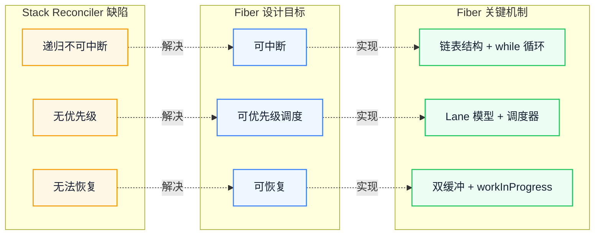
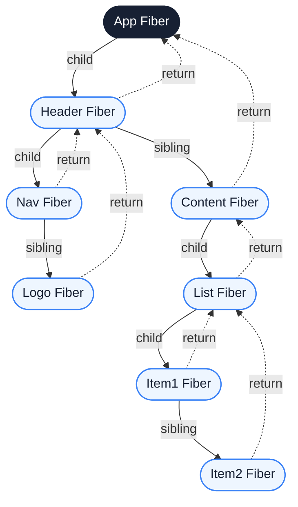
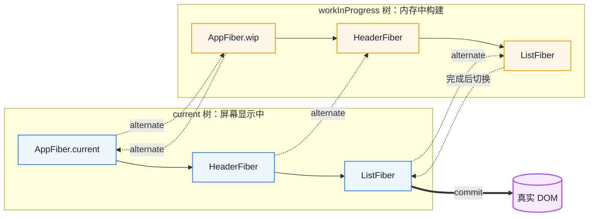
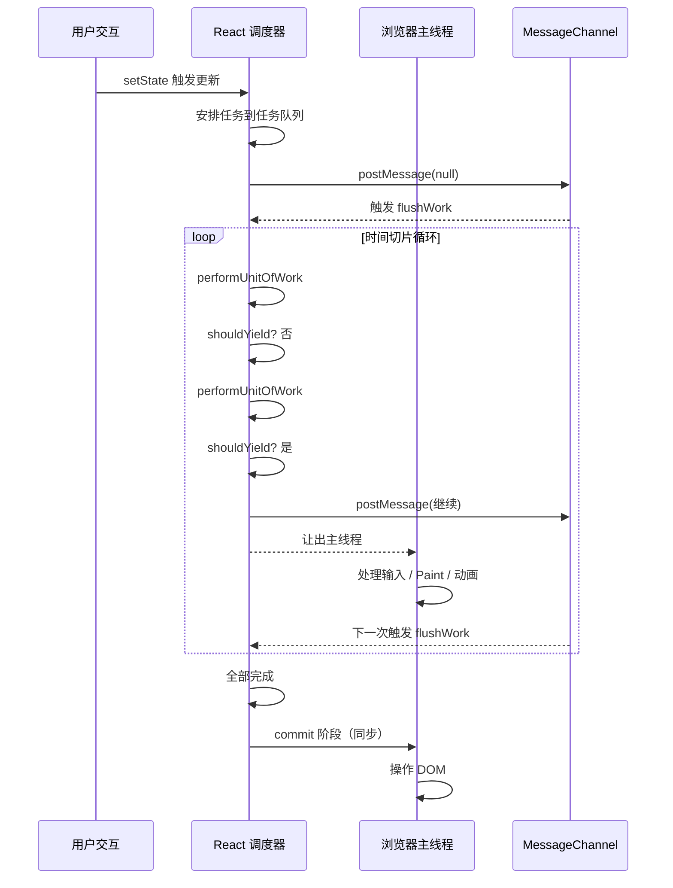
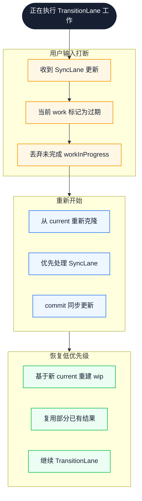
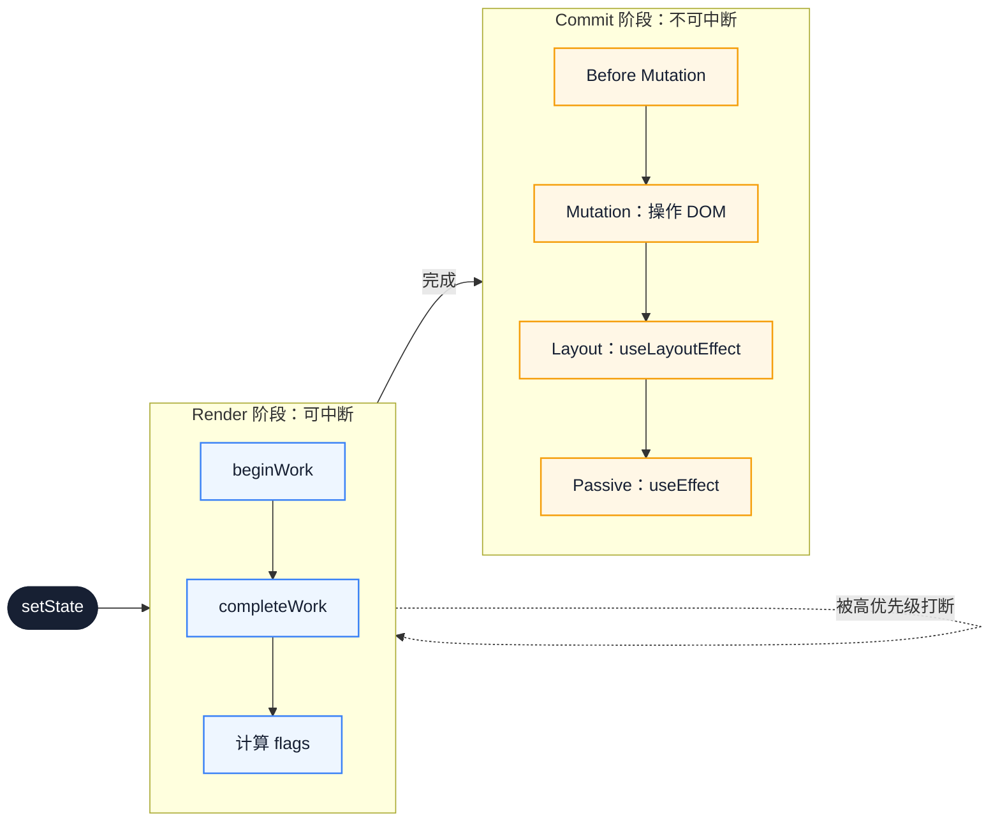
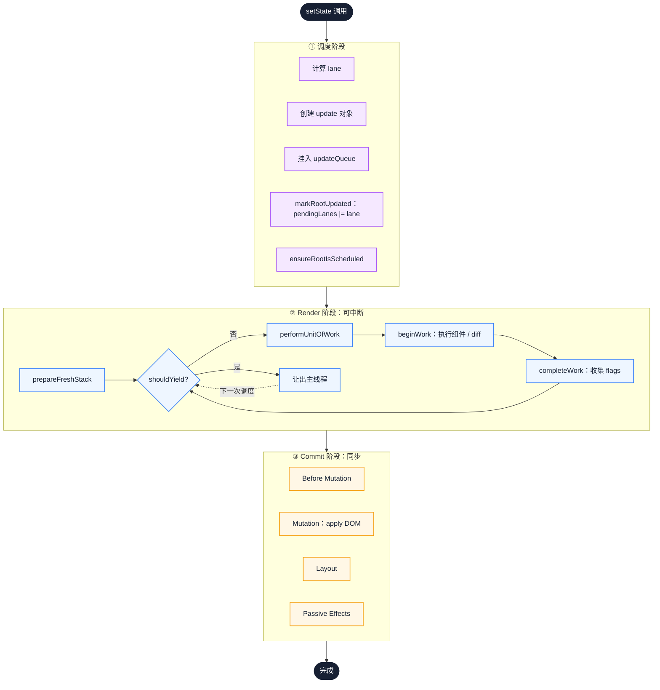

# React Fiber 架构：从栈调度到链式可中断渲染

一次 `setState` 之后，React 在主线程上究竟做了什么？组件树足够大时，为什么一次更新就能让输入框卡住？答案不在某个 API，而在渲染工作能否被暂停、能否让更紧急的更新先执行。本文从 React 15 的递归协调讲起，依次拆开 Fiber 的链表结构、双缓冲、时间切片与 Lane 模型，最后回到可观察的工程边界。

::: info 一句话
React Fiber 的本质，是把一棵递归不可中断的组件树，重写成一棵可中断、可恢复、可优先级调度的链表。
:::

## 目录

- [写在前面](#写在前面)
- [一、React 15 Stack Reconciler 的根本问题](#一、react-15-stack-reconciler-的根本问题)
- [二、Fiber 架构的设计动机：可中断、可恢复、可优先级调度](#二、fiber-架构的设计动机-可中断、可恢复、可优先级调度)
- [三、Fiber 节点的数据结构：从树到链表](#三、fiber-节点的数据结构-从树到链表)
- [四、双缓冲技术：current 树与 workInProgress 树](#四、双缓冲技术-current-树与-workinprogress-树)
- [五、时间切片与 MessageChannel：让主线程呼吸](#五、时间切片与-messagechannel-让主线程呼吸)
- [六、Lane 模型：用位运算表达优先级](#六、lane-模型-用位运算表达优先级)
- [七、并发模式的本质：协同式调度而非真并发](#七、并发模式的本质-协同式调度而非真并发)
- [八、从 setState 到 commit：一次完整更新的流转](#八、从-setstate-到-commit-一次完整更新的流转)
- [九、Fiber 带来的工程价值与代价](#九、fiber-带来的工程价值与代价)
- [结语：把 Fiber 当作调度契约，而不是性能开关](#结语-把-fiber-当作调度契约-而不是性能开关)
- [FAQ](#faq)
- [来源](#来源)

## 写在前面

很多工程师对 Fiber 的理解停在“React 16 引入的新架构”，知道它用了时间切片，却说不清几个关键问题：

- 为什么递归调用栈不可中断？改成 `while` 循环不就行了吗？
- Fiber 节点为什么要拆成三指针链表，而不是继续用树？
- 双缓冲只是为了复用内存吗？
- `shouldYield` 到底在让什么？
- Lane 模型相比 `expirationTime` 解决了什么？
- JavaScript 是单线程，Concurrent Mode 的“并发”二字又从何而来？

回答这些问题之前，先把“协调”这个词固定下来。**协调（Reconciliation）**指 React 对比新旧两棵元素树、决定哪些节点需要创建、更新或删除的过程；它只计算变化，不直接操作 DOM。真正把变化写进 DOM 的是后面的 commit 阶段。Fiber 改的是协调阶段的执行方式。

下文涉及的代码以 React 18 的源码结构为参照，做了删减，只保留支撑主线的字段与分支；它们用于说明机制，不能直接运行。

## 一、React 15 Stack Reconciler 的根本问题

React 15 的协调器叫 **Stack Reconciler**。它的工作方式很直接：从根节点开始递归遍历组件树，对比前后两棵树，把差异记录下来，最后统一提交。

```javascript
// Stack Reconciler 的结构示意，省略了 diff 细节
function reconcileChildren(parentFiber, children) {
  for (const child of children) {
    reconcileChild(parentFiber, child)
  }
}

function reconcileChild(parentFiber, child) {
  if (Array.isArray(child)) {
    reconcileChildren(parentFiber, child)
  } else {
    // 创建 / 更新 / 删除 fiber，然后继续递归
    reconcileChildren(parentFiber, child.props.children)
  }
}
```

这套实现简单，但有一个硬约束：**一旦开始，就必须跑完**。

### 1. 递归调用栈不可中断

JavaScript 的调用栈由引擎管理，开发者无法暂停一个正在执行的函数。协调一旦进入 `reconcileChildren`，就会沿组件树一路递归到底。

如果树很大，比如几千个节点，这段过程可能持续几十到上百毫秒。在这段时间里，主线程被完全占用：点击没有响应，输入框卡顿，动画掉帧。

::: warning 关键问题
不是 React 慢，而是 React 工作时没办法把主线程让出来。
:::

### 2. 单一优先级，无法插队

Stack Reconciler 对所有更新一视同仁。用户点击触发的高优先级更新，必须排在已经开始的低优先级更新之后。

于是会出现一个反直觉的现象：点击响应慢，不是因为点击本身复杂，而是因为前面有一个不重要的更新正在跑。

### 3. 调用栈深度等于组件树深度

递归让调用栈深度随组件树增长。组件树越深，栈越深，错误堆栈也越难读。这不是主要瓶颈，但它说明这套模型没有为“分步执行”留下空间。

三个问题指向同一个结论：Stack Reconciler 缺的不是性能技巧，而是“暂停、恢复、重排”的模型。

## 二、Fiber 架构的设计动机：可中断、可恢复、可优先级调度

Fiber 的设计目标可以归纳为三条，每一条对应 Stack Reconciler 的一个缺陷。



这张图把缺陷、目标和机制一一对应：可中断靠链表与迭代，可恢复靠节点自带上下文，可优先级调度靠 Lane 与调度器。沿虚线读因果，再看右侧机制落在哪个目标上。

### 1. 可中断：把递归改成迭代

要让递归可中断，最直接的办法是把递归改成 `while` 循环，并在循环里检查是否需要让出主线程。

但递归的上下文保存在调用栈里。改成循环后，调用栈没了，上下文从哪里来？

答案是：自己用对象把上下文存下来。这个对象就是 Fiber 节点。

### 2. 可恢复：链表结构 + 节点记上下文

递归函数的“下一步处理谁”由调用栈决定。改为迭代后，每个节点必须自己记住三件事：

- 父节点是谁，处理完我该回到哪里；
- 第一个子节点是谁，我应该向下走到哪里；
- 下一个兄弟节点是谁，处理完子树后该走到哪里。

这就是 Fiber 节点三个核心指针 `return`、`child`、`sibling` 的由来。

### 3. 可优先级调度：让重要的事情先做

可中断和可恢复只是基础，真正的目标是优先级调度。Fiber 维护一套优先级系统（早期是 `expirationTime`，React 17 起逐步引入 Lane 模型），让调度器可以比较两个更新的优先级、延迟低优先级工作、让高优先级更新插队。

三个目标共同决定了实现方式：链表替代树，对象保存上下文，调度器决定何时让出。这是一套协同式调度系统，不是一次性的性能优化。

## 三、Fiber 节点的数据结构：从树到链表

下面是一个简化但内核准确的 Fiber 节点结构，去掉了与本文主线无关的字段。

```javascript
function FiberNode(tag, pendingProps, key) {
  // 身份与类型
  this.tag = tag              // FunctionComponent / ClassComponent / HostComponent / ...
  this.key = key
  this.type = null            // 对应的函数 / 类 / 字符串如 'div'
  this.pendingProps = pendingProps
  this.memoizedProps = null   // 上次渲染用的 props
  this.memoizedState = null   // hooks 链表 / class 实例状态
  this.stateNode = null       // 对应的 DOM 节点 / 类实例

  // 三指针：把树改造成链表
  this.return = null          // 父 Fiber
  this.child = null           // 第一个子 Fiber
  this.sibling = null         // 下一个兄弟 Fiber
  this.index = 0              // 在兄弟中的位置

  // 双缓冲
  this.alternate = null       // 指向另一棵树中对应的 Fiber

  // 副作用
  this.flags = NoFlags        // Placement / Update / Deletion / ...
  this.subtreeFlags = NoFlags // 子树累积的 flags
  this.deletions = null       // 待删除的子节点

  // 调度相关
  this.lanes = NoLanes        // 该 Fiber 上的待处理优先级
  this.childLanes = NoLanes   // 子树上的待处理优先级
}
```

这里的“副作用”（effect）不是指 React 的 `useEffect`，而是协调过程中记录的 DOM 变更标记，例如插入、更新、删除。它们存放在 `flags` 与 `subtreeFlags` 中，等到 commit 阶段才真正执行。

### 1. 三指针链表：每个节点只记三个邻居

最关键的设计是 `return / child / sibling`。它们把一棵树改造成可单步遍历的结构。



实线是向下遍历的路径：先 `child` 下探，再 `sibling` 平移；虚线是回溯路径 `return`。有了这三条边，遍历不需要调用栈，也能知道下一步去哪。

于是工作循环可以写成这样：

```javascript
function workLoopSync(rootFiber) {
  let nextUnitOfWork = rootFiber
  while (nextUnitOfWork !== null) {
    nextUnitOfWork = performUnitOfWork(nextUnitOfWork)
  }
}

function performUnitOfWork(unitOfWork) {
  // 1. 处理当前节点：执行组件函数、对比 props 等
  const next = beginWork(unitOfWork)
  if (next !== null) {
    return next // 有子节点，下一步处理子节点
  }

  // 2. 没有子节点，找兄弟；兄弟也没有，回溯到父节点
  let node = unitOfWork
  while (node !== null) {
    completeWork(node)
    if (node.sibling !== null) {
      return node.sibling
    }
    node = node.return
  }
  return null // 整棵树遍历完成
}
```

`performUnitOfWork` 的返回值就是下一个工作单元。这是 Fiber 把递归变成迭代的核心：**下一个工作单元由指针决定，而不是由调用栈决定**。

### 2. 调度单元 = 渲染单元

Fiber 节点既是数据载体，也是调度单元。调度器可以决定现在处理几个节点、处理到哪个节点时让出、下次从哪个节点继续。

::: info 工程启示
每个 Fiber 节点都自带上下文，React 才能在任意节点中断、在任意节点恢复。这也是 hooks 必须按顺序调用的原因：hooks 链表保存在 Fiber 的 `memoizedState` 上，顺序错乱就找不回来了。
:::

链表结构的价值不在省内存，而在可遍历、可中断。三指针把树拆成可单步推进的工作流，每个 Fiber 都是一个独立的工作单元。

## 四、双缓冲技术：current 树与 workInProgress 树

Fiber 有一个容易让人困惑的字段：`alternate`。它指向另一棵树中对应的 Fiber。

这就是**双缓冲（Double Buffering）**。React 同时维护两棵 Fiber 树：

- **current 树**：当前显示在屏幕上的树，节点的 `stateNode` 指向真实 DOM；
- **workInProgress 树**：在内存中构建的下一棵树。



左边是屏幕上的 current 树，右边是内存中的 workInProgress 树。虚线表示 `alternate` 互指，粗箭头表示 commit 时一次性落到 DOM。关键是两棵树同时存在，切换只发生在 commit 结束。

### 1. 为什么要双缓冲？

最直接的好处是复用 Fiber 对象。一次更新被中断后重新开始，React 有两种选择：

- 完全重建一棵新树，浪费内存；
- 复用 current 树上的 Fiber，只更新变化字段。

`alternate` 让 React 从 current 树克隆出 workInProgress 树；如果某个节点在之前的尝试中已经构建过，就直接复用。

```javascript
function createWorkInProgress(current, pendingProps) {
  let workInProgress = current.alternate
  if (workInProgress === null) {
    // 第一次克隆：创建新 Fiber
    workInProgress = createFiber(current.tag, pendingProps, current.key)
    workInProgress.type = current.type
    workInProgress.stateNode = current.stateNode
    workInProgress.alternate = current
    current.alternate = workInProgress
  } else {
    // 复用：只更新字段
    workInProgress.pendingProps = pendingProps
    workInProgress.flags = NoFlags
    workInProgress.deletions = null
  }
  workInProgress.lanes = current.lanes
  workInProgress.childLanes = current.childLanes
  workInProgress.memoizedProps = current.memoizedProps
  workInProgress.memoizedState = current.memoizedState
  return workInProgress
}
```

### 2. 双缓冲让中断与重启的成本可控

假设一次低优先级更新构建到一半，被高优先级任务打断。React 会：

1. 丢弃未完成的 workInProgress 树；
2. 优先处理高优先级更新，构建新的 workInProgress 树；
3. 高优先级更新 commit 后，`root.current` 指向新的树；
4. 低优先级更新重新开始，从新的 current 树克隆。

克隆是按需的，未访问的节点根本不会创建 workInProgress。中断与重启的成本因此被限制在已经工作过的部分。

把 current 想成 `main` 分支、workInProgress 想成 `feature` 分支，会更容易理解：React 在 feature 上构建，完成后把 main 指过去，下次再从新的 main 切出新的 feature。类比只帮助建立入口，真正的机制仍是 `alternate` 指针与按需克隆。

双缓冲的价值不只是内存复用，更是让“中断—重启”的成本可控。`alternate` 是这套机制的物理实现。

## 五、时间切片与 MessageChannel：让主线程呼吸

可中断、可恢复只是数据结构层面的准备。真正决定“什么时候让出主线程”的是 **Scheduler（调度器）**。

### 1. 时间切片：一次工作 5ms

React 的 Scheduler 把单次连续工作的上限设为一个内部常量 `frameInterval`，默认 5ms。它不是浏览器规范，也不是面向应用的配置项；不同设备上，相同工作量可能更早或更晚触发让出。

```javascript
function workLoopConcurrent(rootFiber) {
  let nextUnitOfWork = rootFiber
  while (nextUnitOfWork !== null && !shouldYieldToHost()) {
    nextUnitOfWork = performUnitOfWork(nextUnitOfWork)
  }
  if (nextUnitOfWork !== null) {
    // 还有工作没做完：让出主线程，等下一次调度
    scheduleCallback(continueWork, nextUnitOfWork)
  }
}

// 简化示意：真实实现还包含对输入事件的判断
function shouldYieldToHost() {
  return getCurrentTime() - startTime >= frameInterval
}
```

`shouldYieldToHost` 问的是“我的工作时间片用完了没”，而不是“主线程有没有别的事”。React 主动让出，给浏览器机会处理输入、Paint 和动画。

### 2. 为什么是 MessageChannel？

React 需要一个“尽快被再次调用”的机制。可选方案各有代价：

- `setTimeout(cb, 0)`：有最小延迟，且会被浏览器 clamp；
- `requestAnimationFrame`：只在每帧渲染前调用一次，时机受帧率约束；
- `requestIdleCallback`：只在浏览器判断空闲时回调，React 无法控制让出时机；
- `MessageChannel`：`postMessage` 触发宏任务，延迟低，且由 React 自己决定何时继续。

```javascript
const channel = new MessageChannel()
const port = channel.port2

channel.port1.onmessage = () => {
  flushWork()
}

function scheduleCallback() {
  port.postMessage(null)
}
```

React 最终选择 `MessageChannel`，原因有二：延迟低，且调度权在自己手里。

::: warning 常见误区
很多人以为 React 用了 `requestIdleCallback`。React 团队评估过，最终放弃：它只在浏览器判断空闲时回调，无法保证高优先级更新先执行，也无法保证输入事件之前让出。React 用 `MessageChannel` 加时间切片自己实现调度。
:::

### 3. 时间切片流程



图中最关键的是两次 `postMessage`：一次启动工作循环，一次在时间片耗尽后把控制权交还浏览器。commit 永远在循环之外同步执行。

时间切片的本质是 React 主动让出主线程。`MessageChannel` 提供低延迟的唤醒，`shouldYield` 检查工作预算是否耗尽。

## 六、Lane 模型：用位运算表达优先级

React 17 之前使用 `expirationTime`：每个更新有一个过期时间，越小越紧急。这个模型简单，但有两个问题：

- 难以表达批量：多个不同优先级的更新混在一起，很难快速算出这批任务的优先级范围；
- 难以处理重叠：高优先级插队时，低优先级工作如何与它区分、复用？

React 17 起逐步引入 **Lane 模型**，React 18 的并发渲染以它为基础。它用 32 位整数的每一位表示一个优先级。

```javascript
// 简化的 Lane 定义，实际还有更多位
export const NoLanes = 0b0000000000000000000000000000000
export const SyncLane = 0b0000000000000000000000000000001
export const InputContinuousLane = 0b0000000000000000000000000000010
export const DefaultLane = 0b0000000000000000000000000000100
export const TransitionLane = 0b0000000000000000000000100000000
export const IdleLane = 0b0010000000000000000000000000000
export const OffscreenLane = 0b1000000000000000000000000000000
```

### 1. 为什么用位运算？

位运算有三个直接好处。

第一，批量判断用 `&`：

```javascript
// 判断是否还有阻塞型优先级的工作
function includesBlockingLane(lanes) {
  const blockingLanes = SyncLane | InputContinuousLane | DefaultLane
  return (lanes & blockingLanes) !== NoLanes
}
```

第二，多优先级可以并存：

```javascript
// 同一个 Fiber 上可以同时挂着同步与 transition 更新
const lanes = SyncLane | TransitionLane
```

第三，分离优先级用 `&` 与 `~`：

```javascript
// 去掉 transition 相关位，得到非 transition 部分
const nonTransitionLanes = lanes & ~TransitionLanes
```

### 2. Lane 与自动批处理

React 18 的 Automatic Batching 与 Lane 紧密相关。多个 `setState` 合并到同一次更新，本质是把它们的 lane 用 `|` 合并。

```javascript
function markRootUpdated(root, updateLane) {
  root.pendingLanes |= updateLane
}
```

调度器拿到 `pendingLanes`，挑出其中最高优先级的 lane，再决定下一次任务的优先级。

### 3. 优先级插队

当用户输入触发 `SyncLane`，而当前正在执行 `TransitionLane` 的工作时，React 会打断、重建、再恢复。



从上往下读：用户输入先打断当前工作，再基于 current 重建，最后才恢复低优先级任务。恢复不是继续旧树，而是从新的 current 重新克隆。

Lane 模型把优先级表达为一组可叠加、可分离的位，让 React 能同时处理多个优先级、批量更新、插队与恢复。`expirationTime` 的单一数值做不到这种并存与分离，这套位运算表达成为并发渲染的算术基础。

## 七、并发模式的本质：协同式调度而非真并发

很多文章说 React 18 引入了“并发模式”，容易让人以为 React 变成多线程。JavaScript 仍然是单线程，这里的“并发”不是“并行”。

### 1. 协同式 vs 抢占式

操作系统调度进程有两种方式：

- **抢占式**：内核强行挂起进程，让另一个进程运行；
- **协同式**：进程自己主动让出 CPU。

JavaScript 单线程，函数一旦开始执行就会运行到结束，没法被内核抢占。React 只能自己主动让出，这就是协同式调度。

### 2. 并发 = 可中断 + 可插队

React 的“并发”实际包含三件事：

- 把渲染工作切成多个小任务；
- 高优先级任务可以打断低优先级任务；
- 低优先级任务在空闲时继续。

用户感受到的“并发”，是输入、动画、渲染不再互相阻塞。

### 3. useTransition 与 useDeferredValue

这两个 API 让开发者主动把一个更新标记为低优先级。

```jsx
function App() {
  const [isPending, startTransition] = useTransition()
  const [query, setQuery] = useState('')
  const [results, setResults] = useState([])

  function handleChange(e) {
    setQuery(e.target.value) // 高优先级：输入框立刻更新
    startTransition(() => {
      setResults(filter(hugeList, e.target.value)) // 低优先级：可以晚一点
    })
  }

  return (
    <>
      <input value={query} onChange={handleChange} />
      {isPending ? 'loading...' : <List items={results} />}
    </>
  )
}
```

`startTransition` 内的 `setState` 会被打上 `TransitionLane`。输入框立刻响应，列表渲染即使更慢也不会卡住输入。

::: warning 关键认知
`useTransition` 不是性能优化 API，而是优先级声明 API。它只告诉 React“这个更新可以晚一点”。如果列表本来就能在一帧内渲染完，它不会带来可感知的加速。

它也和 `setTimeout(fn, 0)` 不同：后者只是把调用推迟到下一个宏任务，回调里的 `setState` 仍按原优先级执行；`useTransition` 改的是调度优先级，更新可以被中断和插队。
:::

### 4. 并发渲染不影响 commit 阶段

render 阶段可以中断，但 **commit 阶段不可中断**。commit 包含真实 DOM 操作、生命周期、`useEffect` 调度，一旦开始必须同步完成。



图中只有上半部分会被打断，下半部分从 Mutation 开始必须同步走完。虚线表示 render 被高优先级任务打断后重新进入。

commit 阶段不可中断，原因不是技术上做不到，而是半途中断会让已删除或已更新的节点处于不一致状态；而且 commit 通常只有毫秒级，中断的收益有限。`useLayoutEffect` 里的重计算会直接阻塞绘制，非必要的工作应放到 `useEffect` 或事件回调里。

并发渲染的“并发”是协同式调度，不是多线程；可中断的只有 render 阶段。`useTransition / useDeferredValue` 是开发者声明优先级的入口。

## 八、从 setState 到 commit：一次完整更新的流转

把前面的概念串起来，一次 `setState` 的完整流程如下。



按 ①→②→③ 读：调度阶段只登记工作，Render 阶段可以反复让出，Commit 阶段一次同步完成。终点的“完成”指 current 指针切换，不是 `useEffect` 已经执行。

### 1. 调度阶段

`setState` 不会立刻触发渲染，而是依次做五件事：

1. 根据更新来源（事件、transition、Suspense 等）计算 lane；
2. 创建 `update` 对象 `{ lane, action, next }`；
3. 把 update 挂到对应的 Hook / updateQueue；
4. 把 lane 通过 `|=` 合并进 `root.pendingLanes`；
5. 调用 `ensureRootIsScheduled`：如果还没有任务在跑，就 `scheduleCallback`。

### 2. Render 阶段

调度器在合适时机调用 work loop：

1. 从 root 开始，`prepareFreshStack` 重置工作单元；
2. 循环执行 `performUnitOfWork`；
3. 每次循环检查 `shouldYield`，超时就回到调度器；
4. 完成后，整棵 workInProgress 树的 flags 都已准备好。

### 3. Commit 阶段

Render 完成后进入 commit，同步执行：

1. **Before Mutation**：`getSnapshotBeforeUpdate` 等；
2. **Mutation**：根据 flags 操作 DOM，插入、删除、更新；
3. **Layout**：`useLayoutEffect`、`componentDidMount`、`componentDidUpdate`；
4. **Passive Effects**：`useEffect` 异步调度。

### 4. 切换 current

commit 完成后，`root.current` 指向新的树。下次更新开始时，这棵树就成了新的 current。

一次更新的完整链路是“调度 → Render（可中断）→ Commit（同步）→ 切换 current”。理解每个阶段做什么、能否被打断，是阅读 React 源码的导航地图。

## 九、Fiber 带来的工程价值与代价

### 1. 工程价值

- **可中断渲染**：长任务被切分，主线程不再被独占；
- **优先级调度**：用户输入优先于数据更新；
- **Suspense**：渲染可以等待，配合异步数据流更自然；
- **Streaming SSR**：服务端流式输出 HTML；
- **Server Components**：与 Suspense、流式渲染一起扩展了 React 的渲染边界。

### 2. 代价

- **心智复杂度**：从“渲染一次”变成“可能渲染多次，部分会被丢弃”；
- **render 阶段不能有副作用**：render 可能被中断重做，副作用会重复执行；
- **内存占用**：双缓冲加链表比递归调用栈占用更多堆内存；
- **Hooks 规则**：必须按顺序调用，因为 hooks 链表保存在 Fiber 上。

::: warning 易踩的坑
在 render 阶段读 ref 并修改、调用没有 cleanup 的副作用、依赖可变的全局状态，都会在并发渲染下暴露问题。render 函数可能被调用多次，必须保持纯净；复杂计算用 `useMemo` 缓存，真正的副作用放到 `useEffect`。
:::

### 3. Fiber 与“React 是声明式框架”的张力

React 一直宣称自己是声明式 UI 框架。Concurrent Rendering 引入后，开发者又必须关心“渲染可能被打断重做”这个非声明式的事实。这是 React 设计哲学中真实存在的张力，并没有被完全解决。

Fiber 是 React 走向调度系统的关键一步。它带来优先级、可中断、Suspense、RSC 等能力，也要求开发者把 render 写得纯净，并接受更高的概念复杂度。

## 结语：把 Fiber 当作调度契约，而不是性能开关

Fiber 真正改变的不是某次渲染的耗时，而是 React 与主线程之间的关系：工作可以被切开、丢弃、重排，紧急更新不必排在长任务后面。由此看，链表、双缓冲、Lane 不是三个孤立的源码细节，而是同一份调度契约的不同侧面。

下一步值得做的，不是背字段，而是在真实项目里观察两件事：一次交互触发的 render 是否被长计算拖住，以及哪些副作用被放在了可能重做的 render 阶段。用 React DevTools 的 Profiler 看提交耗时，再对照 `useTransition` 的 pending 状态，通常比通读源码更快暴露问题。

如果项目仍以一次性同步渲染为主，Fiber 的存在不会自动带来收益；只有把可中断的更新真正标记为 transition 或 deferred，调度能力才会转化为体验。

## FAQ

### 1. Fiber 在 React 16 就已引入，为什么并发渲染直到 React 18 才成为默认能力？

Fiber 提供的是可中断的数据结构与调度基础。React 16/17 的并发特性还是 opt-in，需要显式使用实验入口（例如 `unstable_createRoot`）。React 18 正式提供 `createRoot`，并开放 `useTransition`、`useDeferredValue` 等 API，应用才普遍具备声明优先级的途径。具体版本行为以对应版本的官方文档为准。

### 2. `useTransition` 与 `useDeferredValue` 该怎么选？

需要你自己发起状态更新，并希望这段更新不阻塞输入时，用 `useTransition`，它把 `startTransition` 内的更新标记为低优先级。值来自 props、外部 store 或无法包在回调里的场景，用 `useDeferredValue`：它保留旧值先渲染，等紧急更新完成后再追上。两者都是优先级声明，不负责减少计算量。

### 3. StrictMode 下组件执行两次，与并发中断导致的重复执行是一回事吗？

不是。StrictMode 的双调用是开发期刻意设计的检查，用来暴露不纯净的 render 和缺失 cleanup 的副作用；并发中断是生产环境也可能发生的渲染重做。两者的触发条件与目的不同，但共同要求一致：render 不产生外部副作用，副作用集中在 `useEffect` 等提交后的位置。

### 4. Fiber 会让 React 一定更快吗？

不一定。Fiber 增加了堆内存与调度开销，对小型、同步、一次性完成的更新，未必比原来的递归更快。它的收益在于避免长任务阻塞输入、让高优先级更新插队。是否值得启用并发特性，应看交互密度与单次渲染成本，而不是看框架版本号。

## 来源

1. React 官方文档 - The Plan for React 18：<https://react.dev/blog/2021/06/08/the-plan-for-react-18>
2. React 官方文档 - useTransition：<https://react.dev/reference/react/useTransition>
3. Andrew Clark - React Fiber Architecture：<https://github.com/acdlite/react-fiber-architecture>
4. Sebastian Markbåge - React Basic：<https://github.com/reactjs/react-basic>
5. React 源码（packages/react-reconciler / packages/scheduler）：<https://github.com/facebook/react>

本文同时基于作者对 React 源码的阅读与整理。
