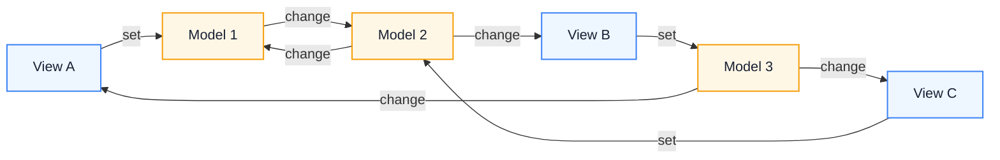
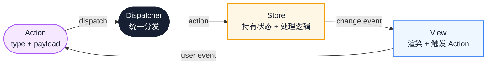
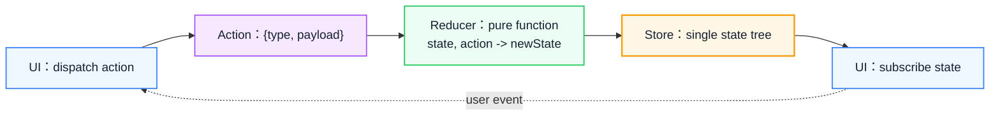
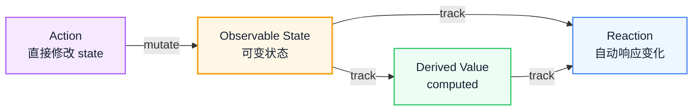
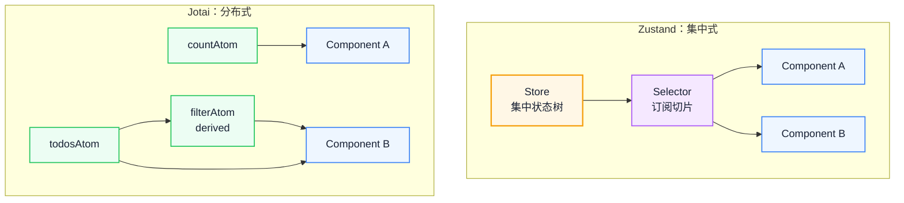
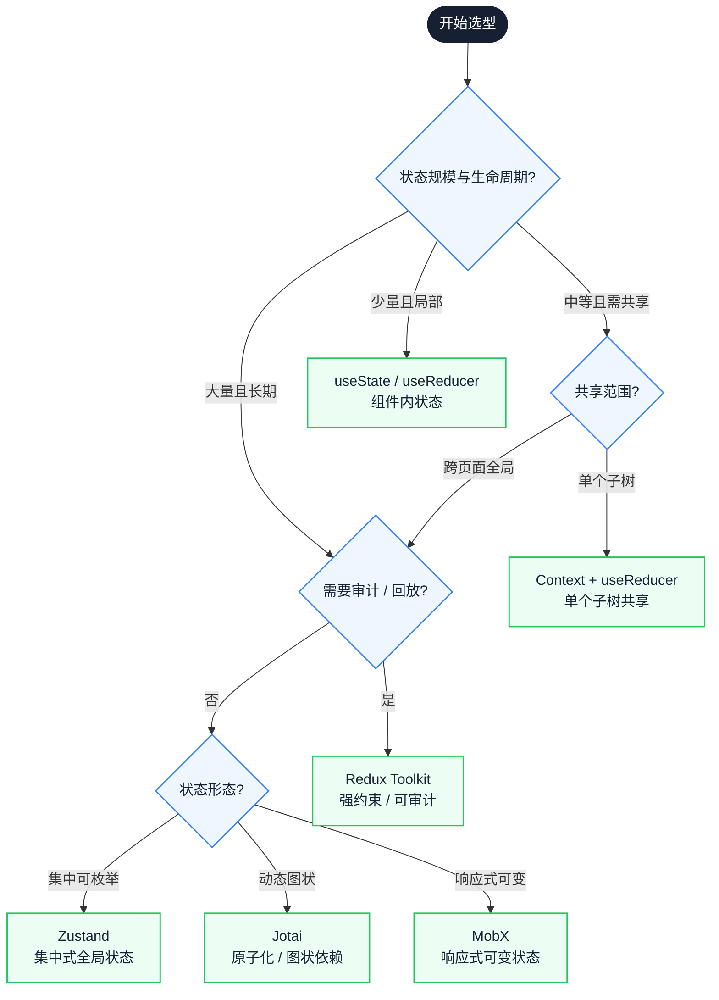

# 现代状态管理演进：从 Flux 到 Zustand 的设计哲学

几乎每个前端项目都会经历一次状态管理选型：先用组件内状态，随后引入 Context，再换成某个全局 store。换工具本身不解决问题，真正决定结果的是状态规模、更新粒度、可追踪性和团队协作成本。本文把主流方案放回各自要解决的约束里比较，再给出可以按条件执行的选型路径。

::: info 一句话
前端状态管理演进的每一步，都在解决“状态变化的可追踪性”与“开发体验”之间的张力——从 Flux 强约束的单向流，到 Zustand 的极简 API，都是在重新权衡这两个维度。
:::

## 目录

- [写在前面](#写在前面)
- [一、决策背景：MVC 的网状状态为什么失控](#一、决策背景-mvc-的网状状态为什么失控)
- [二、评价维度：选型时到底在权衡什么](#二、评价维度-选型时到底在权衡什么)
- [三、方案比较：Flux 用单向数据流换约束](#三、方案比较-flux-用单向数据流换约束)
- [四、方案比较：Redux 把约束推到极致](#四、方案比较-redux-把约束推到极致)
- [五、方案比较：MobX 用响应式换开发效率](#五、方案比较-mobx-用响应式换开发效率)
- [六、方案比较：Zustand 与 Jotai 减少约束](#六、方案比较-zustand-与-jotai-减少约束)
- [七、约束与风险：反模式与边界条件](#七、约束与风险-反模式与边界条件)
- [八、条件化建议：按项目条件选型](#八、条件化建议-按项目条件选型)
- [决策清单](#决策清单)
- [结语：先看清约束，再决定工具](#结语-先看清约束-再决定工具)
- [FAQ](#faq)
- [来源](#来源)

## 写在前面

很多工程师的状态管理路径是这样的：

- 项目开始时用 `useState`，简单够用；
- 状态变多后提升到父组件，开始 prop drilling；
- 觉得麻烦，装 Redux；
- 嫌 Redux 模板多，换 MobX / Zustand / Jotai；
- 用了一段时间，发现每个方案都有不对劲的地方。

换工具之所以反复发生，通常不是库选错了，而是没有先确认约束：状态到底有多大、更新有多频繁、是否需要审计、团队能维护多少约定。

本文按决策顺序回答这些问题：

- Flux 出现前，MVC 的状态流为什么会失控？
- Redux 的三条原则各自约束了什么？
- MobX 与 Redux 是对立关系，还是解决不同问题？
- Zustand 和 Jotai 到底减掉了什么？
- 已有方案运行良好时，什么条件下才值得迁移？
- 服务端数据该不该放进全局 store？

文中代码用于展示结构，省略了错误处理和完整类型；标注为可运行的片段会说明版本与依赖。

## 一、决策背景：MVC 的网状状态为什么失控

在前端框架化之前（约 2010—2014），Backbone.js、Ember.js、Knockout 等框架普遍采用 MVC 或 MVP 模式。Model 持有数据，View 监听 Model 变化并渲染，Controller 处理用户交互。

### 1. 双向绑定的诱惑与陷阱

早期 MVC 框架普遍支持双向绑定：View 的输入变化写回 Model，Model 变化刷新 View。简单场景下很顺手，应用一大就迅速失控。

```javascript
// Backbone 风格的伪代码，只保留双向绑定结构，不能直接运行
const Model = Backbone.Model.extend({
  defaults: { count: 0, total: 100 },
})

const View = Backbone.View.extend({
  events: {
    'input #count': 'onInput', // View -> Model
  },
  initialize() {
    this.model.on('change', this.render, this) // Model -> View
  },
  onInput(e) {
    this.model.set('count', e.target.value)
  },
  render() {},
})
```

### 2. 状态流变得不可追踪

当 Model 数量变多、View 互相依赖、Model 互相监听时，一个用户操作可能触发一连串变化。



图中没有起点也没有终点：View 写 Model，Model 又通过 change 事件影响其他 Model 和 View。只要有一条边形成环，一次输入就可能触发循环更新或级联更新，调试时很难判断最初的动作是什么。

这种网状依赖带来三个问题：

- **数据流不可预测**：一次输入可能触发循环或级联更新；
- **调试困难**：状态变化的源头难以追溯；
- **测试困难**：依赖大量隐式状态。

### 3. Facebook 的“MVC 不 scale”论断

2014 年，Facebook 工程师在 Flux 演讲中展示了 MVC 在大型应用中变成“V-C-M-V-M-C”纠缠的图。这幅图推动了 Flux 的诞生。

::: warning 常见误区
MVC 本身并没有问题。小型应用里它工作得很好，问题出在前端应用规模上来后，缺少对状态变化路径的统一约束。Flux 的核心不是取代 MVC，而是用单向数据流强制约束变化路径。
:::

MVC 时代的核心问题是双向绑定加 Model 互相监听，让数据流变成网状。Flux 要做的，是把网状依赖压回单向链路。

## 二、评价维度：选型时到底在权衡什么

在比较具体库之前，先固定判断轴。否则很容易把“代码少”当成唯一标准，忽略团队协作和可追踪性。

| 维度 | 要回答的问题 | 为什么会改变选型 |
| --- | --- | --- |
| 状态规模与生命周期 | 状态只在组件内、单个子树，还是全局长期存在？ | 全局化会扩大订阅面，也让清理责任变模糊 |
| 状态形态 | 是集中可枚举的对象，还是大量动态生成、互相依赖的单元？ | 决定 selector 是否好用、依赖图是否会失控 |
| 更新粒度 | 高频更新时，能否只重渲染受影响的组件？ | 组件级订阅在频繁更新场景下容易放大成本 |
| 可追踪性 | 是否需要审计、回放、严格约束每一次变更？ | 强约束方案代码更多，但排障与协作边界更清晰 |
| 团队协作成本 | 新人多久能上手？跨团队是否需要统一约定？ | 自由度高但约定弱的方案，规模越大越难维护 |
| 服务端状态边界 | 这些数据的主人和新鲜度归谁？ | 服务端缓存有专门工具，混进通用 store 会增加负担 |

### 1. 状态规模与生命周期

组件内部的表单输入、开关、临时动画状态，生命周期跟随组件，放回本地最省事。跨页面共享、需要长期保留的状态，才值得进入全局层。

判断标准不是“有多少个变量”，而是“谁需要读、读多久、谁负责清理”。

### 2. 状态形态

集中式状态像一个对象加若干切片，适合用户信息、主题、配置这类可枚举结构。原子化状态适合大量动态生成、彼此依赖的单元，例如复杂表单字段、可增删的卡片。

形态选错，后面会用更多 selector 或依赖声明去弥补。

### 3. 更新粒度

高频更新（拖拽、输入联想、实时协作）会放大订阅范围。组件级订阅意味着一次变化可能重跑整个组件；字段级订阅只触发相关 effect 或 selector。

这一维度直接决定是否需要更细的响应式系统，而不是只看 API 长短。

### 4. 可追踪性

需要审计每一次状态变化、回放历史、跨团队排查问题时，显式 Action 与不可变更新会带来实际收益。反过来，如果状态变化只服务于本团队的快速迭代，强约束可能只是额外成本。

### 5. 团队协作成本

Redux Toolkit 的模板比早期 Redux 少很多，但仍要求团队理解 action、reducer 和中间件。Zustand 的 API 更短，但“什么时候该拆 store、selector 怎么写”需要团队自己约定。

选型不只是技术判断，也是在选择一套团队需要长期维护的约定。

### 6. 服务端状态边界

从 API 拉来的数据有所有者、有新鲜度、需要一致性，它更像缓存而不是客户端状态。把这类数据放进通用 store，通常要自己补 loading、error、缓存失效和并发请求处理。

先把服务端状态识别出来，剩下的客户端状态规模往往会小很多。

## 三、方案比较：Flux 用单向数据流换约束

Flux 是 Facebook 在 2014 年提出的架构。它不是库，而是一套设计模式，核心思想是：所有状态变化必须经过 Dispatcher，单向流动。

### 1. Flux 的四个角色



四个角色围成一个闭环：View 产生 Action，Dispatcher 统一分发，Store 更新状态并发出 change 事件，View 再根据事件渲染。单向指的是状态变化只能沿这个方向走，Store 之间不能直接互相调用。

- **Action**：描述“发生了什么”的纯对象 `{ type, payload }`；
- **Dispatcher**：统一分发 Action 到所有 Store；
- **Store**：持有状态，注册到 Dispatcher，根据 Action 类型更新自己；
- **View**：订阅 Store 变化、渲染、响应用户操作触发 Action。

### 2. 简化实现

```javascript
// 只保留分发与订阅的主干，render / addButton 等外部引用省略
class Dispatcher {
  constructor() {
    this.callbacks = []
  }
  register(callback) {
    this.callbacks.push(callback)
    return () => {
      this.callbacks = this.callbacks.filter((cb) => cb !== callback)
    }
  }
  dispatch(action) {
    this.callbacks.forEach((cb) => cb(action))
  }
}

const dispatcher = new Dispatcher()

class TodoStore {
  constructor() {
    this.todos = []
    this.listeners = new Set()
    dispatcher.register((action) => this.handleAction(action))
  }
  handleAction(action) {
    switch (action.type) {
      case 'ADD_TODO':
        this.todos.push(action.payload)
        this.emit()
        break
      case 'REMOVE_TODO':
        this.todos = this.todos.filter((t) => t.id !== action.payload.id)
        this.emit()
        break
    }
  }
  emit() {
    this.listeners.forEach((l) => l())
  }
  subscribe(listener) {
    this.listeners.add(listener)
    return () => this.listeners.delete(listener)
  }
}

const store = new TodoStore()
store.subscribe(() => render(store.todos))
addButton.onclick = () => {
  dispatcher.dispatch({ type: 'ADD_TODO', payload: { id: Date.now(), text: 'new' } })
}
```

### 3. Flux 解决了什么

| MVC 问题 | Flux 解法 |
|---------|----------|
| 数据流网状 | 所有数据流经过 Dispatcher，单向 |
| Model 互相监听 | Store 不允许互相直接调用，只能通过 Dispatcher 间接通信 |
| 状态变化不可追踪 | 所有变化必须由 Action 触发，Action 是不可变事件 |
| 调试困难 | Action 是离散事件，可以记录、回放 |

### 4. Flux 的局限

- **多 Store 协调麻烦**：一个 Action 可能更新多个 Store，Store 之间还要等彼此完成（`waitFor`）；
- **没有标准实现**：Facebook 给了模式，具体 API 各家不同；
- **冗余代码**：每个 Store 都要写 switch-case。

这些局限直接催生了 Redux——一个标准化、单一 Store、函数式的 Flux 变体。

Flux 的贡献是把状态变化变成可枚举的事件，代价是每个事件都要手写分发与分支。

## 四、方案比较：Redux 把约束推到极致

Redux 由 Dan Abramov 与 Andrew Clark 在 2015 年创建。它把 Flux 的思想标准化，并确定了三条原则：

1. **单一数据源**：整个应用的状态保存在一棵 state tree 中；
2. **状态只读**：唯一改变状态的方式是 dispatch action；
3. **纯函数修改**：reducer 必须是纯函数，无副作用。

### 1. Redux 的核心模型



图中 Action 是唯一的输入，Reducer 是纯计算，Store 是唯一状态源。虚线表示用户操作重新产生 Action，而不是直接改 Store；这条边界是 Redux 可追踪性的来源。

### 2. 完整的简化实现

```javascript
function createStore(reducer, initialState) {
  let state = initialState
  const listeners = []

  return {
    getState: () => state,
    dispatch: (action) => {
      state = reducer(state, action) // 纯函数计算新 state
      listeners.forEach((l) => l())
      return action
    },
    subscribe: (listener) => {
      listeners.push(listener)
      return () => {
        const i = listeners.indexOf(listener)
        if (i >= 0) listeners.splice(i, 1)
      }
    },
  }
}

// Reducer：纯函数，不可变更新
function todosReducer(state = [], action) {
  switch (action.type) {
    case 'ADD_TODO':
      return [...state, action.payload]
    case 'TOGGLE_TODO':
      return state.map((t) =>
        t.id === action.payload.id ? { ...t, done: !t.done } : t
      )
    case 'REMOVE_TODO':
      return state.filter((t) => t.id !== action.payload.id)
    default:
      return state
  }
}

const store = createStore(todosReducer, [])
store.subscribe(() => console.log(store.getState()))
store.dispatch({ type: 'ADD_TODO', payload: { id: 1, text: 'learn redux', done: false } })
```

这段代码可以在 Node.js 18+ 或浏览器控制台直接运行，输出是包含一条 todo 的数组。

### 3. 为什么强制不可变

**不可变（Immutable）**指更新时创建新对象，而不是就地修改原对象。Redux 强制 reducer 返回新对象，原因有三。

**第一，可追踪性**：每次 state 变化都是一次新引用，可以用 `===` 快速判断是否变化，无需深比较。

```javascript
// React-Redux 的优化基础
function shallowEqual(a, b) {
  if (a === b) return true // 引用相等直接返回，O(1)
  // 继续比较第一层字段
}
```

**第二，时间旅行**：历史 state 都保留在内存中，可以回放。这是 Redux DevTools 的基础。

**第三，纯函数可测试**：reducer 给定输入一定得到相同输出，测试不需要 mock。

### 4. 中间件机制

Redux 的副作用——异步请求、日志、错误处理——通过中间件实现。中间件是 `store.dispatch` 的包装器。

```javascript
function applyMiddleware(store, middlewares) {
  let dispatch = store.dispatch
  middlewares.forEach((mw) => {
    dispatch = mw(store)(dispatch)
  })
  return { ...store, dispatch }
}

// 日志中间件
const logger = (store) => (next) => (action) => {
  console.log('dispatch', action)
  const result = next(action)
  console.log('next state', store.getState())
  return result
}

// thunk 中间件：处理函数形式的 action
const thunk = (store) => (next) => (action) => {
  if (typeof action === 'function') {
    return action(store.dispatch, store.getState)
  }
  return next(action)
}

const store = createStore(reducer, initialState)
const enhancedStore = applyMiddleware(store, [logger, thunk])

const fetchTodos = () => async (dispatch) => {
  dispatch({ type: 'FETCH_TODOS_REQUEST' })
  try {
    const todos = await api.fetchTodos()
    dispatch({ type: 'FETCH_TODOS_SUCCESS', payload: todos })
  } catch (e) {
    dispatch({ type: 'FETCH_TODOS_FAILURE', payload: e.message })
  }
}
enhancedStore.dispatch(fetchTodos())
```

### 5. Redux 的代价

Redux 的约束力是优点，也是代价：

- **模板代码多**：一个简单功能要写 action type、action creator、reducer、连接组件；
- **不可变更新繁琐**：嵌套对象的 spread 可读性差、易错；
- **学习曲线陡**：纯函数、不可变、中间件、connect/Hooks 都要学；
- **过度工程**：小项目用 Redux 会带来不必要的约束。

```javascript
// 嵌套更新的痛苦
function reducer(state, action) {
  switch (action.type) {
    case 'UPDATE_TODO_TEXT':
      return {
        ...state,
        todos: state.todos.map((t) =>
          t.id === action.payload.id
            ? { ...t, text: action.payload.text }
            : t
        ),
      }
  }
}
```

Immer 让 reducer 可以用可变语法写不可变更新。

```javascript
import { produce } from 'immer'

const reducer = produce((draft, action) => {
  switch (action.type) {
    case 'UPDATE_TODO_TEXT': {
      const todo = draft.todos.find((t) => t.id === action.payload.id)
      if (todo) todo.text = action.payload.text // 看起来可变，实际生成新 state
      break
    }
  }
})
```

Redux 适合把状态变化当作可审计事件的场景，代价是每次扩展都要维护一套 action/reducer 约定。是否值得，取决于可追踪性对团队是否真的重要。

## 五、方案比较：MobX 用响应式换开发效率

MobX 走了相反的路：通过响应式系统自动追踪依赖，让状态管理回到“修改数据”本身。

### 1. MobX 的核心模型



MobX 的入口是 Action，出口是 Reaction。Observable 被读取时自动记录依赖，被修改时自动通知；Derived 与 Reaction 都通过 track 挂在状态上。这里没有手写订阅列表，依赖由读取行为决定。

### 2. 简化实现

下面这段代码展示“Proxy + 自动依赖收集”的最小结构，不是 MobX 源码。

```javascript
// 简化的 observable：思路接近 Vue 3 的 reactive
function observable(target) {
  const deps = new Map() // key -> Set<reaction>
  let currentReaction = null

  const proxy = new Proxy(target, {
    get(t, key) {
      if (currentReaction) {
        if (!deps.has(key)) deps.set(key, new Set())
        deps.get(key).add(currentReaction)
      }
      return t[key]
    },
    set(t, key, value) {
      t[key] = value
      deps.get(key)?.forEach((r) => r())
      return true
    },
  })

  function autorun(fn) {
    const reaction = () => {
      currentReaction = reaction
      try {
        fn()
      } finally {
        currentReaction = null
      }
    }
    reaction()
  }

  return { proxy, autorun }
}

const state = observable({ count: 0, todos: [] })

state.autorun(() => {
  console.log('count is', state.proxy.count)
})

state.proxy.count = 1 // 控制台输出: count is 1
state.proxy.todos.push({}) // 不会触发上面的 autorun，因为没有读取 todos
```

### 3. MobX 6 的写法

实际项目通常用 `makeAutoObservable` 让类字段、getter 和 action 自动变成 observable、computed 和 action。

```javascript
import { makeAutoObservable, autorun } from 'mobx'

class TodoStore {
  todos = []

  constructor() {
    makeAutoObservable(this)
  }

  get unfinishedCount() {
    return this.todos.filter((t) => !t.done).length
  }

  addTodo(text) {
    this.todos.push({ text, done: false })
  }
}

const store = new TodoStore()
autorun(() => console.log('unfinished:', store.unfinishedCount))
store.addTodo('learn mobx') // 控制台输出: unfinished: 1
```

以上示例基于 MobX 6。更早版本使用装饰器或显式 `observable` 包装，写法不同。

### 4. MobX 的关键设计

**第一，状态可变**：直接 `state.count++`，无需 reducer、dispatch 或不可变更新。

**第二，自动依赖追踪**：reaction 运行时读取了哪些 observable，就订阅哪些，无需手写依赖列表。

**第三，细粒度更新**：每个 observable 属性都有自己的订阅集合，更新某个属性只触发相关 reaction。

**第四，computed 缓存**：衍生状态自动缓存，依赖不变时返回旧值。

### 5. Redux vs MobX

| 维度 | Redux | MobX |
|------|-------|------|
| 数据流 | 单向、显式 Action | 双向、直接修改 |
| 状态可变性 | 不可变 | 可变 |
| 依赖追踪 | 手动 connect/selector | 自动 |
| 更新粒度 | 组件级（订阅 state 切片） | 字段级 |
| 模板代码 | 多 | 少 |
| 可追踪性 | 强（所有变化都是 Action） | 弱（任何地方都能改） |
| 调试 | 时间旅行、Action 回放 | 难以回放（状态被直接修改） |
| 适合规模 | 大型团队、需要约束 | 中小型、追求开发效率 |

Redux 和 MobX 不是好与坏的关系，而是约束与自由的取舍。Redux 的强约束让大型团队协作更安全，MobX 的自由让中小型项目开发更快；在不需要严格审计每一次状态变化的场景下，MobX 的开发体验通常更好。

## 六、方案比较：Zustand 与 Jotai 减少约束

到 2017—2019 年，社区对 Redux 的繁琐越来越不满，一批极简状态管理库出现，其中最有代表性的是 Zustand 和 Jotai，另有 Recoil、Valtio 等。

### 1. Zustand：保留 store，去掉模板

Zustand 的目标是保留 Redux 的“显式 store”理念，但去掉样板代码。以下示例基于 Zustand 4/5 与 React 18+。

```jsx
import { create } from 'zustand'

const useStore = create((set, get) => ({
  count: 0,
  todos: [],
  increment: () => set((state) => ({ count: state.count + 1 })),
  addTodo: (text) =>
    set((state) => ({ todos: [...state.todos, { text, done: false }] })),
  getUnfinished: () => get().todos.filter((t) => !t.done).length,
}))

function Counter() {
  const count = useStore((state) => state.count)
  const increment = useStore((state) => state.increment)
  return <button onClick={increment}>{count}</button>
}
```

关键设计：

- **store 是一个 hook**：直接在组件中调用，无需 Provider；
- **状态和 action 放一起**：不再分离 reducer / action creator；
- **可变或不可变都可以**：`set` 接受新对象，也可以配合 Immer 写可变语法；
- **selector 优化**：组件只订阅自己关心的切片。

简化实现大致如下：

```javascript
import { useSyncExternalStore } from 'react'

function createStore(createState) {
  let state
  const listeners = new Set()

  const setState = (partial) => {
    const nextState = typeof partial === 'function' ? partial(state) : partial
    if (!Object.is(nextState, state)) {
      const previousState = state
      state = Object.assign({}, state, nextState)
      listeners.forEach((l) => l(previousState, state))
    }
  }
  const getState = () => state
  const subscribe = (listener) => {
    listeners.add(listener)
    return () => listeners.delete(listener)
  }

  const api = { setState, getState, subscribe }
  state = createState(setState, getState, api)

  const useStore = (selector = (s) => s) => {
    return useSyncExternalStore(subscribe, () => selector(getState()))
  }
  Object.assign(useStore, api)
  return useStore
}
```

这个简化版本没有处理 selector 返回新对象时的缓存问题。Zustand 实际使用 `useSyncExternalStoreWithSelector`，并通过 `Object.is` 比较快照，避免无变化时反复渲染。

### 2. Jotai：原子化状态

Jotai 受 Recoil 启发，走完全不同的路线：状态不集中在一棵树里，而是分散为独立的原子。以下示例基于 Jotai 2.x。

```jsx
import { atom, useAtom } from 'jotai'

// 原子：状态的最小单元
const countAtom = atom(0)
const todosAtom = atom([])

// 衍生原子：依赖其他原子
const unfinishedCountAtom = atom((get) =>
  get(todosAtom).filter((t) => !t.done).length
)

// 可写派生原子
const addTodoAtom = atom(null, (get, set, text) => {
  set(todosAtom, [...get(todosAtom), { text, done: false }])
})

function Counter() {
  const [count, setCount] = useAtom(countAtom)
  return <button onClick={() => setCount(count + 1)}>{count}</button>
}
```

关键设计：

- **状态分散**：每个 atom 独立，不需要集中 store；
- **图状依赖**：atom 可以依赖其他 atom，自动形成依赖图；
- **细粒度订阅**：组件只订阅自己使用的 atom；
- **可派生**：atom 可以是只读衍生状态，也可以是可写转换 atom。

### 3. Zustand vs Jotai



左边 Zustand 只有一个状态源，组件通过 selector 取切片；右边 Jotai 有多个原子，派生原子再把依赖连成图。图中的边越多，越需要考虑依赖是否需要拆分，而不是继续堆在一个 store 里。

| 维度 | Zustand | Jotai |
|------|---------|-------|
| 状态形态 | 集中式 store | 分散原子 |
| 心智模型 | 全局对象 + selector | 原子 + 依赖图 |
| 适合场景 | 业务状态、可枚举状态集合 | 状态依赖复杂、动态生成状态 |
| 状态共享 | 默认全局 | 默认全局，可作用域隔离 |
| API 风格 | 命令式 set/get | 声明式 atom |

### 4. 它们减掉了什么

Zustand 和 Jotai 的共同设计取向：

1. **零模板代码**：没有 reducer、action creator、switch-case；
2. **零 Provider**：直接在组件中 import 使用，不污染组件树；
3. **不强制不可变**：但鼓励，配合 Immer 也容易；
4. **基于 Hooks**：天然契合 React 函数式组件；
5. **体积小**：具体大小随版本和打包方式变化，但都在几 KB 量级。

它们也少了一些 Redux 的能力：没有强制的 Action 类型、没有原生的时间旅行（Zustand 需配合中间件）、没有标准化的副作用方案（需要自己选 saga、observable 或 async）。

Zustand 和 Jotai 代表“回归简单”的趋势。Zustand 保留集中 store，去掉模板；Jotai 把状态分散为最小单元，用依赖图管理。两者都用减少约束换来了开发体验，但把约定责任交给了团队。

## 七、约束与风险：反模式与边界条件

选型不是一次性的。下面三类反模式和几个趋势会改变前面的判断。

### 1. 反模式：所有状态都进全局 store

```jsx
// 反例：只在一个表单里使用的输入，被放进了全局 store
const useFormStore = create((set) => ({
  value: '',
  setValue: (value) => set({ value }),
}))

// 正例：组件内状态足够
const [value, setValue] = useState('')
```

判断原则：只有“跨多组件共享”且“长期存在”的状态才进全局 store。表单临时输入、动画状态、UI 局部开关都应该用组件本地状态。

### 2. 反模式：用通用状态库管理服务端状态

```jsx
// 反例：自己维护服务端列表的缓存、loading 和错误
const [todos, setTodos] = useState([])
useEffect(() => {
  fetchTodos().then(setTodos)
}, [])
```

服务端状态有专门的库：TanStack Query、SWR、RTK Query。它们解决缓存、重新验证、loading 状态、并发请求等问题。

```jsx
// 正例：交给 query 库管理缓存与请求状态
const { data: todos, isLoading, error } = useQuery({
  queryKey: ['todos'],
  queryFn: fetchTodos,
})
```

### 3. 反模式：选型不考虑团队

新人多的团队选 Redux，是在为约束付费，但学习成本很高；强协作场景选 MobX，是在为自由付费，但难以追溯状态变化。选型决策必须考虑团队结构，不能只看技术指标。

### 4. 服务端状态正在被独立出去

React Query、SWR、RTK Query 把服务端数据缓存从状态管理中剥离。开发者不再需要把 API 数据存进 Redux，而是用 query 库管理。在很多业务应用里，所谓的“状态”大部分是服务端数据的本地缓存。

### 5. 框架内置能力在增强

- React Server Components 把服务端状态直接渲染进组件树；
- React 的 `use` Hook 让异步数据可以按 Suspense 语义读取；
- VueUse 的 `useStorage`、`useAsyncState` 等组合式函数覆盖了常见场景；
- SvelteKit、SolidStart 等元框架内置了数据加载和状态同步。

框架覆盖得越多，通用状态库需要承担的部分越少。

### 6. URL 正在承担一部分共享状态

搜索条件、过滤器、分页、tab 选中状态越来越多地被搬进 URL。URL 状态天然可分享、可前进后退、可服务端渲染，这进一步减少了“需要管理”的客户端状态。

### 7. 边界：状态库不会消失

剩下的客户端状态更少了：用户偏好、UI 状态、本地草稿、协作状态。这部分用 Zustand 或 Jotai 通常足够，但在需要审计、跨团队协作或复杂异步编排时，Redux Toolkit 这类强约束方案仍然有位置。

如果服务端状态、URL 状态和框架内置状态继续吸收通用需求，状态管理库会更多回归“局部工具”的角色，而不是项目架构的核心。这个判断成立的前提是应用仍以服务端数据为主；本地优先、离线协作类应用会走出不同的路径。

## 八、条件化建议：按项目条件选型

把前面的维度收成一条决策路径，先看规模和生命周期，再看共享范围，最后看审计需求与状态形态。



决策树把问题按顺序收敛：先排除不需要全局化的状态，再判断共享范围，最后才比较库的形态。它不是评分表；如果团队已经有成熟约定，这条路径只用来检查是否漏掉了关键约束。

按条件给出的建议如下。

| 条件 | 优先方案 | 收益 | 代价与不适用情况 |
| --- | --- | --- | --- |
| 状态只在组件内或单个子树 | `useState` / `useReducer` / Context | 零依赖、边界清晰 | 跨页面共享时会变成多层透传 |
| 全局状态集中、团队较小、迭代快 | Zustand | API 短、订阅粒度可控 | 审计与约定需团队自己补 |
| 大量动态单元、依赖关系像图 | Jotai | 原子级订阅、派生自然 | 原子过多时依赖图难梳理 |
| 跨团队协作、需要审计与回放 | Redux Toolkit + RTK Query | 变更显式、工具链成熟 | 模板与学习成本更高 |
| 团队熟悉响应式、状态高频变化 | MobX | 自动追踪、字段级更新 | 变更来源分散，回放困难 |
| 大部分数据来自 API | TanStack Query / SWR / RTK Query | 缓存、重验证、并发请求有现成方案 | 仍需要客户端状态库处理 UI 状态 |

迁移要看收益是否大于成本。已有 Redux Toolkit 且运行稳定的项目，如果主要痛点是服务端数据，优先引入 RTK Query，而不是整体换库；只有现有约束持续阻碍交付时，迁移才值得进入排期。

## 决策清单

- [ ] 列出所有全局状态，标注每个状态的读写方；只有一个组件读写的项移回本地状态。
- [ ] 区分服务端数据与客户端状态；服务端数据交给 query 库，并确认缓存失效策略。
- [ ] 明确是否需要变更审计或回放；需要时优先选择显式 Action 方案，而不是事后补日志。
- [ ] 用一个真实页面测量最频繁更新的状态，确认订阅粒度不会导致整页重渲染。
- [ ] 检查团队已有的约定、调试工具与迁移成本；新库更短不等于总成本更低。
- [ ] 为本次选型写下重新评估的条件，例如状态规模、团队规模或服务端数据占比发生变化。

## 结语：先看清约束，再决定工具

把状态管理史看成一条工具替换链，很容易得出“新库更好”的结论；把它看成约束的重新分配，结论会不同。Flux 用单向流换可追踪性，Redux 把约束制度化，MobX 用响应式换开发效率，Zustand 与 Jotai 则把约束交还给使用者和团队约定。

下一次选型时，先写下三个条件：状态主要来自服务端还是客户端、是否需要审计每一次变更、团队能否长期维护一套约定。答案通常会直接排除一半方案，剩下的再比较 API 和体积才有意义。

如果已经有一套运行良好的方案，迁移的唯一合理理由是现有约束开始阻碍交付，而不是新库在示例里更短。

## FAQ

### 1. 已有 Redux Toolkit 的项目，值得迁到 Zustand 吗？

先看迁移要解决什么。如果痛点是模板多，RTK 的 slice API 已经削减了大部分样板；如果痛点是服务端缓存，优先引入 RTK Query。只有团队规模缩小、状态大幅简化，且现有约束确实阻碍交付时，整体迁移才可能划算。迁移成本包括重写测试、调试工具链和团队再培训。

### 2. Zustand 的 selector 为什么会造成额外重渲染？

`useStore(selector)` 在每次快照变化时都会重新执行 selector。如果 selector 返回新对象或新数组，例如 `(s) => ({ a: s.a, b: s.b })`，引用每次都不同，React 会认为快照变了。解决方式是拆成多个只返回原始值的 selector，或用 `useShallow` 做浅比较。Zustand 内部的 `useSyncExternalStoreWithSelector` 会做比较，但前提是选择器结果稳定。

### 3. 小团队也需要“可追踪性”吗？

取决于排障成本。小团队、短周期项目里，直接修改状态通常更快；一旦出现“谁改了这个值”难以定位、线上问题需要复现操作序列，显式变更记录的价值就会上升。可追踪性不是大团队专属，而是由问题复杂度决定的。

### 4. 团队已有 MobX，要不要因为生态趋势更换？

不建议只因为趋势更换。MobX 在响应式风格、字段级更新和开发效率上仍有优势；需要评估的是具体痛点：是否难以回放状态、是否与 Suspense / Server Components 集成受阻、是否招不到熟悉该方案的成员。只有这些成本持续高于迁移成本时，更换才有理由。

## 来源

1. Redux 官方文档：<https://redux.js.org/>
2. MobX 官方文档：<https://mobx.js.org/>
3. Zustand GitHub：<https://github.com/pmndrs/zustand>
4. Jotai GitHub：<https://github.com/pmndrs/jotai>
5. Dan Abramov - You Might Not Need Redux：<https://medium.com/@dan_abramov/you-might-not-need-redux-be46360cf367>

本文同时基于作者对多个状态管理库源码的阅读与项目经验总结。
