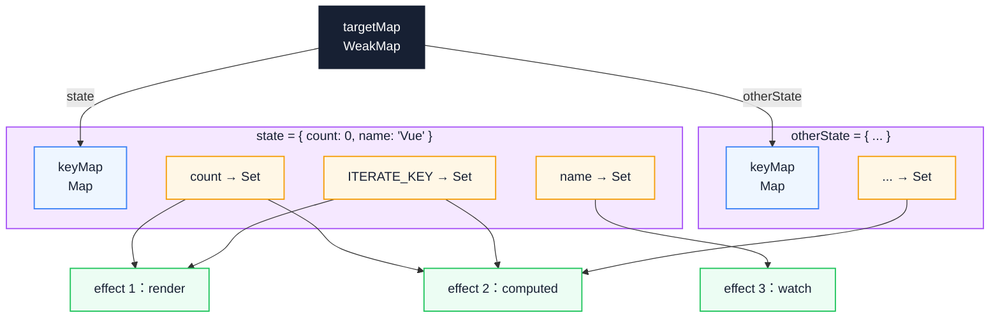
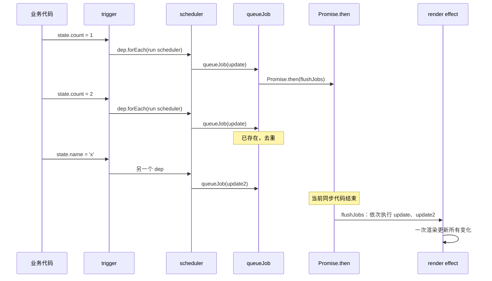

# Vue 3 响应式系统：Proxy 与依赖收集的完整实现

`state.count++` 之后，Vue 怎么知道该更新哪个组件？如果同一个对象被三个组件读取，修改一个字段会不会让三个组件都重渲染？这些问题最终都落在一张依赖表上。本文从 `Object.defineProperty` 的局限出发，拆开 Proxy 拦截、三层 WeakMap、track/trigger 与调度器，最后给出几个可以亲手验证的边界实验。

::: info 一句话
Vue 3 响应式系统的本质，是用 Proxy 拦截读写、用 WeakMap 三层结构记录“谁依赖了什么”，从而在数据变化时精确地通知到每一个 effect。
:::

## 目录

- [写在前面](#写在前面)
- [一、Vue 2 Object.defineProperty 的根本局限](#一、vue-2-object-defineproperty-的根本局限)
- [二、Proxy 与 Reflect：响应式的物理基础](#二、proxy-与-reflect-响应式的物理基础)
- [三、reactive / ref / computed 的实现原理](#三、reactive-ref-computed-的实现原理)
- [四、依赖收集（track）与触发更新（trigger）](#四、依赖收集-track-与触发更新-trigger)
- [五、effect 与调度器：副作用的执行入口](#五、effect-与调度器-副作用的执行入口)
- [六、与 React 响应式模型的对比](#六、与-react-响应式模型的对比)
- [七、几个容易踩坑的细节](#七、几个容易踩坑的细节)
- [结语：响应式不是自动魔法，而是依赖契约](#结语-响应式不是自动魔法-而是依赖契约)
- [FAQ](#faq)
- [来源](#来源)

## 写在前面

很多工程师对“响应式”的理解停在“数据变了视图自动更新”，却说不清下面这些问题：

- 为什么 Vue 2 监听不到对象属性的新增和删除？
- 为什么 Vue 3 改用 Proxy 后，初始化成本会下降？
- `reactive` 和 `ref` 到底有什么区别？为什么不统一成一种？
- 依赖收集的“依赖”具体是什么，保存在哪里？
- `effect` 和 `watch`、`computed` 是什么关系？
- 为什么 `reactive` 解构后会失去响应性，而 `ref` 不会？
- Vue 的响应式和 React 的状态更新机制，本质区别在哪里？

先固定一个词：**副作用（effect）**。这里的 effect 不是 DOM 操作，而是一段依赖响应式数据、需要在数据变化时重新执行的函数。组件渲染、`watch`、`computed` 内部都复用这一抽象。

下文代码以 `@vue/reactivity` 的实现结构为参照，做了删减，只保留支撑主线的依赖关系；它们用于说明机制，不能直接运行。

## 一、Vue 2 Object.defineProperty 的根本局限

Vue 2 的响应式基于 `Object.defineProperty`。

```javascript
function defineReactive(obj, key, val) {
  let dep = new Dep() // 每个 key 一个 Dep，保存依赖它的 Watcher
  Object.defineProperty(obj, key, {
    enumerable: true,
    configurable: true,
    get() {
      dep.depend() // 收集当前 Watcher
      return val
    },
    set(newVal) {
      if (newVal === val) return
      val = newVal
      observe(newVal) // 新值也要变成响应式
      dep.notify() // 通知所有 Watcher
    },
  })
}

function observe(obj) {
  if (typeof obj !== 'object' || obj === null) return
  Object.keys(obj).forEach((key) => {
    defineReactive(obj, key, obj[key])
  })
}
```

这套实现能用，但有四个根本性局限。

### 1. 监听不到属性的新增和删除

`defineProperty` 只能拦截已存在的属性。开发者在响应式对象上写 `obj.newKey = 1`，Vue 2 监听不到，必须改用 `Vue.set(obj, 'newKey', 1)`。删除属性同理，需要 `Vue.delete`。

### 2. 数组监听需要 hack

`defineProperty` 无法监听数组下标赋值（`arr[0] = x`）和 `length` 变化。Vue 2 的解决方案是重写七个变异方法，在方法内部手动触发通知。

```javascript
const methodsToPatch = ['push', 'pop', 'shift', 'unshift', 'splice', 'sort', 'reverse']
methodsToPatch.forEach((method) => {
  const original = arrayProto[method]
  arrayMethods[method] = function (...args) {
    const result = original.apply(this, args)
    const ob = this.__ob__
    // push / unshift / splice 新增的元素也要变成响应式
    let inserted
    switch (method) {
      case 'push':
      case 'unshift':
        inserted = args
        break
      case 'splice':
        inserted = args.slice(2)
        break
    }
    if (inserted) ob.observeArray(inserted)
    ob.dep.notify()
    return result
  }
})
```

### 3. 初始化时递归遍历，深度监听性能差

`observe` 初始化时递归遍历整个对象，给每个 key 装上 getter/setter。对象越大，初始化成本越高，而且很多深层属性可能一辈子都不会被读取。

### 4. 无法监听 Map / Set / WeakMap

`defineProperty` 是为普通对象设计的，对 `Map`、`Set` 这类集合类型无能为力。Vue 2 只能把它们当作非响应式数据。

这些局限不是“Vue 2 实现得不好”，而是 `Object.defineProperty` 这个 API 本身的边界：它只能拦截已存在属性的读写，也无法覆盖数组和集合。解决方案是换一个更通用的拦截机制。

## 二、Proxy 与 Reflect：响应式的物理基础

Vue 3 改用 `Proxy`。Proxy 可以拦截十三种操作，包括 `get / set / has / deleteProperty / ownKeys`，覆盖了 Vue 2 所有“监听不到”的场景。

### 1. Proxy 解决了什么

```javascript
const handler = {
  get(target, key, receiver) {
    track(target, key) // 收集依赖
    const result = Reflect.get(target, key, receiver)
    if (typeof result === 'object' && result !== null) {
      return reactive(result) // 惰性响应式
    }
    return result
  },
  set(target, key, value, receiver) {
    const result = Reflect.set(target, key, value, receiver)
    trigger(target, key) // 触发更新
    return result
  },
  deleteProperty(target, key) {
    const result = Reflect.deleteProperty(target, key)
    trigger(target, key)
    return result
  },
  has(target, key) {
    track(target, key) // 'in' 操作也要收集
    return Reflect.has(target, key)
  },
  ownKeys(target) {
    track(target, ITERATE_KEY) // Object.keys 也要收集
    return Reflect.ownKeys(target)
  },
}

function reactive(target) {
  return new Proxy(target, handler)
}
```

对比 Vue 2 的局限：

| 局限 | Vue 2 | Vue 3 |
|------|-------|-------|
| 属性新增 | `Vue.set` | 直接 `obj.newKey = 1` 自动监听 |
| 属性删除 | `Vue.delete` | 直接 `delete obj.key` 自动监听 |
| 数组下标 | 监听不到 | `arr[0] = x` 自动监听 |
| `length` 变化 | 监听不到 | 自动监听 |
| Map / Set | 不支持 | 原生支持 |
| 初始化成本 | 递归遍历 | 惰性（用到才代理） |

### 2. 为什么用 Reflect

`Reflect.get` / `Reflect.set` 的第三个参数 `receiver` 解决了一个微妙问题：对象存在继承关系时，正确的 `this` 应该指向代理对象，而不是原始对象。

```javascript
const obj = { _value: 0, get value() { return this._value } }
const proxy = new Proxy(obj, {
  get(target, key, receiver) {
    // 不传 receiver，this 指向原始 obj，obj._value 不会经过代理
    // 传 receiver，this 指向 proxy，proxy._value 才能触发响应式
    return Reflect.get(target, key, receiver)
  },
})
```

::: warning 常见误区
手写 Proxy 时直接 `return target[key]`，对带 getter 的对象会丢失响应式，因为 `this` 指向了原始对象。应使用 `Reflect.get(target, key, receiver)`。
:::

### 3. 惰性响应式：性能优势的真正来源

Vue 3 的 `reactive` 不会在初始化时递归遍历。它只在 `get` 时返回子对象的代理。

```javascript
get(target, key, receiver) {
  const result = Reflect.get(target, key, receiver)
  if (typeof result === 'object' && result !== null) {
    return reactive(result) // 用到才代理
  }
  return result
}
```

`reactive` 内部还有缓存：

```javascript
const reactiveMap = new WeakMap()
function reactive(target) {
  if (reactiveMap.has(target)) {
    return reactiveMap.get(target) // 同一对象只代理一次
  }
  const proxy = new Proxy(target, handler)
  reactiveMap.set(target, proxy)
  return proxy
}
```

单个对象的初始化成本因此是 O(1)，而不是 Vue 2 的 O(n)。深层属性只有在被读取时才进入响应式系统。

Proxy 解决了 Vue 2 监听不到新增、删除、数组和集合的问题，并通过“惰性代理 + WeakMap 缓存”把初始化成本降下来。这里的收益主要来自惰性，而不是 Proxy 单次拦截比 `defineProperty` 更快。

## 三、reactive / ref / computed 的实现原理

Vue 3 暴露了三种主要响应式 API：`reactive`、`ref`、`computed`。它们对应不同场景，背后是同一套依赖收集机制的不同封装。

### 1. reactive：对象的代理

`reactive` 用于对象，包括数组、Map、Set。它的实现就是前面的 Proxy 加 handler。

```javascript
const reactiveMap = new WeakMap()

function reactive(target) {
  if (!isObject(target)) return target
  if (isReadonly(target)) return target
  if (reactiveMap.has(target)) {
    return reactiveMap.get(target)
  }
  const proxy = new Proxy(target, mutableHandlers)
  reactiveMap.set(target, proxy)
  return proxy
}
```

`reactive` 只对对象类型有意义。原始值（string、number、boolean）无法被 Proxy 直接代理，这就是 `ref` 存在的原因。

### 2. ref：原始值的包装

JavaScript 的原始值不能被 Proxy 拦截。Vue 3 的解法是用一个对象把它们包起来。

```javascript
class RefImpl {
  constructor(value) {
    this._rawValue = value
    this._value = isObject(value) ? reactive(value) : value
    this.dep = new Dep() // 自己的依赖集合
  }

  get value() {
    trackRefValue(this) // 读取时收集
    return this._value
  }

  set value(newVal) {
    if (newVal !== this._rawValue) {
      this._rawValue = newVal
      this._value = isObject(newVal) ? reactive(newVal) : newVal
      triggerRefValue(this) // 写入时触发
    }
  }
}

function ref(value) {
  return new RefImpl(value)
}
```

`ref` 的本质是用一个对象的 `.value` 属性持有原始值，这样就能借助对象访问器追踪变化。`.value` 的写法不是设计偏好，而是 JavaScript 语言限制下的必然选择。

`ref` 也可以持有对象。这时 `_value` 是 `reactive(value)` 的结果，所以 `ref({ count: 0 })` 既能整体替换（`state.value = { count: 1 }`），又能修改内部（`state.value.count++`）。

### 3. computed：缓存的衍生状态

`computed` 在 effect 之上再加一层缓存。

```javascript
class ComputedRefImpl {
  constructor(getter, setter) {
    this._value = undefined
    this._dirty = true // 是否需要重新计算
    this.dep = new Dep()

    this.effect = new ReactiveEffect(getter, () => {
      // scheduler：依赖变化时不立即重算，只标记 dirty
      if (!this._dirty) {
        this._dirty = true
        triggerRefValue(this) // 通知 computed 的订阅者
      }
    })
  }

  get value() {
    trackRefValue(this)
    if (this._dirty) {
      this._dirty = false
      // 运行 effect：同时重新收集依赖
      this._value = this.effect.run()
    }
    return this._value
  }

  set value(newVal) {
    if (this.setter) this.setter(newVal)
  }
}

function computed(getter, setter) {
  return new ComputedRefImpl(getter, setter)
}
```

computed 有四个关键设计：

1. **lazy**：构造时不计算，读取时才计算；
2. **缓存**：`_dirty = false` 时直接返回旧值；
3. **失效**：依赖变化时由 scheduler 标记 `_dirty`，但不立即重算；
4. **链式订阅**：computed 自己也可以被其他 effect 依赖，形成依赖链。

`reactive` 是对象代理，`ref` 是原始值包装，`computed` 是带缓存的衍生状态。三者是同一套 track/trigger 机制的不同封装。

## 四、依赖收集（track）与触发更新（trigger）

依赖收集要回答的问题是：某个 key 变化时，需要通知谁？

### 1. 三层 WeakMap 结构

Vue 3 用三层结构保存依赖关系。

```javascript
// 全局依赖映射
const targetMap = new WeakMap()
// targetMap: target -> keyMap
// keyMap:    key    -> depSet
// depSet:    effect 集合

function track(target, key) {
  if (!activeEffect) return

  let keyMap = targetMap.get(target)
  if (!keyMap) {
    keyMap = new Map()
    targetMap.set(target, keyMap)
  }

  let depSet = keyMap.get(key)
  if (!depSet) {
    depSet = new Set()
    keyMap.set(key, depSet)
  }

  depSet.add(activeEffect)
  activeEffect.deps.push(depSet) // 反向引用，方便清理旧依赖
}

function trigger(target, key) {
  const keyMap = targetMap.get(target)
  if (!keyMap) return

  const depSet = keyMap.get(key)
  if (!depSet) return

  // 复制一份再遍历，避免遍历过程中集合被修改
  const effectsToRun = new Set(depSet)
  effectsToRun.forEach((effect) => {
    // 避免 effect 内部又触发自己
    if (effect !== activeEffect) {
      effect.run()
    }
  })
}
```

用图表示这个结构：



从 `targetMap` 往下读：第一层按对象分桶，第二层按 key 分桶，第三层才是 effect 集合。一个 effect 可以同时出现在多个集合里，所以还需要 `deps` 反向引用，便于清理旧依赖。

### 2. 为什么最外层用 WeakMap

最外层用 `WeakMap` 而不是 `Map`，是因为响应式对象被销毁、没有其他引用时，`WeakMap` 中对应的条目可以被自动回收。如果用 `Map`，会持有 target 的强引用，target 永远无法释放。

第二层用 `Map`（key 是字符串或 symbol），第三层用 `Set`（effect 集合）。这两层的生命周期跟随 target，不会单独造成泄漏。

### 3. activeEffect：当前正在执行的副作用

依赖收集的关键问题是：track 时把谁加进去？Vue 3 维护一个全局变量 `activeEffect`，指向当前正在执行的 effect。

```javascript
let activeEffect = null

class ReactiveEffect {
  constructor(fn, scheduler) {
    this.fn = fn
    this.scheduler = scheduler
    this.deps = [] // 反向引用，用于清理
  }

  run() {
    const prevEffect = activeEffect
    activeEffect = this
    try {
      return this.fn() // fn 内读取响应式数据时，track 会把 this 加入集合
    } finally {
      activeEffect = prevEffect
    }
  }
}
```

所以“依赖收集”的真正含义是：一个 effect 运行时读取了哪些响应式数据，就把自己注册到这些数据的订阅者集合里。

### 4. 嵌套 effect

effect 可以嵌套，比如组件渲染过程中触发 computed。Vue 3 用保存/恢复 `activeEffect` 的方式管理栈。

```javascript
function run() {
  const prevEffect = activeEffect
  activeEffect = this
  try {
    return this.fn()
  } finally {
    activeEffect = prevEffect // 恢复外层 effect
  }
}
```

内层 effect 跑完后，外层 effect 重新成为 `activeEffect`。内层读取的数据不会被外层收集，这是正确的行为。

依赖收集用 `WeakMap(target) -> Map(key) -> Set(effect)` 三层结构存储。track 把当前运行的 effect 加入集合，trigger 取出集合并逐个执行。这是 Vue 响应式系统的骨架。

## 五、effect 与调度器：副作用的执行入口

`effect` 是响应式系统中最底层的概念。`watch`、`computed`、组件渲染函数，本质上都是 effect。

### 1. effect 的基本结构

```javascript
function effect(fn, options = {}) {
  const _effect = new ReactiveEffect(fn, options.scheduler)
  if (!options.lazy) {
    _effect.run() // 立即执行一次，建立依赖
  }
  return _effect
}
```

调用 `effect(fn)` 后：

1. 立即执行一次 `fn`，期间读取的响应式数据都会把 `_effect` 加入订阅者集合；
2. 之后任何依赖变化，都会调用 `_effect.run()`；
3. 重新执行时再次读取数据，依赖关系被刷新，旧依赖可能被清理。

### 2. 调度器：控制副作用的执行时机

不指定 scheduler 时，trigger 会直接调用 `effect.run()`。但很多场景不希望立即执行：

- 组件渲染：希望批量到下一个微任务再执行，避免同步多次重渲染；
- computed：希望延迟到下次被读取时再计算；
- watch：希望异步执行回调。

scheduler 就是这个控制点。

```javascript
const _effect = new ReactiveEffect(fn, () => {
  // 依赖变化时不直接调用 fn，而是交给 scheduler 决定何时执行
})
```

Vue 的组件渲染 effect 用 scheduler 实现异步批量更新。

```javascript
function setupRenderEffect(instance, container) {
  const update = () => {
    const subTree = instance.render.call(instance.proxy)
    patch(instance.subTree, subTree, container)
    instance.subTree = subTree
  }

  const effect = new ReactiveEffect(update, () => {
    // scheduler：把更新推入队列，下一个 tick 统一 flush
    queueJob(update)
  })

  effect.run() // 首次渲染
}
```

### 3. nextTick 与批量更新

Vue 的更新是异步的：同一个 tick 内的多次赋值会合并成一次重渲染。核心是 `queueJob`。

```javascript
const queue = []
let isFlushing = false
const resolvedPromise = Promise.resolve()

function queueJob(job) {
  if (!queue.includes(job)) {
    queue.push(job)
    if (!isFlushing) {
      isFlushing = true
      resolvedPromise.then(flushJobs)
    }
  }
}

function flushJobs() {
  try {
    for (let i = 0; i < queue.length; i++) {
      queue[i]()
    }
  } finally {
    queue.length = 0
    isFlushing = false
  }
}

export function nextTick(cb) {
  return resolvedPromise.then(cb || (() => {}))
}
```

执行流程如下。



关键在 `queueJob` 的去重和 `Promise.then` 的推迟：同一个更新函数在一个 tick 内只入队一次，真正的 DOM 操作等到微任务统一执行。`nextTick` 与它共用同一个微任务时机。

::: info 工程启示
Vue 的批量更新基于微任务队列，`nextTick` 也用 `Promise.then` 实现。React 18 的 Automatic Batching 则基于 Lane 与调度器，覆盖范围更广，包括异步回调里的 `setState`。两者都叫“批量”，但触发层次不同。
:::

### 4. effect、computed、watch 的关系

三者都是 effect 的不同变体。

| API | 内部实现 | scheduler 行为 |
|-----|---------|---------------|
| `effect(fn)` | 直接创建 ReactiveEffect | 默认同步执行 |
| `computed(fn)` | 创建带 dirty 标记的 effect | 仅标记 dirty，不立即重算 |
| `watch(source, cb)` | 创建带 cb 回调的 effect | 默认异步执行 cb |
| 渲染 effect | 创建组件的渲染副作用 | `queueJob` 异步批量 |

`effect` 是 Vue 响应式的底层抽象，`computed`、`watch`、组件渲染都是它的变体。scheduler 控制“何时执行副作用”，让 Vue 能把同步触发转为异步批量更新。

## 六、与 React 响应式模型的对比

Vue 的响应式系统和 React 的状态更新机制是两种不同模型。理解差异，有助于在具体项目中判断该依赖哪种更新语义。

### 1. Push vs Pull

```mermaid
flowchart TB
    subgraph Vue["Vue：Push 模型"]
        V1["state.count = 1"]
        V2["setter 拦截"]
        V3["trigger：找到该 key 的 dep"]
        V4["执行订阅的 effect"]
        V5["只更新受影响的组件"]

        V1 --> V2 --> V3 --> V4 --> V5
    end

    subgraph React["React：Pull 模型"]
        R1["setState(1)"]
        R2["标记组件 dirty"]
        R3["调度器安排任务"]
        R4["重新渲染整个组件"]
        R5["Virtual DOM diff"]
        R6["提交真实 DOM 更新"]

        R1 --> R2 --> R3 --> R4 --> R5 --> R6
    end

    classDef work fill:#ECFDF3,stroke:#22C55E,color:#172033,stroke-width:1.5px;
    classDef wait fill:#EEF6FF,stroke:#3B82F6,color:#172033,stroke-width:1.5px;

    class V1,V2,V3,V4,V5 work;
    class R1,R2,R3,R4,R5,R6 wait;
```



上半部分是推送：setter 直接找到 dep 并执行 effect；下半部分是拉取：`setState` 只标记组件，再由调度器重新运行组件函数。差异不在速度，而在“谁来决定更新范围”。

**Vue（Push）**：数据变化时，通过 setter 找到订阅者并通知。更新是精确的，只有依赖该数据的 effect 会被执行。

**React（Pull）**：`setState` 只把组件标记为需要更新，真正的渲染发生在调度器决定执行时。React 不知道“哪些数据变了”，只能重新运行组件函数，再通过 Virtual DOM diff 找出真实变化。

### 2. 不可变 vs 可变

```javascript
// React：不可变（Immutable），每次返回新对象
const [user, setUser] = useState({ name: 'A', age: 18 })
setUser({ ...user, age: 19 })

// Vue：可变，直接修改
const user = reactive({ name: 'A', age: 18 })
user.age = 19
```

React 的不可变模型让“对象引用变化”成为“数据变化”的信号，因为 React 没有拦截写入的能力。Vue 通过 Proxy 拦截写入，所以可以直接修改。

### 3. 组件级 vs 字段级

- React：状态变化触发整个组件重新渲染，再通过 diff 决定哪些 DOM 要更新；
- Vue：状态变化触发特定 effect，可能是渲染 effect，也可能是 `watch` 或 `computed`。

这就是 Vue 在大量细粒度更新场景下更省工作的原因：它不需要重新运行整个组件，只需触发对应的 effect。

### 4. 依赖追踪：手动 vs 自动

```javascript
// React：手动声明依赖
useEffect(() => {
  console.log(count, name)
}, [count, name])

// Vue：自动追踪
watchEffect(() => {
  console.log(count.value, name.value)
})
```

Vue 的自动追踪来自 track 机制：effect 运行时读取的数据自动成为依赖。React 的 `useEffect` 没有响应式系统支持，必须手写依赖数组，这是 React Hooks 心智负担的重要来源。

::: warning 取舍
Vue 的自动追踪不是绝对更好。它的代价是：

- 必须显式访问响应式数据（`.value`、`reactive` 包装）才能被追踪；
- 解构 `reactive` 对象会失去响应性；
- 异步代码中 `await` 之后的读取不会被追踪，因为 `activeEffect` 已出栈。

React 的手动依赖数组虽然繁琐，但语义更明确，也更容易静态分析。
:::

Vue 是“精确依赖追踪 + 推送”模型，React 是“组件标记 dirty + 拉取重渲染”模型。两者没有绝对优劣，差别在依赖由谁声明、更新粒度由谁决定。

## 七、几个容易踩坑的细节

### 1. reactive 解构会失去响应性

```javascript
const state = reactive({ count: 0 })
const { count } = state // 解构后 count 是普通数字
// 后续 state.count 变化，count 不会更新
```

原因：解构时执行了 `Reflect.get`，返回的是原始值，不再受 Proxy 拦截。

解决方式是用 `toRefs` 把每个属性变成 ref。

```javascript
const state = reactive({ count: 0 })
const { count } = toRefs(state)
count.value // 是响应式的
```

### 2. ref 在模板中自动解包，在 JS 中不会

```html
<template>
  <div>{{ count }}</div> <!-- 自动解包，不需要 .value -->
</template>

<script setup>
const count = ref(0)
console.log(count) // RefImpl 对象
count.value = 1    // JS 中必须 .value
</script>
```

这是模板编译器对顶层 ref 做了自动解包，不是 ref 本身的行为。

### 3. reactive 替换整个对象不会触发更新

```javascript
let state = reactive({ count: 0 })
state = reactive({ count: 1 }) // 错误：视图仍订阅旧对象
```

正确做法是替换 `ref` 的 value，或者逐个属性赋值。

```javascript
const state = ref({ count: 0 })
state.value = { count: 1 } // 正确：替换 value，触发更新

// 或者
const state2 = reactive({ count: 0 })
Object.assign(state2, { count: 1 }) // 正确：逐属性赋值
```

### 4. 异步代码中的依赖收集失效

```javascript
watchEffect(async () => {
  const data = await fetchData() // await 之后 activeEffect 已被清空
  console.log(state.count) // 错误：不会被收集为依赖
})
```

原因：`await` 之后 effect 已经退出，`activeEffect` 恢复成之前的值（通常是 `null`）。此时读取 `state.count` 不会触发 track。

解决方式是把响应式读取放在 `await` 之前。

```javascript
watchEffect(async () => {
  const count = state.count // 正确：在 await 之前读取
  const data = await fetchData()
  console.log(count)
})
```

### 5. computed 的副作用陷阱

```javascript
const double = computed(() => {
  console.log('computing') // 错误：不要在 computed 中做副作用
  return state.count * 2
})
```

computed 应该是纯函数。依赖变化时它只标记 `dirty`，下次读取才计算；如果把副作用放进去，执行时机会变得不可预期，收益也难以判断。

Vue 响应式的常见坑都来自“Proxy 拦截的边界”：解构失去响应性、ref 解包的差异化行为、对象替换、异步读取、computed 副作用。它们不是零散技巧，而是同一套依赖收集规则在不同位置的表现。

## 结语：响应式不是自动魔法，而是依赖契约

把 Vue 3 响应式看成一张订阅表，比记 API 更有用：Proxy 在读写时留下记录，track 把当前 effect 写进对应键的集合，trigger 再按集合推送。`ref`、`computed`、`watch` 只是这张表上的不同入口，差别在包装方式和调度时机。

下一步可以做一个很小的验证：用 `effect` 包住一段读取两个属性的代码，分别修改它们，观察哪些修改会触发、哪些因为未被读取而不触发。这个实验能同时解释解构失效、异步读取漏收集和 computed 的惰性缓存。

真正需要警惕的不是 API 记不住，而是把“读取过”误当成“永远依赖”。依赖关系每次 effect 重跑都会重建，条件分支、提前 `return` 和 `await` 都会改变它。

## FAQ

### 1. Vue 3 响应式比 React 快吗？

不能简单比较。Vue 在细粒度更新场景下有优势，只触发相关 effect，不需要 diff 整个组件；React 在大型组件树和大量状态并存时，Virtual DOM 与调度模型也有自己的适用空间。性能差异取决于更新模式、组件粒度和状态分布，脱离场景无法下结论。

### 2. 条件分支中读取的依赖为什么会丢失？

effect 每次重跑都会重建依赖集合，只记录这次实际执行的读取。如果某个分支这次没有进入，分支里的属性不会被读取，旧依赖在清理阶段被移除。等条件再次变化时，effect 可能不会因为那个属性而触发，看起来就像“依赖丢了”。解决办法是让条件本身也成为被追踪的响应式数据，或拆成多个独立的 effect。

### 3. Vue 响应式系统能否脱离 Vue 使用？

可以。`@vue/reactivity` 是独立包，可以在非 Vue 项目中使用。比如用 `reactive` + `effect` 自己实现状态管理，或用 `computed` 在 Node.js 中做衍生状态缓存。Vue 3 把它拆成独立包，正是为了框架之外也能复用。

### 4. effect 能手动停止吗？组件卸载后依赖会怎样？

可以。`ReactiveEffect` 提供 `stop()`，会清空它登记过的 dep 并移除自身；组件卸载时 Vue 会停止对应的渲染 effect。成组创建 effect 时可以用 `effectScope()` 统一停止，避免手动逐个清理。停止后 effect 不再响应依赖变化，但已经产生的闭包引用仍需按普通 JavaScript 规则释放。

## 来源

1. Vue 3 官方文档 - Reactivity Fundamentals：<https://vuejs.org/guide/essentials/reactivity-fundamentals.html>
2. Vue 3 官方文档 - Reactivity in Depth：<https://vuejs.org/guide/extras/reactivity-in-depth.html>
3. Vue 3 Reactivity 设计讨论：<https://github.com/vuejs/rfcs/discussions/categories/reactivity>
4. Vue 源码（packages/reactivity）：<https://github.com/vuejs/core/tree/main/packages/reactivity>
5. MDN - Proxy：<https://developer.mozilla.org/en-US/docs/Web/JavaScript/Reference/Global_Objects/Proxy>

本文同时基于作者对 Vue 源码的阅读与整理。
