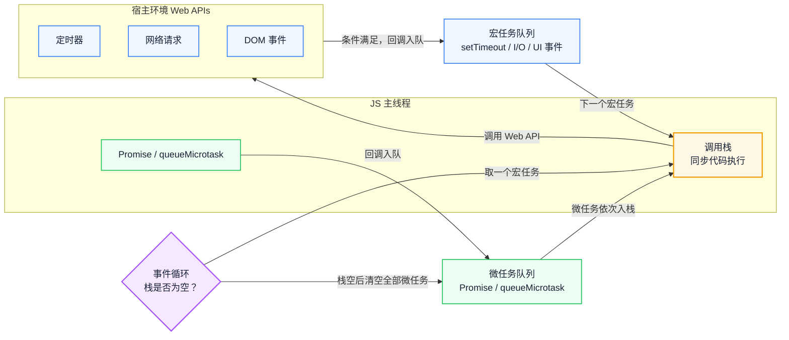
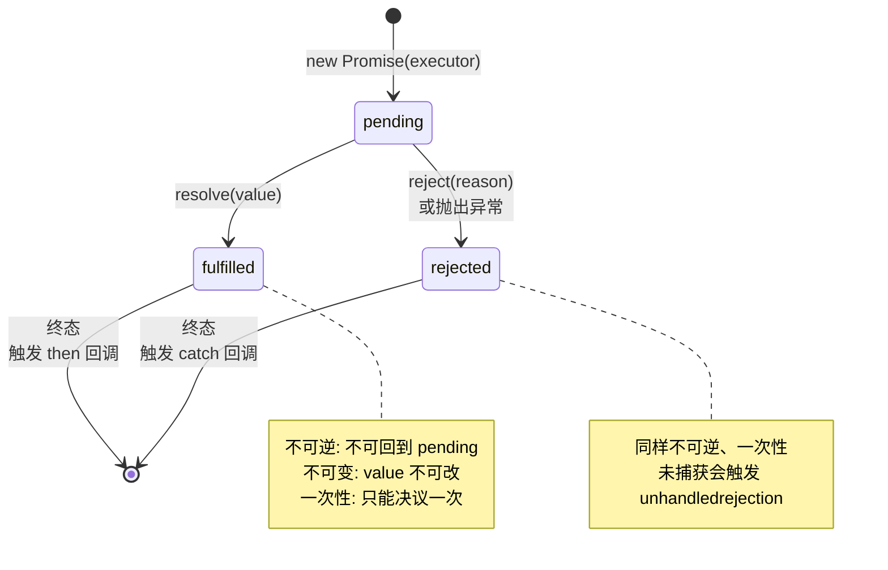
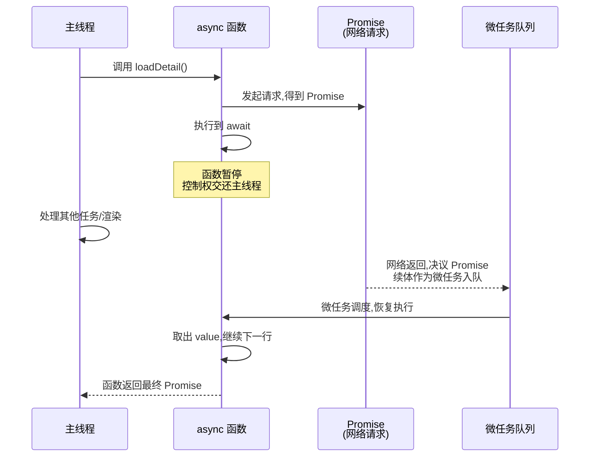

# 异步编程的演进：从回调地狱到 async/await

异步代码的问题很少出在 API 记不住，而是对执行权归谁没有模型：定时器为何排在后面、`await` 暂停了什么、`forEach` 为何不等待回调，答案都在同一条调度链上。本文先建立事件循环的直觉，再沿回调、Promise 与 async/await 的控制权转移展开，最后落到错误处理与并发控制。读完后，你能从调度规则推导顺序，而不是背结论。

::: info 一句话
JavaScript 异步编程的每一次演进，本质上都是在解决同一个问题——"如何在不阻塞主线程的前提下，可靠地表达'以后会发生的事'"。
:::

## 目录

- [现象：为什么异步代码的顺序总与直觉相反](#现象-为什么异步代码的顺序总与直觉相反)
- [一、单线程与事件循环：异步的物理基础](#一、单线程与事件循环-异步的物理基础)
- [二、宏任务与微任务：被忽略的执行顺序](#二、宏任务与微任务-被忽略的执行顺序)
- [三、回调时代：控制反转与信任问题](#三、回调时代-控制反转与信任问题)
- [四、Promise：从状态机角度理解](#四、promise-从状态机角度理解)
- [五、async/await：语法糖还是革命？](#五、async-await-语法糖还是革命)
- [六、异步错误处理：捕获、传播与兜底](#六、异步错误处理-捕获、传播与兜底)
- [七、常见异步陷阱与并发控制](#七、常见异步陷阱与并发控制)
- [结语：异步的本质是调度](#结语-异步的本质是调度)
- [FAQ](#faq)
- [来源](#来源)

## 现象：为什么异步代码的顺序总与直觉相反

异步代码的 bug 常常不是"语法不熟"，而是"模型不清"。下面几个问题，几乎每个前端工程师都遇到过：

- 为什么 `setTimeout(fn, 0)` 不会立即执行？它到底排在谁后面？
- `Promise.then` 和 `setTimeout` 谁先执行？为什么？
- `forEach` 里写 `await` 为什么不生效？
- `async` 函数里的 `await` 到底"阻塞"了什么？它会卡住主线程吗？
- `Promise.all` 和 `Promise.allSettled` 在错误处理上有什么本质区别？

这些问题分别涉及队列、暂停、迭代协议和组合语义，但都能放回同一张图里解释。下面的顺序按依赖关系展开：先有事件循环，才谈任务队列；先有任务队列，才解释回调、Promise 与 async/await 各自解决了什么。

---

## 一、单线程与事件循环：异步的物理基础

JavaScript 是**单线程**的——它只有一个调用栈，同一时刻只能执行一段代码。这是历史选择：浏览器里 JS 要操作 DOM，多线程并发操作 DOM 会引发严重的同步问题，单线程是最简单也最安全的模型。

但单线程意味着：如果一个任务耗时长（比如等网络响应），整个页面就会"卡死"。于是 JavaScript 设计了**事件循环（Event Loop）** 机制，让"需要等待的任务"不占用调用栈——你把"等会儿要做的事"挂起来，等条件满足了再回来执行。

### 1. 事件循环的核心组件

事件循环依赖几个关键部分：

1. **调用栈（Call Stack）**：执行同步代码的地方，后进先出。
2. **宿主环境（浏览器/Node）**：提供 Web API，如定时器、网络请求、DOM 事件。这些 API 在底层往往是多线程的，但回调最终要回到 JS 单线程执行。
3. **任务队列（Task Queue）**：存放待执行的回调。
4. **事件循环（Event Loop）**：不断检查"调用栈是否为空"和"队列里是否有任务"，把就绪的任务推入调用栈执行。



读图时先看左侧：调用栈只执行同步代码；定时器、网络、DOM 等异步操作交给宿主环境，完成后回调进入宏任务队列，而 Promise 与 `queueMicrotask` 由引擎排入微任务队列。事件循环只在栈空时取任务，并且在取下一个宏任务之前先清空微任务队列。

### 2. 一次循环的执行流程

事件循环每一轮（tick）大致做这些事：

1. 从宏任务队列取出**一个**任务执行。
2. 执行过程中产生的所有微任务，在当前宏任务结束后**全部清空**。
3. 必要时进行 UI 渲染（浏览器按屏幕刷新率决定是否渲染，60Hz 屏幕上约 16.67ms 一次）。
4. 回到第 1 步，取下一个宏任务。

```javascript
console.log('1. 同步开始')

setTimeout(() => {
  console.log('4. 宏任务 setTimeout')
}, 0)

Promise.resolve().then(() => {
  console.log('3. 微任务 Promise')
})

console.log('2. 同步结束')

// 预期输出顺序: 1 → 2 → 3 → 4
```

`setTimeout` 的回调进入宏任务队列，`Promise.then` 的回调进入微任务队列。同步代码（1、2）先执行完，然后清空微任务（3），最后才轮到下一个宏任务（4）。

::: warning 0 毫秒不等于立刻执行

`setTimeout(fn, 0)` 中的 0 只是"最早可执行时间"。回调仍要等当前同步代码和所有微任务执行完才可能入栈；HTML 标准还规定，定时器嵌套超过 5 层后，最小延迟为 4ms。

:::

---

## 二、宏任务与微任务：被忽略的执行顺序

任务队列其实不止一个，最重要的是**宏任务队列**和**微任务队列**。它们的调度时机不同，这正是大量"顺序诡异"问题的根源。

### 1. 谁是宏任务，谁是微任务

- **宏任务（Macrotask）**：`setTimeout` / `setInterval`、I/O 回调、UI 事件（click、scroll）、`postMessage`、`MessageChannel`、Node 的 `setImmediate` / `fs` 回调等。
- **微任务（Microtask）**：`Promise.then` / `catch` / `finally`、`queueMicrotask`、`MutationObserver`、Node 的 `process.nextTick`（优先级甚至高于普通微任务）。

### 2. 关键规则：微任务在"每个宏任务之后"清空

最容易被忽略的规则是：**每执行完一个宏任务，引擎会清空当前所有的微任务，然后才进入下一个宏任务**。这意味着微任务可以"插队"到下一个宏任务之前。

```javascript
setTimeout(() => {
  console.log('宏任务 A')
  Promise.resolve().then(() => console.log('  微任务 A1'))
}, 0)

setTimeout(() => {
  console.log('宏任务 B')
  Promise.resolve().then(() => console.log('  微任务 B1'))
}, 0)

// 输出:
// 宏任务 A
//   微任务 A1
// 宏任务 B
//   微任务 B1
```

每个宏任务执行后，紧跟着清空它产生的微任务，然后再取下一个宏任务。微任务永远不会跨宏任务"积压"到中间。

### 3. 渲染时机的位置

浏览器的渲染发生在宏任务之间、微任务清空之后。这意味着：如果你在一个宏任务里改了 DOM，紧接着用微任务继续改，浏览器可以在渲染前看到合并后的结果；但如果用 `setTimeout` 排程后续修改，浏览器可能在两次修改之间渲染一次，造成"闪烁"。

```javascript
// 示意片段：假设 element 已存在
function batchUpdate() {
  element.style.left = '10px'
  queueMicrotask(() => {
    element.style.left = '20px' // 渲染前生效，用户只看到 20px
  })
}
```

::: info 选择微任务还是宏任务
需要"尽快但异步"执行、且必须在渲染前完成的逻辑，用 `queueMicrotask`；需要让出主线程、给渲染或其他任务机会的逻辑，用 `setTimeout(fn, 0)` 或 `requestAnimationFrame`。选择取决于目标，而不是哪个"更高级"。
:::

---

## 三、回调时代：控制反转与信任问题

在 Promise 出现之前，异步几乎只能靠回调：你把"以后要做的事"作为函数传给异步操作，由它在完成后调用你。

### 1. 控制反转

回调的本质是**控制反转（Inversion of Control）**：你不再掌控"何时调用、调用几次、用什么参数"，而是把这些控制权交给了第三方（一个库、一个 API、一段你不完全信任的代码）。

```javascript
// 你写的代码
asyncOperation(data, function callback(result) {
  updateUI(result) // 这个函数何时被调用，你说了不算
})
```

### 2. 回调的信任问题

Kyle Simpson 在《You Don't Know JS》里列出过回调面临的信任问题——你以为回调会按约定执行，但实际上第三方可能：

- 调用**太早**：在异步操作还没真正完成时就回调。
- 调用**太晚**：甚至永远不调用。
- 调用**次数太少或太多**：比如回调被触发 0 次或 3 次。
- **吞掉错误**：出错时不通知你。
- **参数不对**：传回意料之外的数据。

这些问题在真实工程里并不罕见：一个有 bug 的第三方库可能把成功回调调用两次，导致你的 UI 更新执行两遍；一个超时未处理的请求可能让你的 loading 永远不消失。

### 3. 回调地狱：嵌套与控制流丢失

当多个异步步骤有依赖关系时，回调只能层层嵌套：

```javascript
getUser(userId, function (err, user) {
  if (err) return handleError(err)
  getOrders(user.id, function (err, orders) {
    if (err) return handleError(err)
    getOrderDetail(orders[0].id, function (err, detail) {
      if (err) return handleError(err)
      renderDetail(detail)
    })
  })
})
```

这种"金字塔厄运"不只是难看，更致命的是：**控制流被切碎了**。错误处理要每层重复，无法统一；想在中间加一步或调整顺序，要重排整个嵌套结构；想在多步之间共享变量，只能靠闭包层层传递。

回调真正的问题不是嵌套难看，而是控制权外流、信任不可控、控制流被切碎。Promise 要解决的是这三件事，而不是把代码排版得更整齐。

::: warning 命名函数不解决控制权
用命名函数代替匿名函数，只改善了可读性和堆栈信息；回调被调用几次、何时调用、传什么参数，依然由第三方决定。
:::

---

## 四、Promise：从状态机角度理解

把 Promise 当作**有限状态机**，比把它当作"回调的语法糖"更能解释它的行为。

### 1. 三态与不可逆转换

一个 Promise 有三种状态：

- **pending（待定）**：初始状态，尚未决议。
- **fulfilled（已完成）**：操作成功，关联一个 value。
- **rejected（已拒绝）**：操作失败，关联一个 reason。

转换规则非常严格：

1. 只能从 pending → fulfilled，或 pending → rejected。**一旦决议，状态永远不可逆**。
2. 决议只能发生**一次**。再次 resolve / reject 会被静默忽略。



图中只有两条离开 `pending` 的边，没有任何返回边，这就是"决议不可逆"；`then` / `catch` 只是订阅终态，不会改变状态。

### 2. 状态机如何解决信任问题

回到回调时代的信任清单，你会发现状态机的规则正好逐条化解：

- **调用太多次**：状态不可逆 + 一次性决议，resolve 两次只有第一次生效。
- **调用太少/从不调用**：你可以用 `Promise.race` 加一个超时 Promise 来兜底。
- **调用太早**：Promise 的 then 回调**永远是异步的**（微任务），即使在 executor 里同步 resolve，回调也不会在当前 tick 同步执行，避免了"同步回调"的竞态。
- **吞掉错误**：rejection 会沿链传播，直到被 catch 捕获；完全未捕获时浏览器会触发 `unhandledrejection` 事件。

### 3. then 返回新 Promise：链式的本质

`then` 不会修改原 Promise，而是**返回一个新的 Promise**。这是链式调用的根基，也让 Promise 摆脱了"回调嵌套"：

```javascript
getUser(userId)
  .then((user) => getOrders(user.id))     // 返回新 Promise
  .then((orders) => getOrderDetail(orders[0].id))
  .then((detail) => renderDetail(detail))
  .catch((err) => handleError(err))        // 任意一步的 rejection 都会跳到这里

// 等价于一个被"拉平"的管道，而不是金字塔
```

- 如果 `then` 的回调返回一个 Promise，下一个 `then` 会等它决议。
- 如果返回普通值，下一个 `then` 会立即收到这个值。
- 如果抛出异常，链路进入 rejected 状态，跳到最近的 `catch`。

```javascript
Promise.resolve(1)
  .then((n) => n + 1)                       // 返回 2（普通值）
  .then((n) => Promise.resolve(n * 10))     // 返回 Promise，等它决议为 20
  .then((n) => { throw new Error('boom') }) // 进入 rejected
  .then((n) => console.log('不会执行'))      // 被跳过
  .catch((err) => console.log(err.message)) // 'boom'
```

Promise 这套"决议不可逆 + 回调一定异步 + 链式返回新 Promise"的规则，正是它相对回调最核心的增量：控制权被语言机制锁定，而不是依赖第三方守约。

---

## 五、async/await：语法糖还是革命？

`async/await` 在 2017 年随 ES8 进入标准。表面看它是 Promise 的语法糖，但它对异步代码可读性和错误处理的影响是革命性的。

### 1. 它在 Promise 之上做了什么

- **`async` 函数总是返回 Promise**：如果你 return 一个普通值，它会被包成 `Promise.resolve(value)`；如果 return 一个 Promise，就直接用它；如果抛出异常，返回的 Promise 变为 rejected。
- **`await` 暂停当前 async 函数的执行**：等待右侧 Promise 决议，决议后把 value 取出来继续往下执行。**它不阻塞主线程**，暂停期间主线程可以去处理其他任务，函数的剩余部分被注册为微任务在决议后恢复。

```javascript
async function loadDetail(userId) {
  const user = await getUser(userId)        // 暂停，等 Promise 决议
  const orders = await getOrders(user.id)
  const detail = await getOrderDetail(orders[0].id)
  return renderDetail(detail)
}
```

这段代码读起来像同步，但实际执行是异步的——每个 `await` 处都把控制权交还给事件循环。

### 2. await 的执行时序



关键点：`await` 暂停的是**这个 async 函数**，不是主线程。暂停期间主线程完全可以响应用户输入、执行其他回调。函数的"剩余部分"在 Promise 决议后作为微任务恢复。

### 3. 它真正改变了什么

Promise 解决了信任和嵌套，但链式 `.then` 仍有几个痛点：变量作用域被切碎（每步只能拿到上一步的值，跨步共享变量要靠闭包）、控制流（条件、循环）难以表达、错误处理分散。

`async/await` 让你能在异步代码里直接用 `if` / `for` / `try` / `catch`：

```javascript
async function loadAll() {
  const list = await getList()
  const result = []
  for (const id of list) {
    // 循环里直接 await，串行加载
    result.push(await getItem(id))
  }
  return result
}
```

这段逻辑用纯 Promise 写会非常别扭——你需要手动递归或用 `reduce` 串起链。`async/await` 把"异步流程控制"还原成了最熟悉的同步控制流语法。

`async/await` 没有改变底层的 Promise 与微任务语义，它改变的是开发者组织异步流程的方式：把回调式控制流还原成顺序、分支和循环。**`await` 只暂停当前 async 函数，不阻塞主线程**；如果等待期间页面卡住，应该去别处找同步长任务。

---

## 六、异步错误处理：捕获、传播与兜底

异步错误处理是事故高发区。核心原则：**错误必须被显式捕获，且永远不要静默吞掉**。

### 1. async/await 用 try/catch

```javascript
async function load() {
  try {
    const data = await fetch('/api/data').then((r) => r.json())
    return data
  } catch (err) {
    console.error('加载失败', err)
    notifyUser('加载失败，请重试')
    return null
  }
}
```

`await` 会把 Promise 的 rejection 转成抛出异常，所以 `try/catch` 能统一捕获 await 链上的错误。

### 2. 不要忘记 catch，但更不要静默吞掉

```javascript
// 反例：吞掉错误，永远不知道发生了什么
someAsync().catch(() => {})

// 反例：忘记 catch，unhandledrejection 静默累积
someAsync()
```

如果你确实要"忽略"某个错误，至少记一条日志，或把它转成一个语义明确的默认值：

```javascript
someAsync().catch((err) => {
  logger.warn('非关键操作失败', err)
  return null
})
```

### 3. 四种组合 API 的错误语义

理解 `all` / `allSettled` / `any` / `race` 的差异，是并发错误处理的关键：

| API | 成功条件 | 失败行为 | 适用场景 |
| --- | --- | --- | --- |
| `Promise.all` | 全部成功 | 任意一个失败即 reject（fail-fast） | 多个必须全部成功 |
| `Promise.allSettled` | 不会因单个失败而 reject | 返回每个的状态描述符 | 想知道每一个的结果 |
| `Promise.any` | 任意一个成功 | 全部失败才 reject | 取最快成功的那个 |
| `Promise.race` | 第一个决议 | 第一个决议（无论成败） | 超时判断；不会取消其余 Promise |

```javascript
// allSettled: 即使部分失败也不丢信息
const results = await Promise.allSettled([
  fetch('/api/a'),
  fetch('/api/b'),
  fetch('/api/c'),
])
const ok = results.filter((r) => r.status === 'fulfilled').map((r) => r.value)
const failed = results.filter((r) => r.status === 'rejected')
```

::: info 全局兜底
在应用入口处注册一个全局 `unhandledrejection` 监听器，把未被捕获的 Promise 错误上报到监控平台。它不能替代局部 `catch`，但能暴露"忘记 catch"的代码。
:::

```javascript
window.addEventListener('unhandledrejection', (event) => {
  tracker.report({
    type: 'unhandled_promise_rejection',
    reason: event.reason,
  })
})
```

---

## 七、常见异步陷阱与并发控制

### 1. forEach 不等待 await

`Array.prototype.forEach` 不会等待回调里的 `await`，因为它本质上不关心回调返回的 Promise：

```javascript
// 反例:三个请求几乎同时发出,且函数不会等待
async function wrong() {
  [1, 2, 3].forEach(async (id) => {
    await getItem(id) // forEach 不会等这个 await
  })
  console.log('done') // 几乎立即打印,而请求还在飞
}
```

正确做法用 `for...of`（串行）或 `Promise.all`（并行）：

```javascript
// 串行:一个完成再下一个
async function sequential() {
  for (const id of [1, 2, 3]) {
    await getItem(id)
  }
  console.log('done') // 全部完成后才打印
}

// 并行:同时发出,全部等待
async function parallel() {
  await Promise.all([1, 2, 3].map((id) => getItem(id)))
  console.log('done')
}
```

### 2. 串行 vs 并行：别用 await 把能并行的拖成串行

```javascript
// 反例:三个独立请求被拖成串行,总耗时 = a + b + c
async function slow() {
  const a = await fetchA()
  const b = await fetchB()
  const c = await fetchC()
  return { a, b, c }
}

// 正例:同时发起,总耗时 ≈ max(a, b, c)
async function fast() {
  const [a, b, c] = await Promise.all([fetchA(), fetchB(), fetchC()])
  return { a, b, c }
}
```

只有当请求之间**有依赖**时才需要串行 `await`；彼此独立就该用 `Promise.all` 并行。另外，`Promise.all` 只聚合结果，不会取消已经发出的请求；需要真正中断时，要配合 `AbortController` 和 `fetch` 的 `signal`。

### 3. 并发限流：用 Promise 池控制

当任务数量很大（比如批量请求 1000 个 URL），`Promise.all` 会瞬间发出 1000 个请求，可能压垮服务端或触发浏览器并发上限。需要一个并发限流器：

```javascript
async function mapWithConcurrency(items, limit, worker) {
  const results = new Array(items.length)
  let cursor = 0
  const runners = new Array(Math.min(limit, items.length))
    .fill(0)
    .map(async () => {
      while (cursor < items.length) {
        const index = cursor++
        results[index] = await worker(items[index], index)
      }
    })
  await Promise.all(runners)
  return results
}

// 最多 5 个并发
const data = await mapWithConcurrency(urls, 5, (url) =>
  fetch(url).then((r) => r.json())
)
```

### 4. 忘记 await：fire-and-forget 的隐患

```javascript
async function save() {
  // 忘记 await,错误不会进 try/catch,函数立即返回
  syncToRemote()
  return 'saved'
}
```

`syncToRemote` 返回的 Promise 没有被 `await`，它的 rejection 不会进入 `save` 的 try/catch，而是变成 unhandledrejection。如果你确实要"发后即忘"，至少 `.catch` 一下：

```javascript
syncToRemote().catch((err) => tracker.report(err))
```

并发控制可以归结为三个判断：任务是否独立、是否等待结果、同时在途的数量上限。前两个决定用 `for...of` 还是 `Promise.all`，第三个决定是否需要限流器。

---

## 结语：异步的本质是调度

异步代码的可预测性来自调度模型，而不是 API 记忆。事件循环决定谁可以运行，微任务决定一轮之内谁先完成，Promise 和 async/await 则把控制权以可组合的方式交还给调用方。

下一步，挑一段你项目里的异步链路，按"任务从哪里来、进入哪个队列、在哪个 `await` 点让出、错误在哪一层被接住"画一遍。能画清楚，这套模型就已经能用于排查，而不只是解释输出题。

---

## FAQ

### 1. `async` 函数在第一个 `await` 之前的代码是同步执行的吗？

是。调用 `async` 函数时，函数体会同步执行到第一个 `await`；只有遇到 `await` 才会暂停并把控制权交还调用方。所以 `async` 函数里 `await` 之前的代码如果包含同步长任务，依然会阻塞主线程。

### 2. `await` 一个普通值也会让出执行权吗？

会。`await 42` 会经过 `Promise.resolve(42)` 一类处理，函数在 `await` 处暂停，剩余部分进入微任务队列。因此即使右侧不是 Promise，`await` 后面的代码也不会在当前同步片段里继续执行。

### 3. `queueMicrotask` 和 `Promise.resolve().then` 都能排微任务，应该选哪个？

两者进入同一个微任务队列，执行顺序取决于入队顺序。`queueMicrotask` 不创建 Promise，适合纯调度；`Promise.resolve().then` 自带链式错误传播。异常行为也不同：`queueMicrotask` 回调抛错会成为未捕获异常，`then` 回调抛错会让返回的 Promise 进入 rejected。

### 4. `async` 函数里写 `return await p` 和 `return p` 有什么区别？

`return p` 会直接让返回的 Promise 采纳 `p` 的状态；`return await p` 则先等待 `p` 决议，再多经过一次微任务调度。后者在 `try/catch` 中是必要的——它能确保 `p` 的 rejection 被当前 `catch` 捕获，而不是直接穿透到调用方。

---

## 来源

1. MDN 关于事件循环、Promise、async/await 的文档：[MDN Using promises](https://developer.mozilla.org/zh-CN/docs/Web/JavaScript/Guide/Using_promises)、[MDN async function](https://developer.mozilla.org/zh-CN/docs/Web/JavaScript/Reference/Statements/async_function)
2. Kyle Simpson《You Don't Know JS》关于异步与性能、回调信任问题的讨论
3. HTML 规范关于事件循环与任务队列的定义：[HTML Standard Event loops](https://html.spec.whatwg.org/multipage/webappapis.html#event-loops)
4. ECMAScript 规范关于 Promise 与 async/await 的语义：[ECMA-262 Promises](https://tc39.es/ecma262/#sec-promise-objects)
5. Node.js 文档关于事件循环与 `process.nextTick` 的说明：[Node.js process.nextTick](https://nodejs.org/api/process.html#processnexttickcallback-args)
6. 本文基于公开技术文档（MDN、ECMAScript/HTML 规范、Node.js 文档、《You Don't Know JS》）和作者工程实践总结。
