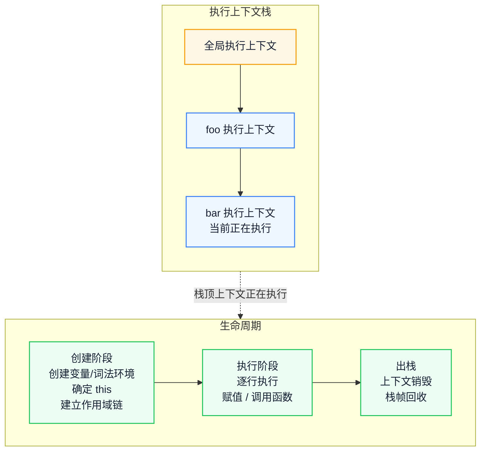
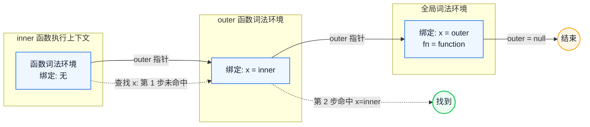
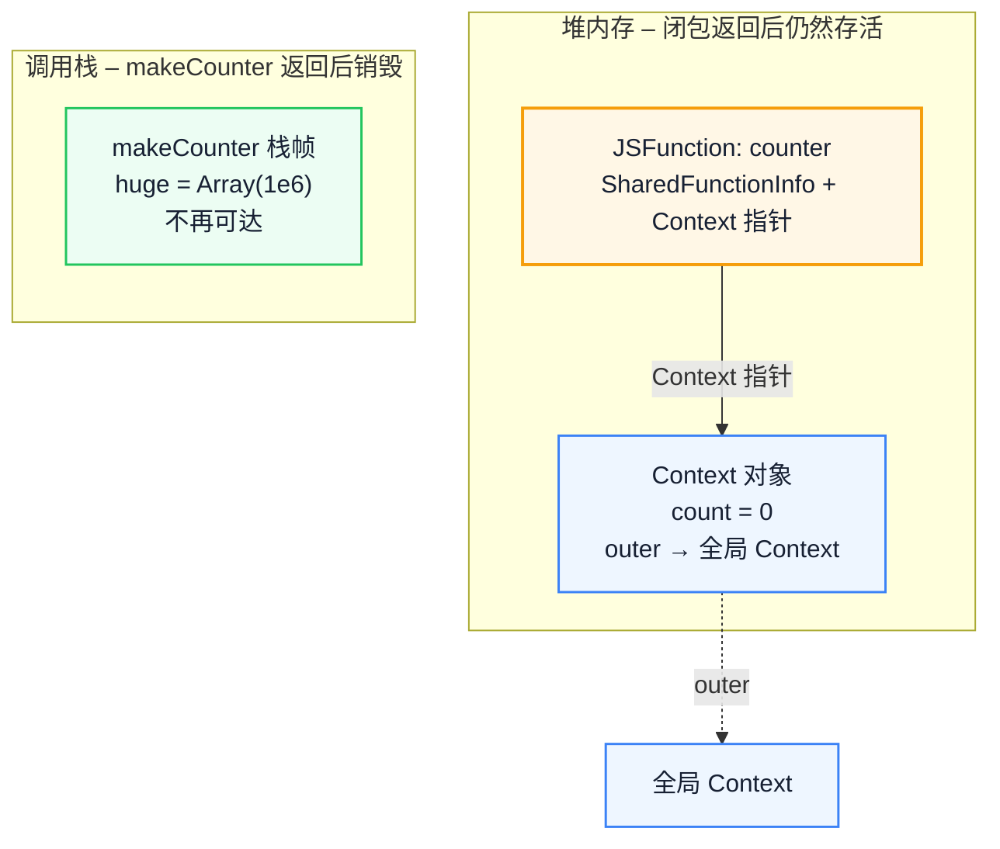

# 执行上下文与作用域链：从 V8 视角理解闭包本质

多数人对闭包的记忆停留在"函数里返回函数"，却说不清变量为什么没有随栈帧销毁、`let` 为什么有暂时性死区、闭包究竟捕获了哪些变量。本文从执行上下文的创建过程开始，沿环境记录与 `outer` 指针还原作用域链，再落到 V8 的 Context 对象与作用域分析，最后区分"闭包"与"闭包导致的内存泄漏"。读完后，你能用内存模型判断闭包的开销，而不是背定义。

::: info 一句话
闭包不是"函数套函数"的语法技巧，而是执行上下文与作用域链在 V8 堆内存中留下的一条真实引用链——理解它，才能理解内存泄漏的真正成因。
:::

## 目录

- [现象：闭包的定义为什么不够用](#现象-闭包的定义为什么不够用)
- [一、执行上下文：JavaScript 代码运行的"现场"](#一、执行上下文-javascript-代码运行的-现场)
- [二、变量环境与词法环境：两套环境如何分工](#二、变量环境与词法环境-两套环境如何分工)
- [三、作用域链的构建机制：outer 指针串起的链条](#三、作用域链的构建机制-outer-指针串起的链条)
- [四、从 V8 视角看闭包：Context 对象与作用域分析](#四、从-v8-视角看闭包-context-对象与作用域分析)
- [五、闭包与内存泄漏的真实关系](#五、闭包与内存泄漏的真实关系)
- [六、闭包的使用边界与工程写法](#六、闭包的使用边界与工程写法)
- [结语：闭包是作用域链在堆上的延续](#结语-闭包是作用域链在堆上的延续)
- [FAQ](#faq)
- [来源](#来源)

## 现象：闭包的定义为什么不够用

"函数内部返回一个函数，内部函数能访问外部变量"这个定义没有错，但它解释不了下面这些问题：

- `var` 和 `let` 在执行上下文里到底有什么不同？为什么 `let` 会有暂时性死区（TDZ）？
- 为什么函数返回后，它内部的局部变量仍然可以被访问？
- 闭包到底"捕获"了哪些变量？是全部捕获，还是只捕获用到的？这会怎么影响内存？
- "闭包导致内存泄漏"这句话在什么前提下成立，什么前提下是被夸大的？

回答这些问题需要把规范模型和 V8 实现接起来：先看执行上下文创建了什么，再看环境记录如何串成链，最后看闭包在堆上留下什么。下面按这个依赖顺序展开。

---

## 一、执行上下文：JavaScript 代码运行的"现场"

**执行上下文（Execution Context）** 是 JavaScript 引擎为执行一段代码所准备的"现场"。它包含这段代码运行所需要的全部信息：变量绑定、`this` 指向、作用域链、外层环境引用等。

JavaScript 中有三种执行上下文：

1. **全局执行上下文**：程序启动时创建，整个生命周期只有一个。它在浏览器里关联到全局对象 `window` / `globalThis`。
2. **函数执行上下文**：每次调用函数时创建一个新的；函数返回后出栈，未被闭包引用的绑定随之不再可达。
3. **Eval 执行上下文**：在 `eval` 中执行的代码。现代工程几乎不用，但它确实存在。

### 1. 执行上下文栈

JavaScript 是单线程的，同一时刻只能执行一个执行上下文。引擎用一个**执行上下文栈（Execution Context Stack，ECS）** 来管理：



左侧看栈的增长方向：每调用一层函数就压入一个上下文，返回时弹出；右侧看单个上下文从创建到出栈的三个阶段。只有栈顶的上下文正在执行。

```javascript
function foo() {
  bar()
}
function bar() {
  console.log('bar')
}
foo()
```

调用 `foo()` 时的栈变化：全局上下文入栈 → `foo` 上下文入栈 → `bar` 上下文入栈 → `bar` 执行完出栈 → `foo` 执行完出栈 → 回到全局上下文。

### 2. 创建阶段做了什么

执行上下文在创建阶段会完成三件事，这三件事决定了"这段代码能看到什么"：

1. **创建词法环境（Lexical Environment）**
2. **创建变量环境（Variable Environment）**
3. **确定 `this` 的绑定**

很多人以为"变量提升"只是把声明挪到顶部，其实更准确的描述是：**在创建阶段，引擎已经把变量名注册到了环境记录里，只是 `var` 的值初始为 `undefined`，而 `let` / `const` 处于"未初始化"状态（这就是 TDZ 的来源）**。

```javascript
console.log(a) // undefined —— var 已注册，值为 undefined
console.log(b) // ReferenceError —— let 已注册，但处于 TDZ
var a = 1
let b = 2
```

---

## 二、变量环境与词法环境：两套环境如何分工

ES5 规范里，执行上下文已经有 `LexicalEnvironment` 和 `VariableEnvironment` 两个组件；在函数代码中，它们通常指向同一个环境。ES6 引入 `let` / `const` / `class` 和块级作用域后，两者的分工才真正显现：

- **变量环境（Variable Environment，`VariableEnvironment`）**：存放 `var` 声明和 `function` 声明。整个函数执行期间不变。
- **词法环境（Lexical Environment，`LexicalEnvironment`）**：存放 `let` / `const` / `class` 声明，同时也是**执行时标识符查找的起点**。它会随着进入新的块级作用域而更新。

### 1. 词法环境的结构

一个词法环境由两部分组成：

1. **环境记录（Environment Record）**：真正存储变量名 → 值映射的地方。
2. **对外部环境的引用（outer / [[OuterEnv]]）**：指向外层词法环境，作用域链就是由它串起来的。

环境记录有几种类型，理解它们的差异有助于解释很多边界行为：

| 环境记录类型 | 用途 | 典型场景 |
| --- | --- | --- |
| 声明式（Declarative） | `var` / `let` / `const` / `function` / `class` 绑定 | 函数体、块级作用域 |
| 函数式（Function） | 声明式 + `this` / `new.target` / `super` 绑定 | 函数调用 |
| 对象式（Object） | 绑定挂在某个对象上 | `with` 语句、全局对象记录 |
| 模块式（Module） | 模块顶层声明，支持 import/export 实时绑定 | ES Module |

### 2. 为什么 `var` 和 `let` 要分开存

关键差异在于**作用域粒度**和**初始化时机**：

- `var` 是函数级作用域，并且创建时初始化为 `undefined`。
- `let` / `const` 是块级作用域，进入块时创建绑定，但**在执行到声明语句之前处于未初始化状态**（TDZ）。

把两套环境分开，引擎才能在进入 `{ }` 块时为 `let` / `const` 创建新的词法环境，而不影响函数级的 `var` 绑定：

```javascript
function demo() {
  // VariableEnvironment: { x: undefined }
  // LexicalEnvironment（函数级）: { x: undefined } —— 注意 var 也会出现在词法环境里供查找
  var x = 1

  if (true) {
    // 进入块：新建一个块级词法环境，outer 指向函数级
    // 块级词法环境: { y: <uninitialized> }
    console.log(x) // 1 —— 沿 outer 找到外层的 x
    let y = 2
    console.log(y) // 2
  }
  // 离开块：块级词法环境被丢弃，y 不可访问
  console.log(y) // ReferenceError: y is not defined
}
demo()
```

::: info TDZ 的工程价值
TDZ 不是"语法糖"，而是真实的运行时约束。在循环、条件块里用 `let` 声明依赖顺序敏感的变量时，TDZ 会让"先用后声明"尽早报错；同样位置换成 `var`，只会静默得到 `undefined`。
:::

---

## 三、作用域链的构建机制：outer 指针串起的链条

**作用域链（Scope Chain）** 不是一条单独维护的链，而是由各个环境的 `outer`（`[[OuterEnv]]`）指针自然形成的。查找变量时，引擎从当前词法环境出发，沿着 `outer` 一路向外找，直到命中或到达 `null`（全局环境之外）。

### 1. 词法作用域：在"写代码时"就决定了

JavaScript 采用**词法作用域（Lexical Scope）**，即函数的作用域链由它**定义时**所处的环境决定，而不是调用时所处的环境。这是理解闭包的前提：

```javascript
const x = 'outer'

function outer() {
  const x = 'inner'
  function inner() {
    console.log(x) // 'inner' —— 由定义位置决定
  }
  return inner
}

const fn = outer()
fn() // 仍然是 'inner'，尽管调用处周围只有 'outer'
```

`inner` 定义在 `outer` 内部，它的 `[[Environment]]` 指向 `outer` 的词法环境。无论它被带到哪里调用，查找 `x` 时都会沿着这条 `outer` 指针回到 `outer` 的环境。

### 2. 作用域链的内存形态

下图展示了嵌套函数执行时作用域链的结构。注意 `outer` 指针是从内指向外的，它是在函数**创建**时就被固定下来的：



读图时沿实线看 `outer` 指针的方向，沿虚线看一次 `x` 查找：先在 `inner` 环境未命中，再到 `outer` 环境命中，找到后停止。

::: warning 动态作用域的例外
`eval` 和 `with` 会让标识符查找偏离静态结构，因此现代代码通常应避免使用。除此之外，函数能访问哪些变量在定义时就已确定，与调用位置无关。
:::

---

## 四、从 V8 视角看闭包：Context 对象与作用域分析

规范模型能解释变量如何查找，却解释不了变量为什么在堆上继续存活。答案在 V8 的实现里。

### 1. 函数对象里藏着一个 Context 指针

在 V8 内部，一个 JavaScript 函数对象（JSFunction）至少包含三部分：

1. **SharedFunctionInfo（SFI）**：函数的"静态信息"——源码、AST、字节码、参数数量等。同一段函数代码只对应一份 SFI。
2. **Context 指针**：指向创建该函数时所在的**执行上下文对应的 Context 对象**。这就是闭包的"记忆"来源。
3. **反馈向量（Feedback Vector）**：用于 IC（内联缓存）的类型反馈数据。

当函数被调用时，V8 会用这个 Context 指针作为新栈帧的"父上下文"，从而恢复出完整的作用域链。

### 2. 栈与堆的分工：为什么局部变量能"活下来"

普通函数的局部变量存储在**调用栈**上。函数返回时栈帧弹出，这些绑定不再可达，但它们占用的内存要等 GC 回收，并不是在返回瞬间归还。

闭包打破了这个前提：如果内部函数引用了外部函数的局部变量，外部函数返回后这些变量仍须可访问。V8 在编译期通过**作用域分析（scope analysis）**决定哪些变量需要做上下文分配（context allocation）：

- 被内层函数引用的变量，分配在**堆上的 Context 对象**里。
- 没有被任何闭包引用的变量，仍随栈帧分配，返回后等待回收。

需要区分的是，TurboFan 里的**逃逸分析（Escape Analysis）**主要优化临时对象的堆分配，和这里的 Context 分配不是同一套机制。

因此，**闭包并不是把整个外部函数的活动记录都搬到堆上，而是只保留被实际引用的变量**。这决定了闭包内存开销的上限。

```javascript
function makeCounter() {
  let count = 0             // 被 inner 引用 → 分配到堆 Context
  let huge = new Array(1e6) // 没有被闭包引用 → 留在栈上，返回后等待回收
  return function inner() {
    count++
    return count
  }
}
const counter = makeCounter()
```

在这个例子里，`huge` 这个大数组虽然定义在 `makeCounter` 里，但因为没有任何闭包引用它，它不会进入 `Context` 对象，`makeCounter` 返回后只是不再可达。只有 `count` 会被保留在堆上的 `Context` 中。

### 3. 闭包的内存模型图



堆上的 `counter` 通过 Context 指针指向同一个 `Context` 对象，`count` 由此存活到函数返回之后；栈帧里的 `huge` 在返回后不再可达，等待 GC 回收。实线表示引用，虚线表示继续向上连接外层作用域。

::: info 排查内存时的检查顺序
如果一段闭包代码占用了意外内存，先看它引用了哪些"大变量"。哪怕你没有显式使用某个变量，只要闭包链上有一个函数引用了它，它就会留在堆上。
:::

---

## 五、闭包与内存泄漏的真实关系

"闭包导致内存泄漏"是被传得最广、也最容易被夸大的说法之一。先说清楚：**闭包本身不是内存泄漏**。闭包按预期保留了它该保留的变量，这是特性而非 bug。

真正的"泄漏"发生在：**一个本该被回收的对象，因为被某条长期存活的闭包链引用，导致无法被 GC 回收**。

### 1. 三种真实的闭包泄漏模式

**模式 A：未清理的事件监听器**

```javascript
function setup(element, heavyData) {
  element.addEventListener('click', function onClick() {
    // onClick 闭包引用了 heavyData
    console.log(heavyData.length)
  })
  // 忘记在组件销毁时 removeEventListener
}
```

`element` 如果被移出 DOM 但事件监听未移除，`onClick` 闭包会同时持有 `heavyData` 和 `element`，导致两者都无法回收。

**模式 B：长期定时器持有引用**

```javascript
function start() {
  const bigCache = buildBigCache()
  setInterval(() => {
    refresh(bigCache) // 定时器回调闭包永远持有 bigCache
  }, 1000)
}
```

`setInterval` 的回调会一直存活，`bigCache` 也就一直存活。正确做法是保留定时器 id，在不需要时 `clearInterval`。

**模式 C：不断增长的缓存闭包**

```javascript
const cache = {}
function get(key) {
  if (!cache[key]) {
    cache[key] = function () {
      // 闭包 + 无界 cache → 内存随 key 增长
      return computeExpensive(key)
    }
  }
  return cache[key]
}
```

闭包本身没问题，问题在"无界缓存 + 永不淘汰"。这其实是缓存设计问题，但常被归咎于闭包。

### 2. 如何判断是不是真的泄漏

用 Chrome DevTools 的 **Memory 面板**：

1. 拍一份堆快照（Heap snapshot）。
2. 执行你怀疑泄漏的操作若干次。
3. 再拍一份堆快照，选择 "Comparison" 模式对比。
4. 按 **Retained Size**（保留大小）排序，看是否有持续增长的对象，重点关注 `(closure)` 和 `(array)` 类型。

::: warning 闭包不等于泄漏
"只要用了闭包就会泄漏"这个判断并不成立。正常使用的短生命周期闭包开销很小，真正要管理的是闭包的**生命周期**与引用范围。排查时关注 Retained Size 持续增长的 `(closure)` 对象，通常能定位到未清理的监听器或定时器。
:::

---

## 六、闭包的使用边界与工程写法

### 1. 循环中的闭包：var vs let

最经典的闭包陷阱：

```javascript
for (var i = 0; i < 3; i++) {
  setTimeout(() => console.log(i), 0)
}
// 输出: 3, 3, 3
```

`var` 是函数级作用域，三次循环共享同一个 `i`。等定时器回调执行时，循环早已结束，`i` 已经是 `3`。

```javascript
for (let i = 0; i < 3; i++) {
  setTimeout(() => console.log(i), 0)
}
// 输出: 0, 1, 2
```

`let` 是块级作用域，规范要求**每次迭代都创建一个新的 `i` 绑定**。所以每个回调闭包捕获的是各自那一份 `i`。

过去用 IIFE（立即调用函数表达式）来解决：

```javascript
for (var i = 0; i < 3; i++) {
  ;((j) => {
    setTimeout(() => console.log(j), 0)
  })(i)
}
// 输出: 0, 1, 2
```

IIFE 通过函数参数 `j` 复制了当前 `i` 的值，从而切断对共享 `i` 的引用。现代代码直接用 `let` 即可，IIFE 已经是历史方案。

### 2. 闭包里"意外捕获"大对象

```javascript
function handler() {
  const huge = new Array(1e6).fill(0) // 仅在 setup 阶段需要
  return function onClick() {
    console.log('clicked')
    // 没有用到 huge，但早期引擎可能仍保留它
  }
}
```

现代 V8 的作用域分析会识别出 `onClick` 没有引用 `huge`，从而不把它放进 `Context`。但**不要依赖引擎优化**——更稳妥的写法是让大对象的作用域尽可能小，或者在用完后显式解引用：

```javascript
function handler() {
  let huge = new Array(1e6).fill(0)
  doSomething(huge)
  huge = null // 显式切断引用，让 GC 尽早回收
  return function onClick() {
    console.log('clicked')
  }
}
```

### 3. 稳定回调引用，便于解绑

每次创建新闭包都会产生一个新函数对象，导致 `removeEventListener` 无法匹配：

```javascript
// 反例：每次都是新闭包，永远无法解绑
function bind() {
  element.addEventListener('click', () => doWork())
  // element.removeEventListener('click', () => doWork()) // 无效！
}
```

正确做法是把闭包保存下来：

```javascript
function bind() {
  const onClick = () => doWork()
  element.addEventListener('click', onClick)
  return () => element.removeEventListener('click', onClick) // 返回清理函数
}
```

这种"返回清理函数"的模式在 React `useEffect` 中也是标准做法。

### 4. 闭包与状态封装

闭包天然适合做私有状态封装，这是模块模式的根基：

```javascript
function createBankAccount(initial = 0) {
  let balance = initial // 私有，外部无法直接访问
  return {
    deposit(amount) {
      balance += amount
      return balance
    },
    withdraw(amount) {
      if (amount > balance) throw new Error('余额不足')
      balance -= amount
      return balance
    },
    getBalance() {
      return balance
    },
  }
}

const account = createBankAccount(100)
account.deposit(50)
console.log(account.getBalance()) // 150
// account.balance // undefined —— 状态被闭包保护
```

闭包对象本身很小，真正占内存的是被捕获的变量以及它们存活的时间。因此工程上的重点不是减少闭包数量，而是缩小捕获范围、缩短引用链寿命。

---

## 结语：闭包是作用域链在堆上的延续

理解了闭包，也就理解了 JavaScript 里"变量可见性"和"变量寿命"是两件不同的事：可见性由词法结构决定，寿命由引用是否可达决定。

下一步，找一个你项目里长期存活的回调——事件监听、定时器或缓存——列出它实际引用的外部变量，再判断这条引用链是否应该活这么久。这比记住"闭包会泄漏"更能指导排查。

---

## FAQ

### 1. 闭包捕获的是变量的值，还是变量本身？

捕获的是**变量绑定**，不是创建闭包那一刻的值的副本。多个闭包共享同一个外部变量时，一个闭包对它的修改，另一个闭包也能看到。只有在循环中使用 `let` 时，规范才为每次迭代创建新的绑定，从而让每个闭包拿到独立变量。

### 2. 箭头函数和普通函数在闭包行为上有区别吗？

词法环境的捕获方式相同：两者都会记住定义时所在的环境。区别在于 `this`、`arguments`、`super` 和 `new.target`——箭头函数不创建自己的这些绑定，而是沿作用域链取外层值。因此闭包的内存模型对两者都适用，但涉及 `this` 时不能混用。

### 3. V8 的 `Context` 和规范里的词法环境是一回事吗？

不是。规范用环境记录（Environment Record）和 `[[OuterEnv]]` 描述作用域链；`Context` 是 V8 的实现载体，除了变量槽位，还包含指向外层 Context 的指针。两者在变量查找这件事上对应，但不是一一映射，V8 还区分函数 Context、块 Context 等具体类型。

### 4. 在 `let` 声明之前创建的闭包，为什么调用时会报 TDZ 错误？

闭包捕获的是绑定，不是值。绑定在进入块时已经创建，但直到执行到 `let` 声明前都处于未初始化状态。闭包如果在初始化前被调用，读取该绑定就会触发 `ReferenceError`；在声明执行后再调用，读到的是初始化后的值。

---

## 来源

1. ECMAScript 规范中关于执行上下文、词法环境、环境记录的定义：[ECMA-262 Lexical Environments](https://tc39.es/ecma262/#sec-lexical-environments)
2. V8 引擎设计与闭包实现的公开文档与博客：[V8 Dev blog](https://v8.dev/blog)
3. MDN 关于闭包与作用域的说明：[MDN Closures](https://developer.mozilla.org/zh-CN/docs/Web/JavaScript/Closures)
4. 本文基于公开技术文档（ECMAScript 规范、V8 官方博客、MDN）和作者工程实践总结。
