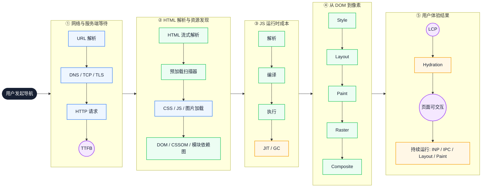
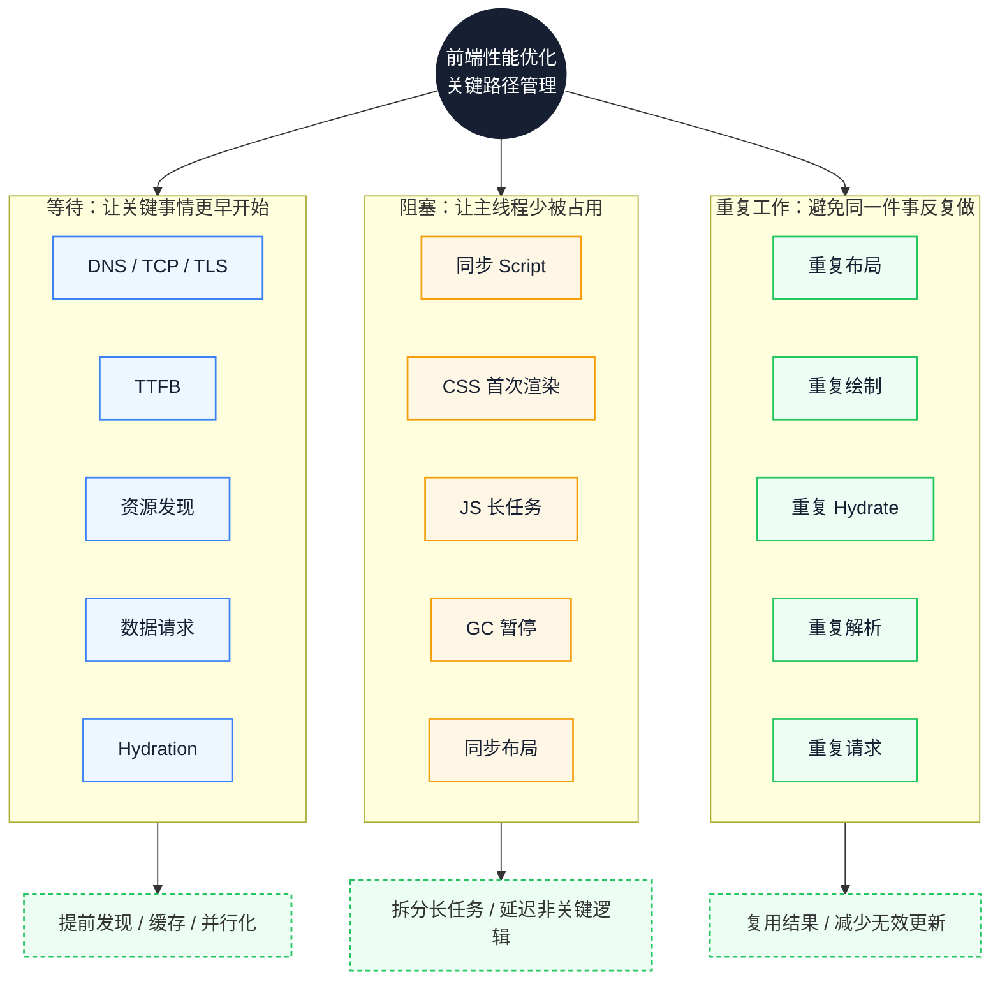

# 现代前端性能的底层链路：如何减少关键路径上的等待、阻塞与重复工作

页面在本地很快，线上却总有几个区域慢半拍：首屏图片出现得晚，按钮点下去要等一会儿才响应，滚动时偶发卡顿。这类问题很难靠“把包减小”解决，因为慢可能发生在网络、解析、执行或渲染的任意一段。本文按一次导航的时间顺序拆开这条链路，先定位等待、阻塞与重复工作发生在哪一段，再给出可验证的改动方式、收益边界和回退条件。

::: info 一句话
现代前端性能优化的本质，是管理关键路径上的等待、阻塞与重复工作。
:::

## 目录

- [写在前面](#写在前面)
- [一、从“框架视角”升级到“浏览器链路视角”](#一、从-框架视角-升级到-浏览器链路视角)
- [二、第一段等待：TTFB 之前，浏览器已经做了很多事](#二、第一段等待-ttfb-之前-浏览器已经做了很多事)
- [三、资源发现：很多 LCP 慢，不是下载慢，而是发现晚](#三、资源发现-很多-lcp-慢-不是下载慢-而是发现晚)
- [四、HTTP/2、HTTP/3 改变了资源组织方式，但没有消灭关键路径](#四、http-2、http-3-改变了资源组织方式-但没有消灭关键路径)
- [五、HTML、CSS、JS 解析阶段本身就是性能战场](#五、html、css、js-解析阶段本身就是性能战场)
- [六、LCP 是结果指标，不是单个资源指标](#六、lcp-是结果指标-不是单个资源指标)
- [七、从 DOM 到像素：Layout、Paint、Raster、Composite 的真实成本](#七、从-dom-到像素-layout、paint、raster、composite-的真实成本)
- [八、光栅化不是抽象概念，而是 LCP 和动画性能的关键](#八、光栅化不是抽象概念-而是-lcp-和动画性能的关键)
- [九、JS 成本不只是执行，还包括解析、编译、JIT 和 GC](#九、js-成本不只是执行-还包括解析、编译、jit-和-gc)
- [十、GC 优化的重点不是“不创建对象”，而是控制生命周期](#十、gc-优化的重点不是-不创建对象-而是控制生命周期)
- [十一、模块运行时：浏览器正在接管过去 Bundler 的一部分职责](#十一、模块运行时-浏览器正在接管过去-bundler-的一部分职责)
- [十二、Hydration：SSR 的成本经常被低估](#十二、hydration-ssr-的成本经常被低估)
- [十三、INP：从“页面出现”走向“交互可靠”](#十三、inp-从-页面出现-走向-交互可靠)
- [十四、IPC 和多进程：浏览器内部协作也有成本](#十四、ipc-和多进程-浏览器内部协作也有成本)
- [十五、站点隔离和沙箱：安全架构也会影响性能模型](#十五、站点隔离和沙箱-安全架构也会影响性能模型)
- [十六、bfcache 和 Service Worker：减少重复加载和重复工作](#十六、bfcache-和-service-worker-减少重复加载和重复工作)
- [十七、统一模型：等待、阻塞、重复工作](#十七、统一模型-等待、阻塞、重复工作)
- [十八、建立基线与验证改动](#十八、建立基线与验证改动)
- [十九、代价与回退：优化不是免费的](#十九、代价与回退-优化不是免费的)
- [二十、高级前端实践清单](#二十、高级前端实践清单)
- [结语：优化的是链路，不是某一行代码](#结语-优化的是链路-不是某一行代码)
- [FAQ](#faq)
- [来源](#来源)

## 写在前面

本文的主要参考来源是 Addy Osmani 的《How modern browsers work》及其中文整理版。Addy Osmani 长期从事 Web 性能与 Chrome 开发者体验相关工作，参与过 DevTools、Lighthouse、Core Web Vitals 等方向，也是《Learning JavaScript Design Patterns》《Image Optimization》的作者，个人主页见 [addyosmani.com](https://addyosmani.com/)。

这里先约定一个贯穿全文的概念：**关键渲染路径（Critical Rendering Path）**指从 HTML、CSS 到达浏览器，到首屏像素真正显示出来必须经过的步骤，下文简称关键路径。它不等于全部加载过程，但决定了用户第一次“看到”页面要等多久。

文中的面板观察以 Chromium 系浏览器的 DevTools 为准，不同版本、主题下的块名称和配色可能不同。

浏览器处理一次导航，可以按时间顺序拆成五段。每一段都可能出现等待、阻塞或重复工作：

- **等待**：TTFB 等网络和服务端；LCP 等主要内容真正显示；Hydration 等页面从“能看”变成“能用”。
- **阻塞**：同步脚本阻塞 HTML 解析；CSS 阻塞首次渲染；长任务（Long Task，通常指占用主线程超过 50ms 的任务）阻塞交互；GC 暂停阻塞主线程。
- **重复工作**：重复布局、重复绘制、重复光栅化、重复 Hydrate 静态区域、重复请求资源。



横向看，前四段决定页面多久能显示，第五段决定显示之后是否可靠。紫色节点是可以直接采集的结果指标，橙色节点是最容易抢占主线程或打断关键路径的阶段；定位时先看它们，再回溯到对应阶段。图中 Style、Layout、Paint、Raster、Composite 依次对应样式计算、布局、绘制、光栅化与合成，后文会逐段展开。

---

## 一、从“框架视角”升级到“浏览器链路视角”

很多工程师做性能优化时，先从框架和产物入手：

- React 组件是不是重复渲染了？
- Vue 响应式是不是触发太多更新了？
- 打包产物是不是太大了？
- 图片是不是没有压缩？
- 接口是不是太慢？

这些问题都值得查，但它们只回答“哪里可能有问题”，不回答“这次慢发生在哪一段”。要继续追问：

- 慢发生在网络、服务端，还是浏览器？
- 是 TTFB 慢，还是资源发现晚？
- 是 CSS 阻塞首次渲染，还是同步 JS 阻塞 HTML 解析？
- 是 LCP 图片下载慢，还是解码、布局、光栅化慢？
- 是客户端模块图太深，导致关键 JS 执行晚？
- 是 Hydration 太重，导致页面“看得见但点不动”？
- 是 JIT 去优化、GC 停顿，还是 IPC 和合成层成本被放大？

现代浏览器并不是一个简单的 HTML/CSS/JS 执行盒子，而是一套软件系统：网络通信、资源调度、HTML/CSS/JS 解析、JavaScript 执行、布局、绘制、GPU 合成、多进程隔离和安全沙箱都在其中。

把上面的图展开成可逐项核对的顺序：

1. 用户发起导航
2. URL 解析 / DNS / TCP / TLS / HTTP 请求
3. TTFB
4. HTML 流式解析 / 预加载扫描
5. DOM / CSSOM / 模块依赖图
6. JS 解析 / 编译 / 执行
7. 样式计算 / 布局 / 绘制记录
8. 分层 / Tile 光栅化 / GPU 合成
9. LCP
10. Hydration
11. 页面真正可交互
12. 持续运行中的 JIT / GC / IPC / Layout / Paint / Composite 成本

定位的第一步不是选优化手段，而是给这次慢贴一个阶段标签。标签错了，后面的手段往往不会命中真正的瓶颈。

---

## 二、第一段等待：TTFB 之前，浏览器已经做了很多事

**TTFB（Time to First Byte，首字节时间）** 表示浏览器发起请求后，到接收到服务器返回的第一个字节之间的时间。

把 TTFB 简单理解为“后端响应时间”并不完整。在第一个字节到达之前，浏览器通常已经经历了 URL 解析、安全检查、DNS 查询、TCP 连接建立、HTTPS 场景下的 TLS 握手、HTTP 请求发送、服务器处理，以及响应头开始返回。

Addy Osmani 在原文中提到，现代 Chromium 的网络栈通常运行在专门的网络服务或网络进程中。渲染器进程不能直接访问网络，而是通过浏览器进程或网络进程获取资源，这既是架构划分，也是安全隔离的一部分。

因此，TTFB 慢可能来自三类原因：

- **网络与连接**：DNS 慢、TCP/TLS 握手慢、用户离服务器远、CDN 未命中。
- **服务端处理**：冷启动、SSR 执行慢、数据库查询慢、后端串行 API、BFF 聚合层过重。
- **缓存与协议**：HTML 不可缓存、边缘节点没有缓存、响应需要回源。

优化方向也按这三类展开：

- 缩短距离：使用 CDN、边缘渲染。
- 减少服务端工作：缓存 HTML 或数据接口、减少串行请求、优化 SSR 冷启动、使用流式 SSR、延后非关键数据。
- 更早准备：对关键资源使用 Early Hints，或用 `preconnect` 提前建连。

**Early Hints（HTTP 103）** 允许服务器在主响应生成完成前，提前告诉浏览器可以预连接或预加载哪些资源。它需要服务器或 CDN 支持，不适合作为唯一手段。

TTFB 是一个合成指标。在 Network 面板或 `PerformanceResourceTiming` 中，可以继续拆成 Redirect、DNS、TCP、Request、Response 等阶段，用来判断慢在连接还是服务端。

本章的结论不是“TTFB 要优化”，而是“先分清 TTFB 里哪一段最贵”。

---

## 三、资源发现：很多 LCP 慢，不是下载慢，而是发现晚

首屏性能中经常被低估的问题是：关键资源**什么时候被浏览器发现**。

很多页面 LCP 慢，并不是图片下载太慢，而是浏览器很晚才知道这张图片存在。

**预加载扫描器（Preload Scanner）** 是这里的关键机制。Chromium 的预加载扫描器会在主 HTML 解析器之前扫描原始标记。即使主解析器被 CSS 或同步 JavaScript 阻塞，它仍然可以发现图片、脚本、样式表等资源，并提前发起并行请求。

因此，LCP 图片直接出现在 HTML 中，对浏览器最友好：

```html

```

如果 LCP 图片由 JS 后续插入：

```javascript
const img = document.createElement('img')
img.src = '/hero.webp'
document.body.appendChild(img)
```

浏览器必须等 JS 下载、解析、编译、执行后，才知道这张图片存在。LCP 图片被拖到 JS 执行之后，形成典型的资源发现延迟。

> **首屏关键资源不应该藏在 JavaScript 执行之后。**

常用的提前手段包括：

- `rel="preload"`：提前加载关键资源
- `rel="modulepreload"`：提前加载关键 ESM 模块
- `fetchpriority="high"`：提示浏览器提升资源优先级
- `rel="preconnect"`：提前建立连接
- Early Hints：让资源提示更早到达浏览器

Addy Osmani 也提到，浏览器会对资源分配优先级：HTML 和 CSS 通常较高，图片可能较低，开发者可以通过 `rel=preload` 和 Fetch Priority 影响调度。

但 preload 只解决“发现和优先级”，不解决依赖链。如果资源 URL 需要等 JS 计算，preload 也无处可放。

::: tip 验证方式
在 Network 面板查看 LCP 图片的 `Initiator`：由 HTML 解析器发起，说明发现正常；由某个 JS 文件发起，且时间点靠后，说明资源发现被推迟。
:::

---

## 四、HTTP/2、HTTP/3 改变了资源组织方式，但没有消灭关键路径

HTTP/1.1 时代常见的优化经验是：

- 减少请求数
- 合并 JS
- 合并 CSS
- 使用雪碧图
- 域名分片

这些经验成立的前提是：浏览器对同一域名的并发连接数量有限，请求过多容易排队。

现代浏览器普遍支持 HTTP/2 和 HTTP/3。HTTP/2 允许在一个 TCP/TLS 连接上多路复用多个资源请求；HTTP/3 基于 QUIC，进一步降低连接建立延迟，并减少 TCP 层的队头阻塞。

这带来几个变化：

- “请求越少越好”不再绝对成立
- 很多小文件不一定必然造成灾难
- 关键路径上的依赖链仍然重要
- 深层模块图仍然可能形成瀑布
- 资源优先级仍然影响首屏

例如下面这条 LCP 依赖链：

```text
HTML
→ main.js
→ router.js
→ page.js
  → component.js
  → fetch data
  → render hero image
```

即使 HTTP/3 很快，用户仍然要等一串串行依赖完成。

协议优化解决的是传输效率，通常不解决“必须按顺序等待”的依赖关系。

---

## 五、HTML、CSS、JS 解析阶段本身就是性能战场

浏览器收到 HTML 后会流式解析并构建 DOM。Addy Osmani 指出，HTML 解析是增量式的，浏览器可以在完整 HTML 下载完之前就开始构建 DOM。

这里有两个重要阻塞点。

### 1. 同步 script 会阻塞 HTML 解析

默认情况下，HTML 解析器遇到普通 `<script>` 会暂停解析，等脚本下载并执行完成后再继续。原因是脚本可能修改 DOM，甚至使用 `document.write()` 改变后续文档结构。

```html
<script src="/large-app.js"></script>
```

更合理的方式是使用 `defer` 或 `type="module"`，或在合适场景使用 `async`。

`defer` 让脚本并行下载，但推迟到 HTML 解析完成后按顺序执行；`async` 并行下载，并在下载完成后尽快执行；ES Module 默认具有类似 `defer` 的行为。`async` 脚本的执行时机不确定，不适合有顺序依赖的代码。

### 2. CSS 会阻塞首次渲染

CSS 不一定阻塞 HTML 解析，但通常会阻塞首次渲染。浏览器要避免先显示一版无样式内容，再在 CSS 到达后重绘成另一版。

同步脚本则更严格：它同时阻塞解析和后续的 DOM 构建。预加载扫描器仍可继续发现资源，但脚本本身的执行必须等下载完成。

::: tip 观察信号
在 Performance 面板中，如果长蓝色“Parse HTML”之后紧跟着黄色“Evaluate Script”，随后才继续解析，通常说明同步脚本阻塞了解析。不同 Chrome 版本的块名称和配色可能略有差异，以调用栈和时序为准。
:::

---

## 六、LCP 是结果指标，不是单个资源指标

**LCP（Largest Contentful Paint，最大内容绘制）** 衡量视口内最大、最重要的可见内容什么时候完成显示。它可能是大图、视频首帧、大块文本区域，或首屏主体内容。

LCP 在用户首次交互后停止记录，所以它衡量的是加载阶段，不是整个会话。某个元素在加载过程中变大，也可能成为新的 LCP 候选。

分析 LCP 更有效的拆解方式：

1. **HTML 什么时候到？**
2. **LCP 元素什么时候被发现？**
3. **LCP 资源什么时候下载完成？**
4. **浏览器什么时候有空把它布局、绘制、光栅化并合成出来？**

```mermaid
flowchart LR
    subgraph Phase1[发现阶段]
        A[HTML 到达]
        B[LCP 元素被发现]
        A --> B
    end

    subgraph Phase2[加载阶段]
        C[LCP 资源开始下载]
        D[资源下载完成]
        B --> C --> D
    end

    subgraph Phase3[渲染阶段]
        E[解码]
        F[Layout]
        G[Paint]
        H[Raster]
        I[Composite]
        D --> E --> F --> G --> H --> I
    end

    J((LCP 完成))
    I --> J

    B -. 发现晚 .-> C
    D -. 下载慢 .-> E
    I -. 主线程或渲染管线繁忙 .-> J

    classDef metric fill:#F5E8FF,stroke:#A855F7,color:#172033,stroke-width:2px;
    classDef wait fill:#EEF6FF,stroke:#3B82F6,color:#172033,stroke-width:1.5px;
    classDef work fill:#ECFDF3,stroke:#22C55E,color:#172033,stroke-width:1.5px;

    class A,B,C,D wait;
    class E,F,G,H,I work;
    class J metric;
```



图中的虚线标出了三段最常见的延迟来源。它们是并列的候选原因，不是固定顺序；先量出哪一段最长，再决定优化手段。

::: tip 验证方式
在 Performance 面板的 Timings 轨道找到 LCP 标记，对照其左侧的资源加载与主线程活动。如果 LCP 标记晚于图片下载完成很多，瓶颈通常在渲染或主线程，而不是网络。
:::

---

## 七、从 DOM 到像素：Layout、Paint、Raster、Composite 的真实成本

一次样式或 DOM 变更，通常要经过以下步骤：

1. DOM 构建
2. CSSOM 构建
3. 样式计算
4. 布局树构建
5. 布局计算（Layout）
6. 绘制记录生成（Paint record / Display list）
7. 图层构建（Layering）
8. Tile 切分
9. 光栅化（Rasterization，把绘制指令转换成像素）
10. GPU 合成（Composite，把图层按顺序合成到屏幕）

Addy Osmani 提到：布局树会省略 `display:none` 这类不产生布局盒子的元素，但 `visibility:hidden` 这类仍占空间的元素会保留在布局树中。

这给前端优化一个重要启示：

> 真正昂贵的不是“改了一个样式”，而是这个样式改动是否让后续整条渲染管线重新工作。

例如典型的布局抖动（Layout Thrashing）：

```javascript
// 反例：读写交错，强制同步布局
for (const item of list) {
  item.style.width = container.offsetWidth + 'px'
}
```

改写为“先读后写”：

```javascript
// 正例：先批量读，再批量写
const width = container.offsetWidth
for (const item of list) {
  item.style.width = width + 'px'
}
```

不同 CSS 属性可能进入不同渲染路径（简化理解）：

- 改 `width` / `height` / `top` / `left`：可能触发布局
- 改 `color` / `background` / `box-shadow`：可能触发绘制
- 改 `transform` / `opacity`：在元素已处于独立合成层时，多数情况下可停留在合成阶段

最后一条有前提：如果元素没有独立合成层，改 `transform` 仍可能触发绘制。属性只是决定“最少需要哪一段”，实际路径取决于图层状态。

::: tip 观察信号
在 Performance 面板中，连续出现的紫色 Layout 块和绿色 Paint 块，通常意味着渲染管线被反复触发。颜色随主题和版本变化，判断时优先看块名称与调用栈。
:::

---

## 八、光栅化不是抽象概念，而是 LCP 和动画性能的关键

**光栅化（Rasterization）** 是把绘制指令转换成真实像素的过程。

在 Chrome 中，合成器线程会把图层拆成更小的 tile，再把这些 tile 分派给多个光栅工作线程并发处理。光栅化后的 tile 作为纹理进入 GPU 内存，最终由 GPU 进程合成到屏幕上。

这意味着：

- LCP 元素的光栅化完成时间，直接影响 LCP
- 动画期间如果触发重新光栅化，会占用 GPU 带宽和合成线程时间
- 大面积图层（如长列表、复杂背景）会增加 tile 管理和光栅化压力

但并不是整个图层都会一次性光栅化。浏览器通常优先处理视口附近的 tile，滚动时再补齐新的区域。因此“图层很大”带来的问题，更多体现在内存、tile 管理和滚动时的持续光栅化，而不是启动时一次性画完。

判断光栅化是否成为瓶颈，先看 LCP 元素是否在下载完成后仍等待较久，再看动画期间是否持续出现 Raster 工作。

---

## 九、JS 成本不只是执行，还包括解析、编译、JIT 和 GC

很多团队衡量 JS 成本时只看 bundle size，但浏览器里的 JS 成本至少包括：

1. 下载
2. 解析
3. 编译
4. 字节码生成
5. 执行
6. JIT 优化 / 去优化
7. 内存分配
8. GC 回收

在 V8 的执行流水线中，源码先被解析成 AST，再由 Ignition 编译成字节码执行；热点代码可能进入 Sparkplug、Maglev、TurboFan 等不同层级的 JIT 编译器。具体启用哪些编译器，随 Chrome 版本和平台变化。

保持对象 shape 稳定，有助于让优化路径稳定：

```javascript
// 正例：对象 shape 稳定，V8 可走快速路径
function update(user) {
  return user.score + 1
}

update({ score: 1 })
update({ score: 2 })
update({ score: 3 })
```

反例是传入对象的形状或类型不断变化：

```javascript
// 反例：对象 shape 变化，可能触发去优化
update({ score: 1 })
update({ score: 1, name: 'Ken' })
update({ score: '1' })
```

这段示例只说明优化前提，不代表固定耗时差异。实际影响取决于该函数是否成为热点、调用频率和 V8 版本。

::: tip 观察信号
在 Performance 面板查看 `Deoptimize` 事件，或使用 `--trace-deopt` 启动参数记录去优化原因。黄色 Evaluate Script 块和紫色 Function Call 块的大小，可以辅助判断执行成本。
:::

---

## 十、GC 优化的重点不是“不创建对象”，而是控制生命周期

GC（垃圾回收）让业务代码不需要手动释放内存，但高频交互路径中仍要警惕短命对象风暴。

```javascript
// 反例：每次移动都创建新对象，增加 GC 压力
function handleMove(points) {
  return points.map((point) => ({
    x: point.x * 2,
    y: point.y * 2,
    time: Date.now(),
  }))
}
```

优化方向：

- 高频路径复用对象，避免每次创建新对象
- 使用对象池管理短命对象
- 将频繁调用的回调函数引用稳定化，避免每次创建新闭包

这些手段都有代价。对象池会增加状态管理复杂度，并让对象长期驻留内存；如果调用频率不高，收益可能抵不过复杂度。是否引入，应以 Performance 面板中 GC 事件的占比为依据。

GC 的具体算法和停顿时间随 V8 版本、堆大小、对象存活率变化，不存在通用的“停顿阈值”。

---

## 十一、模块运行时：浏览器正在接管过去 Bundler 的一部分职责

浏览器原生支持 ES Modules。遇到模块入口时，浏览器会递归构建模块依赖图；只有整个模块图被获取和解析后，浏览器才会按依赖顺序执行模块。

静态 `import` 与动态 `import()` 的关键区别：

- 静态 `import`：执行前就需要把依赖图构建好
- 动态 `import()`：运行时触发加载，更适合路由级、组件级、功能级拆分

模块图的深度决定关键路径长度。把入口拆小不一定减少总字节，但能减少首屏必须等待的那部分图。

---

## 十二、Hydration：SSR 的成本经常被低估

SSR 可以让用户更早看到 HTML，但客户端下载 JS、恢复状态、绑定事件，让静态 HTML 变得可交互的过程就是 **Hydration**。

Hydration 的典型问题是“看起来好了，但点不动”，也就是常说的僵尸页面。它的成本包括组件代码下载、执行、状态恢复和事件绑定；静态 HTML 越大，需要重复处理的内容越多。

现代方案包括：

- Selective Hydration / Progressive Hydration
- Islands Architecture
- Resumability
- Streaming SSR
- Server Components
- Partial Prerendering

共同目标都是减少关键路径上的 JS 执行、主线程阻塞与重复工作。

SSR 是否更快，取决于 HTML 到达时间与 Hydration 完成时间之间的差值。如果 Hydration 很长，首屏可交互时间可能比 CSR 更晚。

---

## 十三、INP：从“页面出现”走向“交互可靠”

**INP（Interaction to Next Paint）** 衡量用户交互到下一次视觉更新之间的延迟。它关注的是页面出现之后的交互可靠性。

INP 差通常来自：

- JS 长任务
- Hydration 后仍有大量初始化任务
- GC 停顿
- 样式重计算
- 强制同步布局
- 第三方脚本抢占主线程

INP 是字段指标，需要真实用户数据。实验室可以用固定的交互脚本近似，但不能用单次本地录制推断整体分布。

优化时先找到与交互重叠的长任务，再决定是拆分任务、延迟初始化，还是把计算移出主线程。

---

## 十四、IPC 和多进程：浏览器内部协作也有成本

Chromium 采用多进程架构：浏览器进程、渲染器进程、GPU 进程、网络进程等，进程间通过 IPC 协作。

以下场景需要更关注 IPC 成本：

- Electron 应用
- iframe 微前端
- 多窗口协作
- 大量 `postMessage`

`postMessage` 的结构化克隆成本与数据大小相关。大数据可以用 transferable 转移所有权，避免复制。高频跨进程通信应批量、异步，避免同步 IPC 阻塞主线程。

---

## 十五、站点隔离和沙箱：安全架构也会影响性能模型

站点隔离让不同站点运行在不同渲染进程中。跨站 iframe 可能成为 OOPIF（out-of-process iframe），提升安全性，也可能带来更多进程开销和通信成本。

这并不是说所有跨站 iframe 都会立即独立成进程。是否启用、何时启用，取决于隔离策略和内存压力。评估成本时，应看实际进程数量与 IPC 频率，而不是只看 iframe 数量。

---

## 十六、bfcache 和 Service Worker：减少重复加载和重复工作

### 1. bfcache：浏览器级瞬时恢复

如果页面能进入 bfcache，前进/后退时不需要重新下载、解析、执行和 Hydrate，几乎可以瞬间恢复。

页面可能因为 `unload` 监听器、`Cache-Control: no-store` 或未关闭的连接而失去 bfcache 资格。优化前先用 DevTools 的 Application 面板确认页面是否真的进入了 bfcache。

### 2. Service Worker：控制网络等待和缓存策略

适合：

- 静态资源预缓存
- 弱网兜底与离线可用
- stale-while-revalidate 等缓存策略

它也会带来复杂性：缓存更新、版本管理、错误缓存，以及调试时旧缓存难以清理。

bfcache 和 Service Worker 都在减少重复工作，但一个是浏览器托管，一个是开发者自建，代价和维护责任不同。

---

## 十七、统一模型：等待、阻塞、重复工作

前面的章节各自处理一个阶段。把它们放在一起，可以看到三组反复出现的问题：



图中上半部分是按症状归类的观察面，下半部分是每个观察面对应的策略方向。它不是严格的分类学：同一个问题可能同时属于等待和阻塞，例如 Hydration 既要在等待队列里完成，也会占用主线程。把它当作排查顺序，而不是互斥标签。

多数性能问题可以归入这三组。先判断属于哪一组，再回到具体章节选择手段，比直接从“优化技巧清单”里挑一条更可靠。

---

## 十八、建立基线与验证改动

实践型优化最容易出错的地方，是改完之后无法证明“真的变快了”。下面四步可以避免这种情况。

### 1. 固定测量条件

记录页面 URL、构建版本、浏览器版本、设备或 CPU 降速倍数、网络配置、缓存状态和视口尺寸。条件变化后，前后数据不可直接比较。

### 2. 用字段数据判断症状，用实验室数据定位阶段

字段数据（RUM、CrUX）回答“用户是否真的慢”，实验室数据回答“慢在哪一段”。只有字段数据没有实验室拆解，容易选错手段；只有实验室数据，可能优化了本地但没改善线上。

### 3. 记录可复现的基线

对同一交互或加载过程连续录制多次，记录中位数和波动范围，而不是单次结果。基线至少包含 TTFB、LCP、长任务总时长，以及关键阶段的耗时。

### 4. 用同一脚本对照改动

改动前后使用相同的交互脚本、相同的降速设置和相同的样本数量。比较分布，而不是比较最好的一次。

```javascript
// 在目标页面控制台运行，用于本地诊断；不能替代真实用户监控
new PerformanceObserver((list) => {
  for (const entry of list.getEntries()) {
    console.log('LCP 候选', Math.round(entry.startTime), entry.size)
  }
}).observe({ type: 'largest-contentful-paint', buffered: true })

new PerformanceObserver((list) => {
  for (const entry of list.getEntries()) {
    console.log('长任务', Math.round(entry.startTime), Math.round(entry.duration))
  }
}).observe({ type: 'longtask', buffered: true })
```

这段代码只用于本地观察。LCP 在用户首次交互后停止上报；Long Task API 目前主要在 Chromium 可用，其他引擎可能不支持。真实结论仍应来自字段数据。

| 指标 | 回答的问题 | 采集方式 |
| --- | --- | --- |
| TTFB | 网络和服务端等了多久 | Network 面板、`PerformanceResourceTiming` |
| LCP | 主要内容何时完成显示 | 字段数据、Performance 面板标记 |
| INP | 交互是否可靠 | 字段数据为主，实验室交互脚本近似 |
| 长任务 | 主线程被谁占住 | Performance 面板、Long Task API |

---

## 十九、代价与回退：优化不是免费的

每条优化都会把成本转移到别处。改动前先写下回退条件，比事后补救更有效。

| 手段 | 主要收益 | 代价 | 回退信号 |
| --- | --- | --- | --- |
| `preload` / Early Hints | 关键资源更早开始 | 预加载过多会争抢带宽；Early Hints 依赖服务端或 CDN | 其他资源排队变长，LCP 未改善 |
| 代码拆分 / 动态 `import()` | 减少首屏必须执行的代码 | 增加请求层级和瀑布风险 | 首屏关键路径变深，交互前请求数上升 |
| SSR / 流式 SSR | 更早显示 HTML | 服务端渲染成本、Hydration 成本 | 可交互时间晚于 CSR，服务端错误率上升 |
| bfcache / Service Worker | 减少重复加载 | 缓存失效、版本管理和调试复杂度 | 用户看到旧版本，缓存清理依赖人工 |
| 对象池 / 复用对象 | 降低高频路径 GC 压力 | 内存驻留、状态管理复杂度 | 内存上涨，GC 总时长未下降 |
| 提升合成层 | 限制重绘范围，稳定动画 | GPU 内存、层管理成本 | 层数量级增长，低端机掉帧更严重 |

回退条件应绑定可观察信号，例如“字段数据 p75 无改善”“低端机掉帧率上升”“内存占用明显高于基线”；具体阈值按设备和项目容忍度设定。没有信号的“再观察一下”不是回退条件。

---

## 二十、高级前端实践清单

### 1. 首屏资源

- [ ] 在初始 HTML 源码中确认 LCP 元素存在，而不是由 JS 插入
- [ ] 在 Network 面板确认 LCP 图片的 Initiator 是 HTML 解析器
- [ ] 只给一个 LCP 候选设置 `fetchpriority="high"`
- [ ] 关键 CSS 内联或前置，非关键 CSS 异步加载
- [ ] 用 `modulepreload` 覆盖首屏入口依赖，并在 Network 面板确认提前发起

### 2. JS 加载与主线程

- [ ] 首屏脚本使用 `defer` 或 `type="module"`，在 Performance 面板确认解析未被 Evaluate Script 打断
- [ ] 非关键路由和功能使用动态 `import()`，并记录首屏请求链深度
- [ ] 用 Long Task API 或 Performance 面板统计首屏长任务数量
- [ ] 将超过 50ms 的计算移入 Worker 或拆分到多个任务

### 3. 模块与缓存

- [ ] 画出首屏入口到 LCP 资源的依赖链，标记串行层级
- [ ] 检查首屏是否引入了只在后续页面使用的工具库
- [ ] 为静态资源配置带哈希的长期缓存，并确认 HTML 不被长期缓存
- [ ] 改动构建后对比模块图深度和首屏请求数

### 4. 渲染管线

- [ ] 用 Performance 面板确认没有读写交错的 Layout 块
- [ ] 动画只改 `transform` / `opacity`，并在 Layers 面板确认元素已独立成层
- [ ] `will-change` 只在动画前开启，动画结束后移除
- [ ] 对比改动前后的 Layout、Paint 总时长和合成层数量

### 5. Hydration 与交互

- [ ] 在 Performance 面板标记 Hydration 起止时间，确认首屏关键交互不在长任务之后
- [ ] 静态区域不进入 Hydration，交互区域按优先级恢复
- [ ] 记录首屏初始化脚本的执行时长，并与基线对比
- [ ] 用固定交互脚本测量 INP 近似值，结合字段数据判断是否改善

### 6. 运行时与多进程

- [ ] 保持热点函数的对象形状和参数类型稳定，并用 `--trace-deopt` 复核
- [ ] 在高频路径统计短命对象分配，确认 GC 事件占比后再决定是否使用对象池
- [ ] 高频 `postMessage` 合并批量发送，大数据使用 transferable
- [ ] 在 Electron 或微前端场景记录 IPC 频率与单次数据大小

---

## 结语：优化的是链路，不是某一行代码

把浏览器看成一条从请求到像素的流水线，性能问题就不再是“某段代码写得慢”，而是“这条流水线在哪个环节等了、被谁占住了、哪件事做了不止一次”。这个视角的价值在于，它能把模糊的卡顿翻译成具体的阶段和可采集的信号。

下一步最值得做的，不是立刻套用清单，而是选一个真实页面，固定测量条件，记录一版基线，然后按阶段定位最长的那一段。改动之后用同一套条件复测；如果没有改善，或者代价超过收益，就按事先写好的条件回退。

---

## FAQ

### 1. 为什么本地优化效果明显，线上却没有变化？

本地通常没有真实网络抖动、低端设备和第三方脚本竞争。先确认线上字段数据是否同样指向同一个瓶颈，再用相同的设备和网络条件复现。如果实验室指标改善而字段指标不变，说明优化点可能不是用户实际遇到的瓶颈。

### 2. LCP 元素是文本块时，还能拆成“发现、下载、渲染”吗？

可以，但“下载”要换成字体加载和文本排版。文本 LCP 往往受字体阻塞、样式计算和主线程长任务影响。先看 HTML 到达时间，再看字体是否阻塞首次绘制，最后看文本区域是否因布局变化延迟完成。

### 3. HTTP/2 多路复用之后，合并资源还有意义吗？

有条件的意义。合并可以减少请求开销和依赖层级，但会降低缓存粒度，让一个文件的改动导致整包失效。优先关注关键路径深度和缓存命中，而不是单纯追求请求数最少。

### 4. 为什么把长任务拆小之后，INP 仍然没有改善？

INP 覆盖从输入到下一次绘制完成的整段过程，不只是事件回调本身。拆小长任务能减少主线程占用，但如果渲染、样式计算或第三方脚本仍在同一帧里排队，下一次绘制仍会延迟。用 Performance 面板查看输入事件到下一帧之间的全部工作，而不是只看单个任务时长。

### 5. 没有真实用户数据时，怎么判断优化是否有效？

可以先建立可复现的实验室基线，但要明确它只能证明机制成立，不能证明线上收益。记录同一条件下的多次运行结果和波动范围，并优先选择那些能直接减少关键路径长度或主线程占用的改动。

---

## 来源

1. Addy Osmani 个人主页：[https://addyosmani.com/](https://addyosmani.com/)
2. Addy Osmani《How modern browsers work》（X 长文）：[https://x.com/addyosmani/article/2068394292796871019](https://x.com/addyosmani/article/2068394292796871019)
3. 《How modern browsers work》中文整理版：[https://lumina.shawnxie.top/article/networking-and-resource-loading-e6bdf120](https://lumina.shawnxie.top/article/networking-and-resource-loading-e6bdf120)
