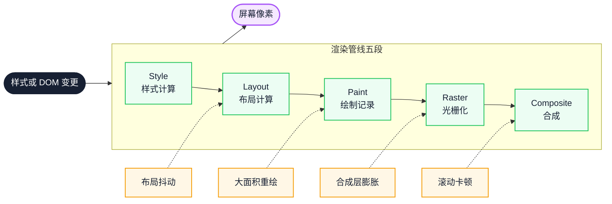
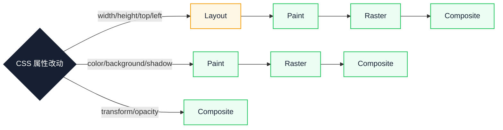

# 渲染性能避坑指南：从 Layout、Paint 到 Composite 的常见陷阱与解法

动画掉帧、滚动发涩、列表越用越卡，通常不是某一行代码写得慢，而是样式改动触发了一整条渲染管线，或在同一帧里反复触发。本文从 Style 到 Composite 逐段拆解常见陷阱：先看改动落在哪一段，再用 Performance 与 Layers 面板确认，最后给出可回退的改法和验证信号。

::: info 一句话
渲染性能问题的本质，是触发了不必要的渲染管线工作，或让管线某一段过载。
:::

## 目录

- [写在前面](#写在前面)
- [一、渲染管线回顾：从 Style 到 Composite 的五段](#一、渲染管线回顾-从-style-到-composite-的五段)
- [二、Layout 陷阱：布局抖动与强制同步布局](#二、layout-陷阱-布局抖动与强制同步布局)
- [三、Paint 陷阱：大面积重绘与绘制区域扩散](#三、paint-陷阱-大面积重绘与绘制区域扩散)
- [四、Composite 陷阱：合成层爆炸与 will-change 滥用](#四、composite-陷阱-合成层爆炸与-will-change-滥用)
- [五、动画性能：transform/opacity 之外的边界条件](#五、动画性能-transform-opacity-之外的边界条件)
- [六、DOM 规模：节点数量如何拖垮整条管线](#六、dom-规模-节点数量如何拖垮整条管线)
- [七、CSS 选择器复杂度：被低估的 Style 成本](#七、css-选择器复杂度-被低估的-style-成本)
- [八、字体与首屏：FOIT、FOUT 与布局偏移](#八、字体与首屏-foit、fout-与布局偏移)
- [九、图片与媒体：解码、光栅化与 LCP](#九、图片与媒体-解码、光栅化与-lcp)
- [十、滚动性能：passive listener 与合成层](#十、滚动性能-passive-listener-与合成层)
- [十一、建立基线与验证改动](#十一、建立基线与验证改动)
- [十二、代价与回退：合成层不是免费的](#十二、代价与回退-合成层不是免费的)
- [十三、渲染性能实践清单](#十三、渲染性能实践清单)
- [结语：优化的是管线，不是单点](#结语-优化的是管线-不是单点)
- [FAQ](#faq)
- [来源](#来源)

## 写在前面

很多团队做渲染性能优化时，第一反应是“加 `will-change`”“用 `transform` 做动画”“开启 GPU 加速”。这些经验有用，但它们只是结论，不是原因。

不理解渲染管线的完整路径，就容易出现下面这些情况：

- 给所有动画元素都加 `will-change: transform`，结果内存上涨、合成层膨胀
- 用 `transform` 做动画，但父级触发了重排，动画依然抖动
- 优化了单次绘制时间，但滚动时持续触发重绘，整体仍然掉帧
- 把列表虚拟化做得很完美，但 CSS 选择器复杂度过高，Style 阶段拖垮了整条管线

本文按“改动落在哪一段”组织：先回顾五段管线，再逐段看陷阱、验证信号与边界条件。每个手段都说明代价，避免把一个阶段的成本转移到另一个阶段。

文中的代码和面板观察基于 Chromium 系浏览器，不同版本的面板命名与配色可能不同。

---

## 一、渲染管线回顾：从 Style 到 Composite 的五段

浏览器把 DOM 和 CSSOM 变成屏幕像素，通常要经历五段：

1. **Style（样式计算）**：把选择器规则匹配到 DOM 元素，计算每个节点的最终样式值。
2. **Layout（布局）**：根据样式计算盒模型，确定每个元素的位置和大小。
3. **Paint（绘制）**：生成绘制记录（paint record / display list），记录“先画什么、后画什么”。
4. **Raster（光栅化）**：把绘制指令转换成真实像素，通常按 tile 并发处理。
5. **Composite（合成）**：把多个图层按顺序合成到屏幕上，通常由 GPU 完成。



图中实线是正常管线，虚线是常见陷阱注入的位置。先确认改动落在哪一段，再看对应的陷阱，比记住一堆技巧更稳定。

不同 CSS 属性的改动会触发不同段落的重新计算：

- 改 `width` / `height` / `margin` / `padding` / `top` / `left`：触发 **Layout**，连带后续所有阶段
- 改 `color` / `background` / `box-shadow` / `border-color`：触发 **Paint**，连带后续阶段
- 改 `transform` / `opacity`：在元素处于独立合成层时，多数情况下只触发 **Composite**



三条分支的差别在起点：越靠左，后续要重做的阶段越多。`Composite` 分支的前提是元素已经独立成层，否则仍可能回到绘制。

::: tip 阶段成本不等于阶段名称
“Layout 最贵”只是一个粗略结论。只改一个覆盖大半个视口的元素背景色，Paint 可能比小范围 Layout 更贵。判断成本要看失效范围和节点数量，而不是只看阶段名称。
:::

::: warning 实现方式不决定性能
认为“CSS 动画一定比 JS 动画快”并不成立。如果动画属性触发 Layout 或 Paint，CSS 动画同样会卡。关键在属性停留在哪一段，以及动画是否运行在合成线程上。
:::

---

## 二、Layout 陷阱：布局抖动与强制同步布局

**Layout Thrashing（布局抖动）** 是渲染性能里最经典的陷阱之一。它的成因是：在同一个帧里反复触发“写 → 读 → 写 → 读”，迫使浏览器多次执行同步布局计算。

### 1. 强制同步布局的成因

浏览器会把一帧内的多次布局变更批处理，在下一帧统一计算。但如果你在写完 DOM 后**立即读取布局属性**，浏览器必须立刻计算一次布局，才能返回正确的值。这就是 **强制同步布局（Forced Synchronous Layout）**。

会触发强制同步布局的常见 API：

- `offsetWidth` / `offsetHeight` / `offsetTop` / `offsetLeft`
- `clientWidth` / `clientHeight`
- `scrollWidth` / `scrollHeight` / `scrollTop` / `scrollLeft`
- `getBoundingClientRect()`
- `getComputedStyle()`
- `window.scrollY` / `window.scrollX`

### 2. 反例：读写交错的循环

```javascript
// 反例：每次循环都强制浏览器同步布局
const boxes = document.querySelectorAll('.box')
for (const box of boxes) {
  box.style.width = box.offsetWidth + 10 + 'px'
}
```

每次循环先读 `offsetWidth`（触发同步布局），再写 `style.width`（让布局失效）。下一次循环再读时，浏览器必须重新计算布局。N 个元素就触发 N 次同步布局。

### 3. 正例：先批量读，再批量写

```javascript
// 正例：先批量读取，再批量写入，只触发一次布局
const boxes = document.querySelectorAll('.box')
const widths = Array.from(boxes).map((box) => box.offsetWidth)
boxes.forEach((box, i) => {
  box.style.width = widths[i] + 10 + 'px'
})
```

把读和写分开后，整段循环只触发一次布局计算。

### 4. 用 rAF 隔离读写

复杂场景下，可以借助 `requestAnimationFrame` 把读操作和写操作分到不同的帧，思路与 FastDOM 类似：

```javascript
// 正例：用 rAF 隔离读写，避免交错
function measureAndMutate() {
  const boxes = document.querySelectorAll('.box')
  const widths = Array.from(boxes).map((box) => box.offsetWidth)

  requestAnimationFrame(() => {
    boxes.forEach((box, i) => {
      box.style.width = widths[i] + 10 + 'px'
    })
  })
}
```

这并不能消除强制布局，只是把它限制为每帧一次。如果写操作仍在读之前发生，读依然会触发同步布局。

::: tip 观察信号
在 Performance 面板中，强制同步布局通常表现为连续的 Layout 块，并伴随 “Forced reflow” 一类的警告。块的颜色和警告文案随 Chrome 版本变化，判断时以块名称、调用栈和时序为准。
:::

---

## 三、Paint 陷阱：大面积重绘与绘制区域扩散

即使避免了 Layout 问题，Paint 阶段仍然有很多陷阱。Paint 成本取决于两个因素：**绘制区域大小** 和 **绘制复杂度**。

### 1. 绘制区域比你想象的更大

浏览器不是只重绘“改了那个元素”的区域。它会计算一个 **重绘矩形（invalidation rect）**，把受影响区域合并。如果多个元素相邻，它们的重绘区域可能合并成一个更大的矩形。

```html
<!-- 反例：相邻元素的重绘区域可能合并 -->
<div class="card" style="background: #fff">卡片 A</div>
<div class="card" style="background: #fff">卡片 B</div>
<div class="card highlighted" style="background: #ffe">卡片 C 高亮</div>
<div class="card" style="background: #fff">卡片 D</div>
```

给 `.highlighted` 改背景色，可能触发多个卡片的合并重绘区域。

### 2. box-shadow 和 border-radius 是 Paint 成本来源

```css
/* 反例：大半径 + 大扩散的 box-shadow，绘制成本高 */
.modal {
  box-shadow: 0 50px 100px rgba(0, 0, 0, 0.5);
  border-radius: 24px;
}
```

`box-shadow` 的绘制成本与阴影面积相关，`border-radius` 会让边缘需要抗锯齿处理。两者叠加时，Paint 时间会上升。

### 3. 滚动时持续重绘

固定定位的元素（`position: fixed` / `position: sticky`）在页面滚动时，如果触发重绘，可能造成明显掉帧：

```css
/* 反例：覆盖视口的大面积 fixed 头部改背景，重绘区域接近整个视口 */
.header {
  position: fixed;
  inset: 0 0 auto 0;
  height: 120px;
  transition: background 0.3s;
}
.header.scrolled {
  background: rgba(255, 255, 255, 0.9);
}
```

重绘范围取决于元素覆盖的面积，不是“整页”或“只有元素自身”这样的固定结论。

### 4. 解法：把重绘限制在合成层

```css
/* 正例：提升合成层，让重绘只发生在该图层 */
.header {
  position: fixed;
  inset: 0 0 auto 0;
  height: 120px;
  will-change: transform;
  transform: translateZ(0);
}
```

提升后，该元素的重绘不会扩散到其他图层，滚动时主线程也更轻松。代价是额外占用 GPU 内存，第 4 节会展开。

重绘范围比绘制复杂度更值得先控制：先缩小失效区域，再考虑降低单次绘制成本。

---

## 四、Composite 陷阱：合成层爆炸与 will-change 滥用

`will-change` 和 `transform: translateZ(0)` 是常见的“GPU 加速”手段，但滥用会带来 **合成层爆炸（Layer Explosion）**。

### 1. 合成层的成本

每个合成层都占用 GPU 内存，层与层之间的合成也需要 GPU 资源。合成层过多会导致：

- GPU 内存占用上升（移动端尤其明显）
- 合成阶段变慢（层排序、层合并）
- 层拆分和重新合成的开销

### 2. 反例：给所有动画元素加 will-change

```css
/* 反例：无差别加 will-change，导致合成层膨胀 */
.card {
  will-change: transform;
}
.list-item {
  will-change: transform;
}
.button {
  will-change: transform;
}
```

如果页面上有几百个 `.card` 和 `.list-item`，每个都成为独立合成层，GPU 内存会迅速上升。

### 3. 正例：按需开启，用完移除

```css
/* 正例：只在动画期间提升合成层 */
.card-animated {
  will-change: transform;
}
```

```javascript
// 正例：动画结束后移除 will-change
function animateCard(card) {
  card.style.willChange = 'transform'
  const animation = card.animate(
    [{ transform: 'translateX(0)' }, { transform: 'translateX(100px)' }],
    { duration: 300 }
  )
  animation.onfinish = () => {
    card.style.willChange = 'auto'
  }
}
```

### 4. 隐式合成层

有些元素即使没加 `will-change`，也会被提升为合成层，例如：

- `position: fixed` / `position: sticky` 且有 `z-index`
- `opacity` 小于 1
- `transform` 非 `none`
- `<video>`、`<canvas>`、`<iframe>`
- CSS 滤镜 `filter` 非 `none`

这些隐式合成层本身没有问题，但数量过多时同样会拖累合成阶段。

::: tip 判断阈值
合成层数量没有统一的“正常值”，它与视口面积、设备内存和页面结构有关。更可靠的判据是纵向对比：同一页面改动前后，层数量是否出现数量级增长，低端机是否变差。
:::

---

## 五、动画性能：transform/opacity 之外的边界条件

“动画只用 `transform` 和 `opacity`”是正确的方向，但仍有边界条件会让动画卡顿。

### 1. 父级重排会打断子级动画

```html
<!-- 反例：父级改 width，子级动画的几何关系需要重新计算 -->
<div class="parent" style="width: 50%">
  <div class="child" style="transform: translateX(100px)"></div>
</div>
```

父级 `width` 变化触发 Layout，整棵子树的布局失效，子级图层的几何关系需要重新计算，动画可能抖动或掉帧。

### 2. 动画元素被提升合成层后，光栅化压力过大

```css
/* 反例：长列表整体提升合成层，光栅化压力大 */
.long-list {
  will-change: transform;
  height: 10000px;
}
```

浏览器按 tile 光栅化，通常只处理视口附近的 tile，不会在启动时画完整个 10000px。但图层过大仍会增加 tile 管理、内存占用，以及滚动时持续光栅化的压力。

### 3. 动画期间触发了滚动

```javascript
// 反例：动画开始后立刻滚动，打断正在进行的合成动画
element.animate(
  [{ transform: 'translateX(0)' }, { transform: 'translateX(100px)' }],
  { duration: 300 }
)
element.scrollIntoView({ behavior: 'smooth' })
```

`scrollIntoView` 需要计算目标位置，可能触发布局或滚动，打断正在进行的动画。

### 4. 正例：动画元素保持独立合成层，避免父级重排

```css
/* 正例：动画元素独立成层，父级不触发布局 */
.card {
  position: absolute;
  will-change: transform;
}
.card.is-moving {
  animation: slide 0.3s ease;
}
@keyframes slide {
  from { transform: translateX(0); }
  to { transform: translateX(100px); }
}
```

合成动画的优势只在属性真正停留在合成阶段时成立。任何让图层失效的改动，都会把成本推回 Layout 或 Paint。

---

## 六、DOM 规模：节点数量如何拖垮整条管线

DOM 节点数量是渲染性能的“隐形税”。它不直接触发某一阶段，但会让每个阶段都变慢。

### 1. Style 阶段：选择器匹配成本与节点数相关

浏览器需要把 CSS 规则与 DOM 节点匹配。按最坏情况粗算，10000 个节点 × 1000 条规则会产生千万级的匹配尝试。实际引擎会使用规则索引和失效集合，远小于这个乘积，但这个数量级能解释为什么大规模 DOM 会拖慢 Style。

### 2. Layout 阶段：布局树构建成本与节点数相关

`display: none` 的元素不进布局树，但 `visibility: hidden` 的元素会进。布局计算需要遍历整棵布局树。

### 3. Paint 阶段：绘制记录数量与节点数相关

每个可见节点至少产生一条绘制记录，复杂结构会产生更多。

### 4. 反例：长列表全量渲染

```html
<!-- 反例：大量数据全量渲染到 DOM（示例中省略数据生成） -->
<ul id="list"></ul>
```

节点数量上升后，Style、Layout、Paint 都会变慢，滚动时尤其明显。

### 5. 正例：虚拟列表 + 内容分片

```javascript
// 正例：只渲染可视区域 + 缓冲区
function renderVisibleItems(container, items, scrollTop, viewportHeight) {
  const itemHeight = 40
  const startIndex = Math.max(0, Math.floor(scrollTop / itemHeight) - 5)
  const endIndex = Math.min(
    items.length,
    Math.ceil((scrollTop + viewportHeight) / itemHeight) + 5
  )

  container.replaceChildren(
    ...items.slice(startIndex, endIndex).map((item) => {
      const li = document.createElement('li')
      li.style.height = `${itemHeight}px`
      li.textContent = item
      return li
    })
  )
}
```

这个示例假设所有条目等高。可变高度、滚动位置恢复和查找功能都需要额外处理。

::: tip 观察信号
在 Performance 面板中，如果 Recalculate Style 和 Layout 的耗时随节点数明显上升，说明是 DOM 规模问题。节点数没有统一阈值，记录同一页面改动前后的耗时曲线更有意义。
:::

---

## 七、CSS 选择器复杂度：被低估的 Style 成本

很多团队只关注“DOM 多不多”“动画用没用 transform”，却忽略了 CSS 选择器本身的复杂度。

### 1. 选择器匹配是从右到左

浏览器匹配选择器时，从最右边的关键选择器开始，再向左验证。这意味着右侧选择器越具体，越容易先筛掉不匹配的元素。

```css
/* 反例：右侧是通配符，匹配面很大 */
.navbar * {
  outline: none;
}

/* 反例：后代选择器过深，匹配路径长 */
.list .item .row .col .cell {
  color: red;
}
```

### 2. 通配符和属性选择器会增加匹配面

```css
/* 反例：通配符命中所有元素 */
* {
  box-sizing: border-box;
}

/* 反例：属性选择器组合较长 */
[data-type='card'][data-status='active']:not(.disabled) {
  background: #fff;
}
```

通配符本身未必昂贵，但当规则数量多、DOM 规模大时，它会扩大每次样式计算需要检查的范围。

### 3. BEM 命名优于深层后代选择器

```css
/* 正例：BEM 命名，扁平化选择器 */
.card {}
.card__title {}
.card--highlighted {}
```

BEM 的价值不在于“命名好看”，而在于类选择器只依赖元素自身的 class，不依赖 DOM 层级，单条规则的匹配路径更短。它不会让整体复杂度变成常数级，但能减少深后代选择器带来的无效验证。

::: tip 先测量再重构
选择器通常不是首屏瓶颈。先用 Performance 面板确认 Recalculate Style 的占比，再看规则数量和 DOM 规模是否足以解释它。没有测量就大规模重构类名，收益通常不可见。
:::

---

## 八、字体与首屏：FOIT、FOUT 与布局偏移

字体加载是渲染性能里容易被忽略的一环。它不仅影响 LCP，还可能引发 CLS（Cumulative Layout Shift，累积布局偏移）。

### 1. FOIT 与 FOUT

- **FOIT（Flash of Invisible Text）**：字体加载完成前，文字不可见。Chromium 在 `font-display: auto` 下有一段阻塞期，超时后回退字体；阻塞期长度随浏览器版本和字体加载状态变化。
- **FOUT（Flash of Unstyled Text）**：先显示回退字体，字体加载完成后替换。

```css
/* 正例：用 font-display 控制字体加载策略 */
@font-face {
  font-family: 'CustomFont';
  src: url('/fonts/custom.woff2') format('woff2');
  font-display: swap;
}
```

`font-display: swap` 表示先用回退字体显示，字体加载完成后替换，也就是 FOUT。

### 2. 字体加载触发布局偏移

如果回退字体和自定义字体的度量（metric）不同，替换时会触发重新布局，造成 CLS。

```css
/* 正例：用 size-adjust 调整回退字体度量，减少偏移
   95% / 90% 是示例值，应按实际回退字体的度量调整 */
@font-face {
  font-family: 'FallbackFont';
  src: local('Arial');
  size-adjust: 95%;
  ascent-override: 90%;
}
```

### 3. 字体预加载

```html
<!-- 正例：关键字体预加载，减少等待 -->
<link
  rel="preload"
  href="/fonts/custom.woff2"
  as="font"
  type="font/woff2"
  crossorigin
/>
```

预加载字体会与 LCP 资源竞争带宽。只预加载首屏实际使用、且确实阻塞文本显示的字重。

---

## 九、图片与媒体：解码、光栅化与 LCP

图片是 LCP 的主要来源，也是渲染性能的重灾区。

### 1. 图片解码可能占用主线程

```html
<!-- 反例：大图未做解码优化，可能占用主线程 -->

```

图片解码可能占用主线程，具体行为取决于浏览器、图片格式和解码器。可以用 `decoding="async"` 提示浏览器异步解码：

```html
<!-- 正例：异步解码，减少主线程阻塞 -->

```

`decoding="async"` 是提示而不是保证；是否异步由浏览器决定。

### 2. 光栅化成本与图片显示尺寸相关

光栅化要把解码后的位图作为纹理上传到 GPU。纹理成本与图片实际显示尺寸、设备像素比相关，而不只是文件分辨率。按需使用 `srcset` 提供不同尺寸：

```html
<!-- 正例：响应式图片，按设备像素比加载合适尺寸 -->

```

### 3. 视频首帧与光栅化

```html
<!-- 正例：视频预加载元数据，用 poster 占位首帧 -->
<video preload="metadata" poster="/poster.webp">
  <source src="/video.mp4" type="video/mp4" />
</video>
```

`poster` 图片会在视频首帧渲染前显示，避免 LCP 元素是视频时出现长时间黑屏。

`fetchpriority="high"` 只应给一个 LCP 候选。多个资源同时声明高优先级，会互相稀释。

---

## 十、滚动性能：passive listener 与合成层

滚动通常由合成器线程驱动，主线程不需要参与每一帧。掉帧通常来自两种情况：主线程被长任务占住，合成器的新帧无法及时提交；或者滚动回调里读取布局、修改会触发布局的属性，让主线程重新进入渲染管线。

### 1. 滚动回调里做重活

```javascript
// 反例：滚动回调里执行复杂计算和布局读取
document.addEventListener('scroll', () => {
  const rect = header.getBoundingClientRect()
  updateParallax(rect.top)
  updateIndicator()
})
```

`getBoundingClientRect()` 会读取布局。如果同一帧里之前有写操作，这里会触发强制同步布局。

### 2. passive 监听器解决的是另一件事

`touchmove`、`wheel` 这类监听器默认不是 passive。浏览器必须等回调执行完，确认没有调用 `preventDefault()`，才决定是否开始滚动。`passive: true` 消除这段等待。

`scroll` 事件在滚动发生后触发，不会阻止滚动开始。给它加 `passive: true` 没有坏处，但真正要解决的是回调占用主线程的问题。

```javascript
// 正例：用 rAF 合并滚动回调，只改 transform
const parallaxLayer = document.querySelector('.parallax-layer')
let ticking = false
document.addEventListener(
  'scroll',
  () => {
    if (ticking) return
    ticking = true
    requestAnimationFrame(() => {
      parallaxLayer.style.transform = `translate3d(0, ${window.scrollY * 0.5}px, 0)`
      ticking = false
    })
  },
  { passive: true }
)
```

### 3. 视差滚动应使用合成层

```css
/* 正例：视差元素提升合成层，滚动时只触发合成 */
.parallax-layer {
  position: fixed;
  will-change: transform;
  transform: translate3d(0, 0, 0);
}
```

::: warning 不要把 passive 当成万能解
滚动卡顿不等于“事件监听太多”。如果监听器里读取布局、修改宽度或执行长任务，`passive: true` 不会让这些工作消失。先确认回调是否进入渲染管线，再决定是否提升合成层。
:::

---

## 十一、建立基线与验证改动

渲染优化的结论很容易被单次录制误导。下面四步能让“变快了”变成可复核的证据。

### 1. 固定录制条件

记录设备、浏览器版本、视口尺寸、设备像素比、CPU 降速倍数、缓存状态和页面构建版本。条件变化后，前后数据不可直接比较。

### 2. 固定交互脚本

为要验证的场景写一段可重复的操作，例如“滚动 3 秒”“打开弹窗并关闭”“切换标签页”。每次录制使用同一段脚本，避免操作差异污染结果。

### 3. 用面板信号定位阶段

- Rendering 面板的 Paint flashing 用来确认重绘范围
- Layer borders 用来确认合成层数量和边界
- Performance 面板的 Layout、Paint、Raster 块用来确认哪一段耗时最长

### 4. 记录分布，而不是最好成绩

同一条件连续录制多次，记录中位数和波动范围。改动前后的差异如果小于波动范围，不能视为有效。

| 症状 | 面板信号 | 验证判据 |
| --- | --- | --- |
| 滚动掉帧 | 长任务与 Layout 块重叠 | 滚动期间长任务数量下降，掉帧减少 |
| 点击后延迟 | 交互后的长任务 | 交互到下一帧的时间缩短 |
| 重绘面积大 | Paint flashing 覆盖大片区域 | 重绘区域缩小到目标元素 |
| 合成层过多 | Layer borders 层数量级增长 | 层数量回到基线附近，内存未上升 |

生产环境仍应看字段数据。实验室只能证明机制成立，不能单独证明用户体感改善。

---

## 十二、代价与回退：合成层不是免费的

渲染优化经常把一个成本换成另一个成本。改动前先写回退条件，比事后判断更可靠。

| 手段 | 主要收益 | 代价 | 回退信号 |
| --- | --- | --- | --- |
| `will-change` / 提升合成层 | 限制重绘范围，稳定动画 | GPU 内存、层管理成本 | 层数量级增长，低端机掉帧更严重 |
| 虚拟列表 | 降低 DOM 规模 | 可变高度、查找、滚动恢复需要额外处理 | 功能回归，或滚动白屏 |
| `passive` + rAF | 减少滚动等待和重复回调 | 回调合并可能引入一帧延迟 | 视差与指示器明显滞后 |
| 字体 `preload` | 关键字体更早可用 | 与 LCP 资源争抢带宽 | LCP 未改善，其他资源排队变长 |
| 固定头部独立成层 | 滚动时重绘不扩散 | 额外合成层与内存 | 层数量上升但掉帧未改善 |

回退条件要绑定可观察信号，例如“字段数据 p75 无改善”“低端机掉帧率上升”“合成层数量增长一个数量级”。无法观察的“再看看”不是回退条件。

---

## 十三、渲染性能实践清单

### 1. 定位与基线

- [ ] 为每个问题记录设备、浏览器版本、视口、DPR 和 CPU 降速倍数
- [ ] 用固定交互脚本连续录制多次，记录中位数而非单次结果
- [ ] 在 Performance 面板确认耗时最长的是 Style、Layout、Paint 还是 Raster
- [ ] 用 Paint flashing 和 Layer borders 确认重绘范围与合成层数量

### 2. Layout

- [ ] 搜索代码中的布局读取 API，确认没有在写操作之后立即读取
- [ ] 把循环内的读写拆成“批量读 → 批量写”
- [ ] 用 rAF 隔离跨帧读写，并确认没有在同一帧内再次交错
- [ ] 在滚动回调中避免 `offsetTop` / `scrollTop` / `getBoundingClientRect()`

### 3. Paint 与 Composite

- [ ] 缩小高频变化元素的重绘区域，而不是只降低单次绘制复杂度
- [ ] 对大半径 `box-shadow`、`border-radius`、滤镜做取舍，确认它们是否在滚动路径上
- [ ] `will-change` 只在动画前开启，动画结束后移除
- [ ] 对比改动前后的合成层数量，确认没有数量级增长
- [ ] 检查 `opacity`、`filter`、`<video>` 等隐式合成层是否过多

### 4. 动画

- [ ] 动画属性优先 `transform` / `opacity`，并在 Layers 面板确认元素已独立成层
- [ ] 动画期间父级不触发 Layout
- [ ] 长列表动画元素不整体提升为一个大图层
- [ ] 动画期间避免 `scrollIntoView`、修改宽度等打断操作

### 5. DOM 与 CSS

- [ ] 长列表使用虚拟化，并处理可变高度、滚动恢复和查找
- [ ] 记录 DOM 节点数与 Style/Layout 耗时的关系，确认是否随规模上升
- [ ] 避免深层后代选择器和通配符规则，优先类选择器
- [ ] 用 Performance 面板确认 Recalculate Style 的占比，再决定是否重构选择器

### 6. 字体、图片与滚动

- [ ] 用 `font-display: swap` 避免文字长时间不可见
- [ ] 只 `preload` 首屏实际使用的关键字体
- [ ] 用 `size-adjust` 校准回退字体度量，减少字体替换偏移
- [ ] 用 `srcset` 按显示尺寸提供图片，并给图片设置 `decoding="async"`
- [ ] 滚动回调用 rAF 合并，`touchmove` / `wheel` 监听器声明 `passive: true`

---

## 结语：优化的是管线，不是单点

渲染性能的难点不在于记住多少技巧，而在于判断一次改动会让管线从哪一段开始重做、重做多大范围、是否在同一帧里重复。把“加 `will-change`”换成“这个改动触发了哪一段”，大多数陷阱都会提前暴露。

下一步可以选一个真实页面，先录制一版基线，再用 Paint flashing 和 Performance 面板定位最贵的一段。改动后复测同一脚本；如果重绘范围、长任务或低端机掉帧没有改善，就按事先写好的条件回退。

---

## FAQ

### 1. 为什么本地 Performance 面板看起来很好，线上用户仍说卡？

本地通常没有低端设备、真实网络抖动和第三方脚本竞争。实验室数据只能证明某个机制在当前条件下成立，不能代表用户分布。先确认字段数据中的 INP、CLS 是否同样异常，再用相同设备和降速条件复现。

### 2. transform 动画在低端机上仍然掉帧，先查什么？

先查图层是否真的独立，再查图层面积和光栅化压力。低端机的 GPU 内存和填充率更有限，过大的图层、过多的合成层、持续重绘都会让合成动画掉帧。用 Layer borders 和 Performance 面板确认成本落在 Raster 还是主线程。

### 3. 虚拟列表能解决所有长列表问题吗？

不能。可变高度需要测量或估算，快速滚动可能出现白屏，浏览器的查找、锚点定位和滚动恢复也需要额外处理。虚拟列表降低的是 DOM 规模，不自动解决图片加载、复杂单元格渲染和无障碍问题。

### 4. 为什么提升合成层后，滚动反而更卡？

合成层不是免费的。层数量上升会增加 GPU 内存和层管理成本；图层面积过大时，滚动还会持续触发新的 tile 光栅化。低端设备的 GPU 内存和填充率更有限，提升合成层可能把主线程成本转成 GPU 成本，体感反而变差。用 Layer borders 和 Performance 面板确认成本是否转移到了 Raster 或合成阶段。

### 5. CSS 选择器优化值得投入吗？

取决于规模。DOM 节点和 CSS 规则都很大时，Style 阶段可能成为可见成本；在普通页面上，选择器通常不是首屏瓶颈。先用 Performance 面板确认 Recalculate Style 的占比，再决定是否值得重构命名和规则。

---

## 来源

1. Web.dev 渲染性能指南：[https://web.dev/articles/rendering-performance](https://web.dev/articles/rendering-performance)
2. Chrome DevTools 性能分析参考：[https://developer.chrome.com/docs/devtools/performance/reference](https://developer.chrome.com/docs/devtools/performance/reference)
3. Inside look at modern web browser（Chrome 官方博客）：[https://developer.chrome.com/blog/inside-browser-part3](https://developer.chrome.com/blog/inside-browser-part3)
