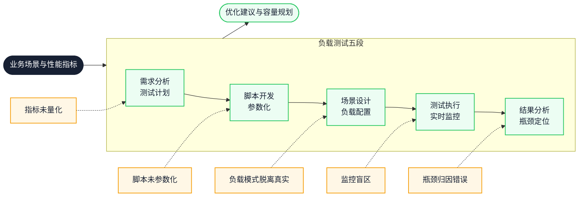
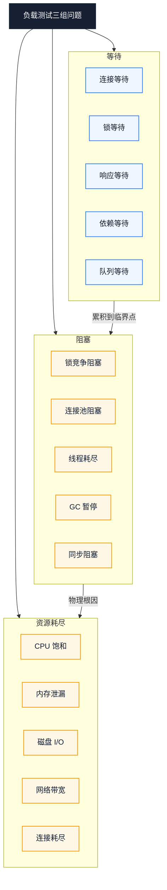
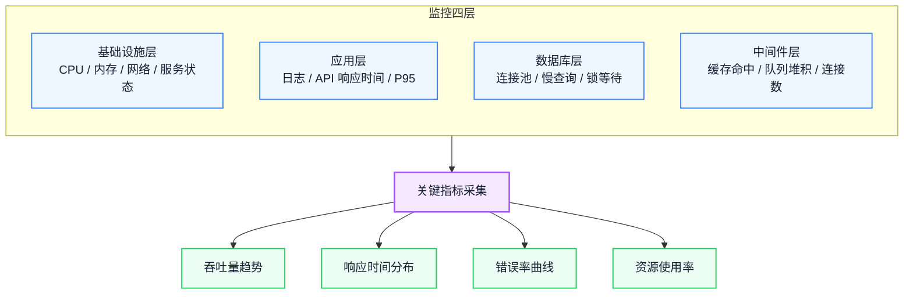
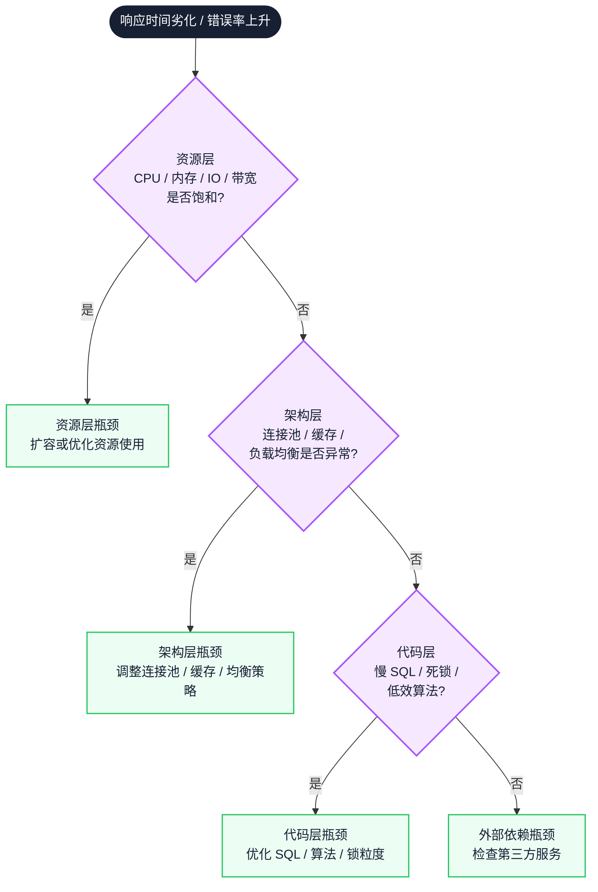

# 负载测试工程实践：从测试计划到瓶颈定位的全流程方法论

一次压测如果只产出"通过"或"不通过"，就无法回答容量、拐点与故障边界。本文把压测当成一次有假设、有对照、可复现的实验：先固定目标与基线，再用参数化脚本和匹配的负载模式施加压力，在监控时间轴上定位最先饱和的资源，最后用复测与回退方案确认结论可重复、可上线。

::: info 一句话
负载测试的本质，是在受控压力下暴露系统在等待、阻塞与资源耗尽上的真实边界。
:::

## 目录

- [写在前面](#写在前面)
- [一、为什么要做负载测试：从技术验证到业务保障](#一、为什么要做负载测试-从技术验证到业务保障)
- [二、负载测试的三组问题：等待、阻塞、资源耗尽](#二、负载测试的三组问题-等待、阻塞、资源耗尽)
- [三、需求分析与测试计划](#三、需求分析与测试计划)
- [四、脚本开发与参数化](#四、脚本开发与参数化)
- [五、场景设计与负载模式](#五、场景设计与负载模式)
- [六、测试执行与实时监控](#六、测试执行与实时监控)
- [七、结果分析与瓶颈定位](#七、结果分析与瓶颈定位)
- [八、关键指标体系：TPS、响应时间与百分位](#八、关键指标体系-tps、响应时间与百分位)
- [九、第三方依赖的压力验证：降级与熔断](#九、第三方依赖的压力验证-降级与熔断)
- [十、负载测试实践清单](#十、负载测试实践清单)
- [结语：负载测试验证的是系统的真实边界](#结语-负载测试验证的是系统的真实边界)
- [FAQ](#faq)
- [来源](#来源)

## 写在前面

很多团队对负载测试的认知停留在"用工具压一下看看扛不扛得住"。这种做法能拿到一个粗略的结论，但回答不了真正关键的问题：

- 系统在多少并发下开始出现响应时间劣化？劣化的拐点在哪？
- 错误率从接近 0 开始上升时，是哪个资源先到达瓶颈？CPU、内存、数据库连接池，还是带宽？
- 当第三方依赖（如外部排队服务）失效时，系统能否承受数倍于日常峰值的流量冲击？是降速还是宕机？
- 增加服务器实例（水平扩展）真的能线性提升吞吐量吗？还是某个共享资源早就成了天花板？

如果一次负载测试结束，只能给出"通过了"或"没通过"的结论，那它几乎没有工程价值。真正的负载测试，是要把系统在压力下的行为拆解清楚：哪里在等待、哪里被阻塞、哪个资源先耗尽。

这条主线可以拆成三组问题：

- **等待**：请求等待连接、事务等待锁、用户等待响应、依赖等待下游。
- **阻塞**：锁竞争阻塞事务、连接池满阻塞请求、线程耗尽阻塞接入、GC 暂停阻塞一切。
- **资源耗尽**：CPU 饱和、内存泄漏、磁盘 I/O 打满、网络带宽见底、数据库连接耗尽。

三组问题会贯穿从计划到归因的每个阶段。下图是从需求分析到瓶颈定位的五段链路，每一段都对应一个可交付产物：



读图时先沿实线看：五段按依赖顺序推进，前一阶段的产物是后一阶段的输入。虚线标出各段最常见的失效点——指标没量化、脚本没参数化、负载脱离真实、监控有盲区、归因跳层；任意一段失效，后一段的结论都不可信。

---

## 一、为什么要做负载测试：从技术验证到业务保障

很多人把负载测试等同于"上线前跑一遍压测脚本"，这是一种窄化的理解。负载测试的实际价值远不止技术验证，它同时承担业务保障与成本优化的职责。

负载测试的核心价值可以归纳为以下几方面：

1. **发现性能瓶颈**：在高并发或高负载场景下，系统可能出现响应延迟、资源耗尽（CPU、内存、数据库连接池满）、请求队列堆积。测试结果是定位代码、SQL 查询、网络带宽或服务器配置瓶颈的优化依据。
2. **验证系统的扩展能力**：水平扩展（Horizontal Scaling）测试系统能否通过增加服务器实例（如增加 Pod 数量）来分担负载；垂直扩展（Vertical Scaling）验证升级硬件资源是否能有效提升性能。
3. **确保用户体验**：保证用户操作（如页面加载、表单提交）在预期时间内完成，避免因系统崩溃或卡顿导致用户流失。
4. **预防业务损失**：避免因系统过载导致服务中断影响声誉，并根据测试结果合理规划服务器资源，平衡性能与成本（容量规划）。
5. **验证第三方依赖**：测试依赖的外部服务（如外部排队服务）在高负载下的表现，模拟第三方故障时系统的降级或熔断机制是否生效——即使外部排队服务失效，系统也应能承受数倍于日常峰值的流量冲击，允许降速但不宕机。
6. **成本优化**：在满足性能需求的前提下选择成本更低的资源配置（服务器数量、数据库规格），避免为应对不切实际的高负载而过度投资硬件或云资源。

区分"验证 SLA"和"寻找边界"两类目标，会直接改变脚本参数、负载模式和验收判据。只想跑一遍脚本、只记录通过与否，两类目标都无法完成。

---

## 二、负载测试的三组问题：等待、阻塞、资源耗尽

要把负载测试从"跑脚本"升级为"工程方法"，需要一个框架来归类观察到的现象。按"等待、阻塞、资源耗尽"分组，可以把零散指标快速映射到瓶颈层次。

### 1. 等待：系统在压力下产生的等待

压力上升后，请求会在多个环节排队等待：

- **连接等待**：数据库连接池满，新请求排队等待可用连接。
- **锁等待**：事务持有行锁或表锁，其他事务等待锁释放。
- **响应等待**：下游服务响应变慢，上游请求等待返回。
- **依赖等待**：第三方服务（如外部排队服务）排队处理，主流程等待其响应。
- **队列等待**：请求队列堆积，新请求等待被消费。

等待的特点是：吞吐量还在增长，但响应时间开始爬升。等待是瓶颈的前兆。

### 2. 阻塞：系统在压力下产生的阻塞

当等待累积到临界点，系统进入阻塞状态：

- **锁竞争阻塞**：大量事务争抢同一行锁，数据库吞吐量骤降。
- **连接池阻塞**：连接池耗尽，新请求被直接拒绝或长时间挂起。
- **线程耗尽阻塞**：Web 容器工作线程打满，无法接入新请求。
- **GC 暂停阻塞**：内存压力触发频繁 Full GC，应用线程被暂停。
- **同步阻塞**：某个慢 SQL 占住连接，整条调用链被拖慢。

阻塞的特点是：吞吐量不再增长甚至下降，错误率开始上升。阻塞是瓶颈的爆发。

### 3. 资源耗尽：系统在压力下的硬性边界

资源耗尽是阻塞的物理根因：

- **CPU 饱和**：CPU 使用率持续 100%，请求处理速度无法提升。
- **内存泄漏**：内存持续增长直至 OOM，进程被重启。
- **磁盘 I/O 瓶颈**：磁盘吞吐打满，所有读写请求变慢。
- **网络带宽见底**：带宽饱和，请求传输延迟剧增。
- **数据库连接耗尽**：连接池配置过小，成为最先到达的瓶颈。



图中向下的箭头表示劣化顺序，而不是三类独立故障：等待先出现，此时吞吐量还在增长；等待累积到临界点变成阻塞；资源耗尽是阻塞背后的物理原因。定位时要从现象往下追一层，而不是停在最先看到的指标上。

三组问题对应的动作也不同：等待优先扩容连接池、异步化、用队列削峰；阻塞优先减小锁粒度、限流降级、拆分长事务；资源耗尽只能垂直扩容、水平扩容或做资源隔离。选错层次，就会出现"改了很多、指标不动"的结果。

---

## 三、需求分析与测试计划

需求分析是负载测试最容易跳过、却又最决定测试价值的一步。没有明确的测试目标，后续所有环节都会失去评判标准。

### 1. 明确测试目标

测试目标必须量化，不能停留在"看看系统扛不扛得住"。典型的量化指标包括：

- **响应时间**：核心接口 P95（95% 百分位，即 95% 的请求不超过该值）不超过 2 秒。
- **吞吐量**：TPS（Transactions Per Second，每秒事务数）达到既定目标。
- **错误率**：错误请求占比低于可接受阈值。
- **并发用户数**：能支持多少并发用户持续操作。

上面的 2 秒是示例，实际阈值（包括错误率）应来自业务 SLA 或历史基线，并在报告中写明出处。

除了指标，还要识别关键业务场景。例如某系统的核心业务流程包含订单提交、数据查询、报表导出、文件上传、批量处理等多类事务，这些就是必须覆盖的测试场景。同时要分析系统架构：服务器、数据库、网络配置等依赖项，明确哪些是测试范围内的影响因素。

### 2. 制定测试计划

测试计划要把目标落到可执行的配置上：

- **负载模型设计**：模拟真实用户行为，覆盖登录、浏览、查询、提交表单等不同操作类型的比例。
- **环境搭建**：隔离测试环境，尽量与生产环境配置一致（硬件规格、网络带宽等）。环境差异是测试结论失真的常见来源。
- **数据准备**：生成测试数据并初始化。包括参数化的用户账号、根据业务表配置好表关联、动态请求参数（如不同用户对应不同业务编号）、测试上传功能所需的静态文件（如 XML 文件）。

```text
// 反例：测试目标模糊
目标：验证系统能扛住大促流量
结论：通过 / 不通过

// 正例：测试目标量化（以下为示例值，不是通用标准）
目标：在 200 并发下，核心接口 P95 ≤ 2s，TPS ≥ 500，错误率 < 1%
拐点定位：找出 TPS 不再增长的并发数
扩展验证：水平扩展后，TPS 是否随实例数同步增长
```

### 3. 建立基线

没有基线，压测结果只能与主观预期比较。基线至少包含三项：上一版本在同一环境、同一脚本下的 TPS 与 P95；当前生产在常态流量下的资源水位；单实例的容量上限。

基线要与正式测试使用同一套脚本、同一数据规模和同一监控口径，否则差异无法归因。如果测试环境无法对齐生产，就把结论降级为"同环境下的版本对比"，不要外推成生产容量的绝对值。

---

## 四、脚本开发与参数化

脚本是把测试计划转化为可执行压测的载体。一个没有参数化的脚本，相当于让一批虚拟用户共用同一个账号登录、提交同一条数据，这种测试既不能暴露并发问题，也无法反映真实流量。

### 1. 录制用户操作

使用 JMeter 录制 HTTP/API 请求，生成基础脚本。录制时要聚焦关键操作：登录、表单提交、数据查询等高频行为，过滤掉静态资源请求（CSS、JS、图片），避免脚本冗余。

### 2. 脚本增强

录制出来的脚本只是骨架，必须经过四步增强才能用于真实压测：

- **参数化**：把静态数据替换为动态变量（如用户名、密码），支持多用户并发。典型做法是从 CSV 文件读取数据，每个虚拟用户分配不同账号。
- **关联处理**：提取服务器返回的动态值并传递给后续请求。最常见的是 Session ID / Token：登录接口返回的 Token 必须提取出来，作为后续接口的请求头。
- **检查点与断言**：验证响应内容是否正确。不能只看 HTTP 状态码 200，要检查返回的 JSON 字段（如 `code === 0`、`data.userId` 存在），否则系统返回错误页面但状态码 200 时会漏判。
- **思考时间与集合点**：模拟真实用户操作间隔（思考时间），在关键事务前设置集合点（Rendezvous），让多个用户同时发起请求以模拟峰值。

```text
// 反例：单用户脚本直接并发
所有虚拟用户使用同一账号 <账号>/<密码>
提交同一个业务编号
不提取 Token，每个请求都重新登录

// 正例：参数化 + 关联 + 断言
从 CSV 读取与并发数匹配的多组账号
每个用户提交自己的业务编号（参数化）
登录后提取 Token，后续请求复用（关联）
断言返回 JSON 的 code 字段为 0（检查点）
```

### 3. 调试与验证

参数化完成后，先用单用户回放脚本，确保功能正确性，排查脚本逻辑或数据问题。单用户通过后再逐步加并发，验证参数化数据是否被正确分配、关联是否生效、断言是否触发。

脚本的验收标准不是"能跑通"，而是单用户回放通过、参数化数据不重复、断言能在错误响应上真正失败。

---

## 五、场景设计与负载模式

场景设计决定了"用什么方式压"。同样的脚本，不同的负载模式会暴露完全不同的问题。

### 1. 配置负载模式

两种基础负载模式对应不同的测试目的：

- **恒定负载（Constant Load）**：固定并发用户数（示例：40 个虚拟用户持续加压）。用于验证系统在持续压力下的稳定性，观察是否出现内存泄漏、连接泄漏等渐进性问题。
- **递增负载（Ramp-up）**：逐步增加用户数（示例：每 20 秒增加 10 个用户）。用于寻找系统的性能拐点——TPS 不再增长、响应时间开始劣化的并发数。

实际测试通常组合使用：先递增找拐点，再恒定验证稳定性。还可以加入峰值负载（瞬间大量并发）和浪涌负载（周期性波动）来模拟大促、秒杀等极端场景。

### 2. 资源监控配置

负载模式确定后，要同步配置资源监控，否则测试结束后无法做瓶颈归因。监控覆盖四个层次：

- **基础设施层（OCP / Grafana Infra）**：CPU、内存、Network Traffic、Service Status。
- **应用层**：应用日志监控、API 各项指标（Response Time、P95）。
- **数据库层**：数据库连接池状态、慢查询、锁等待。
- **中间件层**：缓存命中率、消息队列堆积、连接数。



四层监控的价值在于能在同一时间轴上相互印证：应用层 P95 抬升时，向下看数据库连接池与锁等待，向上看 CPU 与带宽，才能判断问题是等待、阻塞还是资源耗尽。

监控不是测试后的补充材料。没有同一时间轴的资源数据，压测报告只能描述现象，无法完成归因。

::: info 工程启示

OCP（OpenShift Container Platform）和 Grafana 是云原生环境下常用的监控组合。OCP 提供容器级资源监控，Grafana 负责指标可视化与告警。两者配合可以做到"测试一结束，数据立即可查"。

:::

---

## 六、测试执行与实时监控

执行阶段不是"点开始然后等结果"，而是要实时观察系统表现，及时识别异常，避免无效测试浪费时间。

### 1. 预热阶段（Warm-up）

正式测试前以低负载运行一段时间，避免冷启动影响数据准确性。常见做法是 3 至 5 分钟，具体时长看 JIT 编译、缓存填充和连接池何时趋于稳定。冷启动期间的响应时间偏高，直接计入结果会拉高整体均值。

### 2. 正式执行

按场景配置执行测试，重点关注：

- **TPS 与响应时间趋势**：观察是否在预期范围内，是否出现骤降或抖动。
- **错误率**：一旦错误率超过约定阈值，要立即记录发生时间点，便于后续与监控数据对齐分析。
- **异常处理**：设置失败重试机制或动态调整负载策略。例如用户登录失败或 API 请求失败时，跳出当前循环或采取其他处理方式，避免一个失败请求引发连锁失败污染数据。

### 3. 实时监控

通过仪表盘（Grafana Dashboard）实时观察关键指标：

- CPU、内存、Network Traffic、Service Status
- 数据库连接池状态
- API 各项指标（Response Time、P95）

实时监控的价值在于"边测边查"：当发现响应时间突然劣化时，可以立即查看同一时间点的 CPU、连接池、锁等待数据，快速锁定瓶颈层次。如果等测试结束才看监控，时间点对不齐，归因就困难得多。

执行阶段真正要保存的是时间轴：每次负载调整、错误突增、GC 或连接池打满的时间点，都要能和监控对齐。这份时间轴是后续归因的原始证据。

---

## 七、结果分析与瓶颈定位

结果分析是负载测试价值变现的关键环节。同样的测试数据，分析方法不同，得出的结论可能完全相反。

### 1. 生成报告

报告要汇总以下核心数据：

- **平均响应时间**：反映整体水平，但容易被长尾拉高，不能单独使用。
- **P95 响应时间**：反映绝大多数用户的真实体验，比平均值更有参考价值。
- **吞吐量（TPS）**：反映系统处理能力，关注趋势而非瞬时值。
- **错误类型分布**：按错误码或错误类型分类统计，定位问题方向。

图表分析要重点关注两组相关性：

- **并发用户数与响应时间的相关性**：找出响应时间开始劣化的拐点。
- **资源使用率趋势**：在拐点处，哪个资源先到达瓶颈。

### 2. 瓶颈诊断

瓶颈诊断要分层进行，避免"看到 CPU 高就优化代码"的跳跃式归因：



从顶部开始逐层排除，每个"否"分支都表示当前层不是主因。把最容易量化的资源层放在最前，是为了先排除容量问题，减少一上来就改代码的跳跃归因。

三个层次的典型瓶颈：

- **代码层**（一般由后端工程师排查优化）：慢 SQL 查询、死锁、低效算法。通过 APM 工具定位，开源方案如 Prometheus + Grafana 做监控指标与可视化。
- **架构层**：数据库连接池不足、缓存失效、负载均衡策略不合理。
- **资源层**：CPU 过载、内存泄漏、磁盘 I/O 瓶颈、网络带宽瓶颈。

::: tip 分层顺序的边界

分层顺序不是重要性排序。资源层容易量化，通常先排除；但连接池、线程池这类架构参数会伪装成资源不足，需要用"改一个参数再复测"来区分，而不是靠指标猜。

:::

### 3. 验证判据与复测

归因结论必须能被复测验证。常用做法是做单变量对照：只调整被怀疑的资源（例如把连接池容量提高一倍），在同一脚本、同一负载模式下重跑。若拐点后移、P95 回落，归因成立；若指标不变，说明瓶颈在别处。

复测还要排除数据与缓存的影响。两轮运行应使用同等规模的数据、相同的缓存预热方式，并记录运行时长，避免把"第二轮更快"误判为优化生效。

---

## 八、关键指标体系：TPS、响应时间与百分位

指标体系是负载测试的"语言"。同样的测试结果，用不同的指标描述，结论可能完全不同。

### 1. TPS（Transactions Per Second）

TPS 是系统每秒处理的事务数，反映系统的处理能力。这里的"事务"由测试脚本定义，可能是一次接口调用，也可能是一组有业务含义的请求，报告中要写清口径。关注 TPS 时要注意：

- **TPS 趋势比瞬时值更重要**：递增负载下，TPS 先线性增长、后趋于平缓、最后下降，这个拐点就是系统的最大处理能力。
- **TPS 不增长不代表没瓶颈**：可能是连接池打满、可能是锁竞争，需要结合资源监控判断。

### 2. 响应时间与百分位

百分位（Percentile）描述一组请求在分布中的位置：P95 表示 95% 的请求耗时不超过该值。响应时间要看分布，不能只看平均值：

- **平均值（Average）**：整体水平，容易被长尾拉高。
- **中位数（P50）**：一半用户的体验基线。
- **95% 百分位（P95）**：95% 用户的体验上限，常用于核心 SLA。
- **99% 百分位（P99）**：长尾用户体验，反映系统稳定性。

核心接口常把"P95 不超过 2 秒"这类阈值写进 SLA，具体数值取决于业务对延迟的容忍度，不是通用标准。

### 3. 错误率

错误率要按类型分类统计：

- **HTTP 5xx**：服务器错误，通常是资源耗尽或代码异常。
- **HTTP 4xx**：客户端错误，可能是参数化数据问题或鉴权失败。
- **业务错误**：HTTP 200 但业务 code 非 0，需要断言才能发现。
- **超时**：请求未在预期时间内返回，通常是响应等待累积的结果。

```text
// 反例：只看平均值下结论
平均响应时间正常，TPS 达到目标，结论：性能良好

// 正例：看分布、趋势与相关性下结论
P50 正常，但 P95 超过目标，P99 继续抬升
TPS 随并发增加先上升，随后停止增长并回落
错误率在同一并发区间由接近 0 升至不可接受
结合连接池监控，确认拐点处连接池最先打满
结论：拐点出现在 TPS 停止增长的并发区间，瓶颈为数据库连接池
```

指标要服务于验收判据：SLA 看 P95 / P99，容量规划看 TPS 拐点，排障看错误类型分布与资源水位。三者混用时，容易把"均值正常"误当成"系统健康"。

---

## 九、第三方依赖的压力验证：降级与熔断

现代系统很少独立运行，几乎都依赖第三方服务。第三方依赖的压力验证是负载测试中容易被忽略、却最影响线上稳定性的环节。

### 1. 依赖稳定性测试

测试依赖的外部服务（如外部排队服务）在高负载下的表现：

- 第三方服务自身能承受多少流量？
- 第三方服务响应变慢时，主系统的调用链是否会被拖垮？
- 第三方服务限流或熔断时，主系统是否能正确感知并降级？

### 2. 故障注入与降级验证

模拟第三方服务故障，验证系统的降级或熔断机制是否生效：

- **断路器（Circuit Breaker）**：当第三方连续失败达到阈值，断路器是否跳闸，直接返回降级响应？
- **超时控制**：调用第三方是否设置了合理超时？超时后是否释放连接，避免连接被长时间占用？
- **降级策略**：第三方不可用时，系统是否切换到降级逻辑（如返回缓存数据、跳过非核心步骤）？

核心验证目标：就算外部排队服务失效，系统也能承受数倍于日常峰值的流量冲击，允许降速但不宕机。

```text
// 反例：无超时无降级
调用外部排队服务不设超时
外部排队服务变慢 → 主系统连接被占满 → 全站不可用

// 正例：超时 + 熔断 + 降级（阈值按下游 SLA 调整）
调用外部排队服务设置与 SLA 匹配的超时（示例 2s）
连续失败达到阈值后触发熔断，直接走降级逻辑
降级逻辑返回本地排队或友好提示
系统在外部排队服务宕机时仍能服务核心流程
```

### 3. 压测的代价与回退

压测本身有代价。写入型场景会产生脏数据，需要独立账号、可标记的数据或独立测试库；在共享环境加压会挤占其他团队的资源，通常要约定时间窗并提前通知。故障注入还可能在真实依赖上触发限流或计费，应优先在挡板或预发环境执行。

方案也要留回退：临时扩容在测试结束后回收，连接池、超时、熔断阈值等配置改动通过开关或配置中心灰度，确认指标回落后再固化为新基线。没有回退路径的压测，会把一次验证变成一次生产变更。

---

## 十、负载测试实践清单

### 1. 目标与基线

- [ ] 写出可验收的目标：核心接口 P95、目标 TPS、可接受错误率，并注明来源（SLA 或历史基线）
- [ ] 用同一脚本、同一数据规模记录上一版本或单实例的 TPS、P95 与资源水位
- [ ] 列出本次覆盖的关键事务，标注每类事务的流量占比
- [ ] 记录测试环境与生产的差异（实例规格、数据量、网络链路），并写进报告

### 2. 脚本与数据

- [ ] 从 CSV 或数据库为每个虚拟用户分配独立账号与业务编号
- [ ] 登录后提取 Token 并在后续请求中复用
- [ ] 对返回 JSON 的业务 code 和关键字段加断言，不只判断 HTTP 200
- [ ] 设置思考时间与集合点，并记录配置值
- [ ] 单用户回放通过后，用小并发验证数据分配与断言触发

### 3. 场景与监控

- [ ] 递增负载记录每个阶梯的并发数、TPS、P95 和错误率
- [ ] 恒定负载持续到覆盖一次完整的缓存或 GC 周期，观察是否渐进劣化
- [ ] 监控覆盖 CPU、内存、网络、连接池、慢查询、锁等待和队列堆积
- [ ] 压测开始前校准压测机与监控系统的时间

### 4. 执行与记录

- [ ] 预热至 JIT、缓存和连接池稳定后再开始计时
- [ ] 记录每次负载调整、错误突增和资源告警的时间点
- [ ] 失败请求设置重试上限或跳出逻辑，避免连锁失败污染样本
- [ ] 保留原始结果文件（JTL / CSV）与监控快照

### 5. 分析与复测

- [ ] 报告同时给出 P50、P95、P99、TPS 趋势和错误类型分布
- [ ] 在 TPS 停止增长且 P95 抬升的区间标注拐点
- [ ] 对归因结论做单变量复测：只改一个参数，确认拐点或 P95 变化
- [ ] 复测使用与首轮相同的数据规模和缓存预热方式
- [ ] 结论写成"在什么环境、什么负载下、哪个资源先饱和"

### 6. 稳定性与容量

- [ ] 注入下游延迟或失败，确认熔断、超时与降级按预期生效
- [ ] 记录降级期间核心接口的 P95 与错误率，确认仍在可接受范围
- [ ] 水平扩容后复测 TPS，判断是否线性增长及共享资源是否成为上限
- [ ] 给出回退方案：临时扩容何时回收、配置改动如何回滚

---

## 结语：负载测试验证的是系统的真实边界

负载测试的价值不在报告首页的"通过"，而在它留下的三样东西：可复用的脚本与数据、一条能对齐的时间轴、一个能被复测的瓶颈结论。把每次压测的目标、基线和环境差异写清楚，下一次容量决策才有可比对象。

下一步不必急着扩大并发。先挑一个核心接口，用现有脚本补上基线、递增负载和一次单变量复测；当你能解释"TPS 为什么在这个并发点不再增长"，这套方法就已经落地。

---

## FAQ

### 1. 负载测试和压力测试（Stress Test）有什么区别？

负载测试验证系统在预期负载下能否满足 SLA；压力测试则把负载持续加到系统崩溃，观察极限边界与恢复能力。前者回答"能不能扛住"，后者回答"什么时候扛不住、扛不住会怎样"。两者常组合使用：先验证 SLA，再定位极限。

### 2. 测试环境与生产不一致，结论还能用吗？

要看结论的类型。同环境内的版本对比、拐点位置、瓶颈层次通常仍然成立；把测试环境的 TPS 直接换算成生产容量则不可靠。做法是把结论限定在"同环境、同数据规模下"，并单独列出实例规格、数据量、网络链路的差异，让读者知道哪些结论不能外推。

### 3. TPS 达到目标但 P95 超标，算通过吗？

不算。TPS、P95 和错误率分别描述处理能力、用户体验和正确性，任何一个不达标都不能算通过。实际判读时要看三者是否在同一时间窗内达标：TPS 达标但 P95 抬升，通常意味着系统已经进入等待累积阶段，只是还没有转化为错误。

### 4. 递增负载的阶梯和单阶时长怎么定？

阶梯以每阶都能稳定观察到 TPS 与 P95 为准，通常不少于三阶；单阶时长要覆盖一次完整的缓存与 GC 周期，指标抖动大时延长单阶，而不是加密阶梯。阶梯的起点取日常峰值的较低比例，终点要越过预期拐点，否则测不出边界。

---

## 来源

1. Apache JMeter 官方用户手册：

   [https://jmeter.apache.org/usermanual/index.html](https://jmeter.apache.org/usermanual/index.html)

2. Grafana 官方监控文档：

   [https://grafana.com/docs/](https://grafana.com/docs/)

3. OpenShift Container Platform 监控文档：

   [https://docs.openshift.com/container-platform/latest/observability/monitoring/monitoring-overview.html](https://docs.openshift.com/container-platform/latest/observability/monitoring/monitoring-overview.html)

4. Google SRE Book - 处理过载与容量规划：

   [https://sre.google/sre-book/handling-overload/](https://sre.google/sre-book/handling-overload/)
