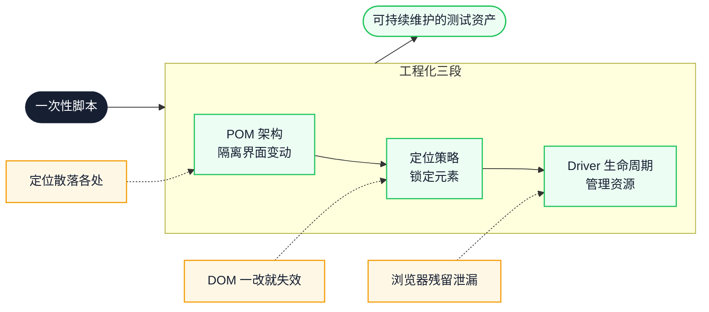
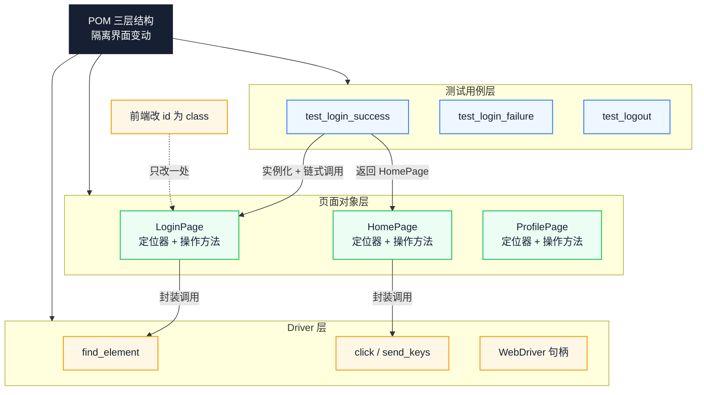
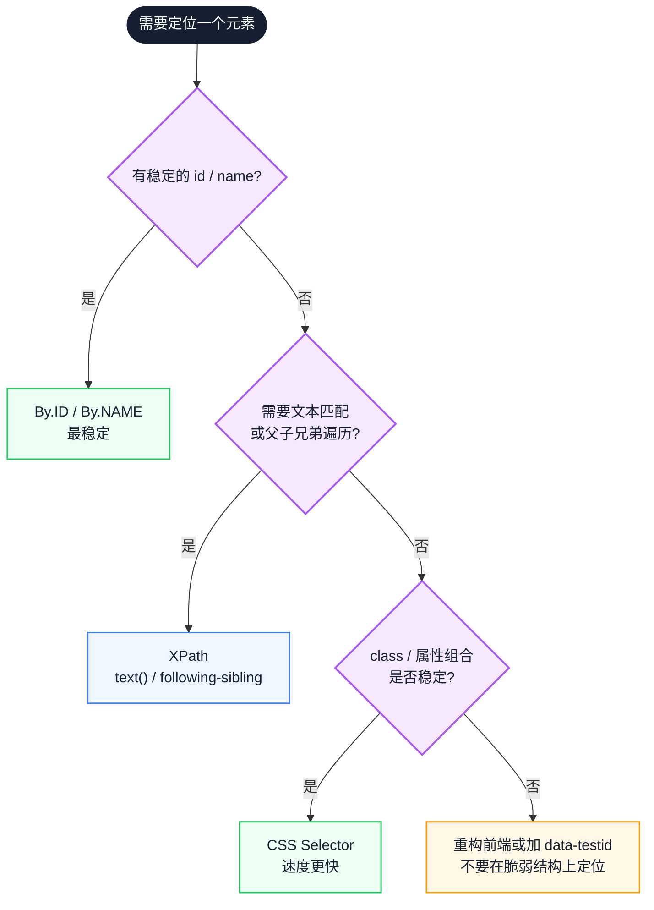
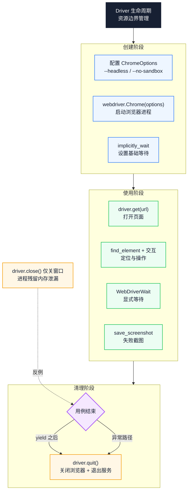

# Python 自动化测试核心概念：从 POM 架构到元素定位与 Driver 工程

前端改一个 `id`，几十条用例同时失败；CI 跑一晚，后台残留几十个浏览器进程。这些症状说明测试代码缺少稳定的边界。本文从页面结构、元素查询和浏览器进程三个层面拆解问题，给出可复用的类结构、定位器约定与 fixture 写法，并说明如何用维护耗时、失败率和进程数验证改造效果。

::: info 一句话
Python 自动化测试的工程化本质，是通过页面对象模型（POM）隔离界面变动、用精准定位策略锁定元素、以 Driver 生命周期管理资源，将一次性脚本变为可持续维护的测试资产。
:::

## 目录

- [写在前面](#写在前面)
- [一、为什么 Python 自动化测试需要工程化：从一次性脚本到测试资产](#一、为什么-python-自动化测试需要工程化-从一次性脚本到测试资产)
- [二、POM 架构：用 Python 类隔离界面变动](#二、pom-架构-用-python-类隔离界面变动)
- [三、POM 的工程化要点：链式调用、组件化与 pytest fixture](#三、pom-的工程化要点-链式调用、组件化与-pytest-fixture)
- [四、定位策略：XPath 与 CSS Selector 的取舍](#四、定位策略-xpath-与-css-selector-的取舍)
- [五、定位器设计：稳定性与可维护性](#五、定位器设计-稳定性与可维护性)
- [六、Driver 工程化：生命周期、等待与资源管理](#六、driver-工程化-生命周期、等待与资源管理)
- [七、Driver 与 POM 的协作模式](#七、driver-与-pom-的协作模式)
- [八、改造验证与回退边界](#八、改造验证与回退边界)
- [九、Python 自动化测试实践清单](#九、python-自动化测试实践清单)
- [结语：从脚本到资产的三块基石](#结语-从脚本到资产的三块基石)
- [FAQ](#faq)
- [来源](#来源)

## 写在前面

很多团队对 Python 自动化测试的认知停留在"用 Selenium 写一段脚本能跑通就行"。这种做法能拿到一个粗略的回归结论，但回答不了真正关键的问题：

- 前端把 `id="username"` 改成 `name="username"` 后，几十条用例同时报错，要在哪里改？
- 同一个按钮既可以用 CSS Selector 又可以用 XPath，到底该用哪个？为什么有的定位一改 DOM 就失效？
- 测试跑完浏览器进程还残留在后台，CI 机器内存越跑越满，问题出在哪里？
- 自动化用例增长到几百条后，每次执行都要十几分钟，是测试本身慢还是 Driver 复用出了问题？

如果一篇自动化测试笔记只能给出"POM 是封装页面的类""XPath 比 CSS 慢""driver 要 quit"这种结论，那它几乎没有工程价值。真正可维护的 Python 自动化测试，要把三件事拆清楚：界面变动如何被隔离、元素如何被稳定锁定、浏览器资源如何被生命周期管理。

POM（Page Object Model，页面对象模型）约束代码结构；定位器（Locator）是描述"如何找到元素"的查询条件，约束查询方式；Driver 是 WebDriver 协议的客户端对象，约束进程生命周期。

这三件事构成了一条主线：**POM 是架构基座、定位是精度工具、Driver 是资源边界**。下图展示了三者如何协作把脚本变成资产：



实线是改造顺序，虚线是每一段对应的典型故障。三者不是并列工具，而是同一份测试代码的三个边界：页面对象约束变动范围，定位器约束查询方式，fixture 约束进程生命周期。

---

## 一、为什么 Python 自动化测试需要工程化：从一次性脚本到测试资产

很多人把 Python 自动化测试等同于"用 Selenium 写几段 `find_element` 跑通登录流程"。这是一种窄化的理解。当用例从十几条增长到几百条、当 UI 迭代从月一次变成日一次、当 CI 需要并行跑几百个浏览器实例时，没有工程化的脚本会迅速退化为维护噩梦。

Python 自动化测试的工程化价值可以归纳为以下几方面：

1. **隔离界面变动**：前端把 `id` 改为 `name`、把 `input` 换成 `div + contenteditable`，工程化的测试只需修改一处定位器，所有用例零变动。
2. **稳定锁定元素**：动态列表、异步加载、影子 DOM 等场景下，定位器的设计直接决定用例的稳定性。工程化的测试用稳定语义而非脆弱结构定位元素。
3. **资源生命周期可控**：浏览器进程的创建、复用、销毁由 fixture 统一管理，避免 CI 机器内存泄漏、避免并行测试相互污染。
4. **复用与组合**：公共头部、底部、弹窗等可抽成 `Component` 类，通过组合方式引入页面对象，符合 Python 的"组合优于继承"理念。
5. **可读性接近自然语言**：测试用例只与页面对象交互，代码读起来像 `LoginPage(driver).enter_username("test_user").click_login()`，阅读门槛明显降低。
6. **与 pytest 生态集成**：driver 通过 fixture 注入，页面对象之间通过返回值传递，类型提示让 IDE 补全链式调用。

判断是否需要工程化，不看用例条数，而看三件事是否开始互相牵制：定位器散落在用例里、同一元素被多种方式查询、driver 的创建散落在用例中。出现任意两项，继续堆脚本的维护成本就会超过改造成本。

### 3. 改造前先记录基线

工程化是否有效，要用改造前的数据对比。至少记录四项：用例总数与整体通过率、近期执行中不稳定用例的比例、完整套件的执行时长、一次 CI 运行后残留的浏览器进程数。

数据不需要精确到毫秒，但要在同一 CI 环境、同一浏览器版本下采集，否则改造后的差异无法归因。

---

## 二、POM 架构：用 Python 类隔离界面变动

第一个要建立的概念是 POM。它的核心是把每一个网页或独立区块封装成一个 Python 类，让测试用例只与页面对象交互，不直接触碰底层 driver 和元素定位细节。

### 1. 没有 POM 的脚本：定位散落各处

在 Python 的 Selenium 自动化初期，测试脚本往往直接操作底层 driver。以下示例基于 Selenium 4.x（`By` 定位 API）与 pytest，省略了浏览器驱动安装步骤：

```python
# 反例：定位散落在用例各处，界面一变就要改几十条用例
from selenium.webdriver.common.by import By


def test_login_success(driver):
    driver.find_element(By.ID, "username").send_keys("test_user")
    driver.find_element(By.ID, "password").send_keys("<PASSWORD>")
    driver.find_element(By.ID, "loginBtn").click()
    assert driver.find_element(By.ID, "welcome").text == "欢迎回来"
```

这种方式会让元素定位散落在各处，界面一有变动就要修改大量用例。当前端把 `id="loginBtn"` 改成 `class="btn-submit"` 时，所有引用 `loginBtn` 的用例都会同时失败。

### 2. POM 的本质：三类映射

**页面对象模型**将每一个网页（或独立区块）封装成一个 **Python 类**，建立三类映射：

- 页面上的元素 → 类的属性（定位器元组）
- 页面提供的操作 → 类的方法
- 操作后的跳转 → 方法返回下一个页面对象（链式调用）

测试用例只与页面对象交互，完全不触碰底层 driver 和元素定位细节。这样界面变动的影响被限制在单个类内部。

```python
# 正例：POM 封装后，定位器集中管理，界面变动只改一处
from selenium.webdriver.common.by import By
from selenium.webdriver.remote.webdriver import WebDriver


class LoginPage:
    """登录页面对象"""

    # 元素定位器集中管理
    _username = (By.ID, "username")
    _password = (By.ID, "password")
    _login_btn = (By.ID, "loginBtn")
    _error_msg = (By.CLASS_NAME, "error")

    def __init__(self, driver: WebDriver):
        self.driver = driver

    def enter_username(self, username: str) -> "LoginPage":
        self.driver.find_element(*self._username).send_keys(username)
        return self  # 返回自身，支持链式调用

    def enter_password(self, password: str) -> "LoginPage":
        self.driver.find_element(*self._password).send_keys(password)
        return self

    def click_login(self) -> "HomePage":
        self.driver.find_element(*self._login_btn).click()
        return HomePage(self.driver)  # 跳转到首页

    def click_login_expecting_failure(self) -> "LoginPage":
        self.driver.find_element(*self._login_btn).click()
        return self  # 仍停留在登录页

    def get_error_message(self) -> str:
        return self.driver.find_element(*self._error_msg).text


class HomePage:
    """首页对象"""

    def __init__(self, driver: WebDriver):
        self.driver = driver
        self._welcome = (By.ID, "welcome")

    def get_welcome_message(self) -> str:
        return self.driver.find_element(*self._welcome).text
```

### 3. 测试用例层：从命令式到声明式

POM 封装完成后，测试用例层只与页面对象交互，代码从"命令式操作 driver"变成"声明式描述业务流程"：

```python
# 正例：用例只描述业务流程，不触碰 driver 与定位
def test_login_success(driver):
    login_page = LoginPage(driver)
    home_page = (
        login_page.enter_username("test_user")
        .enter_password("<PASSWORD>")
        .click_login()
    )
    assert home_page.get_welcome_message() == "欢迎回来"
```

当前端把 `id="loginBtn"` 改成 `class="btn-submit"` 时，只需要修改 `LoginPage` 中的 `self._login_btn` 一处，所有用例零变动。这就是 POM 隔离界面变动的核心价值。

下图展示了 POM 的三层结构与数据流方向：



从上往下看：用例层只依赖页面对象，页面对象依赖 driver 的定位与交互 API。图中的虚线是变化来源——前端改动只应影响页面对象层，一旦它穿到用例层，说明封装漏了。

POM 的边界也可以反过来检查：页面对象里出现 `assert`，说明它同时承担了页面建模和测试验证两个职责，复用性会下降。

---

## 三、POM 的工程化要点：链式调用、组件化与 pytest fixture

把 POM 写成一个 Python 类只是起点。要在工程化项目中真正发挥价值，还需要解决三个问题：链式调用如何让用例可读、复用组件如何避免重复、driver 生命周期如何与 pytest fixture 解耦。

### 1. 链式调用与方法返回值

POM 的方法返回值决定了用例的可读性。一个好的实践是：**操作方法返回自身以支持链式调用，跳转方法返回下一个页面对象**。这样用例代码读起来像自然语言：

```python
# 正例：链式调用让用例接近自然语言
home_page = (
    LoginPage(driver)
    .enter_username("test_user")
    .enter_password("<PASSWORD>")
    .click_login()
)
```

类型提示 `-> "LoginPage"` 和 `-> "HomePage"` 让 IDE 能在链式调用时补全下一级方法，也方便静态检查工具发现跳转链断裂。

```python
# 反例：方法返回 None，链式调用断裂，用例变成命令式堆叠
login_page = LoginPage(driver)
login_page.enter_username("test_user")
login_page.enter_password("<PASSWORD>")
home_page = login_page.click_login()
```

### 2. 组件化：组合优于继承

复杂页面中往往有公共区块（顶部导航、底部链接、用户菜单、表格、弹窗）。把这些区块抽成 `Component` 类，通过组合方式引入页面对象，符合 Python 的"组合优于继承"理念。以下片段省略了 `import` 和 `LoginPage` 的定义：

```python
# 正例：复用组件通过组合引入，符合"组合优于继承"
class HeaderComponent:
    """公共头部组件"""

    def __init__(self, driver: WebDriver):
        self.driver = driver
        self._user_menu = (By.ID, "userMenu")
        self._logout_btn = (By.ID, "logout")

    def open_user_menu(self) -> "HeaderComponent":
        self.driver.find_element(*self._user_menu).click()
        return self

    def click_logout(self) -> "LoginPage":
        self.driver.find_element(*self._logout_btn).click()
        return LoginPage(self.driver)


class HomePage:
    """首页对象，组合 Header 组件"""

    def __init__(self, driver: WebDriver):
        self.driver = driver
        self.header = HeaderComponent(driver)  # 组合而非继承
        self._welcome = (By.ID, "welcome")

    def get_welcome_message(self) -> str:
        return self.driver.find_element(*self._welcome).text
```

### 3. 页面对象不包含断言

页面对象只提供服务，不包含断言。状态查询用 `@property` 暴露，断言留在测试用例层：

```python
# 反例：页面对象包含断言，复用性下降
class LoginPage:
    def login_and_assert_success(self, username, password):
        self.driver.find_element(*self._login_btn).click()
        assert "欢迎" in self.driver.title  # 断言耦合在页面对象内


# 正例：页面对象只提供服务，断言留在用例
class LoginPage:
    @property
    def error_message(self) -> str:
        return self.driver.find_element(*self._error_msg).text

    def click_login_expecting_failure(self) -> "LoginPage":
        self.driver.find_element(*self._login_btn).click()
        return self


def test_login_failure(driver):
    page = LoginPage(driver).enter_username("bad").enter_password("bad").click_login_expecting_failure()
    assert "用户名或密码错误" in page.error_message
```

### 4. 与 pytest fixture 解耦

driver 的生命周期由 pytest fixture 管理，页面对象通过构造函数接收 driver。这样用例、页面对象、driver 三层完全解耦：

```python
# 正例：driver 由 fixture 注入，页面对象在用例中实例化
def test_login_success(driver):
    home_page = LoginPage(driver).enter_username("test_user").enter_password("<PASSWORD>").click_login()
    assert home_page.get_welcome_message() == "欢迎回来"
```

页面对象也可以直接作为更高级的 fixture，进一步减少用例样板代码：

```python
# 正例：把页面对象也封装成 fixture，用例更聚焦
import pytest


@pytest.fixture
def login_page(driver):
    return LoginPage(driver)


def test_login_success(login_page):
    home_page = login_page.enter_username("test_user").enter_password("<PASSWORD>").click_login()
    assert home_page.get_welcome_message() == "欢迎回来"
```

这一层的验收标准很具体：用例里不出现 `find_element`，页面对象里不出现 `assert`，fixture 里出现 `quit()`。三者任一不满足，说明职责边界还没有真正划开。

---

## 四、定位策略：XPath 与 CSS Selector 的取舍

POM 解决了"界面变动如何隔离"的问题，但定位器本身的设计决定了"元素能否被稳定锁定"。Python Selenium 提供了多种定位方式（ID、CLASS_NAME、NAME、TAG_NAME、XPath、CSS Selector），其中 XPath 与 CSS Selector 是功能最强、也最容易误用的两种。

### 1. XPath：双向遍历与文本匹配

XPath 是通过路径表达式在 XML/HTML 中查找节点的语言。它的核心优势是支持双向遍历（父子兄弟）、文本匹配、丰富的函数：

```python
from selenium.webdriver.common.by import By

# 通过文本定位（CSS Selector 做不到）
driver.find_element(By.XPATH, "//button[text()='登录']")

# 通过部分属性
driver.find_element(By.XPATH, "//input[contains(@class, 'user')]")

# 兄弟节点遍历（CSS Selector 做不到）
driver.find_element(By.XPATH, "//label[text()='密码']/following-sibling::input")

# 父子双向遍历
driver.find_element(By.XPATH, "//span[@class='icon']/parent::button")
```

XPath 的代价是性能：复杂路径表达式需要遍历 DOM 树，通常比浏览器原生 CSS 引擎慢，差距随表达式复杂度放大。

### 2. CSS Selector：速度与简洁

CSS Selector 是样式表中选择 HTML 元素的模式，用于定位元素。它的优势是速度快、语法简洁、与前端开发一致；不支持原生文本匹配是它的主要局限：

```python
driver.find_element(By.CSS_SELECTOR, "#username")
driver.find_element(By.CSS_SELECTOR, "input[name='password']")
driver.find_element(By.CSS_SELECTOR, "button.submit:first-child")
driver.find_element(By.CSS_SELECTOR, "form.login > button[type='submit']")
```

### 3. 对比与选择策略

| 特性        | XPath              | CSS Selector           |
| ----------- | ------------------ | ---------------------- |
| 遍历方向    | 双向（父子、兄弟） | 单向（仅向下）         |
| 文本定位    | 支持               | 不支持                 |
| 性能        | 较慢（复杂路径）   | 更快，浏览器原生优化   |
| 函数/运算符 | 丰富               | 较少（依赖属性与伪类） |
| 前端共识    | 测试专属           | 与前端开发一致         |

**选择策略**：优先 CSS Selector（ID、Class、属性），遇到文本匹配或复杂 DOM 关系时用 XPath。

下图展示了定位策略的决策路径：



决策顺序是：先找唯一标识，再判断是否需要文本或结构遍历，最后才考虑属性组合。走到最右分支时，正确动作是改前端可测试性，而不是把更复杂的表达式写进测试。

定位策略的上限由前端可测试性决定。没有稳定锚点时，换 XPath 或 CSS 都不会让用例变稳，先补 `data-testid` 比优化表达式更有效。

---

## 五、定位器设计：稳定性与可维护性

定位策略选完之后，真正决定用例稳定性的是定位器的设计。同一个元素往往有多种定位方式，选哪种决定了"用例能跑多久不被前端改动打断"。

### 1. 优先级：id > name > data-testid > class > 结构

定位器的优先级应该遵循"稳定性递减"原则：

- **id**：全页面唯一，最稳定，前端基本不会随意改 id。
- **name**：表单元素常见，稳定性仅次于 id。
- **data-testid**：测试专用属性，前端明确知道它是为测试服务的，不会随意改动。
- **class**：要区分语义类（如 `.login-form`）和样式类（如 `.btn-primary`、`.mt-4`），前者相对稳定，后者会随样式重构频繁变化。
- **复杂结构**：如 `div > ul > li:nth-child(3) > a`，依赖绝对位置和层级，最脆弱。

```python
# 反例：依赖绝对位置和样式类，前端一改就失效
_login_btn = (By.CSS_SELECTOR, "div:nth-child(2) > form > button.btn-primary.mt-4")

# 正例：用稳定的 id 或 data-testid
_login_btn = (By.ID, "loginBtn")
_password = (By.CSS_SELECTOR, "input[data-testid='password-input']")
```

### 2. 推动前端加 data-testid

当既没有稳定 id 也没有稳定 name 时，不要在脆弱的 class 或结构上玩定位技巧，而是推动前端加 `data-testid` 属性。`data-testid` 是测试专用属性，前端明确知道它是为测试服务的，重构样式时不会动它：

```html
<!-- 前端代码 -->
<button data-testid="submit-login">登录</button>
```

```python
# 测试代码
_login_btn = (By.CSS_SELECTOR, "[data-testid='submit-login']")
```

### 3. 定位器集中管理

定位器应该作为类属性集中管理，而不是散落在方法内部。这样前端改 id 时只需修改一处：

```python
# 反例：定位器散落在方法内
class LoginPage:
    def enter_username(self, username):
        self.driver.find_element(By.ID, "username").send_keys(username)

    def get_error(self):
        return self.driver.find_element(By.CLASS_NAME, "error").text


# 正例：定位器作为类属性集中管理
class LoginPage:
    _username = (By.ID, "username")
    _error_msg = (By.CLASS_NAME, "error")

    def enter_username(self, username):
        self.driver.find_element(*self._username).send_keys(username)

    def get_error(self):
        return self.driver.find_element(*self._error_msg).text
```

### 4. 避免绝对 XPath

绝对 XPath（如 `/html/body/div[2]/form/button[1]`）是定位器设计的反面教材。它依赖从根节点开始的完整路径，任何一层 DOM 改动都会让它失效。应该用相对 XPath（以 `//` 开头）配合稳定的锚点：

```python
# 反例：绝对 XPath，任何一层 DOM 改动都失效
_submit = (By.XPATH, "/html/body/div[2]/form/div[3]/button[1]")

# 正例：相对 XPath + 稳定文本锚点
_submit = (By.XPATH, "//button[text()='提交']")
```

定位器评审可以用一个简单判据：把 DOM 层级或样式类名替换掉，这个定位器还能不能找到同一个元素？不能，就说明它依赖了不该依赖的结构。

---

## 六、Driver 工程化：生命周期、等待与资源管理

POM 解决了架构问题，定位器解决了精度问题，剩下的核心问题是资源问题——浏览器进程的创建、复用、销毁如何被生命周期管理。Driver 工程化做得不好，CI 机器会越跑越慢、并行测试会相互污染、用例执行时间会不可控地膨胀。

### 1. Driver 是什么

WebDriver 是 W3C 定义的浏览器远程控制协议；在 Python Selenium 中，`driver` 是 `webdriver.Chrome()`（或其他浏览器）创建的**客户端对象**，负责按协议向浏览器发送指令，可以把它理解成遥控器：

```python
from selenium import webdriver
from selenium.webdriver.common.by import By

driver = webdriver.Chrome()   # 启动 Chrome 浏览器
driver.get("https://example.com")
driver.find_element(By.ID, "kw").send_keys("Python")
driver.quit()
```

driver 的核心功能覆盖五个方面：

- 控制浏览器窗口：`driver.maximize_window()`, `driver.back()`, `driver.forward()`
- 元素定位与交互：`driver.find_element(By.ID, "id")`
- 脚本执行：`driver.execute_script("return document.title")`
- 等待：`driver.implicitly_wait(10)`（更推荐使用显式等待）
- 截图：`driver.save_screenshot("screen.png")`

### 2. 生命周期管理：pytest fixture 统一收口

在 Python 测试中，driver 的生命周期必须由 pytest fixture 统一管理，确保资源释放。fixture 的 `yield` 之前是创建逻辑，之后是清理逻辑，即使用例抛异常也能保证 `quit()` 被执行：

```python
# 反例：在用例里手动创建和销毁 driver，异常时容易泄漏
def test_login():
    driver = webdriver.Chrome()
    driver.get("https://example.com")
    assert "Example" in driver.title
    driver.quit()  # 如果 assert 抛异常，这行不会执行


# 正例：driver 由 fixture 统一管理，yield 之后必执行
# conftest.py
import pytest
from selenium import webdriver


@pytest.fixture(scope="function")  # 每个测试函数一个 driver，保证隔离性
def driver():
    options = webdriver.ChromeOptions()
    options.add_argument("--headless")  # 无头模式，CI 常用
    options.add_argument("--no-sandbox")
    options.add_argument("--disable-dev-shm-usage")
    drv = webdriver.Chrome(options=options)
    yield drv
    drv.quit()  # 测试结束后彻底关闭，即使用例抛异常也会执行
```

### 3. 作用域选择：function / class / session

fixture 的 `scope` 参数决定了 driver 的复用粒度：

- **`function`**（默认推荐）：每个测试函数一个 driver，完全隔离。用例之间无状态污染，但启动开销最大。
- **`class`**：类内所有用例共享一个 driver，适合一组相关用例共享登录态。要注意用例之间不能互相污染状态。
- **`session`**：全局共享一个 driver，慎用。一旦某个用例让浏览器进入异常状态，后续所有用例都会失败。

```python
# 反例：session 作用域下用例间状态污染
@pytest.fixture(scope="session")
def driver():
    drv = webdriver.Chrome()
    yield drv
    drv.quit()

# 测试用例 A 登录后没退出 → 用例 B 一开始就是已登录状态 → 用例 B 假设未登录，断言失败


# 正例：function 作用域隔离每个用例
@pytest.fixture(scope="function")
def driver():
    drv = webdriver.Chrome()
    yield drv
    drv.quit()
```

### 4. 等待策略：显式等待优先于隐式等待

driver 的等待策略是用例稳定性的关键。隐式等待全局生效但条件粗糙（只等元素出现），显式等待可以定制条件（等元素可见、可点击、包含特定文本）：

```python
# 反例：全局隐式等待 + sleep 硬等待
import time

driver.implicitly_wait(10)
time.sleep(3)  # 不可控，CI 上拖慢执行


# 正例：显式等待定制条件
from selenium.webdriver.support.ui import WebDriverWait
from selenium.webdriver.support import expected_conditions as EC


def wait_for_login_button(driver, timeout=10):
    WebDriverWait(driver, timeout).until(
        EC.element_to_be_clickable((By.ID, "loginBtn"))
    )
```

显式等待应该封装在页面对象内部，测试用例完全不用关心等待逻辑：

```python
class LoginPage:
    def __init__(self, driver: WebDriver):
        self.driver = driver
        self._login_btn = (By.ID, "loginBtn")
        self._wait = WebDriverWait(driver, 10)

    def click_login(self) -> "HomePage":
        button = self._wait.until(EC.element_to_be_clickable(self._login_btn))
        button.click()
        return HomePage(self.driver)
```

### 5. quit 与 close 的区别

这是面试常问、工程中也常错的点：

- **`driver.quit()`**：关闭整个浏览器并退出驱动服务，释放所有资源。
- **`driver.close()`**：仅关闭当前窗口，浏览器进程和驱动服务仍在运行。

```python
# 反例：用 close 代替 quit，浏览器进程残留
@pytest.fixture
def driver():
    drv = webdriver.Chrome()
    yield drv
    drv.close()  # 浏览器进程仍在后台，CI 长跑会持续占用内存


# 正例：用 quit 彻底清理
@pytest.fixture
def driver():
    drv = webdriver.Chrome()
    yield drv
    drv.quit()  # 关闭浏览器 + 退出驱动服务，彻底释放
```

下图展示了 Driver 从创建到销毁的完整生命周期：



从上到下是 driver 的一生：创建、使用、清理。关键在清理分支——无论正常结束还是异常，都应汇入 `quit()`；`close()` 只关闭窗口，进程和驱动服务还在。

::: warning 资源泄漏的边界

在 CI 上用 `close()` 代替 `quit()`，退出的是窗口，不是浏览器进程和驱动服务。一次任务跑几百条用例后，残留进程会持续占用内存与端口，最终让节点不可用。

:::

---

## 七、Driver 与 POM 的协作模式

POM 与 Driver 不是两个孤立的概念，而是通过构造函数注入的方式协作。理解这种协作模式，才能避免"在页面对象里直接 `webdriver.Chrome()`"或"在用例里直接操作 driver"这两种典型反模式。

### 1. 注入模式：driver 通过构造函数传递

页面对象通过构造函数接收 driver，不自己创建 driver。这样 driver 的生命周期由 fixture 统一管理，页面对象只负责使用：

```python
# 反例：页面对象自己创建 driver，生命周期失控
class LoginPage:
    def __init__(self):
        self.driver = webdriver.Chrome()  # 谁来 quit？无法管控

    def login(self, username, password):
        # ...
        pass


# 正例：driver 通过构造函数注入，生命周期由 fixture 管控
class LoginPage:
    def __init__(self, driver: WebDriver):
        self.driver = driver  # 只使用，不创建

    def login(self, username, password) -> "HomePage":
        # ...
        return HomePage(self.driver)  # 跳转时把 driver 传递给下一个页面对象
```

### 2. 跳转链：driver 在页面对象之间传递

POM 的跳转方法返回下一个页面对象时，会把同一个 driver 实例传递过去。这样一次测试会话内只使用一个 driver，从 `LoginPage` 到 `HomePage` 到 `ProfilePage` 形成一条跳转链：

```python
# 正例：driver 在页面对象跳转链中传递
def test_user_flow(driver):
    home_page = LoginPage(driver).enter_username("test_user").enter_password("<PASSWORD>").click_login()
    profile_page = home_page.open_profile()
    profile_page.update_nickname("new_name")
    assert profile_page.get_nickname() == "new_name"
```

整个流程只使用一个 driver 实例，由 fixture 在用例结束时统一 quit。

### 3. 并行测试：每个进程独立 driver

使用 `pytest-xdist` 并行执行时，每个工作进程有自己的 driver 实例，无需额外处理线程安全：

```python
# 正例：pytest-xdist 并行，每个进程独立 driver
# 命令：pytest -n 4  (4 个工作进程并行)
@pytest.fixture(scope="function")
def driver():
    drv = webdriver.Chrome()
    yield drv
    drv.quit()
```

但要注意：如果多个用例操作同一份数据（如都改同一个用户的状态），并行执行会产生数据竞争。解决方法是数据隔离——每个用例用独立的测试账号。

### 4. RemoteWebDriver：分布式执行

连接 Selenium Grid 或云测平台（如 BrowserStack、Sauce Labs）实现分布式执行，只需把 `webdriver.Chrome()` 换成 `webdriver.Remote()`：

```python
# 正例：连接 Selenium Grid 分布式执行
@pytest.fixture
def driver():
    options = webdriver.ChromeOptions()
    drv = webdriver.Remote(
        command_executor="http://<GRID_HOST>:4444",
        options=options,
    )
    yield drv
    drv.quit()
```

这种模式下 driver 仍然由 fixture 管理，用例和页面对象的代码完全不变。这是 POM + fixture 架构的可扩展性体现。

这套协作方式的检验点只有一个：用例和页面对象都不创建 driver。只要 `webdriver.Chrome()` 或 `webdriver.Remote()` 出现在 fixture 之外，生命周期就已经失控。

---

## 八、改造验证与回退边界

### 1. 用基线验证

改造是否值得，不能靠代码看起来更整齐来判断。用改造前记录的基线对比四个信号：定位器变更时改动的文件数、完整套件的执行时长、不稳定用例的比例、一次 CI 运行后的残留进程数。

如果改一个 `id` 仍要动多条用例，说明定位器还在用例层；如果执行时间没有下降，先检查 driver 是否每条用例都重启；如果不稳定比例上升，优先排查等待条件与数据隔离。

### 2. 代价：多一层间接调用

POM 会增加一层间接调用，页面对象过多时，简单用例也要多跳几层；页面对象与业务流程耦合过深时，换一个入口就要改多个类。用例规模很小、页面结构还在剧烈变化时，可以先只做定位器集中管理，等结构稳定再抽页面对象。

### 3. 回退：保留边界，缩小范围

回退不是推翻重来。保留 fixture 与定位器约定，把页面对象合并回少量类即可恢复；若并行化导致数据竞争，先退回串行或按账号分片，而不是继续加进程。

---

## 九、Python 自动化测试实践清单

### 1. 架构与基线

- [ ] 改造前记录用例总数、通过率、不稳定用例比例、套件时长、CI 残留进程数
- [ ] 每个页面或独立区块对应一个 Page Object，类名与页面职责一致
- [ ] 定位器作为类属性集中管理，方法内不出现字面量定位表达式
- [ ] 操作方法返回自身，跳转方法返回下一个页面对象
- [ ] 页面对象中不出现 `assert`，断言只写在用例层
- [ ] 公共区块抽成 Component 并通过组合引入

### 2. 定位器

- [ ] 优先 id / name / data-testid，其次语义 class，最后才用结构选择器
- [ ] 默认 CSS Selector，需要文本匹配或兄弟、父级遍历时用 XPath
- [ ] XPath 以 `//` 开头，不使用 `/html/body/...` 绝对路径
- [ ] 不依赖 nth-child、层级序号或样式类名定位
- [ ] 每个定位器都通过"删掉样式类后仍能找到同一元素"的检查
- [ ] 没有稳定锚点时提交前端加 data-testid，而不是继续写复杂表达式

### 3. Driver 生命周期

- [ ] driver 只在 fixture 中创建，用例与页面对象只接收注入
- [ ] fixture 使用 yield，清理段调用 `driver.quit()`
- [ ] 默认 function 作用域；class / session 仅在确认无状态污染时使用
- [ ] CI 启动参数包含 `--headless` / `--no-sandbox` / `--disable-dev-shm-usage`
- [ ] 一次 CI 运行结束后，浏览器进程数与开始时一致
- [ ] 失败用例通过 `save_screenshot` 保留现场

### 4. 等待策略

- [ ] 只用显式等待（WebDriverWait + expected_conditions）
- [ ] 等待条件与业务状态一致（可点击、可见、文本出现）
- [ ] 显式等待封装在页面对象内，用例层不出现 `WebDriverWait`
- [ ] 代码中不出现 `time.sleep`，确需固定等待时注明原因
- [ ] 不混用隐式等待与显式等待

### 5. 用例与数据

- [ ] 用例只调用页面对象方法，不直接调用 `find_element`
- [ ] 每个用例使用独立账号或独立业务数据
- [ ] 用例可单独执行，不依赖前一条用例留下的状态
- [ ] 断言覆盖业务结果，不只断言页面跳转成功
- [ ] 用例失败时输出当前 URL、关键元素文本与截图

### 6. 并行与分布式

- [ ] pytest-xdist 并行时，每个进程独立创建 driver
- [ ] 并行用例按账号或数据分片，避免写同一份数据
- [ ] 接入 Selenium Grid 或云平台时只替换 driver 创建方式
- [ ] 浏览器与 driver 版本在本地和 CI 保持一致
- [ ] 并行前后对比套件时长与不稳定用例比例，确认收益不是靠重试换来的

---

## 结语：从脚本到资产的三块基石

把 POM、定位器和 Driver 放在一起看，会发现它们解决的是同一类问题：把变化限制在可预期的位置。页面对象限制界面变化的影响范围，定位器限制 DOM 变化的影响方式，fixture 限制进程生命周期的影响边界。

下一步可以从一个最常失败的用例开始：把它的定位器收进页面对象，补上显式等待，确认 fixture 会 quit，再记录改造前后的失败率与执行时间。三块基石不需要一次搭完，但每加一层都要能用数据说明它减少了哪一种维护成本。

---

## FAQ

### 1. POM 一定要用 Python 类实现吗？用函数封装不行吗？

函数封装能解决"定位器散落"的问题，但无法表达"页面跳转链"。POM 的核心价值之一是方法返回下一个页面对象，形成 `LoginPage → HomePage → ProfilePage` 的链式调用，这需要类来承载状态（driver）和行为（操作 + 跳转）。组件复用（如 HeaderComponent 通过组合引入多个页面）也依赖类的组合能力。

### 2. XPath 真的比 CSS Selector 慢吗？

在多数现代浏览器中，CSS Selector 由原生 CSS 引擎处理，XPath 由单独的引擎处理，前者通常更快。差距取决于表达式复杂度：简单的 `//button[@id='login']` 与 CSS 接近，多层轴遍历或文本匹配可能慢出数倍。功能测试的单次定位通常在毫秒级，性能差异一般不是瓶颈；只有批量定位大量元素时才需要认真比较。

### 3. 页面对象里要不要缓存 WebElement？

不建议长期缓存 `find_element` 的结果。DOM 重新渲染后，旧的 WebElement 引用会抛出 `StaleElementReferenceException`；缓存定位器元组、每次操作重新查找，反而更稳。只有在确认元素在用例生命周期内不会重建时，缓存才有意义。

### 4. 自动化用例增长到几百条后执行很慢，先查什么？

先确认 driver 的创建次数：每条用例都启动浏览器时，启动开销通常占大头，可把强相关用例合并到 class 作用域。再查等待：大量 `time.sleep` 或过长的超时会直接拉长套件。然后才考虑 pytest-xdist 并行，并行前先保证数据隔离。最后看流程复用：重复的登录、导航步骤能否抽成 fixture。

---

## 来源

1. Selenium 官方文档 - Page Objects 模式：

   [https://www.selenium.dev/documentation/test_practices/encouraged/page_object_models/](https://www.selenium.dev/documentation/test_practices/encouraged/page_object_models/)

2. Selenium 官方文档 - Waits 等待策略：

   [https://www.selenium.dev/documentation/webdriver/waits/](https://www.selenium.dev/documentation/webdriver/waits/)

3. pytest 官方文档 - Fixtures：

   [https://docs.pytest.org/en/stable/explanation/fixtures.html](https://docs.pytest.org/en/stable/explanation/fixtures.html)

4. Martin Fowler - PageObject 模式原文：

   [https://martinfowler.com/bliki/PageObject.html](https://martinfowler.com/bliki/PageObject.html)

5. MDN Web Docs - CSS Selectors：

   [https://developer.mozilla.org/zh-CN/docs/Web/CSS/CSS_selectors](https://developer.mozilla.org/zh-CN/docs/Web/CSS/CSS_selectors)

6. MDN Web Docs - XPath 文档：

   [https://developer.mozilla.org/zh-CN/docs/Web/XPath](https://developer.mozilla.org/zh-CN/docs/Web/XPath)

7. pytest-xdist 分布式执行插件：

   [https://pytest-xdist.readthedocs.io/en/stable/](https://pytest-xdist.readthedocs.io/en/stable/)
